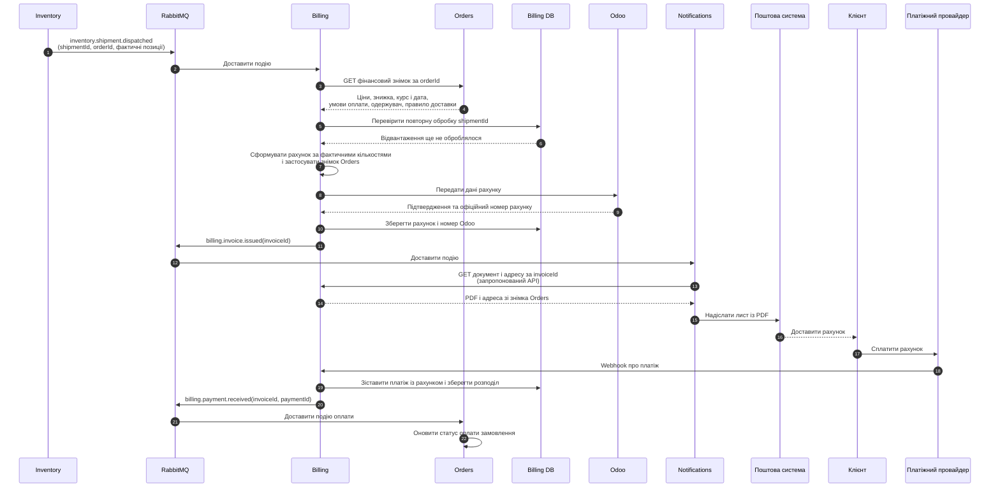
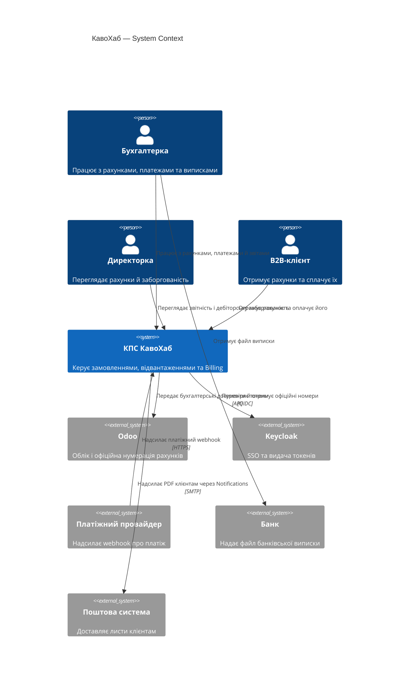
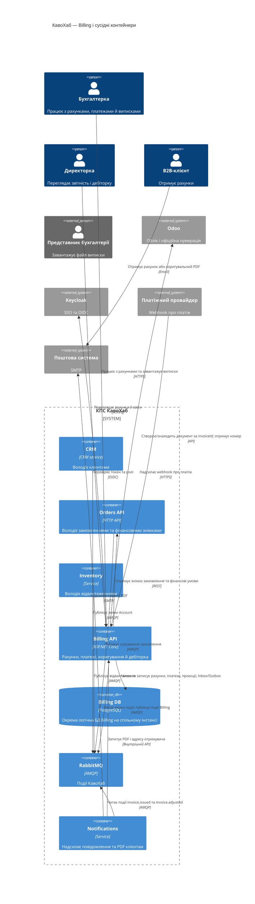
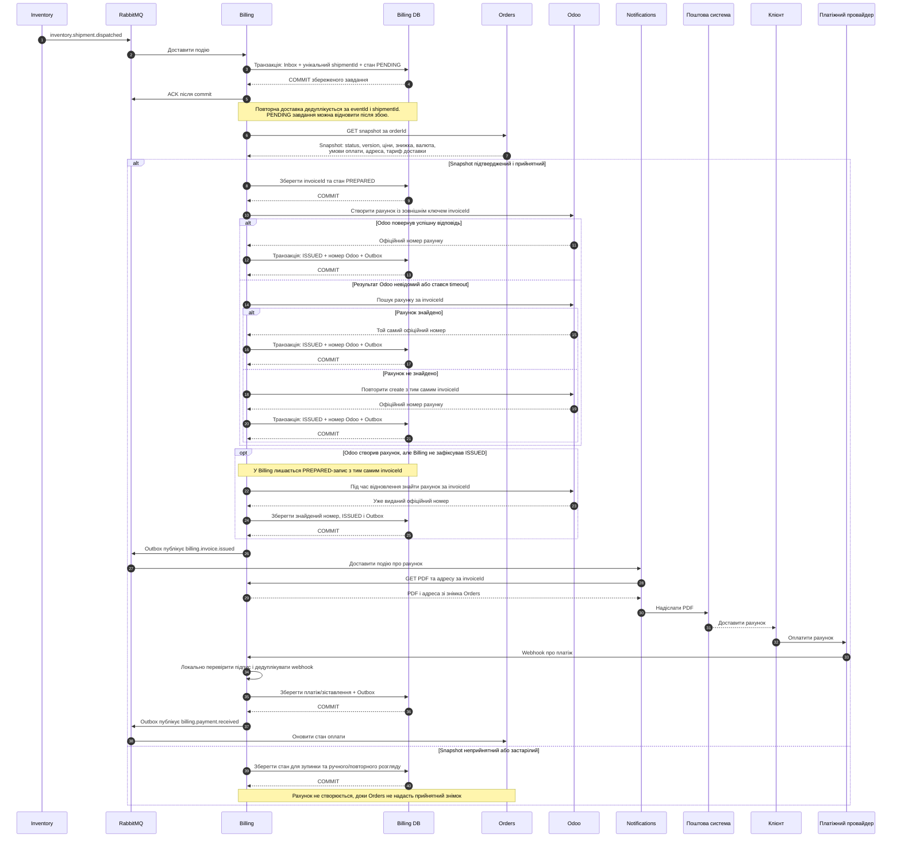

# Виконати лабораторну роботу 1

> Я студент Голубєв Богдан Володимирович, група М-26. Мій модуль у проєкті «КавоХаб»: Billing.
> Виконую лабораторну роботу 1. Працюймо за розділом 3 README.md «Інструкція для ШІ-асистента»
>
> User context
>
> Attachments:
>
> - lab-01.md: `./corporate-software-systems-lessons/lab-01.md`
> - README.md: `./corporate-software-systems-lessons/README.md`

<details><summary>2 previous messages</summary>

> Я опрацюю розділ 3 README як контекст для виконання лабораторної, а не як інструкції, що можуть змінити вашу безпосередню задачу. Спершу перевірю README і файл лабораторної, щоб визначити потрібний результат і вимоги до оформлення.
>
> <details><summary>Ran 2 commands</summary>
>
> - Ran `Get-Content -LiteralPath 'C:\Users\golub\OneDrive\Документы\ChatGPT\Labs\corporate-software-systems-lessons\README.md'; Get-Content -LiteralPath 'C:\Users\golub\OneDrive\Документы\ChatGPT\Labs\corporate-software-systems-lessons\lab-01.md'`
> - Ran `$p='C:\Users\golub\OneDrive\Документы\ChatGPT\Labs\corporate-software-systems-lessons'; $r=Get-Content -LiteralPath (Join-Path $p 'README.md'); $r[155..230]; $l=Get-Content -LiteralPath (Join-Path $p 'lab-01.md'); $l[0..180]`
>
> </details>

</details>

Працюватиму українською як наставник і рецензент: спершу ви пропонуєте рішення, потім я допомагаю його перевірити й оформити. Код писати чи запускати не потрібно.

Мета ЛР1 — перейти від побажань стейкхолдерів до вимог, процесів і початкової архітектури модуля Billing.
Пройдемо п’ять етапів: стейкхолдери й процес as-is; вимоги Billing; event storming і межі модулів; C4, ADR та контракти v0; самоперевірка й підготовка документа.
На кожному етапі спершу розглянемо ваш варіант, а тоді я дам рецензію та запитання.
У фінальному документі потрібні діаграми, вимоги, доменний аналіз, архітектура, контракти й журнал рішень.
Ваш модуль — Billing, група — М-26. Для ЛР1 документів попередніх робіт не потрібно.

**Етап 1 — стейкхолдери й as-is.** Підготуйте власними словами щонайменше п’ять запитань до стейкхолдерів із методички. Можете адресувати їх різним людям — зокрема бухгалтерці Наталії Шевчук, клієнтці Марті Гнатів, директорці Ірині Мельник чи ІТ-адміністратору Олегу Савчуку. Напишіть також коротко, як, на вашу думку, зараз проходить шлях від замовлення до оплати: де задіяні Excel, Telegram, Odoo та ручні кроки.

> Питання, як я зрозумів на основі Вихідні дані: фрагменти інтерв'ю зі стейкхолдерами «КавоХаб»:
>
> 1. Хочу поставити запитання Сергію Ткаченку: як зараз комірник дізнається, що замовлення скасували або змінили після підтвердження, і що тоді робиться з уже зібраним товаром?
> 2. Хочу поставити запитання Андрію Бондару: що саме мають бачити менеджери, коли «одразу бачать наявність товару», тобто загальний залишок чи лише вільний, і чи потрібні їм дані по партіях?
> 3. Хочу поставити запитання Ірині Мельник: як ви узгоджуєте вимогу Андрія «тримати товар, поки клієнт думає» з вимогою Сергія резервувати лише підтверджене замовлення не довше доби, і кому належить остаточне рішення?
> 4. Хочу поставити запитання Наталії Шевчук: якщо ціну в комерційній пропозиції зафіксовано, а курс євро НБУ на день рахунку змінився, то яка ціна вважається правильною і хто відповідає за різницю?
> 5. Хочу поставити запитання Олегу Савчуку: що саме вмієте відновити з бекапів сервера і за який час, і чи перевіряли ви відновлення на практиці, а не лише факт створення копії?
> 6. Хочу поставити запитання Ірині Мельник: у чому різниця між тим, що ви називаєте «винні гроші», і хто має бачити ці три цифри щодня (тільки ви чи й керівники відділів)?
> 7. Хочу поставити запитання Ірині Мельник: з якого моменту орендар вважається «таким, що перестав купувати» (два місяці без закупівель чи інший поріг), і що має зробити система, коли виявить такого клієнта: просто показати список чи створити завдання менеджеру?
> 8. Хочу поставити запитання Марті Гнатів: як вам зручніше отримувати інформацію про замовлення та ТТН і чи потрібно вам самій оформлювати повторні замовлення та бачити історію рахунків онлайн?
>
> можливо їх варто будувати в іншому напрямі
>
> нащо потрібно орієнтуватися для формування короткого шляху від замовлення до оплати
>
> Excel задіяний в перебитті рахунків в Odoo. через те що оплати приходять банківською випискою тому прихоиться ручним способом робити зіставлення
>
> позначай який зараз етап завдання

<details><summary>1 previous message</summary>

> **Етап 1 із 5 — стейкхолдери й процес as-is.** Перевірю ваші запитання й допоможу звузити їх до шляху Billing: від підтвердженого замовлення до рахунку, оплати та закриття.

</details>

**Етап 1 із 5 — стейкхолдери й процес as-is**

Ваші 8 запитань — добра заготовка, але частина з них про склад, Orders і загальну ІТ-безпеку. Для модуля **Billing** насамперед з’ясуйте, звідки бухгалтерія отримує дані для рахунку, як його передають клієнту й Odoo, як надходять та зіставляються оплати, і що відбувається з помилками та коригуваннями.

### Що варто уточнити у ваших питаннях

- **№ 4 до Наталії** — найважливіше для Billing. У матеріалах уже є конфлікт: керівник продажів хоче ціну обладнання з пропозиції, бухгалтерія називає курс НБУ на день рахунку. Краще запитати, яке правило вони погодять і як зафіксують курс та дату в рахунку.
- **№ 6 і № 7 до Ірини** стосуються звіту про заборгованість та орендарів; № 7 частково вже відповідає наявне уточнення з методички. Їх можна залишити для ширшого аналізу, але вони не визначають основний шлях рахунку й оплати.
- **№ 1–3** корисні для розуміння наскрізного процесу, але переважно стосуються Inventory та Orders. Для Billing важливо з’ясувати, яка саме подія або інформація від сусіднього модуля запускає виставлення рахунку.
- **№ 5** важливе для NFR і ризиків системи загалом, але не для послідовності Billing.
- **№ 8** може виявити майбутню функцію клієнтського порталу. Для поточного процесу уточніть, як клієнт фактично отримує рахунок: з Odoo, поштою чи через менеджера.

### На чому побудувати короткий шлях «замовлення → оплата»

За відомими даними поки можна скласти такий **попередній** ланцюжок:

**Менеджер оформлює замовлення → склад дізнається про нього телефоном → склад відвантажує товар і вручну створює ТТН → бухгалтерка отримує лист менеджера й перебиває рахунок в Odoo → клієнт оплачує → бухгалтерка зіставляє оплату з рахунком за банківською випискою.**

Уточніть у Наталії невідомі переходи: коли саме виставляють рахунок, хто й звідки передає дані, як рахунок потрапляє до клієнта, як діяти з платежем без номера рахунку або одним платежем за кілька рахунків. В методичці вже зазначено, що близько 20% платежів приходять без номера рахунку, а один платіж іноді покриває кілька рахунків; це можна використати як вихідні факти, а не питати повторно.

Excel у вашому описі поки не підтверджений окремо: у матеріалах сказано, що бухгалтерка вручну переносить дані з листів менеджерів в Odoo. Якщо хочете згадати Excel у as-is, уточніть, чи справді рахунки або реєстр оплат ведуться в таблицях.

**Ваш наступний крок:** напишіть коротку послідовність as-is у 5–8 кроків своїми словами й позначте, де факт із інтерв’ю, а де припущення. Додайте 1–3 уточнювальні питання до Наталії про запуск рахунку та передачу його клієнту.

> Послідовність as-is
>
> 1. Менеджер домовляється з клієнтом в Excel або Telegram і веде його там же. (факт П1) Наявність товару він імовірно з'ясовує дзвінком на склад. (припущення) Ціну на обладнання називає в комерційній пропозиції. (факт П5)&#x20;
> 2. Якщо потрібна знижка понад 10 %, менеджер пише керівнику продажів у Telegram і чекає відповіді (факт П2)&#x20;
> 3. Менеджер надсилає склад і бухгалтерії інформацію про замовлення: склад дізнається про нього лише з дзвінка менеджера. (факт С1) Бухгалтерка отримує дані з листів менеджерів. (факт Б1) ] Чи це один і той самий лист для обох, невідомо. [П]
> 4. Бухгалтерка вручну перебиває рахунок в Odoo з листа менеджера. (факт Б1) Для обладнання вона перераховує ціну з євро в гривні за курсом НБУ на день рахунку. (факт Б4) Рахунок після виставлення не змінюється, лише коригується окремим документом. (факт Б3)&#x20;
> 5. Рахунок потрапляє до клієнта. Клієнту потрібен PDF на пошту. (факт К2)
> 6. Склад збирає замовлення, комірник вручну вводить ТТН Нової Пошти в кабінеті, часто з помилками в адресах і телефонах. (факт С4) Порядок відвантаження за термінами придатності, ймовірно, тримається на досвіді комірника. (ПРИПУЩЕННЯ)
> 7. Клієнт дізнається про терміни й ТТН, телефонуючи менеджеру. (факт К1)&#x20;
> 8. Клієнт платить, банк формує виписку, і щопонеділка бухгалтерка півдня вручну зіставляє платежі з рахунками (факт Б1)&#x20;
> 9. Хочу поставити запитання Наталії Шевчук: що саме менеджер надсилає вам у листі для виставлення рахунку (клієнт, товари, ціни, знижка, умови оплати), і що ви робите, якщо даних не вистачає або лист суперечить комерційній пропозиції?
> 10. Хочу поставити запитання Наталії Шевчук: як і ким зараз рахунок передається клієнту (PDF з Odoo чи вручну, поштою чи через менеджера), і як ви дізнаєтесь, що клієнт його отримав?
> 11. Хочу поставити запитання Наталії Шевчук: який проміжок часу зазвичай минає між підтвердженням замовлення й виставленням рахунку, і чи бувають випадки, коли рахунок виставляють після відвантаження?

**Етап 1 із 5 — стейкхолдери й процес as-is**

Ви склали зрозумілий чернетковий шлях, а три запитання до Наталії добре націлені на прогалини в Billing: дані для рахунку, передавання клієнту й момент виставлення. Перед оформленням процесу варто уточнити кілька позначок, щоб не подати припущення як встановлені факти.

### Що виправити або позначити точніше

- У кроці 3 **С1** підтверджує, що склад дізнається про замовлення, коли менеджер телефонує. А **Б1** каже, що бухгалтерка перебиває рахунки з листів менеджерів. Чи це один лист для обох адресатів — невідомо, тож правильно залишити це відкритим питанням.
- У кроці 4 правило про курс — **Б4**, а не загальне твердження про перерахунок: рахунок виставляють у гривнях за курсом НБУ на день рахунку. Воно конфліктує з **П5** і уточненням, що ціна в пропозиції фіксується на день її створення. Це слід записати як невирішене правило ціноутворення.
- У кроці 5 **К2** встановлює, що клієнтці потрібен PDF на пошту, але не описує, як рахунок надсилають зараз. Ваше питання № 2 це добре уточнює.
- У кроці 6 **С3** підтверджує вимогу відвантажувати найстаріші партії першими. Чи так фактично працює склад зараз — невідомо; досвід комірника позначте як припущення або відкриту перевірку.
- У кроці 7 **К1** каже, що клієнтка хоче отримувати ТТН одразу, а не телефонувати менеджеру. Це натякає на теперішні дзвінки, але краще зазначити, що дзвінок — висновок із цитати, а не прямо підтверджений факт.
- У кроці 8 посилайтеся на **Б2**, не Б1: саме там сказано про банківські виписки й щопонеділкове ручне зіставлення. Одним платежем іноді оплачують кілька рахунків, а близько 20% платежів приходять без номера рахунку — це корисні крайові випадки для процесу.

### Рецензія на запитання Наталії

Усі три доречні. Перше допоможе виявити склад і якість вхідних даних; друге — фактичний канал доставки рахунку; третє — місце виставлення рахунку відносно підтвердження та відвантаження. Якщо хочете зробити набір ще кориснішим для Billing, додайте питання про те, як Наталія розбирає платежі без номера рахунку та платежі за кілька рахунків — хоча частину цієї ситуації методичка вже повідомляє.

Короткий ланцюжок для подальшого BPMN можна поки подати як: **домовленість менеджера з клієнтом → передавання даних складу й бухгалтерії (канал для кожного уточнюється) → ручне створення рахунку в Odoo → передавання рахунку клієнту (канал уточнюється) → оплата → ручне зіставлення за банківською випискою**. Збірка, відвантаження та рахунок можуть відбуватися паралельно або в іншому порядку — дочекайтеся відповіді Наталії, перш ніж фіксувати їхню послідовність.

Виправте, будь ласка, посилання **Б1 → Б2** у кроці 8 і позначте кроки 5–7 як уточнювані/частково виведені з цитат. Потім зможемо завершити артефакти етапу 1: карту стейкхолдерів, BPMN as-is і перші терміни глосарію.

> уточнена послідовність as-is
>
> 1. Менеджер домовляється з клієнтом і веде його в Excel або Telegram. (факт П1) Наявність товару він, імовірно, з'ясовує дзвінком на склад. (припущення) Ціну на обладнання називає в комерційній пропозиції. (факт П5)
> 2. Якщо потрібна знижка понад 10 %, менеджер пише керівникові продажів у Telegram і чекає відповіді (факт П2)&#x20;
> 3. Склад дізнається про замовлення, коли менеджер телефонує. (факт С1) Бухгалтерка отримує дані для рахунку з листів менеджерів. (факт Б1) Чи це один і той самий лист для складу й бухгалтерії, невідомо. (питання)
> 4. Бухгалтерка вручну перебиває рахунок в Odoo з листа менеджера. (факт Б1) Рахунок виставляють у гривнях за курсом НБУ на день рахунку, бо обладнання постачальник продає в євро. (факт Б4) Після виставлення рахунок не змінюють, лише коригують окремим документом.(факт Б3) Тут є невирішене правило ціноутворення. Менеджер називає ціну в пропозиції, і вона має збігатися з рахунком (факт П5), а курс у Б4 береться на день рахунку. Якщо курс між пропозицією й рахунком змінився, ціни розійдуться. Яка ціна переважає, не сказано. (ВІДКРИТЕ ПИТАННЯ)
> 5. Клієнтці потрібен рахунок у PDF на пошту.(факт К2) як рахунок надсилають зараз, не сказано. (питання)
> 6. Комірник вручну вводить ТТН Нової Пошти в кабінеті й помиляється в адресах і телефонах, через що посилки повертаються. (факт С4) Вимога відвантажувати найстаріші партії першими існує. (факт С3) Чи так склад працює фактично зараз і на чому це тримається. (пиатння)
> 7. Клієнтка хоче отримувати ТТН одразу, а не дзвонити менеджеру. (факт К1) Звідси випливає, що зараз вона телефонує.
> 8. Клієнти платять, банк формує виписку, а призначення платежу вони пишуть довільно. Щопонеділка бухгалтерка пів дня вручну зіставляє платежі з рахунками. (факт Б2)
>
> якщо потрібно підредагуй написання
>
> та що потрібно для карту стейкхолдерів?

**Етап 1 із 5 — стейкхолдери й процес as-is**

Послідовність стала чіткішою. Нижче — відредагований варіант зі збереженням ваших фактів, припущень і відкритих питань.

### Послідовність as-is

1. Менеджер домовляється з клієнтом і веде інформацію про нього в Excel або Telegram (П1). Наявність товару він, імовірно, з’ясовує телефоном на складі — це припущення. Ціну на обладнання називає в комерційній пропозиції (П5).
2. Якщо потрібна знижка понад 10%, менеджер пише керівникові відділу продажів у Telegram і чекає відповіді (П2).
3. Склад дізнається про замовлення, коли менеджер телефонує (С1). Бухгалтерка отримує від менеджерів листи з даними для виставлення рахунку (Б1). Чи надсилають один і той самий лист складу й бухгалтерії — невідомо; це відкрите питання.
4. Бухгалтерка вручну переносить дані з листа менеджера в Odoo (Б1). Рахунок виставляється в гривнях за курсом НБУ на день його виставлення, оскільки постачальник продає обладнання в євро (Б4). Після виставлення рахунок не змінюють, а коригують окремим документом (Б3). Водночас ціна обладнання в рахунку має відповідати ціні комерційної пропозиції (П5). Якщо курс змінився між пропозицією та виставленням рахунку, правило, яка ціна переважає, не визначене — це відкрите питання.
5. Клієнтці потрібен рахунок у PDF на електронну пошту (К2). Як рахунок передають клієнтам зараз, невідомо; це відкрите питання.
6. Комірник вручну вводить дані для ТТН Нової Пошти в її кабінеті. Через помилки в адресах і телефонах посилки повертаються (С4). Є вимога відвантажувати найстаріші партії першими (С3), але невідомо, чи дотримуються її фактично та як контролюють цей порядок.
7. Клієнтка хоче одразу отримувати ТТН, а не телефонувати менеджеру (К1). Це дозволяє припустити, що зараз вона телефонує, але це не підтверджено прямо.
8. Клієнти оплачують рахунки, після чого бухгалтерка отримує банківську виписку. Призначення платежів клієнти пишуть довільно, тому щопонеділка бухгалтерка близько пів дня вручну зіставляє платежі з рахунками (Б2).

**Примітка:** методичка також уточнює, що близько 20% оплат надходять без номера рахунку, а одним платежем клієнт може оплатити кілька рахунків. Це можна додати до кроку 8 як важливі деталі процесу.

### Що включити в карту стейкхолдерів

Для кожного стейкхолдера вкажіть **роль, цілі та болі, владу, інтерес і джерело** — цитату або уточнення з інтерв’ю. Влада показує, наскільки людина може впливати на рішення; інтерес — наскільки її зачіпає результат проєкту. Для Billing особливо важливі бухгалтерка, директорка, менеджер з продажів, клієнтка та ІТ-адміністратор. Склад також варто включити, бо Billing залежить від даних про відвантаження й може взаємодіяти з ним у наскрізному процесі.

Можна оформити так:

| Стейкхолдер                              | Цілі та болі                                                                                                    | Влада                                        | Інтерес                                               | Джерело |
| ---------------------------------------- | --------------------------------------------------------------------------------------------------------------- | -------------------------------------------- | ----------------------------------------------------- | ------- |
| Наталія Шевчук, головна бухгалтерка      | Автоматизувати передавання рахунків в Odoo, скоротити ручне зіставлення оплат; не змінювати виставлений рахунок | Висока щодо облікових правил                 | Високий                                               | Б1–Б5   |
| Ірина Мельник, директорка                | Щодня бачити прийняті й відвантажені замовлення та суму заборгованості                                          | Висока: визначає бізнес-пріоритети           | Високий                                               | Д1, Д5  |
| Андрій Бондар, керівник відділу продажів | Швидко погоджувати знижки; забезпечити відповідність ціни в пропозиції та рахунку                               | Висока щодо знижок і процесу продажів        | Високий                                               | П2, П5  |
| Марта Гнатів, клієнтка                   | Вчасно отримувати рахунок, інформацію про доставку й номер ТТН                                                  | Низька формальна, має вплив як клієнтка      | Високий                                               | К1, К2  |
| Олег Савчук, ІТ-адміністратор            | Підтримувати доступність, доступи та резервне копіювання системи                                                | Середня, відповідає за технічну експлуатацію | Середній або високий                                  | І1–І4   |
| Сергій Ткаченко, керівник складу         | Не отримувати хибні замовлення; правильно резервувати, комплектувати й відвантажувати товар                     | Висока щодо складських операцій              | Середній для Billing, високий для наскрізного процесу | С1–С5   |

Оцінки влади й інтересу — ваш аналіз, а не дослівні факти інтерв’ю. Коротко поясніть кожну оцінку, якщо вона може бути спірною. Наприклад, вплив клієнтки формально низький, але її потреби важливі для утримання клієнтів.

Наступним кроком спробуйте самостійно розставити цих стейкхолдерів за владою та інтересом: **висока/низька**. Тоді я перевірю карту й допоможу перейти до BPMN as-is.

> на мою думку таблиця в загалом коректна, але якщо націлюватись на головне
> щодо влад питань в мене нема, адже є пояснення чому так, звідси і інтерес
> думаю можна додати, або підкоригувати
> Олег Савчук працює 2 дні на тиждень як аутсорс і це ризик доступності для підтримки
> Для Ірини Мельник варто зазначити більшу роль на мою думку, а не лише «визначає пріоритети»
> на чому будувати BPMN as-is?

**Етап 1 із 5 — стейкхолдери й процес as-is**

Так, для фокусу на Billing варто уточнити дві позиції:

- **Олег Савчук:** підтримка доступна обмежений час — він працює на аутсорсі два дні на тиждень. Це ризик для оперативного реагування на збої й відновлення доступу. У карті зазначте це як біль або ризик, спираючись на опис ролі та І1–І4. Інтерес до Billing можна оцінити як середній, а владу — як середню: він відповідає за технічну експлуатацію, але не визначає фінансові правила.
- **Ірина Мельник:** її роль ширша за визначення пріоритетів. Вона — директорка, формулює цілі компанії, хоче щоденний контроль замовлень і заборгованості (Д1), вимагає строків відвантаження (Д2) і вирішує, що бухгалтерський облік залишається в Odoo (Д5). Тож висока влада й високий інтерес добре обґрунтовані.

### На чому будувати BPMN as-is

Побудуйте діаграму за **фактичним процесом, який описаний у вихідних даних**, а не за майбутніми побажаннями. Для Billing основна частина — від отримання даних для рахунку до ручного зіставлення оплати. Інші кроки Lead-to-Cash потрібні як контекст.

Використайте три пули: **Клієнт**, **КавоХаб** і **Нова Пошта**. У пулі «КавоХаб» зробіть доріжки **Менеджер**, **Керівник продажів**, **Склад**, **Бухгалтерія**. Excel, Telegram, Odoo та кабінет Нової Пошти покажіть як засоби або зовнішні системи біля відповідних ручних задач.

Орієнтовний потік, який ви можете самостійно накреслити:

1. Клієнт домовляється з менеджером і передає замовлення.
2. Менеджер веде клієнта в Excel або Telegram; наявність товару уточнює на складі — **припущення**, позначте його.
3. Якщо знижка перевищує 10%, менеджер надсилає запит керівникові в Telegram і чекає рішення (П2). Покажіть шлюз із двома підписаними виходами: **«понад 10%»** і **«до 10% включно»**. Для гілки відмови чи повернення на доопрацювання потрібне уточнення; не вигадуйте результат.
4. Менеджер телефоном повідомляє склад про замовлення (С1) і надсилає бухгалтерці дані для рахунку електронною поштою (Б1). Це окремі дії, а не один потік між доріжками, поки невідомо, чи вони залежать одна від одної.
5. Бухгалтерка вручну переносить дані в Odoo та виставляє рахунок за правилом курсу НБУ на день рахунку (Б1, Б4).
6. Рахунок має потрапити до клієнта, але спосіб передавання **залиште як відкрите питання**. Клієнтці потрібен PDF електронною поштою (К2), це бажаний результат, а не підтверджений as-is крок.
7. Замовлення комплектують і відвантажують; комірник вручну вводить дані ТТН у кабінет Нової Пошти (С4). Порядок цих кроків відносно виставлення рахунку треба уточнити.
8. Клієнт оплачує; бухгалтерка отримує банківську виписку й вручну зіставляє платіж із рахунком (Б2). Позначте окрему гарячу точку для платежу без номера рахунку або оплати кількох рахунків одним платежем.

У BPMN **суцільні стрілки керування** залишайте всередині пулу «КавоХаб». Обмін із клієнтом та Новою Поштою показуйте **пунктирними потоками повідомлень між пулами**. Для невідомих місць додайте примітки «уточнити», а не з’єднуйте їх вигаданим порядком.

Спробуйте зараз накреслити першу версію BPMN — Mermaid або простим списком задач із доріжками. Я перевірю пули, потоки й шлюзи та допоможу знайти місця, де діаграма поки спирається на припущення.

> я спробував зробити з вказанням всіх деталей
> що варто підкоригувати
> якщо потрібно можу надати код Mermaid для редагування
>
> User context
>
> Images:
>
> - `~/Downloads/mermaid-diagram-2026-10-30-210813.png`

**Етап 1 із 5 — стейкхолдери й процес as-is**

Діаграма вже містить основні учасники та багато деталей із інтерв’ю. Пули «Клієнт», «КавоХаб» і «Нова Пошта» доречні; поділ «КавоХаб» на доріжки допомагає побачити, хто виконує кроки. Показані Excel, Telegram, Odoo і ручне введення ТТН — це добре фіксує поточні ручні операції.

Що варто перевірити й підкоригувати:

1. **Розділіть підтверджене й невідоме.** Спосіб передавання рахунку клієнту, порядок виставлення рахунку відносно відвантаження та фактичне дотримання FEFO залиште як примітки «уточнити». Крок клієнта «отримати рахунок» не має виглядати встановленим фактом, якщо канал і спосіб не з’ясовані.
2. **Уточніть гілки погодження знижки.** Понад 10% — погодження керівником продажів; якщо він відсутній, за уточненням у методичці погоджує директорка. Менеджер не змінює знижку після надсилання на погодження, а може лише відкликати запит. Відобразіть ці правила, якщо вони вже є на діаграмі, і покажіть результат відмови або відкликання як невирішений, якщо точного процесу ще не знаєте.
3. **Перевірте типи стрілок.** Суцільний потік керування має залишатися всередині пулу «КавоХаб». Для повідомлень між клієнтом і компанією, а також між «КавоХаб» і Новою Поштою потрібні пунктирні потоки. Потоки між доріжками «КавоХаб» можуть бути суцільними.
4. **Розрізніть події та задачі.** Наприклад, отримання банківської виписки може бути подією, а ручне зіставлення платежу з рахунком — задачею бухгалтерки. Перевірте також, що шлюзи мають підписані умови на кожній гілці.
5. **Полегшіть читання.** На зображенні текст дуже дрібний через широку діаграму. Розбийте її на логічні частини або скоротіть написи на вузлах, а цитати й довгі пояснення винесіть у примітки чи легенду. Це збереже деталі й зробить сам процес читабельним.

Так, надайте код Mermaid — тоді я зможу точніше перевірити стрілки, типи вузлів, шлюзи й запропонувати конкретні правки.

> ось код, за можливістю підредагуй
> flowchart LR
>
>   subgraph PC["Клієнт"]
>     C&#x30;**(**("Потреба\<br/>в замовленні"**)**)
>     C&#x31;**(**"Домовитися з менеджером\<br/>і передати замовлення"**)**
>     C&#x32;**(**(("Отримати\<br/>рахунок"**)**))
>     C&#x33;**(**"Оплатити рахунок\<br/>(платіж через бан&#x43A;**)**")
>     C&#x34;**(**(("Рахунок\<br/>оплачено"**)**))
>     C&#x35;**(**(("Отримати\<br/>посилку"**)**))
>     C&#x36;**(**(("Замовлення\<br/>отримано"**)**))
>   end
>
>   subgraph PK["КавоХаб"]
>
>     subgraph LM["Менеджер"]
>       M&#x31;**(**"Прийняти замовленн&#x44F;**,**\<br/>вести клієнта (П&#x31;**)**")
>       TX[**(**"Excel"**)**]
>       TT1[**(**"Telegram"**)**]
>       M&#x32;**(**"Уточнити наявність\<br/>товару на складі"**)**
>       G1{"× Знижка\<br/>понад 10%?"}
>       M&#x33;**(**"Дати знижку самостійно (П&#x32;**)**")
>       M&#x34;**(**"Надіслати запит\<br/>керівнику в Telegram (П&#x32;**)**")
>       TT2[**(**"Telegram"**)**]
>       MJ{"×"}
>       M&#x36;**(**"Зателефонувати на склад\<br/>про замовлення (С&#x31;**)**")
>       M&#x37;**(**"Надіслати бухгалтерці\<br/>дані для рахунку\<br/>листом (Б&#x31;**)**")
>     end
>
>     subgraph LR2["Керівник продажів"]
>       K&#x31;**(**"Розглянути запит і відповісти.\<br/>Відповіда&#x454;**,** коли побачит&#x44C;**,**\<br/>іноді до 2 діб (П&#x32;**)**")
>       TT3[**(**"Telegram"**)**]
>       G2{"× Рішення"}
>       NK>"УТОЧНИТИ: відмова чи повернення\<br/>на доопрацювання. Що далі,\<br/>в інтерв'ю немає"]
>     end
>
>     subgraph LS["Склад"]
>       S&#x31;**(**"Прийняти інформацію\<br/>про замовлення (з дзвінк&#x430;**)**")
>       S&#x32;**(**"Скомплектувати замовлення"**)**
>       NS2>"Вимога С3: найстаріші партії першими.\<br/>[П] Як працює зараз, невідомо,\<br/>ймовірно за досвідом комірника. Перевірити"]
>       S&#x33;**(**"Вручну ввести дані ТТН\<br/>у кабінеті Нової Пошти (С&#x34;**)**")
>       KNP[**(**"Кабінет\<br/>Нової Пошти"**)**]
>       S&#x34;**(**(("Відвантаження\<br/>передано НП"**)**))
>       NS4>"УТОЧНИТИ: порядок відвантаження\<br/>відносно виставлення рахунку"]
>     end
>
>     subgraph LA["Бухгалтерія"]
>       A&#x31;**(**"Отримати лис&#x442;**,** вручну\<br/>перенести дані в Odoo (Б&#x31;**)**")
>       OD[**(**"Odoo"**)**]
>       A&#x32;**(**"Виставити рахунок: нумерація без пропускі&#x432;**,**\<br/>гривні за курсом НБУ на день рахунку (Б&#x31;**,** Б&#x34;**)**")
>       NA1>"Виставлений рахунок не змінюється,\<br/>лише коригується окремим документом.\<br/>КОНФЛІКТ П5 і Б4:"]
>       A&#x33;**(**"Передати рахунок клієнту\<br/>(УТОЧНИТ&#x418;**)**")
>       A&#x34;**(**(("Отримання щопонеділка\<br/>банківську виписку"**)**))
>       A&#x36;**(**"Вручну зіставити платежі\<br/>з рахункам&#x438;**,** \~пів дня (Б&#x32;**)**")
>       NA2>"Призначення платежу довільне.\<br/>[П] Платіж без номера рахунку або один платіж\<br/>за кілька рахунків: крайові випадки,\<br/>у джерелах не підтверджені"]
>       A&#x37;**(**(("Платежі\<br/>зіставлено"**)**))
>     end
>   end
>
>   subgraph PN["Нова Пошта"]
>     N&#x31;**(**("Дані ТТН"**)**)
>     N&#x32;**(**"Прийняти відправлення\<br/>й доставити"**)**
>     N&#x33;**(**(("Відправлення\<br/>доставлено"**)**))
>   end
>
>   C0 --> C1
>   C1 --> C2
>   C1 --> C5
>   C2 --> C3 --> C4
>   C5 --> C6
>
>   M1 --> M2 --> G1
>   G1 -->|"до 10% включно"| M3 --> MJ
>   G1 -->|"понад 10%"| M4 --> K1 --> G2
>   G2 -->|"погоджено"| MJ
>   G2 -->|"відмова / доопрацювання"| NK
>   MJ --> M6
>   MJ --> M7
>   M6 --> S1 --> S2 --> S3 --> S4
>   M7 --> A1 --> A2 --> A3
>   A4 --> A6 --> A7
>   N1 --> N2 --> N3
>
>   C1 -.->|"замовлення"| M1
>   A3 -.->|"рахунок **(**&#x441;посіб: уточнит&#x438;**)**"| C2
>   C3 -.->|"платіж через банк"| A4
>   S3 -.->|"дані ТТН"| N1
>   N2 -.->|"посилка"| C5
>
>   M1 -.- TX
>   M1 -.- TT1
>   M4 -.- TT2
>   K1 -.- TT3
>   S2 -.- NS2
>   S3 -.- KNP
>   S4 -.- NS4
>   A1 -.- OD
>   A2 -.- OD
>   A2 -.- NA1
>   A6 -.- NA2
>
>   classDef task fill:#eef3ff,stroke:#3b5bdb,color:#111
>   classDef gw fill:#fff,stroke:#333,stroke-width:2px,color:#111
>   classDef start fill:#fff,stroke:#333,stroke-width:1px,color:#111
>   classDef mid fill:#fff,stroke:#333,stroke-width:2px,color:#111
>   classDef fin fill:#fff,stroke:#111,stroke-width:5px,color:#111
>   classDef tool fill:#f1f3f5,stroke:#868e96,color:#111
>   classDef assume fill:#fff9db,stroke:#f08c00,color:#111
>   classDef ask fill:#ffe8cc,stroke:#e8590c,color:#111
>   classDef info fill:#f8f9fa,stroke:#adb5bd,color:#111
>
>   class C1,C3,M1,M2,M3,M4,M6,M7,K1,S1,S2,S3,A1,A2,A3,A6,N2 task
>   class G1,G2,MJ gw
>   class C0,N1 start
>   class C2,C5,A4,A5 mid
>   class C4,C6,S4,A7,N3 fin
>   class TX,TT1,TT2,TT3,KNP,OD tool
>   class NM2,NC1,NN assume
>   class NM7,NK,NS4,NC2 ask
>   class NS1,NS3,NA2 hot
>   class NS2,NA1 info

**Етап 1 із 5 — стейкхолдери й процес as-is**

Так, я підредагував код: виправив пошкоджені ідентифікатори, прибрав посилання на неіснуючі вузли, позначив припущення й невідомі кроки, додав резервну гілку погодження директоркою. Також розвів отримання рахунку й доставку як окремі потоки для клієнта: їхній порядок не підтверджений, а в Mermaid обидві стрілки з одного вузла могли помилково виглядати як паралельне виконання.

```mermaid
flowchart LR
  subgraph PC["Клієнт"]
    C0(("Потреба в замовленні"))
    C1["Домовитися з менеджером<br/>і передати замовлення"]
    C2(("Отримати рахунок"))
    C3["Оплатити рахунок<br/>(через банк)"]
    C4(("Рахунок оплачено"))
    C5(("Отримати посилку"))
    C6(("Замовлення отримано"))
  end

  subgraph PK["КавоХаб"]
    subgraph LM["Менеджер"]
      M1["Прийняти замовлення<br/>і вести клієнта (П1)"]
      TX[("Excel")]
      TT1[("Telegram")]
      M2["Уточнити наявність товару<br/>на складі — припущення"]
      G1{"Знижка понад 10%?"}
      M3["Надати знижку самостійно (П2)"]
      M4["Надіслати запит на погодження<br/>керівнику в Telegram (П2)"]
      TT2[("Telegram")]
      MJ{"Об'єднання гілок"}
      M6["Зателефонувати на склад<br/>про замовлення (С1)"]
      M7["Надіслати бухгалтерці<br/>дані для рахунку листом (Б1)"]
      M8["Відкликати запит або чекати рішення<br/>(уточнити фактичний процес)"]
    end

    subgraph LR2["Керівник продажів"]
      K1["Розглянути запит і відповісти<br/>(П2)"]
      TT3[("Telegram")]
      G2{"Рішення?"}
      K2["Відмовити або повернути<br/>на доопрацювання — уточнити"]
    end

    subgraph LD["Директорка"]
      D1["Погодити знижку,<br/>якщо керівник відсутній"]
    end

    subgraph LS["Склад"]
      S1["Прийняти інформацію<br/>про замовлення телефоном (С1)"]
      S2["Скомплектувати замовлення"]
      NS2["Вимога С3: відвантажувати<br/>найстаріші партії першими.<br/>Фактичне виконання — уточнити."]
      S3["Вручну внести дані ТТН<br/>у кабінет Нової Пошти (С4)"]
      KNP[("Кабінет Нової Пошти")]
      S4(("Передати відправлення НП"))
      NS4["Уточнити порядок відвантаження<br/>відносно виставлення рахунку"]
    end

    subgraph LA["Бухгалтерія"]
      A1["Отримати лист і вручну<br/>перенести дані в Odoo (Б1)"]
      OD[("Odoo")]
      A2["Виставити рахунок у гривнях<br/>за курсом НБУ на день рахунку (Б4)"]
      NA1["Виставлений рахунок не змінюють,<br/>а коригують окремим документом (Б3).<br/>Відкрите питання: ціна пропозиції (П5)<br/>чи курс на день рахунку (Б4)?"]
      A3["Передати рахунок клієнту<br/>(спосіб уточнити)"]
      A4(("Отримати банківську виписку (Б2)"))
      A6["Вручну зіставити платежі<br/>з рахунками; близько пів дня (Б2)"]
      NA2["Призначення платежу довільне (Б2).<br/>Уточнення з методички: близько 20%<br/>платежів без номера рахунку;<br/>один платіж може покривати кілька рахунків."]
      A7(("Платежі зіставлено"))
    end
  end

  subgraph PN["Нова Пошта"]
    N1(("Отримати дані ТТН"))
    N2["Прийняти відправлення<br/>й доставити"]
    N3(("Відправлення доставлено"))
  end

  C0 --> C1
  C1 -. "Замовлення" .-> M1
  M1 --> M2 --> G1
  G1 -->|"до 10% включно"| M3 --> MJ
  G1 -->|"понад 10%"| M4 --> K1 --> G2
  G2 -->|"погоджено"| MJ
  G2 -->|"керівник відсутній"| D1 --> MJ
  G2 -->|"відмова / доопрацювання"| K2 --> M8

  MJ --> M6 --> S1 --> S2 --> S3 --> S4
  MJ --> M7 --> A1 --> A2 --> A3
  A4 --> A6 --> A7

  A3 -. "Рахунок; канал передавання уточнити" .-> C2
  C2 --> C3 --> C4
  C3 -. "Платіж через банк" .-> A4

  S3 -. "Дані ТТН" .-> N1
  N1 --> N2 --> N3
  N3 -. "Відправлення" .-> C5
  C5 --> C6

  M1 -.- TX
  M1 -.- TT1
  M4 -.- TT2
  K1 -.- TT3
  S2 -.- NS2
  S3 -.- KNP
  S4 -.- NS4
  A1 -.- OD
  A2 -.- OD
  A2 -.- NA1
  A6 -.- NA2

  classDef task fill:#eef3ff,stroke:#3b5bdb,color:#111
  classDef gateway fill:#fff,stroke:#333,stroke-width:2px,color:#111
  classDef event fill:#fff,stroke:#333,stroke-width:2px,color:#111
  classDef endEvent fill:#fff,stroke:#111,stroke-width:4px,color:#111
  classDef tool fill:#f1f3f5,stroke:#868e96,color:#111
  classDef note fill:#f8f9fa,stroke:#adb5bd,color:#111
  classDef question fill:#ffe8cc,stroke:#e8590c,color:#111

  class C1,C3,M1,M2,M3,M4,M6,M7,M8,K1,K2,D1,S1,S2,S3,N2,A1,A2,A3,A6 task
  class G1,G2,MJ gateway
  class C0,A4,N1 event
  class C2,C5 endEvent
  class C4,C6,S4,A7,N3 endEvent
  class TX,TT1,TT2,TT3,KNP,OD tool
  class NS2,NA2 note
  class NS4,NA1 question
```



**Два зауваження до змісту.** Уточнення про директорку як резервного погоджувача походить із методички; якщо хочете показувати лише дані, прямо підтверджені базовими цитатами, залиште цю гілку як примітку до перевірки. А примітку про 20% платежів без номера рахунку й оплату кількох рахунків одним платежем краще назвати «уточнення з методички», а не припущення.

Це Mermaid-схема процесу, оформлена з елементами BPMN, але не формальна BPMN-діаграма: стандартна нотація вимагає, зокрема, явних подій-повідомлень, паралельних шлюзів та коректного розділення потоків між пулами. Для завдання методичка допускає Mermaid, якщо типи елементів і семантика потоків чітко позначені.

> я підкоригував припущення -> уточнення з методички
> і Уточнення про директорку залишив без змін
> із С2 про «тіньові» Excel і ручні кроки чи варто їх позначити явно?
> який етап далі?

**Етап 1 із 5 — стейкхолдери й процес as-is**

Так, **явно позначте тіньові Excel і ручні кроки** — це вимога С2. У діаграмі Excel уже показаний, але краще підписати його, наприклад, **«Excel — тіньовий реєстр клієнтів»**. Для Telegram можна додати примітку **«неформальний канал комунікації»**. Ручні кроки вже частково позначені словами «вручну»; додайте це до всіх доречних задач, зокрема до введення ТТН і зіставлення оплат. Легенда з окремими позначками для тіньових інструментів, ручних задач, припущень і відкритих питань зробить це помітним.

Уточнення про резервне погодження директоркою залишайте: воно є у фактах методички. Так само підписуйте інші відомості з неї як **«уточнення з методички»**, щоб відрізняти їх від цитат інтерв’ю.

### Що далі

Наступний — **Етап 2 із 5: вимоги модуля Billing**. Потрібно спроєктувати to-be підпроцес Billing, сформулювати 5–7 user stories із критеріями приймання, щонайменше 3 вимірювані NFR та таблицю конфліктів.

Почнімо з вашого варіанта: опишіть коротко, як **має** проходити Billing у цільовій системі — від отримання даних про замовлення до виставлення рахунку, отримання та зіставлення оплати. Позначте, що модуль Billing отримує від Orders чи інших модулів, і які рішення ще треба погодити зі стейкхолдерами.

> запропонуй як **має** проходити Billing у цільовій системі &#x20;
> чи потрібно посилатися на події з 2.6 README.md?
> і які ресурси для цього підходять?

**Етап 2 із 5 — вимоги модуля Billing**

Так, варто посилатися на події з **README, розділ 2.6**. Це базовий каталог міжмодульних домовленостей. Для Billing особливо важливі:

- `inventory.shipment.dispatched` — Billing отримує факт відвантаження; можна розглядати його як сигнал для виставлення рахунку.
- `orders.order.cancelled` — Billing дізнається про скасування замовлення та перевіряє, чи треба анулювати рахунок.
- `crm.account.upserted` — Billing оновлює локальну копію даних клієнта, бо клієнтами володіє CRM.
- `billing.invoice.issued` — Billing публікує подію після виставлення рахунку; її отримує Orders.
- `billing.payment.received` — Billing публікує подію після отримання й зіставлення оплати; її отримує Orders.

Це дає **чернетку цільового процесу**, яку вам ще потрібно ухвалити або скоригувати:

1. Billing підтримує копію даних клієнта, оновлювану подією CRM.
2. Отримує дані замовлення та відвантаження від відповідних модулів.
3. Формує рахунок, фіксує його незмінні дані та передає до Odoo.
4. Після успішного виставлення публікує `billing.invoice.issued` і передає клієнту PDF.
5. Отримує платіжні дані від платіжного провайдера через webhook або від банківської виписки.
6. Зіставляє платіж із одним чи кількома рахунками; нерозпізнані платежі залишає на ручну перевірку.
7. Після зіставлення публікує `billing.payment.received`; у разі скасування замовлення обробляє `orders.order.cancelled` і, якщо рахунок уже виставлений, створює коригувальний документ за погодженим правилом.

Це лише проєктний варіант: момент виставлення рахунку — після підтвердження замовлення чи після відвантаження — треба визначити як бізнес-правило. Також треба узгодити конфлікт між ціною пропозиції та курсом НБУ на день рахунку.

### Які матеріали використати

Для цього етапу опирайтеся на README: **2.5** (власність даних), **2.6** (події), **2.7** (ролі), **2.8** (технічні обмеження); у `lab-01.md` — на **4.2–4.3** (user stories і NFR), **5** (цитати та уточнення) і **6.2** (завдання Billing). Зі стейкхолдерів ключові — Наталія Шевчук, Андрій Бондар, Ірина Мельник і клієнтка Марта Гнатів.

Ваш наступний крок: вирішіть, **яка подія має запускати виставлення рахунку** у вашому to-be — підтвердження замовлення чи відвантаження — і коротко обґрунтуйте вибір.

> тригер рахунку `inventory.shipment.dispatched` -- рахунок виставляється за фактично відвантаженими кількостями та вартістю доставки, тому виправлень після виставлення буде менше, скасування замовлення до відвантаження не потребує коригувальних документів: Billing просто не має що анулювати.
>
> для пунктів
>
> 2\. треба вказати, звідки він бере ціни, знижку, валюту й умови оплати
>
> 4. уточнити хто надсилає PDF
> 5. webhook є в каталозі інтеграцій, а виписка ні
>
> також бракує пункту просрочення, адже варто вказати хто відстажує борг

**Етап 2 із 5 — вимоги Billing**

Тригер `inventory.shipment.dispatched` має логічне обґрунтування: рахунок формується за фактичними кількостями, а скасування до відвантаження не породжує непотрібного рахунку. Щоб це рішення працювало, подія має містити достатньо даних про відвантаження, а Billing — отримати фінансові умови замовлення від модуля-власника.

### Уточнений цільовий процес Billing

1. Billing підтримує локальну копію даних клієнта з події `crm.account.upserted`.
2. Після `inventory.shipment.dispatched` Billing отримує фактичні відвантажені позиції. За `orderId` він запитує в Orders зафіксований фінансовий знімок замовлення: ціни, знижки, валюту, курс і дату його фіксації, умови оплати та адресу електронної пошти для рахунку. Orders володіє цінами й умовами замовлення; Billing не має самостійно їх перераховувати.
3. Billing формує рахунок на фактично відвантажені позиції та додає вартість доставки. Потрібно визначити джерело вартості доставки: чи її передає Inventory у `inventory.shipment.dispatched`, чи Billing отримує її з іншого джерела. Так само варто вирішити, що робити, якщо фактичне відвантаження містить позиції або кількості, яких немає у фінансовому знімку Orders.
4. Billing записує рахунок у свою базу й передає його до Odoo. Після успішного виставлення публікує `billing.invoice.issued`.
5. **Рекомендований варіант:** Billing генерує PDF і надсилає його клієнту на адресу з локальної копії CRM. Так відповідальність за рахунок і його доставку лишається в одному модулі. Альтернатива — передати PDF-сценарій Notifications, але тоді треба погодити нову підписку цього модуля на `billing.invoice.issued` та передачу адреси/посилання на документ.
6. Billing приймає платежі від провайдера через webhook. Банківська виписка зараз є ручним джерелом, якого немає в каталозі інтеграцій. Для цільового процесу можна передбачити імпорт виписки бухгалтером або окрему банківську інтеграцію; поки джерело не погоджене, позначте це як відкрите питання.
7. Billing зіставляє платіж з одним або кількома рахунками. Нерозпізнаний платіж потрапляє до черги ручного опрацювання бухгалтером. Після успішного зіставлення Billing публікує `billing.payment.received`.
8. Billing відстежує строки оплати й стан дебіторської заборгованості. Бухгалтер бачить перелік прострочених рахунків із сумою та кількістю днів прострочення; директорка — щоденний підсумок заборгованості. Якщо потрібні нагадування клієнтам, окремо визначте, хто їх надсилає і за яким правилом.

### Контракти, які треба уточнити

У базовому каталозі `inventory.shipment.dispatched` уже є, але його payload для цього сценарію треба перевірити або запропонувати розширити. Billing потрібні щонайменше `shipmentId`, `orderId`, фактичні відвантажені позиції з кількістю та вартість доставки — або спосіб отримати останню окремо. Фінансовий знімок замовлення Billing має отримувати з Orders через API, бо базові події не містять усіх потрібних фінансових полів.

`billing.invoice.issued` і `billing.payment.received` відповідають базовому каталогу. Для банківської виписки та повідомлень про прострочення нових подій поки не додавайте, доки не вирішите, чи це будуть інтеграції, внутрішні задачі Billing або контракти з Notifications.

Для вашого проєктного рішення зафіксуйте власника відстеження боргу як **Billing**. Залишаються відкритими питання: звідки надходить вартість доставки, як імпортується виписка та чи надсилає Billing нагадування про прострочення, чи це робить Notifications.

> 2. адресу для рахунку Billing бере зі знімка Orders, у кроці 5 з копії CRM -- краще одне джерело
>    Зник сценарій скасування
>    якщо Billing сам надсилає PDF, у нього з'являється нова інтеграція (пошта), якої немає в таблиці модулів -- рішення

**Етап 2 із 5 — вимоги Billing**

Так, для формування рахунку краще використовувати **одне джерело даних**. Нехай Billing отримує адресу одержувача разом із фінансовим знімком замовлення з Orders. Цей знімок має містити адресу та контакт, зафіксовані для рахунку. CRM залишається власником актуальних даних клієнта, а Orders передає Billing їхній узгоджений знімок для конкретного замовлення. Так зміна адреси в CRM після оформлення замовлення не змінить одержувача вже підготовленого рахунку.

### Сценарій скасування

Його треба повернути в процес із розгалуженням за станом рахунку:

- **Скасування до відвантаження:** Billing отримує `orders.order.cancelled`, але рахунку ще немає — нічого анулювати не потрібно.
- **Скасування після відвантаження, але до виставлення рахунку:** треба узгодити поведінку на випадок, коли події про скасування та відвантаження приходять майже одночасно. Billing має перевірити актуальний стан замовлення в Orders перед виставленням рахунку.
- **Скасування після виставлення рахунку:** Billing створює коригувальний документ, бо Б3 забороняє змінювати виставлений рахунок. Варто визначити, чи це завжди повне коригування, чи можливе часткове.

Останній випадок потребує контрактного рішення: у каталозі є `orders.order.cancelled`, але немає події від Billing про створене коригування. Можна запропонувати `billing.invoice.adjusted` і погодити його з Orders як споживачем.

### Хто надсилає PDF

Це справді окрема інтеграційна відповідальність. Я рекомендую **доручити надсилання Notifications**, бо в цільовій системі цей модуль уже відповідає за сповіщення, а Mailpit передбачений для поштових інтеграцій. Тоді:

- Billing генерує PDF, зберігає його та публікує `billing.invoice.issued` із посиланням на документ і адресою одержувача зі знімка Orders.
- Notifications підписується на цю подію та надсилає лист.
- У каталозі подій треба запропонувати додати Notifications до споживачів `billing.invoice.issued`. Це зміна базового контракту, яку слід зафіксувати й погодити з командою Notifications.

Якщо оберете цей варіант, у Billing не з’являється прямої поштової інтеграції; натомість виникає міжмодульна залежність від Notifications. Зафіксуйте цю зміну як пропозицію до контракту й внесіть рішення до журналу проєктних рішень.

> так, поверни скасування в процес із розгалуженням за станом рахунку і пропозиція з `billing.invoice.adjusted` виглядає прийнятною
> про Notifications: що він робить по дефолту? Прості сповіщення (без генерації) ->то він має сповіщати на Billing, що генерує PDF ....
> і твоя ідея про зміну базового контракту, яку слід зафіксувати й погодити з командою Notifications
> то тепер переходимо до User stories?

**Етап 2 із 5 — вимоги Billing**

Так, переходимо до **user stories**.

За README, модуль **Notifications / Reporting** відповідає за сповіщення за подіями, шаблони та поштовий канал. Тому пропоную розділити відповідальність так:

- Billing формує рахунок, генерує PDF і публікує `billing.invoice.issued`.
- Notifications отримує подію й надсилає клієнту лист із PDF або посиланням на нього.
- Якщо надсилання не вдалося, Notifications повторює спробу; це не має скасовувати вже виставлений рахунок.

Отже, Billing не надсилає окреме сповіщення до себе: він публікує подію, а Notifications на неї реагує. У базовому каталозі споживачем `billing.invoice.issued` поки вказано Orders. Додавання Notifications — **пропозиція зміни контракту**, яку треба зафіксувати та погодити з цією командою.

Скасування теж врахуємо в історіях і процесі:

- `orders.order.cancelled` до виставлення рахунку — Billing не має що коригувати.
- Після виставлення — Billing створює коригувальний документ, не змінюючи рахунок.
- `billing.invoice.adjusted` — прийнятна пропозиція нової події; погодьте її споживачів, зокрема Orders, і за потреби Notifications.

Тепер спробуйте сформулювати **перші 2–3 user stories для Billing** за шаблоном:

> Як **[роль]**, я хочу **[дія]**, щоб **[цінність]**.
> Пріоритет: Must / Should / Could. Джерело: **[цитата або уточнення]**.
> Критерії приймання: Given / When / Then, включно хоча б з одним негативним сценарієм.

Для початку підійдуть теми виставлення рахунку за фактично відвантажене, зіставлення платежу та обробки скасування. Не потрібно одразу охоплювати всі деталі — я перевірю ваші формулювання й допоможу довести їх до перевірюваних критеріїв.

> сгенеруй кілька user stories для Billing з критеріями прийняття також залучивши негативні сценарії, і надай посилання що є у файлі, або були знайдені шляхом уточнення

**Етап 2 із 5 — вимоги Billing**

Нижче — чотири початкові user stories. Позначки **«рішення в діалозі»** та **«пропозиція контракту»** відрізняють наші проєктні рішення від фактів методички.

### US-BIL-01. Виставити рахунок за відвантаження

Як **бухгалтер**, я хочу, щоб Billing формував рахунок за фактично відвантаженими кількостями та погодженими умовами замовлення, щоб рахунок відповідав поставці.

**Пріоритет:** Must. **Джерело:** рішення в діалозі; `inventory.shipment.dispatched` у README, §2.6; ручне перенесення даних у Odoo — Б1; ціна й курс — П5, Б4.

- **AC-1:** Given відвантаження містить фактичні позиції та кількості, а Billing отримав фінансовий знімок замовлення з Orders, When Billing обробляє `inventory.shipment.dispatched`, Then він створює рахунок за відвантаженими кількостями й передає його до Odoo.
- **AC-2:** Given Billing уже обробив це відвантаження, When надходить повторна доставка тієї самої події, Then другий рахунок не створюється.
- **AC-3:** Given для позиції немає ціни або фінансового знімка замовлення, When Billing обробляє відвантаження, Then рахунок не виставляється, а операція потрапляє на перевірку бухгалтеру.
- **AC-4:** Given ціна в комерційній пропозиції відрізняється від ціни за курсом на день рахунку, When Billing готує рахунок, Then він застосовує лише погоджене правило ціноутворення; до його погодження система не підміняє правило мовчки.

### US-BIL-02. Надіслати клієнту PDF рахунку

Як **бухгалтер**, я хочу, щоб після виставлення рахунку клієнт отримував його PDF електронною поштою, щоб бухгалтерці не доводилося передавати документ вручну.

**Пріоритет:** Must. **Джерело:** побажання клієнтки К2; `billing.invoice.issued` у README, §2.6; рішення в діалозі — Billing генерує PDF, Notifications надсилає його.

- **AC-1:** Given рахунок успішно виставлено й у замовленні є адреса одержувача, When Billing публікує `billing.invoice.issued`, Then Notifications отримує подію та надсилає клієнту PDF або посилання на нього.
- **AC-2:** Given поштове надсилання тимчасово не вдалося, When Notifications обробляє помилку, Then воно повторює надсилання, а виставлений рахунок залишається чинним.
- **AC-3:** Given у замовленні немає адреси одержувача, When Notifications отримує подію, Then воно не надсилає лист на невідому адресу та позначає доставку для ручної перевірки.

Додавання Notifications до споживачів `billing.invoice.issued` — **пропозиція зміни контракту**, яку треба погодити з командою Notifications.

### US-BIL-03. Зіставити оплату з рахунками

Як **бухгалтер**, я хочу зіставляти банківські платежі з одним або кількома рахунками, щоб зменшити ручну роботу та правильно оновлювати стан заборгованості.

**Пріоритет:** Must. **Джерело:** Б2; уточнення з методички, `lab-01.md`, §5.1 — близько 20% платежів без номера рахунку, один платіж може покривати кілька рахунків.

- **AC-1:** Given призначення платежу однозначно ідентифікує рахунок, When Billing обробляє платіж, Then платіж зіставляється з цим рахунком і його баланс оновлюється.
- **AC-2:** Given платіж призначений для кількох рахунків і суми достатньо для однозначного зіставлення, When бухгалтер підтверджує розподіл, Then Billing записує розподіл платежу й оновлює баланси всіх рахунків.
- **AC-3:** Given платіж не містить номера рахунку або його неможливо зіставити однозначно, When Billing обробляє платіж, Then він не позначає довільний рахунок оплаченим, а передає платіж бухгалтеру на ручну перевірку.
- **AC-4:** Given платіж успішно зіставлено, When операцію збережено, Then Billing публікує `billing.payment.received` для Orders (README, §2.6).

Банківська виписка згадана в інтерв’ю, але окремої інтеграції для її імпорту в каталозі немає. Джерело й спосіб імпорту виписки залишаються відкритим питанням.

### US-BIL-04. Обробити скасування замовлення

Як **бухгалтер**, я хочу, щоб Billing правильно реагував на скасування замовлення залежно від стану рахунку, щоб не створювати зайвих документів і не змінювати вже виставлений рахунок.

**Пріоритет:** Must. **Джерело:** `orders.order.cancelled` у README, §2.6; правило коригування замість зміни рахунку — Б3; рішення в діалозі про тригер рахунку після відвантаження.

- **AC-1:** Given Billing отримав скасування до відвантаження й рахунок не створено, When він обробляє `orders.order.cancelled`, Then коригувальний документ не створюється.
- **AC-2:** Given рахунок уже виставлено, When Billing обробляє скасування, Then початковий рахунок залишається незмінним, а Billing створює коригувальний документ.
- **AC-3:** Given коригувальний документ успішно створено, When Billing завершує обробку, Then він публікує `billing.invoice.adjusted` для погоджених споживачів.
- **AC-4:** Given повідомлення про скасування або відвантаження надійшли в неоднозначному порядку й рахунок іще не виставлено, When Billing обробляє їх, Then перед виставленням рахунку він перевіряє актуальний стан замовлення в Orders.

`billing.invoice.adjusted` — **нова пропозиція контракту**: її payload і споживачів потрібно погодити з командами Orders та, якщо сповіщатимуть клієнта про коригування, Notifications.

### Джерела

- [Методичка ЛР1](./corporate-software-systems-lessons/lab-01.md) — §5 і §5.1 (інтерв’ю й уточнення), §6.2 (завдання Billing).
- [README курсу](./corporate-software-systems-lessons/README.md) — §2.5 (власність даних), §2.6 (каталог подій), §2.8 (технічні обмеження).
- Рішення, ухвалені в цьому діалозі: рахунок запускає `inventory.shipment.dispatched`; Billing генерує PDF, Notifications надсилає його; пропонується `billing.invoice.adjusted`.

Це чернетки для вашого проєктного документа. Перед остаточним включенням узгодьте правило ціни між П5 і Б4 та джерело вартості доставки.

> для US-BIL-01 Billing застосовує ціни та курс НБУ зі знімка Orders, зафіксованого при підтвердженні.
> джерело вартості доставки - Orders фіксує тарифи: безкоштовно, фіксована сума чи за тарифом перевізника. Billing лише застосовує його
> сформуй ці users stories в таблицю

**Етап 2 із 5 — вимоги Billing**

Уточнення враховано: Billing бере ціни й курс НБУ зі знімка Orders, зафіксованого під час підтвердження замовлення. Orders також фіксує правило вартості доставки, а Billing застосовує його під час формування рахунку.

| ID і user story                                                                                                                                                                                                                     | Пріоритет і джерело                                                                                                                                                                           | Критерії приймання                                                                                                                                                                                                                                                                                                                                                                                                                                                                                                                                                                                                                                                                                                                                                                                                                                                                                       |
| ----------------------------------------------------------------------------------------------------------------------------------------------------------------------------------------------------------------------------------- | --------------------------------------------------------------------------------------------------------------------------------------------------------------------------------------------- | -------------------------------------------------------------------------------------------------------------------------------------------------------------------------------------------------------------------------------------------------------------------------------------------------------------------------------------------------------------------------------------------------------------------------------------------------------------------------------------------------------------------------------------------------------------------------------------------------------------------------------------------------------------------------------------------------------------------------------------------------------------------------------------------------------------------------------------------------------------------------------------------------------- |
| **US-BIL-01. Виставити рахунок за відвантаження.** Як бухгалтер, я хочу, щоб Billing формував рахунок за фактично відвантаженими кількостями та фінансовим знімком замовлення, щоб рахунок відповідав поставці й погодженим умовам. | **Must.** `inventory.shipment.dispatched` — README §2.6; ручне перенесення даних у Odoo — Б1; ціна й курс — П5, Б4; правило використання знімка Orders і тарифу доставки — рішення в діалозі. | **AC-1.** Given відвантаження містить фактичні позиції та кількості, а Billing отримав знімок замовлення з Orders, When Billing обробляє `inventory.shipment.dispatched`, Then він формує рахунок за відвантаженими кількостями, застосовуючи ціни, знижки та курс НБУ зі знімка, зафіксованого під час підтвердження замовлення.<br><br>**AC-2.** Given знімок Orders задає безкоштовну доставку, фіксовану суму або тариф перевізника, When Billing формує рахунок, Then він застосовує це правило вартості доставки.<br><br>**AC-3.** Given Billing уже обробив це відвантаження, When надходить повторна доставка тієї самої події, Then другий рахунок не створюється.<br><br>**AC-4.** Given для відвантаження немає знімка Orders або в ньому відсутні потрібні фінансові дані, When Billing обробляє подію, Then рахунок не виставляється, а операція передається на ручну перевірку бухгалтеру. |
| **US-BIL-02. Надіслати клієнту PDF рахунку.** Як бухгалтер, я хочу, щоб після виставлення рахунку клієнт отримував його PDF електронною поштою, щоб не передавати документ вручну.                                                  | **Must.** К2; `billing.invoice.issued` — README §2.6; Billing генерує PDF, Notifications надсилає — рішення в діалозі.                                                                        | **AC-1.** Given рахунок успішно виставлено й у знімку замовлення є адреса одержувача, When Billing публікує `billing.invoice.issued`, Then Notifications отримує подію та надсилає клієнту PDF або посилання на нього.<br><br>**AC-2.** Given поштове надсилання тимчасово не вдалося, When Notifications обробляє помилку, Then воно повторює надсилання, а виставлений рахунок залишається чинним.<br><br>**AC-3.** Given у знімку немає адреси одержувача, When Notifications отримує подію, Then воно не надсилає лист і передає доставку на ручну перевірку.                                                                                                                                                                                                                                                                                                                                        |
| **US-BIL-03. Зіставити оплату з рахунками.** Як бухгалтер, я хочу зіставляти платежі з одним або кількома рахунками, щоб правильно оновлювати їхні баланси й скоротити ручну роботу.                                                | **Must.** Б2; уточнення з методички, `lab-01.md` §5.1: близько 20% платежів без номера рахунку; один платіж може покривати кілька рахунків.                                                   | **AC-1.** Given призначення платежу однозначно ідентифікує рахунок, When Billing обробляє платіж, Then платіж зіставляється з рахунком і його баланс оновлюється.<br><br>**AC-2.** Given платіж призначений для кількох рахунків і бухгалтер підтвердив розподіл, When Billing зберігає розподіл, Then баланси всіх зазначених рахунків оновлюються відповідно до сум розподілу.<br><br>**AC-3.** Given в платежі немає номера рахунку або його неможливо зіставити однозначно, When Billing обробляє платіж, Then він не позначає довільний рахунок оплаченим, а передає платіж бухгалтеру на ручну перевірку.<br><br>**AC-4.** Given платіж зіставлено, When Billing зберігає операцію, Then він публікує `billing.payment.received` для Orders.                                                                                                                                                       |
| **US-BIL-04. Обробити скасування замовлення.** Як бухгалтер, я хочу, щоб Billing реагував на скасування залежно від стану рахунку, щоб не створювати зайвих документів і не змінювати виставлений рахунок.                          | **Must.** `orders.order.cancelled` — README §2.6; рахунок коригують окремим документом — Б3; рішення про виставлення після відвантаження — у діалозі.                                         | **AC-1.** Given замовлення скасовано до відвантаження й рахунок не створено, When Billing отримує `orders.order.cancelled`, Then коригувальний документ не створюється.<br><br>**AC-2.** Given рахунок уже виставлено, When Billing обробляє скасування, Then початковий рахунок залишається незмінним і створюється коригувальний документ.<br><br>**AC-3.** Given коригувальний документ створено, When Billing завершує обробку, Then він публікує `billing.invoice.adjusted` для погоджених споживачів.<br><br>**AC-4.** Given повідомлення про скасування та відвантаження надійшли в неоднозначному порядку, а рахунок ще не виставлено, When Billing обробляє відвантаження, Then перед виставленням рахунку він перевіряє актуальний стан замовлення в Orders.                                                                                                                                   |

**Примітки до таблиці:** додавання Notifications як споживача `billing.invoice.issued` та подія `billing.invoice.adjusted` — пропозиції змін до базового каталогу подій, які треба погодити з відповідними командами. Спосіб імпорту банківської виписки лишається відкритим питанням.

> що мається на увазі "Спосіб імпорту банківської виписки лишається відкритим питанням", якщо його формує Billing і для сповіщення викликає подію Notifications
>
> тоді перейдемо до наступного пунткту/етапу

**Етап 2 із 5 — вимоги Billing**

Тут змішалися два різні потоки:

- **Банківську виписку формує банк.** Billing її отримує — наприклад, бухгалтер завантажує файл вручну або система імпортує його через банківську інтеграцію. Методичка повідомляє, що бухгалтерка працює з випискою, але не визначає спосіб її передавання до Billing. Тому це питання відкрите, доки ви не оберете спосіб.
- **Notifications не імпортує виписку.** Він підписується на подію, наприклад `billing.invoice.issued`, і надсилає клієнту PDF рахунку. Billing публікує подію, Notifications на неї реагує.
- Після того як Billing зіставить платіж із рахунком, він публікує `billing.payment.received` для Orders, щоб оновити статус оплати.

Отже, у таблиці краще уточнити формулювання: **«Спосіб отримання банківської виписки модулем Billing ще треба визначити: ручне завантаження файлу чи інтеграція з банком».**

Наступний пункт цього етапу — **нефункціональні вимоги та конфлікти**. Спробуйте запропонувати щонайменше три вимірювані NFR для Billing. Для кожної вкажіть показник, цільове значення, спосіб перевірки й джерело. Можна взяти продуктивність виставлення рахунку, надійність обробки повторних подій і доступність/захист фінансових даних.

> Сформулюй таблично 4-6 NFR з вимогами та способом перевірки та джерелом

**Етап 2 із 5 — вимоги Billing: NFR**

Нижче — п’ять вимірюваних NFR. Цільові числа, яких немає в інтерв’ю чи методичці, позначені як **пропозиції для погодження**.

| ID              | Характеристика             | Вимога                                                                                                                                                                                                                                                          | Спосіб перевірки                                                                                                                                | Джерело                                                                                                                                                      |
| --------------- | -------------------------- | --------------------------------------------------------------------------------------------------------------------------------------------------------------------------------------------------------------------------------------------------------------- | ----------------------------------------------------------------------------------------------------------------------------------------------- | ------------------------------------------------------------------------------------------------------------------------------------------------------------ |
| **NFR-PERF-01** | Продуктивність             | За навантаження до **4 подій відвантаження за хвилину** Billing має надійно приймати й записувати подію протягом **≤2 с у 95% випадків**. Виставлення рахунку та передавання до Odoo мають завершуватися протягом **≤60 с у 95% випадків** за доступності Odoo. | Навантажувальний тест із піковою кількістю подій; окремо виміряти час приймання події та час до підтвердження Odoo.                             | Пікове навантаження — Д4 і приклад NFR у `lab-01.md`, §4.3. Ліміт 4 події/хв і цілі часу — пропозиція для погодження.                                        |
| **NFR-REL-01**  | Надійність                 | Якщо Orders, Odoo або Notifications недоступні до **10 хвилин**, прийнята подія відвантаження не губиться, а повторна доставка тієї самої події не створює дубль рахунку. Після відновлення залежностей черга обробляється не довше ніж за **5 хвилин**.        | Інтеграційний тест зі збоєм кожної залежності та повторною доставкою повідомлень; перевірити кількість подій, рахунків і час відновлення черги. | Вимога не втрачати й не дублювати дані під час збою до 10 хв — `lab-01.md`, §4.3. Час обробки черги — пропозиція.                                            |
| **NFR-SEC-01**  | Безпека                    | **100%** захищених API-запитів Billing мають проходити перевірку JWT/OIDC. Операції створення рахунків і зіставлення платежів доступні ролі `accountant`; `director` має лише доступ на читання; користувачі без прав отримують `403`, дані не змінюються.      | Набір позитивних і негативних авторизаційних тестів для кожного API-ресурсу та ролі; перевірити журналювання відмов.                            | Ролі — README, §2.7; перевірка JWT/OIDC — README, §2.8.                                                                                                      |
| **NFR-AUD-01**  | Підзвітність та цілісність | **100%** виставлених рахунків зберігаються незмінними. Коригування створює окремий документ із посиланням на початковий рахунок, автором, часом і причиною; зміна рахунку напряму відхиляється.                                                                 | Інтеграційні тести спроби змінити виставлений рахунок і створення коригування; перевірити зв’язок документів та аудиторські поля.               | Б3; уточнення бухгалтерки про окрему послідовність коригувальних документів — `lab-01.md`, §5.1.                                                             |
| **NFR-REC-01**  | Відновлюваність            | Запропонована ціль: **RPO ≤24 год**, **RTO ≤4 год** для даних Billing. Відновлення з резервної копії перевіряється щонайменше раз на квартал; успішний результат — Billing відновлено в межах RTO, а втрачено не більше даних за RPO.                           | Планове тестове відновлення копії Billing у ізольоване середовище; зафіксувати фактичні RPO і RTO.                                              | І1: резервування відбувається щоночі, але відновлення не перевіряли (`lab-01.md`, §5.1). Значення RPO/RTO і періодичність тесту — пропозиції для погодження. |

Для фінального документа окремо узгодьте запропоновані числові цілі з бізнесом та ІТ. Найбільше залежать від додаткових рішень **RTO**, пропускна здатність і час обробки черги.

> в цілому допустимо
> лиміт можна збільшити на 10-15% адже навантаження не миттєве а тривале
> сформуй таблицю конфліктів з відкритими рішеннями та хто за них має відповідати

**Етап 2 із 5 — конфлікти та відкриті рішення**

Запропонований резерв продуктивності врахую в NFR: замість 4 подій відвантаження за хвилину закласти **4,6 події/хв** — запас 15%. Це проєктне припущення; перевіряти його треба за тривалим навантаженням, а не лише коротким піком.

| ID       | Конфлікт або відкрите питання                                                                                  | Джерела та позиції                                                                                                                                                                                                      | Пропоноване рішення                                                                                                                                                                                                                                     | Хто відповідає за рішення                                                                                                                        |
| -------- | -------------------------------------------------------------------------------------------------------------- | ----------------------------------------------------------------------------------------------------------------------------------------------------------------------------------------------------------------------- | ------------------------------------------------------------------------------------------------------------------------------------------------------------------------------------------------------------------------------------------------------- | ------------------------------------------------------------------------------------------------------------------------------------------------ |
| **C-01** | Який курс і ціна потрапляють у рахунок?                                                                        | П5: ціна обладнання має збігатися з комерційною пропозицією. Б4: курс НБУ на день рахунку.                                                                                                                              | У діалозі обрано застосовувати ціни, знижку й курс зі знімка Orders, зафіксованого під час підтвердження. У рахунку показувати курс і дату. Потрібне формальне погодження облікового правила та відображення в Odoo.                                    | **Наталія Шевчук** — облікова коректність; **Андрій Бондар** — відповідність пропозиції; за спірного рішення — **Ірина Мельник**.                |
| **C-02** | Як гарантувати безперервну нумерацію рахунків при паралельній обробці й збоях?                                 | Б1: нумерація без пропусків. Уточнення: всі рахунки в одному журналі Odoo з префіксом `КХ/2026/`; коригувальні документи мають окрему послідовність. Billing виставляє рахунки, Odoo веде бухгалтерський облік.         | Визначити, чи офіційний номер видає Odoo, а Billing лише зберігає отриманий номер. Узгодити, як обробляються помилки передавання, щоб не створювати пропусків або повторних номерів.                                                                    | **Наталія Шевчук** — правило нумерації; **Олег Савчук** — технічний механізм із Odoo.                                                            |
| **C-03** | Як розраховується вартість доставки, якщо тариф перевізника змінився або фактична сума відрізняється?          | Рішення в діалозі: Orders фіксує безкоштовну доставку, фіксовану суму або тариф перевізника; Billing застосовує це правило.                                                                                             | Визначити, чи рахунок бере зафіксовану в Orders суму, чи фактичну вартість із даних відвантаження. Визначити джерело фактичного тарифу та правило для розбіжності.                                                                                      | **Андрій Бондар** — умови для клієнта; **Сергій Ткаченко** — фактична доставка; **Наталія Шевчук** — облікове відображення.                      |
| **C-04** | Що робити, якщо скасування й відвантаження обробляються майже одночасно або скасування надійшло після рахунку? | `orders.order.cancelled` та `inventory.shipment.dispatched` — README §2.6; Б3: виставлений рахунок не змінюють, а коригують окремим документом.                                                                         | До виставлення рахунку Billing перевіряє актуальний стан замовлення в Orders. Після виставлення створює коригувальний документ. Уточнити, чи скасування після відвантаження означає повне або часткове коригування та як врахувати вже отриману оплату. | **Наталія Шевчук** — коригування й оплати; **Андрій Бондар** — комерційне правило; **Сергій Ткаченко** — факт і склад відвантаження.             |
| **C-05** | Чи надсилає Notifications рахунок і коригувальний документ?                                                    | К2: клієнтці потрібен PDF на пошту. Базовий `billing.invoice.issued` має споживача Orders; рішення в діалозі — PDF генерує Billing, надсилання виконує Notifications. `billing.invoice.adjusted` — запропонована подія. | Погодити Notifications як споживача `billing.invoice.issued`; вирішити, чи він також отримує `billing.invoice.adjusted` і надсилає клієнту коригувальний документ. Узгодити поля подій і безпечне посилання на PDF.                                     | **Команда Notifications** і **власник Billing**; бізнес-правило повідомлення клієнта підтверджує **Наталія Шевчук**.                             |
| **C-06** | Як Billing отримує банківську виписку?                                                                         | Б2: бухгалтерка зіставляє платежі за банківською випискою. Уточнення: близько 20% платежів без номера рахунку, одним платежем іноді сплачують кілька рахунків. Каталог інтеграцій не визначає імпорт виписки.           | Обрати між ручним завантаженням файлу та інтеграцією з банком. Незалежно від каналу, неоднозначні платежі передавати бухгалтеру на ручне зіставлення.                                                                                                   | **Наталія Шевчук** — потрібний процес і формат; **Олег Савчук** — технічна інтеграція та оцінка підтримки.                                       |
| **C-07** | Хто діє щодо простроченої заборгованості й чи треба надсилати нагадування?                                     | Б5: бухгалтерці потрібен список прострочених рахунків. Д1: директорці потрібна сума боргу щодня. Методичка не визначає нагадування клієнтам чи ескалацію.                                                               | Billing відстежує дати, суми й дні прострочення та надає список бухгалтерці й підсумок директорці. Окремо вирішити, чи надсилати автоматичні нагадування через Notifications і хто затверджує правила ескалації.                                        | **Наталія Шевчук** — правила дебіторки; **Ірина Мельник** — пріоритети й ескалація; якщо автоматизувати листи — також **команда Notifications**. |

**Питання резерву товару** (П4 проти С2) залишається важливим для Orders та Inventory, але для Billing це залежність: Billing виставляє рахунок за відвантаженням, а не за тимчасовим резервом. Правило погодження знижок також переважно уточнене: керівник продажів, а за його відсутності директорка; відкритими лишаються наслідки відмови та строки очікування.

> для Billing резерв є залежністю, бо рахунок будується за відвантаженням.
> сформуй глоссарій за виконаною роботою у вигляді таблиці
> згодом можемо переходити до наступного пункту/етапу

**Етап 2 із 5 — вимоги Billing**

Так, резерв товару для Billing — залежність від Orders та Inventory: **резерв сам по собі не запускає виставлення рахунку; Billing формує його за фактом відвантаження** (`inventory.shipment.dispatched`). Це варто зазначити в описі меж модуля.

Нижче — глосарій за вже опрацьованими матеріалами. Розподіл за модулями показує, хто володіє поняттям або його даними.

| Термін                              | Визначення в проєкті «КавоХаб»                                                                                                                                        | Власник / відповідальний модуль                                              |
| ----------------------------------- | --------------------------------------------------------------------------------------------------------------------------------------------------------------------- | ---------------------------------------------------------------------------- |
| **Замовлення**                      | Погоджений перелік товарів клієнта з кількостями та умовами продажу. Billing використовує фінансові умови замовлення для рахунку.                                     | **Orders**                                                                   |
| **Знімок замовлення**               | Зафіксований під час підтвердження набір даних замовлення, зокрема ціни, знижка, валюта, курс і умови оплати. Billing застосовує ці дані під час виставлення рахунку. | **Orders**                                                                   |
| **Резерв товару**                   | Тимчасове закріплення товару під замовлення. Для Billing резерв не є підставою для виставлення рахунку.                                                               | **Inventory**                                                                |
| **Відвантаження**                   | Фактична передача товарів для доставки клієнту із зафіксованими позиціями та кількостями. За прийнятим рішенням це тригер виставлення рахунку.                        | **Inventory**                                                                |
| **`inventory.shipment.dispatched`** | Подія про відвантаження, після якої Billing отримує фактичні кількості для формування рахунку.                                                                        | **Inventory** — продюсер; **Billing** — споживач                             |
| **Рахунок**                         | Документ на оплату відвантажених товарів і доставки. Після виставлення не змінюється; за потреби створюється окремий коригувальний документ.                          | **Billing**; бухгалтерський облік — Odoo                                     |
| **Коригувальний документ**          | Окремий документ для коригування вже виставленого рахунку; початковий рахунок лишається незмінним.                                                                    | **Billing**; бухгалтерський облік — Odoo                                     |
| **`billing.invoice.issued`**        | Подія про успішне виставлення рахунку. Її споживачем є Orders; пропонується додати Notifications для надсилання PDF клієнту.                                          | **Billing** — продюсер; **Orders**, потенційно **Notifications** — споживачі |
| **`billing.invoice.adjusted`**      | Запропонована подія про створення коригувального документа до рахунку. Її треба погодити як зміну базового каталогу подій.                                            | **Billing** — потенційний продюсер; споживачів треба погодити                |
| **Платіж**                          | Кошти, отримані від клієнта для оплати одного чи кількох рахунків.                                                                                                    | **Billing**                                                                  |
| **Зіставлення платежу**             | Визначення, до якого рахунку або рахунків належить платіж, і розподіл суми між ними. Неоднозначні платежі передаються бухгалтеру на ручну перевірку.                  | **Billing**                                                                  |
| **Банківська виписка**              | Дані про платежі, які бухгалтерка використовує для їх зіставлення з рахунками. Спосіб передавання виписки до Billing ще не визначено.                                 | Банк — джерело; **Billing** — обробник                                       |
| **`billing.payment.received`**      | Подія про платіж, який Billing отримав і зіставив із рахунком. Її споживає Orders для оновлення статусу оплати.                                                       | **Billing** — продюсер; **Orders** — споживач                                |
| **Дебіторська заборгованість**      | Сума виставлених, але ще не сплачених рахунків клієнтів, разом зі строком і тривалістю прострочення.                                                                  | **Billing**                                                                  |
| **Прострочений рахунок**            | Рахунок, строк оплати якого минув, а сума лишається повністю або частково несплаченою.                                                                                | **Billing**                                                                  |
| **Тариф доставки**                  | Зафіксоване Orders правило вартості доставки: безкоштовна, фіксована сума або тариф перевізника. Billing застосовує це правило в рахунку.                             | **Orders** — правило; **Billing** — застосування                             |

Це робоча версія глосарію: нові терміни й уточнені визначення згодом можна додати до документа ЛР1. Наступним пунктом після завершення вимог буде **Етап 3 — event storming і межі модулів**.

> проведи event storming для події Lead-to-Cash та визнач гарячі точки, ключові (pivotal) події, сформуй у вигляді таблиці

**Етап 3 із 5 — event storming Lead-to-Cash**

Нижче — big picture на основі інтерв’ю, README і рішень цього діалогу. **Події базового каталогу наведені без змін; інші назви позначені як кандидати для уточнення**, а не як погоджені контракти. Ключові події виділені жирним.

| Крок                            | Актор / команда                                                         | Доменна подія                                                                             | Політика або зовнішня система                                                                                                            | Гаряча точка / питання                                                                                                                                                                    | Ключова подія?                                                        |
| ------------------------------- | ----------------------------------------------------------------------- | ----------------------------------------------------------------------------------------- | ---------------------------------------------------------------------------------------------------------------------------------------- | ----------------------------------------------------------------------------------------------------------------------------------------------------------------------------------------- | --------------------------------------------------------------------- |
| 1. Потенційний клієнт           | Менеджер кваліфікує ліда й веде клієнта                                 | Лід кваліфіковано _(кандидат)_                                                            | CRM зберігає ліда, клієнта й угоду; зараз менеджери використовують Excel і Telegram (П1)                                                 | Клієнти можуть «зникнути» разом із менеджером. Хто підтримує актуальність даних і передає клієнтів іншому менеджеру?                                                                      | Ні                                                                    |
| 2. Продаж                       | Менеджер надсилає комерційну пропозицію                                 | Пропозицію надіслано _(кандидат)_                                                         | Orders фіксує ціну обладнання, знижку, курс і умови у знімку замовлення; пропозиція дійсна 5 робочих днів (уточнення до П5)              | Правило ціни узгоджене в проєкті: Billing застосовує знімок Orders, зафіксований під час підтвердження. Треба забезпечити, щоб ціна пропозиції й знімок відповідали один одному.          | Ні                                                                    |
| 3. Перемога угоди               | Менеджер позначає угоду виграною                                        | **`crm.deal.won`**                                                                        | CRM публікує подію; Orders створює чернетку замовлення                                                                                   | Чи достатньо даних про клієнта й склад замовлення для створення чернетки?                                                                                                                 | **Так — перехід CRM → Orders**                                        |
| 4. Оформлення замовлення        | Менеджер підтверджує замовлення                                         | **`orders.order.confirmed`**                                                              | Orders перевіряє знижку; формує зафіксований знімок фінансових умов і тарифу доставки                                                    | Знижки понад 10% погоджує керівник продажів, за його відсутності — директорка. Резерв обмежений 24 годинами; як обробляти відмову чи відкликання — треба уточнити.                        | **Так — Orders передає підтверджене замовлення сусіднім модулям**     |
| 5. Резервування                 | Inventory резервує товари                                               | `inventory.stock.reserved` або `inventory.stock.reservation_failed`                       | Inventory перевіряє залишок; резерв знімається за правилами замовлення                                                                   | П4 хоче резервувати, поки клієнт думає; С2 — лише підтверджене замовлення. Базове правило README — резерв під погодження не довше 24 годин. Що відбувається після невдалого резерву?      | Ні                                                                    |
| 6. Підготовка й доставка        | Склад комплектує замовлення та створює ТТН                              | ТТН створено _(кандидат)_                                                                 | Inventory взаємодіє з Новою Поштою; для Києва також є власна доставка                                                                    | С3 вимагає відвантажувати найстаріші партії першими; фактичне виконання треба перевірити. Д4 задає термін відвантаження до доби, а для Києва до 13:00 — того самого дня.                  | Ні                                                                    |
| 7. Фактичне відвантаження       | Склад передає відправлення перевізнику                                  | **`inventory.shipment.dispatched`**                                                       | Inventory публікує фактичні відвантажені кількості. Orders передає зафіксований знімок, де є ціни, курс, умови оплати й правило доставки | Billing має отримати ідентифікатор замовлення, фактичні позиції та достатні дані для рахунку. Скасування та відвантаження можуть надійти в неоднозначному порядку.                        | **Так — перехід Inventory → Billing**                                 |
| 8. Виставлення рахунку          | Billing формує рахунок і передає його в Odoo                            | **`billing.invoice.issued`**                                                              | Billing рахує суму за фактичними кількостями, застосовує ціну зі знімка Orders та тариф доставки; передає рахунок до Odoo                | Б1 вимагає безперервну нумерацію, а Odoo має єдиний журнал. Треба визначити, хто видає офіційний номер і як уникати пропусків при збоях.                                                  | **Так — межа відповідальності Billing; фінансовий документ створено** |
| 9. Доставка рахунку клієнту     | Notifications надсилає PDF                                              | `billing.invoice.issued` → лист надіслано _(результат обробки; контракт ще погоджується)_ | Billing генерує PDF; Notifications підписується на `billing.invoice.issued` і надсилає документ клієнту                                  | К2 просить PDF на пошту. Додавання Notifications до споживачів базової події — запропонована зміна контракту. Що робити при помилці пошти? Повторювати надсилання, не скасовуючи рахунок. | Ні                                                                    |
| 10. Оплата                      | Клієнт платить; Billing отримує платіжні дані                           | Платіж отримано _(внутрішня подія до зіставлення)_                                        | Платіжний провайдер надсилає webhook; банківська виписка — альтернативне джерело, спосіб імпорту ще не визначено                         | Близько 20% платежів без номера рахунку, один платіж може покривати кілька рахунків. Не можна автоматично зараховувати неоднозначний платіж.                                              | Ні                                                                    |
| 11. Зіставлення та облік оплати | Бухгалтер зіставляє платіж із рахунком або рахунками                    | **`billing.payment.received`**                                                            | Після успішного зіставлення Billing оновлює баланс і публікує подію для Orders                                                           | Потрібні черга ручного розгляду, підтримка часткової оплати й правила переплати/повернення, якщо вони входять до обсягу MVP.                                                              | **Так — розрахунок за рахунком підтверджено**                         |
| 12. Контроль заборгованості     | Billing розраховує прострочення; бухгалтер і директор переглядають його | Прострочення виявлено _(кандидат, внутрішня подія або стан)_                              | Billing формує список прострочених рахунків (Б5) і щоденний підсумок для директорки (Д1)                                                 | Хто ініціює нагадування клієнту й ескалацію прострочення? Власник обліку боргу — Billing; канал і правила нагадувань ще треба вирішити.                                                   | Ні                                                                    |
| 13. Скасування                  | Orders повідомляє про скасування                                        | `orders.order.cancelled`                                                                  | Якщо рахунку ще немає — Billing нічого не коригує. Якщо рахунок уже виставлено — Billing створює коригувальний документ                  | Скасування після відвантаження та оплати потребує правила повного/часткового коригування й повернення коштів.                                                                             | **Так — перетин Orders → Billing, що визначає обробку рахунку**       |
| 14. Коригування рахунку         | Billing створює окремий коригувальний документ                          | `billing.invoice.adjusted` _(запропонована нова подія)_                                   | Billing публікує подію для погоджених споживачів, зокрема потенційно Orders і Notifications                                              | Треба погодити payload, споживачів і чи надсилає Notifications клієнту коригувальний документ. Виставлений рахунок не змінюється (Б3).                                                    | **Так — якщо погодити цю подію як контракт**                          |

### Гарячі точки

1. **Нумерація:** хто видає офіційний номер рахунку та гарантує безперервність у разі збоїв — Odoo чи Billing.
2. **Скасування й відвантаження:** як Billing узгоджує події, що надходять із затримкою або не за очікуваним порядком.
3. **Вартість доставки:** Orders фіксує правило тарифу, але треба визначити джерело фактичної суми за тарифом перевізника та поведінку при розбіжності.
4. **Платежі:** як бухгалтер обробляє платежі без номера рахунку, платежі за кілька рахунків, часткові оплати й переплати.
5. **Виписка:** визначити ручне завантаження чи інтеграцію з банком.
6. **Пошта:** погодити Notifications як споживача `billing.invoice.issued`, а також правила повторних спроб і відправлення коригувальних документів.
7. **Прострочення:** Billing відстежує борг, але відповідального за нагадування та ескалацію ще треба визначити.
8. **Резерв:** для Billing це upstream-залежність. Резерв не запускає рахунок; тригер — фактичне відвантаження.

### Pivotal-події й межі контекстів

- **`crm.deal.won`** — CRM завершує продажну угоду й передає її в Orders.
- **`orders.order.confirmed`** — Orders фіксує комерційні умови й запускає виконання замовлення в Inventory.
- **`inventory.shipment.dispatched`** — Inventory підтверджує фактичне відвантаження; цей факт запускає формування рахунку в Billing.
- **`billing.invoice.issued`** — Billing засвідчує створення рахунку; Orders отримує його статус, Notifications може надіслати PDF після погодження зміни контракту.
- **`billing.payment.received`** — Billing засвідчує зіставлену оплату; Orders отримує статус розрахунку.
- **`orders.order.cancelled`** — Orders повідомляє про скасування; Billing перевіряє стан рахунку й застосовує відповідне правило.
- **`billing.invoice.adjusted`** — запропонована pivotal-подія для коригувального документа; контракт і споживачів ще треба погодити.

Події `lead qualified`, `proposal sent`, `shipment delivered` і події про прострочення в таблиці позначені як кандидати або внутрішні результати: у базовому каталозі README їх немає. Не додавайте їх до міжмодульного контракту без окремого обґрунтування.

> що наступне потрібно вирішити відповідно до поточного етапу

**Етап 3 із 5 — event storming і межі модулів**

Event storming ми склали. Далі за планом потрібно побудувати **карту контекстів Billing і його сусідів** та звірити **власність даних**. Треба визначити:

- які модулі є джерелами даних для Billing, а які споживають події Billing;
- які дані Billing зберігає у себе, а які лише читає або копіює;
- яким патерном пов’язані модулі — наприклад, через опублікований контракт події, адаптер для зовнішньої системи чи локальну проєкцію даних;
- як ізоляція Billing від Odoo захищає його доменну модель від особливостей Odoo.

У центрі карти мають бути **Billing**, а поряд — щонайменше **Orders, Inventory, CRM та Odoo**. Також можна показати **платіжного провайдера** й **Notifications**. Для старту напишіть власний варіант у кількох рядках: для кожного сусіднього модуля — які дані чи події йдуть до Billing, що Billing передає назад і хто володіє відповідними даними. Я перевірю напрямки та запропоную назви патернів.

> Побудуй карту контекстів Billing і його сусідів та звірь **власність даних** до цих пунктів, у вигляді таблиці/ь

**Етап 3 із 5 — карта контекстів і власність даних**

Нижче — карта для Billing за базовою власністю даних і каталогом подій у README, §2.5–2.6. Патерни відносин — архітектурна пропозиція для проєкту.

| Відношення                        | Напрямок даних / контракт                                                                                                                                                                                  | Патерн контексту                                                                                | Пояснення                                                                                                                                                                                               |
| --------------------------------- | ---------------------------------------------------------------------------------------------------------------------------------------------------------------------------------------------------------- | ----------------------------------------------------------------------------------------------- | ------------------------------------------------------------------------------------------------------------------------------------------------------------------------------------------------------- |
| **CRM → Billing**                 | CRM публікує `crm.account.upserted`; Billing підтримує потрібну йому локальну копію даних клієнта.                                                                                                         | **Upstream/Downstream + Published Language**; у Billing — локальна проєкція, за потреби **ACL** | CRM володіє клієнтом. Billing не змінює клієнтські дані; лише використовує їх. Для рахунку адресу й одержувача бере зі знімка Orders, щоб джерело даних конкретного рахунку було одне.                  |
| **Orders → Billing**              | Orders надає фінансовий знімок замовлення через API; публікує `orders.order.cancelled`. Знімок містить зафіксовані ціни, знижку, курс і дату, валюту, умови оплати, правило доставки й одержувача рахунку. | **Customer/Supplier + Published Language + ACL**                                                | Orders володіє замовленням і його комерційними умовами. Billing перетворює модель Orders у власну модель рахунку через адаптер, не змінюючи дані Orders.                                                |
| **Inventory → Billing**           | Inventory публікує `inventory.shipment.dispatched` із фактичними відвантаженими позиціями та кількостями. Це тригер формування рахунку.                                                                    | **Upstream/Downstream + Published Language + ACL**                                              | Inventory володіє відвантаженнями. Billing перетворює подію відвантаження на підставу для рахунку. Резерв сам по собі рахунок не запускає.                                                              |
| **Billing → Orders**              | Billing публікує `billing.invoice.issued` і `billing.payment.received`; пропонується також `billing.invoice.adjusted`.                                                                                     | **Upstream/Downstream + Published Language**                                                    | Billing володіє рахунками, оплатами й їхнім зіставленням. Orders споживає події, щоб оновити статус оплати замовлення. `billing.invoice.adjusted` — нова подія, яку треба погодити.                     |
| **Billing ↔ Odoo**                | Billing передає рахунки й оплати до Odoo; отримує результат обробки та бухгалтерські ідентифікатори/статуси, якщо це передбачить контракт інтеграції.                                                      | **ACL** на межі Billing–Odoo                                                                    | Billing володіє бізнес-моделлю рахунку й платежу; Odoo — бухгалтерськими проведеннями. Адаптер ізолює Billing від формату й особливостей Odoo. Хто присвоює офіційний номер рахунку, ще треба вирішити. |
| **Платіжний провайдер → Billing** | Провайдер надсилає webhook про платіж; Billing перевіряє його та зіставляє платіж із рахунком.                                                                                                             | **Upstream/Downstream + ACL**                                                                   | Провайдер володіє своїм записом транзакції. Billing створює власний доменний запис платежу, а не копіює модель провайдера безпосередньо.                                                                |
| **Банк → Billing**                | Банківська виписка містить платежі для імпорту й зіставлення. Спосіб її передавання ще не визначений.                                                                                                      | **Upstream/Downstream + ACL** — після визначення каналу                                         | Банк є джерелом даних виписки; Billing її обробляє. Ручне завантаження файлу й інтеграція з банком — альтернативи, між якими ще треба обрати.                                                           |
| **Billing → Notifications**       | Billing публікує `billing.invoice.issued`; пропонується додати Notifications як споживача. Billing генерує PDF, Notifications надсилає його клієнту. Для коригувань треба окремо погодити сповіщення.      | **Upstream/Downstream + Published Language**                                                    | Billing володіє рахунком і PDF; Notifications відповідає за доставку повідомлення. Додавання споживача до базового каталогу треба погодити з командою Notifications.                                    |

### Матриця власності даних

| Дані                                                                    | Власник / джерело істини                                              | Що зберігає Billing                                                                      | Правило                                                                                                                    |
| ----------------------------------------------------------------------- | --------------------------------------------------------------------- | ---------------------------------------------------------------------------------------- | -------------------------------------------------------------------------------------------------------------------------- |
| Клієнтський запис: назва, контакти, актуальні дані                      | **CRM**                                                               | Локальна проєкція, оновлена подією `crm.account.upserted`                                | Billing не редагує дані CRM.                                                                                               |
| Одержувач рахунку та адреса для конкретного замовлення                  | **Orders** — зафіксований знімок замовлення, сформований із даних CRM | Копію одержувача зі знімка рахунку                                                       | Для виставлення та надсилання конкретного рахунку використовує один знімок із Orders.                                      |
| Замовлення, ціни, знижки, курс, валюта, умови оплати й правило доставки | **Orders**                                                            | Знімок використаних умов і посилання на `orderId`                                        | Billing застосовує умови, зафіксовані під час підтвердження, а не перераховує їх самостійно.                               |
| Товари, склад і фактичні дані відвантаження                             | **Inventory**                                                         | Отримані фактичні рядки відвантаження та посилання на `shipmentId`                       | Рахунок формується за фактично відвантаженими кількостями.                                                                 |
| Тариф/правило вартості доставки                                         | **Orders**                                                            | Застосовану в рахунку суму й правило                                                     | Orders фіксує: безкоштовно, фіксована сума або тариф перевізника; джерело фактичного тарифу перевізника ще треба уточнити. |
| Рахунок, рядки рахунку, стан і сума до сплати                           | **Billing**                                                           | Повний запис рахунку                                                                     | Після виставлення рахунок незмінний; зміни оформлюються коригувальним документом.                                          |
| PDF рахунку                                                             | **Billing**                                                           | Документ або контрольоване посилання на нього                                            | Billing генерує; Notifications лише доставляє.                                                                             |
| Платіж і його розподіл між рахунками                                    | **Billing**                                                           | Платіж, зіставлення/розподіл і стан обробки                                              | Неоднозначні платежі передаються бухгалтеру на ручний розгляд.                                                             |
| Банківська транзакція                                                   | **Банк** як джерело                                                   | Імпортовані дані та зв’язок із внутрішнім записом платежу                                | Канал отримання виписки ще не вибрано.                                                                                     |
| Бухгалтерські проведення                                                | **Odoo**                                                              | Посилання/ідентифікатор проведення та результат передавання                              | Billing не стає власником проведень Odoo.                                                                                  |
| Шаблони листів і статус доставки повідомлення                           | **Notifications**                                                     | Billing може зберігати лише статус або ідентифікатор запиту, якщо це потрібно для аудиту | Notifications володіє шаблонами та процесом надсилання.                                                                    |

**Відкрите питання для матриці:** формально визначити, де видається офіційний номер рахунку. Billing володіє бізнес-рахунком, але бухгалтерський журнал і вимога безперервної нумерації прив’язані до Odoo. Це рішення не змінює межі власності рахунку, але визначає відповідальність за його бухгалтерський номер.

> номер видає Odoo, а Billing володіє рахунком як бізнес-об'єктом, якщо номери видаватимуть обидві системи, пропуски та дублі що буде суперечити (Б1)
> який пункт/етап наступний?

**Етап 3 із 5 завершено.** Зафіксував рішення: **Odoo видає офіційний номер рахунку**, а **Billing володіє рахунком як бізнес-об’єктом** і зберігає присвоєний Odoo номер. Так не виникає двох незалежних нумераторів і ризику пропусків чи дублів за вимогою Б1. Це рішення додайте до карти власності даних і журналу проєктних рішень.

Наступний — **Етап 4 із 5: архітектура, ADR і контракти v0**. Потрібно підготувати:

- C4 System Context і Container, діаграму послідовності щасливого сценарію;
- ADR про архітектурний стиль, міжмодульну взаємодію, власність і зберігання даних, а також технологічний стек;
- каталог подій Billing v0, ескіз API та структуру сервісу.

Почнімо з вашого варіанта архітектури Billing: **як ви бачите взаємодію з Orders, Inventory та Odoo — через події, REST чи поєднання обох?** І який стек хотіли б обрати? За README модуль має бути окремим сервісом із власною схемою/БД, HTTP API, RabbitMQ, JWT/OIDC, JSON-логами, Prometheus-метриками й Docker-образом.

> Побудуй C4 System Context і Container, діаграму послідовності щасливого сценарію

**Етап 4 із 5 — архітектура**

Нижче — C4 System Context і Container у Structurizr DSL, а також послідовність щасливого сценарію. Billing зображений окремим сервісом із власною БД; Odoo видає офіційний номер рахунку.

### C4: System Context і Container

```structurizr
workspace "КавоХаб — Billing" "Архітектура Billing у складі КПС КавоХаб" {
  model {
    accountant = person "Бухгалтер" "Виставляє рахунки, зіставляє оплати, переглядає дебіторку."
    director = person "Директорка" "Переглядає підсумок дебіторської заборгованості."
    customer = person "B2B-клієнт" "Отримує рахунок і сплачує його."

    kavohub = softwareSystem "КПС КавоХаб" "Модульна система для процесу Lead-to-Cash." {
      crm = container "CRM" "Володіє клієнтами та публікує зміни клієнтських даних." "CRM service"
      orders = container "Orders" "Володіє замовленнями та зафіксованим фінансовим знімком." "Orders service"
      inventory = container "Inventory" "Володіє запасами й фактичними відвантаженнями." "Inventory service"

      billing = container "Billing API" "Формує рахунки за відвантаженнями, зіставляє платежі й відстежує борг." "HTTP API / AMQP 0-9-1"
      billingDb = container "Billing DB" "Рахунки, рядки, платежі, розподіли та стани обробки." "PostgreSQL 17+"

      notifications = container "Notifications" "Надсилає повідомлення за подіями." "Notifications service"
      broker = container "RabbitMQ" "Брокер подій; exchange kavohub.events." "RabbitMQ"

      crm -> broker "Публікує crm.account.upserted" "AMQP"
      orders -> broker "Публікує orders.order.cancelled" "AMQP"
      inventory -> broker "Публікує inventory.shipment.dispatched" "AMQP"

      broker -> billing "Доставляє події CRM, Orders та Inventory" "AMQP"
      billing -> broker "Публікує billing.invoice.issued, billing.payment.received; пропонує billing.invoice.adjusted" "AMQP"
      broker -> orders "Доставляє події Billing для оновлення статусу" "AMQP"
      broker -> notifications "Доставляє billing.invoice.issued (запропонована підписка)" "AMQP"

      billing -> billingDb "Читає та записує" "SQL"
      billing -> orders "Запитує фінансовий знімок підтвердженого замовлення" "HTTPS / REST"
      notifications -> billing "Запитує PDF і адресу одержувача за invoiceId (запропонований API)" "HTTPS / REST"
    }

    odoo = softwareSystem "Odoo" "Бухгалтерський облік; видає офіційний номер рахунку."
    keycloak = softwareSystem "Keycloak" "SSO та перевірка JWT/OIDC у realm kavohub."
    paymentProvider = softwareSystem "Платіжний провайдер" "Приймає платежі та надсилає webhook."
    mail = softwareSystem "Поштова система / Mailpit" "Доставляє електронні листи; Mailpit використовується в тестовому середовищі."

    accountant -> kavohub "Працює з рахунками, оплатами й дебіторкою"
    director -> kavohub "Переглядає підсумок заборгованості"
    kavohub -> customer "Надає рахунок і стан розрахунків"
    customer -> paymentProvider "Сплачує рахунок"

    kavohub -> odoo "Передає рахунок і дані для обліку; отримує офіційний номер" "API"
    kavohub -> keycloak "Перевіряє JWT/OIDC-токени" "OIDC"
    paymentProvider -> kavohub "Надсилає webhook про платіж" "HTTPS"
    kavohub -> mail "Notifications надсилає клієнту PDF рахунку" "SMTP"
  }

  views {
    systemContext kavohub "BillingSystemContext" {
      include *
      autolayout lr
    }

    container kavohub "BillingContainers" {
      include *
      autolayout lr
    }
  }
}
```

У схемі підписка Notifications на `billing.invoice.issued`, отримання PDF через внутрішній API та подія `billing.invoice.adjusted` — **пропозиції**, які ще треба погодити й зафіксувати в контрактах. Mailpit — тестова поштова система, а не обов’язково виробничий поштовий сервіс.

### Діаграма послідовності: від відвантаження до оплати



Послідовність показує лише щасливий шлях. Повторна доставка події має бути ідемпотентною за `shipmentId`; за невдалого передавання до Odoo чи пошти потрібні окремі сценарії відновлення, які можна додати до NFR та контрактів.

> якщо kavohub -> mail "Notifications надсилає клієнту PDF рахунку" "SMTP" відповідає mail -> customer , де лист із PDF доходить до клієнта то допустимо.&#x20;
> до діаграми:
> додати: доставка події гарантує щонайменше один раз, де підтвердження (ack) надсилається після збереження стану (крок 2)
> також думаю варто спершу щоб Billing атомарно резервував `shipmentId` в БД (унікальний ключ) і лише потім питав Orders (5-6 перед 3)
> також думаю що при збою між кроками 9 і 10 залишиться рахунок в Odoo без запису в Billing, і виникне дубль або пропуск
> також Odoo начебто викликається з `invoiceId` як зовнішнім ключем, тож повтор повертає той самий номер &#x20;
> який пункт наступний?

<details><summary>1 previous message</summary>

> **Етап 4 із 5 — архітектура.** Ви виявили важливий збійний сценарій між Odoo та БД Billing. Перебудую послідовність навколо надійного приймання події, стабільного `invoiceId` та ідемпотентного виклику Odoo.

</details>

**Етап 4 із 5 — архітектура**

Так, зв’язок `КПС КавоХаб → поштова система` доречний на **System Context**: він показує зовнішню взаємодію всієї системи. На рівні **Container** краще деталізувати, що SMTP викликає саме Notifications.

Ось оновлена послідовність. Вона підтверджує подію лише після надійного запису, резервує `shipmentId` у Billing із унікальним обмеженням, а до Odoo передає стабільний `invoiceId`.

```mermaid
sequenceDiagram
  autonumber
  participant INV as Inventory
  participant MQ as RabbitMQ
  participant BIL as Billing
  participant DB as Billing DB
  participant ORD as Orders
  participant ODOO as Odoo
  participant OUT as Outbox publisher
  participant NTF as Notifications
  participant MAIL as Поштова система
  participant C as Клієнт
  participant PAY as Платіжний провайдер

  INV->>MQ: inventory.shipment.dispatched<br/>(shipmentId, orderId, фактичні позиції)
  MQ->>BIL: Доставити подію
  BIL->>DB: Транзакція: INSERT inbox/shipment<br/>UNIQUE(shipmentId), статус RECEIVED
  DB-->>BIL: COMMIT — запис збережено
  BIL->>MQ: ACK після COMMIT

  BIL->>DB: Взяти RECEIVED на обробку;<br/>перевести в PROCESSING
  BIL->>ORD: GET фінансовий знімок за orderId
  ORD-->>BIL: Ціни, знижка, курс і дата,<br/>умови оплати, одержувач, правило доставки
  BIL->>DB: Створити рахунок зі стабільним invoiceId;<br/>статус PREPARED
  BIL->>ODOO: Створити рахунок;<br/>external key = invoiceId
  ODOO-->>BIL: Офіційний номер рахунку
  BIL->>DB: Транзакція: записати номер Odoo,<br/>позначити ISSUED і додати invoice.issued до outbox
  DB-->>BIL: COMMIT
  OUT->>DB: Прочитати неопубліковану outbox-подію
  OUT->>MQ: Опублікувати billing.invoice.issued(invoiceId)
  MQ-->>OUT: Підтвердження публікації
  OUT->>DB: Позначити outbox-подію опублікованою

  MQ->>NTF: billing.invoice.issued(invoiceId)
  NTF->>BIL: GET PDF і адресу одержувача за invoiceId
  BIL-->>NTF: PDF та адреса зі знімка Orders
  NTF->>MAIL: Надіслати лист із PDF
  MAIL-->>C: Доставити рахунок

  C->>PAY: Сплатити рахунок
  PAY->>BIL: Webhook про платіж
  BIL->>DB: Зіставити платіж, зберегти розподіл;<br/>додати payment.received до outbox
  BIL->>MQ: Опублікувати billing.payment.received
  MQ->>ORD: Доставити подію оплати
  ORD->>ORD: Оновити статус оплати замовлення
```

Ця схема зменшує ризик, який ви вказали: якщо Odoo створив рахунок, але Billing не отримав відповідь або не встиг її зберегти, Billing повторює запит із тим самим `invoiceId`. **Однак підтримка такого ідемпотентного ключа в Odoo — припущення, а не факт із методички.** Її треба підтвердити для обраного API Odoo. Якщо її немає, потрібен інший механізм звірки зовнішнього ключа перед створенням рахунку. Outbox так само є запропонованим способом не втратити подію `billing.invoice.issued` після збереження рахунку.

ACK після `COMMIT` означає, що RabbitMQ може повторно доставити подію, якщо споживач упаде до підтвердження. Унікальний `shipmentId` дає змогу безпечно відхилити повтор; незавершений запис зі статусом `RECEIVED`/`PROCESSING` має підхопити механізм повторної обробки.

### Що далі в Етапі 4

Наступний пункт — **ADR**. Найдоречніше почати з ADR-0002 про міжмодульну взаємодію: зафіксувати RabbitMQ, ACK після надійного запису, унікальність `shipmentId`, outbox та ідемпотентність виклику Odoo. Підтримку зовнішнього ключа Odoo треба залишити умовою рішення, доки її не підтверджено.

> покажи змінену діаграму у вигляді діаграми а не коду
> для API Odoo поки залишимо так, якщо нема ніяких відкритих пропозицій
> побудуй 4 ADR з альтернативами

<details><summary>2 previous messages</summary>

> **Етап 4 із 5 — архітектура.** Зафіксую Odoo external key як робоче припущення без додаткових альтернатив. Для діаграми підготую візуальне подання, а ADR оформлю з альтернативами, рішеннями, наслідками й відкритими перевірками.
>
> <details><summary>Created 2 files, ran a command</summary>
>
> - Wrote `./billing-sequence.svg` (+56 -0)
> - Ran `Get-Location; Resolve-Path -LiteralPath 'billing-sequence.svg'`
> - Wrote `./billing-sequence-v2.svg` (+6 -0)
>
> </details>

</details>

**Етап 4 із 5 — архітектура**

Ось оновлена діаграма послідовності як зображення:


Чотири ADR нижче — **проєктні пропозиції** для вашого документа. У них залишив передавання до Odoo зі стабільним `invoiceId`, як ви вирішили; підтримку такого ключа Odoo треба перевірити під час узгодження інтеграційного контракту.

### ADR-0001. Архітектурний стиль

**Статус:** запропоновано. **Дата:** 2026-10-31. **Автор:** Голубєв Богдан Володимирович.

**Контекст.** Модулі КавоХаб мають окремі відповідальності й порти. Для Billing важливо незалежно розвивати рахунки й платежі та ізолювати їхні дані.

**Розглянуті варіанти:**

1. **Модульний моноліт** — простіший запуск і підтримка; модулі поділяють процес розгортання.
2. **Окремі сервіси з чіткими межами даних** — незалежне розгортання; більше вимог до спостережуваності, мережевої взаємодії й обробки збоїв.
3. **Сервіси зі спільною БД** — простіші звіти й транзакції між модулями; послаблюється ізоляція власності даних.

**Рішення.** Обрати окремий сервіс Billing із власною БД та інтеграціями через API й події.

**Наслідки.** Billing можна розгортати незалежно, але потрібно обробляти повтори, затримки та недоступність залежностей. Переглянути рішення, якщо операційні витрати на незалежні сервіси виявляться завеликими для команди.

### ADR-0002. Міжмодульна взаємодія

**Статус:** запропоновано. **Дата:** 2026-10-31.

**Контекст.** Billing отримує факт відвантаження з Inventory, фінансовий знімок — від Orders, передає рахунки до Odoo та повідомляє Orders про виставлення рахунку й оплату.

**Розглянуті варіанти:**

1. **Лише REST** — простіше синхронно отримати відповідь; виклики сильніше залежать від доступності сусідніх систем.
2. **Лише події** — менша часова залежність; важко отримати актуальний знімок умов замовлення в момент обробки.
3. **Гібрид: події для фактів і REST для запитів** — асинхронне повідомлення про відвантаження та скасування; REST-запит до Orders за знімком.

**Рішення.** Використати гібрид: RabbitMQ для подій, REST для читання знімка Orders і виклику Odoo. Приймати подію щонайменше один раз; спершу зберігати її в Inbox із унікальним `shipmentId`, потім надсилати ACK. Для надійної публікації подій Billing використовувати Outbox. Передавати в Odoo стабільний `invoiceId` як зовнішній ключ.

**Наслідки.** Дублі подій можна відсікати за `shipmentId`; Outbox допомагає не втратити подію після транзакції в Billing. Потрібні повторна обробка незавершених Inbox-записів та звірка статусів. Використання зовнішнього ключа Odoo — припущення інтеграційного контракту, яке треба перевірити.

### ADR-0003. Власність і зберігання даних

**Статус:** запропоновано. **Дата:** 2026-10-31.

**Контекст.** Billing володіє рахунками та платежами; Orders — замовленнями й фінансовим знімком; Odoo — бухгалтерськими проведеннями. Б1 вимагає безперервної нумерації рахунків.

**Розглянуті варіанти:**

1. **Спільна схема для модулів** — простіше робити прямі запити; зростає ризик перетину відповідальностей.
2. **Окремі схеми в PostgreSQL із власними користувачами** — краща ізоляція, але спільний сервер БД.
3. **Окрема база та користувач для Billing** — чітка ізоляція; більше адміністративних налаштувань.

**Рішення.** Обрати окрему БД і користувача для Billing. Billing володіє рахунком як бізнес-об’єктом і зберігає офіційний номер, який видає Odoo. Billing не змінює дані CRM, Orders чи Inventory; потрібні дані отримує через події або API й зберігає необхідні знімки для рахунку.

**Наслідки.** Немає прямого доступу до чужих схем; потрібні інтеграційні контракти. Слід забезпечити, щоб Odoo присвоював номер лише одному рахунку, а Billing прив’язував номер до свого `invoiceId`. Це узгоджує власність бізнес-рахунку з вимогою Б1 про нумерацію без пропусків.

### ADR-0004. Технологічний стек Billing

**Статус:** запропоновано. **Дата:** 2026-10-31.

**Контекст.** Стек має підтримувати HTTP API з OpenAPI, PostgreSQL і міграції, RabbitMQ, перевірку JWT/OIDC, структуровані JSON-логи, Prometheus-метрики, тести й Docker-образ.

**Розглянуті варіанти:**

1. **C# / ASP.NET Core** — зрілий HTTP-стек і типізована модель; потрібен досвід команди з .NET.
2. **TypeScript / NestJS** — структурований підхід і зручна робота з HTTP та подіями; важливо послідовно типізувати фінансові дані.
3. **Java / Spring Boot** — розвинена екосистема корпоративних інтеграцій; може бути важчим за операційними витратами для невеликого сервісу.

**Рішення.** Запропонувати C# / ASP.NET Core, PostgreSQL із міграціями, RabbitMQ-клієнт, OIDC/JWT middleware, OpenAPI, JSON-логування, Prometheus-метрики, модульні й інтеграційні тести з Testcontainers та Docker.

**Наслідки.** Стек покриває задані вимоги й дає суворо типізований домен рахунків та платежів. Рішення варто переглянути, якщо команда не має достатнього досвіду з .NET або інший стек уже стандартизований у КавоХаб.

> 0003 Окрема БД - чи це окремий інстанс, чи окрема БД на спільному сервері?
> 0004 умовне рішення "якщо команда не має достатнього досвіду з .NET", також є проблема що decimal відсутній в TypeScript, потрібна десяткова
> який наступний пункт

**Етап 4 із 5 — архітектура**

1. **ADR-0003: окрема база — це окремий PostgreSQL database на спільному сервері.** README задає PostgreSQL 17+ і допускає окрему схему або базу та окремого користувача для кожного модуля. Тож для нашої пропозиції: Billing має власну базу й користувача, але може працювати на спільному PostgreSQL-інстансі. Виділений інстанс означав би окремий серверний процес і ресурси; такої вимоги поки немає.

2. **ADR-0004: питання десяткової арифметики слушне.** У JavaScript немає вбудованого десяткового типу для грошей; TypeScript типізує `number`, але не додає власний `decimal`. Тому для Billing варто явно зазначити, що двійкову арифметику `number` для грошових сум не використовують. Варіанти — C# із `decimal`, Java з `BigDecimal` або TypeScript із бібліотекою десяткової арифметики. Я б залишив C# як проєктний вибір через вбудований `decimal`; досвід команди вказав би як ризик і критерій перегляду рішення, а не як невизначену умову вибору.

Наступний пункт у цьому етапі — **контракти v0**: каталог подій Billing, ескіз API та структура сервісу (M9–M11). Почати логічно з каталогу подій: уточнити `billing.invoice.issued` і `billing.payment.received`, а також оформити пропозицію `billing.invoice.adjusted` та зміну споживачів для Notifications.

> побудуй **контракти,** каталог подій Billing у табличному вигляді, ескіз API та структуру сервісу

**Етап 4 із 5 — контракти Billing**

Нижче — чернетка каталогу подій, API та структури сервісу. `billing.invoice.adjusted` і споживач Notifications для рахунку — **пропозиції до погодження**. Рахунок запускає `inventory.shipment.dispatched`, а фінансові умови Billing бере зі знімка Orders.

### 1. Каталог подій Billing v0

| Подія                      | Продюсер → споживачі                                          | Коли публікується                                                                        | Основні поля `data`                                                                                                | Статус                                                           |
| -------------------------- | ------------------------------------------------------------- | ---------------------------------------------------------------------------------------- | ------------------------------------------------------------------------------------------------------------------ | ---------------------------------------------------------------- |
| `billing.invoice.issued`   | Billing → Orders; **Notifications — запропонований споживач** | Після того, як Odoo присвоїв офіційний номер і Billing зберіг рахунок як виставлений     | `invoiceId`, `orderId`, `shipmentId`, `invoiceNumber`, `accountId`, `totalAmount`, `currency`, `issuedAt`, `dueAt` | Базова подія README §2.6; споживача Notifications треба погодити |
| `billing.payment.received` | Billing → Orders                                              | Після того, як Billing зіставив платіж з одним або кількома рахунками та зберіг розподіл | `paymentId`, `receivedAt`, `currency`, `allocations[{invoiceId, amount}]`                                          | Базова подія README §2.6                                         |
| `billing.invoice.adjusted` | Billing → Orders; **Notifications — за потреби**              | Після створення в Odoo коригувального документа та збереження його номера у Billing      | `adjustmentId`, `invoiceId`, `orderId`, `adjustmentNumber`, `amount`, `currency`, `reason`, `adjustedAt`           | Нова пропозиція; погодити назву, payload і споживачів            |

**Загальний конверт:** події використовують формат README §2.6 за мотивами CloudEvents 1.0: `specversion`, `id`, `type`, `source`, `time`, `correlationId`, `dataschema`, `data`. Повторна доставка можлива; споживачі мають відкидати дублікати за `id`. Для рахунку Billing додатково забезпечує ідемпотентність за `shipmentId`.

Для передавання PDF не варто вкладати документ у подію. Notifications отримує `invoiceId` з `billing.invoice.issued` і запитує документ у Billing через внутрішній API.

#### Вхідні події та залежності Billing

| Подія / запит                   | Джерело                        | Використання Billing                                                                                                                                                      |
| ------------------------------- | ------------------------------ | ------------------------------------------------------------------------------------------------------------------------------------------------------------------------- |
| `crm.account.upserted`          | CRM → RabbitMQ → Billing       | Оновити мінімальну локальну проєкцію клієнта згідно з README §2.5. Для конкретного рахунку адресу одержувача брати зі знімка Orders.                                      |
| `inventory.shipment.dispatched` | Inventory → RabbitMQ → Billing | Створити рахунок за фактично відвантаженими позиціями та кількостями.                                                                                                     |
| `orders.order.cancelled`        | Orders → RabbitMQ → Billing    | Перевірити стан рахунку: до виставлення — нічого не коригувати; після — створити коригувальний документ.                                                                  |
| Billing snapshot замовлення     | Orders → Billing через REST    | Отримати зафіксовані ціни, знижку, валюту, курс і дату, умови оплати, одержувача та правило вартості доставки. Це проєктний контракт, якого ще немає у базовому каталозі. |

### 2. Ескіз API Billing

Модуль доступний на порту **8104** згідно з README §2.8. Події обробляються асинхронно; публічний endpoint для ручного створення рахунку не потрібен.

| Метод  | Шлях                                      | Призначення                                                  | Викликає                | Доступ                                                        |
| ------ | ----------------------------------------- | ------------------------------------------------------------ | ----------------------- | ------------------------------------------------------------- |
| `GET`  | `/health`                                 | Перевірити доступність сервісу                               | Оркестратор, моніторинг | Без автентифікації                                            |
| `GET`  | `/invoices`                               | Переглянути/фільтрувати рахунки за клієнтом, датою та станом | Бухгалтер, директорка   | `accountant` — перегляд і фільтри; `director` — лише перегляд |
| `GET`  | `/invoices/{invoiceId}`                   | Переглянути рахунок і його стан                              | Бухгалтер, директорка   | `accountant`, `director`                                      |
| `GET`  | `/receivables/overdue`                    | Отримати прострочені рахунки, суми й дні прострочення        | Бухгалтер, директорка   | `accountant`, `director`                                      |
| `GET`  | `/payments/unallocated`                   | Переглянути платежі, які не вдалося однозначно зіставити     | Бухгалтер               | `accountant`                                                  |
| `POST` | `/payments/{paymentId}/allocations`       | Зафіксувати ручний розподіл платежу між рахунками            | Бухгалтер               | `accountant`; запит ідемпотентний                             |
| `POST` | `/invoices/{invoiceId}/adjustments`       | Створити коригувальний документ із причиною                  | Бухгалтер               | `accountant`; початковий рахунок не змінюється                |
| `POST` | `/webhooks/payment-provider`              | Прийняти webhook провайдера про платіж                       | Платіжний провайдер     | Перевірка підпису webhook; це не користувацький endpoint      |
| `GET`  | `/internal/invoices/{invoiceId}/document` | Надати PDF і адресу одержувача для доставки                  | Notifications           | `svc-notifications`; пропонований внутрішній контракт         |

**Вихідний REST-запит Billing до Orders**, а не endpoint Billing: `GET /internal/orders/{orderId}/billing-snapshot`. Його потрібно погодити з командою Orders. Формат грошових сум у JSON визначити як десятковий рядок або інше узгоджене представлення, яке не втрачає точність.

Імпорт банківської виписки в API поки не включений: спершу треба вирішити, чи бухгалтер завантажує файл, чи Billing інтегрується з банком.

### 3. Структура сервісу Billing

| Шар / компонент                 | Відповідальність                                                                                                                                        |
| ------------------------------- | ------------------------------------------------------------------------------------------------------------------------------------------------------- |
| **API**                         | HTTP endpoints для рахунків, заборгованості, ручного зіставлення платежів, webhook та внутрішнього отримання PDF; OpenAPI                               |
| **Application**                 | Сценарії `ProcessShipmentDispatched`, `HandleOrderCancelled`, `RegisterPayment`, `AllocatePayment`, `CreateInvoiceAdjustment`; транзакційна координація |
| **Domain**                      | Сутності `Invoice`, `InvoiceLine`, `Payment`, `PaymentAllocation`, `InvoiceAdjustment`; правила незмінності виставленого рахунку й прострочення         |
| **Messaging**                   | RabbitMQ consumers для `inventory.shipment.dispatched`, `orders.order.cancelled`, `crm.account.upserted`; publisher подій Billing                       |
| **Inbox / Outbox**              | Inbox з унікальним `shipmentId`, станами обробки та ACK після запису; Outbox для надійної публікації подій після транзакції                             |
| **Orders adapter**              | REST-клієнт знімка замовлення; перетворення контракту Orders у доменну модель Billing                                                                   |
| **Odoo adapter**                | Передавання рахунку/коригування, отримання офіційного номера, повтор запиту зі стабільним `invoiceId` як зовнішнім ключем                               |
| **Payment adapter**             | Перевірка webhook провайдера та перетворення його payload у внутрішню модель платежу                                                                    |
| **Persistence**                 | Власна БД PostgreSQL із міграціями для рахунків, платежів, Inbox і Outbox                                                                               |
| **Document delivery interface** | Генерація/отримання PDF для внутрішнього endpoint; фактичне надсилання пошти виконує Notifications                                                      |
| **Cross-cutting**               | JWT/OIDC, ролі, JSON-логи, Prometheus-метрики, кореляційний `correlationId`, Docker-образ                                                               |

Джерела вимог: [README.md](./corporate-software-systems-lessons/README.md), §2.5–2.8; [lab-01.md](./corporate-software-systems-lessons/lab-01.md), §5–6.2. Далі на Етапі 4 можна перевірити узгодженість контрактів з ADR і завершити опис структури сервісу.

> у каталогу були прийняті до уваги визначені зміни з діаграми послідовностей і тд?
> Вихідний REST-запит Billing до Orders зазначити що його опотрібно погодити з командою Orders
> чи були обговорення про чи бухгалтер завантажує файл, чи Billing інтегрується з банком? який його флоу?
> перевір, грунтуючись на попередніх описах/уточненнях, контракти з ADR і заверши опис структури сервісу

**Етап 4 із 5 — перевірка контрактів і структура сервісу**

У попередній таблиці було враховано основні події, але не всі рішення з діаграми послідовності були відображені явно. Нижче — звірка та уточнення.

### Звірка контрактів з ADR і діаграмою

| Рішення / взаємодія                                          | Як узгоджується                                                                                                                                                                                     | Статус                                                                                                                                    |
| ------------------------------------------------------------ | --------------------------------------------------------------------------------------------------------------------------------------------------------------------------------------------------- | ----------------------------------------------------------------------------------------------------------------------------------------- |
| `inventory.shipment.dispatched` запускає виставлення рахунку | Billing приймає подію, у транзакції зберігає Inbox-запис з унікальним `shipmentId` і лише після commit надсилає RabbitMQ ACK. Повторна подія не створює другий рахунок.                             | Враховано в діаграмі; це правило обробки, а не окрема доменна подія.                                                                      |
| Отримання фінансового знімка Orders                          | Billing запитує знімок за `orderId`: ціни, знижку, валюту, курс і дату, умови оплати, одержувача рахунку й правило доставки.                                                                        | **REST-контракт і маршрут треба погодити з командою Orders.** Пропонований маршрут: `GET /internal/orders/{orderId}/billing-snapshot`.    |
| Вартість доставки                                            | Orders фіксує тип тарифу: безкоштовно, фіксована сума або тариф перевізника. Billing застосовує це правило.                                                                                         | Враховано; формат і джерело суми за тарифом перевізника треба включити до погоджуваного знімка Orders.                                    |
| Офіційний номер рахунку                                      | Odoo присвоює номер; Billing володіє бізнес-рахунком і зберігає цей номер. У виклик передається стабільний `invoiceId` як зовнішній ключ.                                                           | Відповідає ADR-0003. Ідемпотентне повернення того самого номера Odoo — припущення інтеграційного контракту, яке треба перевірити.         |
| `billing.invoice.issued`                                     | Billing публікує подію лише після того, як зберіг номер Odoo, стан рахунку та запис Outbox в одній транзакції.                                                                                      | Узгоджується з Inbox/Outbox у ADR-0002.                                                                                                   |
| Доставка PDF                                                 | Billing генерує PDF; Notifications отримує `invoiceId`, запитує PDF і адресу у Billing та надсилає лист через пошту.                                                                                | Підписка Notifications на `billing.invoice.issued` і endpoint документа — **пропозиції, потребують погодження з командою Notifications**. |
| Оплата через провайдера                                      | Billing приймає webhook, зіставляє платіж і зберігає результат разом із подією Outbox.                                                                                                              | Враховано. Webhook треба дедуплікувати за ідентифікатором транзакції провайдера.                                                          |
| `billing.payment.received`                                   | Публікується після успішного зіставлення платежу, а не просто після отримання webhook чи рядка виписки.                                                                                             | Відповідає базовому опису події в README §2.6.                                                                                            |
| Скасування замовлення                                        | `orders.order.cancelled`: якщо рахунку ще немає — Billing нічого не коригує; якщо рахунок виставлено — створює в Odoo коригувальний документ, зберігає номер і публікує `billing.invoice.adjusted`. | `billing.invoice.adjusted` — **нова пропозиція**; контракт і споживачів треба погодити.                                                   |

Це відповідає архітектурним ADR: окремий сервіс із власною БД на спільному PostgreSQL-інстансі (ADR-0001, ADR-0003); RabbitMQ для подій, REST для запиту знімка Orders, Inbox/Outbox і повторна обробка (ADR-0002); запропонований C#/.NET стек із точним десятковим типом для грошей (ADR-0004).

### Банківська виписка: що вже обговорили і який потік пропоную

Ми обговорили два варіанти — бухгалтер завантажує файл або Billing інтегрується з банком, — але остаточно жоден не обрали. Методичка підтверджує лише поточний процес: бухгалтерка отримує банківську виписку й вручну зіставляє платежі.

Для MVP пропоную **ручне завантаження файлу бухгалтером**. Це найменше розширення системи за відсутності погодженої банківської інтеграції:

1. Бухгалтер завантажує виписку через окремий API endpoint Billing.
2. Billing перевіряє формат і дублікати, перетворює рядки на внутрішні записи платежів.
3. Однозначні платежі Billing зіставляє з рахунками; неоднозначні та платежі без номера рахунку показує в черзі ручної обробки.
4. Бухгалтер підтверджує або виправляє розподіл.
5. Після збереження зіставлення Billing публікує `billing.payment.received`.

Майбутня інтеграція з банком могла б замінити крок завантаження, використовуючи той самий внутрішній потік обробки платежу. Це **рекомендований варіант**, а не факт із README.

За такої пропозиції до API додається:

| Метод  | Шлях                      | Призначення                                        | Доступ       |
| ------ | ------------------------- | -------------------------------------------------- | ------------ |
| `POST` | `/bank-statements/import` | Завантажити файл виписки й поставити її на обробку | `accountant` |

Формат файлу, розмір, повторний імпорт і ключ дедуплікації треба буде визначити в контракті імпорту.

### Завершений опис структури Billing

```text
Billing/
├── Api/
│   ├── InvoicesController
│   ├── PaymentsController
│   ├── ReceivablesController
│   ├── BankStatementsController
│   ├── WebhooksController
│   └── InternalDocumentsController
├── Application/
│   ├── Invoices/
│   │   ├── ProcessShipmentDispatched
│   │   ├── HandleOrderCancelled
│   │   └── CreateInvoiceAdjustment
│   ├── Payments/
│   │   ├── RegisterProviderPayment
│   │   ├── ImportBankStatement
│   │   └── AllocatePayment
│   └── Receivables/
│       └── GetOverdueInvoices
├── Domain/
│   ├── Invoices/
│   │   ├── Invoice
│   │   ├── InvoiceLine
│   │   └── InvoiceAdjustment
│   ├── Payments/
│   │   ├── Payment
│   │   └── PaymentAllocation
│   └── Receivables/
│       └── ReceivableStatus
├── Contracts/
│   ├── Events/
│   │   ├── InvoiceIssued
│   │   ├── PaymentReceived
│   │   └── InvoiceAdjusted
│   └── Orders/
│       └── BillingSnapshot
├── Integrations/
│   ├── OrdersClient/
│   ├── OdooAdapter/
│   ├── PaymentProvider/
│   ├── NotificationsDocuments/
│   └── BankStatementImport/
├── Messaging/
│   ├── Consumers/
│   │   ├── ShipmentDispatchedConsumer
│   │   ├── OrderCancelledConsumer
│   │   └── AccountUpsertedConsumer
│   ├── OutboxPublisher
│   └── InboxProcessor
├── Persistence/
│   ├── BillingDbContext
│   ├── Migrations/
│   ├── Repositories/
│   └── InboxOutbox/
├── Documents/
│   └── InvoicePdfGenerator
└── Observability/
    ├── JsonLogging
    ├── PrometheusMetrics
    └── CorrelationId
```

Структура показує межі й відповідальність компонентів, а не обов’язкові назви папок. База Billing містить рахунки, платежі, розподіли, Inbox/Outbox та стан обробки. Офіційний номер рахунку зберігається в рахунку Billing після отримання від Odoo.

**Погодження, які ще потрібні для контрактів:** REST-знімок з Orders; Notifications як споживач `billing.invoice.issued` і endpoint PDF; подія `billing.invoice.adjusted`; поведінка ідемпотентного створення рахунку в Odoo. Спосіб імпорту виписки не був раніше ухвалений — ручне завантаження запропоновано як варіант MVP.

> для вивиписки думаю варто змінити на таке і прийняти
>
> 2. підозрілі дублі йдуть у чергу
>
> 5) нерозподілені платежі показуються в звіті окремо.
>
> надай можливі вирішення для інших відкритих питань
>
> який далі буде наступний пункт?

**Етап 4 із 5 — контракти Billing**

Приймаю уточнення для імпорту виписки:

1. Бухгалтер завантажує файл виписки.
2. Billing перевіряє його формат і визначає підозрілі дублікати.
3. Підозрілі дублікати потрапляють у чергу перевірки, а не відкидаються автоматично.
4. Решта платежів зіставляється з рахунками автоматично, коли це можливо. Неоднозначні платежі залишаються нерозподіленими.
5. Нерозподілені платежі показуються окремо у звіті.

Це рішення варто занести до журналу проєктних рішень. Формат файлу й правила, за якими дубль вважається підозрілим, поки не визначені.

### Інші відкриті питання та можливі рішення

| Питання                                                     | Можливі вирішення                                                                                                                                                                       | Рекомендований варіант і відповідальні                                                                                                                                                                                                                                                              |
| ----------------------------------------------------------- | --------------------------------------------------------------------------------------------------------------------------------------------------------------------------------------- | --------------------------------------------------------------------------------------------------------------------------------------------------------------------------------------------------------------------------------------------------------------------------------------------------- |
| **REST-контракт зі знімком Orders**                         | Orders може віддати фінансовий знімок через внутрішній REST API або включати його в подію підтвердження замовлення.                                                                     | Залишити запит Billing до `GET /internal/orders/{orderId}/billing-snapshot`, як спроєктовано, і погодити маршрут, поля та версію контракту з командою Orders. Знімок містить фінансові умови й одержувача рахунку, зафіксовані під час підтвердження.                                               |
| **Точна сума доставки**                                     | Orders передає готову суму; або передає правило й дані, за якими інший модуль обчислює суму.                                                                                            | Orders має передавати Billing зафіксовану суму до сплати за доставку або достатні дані для однозначного розрахунку. Billing не звертається до перевізника й не вигадує тариф. Уточнити розрахунок із командами Orders та Inventory; бізнес-правило підтвердити з продажами й бухгалтерією.          |
| **Збій між створенням рахунку в Odoo та записом у Billing** | Odoo приймає `invoiceId` як унікальний зовнішній ключ і повертає на повторний запит той самий рахунок; або Billing шукає рахунок в Odoo за зовнішнім ключем перед повторним створенням. | Перевірити й зафіксувати в контракті Odoo один із цих механізмів. Не повторювати створення рахунку без перевірки результату першого запиту. Відповідають бухгалтерка та ІТ-адміністратор.                                                                                                           |
| **Доставка PDF через Notifications**                        | Notifications отримує PDF і адресу з Billing через внутрішній API; або подія містить захищене посилання на документ.                                                                    | Рекомендую внутрішній `GET /internal/invoices/{invoiceId}/document` для `svc-notifications`; подія містить `invoiceId`, а не PDF чи відкриті персональні дані. Погодити API і споживача `billing.invoice.issued` з командою Notifications.                                                          |
| **Контракт `billing.invoice.adjusted`**                     | Повідомляти лише Orders; або також Notifications, щоб клієнту надійшов коригувальний документ.                                                                                          | Публікувати подію лише після створення документа в Odoo й збереження його номера у Billing. Передавати посилання на початковий рахунок, номер коригування, суму, валюту й причину. Споживача Notifications додавати, якщо погодять надсилання документа клієнту. Погодити з Orders і Notifications. |
| **Скасування та відвантаження, що надійшли не за порядком** | Довіряти порядку доставки подій; або перед виставленням рахунку звіряти стан замовлення з Orders.                                                                                       | Звіряти актуальний стан через погоджений Orders API; за можливості передавати версію/час зміни замовлення, щоб виявляти застарілий знімок. Після виставлення — окреме коригування за Б3. Повне чи часткове коригування і повернення оплати погоджують бухгалтерка, продажі та склад.                |
| **Формат і перевірка банківської виписки**                  | Підтримати погоджений CSV-шаблон; або формат, який надає банк.                                                                                                                          | Для MVP обрати один узгоджений із бухгалтеркою формат і описати обов’язкові поля та правила перевірки. Дублі визначати за банківським ідентифікатором транзакції, якщо він є; підозрілі збіги надсилати до черги. Формат і критерій дубля погодити з бухгалтеркою та ІТ.                            |
| **Той самий платіж у webhook і виписці**                    | Вважати джерела взаємовиключними; або зводити їх в один платіж за спільним ідентифікатором.                                                                                             | Якщо обидва канали використовуються, Billing має дедуплікувати за ідентифікатором транзакції, а неоднозначні збіги — показувати для перевірки. Визначити, які типи оплат приходять через провайдера, а які — лише у виписці, із бухгалтеркою та ІТ.                                                 |
| **Нагадування про прострочення**                            | У MVP лише звіт для бухгалтерії й директорки; або автоматичні нагадування клієнтам через Notifications.                                                                                 | Для MVP рекомендую звіт про прострочені рахунки за Б5 і щоденний підсумок за Д1. Автоматичні нагадування, адресатів і строки ескалації винести в окреме рішення з бухгалтеркою та директоркою.                                                                                                      |

### Наступний пункт

Наступний — **Етап 5 із 5: самоперевірка, контрольні питання й оформлення документа**. Відкриті рішення з таблиці можна занести в документ як питання та ризики, не блокуючи перевірку вже підготовлених артефактів.

> коригування до вирішень
> REST-контракт зі знімком Orders -- додати до контракту status , version &#x20;
> Збій між створенням рахунку в Odoo та записом у Billing -- основний механізм зовнішній ключ `invoiceId`, запасний пошук в Odoo за ключем перед повтором, де бухгалтерка підтверджує лише облікову поведінку
> Контракт `billing.invoice.adjusted` -- Повідомляти лише Orders і також Notifications, щоб клієнту надійшов коригувальний документ.
> Формат і перевірка банківської виписки -- вказати як відкрите питання до бухгалтерки який формат дає банк чи є унікальний референс&#x20;
>
> виконай перевірку, чи всі етапи та пункти були виконані, чи відповідно до вказівок були проведені аналіз та процеси&#x20;

<details><summary>2 previous messages</summary>

> **Етап 5 із 5 — самоперевірка.** Спершу зафіксую ваші чотири уточнення, потім звірю пройдений діалог із етапами, артефактами й критеріями ЛР1. Розділю виконане, частково виконане та те, чого ще бракує, щоб було зрозуміло, чи можна завершувати документ.
>
> <details><summary>Ran 2 commands</summary>
>
> - Ran `$p='C:\Users\golub\OneDrive\Документы\ChatGPT\Labs\corporate-software-systems-lessons'; $r=Get-Content -LiteralPath (Join-Path $p 'README.md'); $r[175..250]; $l=Get-Content -LiteralPath (Join-Path $p 'lab-01.md'); $l[210..390]`
> - Ran `$p='C:\Users\golub\OneDrive\Документы\ChatGPT\Labs\corporate-software-systems-lessons\lab-01.md'; $l=Get-Content -LiteralPath $p; $l[175..255]`
>
> </details>

</details>

## Самоперевірка ЛР1

**Висновок:** основний аналіз пройшли, але ЛР1 ще **не повністю готова до здачі**. За етапами опрацьовано багато змісту, проте відсутні деякі обов’язкові артефакти, а частину рішень треба оновити з урахуванням останніх уточнень. Це перевірка повноти, не офіційна оцінка. Критерії й склад здачі наведені в [lab-01.md, §§9–11](./corporate-software-systems-lessons/lab-01.md); порядок етапів — у [README.md, §3.5](./corporate-software-systems-lessons/README.md).

### Етапи та артефакти

| Етап / завдання                                                | Статус                           | Що вже є та що треба доробити                                                                                                                                                                                                                                                                                    |
| -------------------------------------------------------------- | -------------------------------- | ---------------------------------------------------------------------------------------------------------------------------------------------------------------------------------------------------------------------------------------------------------------------------------------------------------------- |
| **Етап 1: С1 — стейкхолдери**                                  | Частково                         | Є таблиця з цілями, болями, владою та інтересом. Треба зібрати її в остаточну версію, зокрема відобразити ризик підтримки Олега, який працює два дні на тиждень, і роль Ірини як директорки.                                                                                                                     |
| **Етап 1: С2 — BPMN as-is**                                    | Частково                         | Ви склали діаграму й ми редагували її код. Треба довести до фінальної версії: чітко позначити тіньові Excel/Telegram і ручні задачі, відкриті питання, пули й типи потоків. Наявний код має пройти фінальну перевірку нотації.                                                                                   |
| **Етап 1: початковий глосарій**                                | Виконано                         | Складено терміни; у фінальному документі потрібно зберегти джерела та актуальне рішення: Odoo присвоює номер, Billing володіє рахунком.                                                                                                                                                                          |
| **Етап 2: М1 — BPMN to-be Billing**                            | **Не виконано**                  | Є текстовий опис процесу, але окремої діаграми to-be Billing ще немає.                                                                                                                                                                                                                                           |
| **Етап 2: М2 — user stories**                                  | Частково                         | Сформульовано 4 історії. Потрібно ще щонайменше одну, а краще 2–3, щоб отримати потрібні **5–7**; перевірити, що в кожної є джерело та мінімум два AC, серед яких негативний сценарій.                                                                                                                           |
| **Етап 2: М3 — NFR**                                           | Частково                         | Є 5 вимог із методами перевірки. Продуктивність треба оновити до погодженого запасу **4,6 події/хв** і тривалого навантаження. Також треба покрити І2–І4: віддалений доступ, персональні облікові записи й відкликання доступу після звільнення.                                                                 |
| **Етап 2: М4 — конфлікти**                                     | Частково                         | Є таблиця конфліктів, рішень і відповідальних. Треба внести ваші останні рішення та явно додати конфлікт резервування П4 ↔ С2, його компроміс і відповідальних. Позиції стейкхолдерів поки взято з цитат; окремої рольової перевірки позицій у діалозі не проводили.                                             |
| **Етап 3: С4 — big-picture event storming**                    | Виконано                         | Є часова таблиця з командами, подіями, політиками, гарячими точками й pivotal-подіями. Потрібно зберегти позначки, де події лише кандидати.                                                                                                                                                                      |
| **Етап 3: С5 — карта контекстів і власність даних**            | Частково                         | Є карта та матриця. Треба синхронізувати їх із новими рішеннями: Billing бере адресу зі знімка Orders; Odoo видає офіційний номер; Billing володіє рахунком.                                                                                                                                                     |
| **Етап 3: М5 — event storming Billing**                        | Частково                         | Є big-picture потік, але окремо треба чітко показати команди Billing, його доменні події, політики й агрегати-кандидати, наприклад Invoice, Payment, Allocation.                                                                                                                                                 |
| **Етап 3: М6 — глосарій контексту**                            | Виконано                         | Є понад 15 термінів. Перед здачею оновити визначення щодо власності рахунку/номера, відвантаження й коригувального документа.                                                                                                                                                                                    |
| **Етап 4: С6 — C4 Context і Container та happy-path sequence** | Частково                         | Є C4 DSL і діаграма послідовності. Потрібно оновити Container-зв’язок пошти як `Notifications → Mail`; на System Context рівні зв’язок від усієї КПС допустимий. У послідовність внести Inbox/ACK, Outbox, унікальний `shipmentId` і Odoo retry. Для здачі збережіть і джерело Mermaid, і читабельне зображення. |
| **Етап 4: М7 — C4 Component Billing**                          | **Не виконано**                  | Поки є System Context і Container, але немає окремої Component-діаграми внутрішніх частин Billing.                                                                                                                                                                                                               |
| **Етап 4: С7 — ADR-0001–0003**                                 | Частково                         | Чернетки є з альтернативами. Треба оформити наслідки, критерії перевірки/перегляду, посилання на вимоги та фактичний статус рішення.                                                                                                                                                                             |
| **Етап 4: М8 — ADR технологічного стеку**                      | Частково                         | Є пропозиція C#/.NET з `decimal`, але ADR треба фіналізувати й узгодити з обов’язковими пунктами README §2.8.                                                                                                                                                                                                    |
| **Етап 4: М9 — каталог подій**                                 | Частково                         | Є три вихідні події та вхідні залежності. Треба внести останні уточнення до `billing.invoice.adjusted` і споживачів Notifications; контракт Orders-знімка має містити `status` і `version`.                                                                                                                      |
| **Етап 4: М10 — API**                                          | Частково                         | Є маршрутні ескізи й ролі. Додати прийнятий процес імпорту виписки та вказати, що формат файла й унікальний референс треба уточнити в Наталії.                                                                                                                                                                   |
| **Етап 4: М11 — структура сервісу**                            | Виконано, потребує синхронізації | Є шари й залежності. Оновити після затвердження формату виписки та остаточного контракту PDF із Notifications.                                                                                                                                                                                                   |
| **Етап 5: самоперевірка**                                      | Виконано зараз                   | Ця таблиця є самоперевіркою за критеріями; офіційної оцінки не виставляю.                                                                                                                                                                                                                                        |
| **Етап 5: захист**                                             | **Не виконано**                  | Треба відповісти власними словами щонайменше на 5 контрольних питань. Їх потрібно ставити по одному, не показуючи відповідь наперед.                                                                                                                                                                             |
| **Етап 5: документ і журнал рішень**                           | **Не виконано**                  | Артефакти ще не зібрані в єдиний `lab-01-billing-Голубєв.md`; немає фінального переліку припущень, відкритих питань, відповідей на захист і 3–5 моментів корекції/незгоди в роботі з ШІ.                                                                                                                         |

### Ваші останні уточнення — прийняті

Їх треба перенести в усі відповідні таблиці та контракти:

- REST-знімок Orders містить `status` і `version`; Billing обробляє рахунок лише за підтвердженим замовленням і зберігає версію знімка.
- Odoo спершу викликається зі стабільним зовнішнім ключем `invoiceId`; якщо результат невідомий, Billing шукає рахунок у Odoo за цим ключем перед повтором. Бухгалтерка підтверджує облікову поведінку; технічну підтримку ключа перевіряє команда інтеграції/ІТ.
- `billing.invoice.adjusted` повідомляє **Orders і Notifications**; Notifications надсилає клієнту коригувальний документ.
- Для виписки формат, який надає банк, і наявність унікального референсу — відкрите питання **до Наталії Шевчук**.
- Підозрілі дублікати виписки спрямовуються в чергу; нерозподілені платежі показуються окремо у звіті.

### Перевірка критеріїв оцінювання

| Критерій                      | Статус             | Основна доробка                                                                                                     |
| ----------------------------- | ------------------ | ------------------------------------------------------------------------------------------------------------------- |
| BPMN as-is і to-be            | Частково           | Завершити й перевірити обидві діаграми; to-be відсутня.                                                             |
| User stories і конфлікти      | Частково           | Додати історії до мінімуму 5, оновити AC/джерела й таблицю конфліктів; провести рольове з’ясування спірних позицій. |
| NFR                           | Частково           | Оновити навантаження та додати перевірювані вимоги для І2–І4.                                                       |
| Доменний аналіз               | Переважно виконано | Додати М5-команди/агрегати та синхронізувати матрицю власності з останніми рішеннями.                               |
| C4 і послідовність            | Частково           | Додати C4 Component Billing і фіналізувати діаграми.                                                                |
| ADR                           | Частково           | Довести всі 4 ADR до формату з наслідками, перевірками та критеріями перегляду.                                     |
| Контракти й структура сервісу | Частково           | Узгодити всі поправки в каталозі, API, статусах, ролях і залежностях.                                               |

**Наступні практичні кроки:** спершу завершити М1 — BPMN to-be Billing, потім додати user stories до потрібної кількості й закрити NFR та конфлікти. Після цього доробити C4 Component, синхронізувати ADR/контракти, поставити 5 контрольних питань по одному й зібрати підсумковий документ.

> для С1 — стейкхолдери, збери остаточну версію включивши ризик підтримки Олега, який працює два дні на тиждень, також було визначено що Ірина Мельник "її роль ширша за визначення пріоритетів. Вона — директорка, формулює цілі компанії, хоче щоденний контроль замовлень і заборгованості (Д1), вимагає строків відвантаження (Д2) і вирішує, що бухгалтерський облік залишається в Odoo (Д5). Тож висока влада й високий інтерес добре обґрунтовані."
> С2 — BPMN as-is, було позначено тіньові Excel/Telegram і ручні задачі відповідними словами, познач відкриті питання, пули й типи потоків що не були показані, якщо є. та перевір діаграму
> М1 — BPMN to-be Billing -- надай текстовий опис, та код для відображення в діаграмі
> М2 — user stories: додай можливі 2 us для мого подальшого розвинення
> М3 — NFR надай поточну таблицу, та що потрібно внести/оновити
> М4 — конфлікти що мається наувазі рольова перевірка (хто кому задає питання, та за яким шаблоном)
> С5 — карта контекстів і власність даних - синхронізуй із новими рішеннями
>
> User context
>
> Images:
>
> - `~/Downloads/mermaid-diagram-2026-10-31-233223.png`

## Етапи 1–3: оновлені артефакти Billing

Уточнення про Odoo, знімок Orders, подію коригування та імпорт виписки нижче враховані. Джерела — [README.md](./corporate-software-systems-lessons/README.md) і [lab-01.md](./corporate-software-systems-lessons/lab-01.md). Позначки Д1, П1, Б1 тощо — цитати з інтерв’ю в §5; уточнення до них — §5.1.

### С1. Остаточна карта стейкхолдерів

| Стейкхолдер                                   | Цілі та болі, важливі для КПС / Billing                                                                                                                                               |            Влада |                                               Інтерес | Джерела                                       |
| --------------------------------------------- | ------------------------------------------------------------------------------------------------------------------------------------------------------------------------------------- | ---------------: | ----------------------------------------------------: | --------------------------------------------- |
| **Ірина Мельник, директорка**                 | Визначає цілі компанії; хоче щодня бачити кількість прийнятих і відвантажених замовлень та суму боргу; вимагає строків відвантаження; залишає бухгалтерський облік в Odoo.            |           Висока |                                               Високий | Д1, Д2, Д5                                    |
| **Андрій Бондар, керівник продажів**          | Відповідає за процес продажів і погодження знижок понад 10%; хоче, щоб ціна обладнання з пропозиції відповідала рахунку; зараз погоджує знижки через Telegram із затримками.          |           Висока |                                               Високий | П2, П4, П5; уточнення §5.1                    |
| **Сергій Ткаченко, керівник складу**          | Відповідає за резерви, комплектування й відвантаження; хоче уникати продажу відсутнього товару та довгого резервування; комірникам не слід бачити суми.                               |           Висока | Середній для Billing; високий для наскрізного процесу | С1–С5                                         |
| **Наталія Шевчук, головна бухгалтерка**       | Працює з рахунками в Odoo; вручну переносить дані з листів і зіставляє платежі; вимагає незмінності рахунків після виставлення, коригувань окремими документами й звіту прострочення. |           Висока |                                               Високий | Б1–Б5; уточнення §5.1                         |
| **Олег Савчук, ІТ-адміністратор на аутсорсі** | Підтримує інфраструктуру, доступи й резервні копії. Працює лише два дні на тиждень — ризик затримки підтримки та відновлення, особливо поза його робочими днями.                      |          Середня |                                              Середній | Опис ролі; І1–І4; уточнення про бекапи в §5.1 |
| **Марта Гнатів, клієнтка**                    | Хоче отримувати PDF рахунку на пошту, знати статус доставки й одержувати ТТН без дзвінка менеджеру.                                                                                   | Низька формальна |                                               Високий | К1, К2                                        |

Влада та інтерес — аналітична оцінка, не цитата. Олег має середню владу, бо відповідає за технічну підтримку, але не визначає фінансові правила. Його часткова доступність — **ризик експлуатації**, а не доказ низької компетентності.

### С2. Рецензія на BPMN as-is

На наданій діаграмі видно такі потрібні учасники: пули **«Клієнт»**, **«КавоХаб»** із доріжками менеджера, керівника продажів, складу, бухгалтерії та директорки, а також **«Нова Пошта»**. Excel позначений як тіньовий реєстр; Telegram — як неформальний канал; ручні кроки описані словами «вручну». Це відповідає задуму С2.

Що треба перевірити або явно позначити у фінальному варіанті:

| Перевірка                  | Що має бути на діаграмі                                                                                                                                                                            |
| -------------------------- | -------------------------------------------------------------------------------------------------------------------------------------------------------------------------------------------------- |
| Пули й доріжки             | Назви учасників і ролей читаються; «КавоХаб» — один пул із доріжками, а не окремі пули для його працівників.                                                                                       |
| Потоки між пулами          | Пунктирні потоки повідомлень: клієнт → менеджер (замовлення), Billing/бухгалтерія → клієнт (рахунок, канал зараз уточнюється), Нова Пошта ↔ КавоХаб (дані ТТН/відправлення).                       |
| Потоки всередині «КавоХаб» | Суцільні потоки керування між доріжками. Телефон, електронна пошта й Telegram можна підписати на відповідних задачах/повідомленнях, але не використовувати як підставу для потоку між пулами.      |
| Погодження знижки          | XOR-шлюз із підписами гілок «до 10% включно» і «понад 10%»; окремо показати погодження, відмову/повернення та відкликання. Рішення директора за відсутності керівника продажів — уточнення з §5.1. |
| Невідомий порядок          | Виставлення рахунку відносно відвантаження позначити як відкрите питання. Канал надсилання рахунку клієнту також позначити «уточнити».                                                             |
| Склад і доставка           | FEFO — вимога С3; чи фактично її виконують — відкрите питання. Не показувати автоматичне сповіщення клієнту від Нової Пошти як поточний факт, якщо воно не підтверджене.                           |
| Банк                       | Якщо показано передавання виписки, додати пул «Банк» або явну примітку, що фактичний механізм отримання не встановлений.                                                                           |

За зображенням загальна структура схожа на потрібну. Але через масштаб і нечіткість пунктиру неможливо надійно перевірити кожне ребро та тип кожної події. Перед здачею збільште діаграму й перевірте, що жоден суцільний потік керування не перетинає межу пулу. Також варто винести довгі пояснення у примітки/легенду, щоб читалися самі задачі.

### М1. BPMN to-be підпроцесу Billing

**Текстовий опис.** Billing отримує `inventory.shipment.dispatched`, зберігає повідомлення в Inbox з унікальним `shipmentId` і підтверджує його RabbitMQ лише після commit. Перевіряє, чи відвантаження вже оброблялося, потім запитує в Orders фінансовий знімок. Знімок має містити `status`, `version`, суми/ціни, знижку, валюту, курс і дату, умови оплати, одержувача рахунку та правило доставки. Якщо стан не підтверджений або дані неузгоджені, Billing не виставляє рахунок і передає випадок на звірку. Якщо все коректно — створює рахунок за фактично відвантаженими кількостями.

Billing передає рахунок до Odoo з власним стабільним `invoiceId` як зовнішнім ключем. Odoo видає офіційний номер, який Billing зберігає разом зі станом рахунку й записом Outbox в одній транзакції. Якщо результат першого виклику Odoo невідомий, Billing спершу шукає рахунок у Odoo за `invoiceId`, а не створює новий навмання. Notifications реагує на `billing.invoice.issued`, отримує PDF та адресу через внутрішній Billing API й надсилає документ клієнту.

Окремий сценарій: на `orders.order.cancelled` Billing перевіряє наявність рахунку. Якщо його ще немає — коригувальний документ не створюється. Якщо рахунок уже виставлений — Billing створює в Odoo коригувальний документ, зберігає його номер і публікує `billing.invoice.adjusted` для Orders та Notifications.

```mermaid
flowchart LR
  subgraph INV["Inventory — зовнішній пул"]
    I1(("Відвантаження передано<br/>inventory.shipment.dispatched"))
  end

  subgraph KH["КавоХаб"]
    subgraph ORD["Orders — доріжка"]
      O1["Надати фінансовий знімок<br/>за orderId"]
      O2["Знімок містить status, version,<br/>умови, одержувача й доставку"]
      O1 --> O2
    end

    subgraph BIL["Billing — доріжка"]
      B1(("Отримати подію відвантаження"))
      B2["Зберегти Inbox-запис<br/>UNIQUE(shipmentId)"]
      B3{"Відвантаження вже<br/>оброблялося?"}
      B4(("Завершити повтор<br/>без нового рахунку"))
      B5["Після commit надіслати ACK"]
      B6["Запросити знімок Orders<br/>REST-контракт погодити з Orders"]
      B7{"status = CONFIRMED<br/>і version узгоджена?"}
      B8["Призупинити й передати<br/>на звірку"]
      B9["Створити рахунок за фактичними<br/>кількостями та умовами знімка"]
      B10["Передати до Odoo з external key = invoiceId"]
      B11["Зберегти номер Odoo + ISSUED<br/>і Outbox-подію атомарно"]
      B12(("Опублікувати<br/>billing.invoice.issued"))
    end

    subgraph NTF["Notifications — доріжка"]
      N1["Отримати подію рахунку"]
      N2["Забрати PDF та адресу<br/>через внутрішній API Billing"]
      N3["Надіслати PDF клієнту"]
    end

    subgraph CANCEL["Обробка скасування — доріжка Billing"]
      X1(("orders.order.cancelled"))
      X2{"Рахунок уже<br/>виставлений?"}
      X3(("Завершити без коригування"))
      X4["Створити коригувальний документ<br/>в Odoo; зберегти його номер"]
      X5(("Опублікувати<br/>billing.invoice.adjusted"))
    end
  end

  subgraph ODOO["Odoo — зовнішній пул"]
    D1["Створити рахунок або знайти<br/>за invoiceId при повторі"]
    D2["Видати офіційний номер"]
    D1 --> D2
  end

  subgraph CLIENT["Клієнт — зовнішній пул"]
    C1(("Отримати рахунок"))
  end

  I1 -. "Повідомлення RabbitMQ" .-> B1
  B1 --> B2 --> B3
  B3 -->|"Так"| B4
  B3 -->|"Ні"| B5 --> B6
  B6 -. "REST-запит" .-> O1
  O2 -. "Знімок" .-> B7
  B7 -->|"Ні"| B8
  B7 -->|"Так"| B9 --> B10
  B10 -. "REST/API" .-> D1
  D2 -. "Номер рахунку" .-> B11
  B11 --> B12
  B12 -. "Подія; підписку погодити" .-> N1
  N1 --> N2 --> N3
  N3 -. "SMTP / пошта" .-> C1

  X1 --> X2
  X2 -->|"Ні"| X3
  X2 -->|"Так"| X4 --> X5
  X5 -. "Подія до Orders і Notifications" .-> O1
```



У цій схемі подія `billing.invoice.adjusted` і підписка Notifications позначені як контракти, які ще потрібно погодити із сусідніми командами. Схема — Mermaid-подання процесу з BPMN-подібною семантикою; для фінальної роботи явно перевірте типи подій/шлюзів та потоки за шпаргалкою BPMN у `lab-01.md`, §4.1.

### М2. Дві додаткові user stories для вашого розвитку

Це чернетки до вже створених чотирьох історій; AC можна уточнювати після погодження правил.

**US-BIL-05. Перегляд простроченої заборгованості**

Як **бухгалтер**, я хочу бачити список прострочених рахунків із клієнтом, сумою та кількістю днів прострочення, щоб вчасно контролювати дебіторську заборгованість.

**Пріоритет:** Must. **Джерело:** Б5; щоденний підсумок для директорки — Д1.

- **AC-1:** Given рахунок не сплачено до дати оплати, When бухгалтер відкриває звіт прострочення, Then рахунок показаний із клієнтом, непогашеною сумою та кількістю днів прострочення.
- **AC-2:** Given рахунок оплачено повністю до строку, When формується звіт прострочення, Then цей рахунок у ньому не показується.
- **AC-3 (негативний):** Given користувач не має ролі `accountant` чи `director`, When він запитує звіт, Then Billing відмовляє без розкриття фінансових даних.

**US-BIL-06. Імпорт банківської виписки**

Як **бухгалтер**, я хочу завантажувати виписку й бачити підозрілі дублікати та нерозподілені платежі окремо, щоб безпечно зіставляти надходження з рахунками.

**Пріоритет:** Should до погодження формату банку. **Джерело:** Б2; рішення в діалозі про чергу підозрілих дублів і окремий звіт нерозподілених платежів.

- **AC-1:** Given файл має погоджений формат, When бухгалтер завантажує його, Then Billing перевіряє записи й автоматично зіставляє лише ті платежі, для яких рахунок визначено однозначно.
- **AC-2:** Given рядок схожий на раніше імпортований платіж, When Billing перевіряє файл, Then запис позначається як підозрілий дублікат і надходить у чергу перевірки, а не відкидається мовчки.
- **AC-3:** Given платіж не зіставився однозначно, When імпорт завершено, Then він відображається в окремому звіті нерозподілених платежів і не публікується як зіставлений `billing.payment.received`.
- **AC-4 (негативний):** Given файл не відповідає погодженому формату або не містить обов’язкових полів, When бухгалтер завантажує його, Then Billing відхиляє імпорт із переліком помилок і не створює частково завантажених платежів.

### М3. Актуальна таблиця NFR і потрібні зміни

| ID                | Вимога та спосіб перевірки                                                                                                                                                                                                                                                                                | Джерело                                                                                 | Що актуалізувати                                                                                                                     |
| ----------------- | --------------------------------------------------------------------------------------------------------------------------------------------------------------------------------------------------------------------------------------------------------------------------------------------------------- | --------------------------------------------------------------------------------------- | ------------------------------------------------------------------------------------------------------------------------------------ |
| **NFR-PERF-01**   | **Пропозиція:** за навантаженням **4,6 події відвантаження/хв протягом 4 годин**, Billing зберігає подію в Inbox за ≤2 с у 95% випадків; рахунок передається до Odoo за ≤60 с у 95% випадків за доступності Odoo. Перевірка — тривалий навантажувальний тест; окремо вимірювати приймання та виставлення. | Д4; приклад навантаження в `lab-01.md`, §4.3; збільшення ліміту на 15% — ваше уточнення | Замінити попередній ліміт 4 на 4,6. Підтвердити, що 4,6/хв моделює саме відвантаження, а не замовлення; строки — цільові пропозиції. |
| **NFR-REL-01**    | За недоступності одного залежного модуля до 10 хв жодна підтверджена подія не губиться й рахунок не дублюється; після відновлення черга опрацьовується за ≤5 хв. Тест — збій Orders/Odoo/RabbitMQ та повторна доставка.                                                                                   | `lab-01.md`, §4.3; Inbox/Outbox — архітектурне рішення                                  | Перевірити recovery для записів `RECEIVED/PROCESSING` і повторів Odoo за `invoiceId`. ≤5 хв — запропонована ціль.                    |
| **NFR-SEC-01**    | 100% захищених API перевіряють JWT/OIDC; бухгалтер має операції запису, директорка — лише читання, неавторизовані запити не змінюють дані. Перевірка — рольові позитивні/негативні інтеграційні тести.                                                                                                    | README, §§2.7–2.8                                                                       | Додати перевірку доступу до PDF і звітів заборгованості.                                                                             |
| **NFR-SEC-02**    | **Пропозиція:** кожна інтерактивна сесія відповідає персональному обліковому запису; спільні облікові записи працівників не використовуються. Перевірка — звірка `sub`/користувачів Keycloak і журналів входу.                                                                                            | І3; уточнення про Google Workspace у `lab-01.md`, §5.1                                  | Додати до NFR, бо попередня таблиця не закривала ризик спільного пароля на складі.                                                   |
| **NFR-ACCESS-01** | **Пропозиція:** після повідомлення про звільнення доступ користувача відкликається не пізніше ніж за 15 хв. Перевірка — тест відкликання сесії/токена й доступу до Billing API.                                                                                                                           | І4; корпоративна пошта/Workspace — §5.1                                                 | Визначити, хто й яким каналом сповіщає ІТ. 15 хв — ціль для погодження.                                                              |
| **NFR-ACCESS-02** | **Пропозиція:** з віддаленої мережі менеджер/бухгалтер із чинним токеном може безпечно отримати доступ до API через TLS; 99,5% перевірних запитів до Billing у робочий час успішні за доступності залежностей. Перевірка — зовнішній сценарій доступу й моніторинг успішності.                            | І2; README, §2.8                                                                        | Додати вимогу віддаленого доступу. UI для телефона не проєктували, тож сумісність мобільного інтерфейсу потребує окремого рішення.   |
| **NFR-AUD-01**    | 100% виставлених рахунків незмінні; коригування створює окремий документ із посиланням на початковий, автором, часом і причиною. Перевірка — тести спроби змінити рахунок і звірка аудиту.                                                                                                                | Б3; уточнення в §5.1                                                                    | Додати зв’язок із офіційним номером/коригувальним номером Odoo.                                                                      |
| **NFR-REC-01**    | **Пропозиція:** RPO ≤24 год, RTO ≤4 год; відновлення перевіряється щокварталу. Перевірка — тестове відновлення копії Billing із вимірюванням RPO/RTO.                                                                                                                                                     | І1; уточнення про нічну копію без перевіреного відновлення в §5.1                       | Цілі не задані інтерв’ю — погодити їх з директоркою та ІТ; включити статус резервування власної БД Billing.                          |

### М4. Що означає рольова перевірка конфліктів

Це не оцінка від ШІ замість бізнес-рішення. Ви окремо просите асистента відповісти **від імені кожної сторони конфлікту**, щоб почути критерії та обмеження обох позицій. Після цього фіксуєте відповідь як позицію стейкхолдера; якщо вона не міститься в методичці, позначаєте її як **нове уточнення**, а не як цитату.

**Шаблон запиту:**

> Відповідай від імені [ім’я, роль]. У кейсі зазначено [цитата/ID]. Як це працює для вас на практиці? Який результат ви хочете, за яким критерієм приймете рішення, які винятки важливі? Не пропонуй архітектурне рішення. Якщо додаєш факт, якого немає в матеріалах, познач його «нове уточнення».

Для конфлікту резервування ставите окремо:

- **Андрію Бондарю:** що для вас означає «поки клієнт думає»; скільки часу допустимо тримати товар, і що має статися після відмови?
- **Сергію Ткаченку:** які наслідки резерву для комплектування й інших замовлень; за яких умов резерв на короткий строк прийнятний?
- Потім **Ірині Мельник**, якщо позиції не сходяться: хто має затвердити компроміс для компанії?

Так само перевірте П5 ↔ Б4 окремо з Андрієм і Наталією. На нумерацію рахунку запитуйте Наталію про облікове правило, а Олега/інтеграційну роль — про технічний спосіб передавання ключа до Odoo. У вашій поточній роботі цитати сторін про резерв і курс зібрані, але окремих рольових відповідей у діалозі ще не було — тому М4 частково виконано.

### С5. Оновлена карта контекстів

| Відношення                    | Дані/контракт                                                                                                               | Патерн і відповідальність                                                                                                                                                                                                                                  |
| ----------------------------- | --------------------------------------------------------------------------------------------------------------------------- | ---------------------------------------------------------------------------------------------------------------------------------------------------------------------------------------------------------------------------------------------------------- |
| CRM → Billing                 | `crm.account.upserted`; локальна мінімальна проєкція клієнта                                                                | CRM — upstream і власник клієнта; Published Language. Billing не редагує клієнта. Одержувача конкретного рахунку бере зі знімка Orders.                                                                                                                    |
| Orders → Billing              | REST-знімок замовлення; `orders.order.cancelled`                                                                            | Orders — upstream, Billing — downstream; Customer/Supplier, Published Language, ACL. Знімок має включати `status`, `version`, ціни, знижку, валюту, курс/дату, умови оплати, одержувача й правило/суму доставки. Контракт REST потрібно погодити з Orders. |
| Inventory → Billing           | `inventory.shipment.dispatched` із `shipmentId`, `orderId`, фактичними лініями                                              | Inventory — власник відвантаження й upstream; Billing — downstream. Published Language + ACL. У Billing `shipmentId` унікальний і є ключем ідемпотентності.                                                                                                |
| Billing → Orders              | `billing.invoice.issued`, `billing.payment.received`, `billing.invoice.adjusted`                                            | Billing — власник бізнес-рахунку/платежу та upstream; Orders — споживач. `billing.invoice.adjusted` — запропонована нова подія.                                                                                                                            |
| Billing → Notifications       | `billing.invoice.issued` і `billing.invoice.adjusted`; Notifications отримує документ і адресу через внутрішній API Billing | Billing — джерело рахунку/PDF; Notifications — споживач і відправник пошти. Додати Notifications як споживача обох подій і погодити API з командою.                                                                                                        |
| Billing ↔ Odoo                | Billing передає рахунок/коригування, Odoo повертає офіційний номер; `invoiceId` — зовнішній ключ                            | ACL ізольовує модель Billing від формату Odoo. Billing володіє рахунком як бізнес-об’єктом, Odoo — бухгалтерськими проведеннями та нумерацією. При невідомому результаті Billing шукає в Odoo за `invoiceId` до повторного створення.                      |
| Платіжний провайдер → Billing | Webhook про платіж                                                                                                          | Провайдер — джерело транзакції; Billing перевіряє webhook, дедуплікує і створює власний Payment. ACL.                                                                                                                                                      |
| Банк → Billing                | Файл банківської виписки                                                                                                    | Джерело — банк; бухгалтер завантажує файл. Формат і наявність унікального референсу — відкрите питання до Наталії. Підозрілі дублікати — в чергу; нерозподілені платежі — в окремий звіт.                                                                  |

### Оновлена матриця власності даних

| Дані                                                                   | Власник                                     | Що зберігає/робить Billing                                                                   |
| ---------------------------------------------------------------------- | ------------------------------------------- | -------------------------------------------------------------------------------------------- |
| Клієнт і його актуальні контакти                                       | CRM                                         | Мінімальна проєкція з `crm.account.upserted`; без редагування CRM-даних                      |
| Одержувач рахунку конкретного замовлення                               | Orders snapshot, сформований із даних CRM   | Зберігає одержувача зі знімка; використовує його для PDF і повідомлення                      |
| Замовлення, ціни, знижки, курс, умови, тариф доставки, статус і версія | Orders                                      | Зберігає використаний знімок/посилання на `orderId` і `version`                              |
| Товари та фактичне відвантаження                                       | Inventory                                   | Зберігає отримані `shipmentId` і фактичні позиції як основу рахунку                          |
| Бізнес-рахунок, його рядки та стан                                     | Billing                                     | Володіє об’єктом; офіційний номер зберігає після присвоєння в Odoo                           |
| Офіційний номер рахунку та коригування                                 | Нумератор — Odoo; бізнес-документ — Billing | Передає стабільний `invoiceId`; зберігає повернений номер і використовує його під час звірки |
| Платіж і розподіл платежу за рахунками                                 | Billing                                     | Зберігає отримані транзакції, алокації та стан зіставлення                                   |
| Банківський запис транзакції                                           | Банк                                        | Зберігає імпортовані дані й джерельний референс, коли Наталія підтвердить, що він є          |
| Шаблони та статус доставки листа                                       | Notifications                               | Billing передає подію та надає PDF; не керує шаблонами/SMTP                                  |

Щоб завершити перевірку ЛР1, ще залишаються **2–3 user stories до мінімуму 5**, окремий **C4 Component**, уточнення рольових позицій для М4, фінальна перевірка BPMN as-is, відповіді на п’ять контрольних питань і збірка документа з журналом рішень та припущеннями.

> зміни в BPMN as-is
> для BPMN to-be підпроцесу Billing є дві суттєві розбіжності -- невідомий результат виклику Odoo: Billing спершу шукає рахунок за `invoiceId` та повторна доставка: ACK після commit для кожного повідомлення, їх виправити в діаграмі та буде допустимо
> нові user stories мене задовільняють&#x20;
>
> побудуй окремий **C4 Component**
>
> User context
>
> Images:
>
> - `~/Downloads/mermaid-diagram-2026-10-31-235101.png`

**Етапи 1–4 — оновлення діаграм**

Прийняв дві правки до BPMN to-be. ACK надсилається після commit Inbox-запису **для кожного отриманого повідомлення**, а за невідомого результату виклику Odoo Billing спершу шукає рахунок за `invoiceId`, і лише якщо його не знайдено — повторює створення з тим самим ключем. Дві додаткові user stories вважаю прийнятими як чернетки для подальшого доопрацювання.

### Перевірка нового BPMN as-is

На новому зображенні з’явився окремий пул **«Банк»** — це корисно для показу виписки. Також видно пул «Клієнт», один пул «КавоХаб» із доріжками відповідальних ролей і пул «Нова Пошта».

Перед фіналізацією перевірте, щоб:

- суцільні потоки керування залишалися всередині пулу «КавоХаб»;
- взаємодії клієнта, банку й Нової Пошти з КавоХаб були пунктирними потоками повідомлень;
- спосіб передавання рахунку клієнту залишався позначеним як невідомий;
- ручне завантаження виписки не виглядало встановленим фактом для as-is: воно є прийнятою пропозицією для to-be, а формат і референс ще треба уточнити в бухгалтерки;
- довгі лінії та написи були розбірливими в повнорозмірній версії.

Через зменшення зображення не можу надійно перевірити стиль кожної окремої стрілки. У фінальному експорті перевірте їх крупним планом і додайте легенду типів стрілок.

### Оновлена діаграма to-be Billing

```mermaid
flowchart LR
  subgraph INV["Inventory — зовнішній пул"]
    I1(("inventory.shipment.dispatched"))
  end

  subgraph KH["КавоХаб"]
    subgraph ORD["Orders — доріжка"]
      O1["Надати знімок замовлення"]
      O2["Знімок: status, version,<br/>ціни, знижка, валюта,<br/>курс/дата, доставка,<br/>умови оплати, одержувач"]
    end

    subgraph BILL["Billing — доріжка"]
      B1(("Отримати повідомлення"))
      B2["Транзакція Inbox:<br/>зберегти повідомлення;<br/>унікальний shipmentId"]
      B3["COMMIT"]
      B4["ACK RabbitMQ"]
      B5{"Повідомлення нове?"}
      B6(("Дублікат:<br/>завершити без повторної роботи"))
      B7["Запросити знімок Orders"]
      B8{"status підтверджений<br/>і version узгоджена?"}
      B9["Зупинити виставлення;<br/>передати на звірку"]
      B10["Створити рахунок у Billing<br/>зі стабільним invoiceId"]
      B11["Надіслати до Odoo<br/>invoiceId як зовнішній ключ"]
      B12{"Результат виклику Odoo<br/>відомий?"}
      B13["Зберегти номер Odoo,<br/>ISSUED + запис Outbox<br/>в одній транзакції"]
      B14(("Опублікувати<br/>billing.invoice.issued"))
      B15["Шукати в Odoo за invoiceId"]
      B16{"Рахунок знайдено?"}
      B17["Взяти знайдений номер;<br/>зберегти ISSUED + Outbox"]
      B18["Повторити створення<br/>з тим самим invoiceId"]
      B19["Якщо Odoo недоступна —<br/>відкласти й повторити звірку;<br/>не створювати новий invoiceId"]

      C1(("orders.order.cancelled"))
      C2["Inbox-запис і COMMIT;<br/>після цього ACK"]
      C3{"Рахунок уже<br/>виставлено?"}
      C4(("Немає рахунку:<br/>завершити без коригування"))
      C5["Створити коригувальний документ<br/>в Odoo; зберегти його номер"]
      C6(("Опублікувати<br/>billing.invoice.adjusted"))
    end

    subgraph NTF["Notifications — доріжка"]
      N1["Отримати billing.invoice.issued"]
      N2["Запитати PDF та адресу<br/>у Billing"]
      N3["Надіслати PDF клієнту"]
      N4["Отримати billing.invoice.adjusted"]
      N5["Надіслати коригувальний документ"]
    end
  end

  subgraph ODOO["Odoo — зовнішній пул"]
    D1["Створити рахунок<br/>із зовнішнім ключем invoiceId"]
    D2["Повернути офіційний номер"]
    D3["Пошук рахунку<br/>за invoiceId"]
  end

  subgraph MAIL["Поштова система"]
    E1["Доставити лист"]
  end

  subgraph CUSTOMER["Клієнт"]
    U1(("Отримати рахунок"))
    U2(("Отримати коригувальний документ"))
  end

  I1 -. "Повідомлення RabbitMQ" .-> B1
  B1 --> B2 --> B3 --> B4 --> B5
  B5 -->|"Ні"| B6
  B5 -->|"Так"| B7
  B7 -. "REST: запит знімка" .-> O1
  O1 --> O2
  O2 -. "REST: знімок" .-> B8
  B8 -->|"Ні"| B9
  B8 -->|"Так"| B10 --> B11
  B11 -. "API Odoo" .-> D1
  D1 --> D2
  D2 -. "Офіційний номер" .-> B12
  B12 -->|"Так"| B13 --> B14
  B12 -->|"Тайм-аут / невідома відповідь"| B15
  B15 -. "Пошук за ключем" .-> D3
  D3 -. "Результат пошуку" .-> B16
  B16 -->|"Так"| B17 --> B14
  B16 -->|"Ні"| B18
  B18 -. "Повтор із тим самим ключем" .-> D1
  D3 -. "Odoo тимчасово недоступна" .-> B19

  B14 -. "Подія; споживача Notifications погодити" .-> N1
  N1 --> N2 --> N3
  N3 -. "SMTP" .-> E1
  E1 -. "Лист із PDF" .-> U1

  C1 --> C2 --> C3
  C3 -->|"Ні"| C4
  C3 -->|"Так"| C5
  C5 -. "API Odoo" .-> D1
  C5 --> C6
  C6 -. "Подія до Orders і Notifications" .-> N4
  N4 --> N5
  N5 -. "SMTP" .-> E1
  E1 -. "Коригувальний документ" .-> U2
```



Однаковий порядок `Inbox → COMMIT → ACK` має застосовуватися також до інших вхідних повідомлень Billing, зокрема `orders.order.cancelled` і `crm.account.upserted`. Для скасування, як і для відвантаження, ключем дедуплікації буде унікальний ID повідомлення з конверта події; `shipmentId` є додатковим бізнес-ключем ідемпотентності відвантаження.

### C4 Component Billing

Нижче — окрема Structurizr DSL-діаграма компонентів Billing. Вона показує внутрішні компоненти та їхні залежності від контейнерів і зовнішніх систем.

```structurizr
workspace "КавоХаб — Billing Components" "Компонентна діаграма модуля Billing" {
  model {
    accountant = person "Бухгалтер" "Працює з рахунками, платежами та виписками."
    director = person "Директорка" "Переглядає звіти й дебіторську заборгованість."

    kavohub = softwareSystem "КПС КавоХаб" {
      billingApi = container "Billing API" "Рахунки, оплати, дебіторка та інтеграції." "ASP.NET Core" {
        httpApi = component "HTTP API" "REST endpoints для користувачів і внутрішніх клієнтів." "ASP.NET Core Controllers"
        auth = component "Authorization" "Перевірка JWT/OIDC і ролей." "ASP.NET Core Authorization"
        invoiceUseCases = component "Invoice Use Cases" "Обробка відвантажень, формування рахунку та коригування." "Application layer"
        paymentUseCases = component "Payment Use Cases" "Приймання, зіставлення та розподіл платежів." "Application layer"
        receivablesUseCases = component "Receivables Use Cases" "Розрахунок і перегляд простроченої заборгованості." "Application layer"
        domain = component "Billing Domain" "Invoice, InvoiceLine, Payment, Allocation, Adjustment." "Domain model"
        shipmentConsumer = component "Shipment Consumer" "Споживає inventory.shipment.dispatched." "RabbitMQ consumer"
        cancellationConsumer = component "Cancellation Consumer" "Споживає orders.order.cancelled." "RabbitMQ consumer"
        accountConsumer = component "Account Projection Consumer" "Оновлює мінімальну проєкцію CRM account." "RabbitMQ consumer"
        inbox = component "Inbox Processor" "Дедуплікація, збереження події; ACK лише після commit." "Inbox"
        outboxPublisher = component "Outbox Publisher" "Публікує події Billing після commit." "Outbox worker"
        ordersClient = component "Orders Snapshot Client" "Запитує й перевіряє status/version знімка Orders." "REST client + ACL"
        odooAdapter = component "Odoo Adapter" "Створення/пошук за invoiceId; отримання офіційного номера." "REST/XML-RPC adapter"
        providerWebhook = component "Payment Provider Adapter" "Перевіряє webhook і нормалізує платіж." "Webhook adapter"
        statementImporter = component "Bank Statement Importer" "Валідує файл; підозрілі дублікати відправляє в чергу." "Import adapter"
        pdfGenerator = component "Invoice PDF Generator" "Формує PDF рахунку або коригувального документа." "Document component"
        documentQuery = component "Invoice Document Endpoint" "Надає PDF і адресу для Notifications." "Internal API"
        repositories = component "Repositories" "Зберігають рахунки, платежі, алокації та стани." "Persistence ports"
        inboxOutboxStore = component "Inbox/Outbox Store" "Транзакційне збереження вхідних і вихідних повідомлень." "Persistence adapter"
      }

      billingDb = container "Billing DB" "Власні рахунки, платежі, Inbox та Outbox." "PostgreSQL 17+"
      rabbit = container "RabbitMQ" "Exchange kavohub.events." "AMQP 0-9-1"
      orders = container "Orders API" "Власник замовлень і фінансового знімка." "HTTP API"
      inventory = container "Inventory" "Власник фактичного відвантаження." "Inventory service"
      crm = container "CRM" "Власник даних клієнтів." "CRM service"
      notifications = container "Notifications" "Надсилає рахунок і коригувальний документ." "Notifications service"
    }

    odoo = softwareSystem "Odoo" "Бухгалтерський облік і офіційна нумерація документів."
    keycloak = softwareSystem "Keycloak" "SSO та JWT/OIDC."
    provider = softwareSystem "Платіжний провайдер" "Платежі та webhook."
    bank = softwareSystem "Банк" "Джерело банківської виписки."
    mail = softwareSystem "Поштова система / Mailpit" "Доставка електронних листів."

    accountant -> httpApi "Працює з рахунками, оплатами, імпортом і звітом"
    director -> httpApi "Переглядає заборгованість"

    httpApi -> auth "Перевіряє доступ"
    auth -> keycloak "Перевіряє JWT/OIDC"
    httpApi -> invoiceUseCases "Викликає сценарії рахунку"
    httpApi -> paymentUseCases "Викликає сценарії платежів"
    httpApi -> receivablesUseCases "Запитує звіти"
    httpApi -> documentQuery "Надає внутрішній документний endpoint"

    inventory -> rabbit "Публікує inventory.shipment.dispatched"
    crm -> rabbit "Публікує crm.account.upserted"
    orders -> rabbit "Публікує orders.order.cancelled"
    rabbit -> shipmentConsumer "Доставляє подію відвантаження"
    rabbit -> cancellationConsumer "Доставляє скасування"
    rabbit -> accountConsumer "Доставляє зміну клієнта"

    shipmentConsumer -> inbox "Передає повідомлення для надійного приймання"
    cancellationConsumer -> inbox "Передає повідомлення для надійного приймання"
    accountConsumer -> inbox "Передає повідомлення для надійного приймання"
    inbox -> inboxOutboxStore "Записує Inbox і commit перед ACK"
    inbox -> invoiceUseCases "Запускає нові події після фіксації"

    invoiceUseCases -> domain "Застосовує правила рахунку"
    paymentUseCases -> domain "Застосовує правила платежу"
    receivablesUseCases -> repositories "Читає стани рахунків"
    invoiceUseCases -> ordersClient "Отримує знімок за orderId"
    ordersClient -> orders "GET snapshot: status, version та фінансові умови"
    invoiceUseCases -> odooAdapter "Створює або звіряє рахунок"
    odooAdapter -> odoo "Передає invoiceId; шукає за ключем перед повтором"
    invoiceUseCases -> repositories "Зберігає рахунок і номер Odoo"
    paymentUseCases -> providerWebhook "Нормалізує webhook-платіж"
    providerWebhook -> provider "Перевіряє джерело webhook"
    httpApi -> statementImporter "Приймає файл виписки"
    statementImporter -> paymentUseCases "Передає валідовані платежі"
    domain -> repositories "Зберігає бізнес-стан через порти"

    invoiceUseCases -> inboxOutboxStore "В одній транзакції зберігає ISSUED і Outbox"
    paymentUseCases -> inboxOutboxStore "Зберігає зіставлення й Outbox"
    outboxPublisher -> inboxOutboxStore "Читає неопубліковані події"
    outboxPublisher -> rabbit "Публікує billing.*"
    documentQuery -> repositories "Читає рахунок і адресу"
    documentQuery -> pdfGenerator "Формує PDF"
    notifications -> rabbit "Споживає billing.invoice.issued та billing.invoice.adjusted"
    notifications -> documentQuery "Запитує PDF і адресу"
    notifications -> mail "Надсилає рахунок або коригувальний документ"
    repositories -> billingDb "Читає та записує"
    inboxOutboxStore -> billingDb "Транзакційні Inbox/Outbox записи"
  }

  views {
    component billingApi "BillingComponents" {
      include *
      autolayout lr
    }
  }
}
```

Контракт пошуку в Odoo тут показаний як залежність адаптера: перед повторним створенням він знаходить документ за зовнішнім `invoiceId`. Це зберігає офіційну нумерацію за Odoo й не створює другого нумератора в Billing. Технічну підтримку такого ключа має підтвердити інтеграційний контракт; бухгалтерка підтверджує облікову поведінку.

Дві нові user stories залишаються прийнятими як чернетки. У фінальному документі також варто відобразити їх у переліку 5–7 історій і синхронізувати їх із таблицями M3/M4 та контрактом імпорту виписки.

> `providerWebhook -> provider "Перевіряє джерело"`: стрілка в зворотний бік провайдер сам надсилає webhook, а підпис перевіряється локально &#x20;
> `domain -> repositories`: доменна модель залежить від збереження, що порушує шарування &#x20;
> ща наступне залишилось?

Так, обидва зауваження правильні — це помилки в напрямку залежностей компонентів:

- `provider -> providerWebhook`: провайдер надсилає webhook; локальний компонент перевіряє його підпис.
- Зв’язок `domain -> repositories` треба прибрати. Домен не залежить від збереження. Application-сценарії використовують порт репозиторію, а PostgreSQL-адаптер реалізує цей порт і працює з БД.

### Що ще залишилося

1. **Завершити М4:** окремо поставити рольові запитання сторонам конфліктів — насамперед Андрію й Сергію про резерв, Андрію й Наталії про курс/ціну. Зафіксувати їхні позиції, відповідального за рішення та нові уточнення.
2. **Синхронізувати артефакти:** у C4, API й подіях відобразити `status` і `version` знімка Orders; Odoo пошук за `invoiceId` перед повтором; споживачів `billing.invoice.adjusted` — Orders і Notifications; імпорт виписки з чергою підозрілих дублів і окремим звітом нерозподілених платежів.
3. **Закрити M5 і M6:** додати в event storming Billing команди, політики й агрегати-кандидати; оновити глосарій під остаточні рішення.
4. **Виправити C4 Component:** змінити напрям webhook і прибрати залежність Domain від repository. Решту C4 й діаграм перевірити на відповідність остаточним контрактам.
5. **Довести М3:** оновити навантаження до 4,6 події/хв і включити вимоги І2–І4, позначивши погоджувані числові цілі як пропозиції.
6. **Етап 5:** пройти п’ять контрольних питань по одному й зібрати проєктний документ із журналом рішень, припущеннями, відкритими питаннями та 3–5 прикладами корекцій у роботі з ШІ.

**Наступний найкращий крок — рольова перевірка М4.** Вона закриє вимогу методички з’ясувати позиції стейкхолдерів, перш ніж вносити остаточні рішення в конфлікти та фінальний документ.

> 1. Андрій Бондар: Відповідай від імені Андрія Бондаря, керівника відділу продажів. У кейсі зазначено (П4): «…щоб цей товар ніхто не забрав, поки клієнт думає.» Як це працює для вас на практиці? Що означає «поки клієнт думає», скільки часу допустимо тримати товар і що має статися після відмови? Який результат ви хочете, за яким критерієм приймете рішення, які винятки важливі?.
> 2. Сергій Ткаченко: Відповідай від імені Сергія Ткаченка, керівника складу. У кейсі зазначено (С2): «Резервувати можна лише підтверджене замовлення, і не довше доби.» Як це працює для вас на практиці? Які наслідки несе резерв «поки клієнт думає» для комплектування й інших замовлень і за яких умов короткий резерв був би прийнятний? Який результат ви хочете, за яким критерієм приймете рішення, які винятки важливі?
> 3. Андрій Бондар: Відповідай від імені Андрія Бондаря, керівника відділу продажів. У кейсі зазначено (П5): «Ціну на обладнання ми називаємо клієнту в комерційній пропозиції, і вона має бути саме такою в рахунку.» Як це працює для вас на практиці? У якій валюті й на який момент ви фіксуєте ціну в пропозиції та скільки вона дійсна? Який результат ви хочете, за яким критерієм приймете рішення, які винятки важливі?
> 4. Наталія Шевчук: Відповідай від імені Наталії Шевчук, головної бухгалтерки. У кейсі зазначено (Б4): «Обладнання постачальник продає нам у євро. Клієнту ми виставляємо в гривнях за курсом НБУ на день рахунку.» Як це працює для вас на практиці? Що ви робите, коли курс між пропозицією й рахунком змінився, і хто відповідає за різницю? Який результат ви хочете, за яким критерієм приймете рішення, які винятки важливі?

**Етап 2 із 5 — М4: рольова перевірка конфліктів**

### 1. [Андрій Бондар, керівник відділу продажів] — резерв «поки клієнт думає»

«Мені важливо швидко показати клієнту доступність товару й не втратити продаж через те, що товар забрав інший клієнт. Але я не маю на увазі тримати резерв кілька днів, поки клієнт просто обмірковує пропозицію. Для звичайного замовлення клієнт спершу підтверджує замовлення; якщо знижка чекає мого погодження, товар можна зарезервувати на час погодження, максимум на 24 години. Якщо клієнт відмовився або замовлення відкликали, резерв треба зняти».

**Нове уточнення з рольової перевірки:** Андрій розрізняє перегляд доступності товару та його фактичне резервування. До підтвердження замовлення менеджер бачить залишок, але не блокує товар.

### 2. [Сергій Ткаченко, керівник складу] — наслідки резерву

«Резерв забирає товар із доступного залишку для інших замовлень, навіть якщо клієнт ще не вирішив, чи купуватиме. Через довгі резерви склад може не використати наявний товар для підтвердженого замовлення. Короткий резерв прийнятний, коли є підтверджене замовлення, зрозуміло, під яке саме замовлення він створений, і система автоматично знімає його через 24 години або раніше після скасування чи відкликання».

**Нове уточнення з рольової перевірки:** для складу прийнятний резерв із чітким власником-замовленням, строком завершення й автоматичним зняттям. Це узгоджується з компромісом у README про резерв до 24 годин під час погодження.

### 3. [Андрій Бондар, керівник відділу продажів] — ціна в пропозиції

«Ціна обладнання в комерційній пропозиції фіксується у гривнях за курсом НБУ на день створення пропозиції. Пропозиція діє п’ять робочих днів. Поки вона чинна, саме зазначена в ній ціна має бути в рахунку».

Це підтверджено уточненням до П5 у `lab-01.md`, §5.1, а не новим фактом рольової перевірки.

### 4. [Наталія Шевчук, головна бухгалтерка] — зміна курсу

«За стандартним правилом ми виставляємо рахунок за курсом НБУ на день рахунку. Але я готова прийняти курс на день комерційної пропозиції, якщо в рахунку будуть зазначені сам курс і дата, за якою його застосували. Для мене важливо, щоб розрахунок можна було перевірити. Хто несе комерційну різницю, якщо курс змінився, має вирішити керівництво, а не бухгалтерія».

Перша частина відповіді прямо підтверджена уточненням до Б4 у §5.1. Фраза про відповідального за комерційну різницю — це **нове уточнення з рольової перевірки**; відповідальним за політику має бути керівництво.

### Що зафіксувати після перевірки

- **Резерв:** до підтвердження замовлення — лише перегляд наявності; після підтвердження — резерв під конкретне замовлення, автоматичне зняття не пізніше ніж за 24 години, раніше — при відкликанні чи скасуванні.
- **Ціна:** пропозиція фіксує гривневу ціну за курсом на день пропозиції та чинна п’ять робочих днів. Ваше попереднє рішення для Billing варто уточнити: Orders-знімок під час підтвердження має зберігати саме курс і ціну з чинної пропозиції. Якщо пропозиція прострочена, потрібне окреме правило щодо оновлення ціни.
- **Відповідальність за різницю курсу:** рольова відповідь Наталії залишає це бізнес-рішенням керівництва. Запишіть Ірину Мельник як відповідальну за остаточне рішення після консультації з Андрієм і Наталією.

Ці дві нові уточнювальні позиції — про резерв до підтвердження та відповідальність за валютну різницю — внесіть до документа в розділ «Уточнення стейкхолдерів і припущення».

> давай відразу внесемо це до документа в розділ «Уточнення стейкхолдерів і припущення»
> і внеси те що було зроблено, відповідно до завдань
> який пункт на виправлення далі?

<details><summary>2 previous messages</summary>

> Знайду, чи є вже проєктний документ ЛР1 у робочій папці. Якщо є — внесу зміни в нього; якщо ні, створю чернетку документа за структурою здачі та перенесу туди вже опрацьовані артефакти й уточнення.
>
> <details><summary>Created a file, edited a file, ran 5 commands</summary>
>
> - Ran `Get-ChildItem -LiteralPath 'C:\Users\golub\OneDrive\Документы\ChatGPT\Labs\corporate-software-systems-lessons' -Force | Select-Object Name,Length,LastWriteTime; rg --files 'C:\Users\golub\OneDrive\Документы\ChatGPT\Labs\corporate-software-systems-lessons'`
> - Ran `$p='C:\Users\golub\OneDrive\Документы\ChatGPT\Labs\corporate-software-systems-lessons\README.md'; $r=Get-Content -LiteralPath $p; $r[270..350]`
> - Ran `Get-Item -LiteralPath 'C:\Users\golub\Downloads\mermaid-diagram-2026-10-31-235101.png' | Select-Object FullName,Length; Get-Item -LiteralPath 'C:\Users\golub\OneDrive\Документы\ChatGPT\Labs\corporate-software-systems-lessons\billing-sequence-v2.svg' | Select-Object FullName,Length`
> - Ran `$base='C:\Users\golub\OneDrive\Документы\ChatGPT\Labs\corporate-software-systems-lessons'; $assets=Join-Path $base 'lab-01-billing-assets'; New-Item -ItemType Directory -Path $assets -Force | Out-Null; Copy-Item -LiteralPath 'C:\Users\golub\Downloads\mermaid-diagram-2026-10-31-235101.png' -Destination (Join-Path $assets 'bpmn-as-is-2026-10-31.png') -Force; Copy-Item -LiteralPath 'C:\Users\golub\OneDrive\Документы\ChatGPT\Labs\billing-sequence-v2.svg' -Destination (Join-Path $assets 'billing-sequence.svg') -Force; Get-ChildItem -LiteralPath $assets | Select-Object Name,Length`
> - Wrote `./corporate-software-systems-lessons/lab-01-billing-holubiev.md` (+369 -0)
> - Wrote `./corporate-software-systems-lessons/lab-01-billing-holubiev.md` (+11 -4)
> - Wrote `./corporate-software-systems-lessons/lab-01-billing-holubiev.md` (+110 -1)
> - Wrote `./corporate-software-systems-lessons/lab-01-billing-holubiev.md` (+64 -4)
> - Ran `Get-Item -LiteralPath 'C:\Users\golub\OneDrive\Документы\ChatGPT\Labs\corporate-software-systems-lessons\lab-01-billing-holubiev.md' | Select-Object FullName,Length,LastWriteTime; Select-String -LiteralPath 'C:\Users\golub\OneDrive\Документы\ChatGPT\Labs\corporate-software-systems-lessons\lab-01-billing-holubiev.md' -Pattern '^## |^### ' | Select-Object -First 35 LineNumber,Line`
>
> </details>

</details>

Створив чернетку проєктного документа й переніс туди опрацьовані артефакти ЛР1, зокрема рольові уточнення про резерв і курс, шість user stories, NFR, BPMN-діаграми, контекстну карту, ADR, каталог подій, API та структуру Billing.

- [Проєктний документ ЛР1 — Billing](./corporate-software-systems-lessons/lab-01-billing-holubiev.md)
- [BPMN as-is](./corporate-software-systems-lessons/lab-01-billing-assets/bpmn-as-is-2026-10-31.png)
- [Діаграма послідовності](./corporate-software-systems-lessons/lab-01-billing-assets/billing-sequence.svg)

У документі відкриті питання позначені окремо. Наступний пункт за планом ЛР1 — **контрольні питання для захисту**: потрібно підготувати щонайменше п’ять відповідей власними словами. Перед здачею також залишиться перевірити читабельність і семантику BPMN та актуальність Structurizr DSL.

> чудово,
> BPMN as-is і to-be я перевірив та вважаю коректними
> до user stories
> rонфлікт П5 ↔ Б4 у US-01 AC1 фактично розв'язано на користь П5 курс і ціни беруться зі знімка. Б4 каже інакше: курс НБУ на день рахунку
> US-01 -- нумерація без пропусків (Б1) не покрита жодним AC
> US-02 -- скільки повторів і з яким інтервалом, повторна подія не має призводити до другого листа
> US-04 -- скасування після відвантаження, але до рахунку; після оплати, повна чи часткова корекція, нумерація документів корекції
> US-05 -- Д1 просить усю заборгованість, а тут лише прострочена
> US-03 має пріоритет Must, а US-06 - Should -- Must залежить від Should, варто підняти US-06
>
> для NFR
> кількість подій можна перевірити лише фактично адже для складу, де «двічі на тиждень продають те, чого немає» (С1), це може бути завищено
> для І1–І4
> чи бекапи взагалі існують, невідомо: це припущення, не факт. не сказано чи копії зберігаються поза офісом.
> немає вимог до мобільного інтерфейсу й до слабкого каналу в кав'ярнях «звідусіль» означає, що обмеження за IP неможливі, тому потрібен захист від підбору паролів.
> невідомо до яких систем прив'язаний спільний пароль
> ІТ не завжди дізнається про звільнення -- проблема не в швидкості, а в тому, що ІТ не знає, адже Олег працює 2 дні на тиждень, тому 15 хв нереальні без запасного виконавця

<details><summary>2 previous messages</summary>

> Оновлю чернетку: уточню AC для US-01–US-06, пріоритет імпорту виписки, звіт усієї дебіторки та NFR для слабкого каналу, мобільного використання, підбору паролів і процесу звільнення. Також звірю ваше зауваження про бекапи з уточненням ІТ в методичці: там вказано нічну копію на зовнішній диск в офісі, але відновлення не тестували.
>
> <details><summary>Edited a file, ran 7 commands</summary>
>
> - Ran `rg -n 'US-BIL-01|US-BIL-02|US-BIL-03|US-BIL-04|US-BIL-05|US-BIL-06|NFR-PERF-01|NFR-SEC-02|NFR-ACCESS-01|NFR-ACCESS-02|NFR-REC-01|Банківська виписка: формат|US-BIL-06|U-08|4.1|Самоперевірка' 'C:\Users\golub\OneDrive\Документы\ChatGPT\Labs\corporate-software-systems-lessons\lab-01-billing-holubiev.md'`
> - Ran `$p='C:\Users\golub\OneDrive\Документы\ChatGPT\Labs\corporate-software-systems-lessons\lab-01-billing-holubiev.md'; $l=Get-Content -LiteralPath $p; $l[102..155]`
> - Wrote `./corporate-software-systems-lessons/lab-01-billing-holubiev.md` (+28 -22)
> - Ran `$p='C:\Users\golub\OneDrive\Документы\ChatGPT\Labs\corporate-software-systems-lessons\lab-01-billing-holubiev.md'; $l=Get-Content -LiteralPath $p; $l[153..185]`
> - Wrote `./corporate-software-systems-lessons/lab-01-billing-holubiev.md` (+6 -5)
> - Ran `rg -n 'Should|простроч|4,6|ACCESS-|REC-01|Скасування після виставлення|Нумерація документів|контрольні питання|Захист' 'C:\Users\golub\OneDrive\Документы\ChatGPT\Labs\corporate-software-systems-lessons\lab-01-billing-holubiev.md'`
> - Ran `$p='C:\Users\golub\OneDrive\Документы\ChatGPT\Labs\corporate-software-systems-lessons\lab-01-billing-holubiev.md'; $l=Get-Content -LiteralPath $p; $l[124..153]; $l[520..552]`
> - Wrote `./corporate-software-systems-lessons/lab-01-billing-holubiev.md` (+11 -11)
> - Ran `$p='C:\Users\golub\OneDrive\Документы\ChatGPT\Labs\corporate-software-systems-lessons\lab-01-billing-holubiev.md'; $l=Get-Content -LiteralPath $p; $l[535..565]; $l[155..177]`
> - Ran `rg -n 'receivables/overdue|Перегляд прострочення|прострочені рахунки|NFR-01|Should до|15 хв|нічне резервування|4,6' 'C:\Users\golub\OneDrive\Документы\ChatGPT\Labs\corporate-software-systems-lessons\lab-01-billing-holubiev.md'`
> - Wrote `./corporate-software-systems-lessons/lab-01-billing-holubiev.md` (+2 -2)
>
> </details>

</details>

Оновив [чернетку документа ЛР1](./corporate-software-systems-lessons/lab-01-billing-holubiev.md).

У user stories виправлено:

- **US-01:** ціни й курс беруться з чинної пропозиції у знімку Orders; додано AC про нумерацію Odoo без пропусків і пошук за `invoiceId` перед повтором.
- **US-02:** додано дедуплікацію листів за `invoiceId` і проєктну retry policy — до чотирьох повторів через 1, 5, 15 і 30 хвилин. Ці інтервали ще треба затвердити. Якщо SMTP не дає однозначної відповіді, ризик фізичного дубля потребує окремої звірки.
- **US-04:** враховано скасування після часткового відвантаження, після виставлення та після оплати; додано окрему безперервну послідовність номерів коригувань. Правило кредиту/повернення коштів ще відкрите.
- **US-05:** звіт тепер охоплює всю дебіторську заборгованість, а не лише прострочені рахунки.
- **US-06:** імпорт виписки піднято до **Must**, як залежну частину зіставлення платежів. В API звіт тепер має охоплювати всю заборгованість.

NFR оновлено з урахуванням І2–І4: додано віддалений доступ без IP allowlist, захист від підбору паролів, мобільний/слабкий канал, персональні облікові записи та повідомлення про звільнення з резервним адміністратором.

Щодо бекапів: **lab-01 §5.1 повідомляє** про нічну копію о 02:00 на зовнішній диск в офісі, але відновлення не перевіряли. Тож графік резервування задекларований, а фактичну успішність і відновлюваність не доведено; копію поза офісом не підтверджено. У документі це саме так і позначено.

**Наступний пункт на виправлення:** уточнити з Наталією банківський формат і стабільний референс, а з керівництвом — правило повернення коштів після оплаченого коригування та резервного адміністратора для offboarding. Потім залишаться відповіді власними словами щонайменше на п’ять контрольних питань і фінальна збірка документа.

> що мається на увазі погодити правила/затвердити, з ким це варто робити?
> які є варіанти для "остаточно погодити правила оплати після коригування та політику невідомого SMTP-результату"?
> для NFR задвердити числові цілі "кількість подій можна перевірити лише фактично" для складу

**«Погодити/затвердити»** означає, що відповідальний стейкхолдер підтверджує бізнес-правило, а технічний виконавець — що контракт або інтеграція можуть його підтримати. Це не просто вибір розробника.

### Хто погоджує відкриті правила

| Рішення                                  | Хто погоджує бізнес-правило                                                        | Хто перевіряє технічну можливість                                       |
| ---------------------------------------- | ---------------------------------------------------------------------------------- | ----------------------------------------------------------------------- |
| Коригування вже оплаченого рахунку       | Наталія — облік; Ірина — політика повернення коштів; Андрій — наслідки для клієнта | Billing, Orders, Odoo-інтеграція                                        |
| Поведінка при невідомому результаті SMTP | Наталія або Ірина — наскільки терміново клієнт має отримати документ               | Власник Notifications та ІТ/поштовий адміністратор                      |
| Формат виписки й унікальний референс     | Наталія                                                                            | Олег або команда інтеграції                                             |
| Обсяг навантаження Billing               | Ірина як власниця бізнес-цілі; склад підтверджує фактичний потік відвантажень      | Inventory/Billing та ІТ вимірюють і проганяють навантажувальний профіль |

### Варіанти для оплати після коригування

Якщо рахунок уже оплачено, а коригування зменшує суму, є три основні правила:

1. **Зарахувати залишок у майбутні замовлення.** Найпростіше для автоматизації; потрібен облік кредитного балансу клієнта.
2. **Повернути різницю клієнту.** Потрібні окреме погодження, платіжна операція та її облік у Odoo.
3. **Застосовувати обидва способи за рішенням бухгалтера.** Billing створює коригування і суму до повернення/зарахування, а бухгалтер обирає дію.

Для MVP я б запропонував **варіант 3 із ручним рішенням бухгалтера**: автоматично не повертати кошти; показувати переплату як «до повернення або зарахування». Наталія погоджує облікову процедуру, а Ірина — хто має право затверджувати повернення. Вибір способу треба зберігати в Billing, а рахунок залишати незмінним.

### Варіанти для невідомого результату SMTP

Тут важлива різниця: дедуплікація події гарантує, що повторна подія не створить друге **завдання** надсилання. Але якщо SMTP прийняв лист і відповідь загубилася, Billing/Notifications може не знати, чи лист уже пішов.

- **Повторювати всі невдалі спроби:** простий варіант, але є ризик дубльованого листа.
- **Не повторювати невідомий результат:** менше дублів, але є ризик, що лист не дійшов.
- **Окремий стан `DELIVERY_UNKNOWN`:** призупинити автоматичну повторну відправку, звірити журнал поштового сервісу; повторювати лише якщо лист не прийнято. Це мій рекомендований варіант, якщо поштовий сервіс дає змогу перевірити статус або ідентифікатор повідомлення.
- **Провайдер із ключем ідемпотентності:** найкраще для автоматичних повторів, якщо обраний поштовий сервіс підтримує такий механізм.

Політику має погодити Notifications разом із поштовим адміністратором; Наталія підтверджує допустимий строк доставки рахунку. Попередні інтервали повторів 1, 5, 15 і 30 хвилин — лише пропозиція, а не погоджене правило.

### Як визначити числову ціль навантаження

Тут ви слушно зауважили: **4,6 події/хв поки не слід вважати затвердженою вимогою**. Цитата С1 про продаж товару, якого немає, показує проблему точності залишків, але не кількість відвантажень. Д4 дає сезонний профіль замовлень — 412 за день, приблизно 60% між 9:00 і 13:00 — та не доводить, що відвантаження Billing приходять із такою самою швидкістю.

Практичний порядок:

1. В Inventory зібрати кількість `inventory.shipment.dispatched` за хвилину, число рядків у відвантаженні та пікові інтервали. Використати історичні дані, якщо вони є; інакше — заміряти під час пілота.
2. Погодити з Іриною та складом, який сезонний період і який запас навантаження треба підтримувати.
3. За виміряним піковим профілем встановити числову ціль; наприклад, витримувати **115% виміряного пікового потоку протягом чотирьох годин**, з окремими межами p95 для приймання події та виставлення рахунку до Odoo.
4. До заміру позначати пропускну здатність як **відкрите припущення**, а не підтверджений NFR.

Тож у таблиці NFR варто залишити 4,6 лише як тимчасовий орієнтир і замінити його на результат вимірювання shipment-подій, коли він стане доступним.

> з погодженням відкритих правил я згоден
> для оплати після коригування так, третій варіант кращий, але залік і повернення варто залишити як два допустимі результати рішення бухгалтера, а кредитний баланс клієнта винести у «пізніше», поки не підтвердять, що він потрібен
> для рахунку дубль листа з тим самим PDF менш шкідливий, ніж лист, що не дійшов клієнт не знатиме про борг, а Б5 потім покаже його як прострочений -- основа: `DELIVERY_UNKNOWN` де автоматичні повтори призупиняються, лист звіряється з журналом поштового сервісу, повторюється лише тоді, коли лист точно не прийнято
> у таблиці NFR варто залишити 4,6 лише як тимчасовий орієнтир і замінити його на результат вимірювання shipment-подій, коли він стане доступним.

<details><summary>2 previous messages</summary>

> Зафіксую ці рішення в документі: переплату після коригування бухгалтер може або повернути, або зарахувати в майбутню оплату; кредитний баланс відкладається до підтвердження потреби. Для пошти встановлю `DELIVERY_UNKNOWN` зі звіркою журналу, а 4,6 події/хв залишу лише тимчасовою гіпотезою до вимірювання реальних відвантажень.
>
> <details><summary>Edited a file, ran a command</summary>
>
> - Wrote `./corporate-software-systems-lessons/lab-01-billing-holubiev.md` (+12 -7)
> - Wrote `./corporate-software-systems-lessons/lab-01-billing-holubiev.md` (+3 -3)
> - Ran `Get-Item -LiteralPath 'C:\Users\golub\OneDrive\Документы\ChatGPT\Labs\corporate-software-systems-lessons\lab-01-billing-holubiev.md' | Select-Object FullName,Length,LastWriteTime; rg -n 'DELIVERY_UNKNOWN|D-09|4,6 події|credit balance|кредитний баланс|invoice.issued' 'C:\Users\golub\OneDrive\Документы\ChatGPT\Labs\corporate-software-systems-lessons\lab-01-billing-holubiev.md'`
> - Wrote `./corporate-software-systems-lessons/lab-01-billing-holubiev.md` (+1 -1)
>
> </details>

</details>

Зафіксував ці рішення в [чернетці документа ЛР1](./corporate-software-systems-lessons/lab-01-billing-holubiev.md).

- **Після коригування оплаченого рахунку:** бухгалтер обирає повернення або ручне зарахування до конкретного майбутнього рахунку. Постійний автоматичний кредитний баланс не створюємо, доки не підтвердять потребу.
- **Невідомий результат SMTP:** Notifications ставить `DELIVERY_UNKNOWN` і призупиняє повтори. Якщо журнал підтверджує приймання — позначає доставку прийнятою; якщо неприймання — повторює; якщо статус неясний — віддає на ручну звірку.
- **Продуктивність:** 4,6 події/хв лишається тимчасовою гіпотезою. Ціль має спиратися на фактично виміряний піковий потік `inventory.shipment.dispatched`, із погодженим запасом 15%.

Наступними відкритими діями залишаються уточнення формату виписки та референсу в Наталії, вимірювання потоку відвантажень і відповіді на контрольні питання захисту.

> вимірювання потрібно робити по факту, тому залишаємо поточні значення
> уточнення формату виписки та референсу в Наталії, начебто залежать не від наталії, якщо я не прав надай варіанти
> так задай питання відповідно лабораторної роботи

<details><summary>2 previous messages</summary>

> Залишу 4,6 події/хв як тимчасове значення до фактичного вимірювання. Формат і референс виписки справді задає банк; Наталія потрібна, щоб надати реальний зразок і пояснити поточний процес, а Олег — оцінити технічний імпорт. Оновлю це розмежування в документі й почну захист із першого контрольного питання.
>
> <details><summary>Edited a file, ran a command</summary>
>
> - Ran `rg -n 'Банківська виписка: формат|Наталії уточнити формат|U-08|формат.*референс|4,6' 'C:\Users\golub\OneDrive\Документы\ChatGPT\Labs\corporate-software-systems-lessons\lab-01-billing-holubiev.md'`
> - Wrote `./corporate-software-systems-lessons/lab-01-billing-holubiev.md` (+6 -6)
>
> </details>

</details>

Формат і стабільний референс виписки задає банк, тож це питання не залежить лише від Наталії. Вона може надати зразок фактичного файла й пояснити, як бухгалтерія зіставляє платежі; банк або його документація підтвердить формат і значення референсу; Олег оцінить технічний спосіб імпорту. Це розмежування внесено до документа. Значення **4,6 події/хв** лишається тимчасовим орієнтиром до вимірювання фактичних відвантажень.

**Етап 5 із 5 — захист, контрольне питання 1 із щонайменше 5:**

Який тип відносин між Billing і Odoo ви заклали на карті контекстів, і чому там потрібен антикорупційний шар?

> там закладено партнерські відносини з розподілом власності, а не підпорядкування одного контексту іншому. антикорупційни шар потрібен адже Odoo зовнішня система, яку не змінюють і працює в хмарі партнера тому Billing не може підлаштувати її під свою модель. також Odoo видає номер, Billing лише зберігає його, а власного нумератора немає
>
> задай наступні 4 питання одразу

Ви правильно пояснили межі власності: Billing володіє бізнес-рахунком, а Odoo — бухгалтерським проведенням і офіційною нумерацією. Також правильно, що Billing не може змінювати модель Odoo й зберігає виданий номер.

У карті контекстів я б назвав цей зв’язок **ACL на межі Billing–Odoo**, а не «партнерство»: незмінна зовнішня модель Odoo потребує перекладу через адаптер у модель Billing. Сам розподіл власності ще не означає DDD-патерн Partnership. Ваша відповідь загалом сильна; уточніть у документі тип зв’язку.

**Контрольні питання 2–5:**

2. Які конфлікти вимог ви знайшли, хто має їх вирішувати й чому це не рішення розробника?

3. Чим доменна подія відрізняється від команди? Чому події в event storming формулюють у минулому часі?

4. Які ключові (pivotal) події визначили межі Billing?

5. Які альтернативи ви розглянули в ADR-0001 і за яких умов варто переглянути обране рішення?

> 2. П4 з С2 -- Ірина підтверджує процесний компроміс, реалізація за Orders і Inventory
>
> П5 з Б4 (курси) -- Наталія (облік), Андрій (комерційна ціна), Ірина (відповідальність за валютну різницю)
>
> Б1 безперервна нумерація з розподілена обробка Billing/Odoo -- Наталія (облікове правило), Олег або інтеграційна команда (технічна перевірка ключа)
>
> розробник не має ні повноважень, ні повної картини, щоб це вирішити, а мовчазний вибір у коді прихує рішення від тих, хто за нього відповідає&#x20;
>
> 3. Доменна подія це факт, який уже сталося й про який можуть дізнатися кілька підписників , а команда це намір: прохання виконати дію. event storming показує, що подія вже відбулася й є незмінним фактом, а не планом
> 4. `inventory.shipment.dispatched` запускає Billing за фактичними кількостями; `billing.invoice.issued` фіксує рахунок як незмінний із безперервним номером, тут Billing володіє бізнес-рахунком, Odoo номером і проведенням; `billing.payment.received` передає Orders стан оплати після зіставлення, тому в Billing знаходиться зіставлення платежів; orders.order.cancelled хоч і не знаходиться в Billing але воно визначає що саме Billing має робити
> 5. альтернатив&#x438;**:** модульний моноліт, окремі модулі-сервіси, сервіси зі спільною БД
>
> було обрано незалежно розгортуваний Billing із власною БД, переглянути якщо підтримка сервісної топології непропорційна команді

<details><summary>2 previous messages</summary>

> Ваші п’ять відповідей по суті покривають відповідні питання захисту. Додам їх у документ, підчищу формулювання та уточню термін для Odoo: розподіл власності ви пояснили правильно, а патерн на цій межі — ACL, не Partnership.
>
> <details><summary>Edited a file, ran a command</summary>
>
> - Wrote `./corporate-software-systems-lessons/lab-01-billing-holubiev.md` (+30 -1)
> - Ran `rg -n 'Відповіді на контрольні|Ще не заповнено|контрольних питаннях|Скасування/повернення|відповідей' 'C:\Users\golub\OneDrive\Документы\ChatGPT\Labs\corporate-software-systems-lessons\lab-01-billing-holubiev.md'`
> - Wrote `./corporate-software-systems-lessons/lab-01-billing-holubiev.md` (+1 -1)
>
> </details>

</details>

Відповіді по суті правильні. Я додав їх до розділу **«Відповіді на контрольні питання»** у [документі ЛР1](./corporate-software-systems-lessons/lab-01-billing-holubiev.md).

Невелике уточнення до відповіді про Odoo: ви правильно описали зовнішність Odoo й розподіл власності, але сам патерн відносин краще назвати **ACL**, а не партнерством. Billing перекладає свою модель рахунку у формат незмінюваної зовнішньої системи; Odoo видає офіційний номер і веде бухгалтерське проведення.

Захистовий пункт виконано: у документі тепер є п’ять відповідей із контрольних питань, а відкриті бізнес-рішення та технічні погодження залишені окремо.

> тепер знову виконай перевірку чи всі етапи та пункти були виконані, чи відповідно до вказівок були проведені аналіз та процеси, і чи можна завершувати роботу

<details><summary>2 previous messages</summary>

> Звірю поточну версію документа з критеріями ЛР1 і перевірю, чи останні відповіді вже відображені в самооцінці та розділі захисту. Окремо позначу артефакти, які є в документі, але ще мають статус пропозиції або потребують зовнішнього посилання/погодження.
>
> <details><summary>Edited a file, ran 3 commands</summary>
>
> - Ran `$p='C:\Users\golub\OneDrive\Документы\ChatGPT\Labs\corporate-software-systems-lessons\lab-01-billing-holubiev.md'; $l=Get-Content -LiteralPath $p; $l[0..8]; $l[520..590]`
> - Ran `$p='C:\Users\golub\OneDrive\Документы\ChatGPT\Labs\corporate-software-systems-lessons\lab-01-billing-holubiev.md'; $l=Get-Content -LiteralPath $p; $l[385..422]`
> - Ran `$p='C:\Users\golub\OneDrive\Документы\ChatGPT\Labs\corporate-software-systems-lessons\lab-01-billing-holubiev.md'; $l=Get-Content -LiteralPath $p; $l[355..386]; $l[550..575]`
> - Wrote `./corporate-software-systems-lessons/lab-01-billing-holubiev.md` (+9 -9)
>
> </details>

</details>

## Підсумкова самоперевірка ЛР1

**Змістовна робота по етапах виконана.** У документі є артефакти всіх п’яти етапів; відкриті технічні питання позначені як питання або пропозиції, а не приховані в остаточних вимогах.

| Критерій оцінювання           | Статус                                           | Коментар                                                                                                                                                          |
| ----------------------------- | ------------------------------------------------ | ----------------------------------------------------------------------------------------------------------------------------------------------------------------- |
| BPMN as-is і to-be            | Виконано за перевіркою студента                  | Ви перевірили обидві діаграми. As-is містить потрібні пули, ручні кроки й тіньові інструменти.                                                                    |
| User stories і конфлікти      | Виконано як проєктні вимоги                      | Є 6 історій з AC і негативними сценаріями; конфлікти, позиції сторін і відповідальні внесені. Технічні/облікові деталі після коригування позначені для уточнення. |
| NFR                           | Виконано з тимчасовою гіпотезою навантаження     | Є 9 вимог із методами перевірки й джерелами, враховані Д4 та І1–І4. 4,6 події/хв залишено тимчасовим орієнтиром до вимірювання фактичного потоку відвантажень.    |
| Доменний аналіз               | Виконано                                         | Є глосарій із понад 15 термінів, event storming, pivotal-події, карта контекстів і матриця власності. Зміни контрактів зазначені як пропозиції.                   |
| C4 і sequence                 | Артефакти є; лишилася технічна перевірка подання | Є Context, Container, Component і послідовність. Перед здачею варто відобразити Structurizr DSL і перевірити читабельність та напрямки зв’язків.                  |
| ADR                           | Виконано як проєктні чернетки                    | Чотири ADR містять альтернативи, рішення, наслідки й критерії перегляду; додано метадані автора та дати.                                                          |
| Контракти й структура сервісу | Виконано як v0                                   | Є каталог подій, API з ролями та структура Billing. Погодження з Orders, Notifications і технічна поведінка Odoo лишаються відкритими інтеграційними питаннями.   |

**Висновок:** ЛР1 можна вважати завершеною як проєктну роботу, якщо відкриті питання залишаються задокументованими ризиками й припущеннями. Для готовності документа до здачі обов’язково замініть placeholder посилання на діалог у шапці на реальне посилання або додайте експорт. Перевірка рендерингу C4 DSL — остання рекомендована технічна перевірка.

Оновлений [проєктний документ ЛР1 — Billing](./corporate-software-systems-lessons/lab-01-billing-holubiev.md).

> дійсно, давай перевіримо C4 і sequence, що зараз є, на що варто звернути увагу

<details><summary>5 previous messages</summary>

> Перевірю поточний Structurizr DSL і Mermaid sequence у документі: окремо подивлюся на рівні C4, напрямки залежностей, відповідність ADR і узгодженість happy path із рішеннями про Inbox/ACK та Odoo retry.
>
> <details><summary>Ran a command</summary>
>
> - Ran `$p='C:\Users\golub\OneDrive\Документы\ChatGPT\Labs\corporate-software-systems-lessons\lab-01-billing-holubiev.md'; $l=Get-Content -LiteralPath $p; $l[240..410]`
>
> </details>
>
> Context compaction
>
> Source: automatic
> Status: completed
>
> Перечитаю C4 і sequence частинами, щоб звірити їх із останніми рішеннями про Inbox/ACK, Odoo idempotency, власність даних і скасування. Поки роблю саме змістову перевірку: не буду називати діаграми валідованими рендерером без фактичного відображення.
>
> <details><summary>Ran 3 commands</summary>
>
> - Ran `$p='C:\Users\golub\OneDrive\Документы\ChatGPT\Labs\corporate-software-systems-lessons\lab-01-billing-holubiev.md'; $l=Get-Content -LiteralPath $p; $l[250..335]`
> - Ran `$p='C:\Users\golub\OneDrive\Документы\ChatGPT\Labs\corporate-software-systems-lessons\lab-01-billing-holubiev.md'; $l=Get-Content -LiteralPath $p; $l[336..410]`
> - Ran `$p='C:\Users\golub\OneDrive\Документы\ChatGPT\Labs\corporate-software-systems-lessons\lab-01-billing-holubiev.md'; $l=Get-Content -LiteralPath $p; $l[411..466]`
>
> </details>

</details>

Перевірив поточний DSL і Mermaid у документі. **За змістом архітектура переважно відповідає узгодженим рішенням**, але перед фінальним рендером варто виправити кілька речей.

### C4

1. **Container view може не показати головні зв’язки Billing.** Зараз частина зв’язків задана на рівні компонентів — наприклад, `Odoo Adapter → Odoo`, `Orders Snapshot Client → Orders`, `Provider → Webhook Endpoint`. Додайте зв’язки контейнера `Billing API` з `Billing DB`, RabbitMQ, Orders, Odoo і Keycloak, а також `Notifications → Billing API` і `Provider → Billing API`. Інакше на Container view інтеграції можуть бути неочевидними або зображеними лише на Component view.

2. **Уточніть склад Billing DB.** `Account Projection Consumer` оновлює проєкцію Account, але опис БД перелічує лише рахунки, платежі та Inbox/Outbox. Зазначте проєкцію Account у складі БД або поясніть, де вона зберігається.

3. **Вирівняйте підписи з ADR-0003.** Назвіть сховище «логічна Billing DB на спільному PostgreSQL» або аналогічно: рішення стосується окремої логічної бази й користувача, а не окремого інстансу.

4. **Зв’язок пошти показаний на двох рівнях.** Системний `КавоХаб → Поштова система` можна залишити в Context view, але на Container view варто чітко показати `Notifications → Поштова система (SMTP)`. Тоді зрозуміло, який саме компонент надсилає лист, а Billing генерує PDF і надає його Notifications.

### Sequence

1. **Порядок резервування не відповідає узгодженій схемі.** Наразі Billing спочатку підтверджує Inbox і ACK, потім питає Orders, а `invoiceId` та `PREPARED` записує лише після відповіді Orders. Додайте до першої транзакції унікальне резервування `shipmentId` і стійкий стан очікування обробки — до запиту Orders. Це захистить від паралельної повторної доставки.

2. **Потрібно пояснити ранній ACK.** ACK після commit Inbox коректний, якщо commit зберігає і запис події, і завдання для відновлюваного фонового обробника. На діаграмі цього обробника та повторного запуску немає. Покажіть їх або уточніть, що ACK надсилається після збереження такого відновлюваного стану.

3. **Додайте сценарій збою після успіху Odoo.** Timeout-гілка вже правильно передбачає пошук за `invoiceId`. Але окремо покажіть випадок: Odoo створив рахунок і повернув номер, а Billing не зміг зафіксувати `ISSUED`/Outbox. Після відновлення Billing має шукати рахунок за тим самим `invoiceId` і зберегти знайдений номер, а не створювати новий.

4. **Покажіть перевірку відповіді Orders.** Перед створенням `PREPARED`/рахунку потрібна розвилка для статусу та версії знімка: прийнятний знімок — продовжити; неприйнятний або застарілий — призупинити обробку й не виставляти рахунок.

5. **Webhook варто деталізувати одним кроком.** Позначте локальну перевірку підпису та ідемпотентну обробку повторного webhook перед записом платежу. Це узгодить sequence з Component view.

Скасування, імпорт банківської виписки та невідомий результат SMTP не обов’язково додавати до **happy path**: їх краще оформити окремими sequence для альтернативних сценаріїв. Поточну схему можна називати перевіреною за змістом, але синтаксис Structurizr і результат рендерингу я тут не перевіряв.

> надай у вигляді діаграм/коду для Mermaid з внесеними правками, для перевірки

<details><summary>1 previous message</summary>

> Підготую оновлений Mermaid для C4 Context, Container, Component і sequence. Внесу явні зв’язки контейнерів, резерв `shipmentId` до запиту Orders, відновлювану Inbox-обробку після ACK і гілку збою після створення рахунку в Odoo.

</details>

Нижче — чотири окремі Mermaid-діаграми для перевірки. У C4-діаграмах використано типи `C4Context`, `C4Container` і `C4Component`; sequence показує ранній ACK лише після збереження відновлюваного Inbox-завдання та унікального `shipmentId`.

### C4 System Context



### C4 Container



### C4 Component для Billing API

```mermaid
C4Component
    title Billing API — компоненти

    Container_Ext(orders, "Orders API", "HTTP API", "Знімок замовлення зі status і version")
    Container_Ext(odoo, "Odoo", "API", "Облік і офіційна нумерація")
    Container_Ext(rabbit, "RabbitMQ", "AMQP", "Доставка подій")
    Container_Ext(billingDb, "Billing DB", "PostgreSQL", "Окрема логічна БД Billing")
    Container_Ext(notifications, "Notifications", "Service", "Надсилання документів")
    System_Ext(provider, "Платіжний провайдер", "Надсилає платіжний webhook")

    Container_Boundary(billing, "Billing API — ASP.NET Core") {
        Component(httpApi, "HTTP API", "ASP.NET Core", "Внутрішні й користувацькі endpoints")
        Component(auth, "Authorization", "Middleware", "Перевірка JWT/OIDC та ролей")

        Component(invoiceUseCases, "Invoice Use Cases", "Application", "Створення та коригування рахунків")
        Component(paymentUseCases, "Payment Use Cases", "Application", "Реєстрація платежів і зіставлення")
        Component(receivables, "Receivables Query", "Application", "Звіти про дебіторку та нерозподілені платежі")
        Component(domain, "Billing Domain", "Domain", "Invoice, Payment, Allocation, Adjustment")

        Component(shipmentConsumer, "Shipment Consumer", "RabbitMQ consumer", "Приймає inventory.shipment.dispatched")
        Component(cancelConsumer, "Cancellation Consumer", "RabbitMQ consumer", "Приймає orders.order.cancelled")
        Component(accountConsumer, "Account Projection Consumer", "RabbitMQ consumer", "Оновлює локальну проєкцію Account")
        Component(inboxProcessor, "Inbox Processor", "Application", "Дедуплікує події та зберігає роботу для відновлення")
        Component(outboxPublisher, "Outbox Publisher", "Worker", "Публікує події Billing після commit")

        Component(ordersClient, "Orders Snapshot Client", "REST client + ACL", "Отримує й перевіряє status/version знімка")
        Component(odooAdapter, "Odoo Adapter", "Integration adapter", "Створює або знаходить документ за invoiceId")
        Component(webhookEndpoint, "Provider Webhook Endpoint", "HTTP adapter", "Перевіряє підпис webhook локально")
        Component(statementImporter, "Bank Statement Importer", "Import adapter", "Валідує виписку та позначає підозрілі дублі")

        Component(pdfGenerator, "PDF Generator", "Document component", "Генерує рахунок або коригувальний документ")
        Component(documentEndpoint, "Invoice Document Endpoint", "Internal API", "Надає PDF і адресу Notifications")

        Component(repositoryPort, "Repository Ports", "Application ports", "Абстракції доступу до агрегатів")
        Component(postgresAdapter, "PostgreSQL Repository Adapter", "Persistence adapter", "Реалізує порти збереження")
        Component(inboxOutboxStore, "Inbox/Outbox Store", "Persistence adapter", "Зберігає події та роботу транзакційно")
    }

    Rel(httpApi, auth, "Перевіряє доступ")
    Rel(auth, httpApi, "Дозволяє авторизований запит")
    Rel(httpApi, invoiceUseCases, "Команди рахунків")
    Rel(httpApi, paymentUseCases, "Команди платежів")
    Rel(httpApi, receivables, "Запити звітів")
    Rel(httpApi, statementImporter, "Імпортує файл виписки")
    Rel(httpApi, documentEndpoint, "Надає документ внутрішнім споживачам")

    Rel(shipmentConsumer, inboxProcessor, "Передає подію відвантаження")
    Rel(cancelConsumer, inboxProcessor, "Передає подію скасування")
    Rel(accountConsumer, inboxProcessor, "Передає зміну Account")
    Rel(inboxProcessor, inboxOutboxStore, "Унікальний запис і commit до ACK")
    Rel(inboxProcessor, invoiceUseCases, "Запускає відновлювану обробку")

    Rel(invoiceUseCases, ordersClient, "Запитує знімок замовлення")
    Rel(ordersClient, orders, "GET snapshot: status, version, фінансові умови")
    Rel(invoiceUseCases, odooAdapter, "Створює/звіряє рахунок або коригування")
    Rel(odooAdapter, odoo, "Create/search за invoiceId; отримує номер")
    Rel(provider, webhookEndpoint, "Надсилає webhook", "HTTPS")
    Rel(webhookEndpoint, paymentUseCases, "Передає перевірений платіж")
    Rel(statementImporter, paymentUseCases, "Передає валідовані платежі")

    Rel(invoiceUseCases, domain, "Застосовує правила рахунку")
    Rel(paymentUseCases, domain, "Застосовує правила платежу")
    Rel(invoiceUseCases, repositoryPort, "Читає та зберігає рахунки")
    Rel(paymentUseCases, repositoryPort, "Читає та зберігає платежі")
    Rel(receivables, repositoryPort, "Читає рахунки й алокації")
    Rel(postgresAdapter, repositoryPort, "Реалізує порти")
    Rel(postgresAdapter, billingDb, "Читає та записує")
    Rel(inboxOutboxStore, billingDb, "Транзакційні записи Inbox/Outbox")

    Rel(invoiceUseCases, inboxOutboxStore, "Фіксує ISSUED і Outbox в одній транзакції")
    Rel(paymentUseCases, inboxOutboxStore, "Фіксує зіставлення й Outbox в одній транзакції")
    Rel(outboxPublisher, inboxOutboxStore, "Читає неопубліковані події")
    Rel(outboxPublisher, rabbit, "Публікує billing.* після commit")

    Rel(documentEndpoint, repositoryPort, "Читає рахунок і адресу")
    Rel(documentEndpoint, pdfGenerator, "Генерує PDF")
    Rel(notifications, documentEndpoint, "Запитує PDF і адресу")
```



### Sequence: від відвантаження до рахунку та оплати



Це варіант для перегляду. У sequence варто окремо перевірити, чи хочете саме таке правило: після commit `Inbox + PENDING + shipmentId` Billing може ACK-нути RabbitMQ, а бізнес-обробку продовжити відновлюваним worker-процесом.

> для System Context:
> `Rel(accountant, bank, "Отримує файл виписки")` має напрямок навпаки: файл дає банк, тож `Rel(bank, accountant, ...)`.&#x20;
> Клієнт не пов'язаний із платіжним провайдером, хоча сплачує через нього. додати `Rel(customer, provider, "Сплачує рахунок")`.
> Container view
> `Person_Ext(bankUser)` не пов'язаний із жодним елементом і дублює бухгалтерку
> Орders не споживає `billing.invoice.issued` і `billing.payment.received`, хоча закриває замовлення за ними.
> Billing API включає споживачів подій і фонові обробники.
> Component view
> `Rel(auth, httpApi, "Дозволяє…")` дублює `httpApi → auth` і створює цикл.
> Keycloak в моделі немає, хоча `auth` перевіряє токени.
> `Rel(notifications, documentEndpoint)` оминає `httpApi` і `auth`. Зв'язок має йти через `notifications → httpApi`, бо токен сервісного акаунта теж треба перевіряти.
> Проєкція Account проходить `inboxProcessor → invoiceUseCases`це не сценарій рахунку, потрібен окремий компонент для проєкції.
> PDF генерується лише за запитом (`documentEndpoint → pdfGenerator`), а діаграма послідовності вимагає генерації після отримання номера й збереження.&#x20;
> `invoiceUseCases` пише в `repositoryPort` і в `inboxOutboxStore` «в одній транзакції», хоча це різні компоненти.
> Платежі не потрапляють в Odoo
>
> Sequence
> Дубль не показано гілкою (1-5)
> немає гілки, коли Orders недоступний або відповів помилкою
> додати крок «Згенерувати й зберегти PDF» перед фіксацією `ISSUED`, а Notifications лише читає готовий файл &#x20;
>
> виправити та додати ці правки

<details><summary>2 previous messages</summary>

> Внесу ці правки в артефакти лабораторної: перевірю актуальний розділ C4 і sequence, оновлю напрямки та межі компонентів, а також узгоджу створення PDF і облік платежів із погодженим потоком.
>
> <details><summary>Edited a file, ran 3 commands</summary>
>
> - Ran `$p='C:\Users\golub\OneDrive\Документы\ChatGPT\Labs\corporate-software-systems-lessons\lab-01-billing-holubiev.md'; $l=Get-Content -LiteralPath $p; for($i=245;$i -lt [Math]::Min(445,$l.Length);$i++){ '{0}: {1}' -f ($i+1),$l[$i] }`
> - Wrote `./corporate-software-systems-lessons/lab-01-billing-holubiev.md` (+234 -156)
> - Ran `$p='C:\Users\golub\OneDrive\Документы\ChatGPT\Labs\corporate-software-systems-lessons\lab-01-billing-holubiev.md'; Select-String -LiteralPath $p -Pattern 'billing-sequence|Створює PDF|Діаграма послідовності|Платежі|System Context|ISSUED' | Select-Object -First 25 LineNumber,Line`
> - Wrote `./corporate-software-systems-lessons/lab-01-billing-holubiev.md` (+9 -8)
> - Wrote `./corporate-software-systems-lessons/lab-01-billing-holubiev.md` (+2 -0)
> - Ran `$p='C:\Users\golub\OneDrive\Документы\ChatGPT\Labs\corporate-software-systems-lessons\lab-01-billing-holubiev.md'; $l=Get-Content -LiteralPath $p; $l[250..270]; $l[375..430]; $l[455..480]`
>
> </details>

</details>

Вніс правки до C4 і sequence в [lab-01-billing-holubiev.md](./corporate-software-systems-lessons/lab-01-billing-holubiev.md).

- У System Context виправив напрямок банківської виписки й додав оплату клієнта через провайдера.
- У Container показав обробку подій у Billing, споживання `invoice.issued` і `payment.received` модулем Orders та проєкцію Account у Billing DB.
- У Component прибрав цикл авторизації, додав Keycloak, провів запит Notifications через HTTP API й Authorization, відокремив обробник Account Projection і показав реєстрацію платежу в Odoo.
- У sequence додав гілки дубля, помилки/недоступності Orders та збою Billing DB після успішного створення рахунку в Odoo. ACK іде після збереження Inbox, унікального `shipmentId` і відновлюваного завдання. PDF генерується та зберігається перед `ISSUED`, а Notifications читає готовий файл.

Окремо позначив відкрите технічне питання: Odoo має підтвердити ідемпотентну реєстрацію платежів за стабільним `paymentId`, щоб відновлення не створювало повторне проведення. Код Mermaid у документі оновлено; рендер у Mermaid-переглядачі ще не перевіряв.
