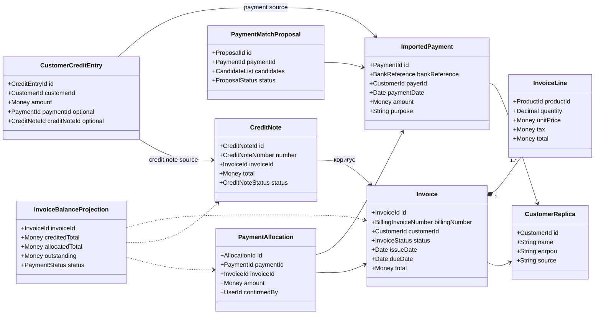
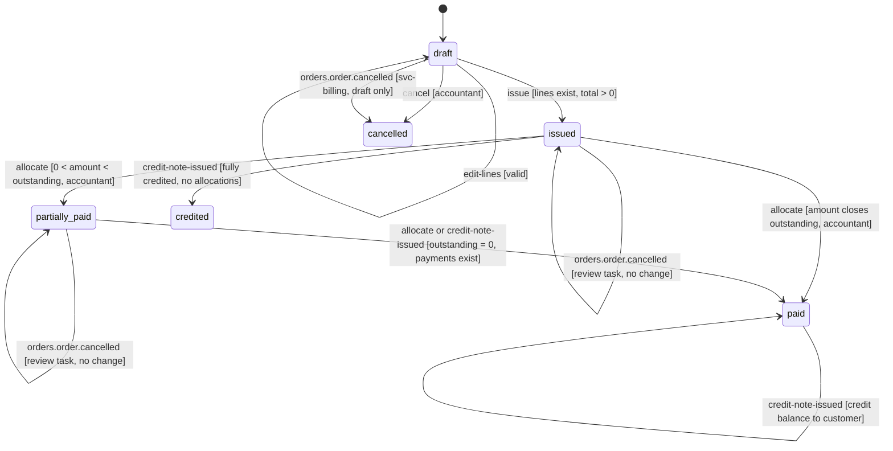
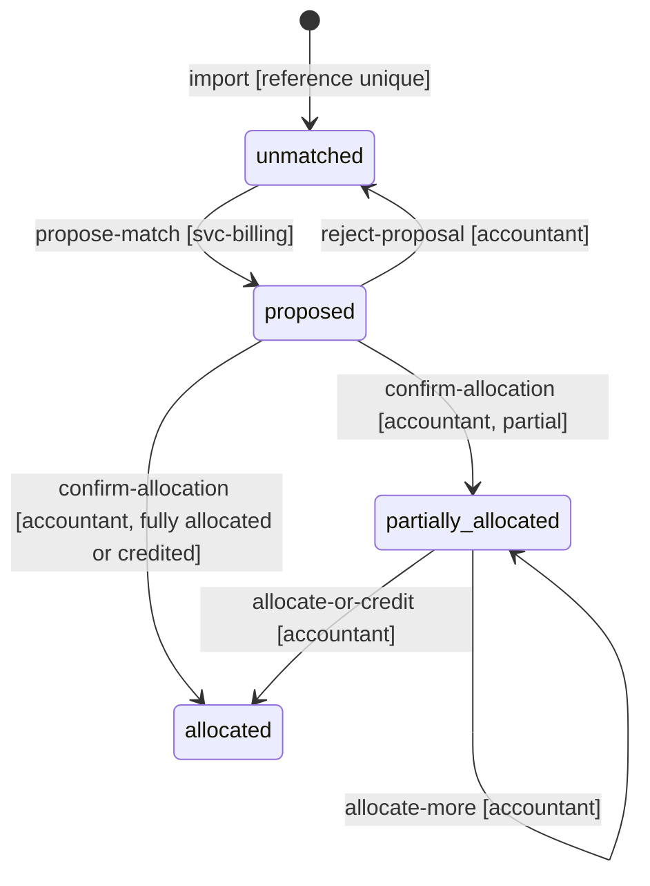

# ЛР2. ERP- та CRM-компоненти: fit-gap аналіз Odoo і проєктування модуля КПС — Billing

Студент: Голубєв Богдан Володимирович, група М-26. Дата: 2026-11-18.  
ШІ-асистент: Codex, GPT-6. Діалог: додати посилання або експорт перед здачею.

## 0. Вихідні дані

За основу взято [README.md](../../README.md) і [lab-01.md](lab-01.md). Проблема Billing — ручне зіставлення платежів із рахунками, зокрема часткові оплати, один платіж на кілька рахунків і платежі без номера рахунку.

### Підтверджені факти й робочі висновки

- **Олег Савчук, lab-02.md §5.1:** у партнера Odoo 18 Community; Enterprise і Studio не купують. Партнер може видати API-ключ окремому технічному користувачу; орієнтовний ліміт — 60 запитів/хв; під час щотижневого оновлення API може бути недоступним до двох годин; перехід на Odoo 19 планується наступного року, але точної дати немає.
- **Наталія Шевчук, lab-02.md §5.1:** журнал «Рахунки клієнтам» має префікс КХ/2026/; кредит-ноти — окрема послідовність у тому самому журналі; умови оплати 14 днів стандартно й 30 днів приблизно для 30 клієнтів за договором.
- **Наталія, lab-02.md §5.1:** щопонеділка завантажує CSV-виписку з датою, сумою, ЄДРПОУ, призначенням платежу та банківським референсом. Банківська синхронізація Odoo не налаштована.
- Процес Lead-to-Cash задає порядок «відвантаження й ТТН → рахунок → оплата». Рахунок за фактично відвантаженими кількостями прийнято як робочий висновок; чи створюється окремий рахунок для кожної часткової доставки, ще треба уточнити.
- Бізнес-вимога: знижку понад 10% погоджує керівник продажів. Odoo 18 документує застосування знижок, але штатне погодження порога в документації не підтверджено.
- За BIL-R1 Billing видає власний номер у момент issue. Odoo окремо видає номер бухгалтерського запису. Адаптер зберігає обидва номери, не підмінюючи номер Billing номером Odoo.
- Наталія не підтвердила алгоритм розподілу багаторахункового платежу. Ранжування кандидатів і підтвердження лише accountant — проєктне рішення з ЛР1, не пряма відповідь стейкхолдерки.

## 1. Lead-to-Cash в Odoo

Сценарій: лід «Кав’ярня “Зерно”» → пропозиція на 10 кг кави й кавомолку зі знижкою 12% → замовлення → резерв і відвантаження → рахунок за відвантаженим → часткова й повна оплата → кредит-нота на 1 кг.

| Крок | Застосунок і модель Odoo | Що відбувається | Що не сходиться / рішення КавоХаб |
|---|---|---|---|
| Лід і кваліфікація | CRM: crm.lead, res.partner | Лід стає opportunity і проходить воронку до виграшу. | CRM володіє клієнтом; Billing зберігає read-only репліку. |
| Пропозиція | Sales: sale.order, sale.order.line, product.pricelist | Створюється quotation на 10 кг кави й кавомолку. | Sales має функцію знижки, якщо її ввімкнено. |
| Знижка 12% і замовлення | Sales: sale.order | Після погодження знижки й підтвердження клієнтом пропозиція стає замовленням. | Бізнес вимагає погодження знижок понад 10%. Документація Odoo 18 описує знижки, але не threshold approval. Рішення погодження належить Orders; резерв під очікування — не довше 24 годин за кейсом. [Odoo: Discounts](https://www.odoo.com/documentation/18.0/applications/sales/sales/products_prices/prices/discounts.html); існує сторонній [модуль approval для Odoo 18](https://apps.odoo.com/apps/modules/18.0/discount), але його сумісність, ліцензію й супровід не перевірено. |
| Резерв | Inventory: запаси й складські операції | Резервуються потрібні товари. | Власник резерву — Inventory; Orders оркеструє процес. |
| Відвантаження й ТТН | Inventory: stock.picking і складські рухи | Фіксується фактична кількість, оформлюється доставка/ТТН. | Billing споживає inventory.shipment.dispatched. Odoo підтримує рахунок за доставленим; окремий рахунок після кожної часткової поставки ще не підтверджений бізнесом. [Odoo: Invoicing Policy](https://www.odoo.com/documentation/18.0/applications/sales/sales/invoicing/invoicing_policy.html) |
| Створення й проведення рахунку | Invoicing/Accounting: account.move, account.move.line | Рахунок створюється за відвантаженими кількостями та проводиться. | Billing видає billingInvoiceNumber за BIL-R1; Odoo присвоює odooJournalNumber. Зіставлення зберігає адаптер. [Odoo: Customer Invoices](https://www.odoo.com/documentation/18.0/applications/finance/accounting/getting_started/process_overview/customer_invoice.html) |
| Часткова оплата | Invoicing: account.payment і бухгалтерські рядки | Реєструється частина суми; рахунок має залишок. | Billing зберігає початковий платіж окремо від розподілів. |
| Повна оплата й звірка | Accounting / банківська виписка | Після повної оплати та звірки рахунок має нульовий борг. | CSV завантажується вручну; доступність звірки в інсталяції Community треба перевірити з Олегом. [Odoo: Payments](https://www.odoo.com/documentation/18.0/applications/finance/accounting/payments/forecast.html) |
| Кредит-нота на 1 кг | Invoicing: account.move, тип credit note | Створюється окремий коригувальний документ до рахунку. | Проведений рахунок не змінюється; кредит-нота має окремий номер і посилання на початковий рахунок. [Odoo: Credit Notes](https://www.odoo.com/documentation/18.0/applications/finance/accounting/customer_invoices/credit_notes.html) |
| Скасування замовлення | Orders → Billing: orders.order.cancelled | Billing одержує подію про скасування. | svc-billing може скасувати пов’язану чернетку; проведений рахунок не змінює й ставить на розгляд accountant. |

## 2. Аналіз застосунку Odoo для Billing

| Налаштування | Рішення / відповідь | Підстава |
|---|---|---|
| Політика рахунків | Налаштувати рахунок за фактично відвантаженою кількістю. Часткові доставки підтримуються; чи рахунок формується після кожної партії, уточнити. | [Odoo Invoicing Policy](https://www.odoo.com/documentation/18.0/applications/sales/sales/invoicing/invoicing_policy.html); README §2.2. |
| Журнал і серії | Журнал «Рахунки клієнтам», КХ/2026/; для кредит-нот окрема послідовність. Billing і Odoo зберігають окремі номери. | Наталія, lab-02 §5.1; [Odoo Invoice Sequence](https://www.odoo.com/documentation/18.0/applications/finance/accounting/customer_invoices/sequence.html). |
| Платіжні умови | 14 днів стандартно; 30 днів для клієнтів за договором. | Наталія, lab-02 §5.1; [Odoo Payment Terms](https://www.odoo.com/documentation/18.0/applications/finance/accounting/customer_invoices/payment_terms.html). |
| CSV і звірка | CSV завантажує accountant; Billing обробляє файл і дедуплікує. Odoo 18 docs описує CSV import, але саме імпорт/звірку в Community партнера має підтвердити Олег. | Наталія, lab-02 §5.1; [Odoo Transactions](https://www.odoo.com/documentation/18.0/applications/finance/accounting/bank/transactions.html); [порівняння редакцій](https://www.odoo.com/page/editions). |
| Погодження знижки | Бізнес вимагає approval понад 10% від керівника продажів. Стандартне правило Odoo не підтверджене документацією; реалізація лишається Orders або окремо перевіряється addon. | README §2.1; [Odoo Discounts](https://www.odoo.com/documentation/18.0/applications/sales/sales/products_prices/prices/discounts.html). |

## 3. Fit-gap таблиця Billing

У ЛР1 немає завершеного backlog user stories. Ці 10 рядків сформовано з BIL-R1–R6 та фактів кейсу; перед здачею їх треба зіставити з остаточними ID backlog.

| Вимога | Клас | Як покривається / чого бракує | Підстава (документація / кейс) | Зусилля | Вплив на оновлення | Рішення |
|---|---|---|---|---|---|---|
| Рахунок за відвантаженою кількістю | Configure | Є політика Invoice what is delivered; перевірити часткові поставки у партнерській базі. | [Odoo policy](https://www.odoo.com/documentation/18.0/applications/sales/sales/invoicing/invoicing_policy.html); lab-02 §6.1. | S | Низький без коду | Налаштувати; створення рахунку ініціює shipment event. |
| BIL-R1 — номер Billing при issue, без пропусків і дублів | Extend | Odoo видає власний номер при проведенні, але це не реалізує номер Billing. | lab-02 §6.7 BIL-R1; [Odoo sequence](https://www.odoo.com/documentation/18.0/applications/finance/accounting/customer_invoices/sequence.html). | M | Лічильник лишається в Billing; мапінг адаптера тестувати при оновленні | Billing number і Odoo number — окремі поля. |
| Окрема серія кредит-нот | Configure | Odoo підтримує окрему послідовність у журналі. | Факт Наталії lab-02 §5.1; [Odoo Journals](https://www.odoo.com/documentation/18.0/applications/finance/accounting/get_started/journals.html). | S | Низький | Налаштувати в Odoo; Billing зберігає власний номер ноти. |
| BIL-R2 — issued invoice незмінний | Extend* | Домен Billing це гарантує. В Odoo потрібно перевірити ACL технічного користувача; якщо не можна гранулярно заборонити reset-to-draft, потрібен серверний захист. | lab-02 §6.7 BIL-R2; [Odoo Access Rights](https://www.odoo.com/documentation/18.0/applications/general/users/access_rights.html). | M | Власний Odoo модуль треба переносити при оновленні; уникати, якщо ACL достатні | Заборонити технічному користувачу reset-to-draft; коригувати кредит-нотою. |
| Умови оплати 14/30 днів | Configure | Платіжні умови задаються для клієнта, замовлення чи рахунку. | Факт Наталії; [Odoo Payment Terms](https://www.odoo.com/documentation/18.0/applications/finance/accounting/customer_invoices/payment_terms.html). | S | Низький | Налаштувати стандарт і договори. |
| CSV upload та імпорт платежів | Extend | Документація описує CSV import, але повний workflow із правом accountant, batch і дедуплікацією — власні вимоги Billing; функціональність Community треба перевірити. | Факт Наталії lab-02 §5.1; [Odoo Transactions](https://www.odoo.com/documentation/18.0/applications/finance/accounting/bank/transactions.html); edition comparison. | M | Логіка лишається в Billing | accountant завантажує CSV; svc-billing обробляє рядки. |
| BIL-R4 — часткова оплата й кредит клієнта | Extend | Billing володіє Payment, Allocation і customer credit; Odoo отримує бухгалтерське подання. | lab-02 §6.7 BIL-R4; README §2.5. | M | Низький, якщо не розширювати Odoo | Зберігати оплату й розподіл окремо. |
| BIL-R3 — пошук кандидатів і багаторахунковий розподіл | Extend | Потрібні regex-пошук, черга нерозпізнаних і бухгалтерське підтвердження. | lab-02 §6.7 BIL-R3; ЛР1 Б2. | M | Версіювати контракти Billing | svc-billing пропонує; accountant підтверджує. |
| BIL-R6 — унікальний bank reference | Extend | Унікальність та дедуплікація мають бути в Billing. | lab-02 §6.7 BIL-R6; факти CSV lab-02 §5.1. | S–M | Низький | UNIQUE(source_bank, bank_reference), повтор — 409 conflict. |
| BIL-R5 — aging 0–30/31–60/61+ | Extend | Aged Receivable описаний для Odoo Accounting, але доступність у Community партнера невідома. Billing має дані для власного звіту. | lab-02 §6.7 BIL-R5; [Odoo Customer Invoices/Aged Receivable](https://www.odoo.com/documentation/18.0/applications/finance/accounting/getting_started/process_overview/customer_invoice.html); edition comparison. | M | Низький, якщо звіт у Billing | Розраховувати за due date й непогашеним залишком. |

* Extend для BIL-R2 — консервативна класифікація до перевірки ACL. Якщо штатних прав достатньо, клас можна змінити на Configure.

## 4. Адаптер до Odoo

Для Odoo 18 проєктується XML-RPC через /xmlrpc/2/common і /xmlrpc/2/object; виклики моделей — execute_kw. Odoo 19 має JSON-2 з bearer API key; XML-RPC у 19 позначено deprecated і планується видалити в Odoo 22. Перехід партнера на 19 наступного року — факт Олега без точної дати. [Odoo 18 API](https://www.odoo.com/documentation/18.0/developer/reference/external_api.html); [Odoo 19 JSON-2](https://www.odoo.com/documentation/19.0/developer/reference/external_api.html); [Odoo 19 RPC deprecation](https://www.odoo.com/documentation/19.0/developer/reference/external_rpc_api.html).

| Операція | Модель/метод | Мапінг |
|---|---|---|
| Знайти клієнта | res.partner / search_read | ЄДРПОУ, назва, CRM account reference; Odoo IDs лишаються в адаптері. |
| Створити чернетку | account.move / create | move_type=out_invoice, partner_id, invoice_date, invoice_date_due, currency_id, invoice_line_ids; Billing ID як зовнішній референс. |
| Провести рахунок | account.move / action_post | Записати Odoo record ID і odooJournalNumber окремо від номера Billing. |
| Передати кредит-ноту | account.move / create, action_post | move_type=out_refund, оригінальний рахунок, рядки/сума, окремий номер; поля перевірити на базі. |
| Передати оплату | account.payment / create, action_post | Сума, дата, валюта, платник, reference; процес звірки залежить від встановленого Accounting. |
| Перевірити результат | account.move/account.payment / search_read | Шукати за зовнішнім референсом перед повтором create. |

**Ідемпотентність.** Поле ref можна спробувати використати для зберігання Billing ID і пошуку, але воно саме не забезпечує унікальність. Найнадійніший варіант — custom external-id field з UNIQUE в Odoo, якщо партнер дозволить модуль. Без розширення Billing має outbox/таблицю sync, один create in-flight на рахунок і після неоднозначного timeout спершу шукати за ref; не повторювати create навмання. Залишається ризик гонки з іншими клієнтами Odoo.

| Роль | Дозволи |
|---|---|
| accountant | Завантажити CSV; перегляд; issue/cancel чернетки; кредит-ноти; підтвердити allocation; aging. |
| svc-billing | Створити рахунок із shipment, issue, обробляти платежі з batch, пропонувати кандидатів, викликати дозволені Odoo API. Не підтверджує allocations і не повертає проведені рахунки в чернетку. |
| director | Read-only звіт aging та узгоджені показники. |
| Odoo technical user | Мінімальні права на потрібні моделі/методи; reset-to-draft заборонити, якщо це можна забезпечити ACL. |

CSV завантажує accountant через POST /payment-imports. Batch обробляє svc-billing. POST /payments доступний accountant для одиничного ручного запису та svc-billing для внутрішнього створення нормалізованого рядка.

Олегові атрибутуються ліміт близько 60 запитів/хв, недоступність до двох годин щонеділі, можливість видати API-ключ і план переходу на 19 — це дані lab-02 §5.1, не твердження документації. Адаптер обмежує швидкість, ставить запити в чергу, використовує backoff+jitter, переживає недоступність, а невичерпні помилки передає на ручний розгляд. Ключ і staging після міграції треба перевірити; їх перенесення не гарантовано.

Приклад XML-RPC послідовності:

    authenticate(db, technical_user, api_key)
    execute_kw(db, uid, api_key,
      "account.move", "search_read",
      [[["ref", "=", billingInvoiceNumber]]],
      {"fields": ["id", "name", "state", "ref"], "limit": 2})

Якщо знайдено більше одного запису, не створювати новий автоматично — зафіксувати інтеграційний конфлікт.

## 5. ADR-0004 «Buy vs build»

**Статус:** рекомендовано. Відкрите питання — чи має клієнтський документ показувати один номер або обидва.

| Варіант | Переваги | Наслідки для оновлень |
|---|---|---|
| 1. Усе в Odoo, власні Odoo модулі | Один UI/сховище рахунків і обліку. | Кожне оновлення потребує переносити й регресійно перевіряти власні модулі; найближчий перехід — Odoo 19 наступного року. Якщо зовнішній інтеграційний виклик лишається XML-RPC — окремо перейти на JSON-2. |
| 2. Billing окремо; Odoo через адаптер (**обрано**) | Billing контролює BIL-R1–R6 і matching; Odoo зберігає бухгалтерські записи. | Переважно змінюється/перевіряється адаптер при переході 18→19. Якщо партнер вимагатиме Odoo module для ACL чи unique external ID, його також доведеться мігрувати. |
| 3. Гібрид: Odoo створює рахунки, Billing зіставляє платежі | Менше власної логіки рахунку; бухгалтерія працює у звичному середовищі. | Складніше узгодити номери й стани двох систем; при оновленні перевіряються інтеграція і workflow рахунку/платежу. |

Обираємо варіант 2: Billing видає billingInvoiceNumber за BIL-R1; Odoo видає odooJournalNumber. Адаптер веде мапінг. Якщо Наталія вимагатиме одного номера, це окреме рішення/ADR; не припускаємо, що стандартний API Odoo дозволяє зробити зовнішній номер номером журналу.

## 6. Доменна модель та інваріанти

Межі: Invoice містить InvoiceLine; CreditNote — окремий корінь, посилається на invoice ID; ImportedPayment має незмінні банківські реквізити; PaymentAllocation зберігається окремо; CustomerCreditEntry пов’язує джерело кредиту — payment або credit note. CustomerReplica є read-only реплікою з CRM. Odoo IDs і терміни зберігає адаптер.

Інваріанти:

1. Сума рядків дорівнює сумі рахунку; VAT 20% рахується та округлюється до копійок на рівні рядка.
2. Issue — лише коли є рядки й сума більше нуля; номер видається в тій самій транзакції.
3. Проведений рахунок незмінний; корекція — окрема кредит-нота.
4. Кредит-нота лише до проведеного рахунку; сума кредит-нот не перевищує суму рахунку.
5. Allocations рахунку не перевищують invoice total мінус кредит-ноти; переплата створює customer credit.
6. Allocations плюс кредити, джерелом яких є один payment, не перевищують payment.amount. Це міжтабличний інваріант, не звичайний CHECK.
7. Банківські реквізити незмінні після імпорту; виправлення/сторно — окремий пов’язаний запис.
8. Bank reference унікальний у межах джерела банку.
9. CustomerCreditEntry має рівно одне джерело: payment або credit note.
10. Прострочення обчислюється з due date й outstanding.

## 7. Життєвий цикл документа

### Рахунок

| Стан | Команда/подія | Умова | Роль | Новий стан | Побічний ефект / помилка |
|---|---|---|---|---|---|
| draft | edit-lines | Рядки валідні | accountant; svc-billing — лише службове створення з shipment | draft | Перерахувати суму; неправильна роль 403 |
| draft | issue | Є рядки, сума > 0 | accountant або svc-billing | issued | Видати номер, дату, outbox; invalid input 422 |
| draft | cancel | Рахунок ще не виставлено | accountant | cancelled | Записати причину; неправильний стан 409 |
| draft | orders.order.cancelled | Подія стосується замовлення | svc-billing, окремий idempotent handler | cancelled | Без номера; подія вже оброблена — no-op |
| issued / partially_paid | allocate | Підтверджена accountant сума в межах залишку | accountant | partially_paid або paid | Створити allocation, оновити баланси атомарно |
| issued / partially_paid | credit-note-issued | Нота валідна | Ноту видає accountant | Без зміни, paid або credited за балансом | Invoice незмінний; перевищення ліміту 422 |
| issued / partially_paid / paid | orders.order.cancelled | Замовлення скасовано після issue | svc-billing | Без переходу | Review task для accountant; рахунок не редагувати |

Публічний cancel endpoint дозволено лише accountant. Реакція svc-billing на order event — окремий системний сценарій лише для draft, не загальне право cancel.

### Кредит-нота

| Стан | Команда | Умова | Роль | Новий стан | Помилка |
|---|---|---|---|---|---|
| draft | edit-lines | Чернетка, сума валідна | accountant | draft | 422 validation-error |
| draft | issue | Початковий рахунок issued; сумарні credit notes у межах invoice total | accountant | issued | Перевищення 422; неправильний стан 409 |
| draft | cancel | Ще не проведена | accountant | cancelled | Неправильна роль 403 |
| issued | edit/cancel | Заборонено | будь-яка роль | без зміни | 409 invalid-transition; виправлення — новий коригувальний документ |

Тип документа, що компенсує помилкову проведену кредит-ноту, не заданий кейсом; питання лишається відкритим.

### Платіж

Нерозпізнаний платіж зберігається без автоматичного видалення. svc-billing тільки формує кандидатів; підтверджує accountant. Первинні банківські поля після імпорту незмінні. Allocated означає, що вся сума розподілена або зарахована як клієнтський кредит.

## 8. Бізнес-правила: місце перевірки й помилка API

| Правило | Місце перевірки | Роль | RFC 9457 type/status |
|---|---|---|---|
| BIL-R1 — номер на issue, послідовний за рік | Domain перевіряє статус/рядки; application transaction блокує лічильник за роком; UNIQUE на номер і (year, sequence_no) | accountant або svc-billing | Некоректні поля: validation-error/422; неправильний стан: invalid-transition/409; дублікат: conflict/409 |
| BIL-R2 — issued invoice незмінний | Domain-команди дозволяють редагування лише в draft; API не має update для issued; Odoo ACL технічного користувача перевіряються | cancel вручну — accountant; event handler — svc-billing лише draft | invalid-transition/409; роль — forbidden/403 |
| BIL-R3 — пошук номера і unmatched queue | Matching service формує proposal; відсутність збігу — нормальний стан, не помилка | svc-billing пропонує, accountant вирішує | Неавторизоване підтвердження — forbidden/403; invoice відсутній — not-found/404 |
| BIL-R4 — часткова оплата/кредит | Транзакція блокує payment і invoice balances, перевіряє залишки, додає allocation/credit | Підтверджує accountant | Конкурентний конфлікт — conflict/409; некоректна сума — validation-error/422; роль — forbidden/403 |
| BIL-R5 — overdue та aging | Query service обчислює стан за due date й outstanding; час сам не змінює invoice status | accountant, director read-only | Фільтр невалідний — validation-error/422; доступ — forbidden/403 |
| BIL-R6 — bank reference унікальний | Попередня application перевірка + UNIQUE(source_bank, bank_reference) | accountant завантажує CSV; svc-billing обробляє batch | Дублікат — conflict/409; формат — validation-error/422 |

Для allocation рольовий отказ — саме 403 forbidden. Тип approval-required для цього endpoint не застосовується.

## 9. Схема зберігання й план міграцій

Типи та обмеження в PostgreSQL notation; остаточна фізична реалізація узгоджується з ADR стеку. Гроші — NUMERIC(14,2), кг — NUMERIC(12,3), штуки — цілі значення; дата документа — календарна дата Europe/Kyiv, timestamps — UTC.

| Таблиця | Ключові поля | Ключі та обмеження |
|---|---|---|
| customer_replica | id, crm_account_id, name, edrpou, source_updated_at | PK id, UNIQUE crm_account_id; read-only репліка з CRM. |
| invoice_number_counter | year, next_value | PK year; CHECK next_value > 0; рядок блокується на issue. |
| invoice | id, billing_number, year, sequence_no, customer_id, order_id, status, issue_date, due_date, currency, total | PK id; FK customer_replica; UNIQUE billing_number і (year,sequence_no); NUMERIC(14,2); індекси customer/status/due_date. |
| invoice_line | id, invoice_id, line_no, product_id, quantity, unit, unit_price, tax_rate, net_amount, tax_amount, total_amount | PK; FK invoice; UNIQUE(invoice_id,line_no); quantity > 0; для pcs/pack кількість ціла; line total узгоджений із net+tax. |
| credit_note_number_counter | year, next_value | PK year; CHECK next_value > 0. |
| credit_note / credit_note_line | id, number, invoice_id, status, issue_date, currency, total; рядки з invoice_line_id та amount | FK invoice; номер UNIQUE; позитивні суми; сумарний ліміт кредит-нот перевіряється транзакційно під блокуванням invoice balance. |
| payment_import_batch | id, source_bank, file_hash, imported_at, status | PK; UNIQUE(source_bank,file_hash) запобігає повторному batch. |
| payment | id, batch_id, source_bank, bank_reference, customer_id, payer_edrpou, payment_date, amount, currency, purpose, status, imported_at | PK; FK batch/customer; UNIQUE(source_bank,bank_reference); amount NUMERIC(14,2) CHECK > 0; первинні реквізити незмінні. |
| payment_match_proposal | id, payment_id, invoice_id, proposed_amount, reason, status, created_at | FK payment/invoice; пропозиція не змінює баланс. |
| payment_allocation | id, payment_id, invoice_id, amount, confirmed_by, confirmed_at, idempotency_key | FK payment/invoice; amount > 0; UNIQUE idempotency_key; підтверджені рядки незмінні. |
| customer_credit_entry | id, customer_id, amount, payment_id NULL, credit_note_id NULL, entry_type, created_at | FK customer; amount > 0; рівно одне джерело: CHECK ((payment_id IS NOT NULL) <> (credit_note_id IS NOT NULL)). |
| invoice_balance | invoice_id, allocated_total, credited_total, outstanding, payment_status, updated_at | PK/FK invoice; проєкція і рядок блокування; оновлюється в тій самій транзакції. |
| payment_balance | payment_id, allocated_total, credited_total, unallocated, updated_at | PK/FK payment; не ставити звичайний CHECK, що читає payment.amount з іншої таблиці. |
| odoo_sync | id, invoice_id, odoo_record_id, odoo_journal_number, status, attempts, last_error | FK invoice; UNIQUE invoice_id; UNIQUE odoo_record_id за наявності. |
| outbox_event | id, event_type, aggregate_id, payload JSONB, created_at, published_at | PK event id; індекс unpublished events; записується разом із доменною транзакцією. |

Сума рядків, сума allocations на рахунок, сума кредит-нот і обмеження allocations плюс кредитні записи на платіж — міжрядкові/міжтабличні умови. Вони перевіряються application service у транзакції з блокуванням потрібних рядків; deferred constraint trigger може бути додатковим захистом. Це не звичайний SQL CHECK. Для payment_balance перевірка агрегату підсумовує allocations і customer_credit_entry, а payment.amount читає з payment після блокування батьківського payment row.

Міграції:

1. V001 — створити billing schema, customer_replica, статусні довідники й базові індекси.
2. V002 — invoice, invoice_line, лічильники, credit_note, credit_note_line; FK, унікальні номери й статусні обмеження.
3. V003 — payment_import_batch, payment, proposals, allocations, customer_credit_entry та balance projections.
4. V004 — odoo_sync, outbox_event, індекси на чергах, статусах, due_date і customer_id.
5. V005 — тригери незмінності після issue/import, deferred перевірки агрегованих сум, фінальні constraints.
6. V006 — seed-дані для чистих сценаріїв.

Seed для інтеграційного сценарію: 5 клієнтських реплік, 20 зовнішніх product refs/знімків рядків, 2 warehouse/shipment refs і базовий price snapshot. Товари, склади й прайси не стають власністю Billing; модуль зберігає лише потрібні знімки рядків рахунку й зовнішні посилання.

## 10. API та RFC 9457

| Метод і шлях | Роль | Призначення / тіло | Успіх | Помилки |
|---|---|---|---|---|
| POST /invoices | accountant або svc-billing | Створити draft із клієнтом, order/shipment ref і рядками; для сервісу — лише з довіреного shipment flow | 201 Created, draft | validation-error/422, forbidden/403, not-found/404 |
| PUT /invoices/{id}/lines | accountant | Змінити рядки лише в draft | 200 OK з перерахованою сумою | invalid-transition/409, validation-error/422, forbidden/403 |
| POST /invoices/{id}/issue | accountant або svc-billing | Провести рахунок і видати номер Billing | 200 OK: issued, billing number, Odoo sync status | invalid-transition/409, conflict/409, validation-error/422, forbidden/403 |
| POST /invoices/{id}/cancel | accountant | Скасувати лише draft із причиною | 200 OK: cancelled | invalid-transition/409, forbidden/403 |
| POST /invoices/{id}/credit-notes | accountant | Створити/провести кредит-ноту до issued invoice | 201 Created: номер і статус | invalid-transition/409, validation-error/422, forbidden/403 |
| POST /payment-imports | accountant | Завантажити CSV; створити batch | 202 Accepted: batch ID/status | validation-error/422, conflict/409, forbidden/403 |
| POST /payments | accountant або svc-billing | Одиничний ручний запис від accountant або normalized row із batch від svc-billing | 201 Created: unmatched | conflict/409 для дубля, validation-error/422, forbidden/403 |
| POST /payments/{id}/proposals | svc-billing | Сформувати кандидатів; не підтверджує оплату | 200 OK: proposed + candidates | not-found/404, invalid-transition/409, forbidden/403 |
| POST /payments/{id}/allocate | accountant | Підтвердити кілька allocations і, за потреби, суму кредиту | 200 OK: allocations і статус | conflict/409, validation-error/422, forbidden/403 |
| GET /invoices?status=&overdue= | accountant, svc-billing | Список рахунків | 200 OK | validation-error/422, forbidden/403 |
| GET /receivables/aging?asOf= | accountant, director | Aging 0–30/31–60/61+ | 200 OK | validation-error/422, forbidden/403 |

Для POST /payments/{id}/allocate actor svc-billing отримує **403 forbidden**, бо не має дозволу підтверджувати allocation. 409 approval-required тут не застосовується.

Приклад 409 invalid-transition:

    HTTP/1.1 409 Conflict
    Content-Type: application/problem+json

    {
      "type": "https://kavohub.example/problems/invalid-transition",
      "title": "Недопустимий перехід стану",
      "status": 409,
      "detail": "Виставлений рахунок не можна редагувати. Створіть кредит-ноту для коригування.",
      "instance": "/invoices/8d4f.../lines",
      "currentState": "issued",
      "allowedActions": ["create-credit-note"]
    }

Приклад 403 forbidden для сервісу:

    HTTP/1.1 403 Forbidden
    Content-Type: application/problem+json

    {
      "type": "https://kavohub.example/problems/forbidden",
      "title": "Недостатньо прав",
      "status": 403,
      "detail": "svc-billing може пропонувати збіги, але підтверджувати allocation може лише accountant.",
      "instance": "/payments/43af.../allocate"
    }

## 11. Тестові сценарії Given / When / Then

1. **BIL-R1 — успішний issue.**  
   **Given** draft має коректні рядки й суму > 0.  
   **When** accountant викликає issue.  
   **Then** Billing атомарно видає номер і переводить рахунок у issued.

2. **BIL-R1 — паралельний issue.**  
   **Given** два рахунки одного року готові до issue.  
   **When** обидва запити виконуються паралельно.  
   **Then** номери різні й послідовні, дубліката немає.

3. **BIL-R1 — порожній рахунок.**  
   **Given** draft без рядків або з нульовою сумою.  
   **When** викликають issue.  
   **Then** номер не видається, стан лишається draft, API повертає 422 validation-error.

4. **BIL-R2 — редагування проведеного рахунку.**  
   **Given** рахунок issued.  
   **When** викликають edit-lines.  
   **Then** дані не змінюються, API повертає 409 invalid-transition.

5. **Роль — сервіс не має права ручного cancel.**  
   **Given** draft існує.  
   **When** svc-billing викликає публічний cancel endpoint.  
   **Then** стан не змінюється, API повертає 403 forbidden.

6. **Скасування замовлення до issue.**  
   **Given** draft пов’язаний із замовленням.  
   **When** svc-billing отримує orders.order.cancelled.  
   **Then** draft стає cancelled без номера; повтор eventId не повторює зміну.

7. **Скасування замовлення після issue.**  
   **Given** рахунок уже issued.  
   **When** надходить orders.order.cancelled.  
   **Then** рахунок не змінюється; створюється задача для accountant.

8. **BIL-R3 — пропозиція збігу.**  
   **Given** призначення платежу містить номер рахунку.  
   **When** svc-billing запускає matching.  
   **Then** платіж переходить у proposed, але баланс рахунку не змінюється.

9. **Роль — сервіс не може підтвердити allocation.**  
   **Given** платіж має пропозицію.  
   **When** svc-billing викликає allocate.  
   **Then** allocation не створюється, повертається 403 forbidden.

10. **BIL-R4 — часткова оплата.**  
    **Given** запропонований платіж менший за outstanding.  
    **When** accountant підтверджує allocation.  
    **Then** створюється allocation, invoice стає partially_paid, початкові поля payment незмінні.

11. **Конкурентний розподіл останнього залишку.**  
    **Given** рахунок має 100 грн залишку й два розподіли претендують на ці 100 грн.  
    **When** обидві транзакції стартують одночасно.  
    **Then** одна проходить; інша після повторної перевірки отримує 409 conflict; від’ємного залишку немає.

12. **BIL-R4 — кредит від переплати платежу.**  
    **Given** payment 120 грн і invoice outstanding 100 грн.  
    **When** accountant підтверджує розподіл 100 грн і кредит 20 грн.  
    **Then** allocations + кредитні записи дорівнюють payment.amount, стан платежу allocated.

13. **Кредит від credit note на вже сплачений рахунок.**  
    **Given** рахунок оплачений і проведено кредит-ноту, що створює клієнтський кредит.  
    **When** створюється customer_credit_entry.  
    **Then** payment_id NULL, credit_note_id заданий, джерело проходить XOR обмеження.

14. **BIL-R6 — повторний bank reference.**  
    **Given** існує payment із тим самим source_bank і bank_reference.  
    **When** повторно імпортують рядок.  
    **Then** другого платежу немає, API повертає 409 conflict.

15. **Кредит-нота понад ліміт.**  
    **Given** попередні credit notes дорівнюють 90 грн за invoice 100 грн.  
    **When** проводять ще одну на 20 грн.  
    **Then** стан не переходить в issued, API повертає 422 validation-error.

16. **BIL-R5 — aging на дату зрізу.**  
    **Given** є рахунки з різними строками й залишками.  
    **When** accountant запитує aging на дату.  
    **Then** рахунки потрапляють у правильні інтервали; самі invoice status не змінюються.

## Журнал проєктних рішень

| № | Рішення | Альтернативи | Чому обрано | Підстава |
|---|---|---|---|---|
| ADR-0004 | Billing окремо, Odoo через адаптер | Усе в Odoo з модулями; Billing окремо; гібрид | Зберігає межі власності й при оновленні здебільшого змінює адаптер | README §§2.3–2.5; Oleg facts lab-02 §5.1; Odoo API docs |
| DEC-BIL-01 | Два номери: billingInvoiceNumber і odooJournalNumber | Один номер видає Odoo або Billing | BIL-R1 вимагає номер Billing на issue, Odoo видає номер запису при проведенні | lab-02 §6.7 BIL-R1; Odoo Invoice Sequence |
| DEC-BIL-02 | Allocation — окремі записи; payment source immutable | Редагувати payment під час розподілу | Зберігає аудиторський слід і первинні банківські реквізити | lab-02 BIL-R2/R4; ЛР1 платіжний процес |
| DEC-BIL-03 | CSV upload — accountant; обробка batch — svc-billing | Доступ до import лише сервісу | Наталія сама щопонеділка завантажує CSV; service автоматизує обробку, але не затвердження | lab-02 §5.1; README role model |
| DEC-BIL-04 | customer_credit_entry має необов’язкові payment_id і credit_note_id; рівно одне джерело | Завжди вимагати payment_id | Кредит після корекції сплаченого рахунку виникає від credit note | Узгодження в цьому діалозі; BIL-R4 |
| DEC-BIL-05 | Cross-table totals захищати транзакцією/відкладеною перевіркою | Звичайний CHECK | CHECK не агрегує інші таблиці | Реляційна схема й вимоги паралельного allocation |
| DEC-BIL-06 | Неавторизований allocation — 403 forbidden | 409 approval-required для svc-billing | Сервіс не має права підтвердження, це ACL заборона | README roles і погоджена модель доступу |

## Уточнення стейкхолдерів і припущення

| № | Уточнення / припущення | Джерело | Вплив |
|---|---|---|---|
| 1 | Odoo 18 Community, API-ключ технічного користувача, ≈60 запитів/хв, до 2 год недоступності щонеділі; Odoo 19 наступного року без дати | Олег, lab-02 §5.1 | XML-RPC, черга, rate limiting, перехід на JSON-2 |
| 2 | CSV завантажує Наталія; є дата, сума, ЄДРПОУ, призначення, референс | Наталія, lab-02 §5.1 | Batch upload має дозволяти accountant |
| 3 | Рахунок за відвантаженим; окремий рахунок на кожну часткову поставку — не підтверджено | Висновок із процесу | Shipment→Invoice |
| 4 | Billing і Odoo мають два окремі номери | BIL-R1 + нумерація Odoo; архітектурне рішення | Schema, API, adapter |
| 5 | customer_credit_entry має одне джерело: payment або credit note | Архітектурне рішення | Відображення переплати й кредиту від ноти |
| 6 | Суми allocation і customer credit на платіж не можуть перевищувати payment amount | Бізнес-правило BIL-R4 | Транзакційне блокування/перевірка |
| 7 | svc-billing лише пропонує матчі; accountant підтверджує | Проєктне рішення ЛР1 і рольова модель | API ACL і автомат платежу |
| 8 | Odoo ref може бути пошуковим референсом, але не унікальним ключем | Технічне припущення, перевірити з Олегом | Idempotency adapter |

## Відкриті питання та ризики

- Які модулі фактично встановлені в базі партнера; чи доступні там CSV import, звірка й Aged Receivable?
- Чи можна ACL обмежити reset-to-draft для технічного Odoo user?
- Чи дозволить партнер власні модулі, чи є staging і чи переноситься API-ключ після оновлення?
- Чи буде клієнтський PDF показувати один номер чи обидва?
- Чи погоджує Наталія окремі рахунки після часткових доставок?
- Як саме бухгалтерка розподіляє один платіж між кількома рахунками та обробляє неповне призначення?
- Який документ виправляє помилкову проведену кредит-ноту?

## Самоперевірка за критеріями

| Критерій | Статус | Де |
|---|---|---|
| Lead-to-Cash і знижка 12% | Є; порогове Odoo approval не підтверджено | §1 |
| Аналіз Odoo з підставами | Частково; документація є, партнерська база не перевірена | §2, відкриті питання |
| Fit-gap 8–10 вимог | 10 рядків із колонкою «Підстава»; зіставити з повним backlog ЛР1 | §3 |
| Адаптер, мапінг, ACL і збої | Є як проєкт; ACL/ref/staging перевірити з Олегом | §4 |
| ADR з трьома альтернативами й наслідками | Є | §5 |
| Доменна модель та автомат | Є; розподіл багаторахункового платежу має відкрите правило | §§6–7 |
| BIL-R1–R6 із перевірками й помилками | Є | §8 |
| БД, міграції, seed | Є; агреговані обмеження не помилково подані як CHECK | §9 |
| API з RFC 9457 | Є таблиця й приклади 409/403 | §10 |
| ≥10 Given/When/Then, негативні й конкурентні | 16 сценаріїв | §11 |

## Відповіді на контрольні питання

1. **Configure vs Extend.** Configure — функція є, треба налаштувати. Extend — потрібна власна логіка/модуль/API. Extend дорожчає через супровід і регресійну перевірку при кожному оновленні.
2. **Найкраще й найгірше покриття Odoo.** Найкраще — типові платіжні умови, журнали й кредит-ноти за наявності застосунків. Найгірше — специфічний розподіл платежів і черга неоднозначних збігів. Підтверджено документацією Odoo 18; Community інсталяцію ще перевірити.
3. **Чому Odoo лишається бухгалтерською системою запису.** Так визначає ландшафт README; Billing володіє доменними рахунками/платежами, а Odoo зберігає бухгалтерські проведення.
4. **Навіщо антикорупційний шар.** Щоб Odoo-моделі й поля не потрапляли в домен Billing. Внутрішні типи — Invoice/Payment; Odoo IDs та account.move лишаються в адаптері.
5. **Чому команди, а не status update.** Команда перевіряє стан, право та інваріанти. Заборонений перехід — 409 invalid-transition; рольова заборона — 403 forbidden.
6. **Чому не float.** Двійкове представлення не зберігає більшість десяткових дробів точно; суми можуть накопичувати похибку. Для грошей — decimal/Numeric.
7. **Чому не PostgreSQL SEQUENCE для no-gap.** Видача sequence не відкочується разом із транзакцією. Лічильник-рядок блокується й збільшується в тій самій транзакції issue; видані номери не видаляються.
8. **Як запобігти подвійному allocation.** Унікальність bank reference блокує дубль імпорту; транзакція блокує баланси, повторно перевіряє залишок і записує allocations атомарно.
9. **Сутності й об’єкти-значення.** Invoice, Payment, CreditNote й Allocation мають ідентичність. Money, BankReference, BillingInvoiceNumber — об’єкти-значення. InvoiceLine — дочірня сутність рахунку.
10. **Що захищає БД.** PK/FK, унікальні ключі, позитивні суми й локальні обмеження — CHECK/UNIQUE. Сума рядків і межі allocations/credits потребують транзакційної логіки та deferred validation, бо звичайний CHECK не читає суми інших рядків/таблиць.

## Робота з ШІ-асистентом і самоаналіз

1. Виявлено відсутню колонку «Підстава» у fit-gap; додано посилання на документацію та атрибуцію фактів Олегу/Наталії.
2. Виявлено суперечність між BIL-R1 і твердженням, що Billing використовує номер Odoo; розведено billingInvoiceNumber та odooJournalNumber.
3. Виявлено, що кредит клієнта може виникнути від кредит-ноти до вже оплаченого рахунку; customer_credit_entry тепер має nullable payment_id і credit_note_id з правилом рівно одного джерела.
4. Виявлено, що сума з payment іншої таблиці не може бути в звичайному CHECK; замінено на транзакційну перевірку з блокуваннями та відкладеним DB guard.
5. Виявлено ACL-проблему CSV: файл завантажує Наталія, тому POST /payment-imports дозволений accountant; svc-billing обробляє batch. Для не-бухгалтера allocation повертає 403 forbidden, не 409 approval-required.

## Підсумок самоаналізу

Артефакти частин A і B зібрані в одному документі. Усі виявлені помилки в нумерації, джерелі кредиту, cross-table constraint і правах імпорту виправлено. Fit-gap щодо точної партнерської інсталяції лишається частково неперевіреним; потрібні відповіді Олега про модулі, ACL, staging, custom addons і міграцію ключа, а також уточнення Наталії щодо розподілу багаторахункових платежів.

## Відкриті питання для захисту

- Чи має рахунок клієнта показувати два номери, чи один?
- Чи виставляється окремий рахунок після кожної часткової відвантаженої партії?
- Який документ компенсує помилкову проведену кредит-ноту?
- Чи доступний CSV import і bank reconciliation у фактичній Community базі?
- Яким є порядок розподілу багаторахункового платежу при неповному призначенні?

