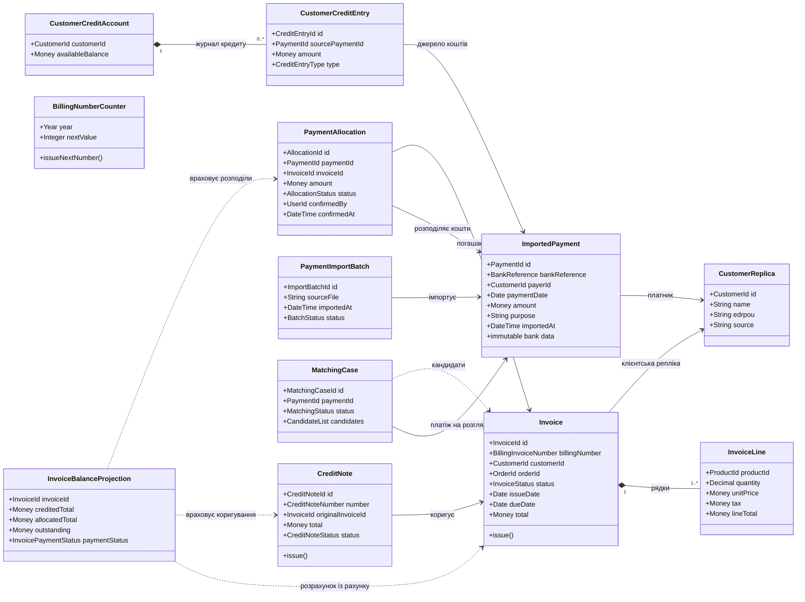
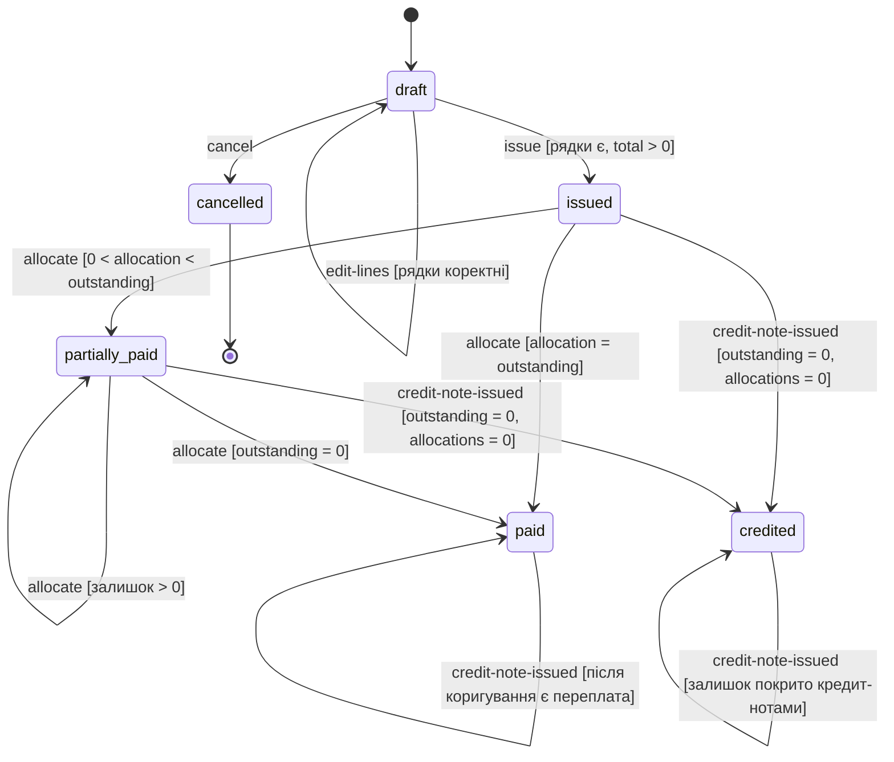
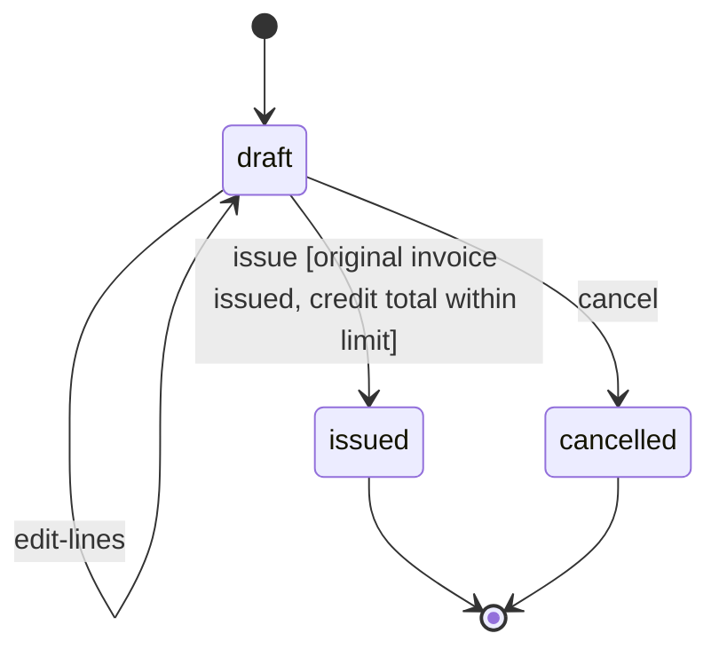
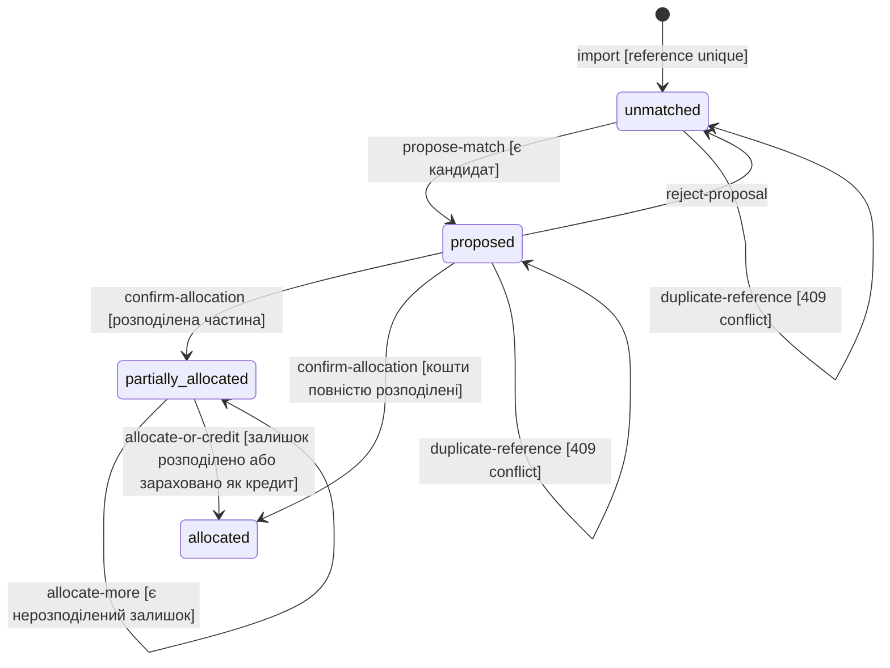

# Опиши етапи лабораторної 02

> Зараз виконуємо лабораторну роботу з lab-02.md базуючись на контексті з lab-01.md де я працював з обраним модулем Billing
> Опиши завдання на цю лабораторну за етапами, що в них я маю виконати
>
> User context
>
> Attachments:
>
> - README.md: `./corporate-software-systems-lessons/README.md`
> - lab-02.md: `./corporate-software-systems-lessons/lab-02.md`
> - lab-01.md: `./corporate-software-systems-lessons/result/golubiev-bohdan/lab-01.md`

<details><summary>2 previous messages</summary>

> Я прочитаю інструкції з `lab-02.md` і використаю `lab-01.md` лише як контекст про обраний модуль Billing, щоб розкласти роботу на зрозумілі етапи.
>
> <details><summary>Ran 4 commands</summary>
>
> - Ran `Get-Content -LiteralPath 'C:\Users\golub\OneDrive\Документы\ChatGPT\Labs\corporate-software-systems-lessons\lab-02.md'; Get-Content -LiteralPath 'C:\Users\golub\OneDrive\Документы\ChatGPT\Labs\corporate-software-systems-lessons\result\golubiev-bohdan\lab-01.md'; Get-Content -LiteralPath 'C:\Users\golub\OneDrive\Документы\ChatGPT\Labs\corporate-software-systems-lessons\README.md'`
> - Ran `rg -n '^#{1,3} |Billing|Що здати|Етап|Частина [AB]|Контрольні питання|Критерії' 'corporate-software-systems-lessons/lab-02.md' 'corporate-software-systems-lessons/result/golubiev-bohdan/lab-01.md'`
> - Ran `$p='corporate-software-systems-lessons/lab-02.md'; $x=Get-Content -LiteralPath $p; $x[122..320]; $y=Get-Content -LiteralPath 'corporate-software-systems-lessons/result/golubiev-bohdan/lab-01.md'; $y[470..492]`
> - Ran `$p='corporate-software-systems-lessons/lab-02.md'; $x=Get-Content -LiteralPath $p; $x[320..379]; $x[417..450]`
>
> </details>

</details>

# План виконання ЛР2 для модуля Billing

ЛР2 — це **проєктування, а не написання коду**. На виході має бути один документ `lab-02-billing-golubiev.md` і посилання на діалог із ШІ або його експорт.

Інструкції самої лабораторної визначають обов’язкові результати, а `lab-01.md` дає контекст для Billing: ручне зіставлення банківських платежів із рахунками, зокрема часткові оплати, платежі за кілька рахунків і платежі без номера рахунку. Частина запропонованих у ЛР1 правил **ще не підтверджена Наталією Шевчук** — позначайте їх як припущення й перевіряйте під час роботи.

## Етап 1. Розібрати Lead-to-Cash і Odoo

Пройдіть наскрізний сценарій у Odoo: CRM-лід → пропозиція → замовлення → резерв і відвантаження → рахунок → оплати → кредит-нота. Для Billing описуйте докладніше, решту кроків можна стисло.

Підготуйте таблицю: **крок → застосунок і модель Odoo → що відбувається → розбіжність із вимогами ЛР1**. Окремо з’ясуйте, чи вимагає знижка 12% погодження.

Для свого застосунку опишіть налаштування рахунків, журналу й нумерації, платіжних умов, реєстрації оплат і кредит-нот. Дайте підстави для відповідей на запитання лабораторної про безперервність нумерації, скасування рахунку та зіставлення платежів із випискою. У ЛР1 є додатковий контекст: виписка надходить щотижня CSV, приблизно 20% платежів не містять номера рахунку, а один платіж іноді покриває кілька рахунків.

**Результат етапу:** таблиця Lead-to-Cash і обґрунтовані відповіді про Billing в Odoo.

## Етап 2. Fit-gap, адаптер і рішення «купити чи розробити»

Візьміть 8–10 вимог Billing із ЛР1 і для кожної визначте, чи Odoo покриває її готовою функцією, налаштуванням, розширенням або не покриває. Додайте спосіб покриття, джерело підтвердження, оцінку зусиль, ризик для оновлень і рішення.

Спроєктуйте адаптер до Odoo: які операції він виконує над `account.move` та `account.payment`, як зіставляє поля й поняття, які дані передає, як обробляє недоступність API та повтори без дублів. Для кейсу вказана Odoo 18 Community, окремий технічний API-користувач, обмеження приблизно 60 запитів за хвилину й планове вікно недоступності. Обґрунтуйте вибір API для цієї версії та врахуйте запланований перехід на Odoo 19.

Потім підготуйте ADR-0004 про розподіл відповідальності між Odoo і власним Billing. Розгляньте щонайменше три реальні варіанти, включно з «усе в Odoo + власні розширення», і вкажіть наслідки кожного для оновлень.

Для нумерації є окрема неузгодженість, яку треба вирішити явно: у варіанті Billing наведено номер на кшталт `КХ-2026-000123` і безперервний власний лічильник, а в даних кейсу для Odoo — префікс `КХ/2026/` та окрему послідовність кредит-нот. Визначте, яка система відповідає за остаточний номер і як узгодити записи, не порушуючи вимоги.

**Результат етапу:** fit-gap на 8–10 вимог, проєкт адаптера й ADR-0004 з альтернативами та наслідками.

## Етап 3. Побудувати доменну модель і життєвий цикл

Спроєктуйте домен Billing навколо рахунків, кредит-нот, платежів і розподілів оплат. Визначте агрегати, їхні інваріанти, сутності й об’єкти-значення. Позначте клієнтські дані як репліку та вкажіть їхнє джерело.

Для основного документа побудуйте автомат станів і таблицю переходів із командами, умовами, ролями й побічними ефектами. Варіант ЛР2 задає стани рахунку `draft → issued → partially_paid → paid`; прострочення обчислюється. Уточніть також, як у вашому проєкті живуть імпортований платіж, нерозподілений платіж, аванс і кредит-нота — їхні стани та дозволені операції.

Перевірте всі задані правила Billing: номер видається під час `issue`; виставлений рахунок незмінний; платіж шукає номер у призначенні й інакше потрапляє до черги на розгляд; підтримуються часткові оплати й кредитний залишок; розраховується прострочення та старіння дебіторки; повторний банківський референс відхиляється. Для кожного правила вкажіть, де його перевіряти й яку помилку повертати.

Зіставте ці правила з ЛР1: автоматичне розпізнавання може пропонувати рахунки-кандидати, але неоднозначний платіж не слід остаточно розподіляти без підтвердження бухгалтерки. Зафіксуйте це як проєктне рішення або уточнення, а не як відповідь стейкхолдера.

**Результат етапу:** діаграма моделі, діаграма й таблиця переходів, правила з місцем перевірки.

## Етап 4. Спроєктувати зберігання, API й сценарії перевірки

Опишіть схему бази Billing: таблиці, типи, ключі, обмеження й індекси; додайте план міграцій і склад невеликого набору початкових даних. Врахуйте вимоги до грошей і дат із методички, а також унікальність банківського референсу й послідовну видачу номерів.

Складіть таблицю REST-ендпоінтів для створення й виставлення рахунків, кредит-нот, імпорту платежів, розподілу оплат і звіту дебіторки. Для команд переходу задайте ролі, запити, відповіді та помилки RFC 9457. Додайте 2–3 приклади API, серед яких має бути приклад помилки.

Підготуйте щонайменше 10 тестових сценаріїв у форматі Given / When / Then. Покрийте кожне бізнес-правило, заборонені переходи, дублікати, часткову оплату, переплату, нерозпізнані або неоднозначні платежі та паралельне виставлення рахунків чи повторний імпорт.

**Результат етапу:** схема й план міграцій, API з прикладами, не менше 10 сценаріїв, пов’язаних із правилами.

## Етап 5. Самоперевірка, захист і оформлення документа

Попросіть асистента перевірити документ за критеріями ЛР2 і провести захист щонайменше за п’ятьма контрольними питаннями. Переконайтеся, що в документі є всі артефакти, журнал проєктних рішень, уточнення та припущення, відкриті питання, самоперевірка і посилання або експорт діалогу.

За шаблоном README додайте:

- вихідні дані з ЛР1 і зміни, якщо ви їх ухвалили;
- журнал рішень із альтернативами й підставами;
- уточнення стейкхолдерів і припущення з позначеним джерелом;
- відкриті питання та ризики;
- відповіді на контрольні питання;
- 3–5 прикладів, де ви змінили або відхилили пропозицію асистента, і чому.

**Підсумкова перевірка:** документ має містити 11 розділів артефактів із таблиці «Що здати» ЛР2, а не лише опис платіжного процесу з ЛР1.

> Давай розберемо Lead-to-Cash і Odoo і визначимо які є питання піспілкувавшись з бізнесом

<details><summary>2 previous messages</summary>

> Почнімо з наскрізного сценарію: я зіставлю кроки Lead-to-Cash із застосунками Odoo, а потім виділимо питання до бізнесу для Billing. За методичкою я відповідатиму від імені стейкхолдера лише на прямо поставлені йому запитання, тож зможемо зафіксувати, що є підтвердженим фактом, а що лишається відкритим.
>
> <details><summary>Searched the web</summary>
>
> Searched the web for `site:odoo.com/documentation/18.0 applications finance accounting customer invoices payment terms credit notes Odoo 18 ...`
>
> </details>

</details>

## Lead-to-Cash у Odoo: перша схема

Для прикладу з лабораторної — кав’ярня замовляє 10 кг кави й кавомолку зі знижкою 12%, отримує відвантаження, рахунок і платить частинами.

| Крок                    | Застосунок і основні моделі Odoo                                              | Що відбувається                                                                                                                                                                                      |
| ----------------------- | ----------------------------------------------------------------------------- | ---------------------------------------------------------------------------------------------------------------------------------------------------------------------------------------------------- |
| Лід і продажна нагода   | **CRM** — `crm.lead`, контакти `res.partner`                                  | Лід кваліфікують і ведуть у воронці до виграшу.                                                                                                                                                      |
| Пропозиція і замовлення | **Sales** — `sale.order`, `sale.order.line`, прайс-лист `product.pricelist`   | Створюють пропозицію на 10 кг і кавомолку, застосовують знижку, після підтвердження отримують замовлення.                                                                                            |
| Резерв і відвантаження  | **Inventory** — операція доставки `stock.picking`, залишки `stock.quant`      | Готують і підтверджують доставку. Якщо відвантаження часткове, можна вести залишок до наступної доставки.                                                                                            |
| Рахунок                 | **Invoicing / Accounting** — `account.move`                                   | За політики «рахунок за відвантаженим» рахунок створюють після підтвердження доставленої кількості. Odoo присвоює номер під час підтвердження рахунку; опублікований рахунок не редагується напряму. |
| Часткова й повна оплата | **Invoicing / Accounting** — `account.payment` та звірка банківської операції | Реєструють платіж, а рахунок стає повністю оплаченим після звірки відповідного бухгалтерського запису з банківською операцією.                                                                       |
| Кредит-нота на 1 кг     | **Invoicing / Accounting** — `account.move`                                   | Створюють кредит-ноту до рахунку, наприклад щоб виправити його суму.                                                                                                                                 |

Це базове зіставлення за документацією Odoo 18: [рахунки за замовленою чи відвантаженою кількістю](https://www.odoo.com/documentation/18.0/applications/sales/sales/invoicing/invoicing_policy.html), [створення й підтвердження рахунку](https://www.odoo.com/documentation/18.0/applications/finance/accounting/getting_started/process_overview/customer_invoice.html), [оплати](https://www.odoo.com/documentation/18.0/applications/finance/accounting/payments/forecast.html) і [кредит-ноти](https://www.odoo.com/documentation/18.0/applications/finance/accounting/customer_invoices/credit_notes.html).

У бізнес-кейсі є один уже відомий факт для Billing: бухгалтерка щопонеділка імпортує банківську виписку CSV; синхронізація банку з Odoo не налаштована. З ЛР1 також відомо, що частина платежів не містить номера рахунку, а одним платежем іноді оплачують кілька рахунків. Решту правил поки потрібно з’ясувати в розмові з бухгалтеркою.

## Запитання до бізнесу

Почав би розмову з Наталією Шевчук так:

> «Як зараз ви зіставляєте рядки банківської виписки з рахунками? Які дані у виписці допомагають знайти рахунок, а що робите, коли номеру рахунку немає або один платіж покриває кілька рахунків?»

Це перше запитання зачіпає головну проблему Billing із ЛР1. Далі варто з’ясувати:

1. **Автоматичне зіставлення:** за якими ознаками Billing може запропонувати рахунок — номер із призначення, ЄДРПОУ, сума, дата, договір? Коли результат достатньо надійний, щоб не вимагати ручної перевірки?
2. **Розподіл платежу:** як бухгалтерка хоче розподіляти суму між кількома рахунками? Чи дозволений частковий розподіл, а нерозподілений залишок — зберігати як аванс?
3. **Помилкові й повторні рядки:** який ідентифікатор виписки вважається стабільним? Як обробляти дублікати, повернення або сторнування вже зіставленого платежу?
4. **Затвердження:** хто остаточно підтверджує автоматично запропонований розподіл і списання невеликої різниці? ЛР1 пропонує роль бухгалтерки (`accountant`), але це ще треба підтвердити.
5. **Рахунок і нумерація:** чи має Billing створювати рахунок у себе, в Odoo чи в обох системах? Яка система є джерелом остаточного бухгалтерського запису й номера?
6. **Строки та кредит-ноти:** чи зберігаємо стандартний строк оплати 14 днів і винятки на 30 днів за договорами? Хто й за яких умов оформлює кредит-ноту?

Поставте Наталії перше запитання своїми словами — я відповім у її ролі на основі фактів лабораторної, а потім разом розберемо відповідь і визначимо наступне запитання.

> 1. Хочу поставити запитання Наталії: як зараз влаштовано журнал рахунків і нумерацію в Odoo? Яка система номерів, чи окремо для кредит-нот, і чи була потреба скасовувати вже проведений рахунок?
> 2. Хочу поставити запитання Наталії: коли ви виставляєте рахунок, за замовленими чи відвантаженими кількостями? Які платіжні умови стандартні, і чи є виняткові?
> 3. Хочу поставити запитання Наталії: як ви реєструєте оплату в Odoo? Що ви робите, коли платіж за кілька рахунків, і як зв'язуєте рядок виписки з платежем?
>
> Далі вказуй поточний єтап завдання, і що має бути настпуним

## Поточний етап: 1 — Odoo і Lead-to-Cash

Зараз ми розбираємо застосунок Billing у межах етапу 1 ЛР2. Ти поставив три запитання Наталії; нижче — відповіді за відомими фактами кейсу. Там, де в матеріалах немає відповіді, позначаю це як відкрите питання, а не домислюю за стейкхолдерку.

### 1. Журнал, нумерація та скасування рахунків

**Наталія — відомі факти:** в Odoo є один журнал продажу **«Рахунки клієнтам»** із префіксом `КХ/2026/`. Кредит-ноти ведуться в тому самому журналі, але мають **окрему послідовність номерів**.

**Поки не з’ясовано:** чи були в Наталії випадки, коли потрібно було скасувати вже проведений рахунок, і як саме їх тоді обробляли. За документацією Odoo, проведений рахунок не редагують напряму; для його виправлення, скасування чи повернення використовують кредит-ноту. [Документація Odoo про рахунки](https://www.odoo.com/documentation/18.0/applications/finance/accounting/getting_started/process_overview/customer_invoice.html), [про кредит-ноти](https://www.odoo.com/documentation/18.0/applications/finance/accounting/customer_invoices/credit_notes.html).

### 2. Кількості в рахунку та платіжні умови

**Наталія — відомі факти:** стандартна платіжна умова — **14 днів**. Приблизно для 30 клієнтів за договором діє строк **30 днів**.

**Поки не з’ясовано:** рахунки виставляють за замовленими чи за фактично відвантаженими кількостями. Odoo підтримує обидві політики; за політики відвантажених кількостей рахунок створюють після підтвердження доставки. [Документація Odoo про політики виставлення рахунків](https://www.odoo.com/documentation/18.0/applications/sales/sales/invoicing/invoicing_policy.html).

### 3. Реєстрація й зіставлення оплат

**Наталія — відомі факти:** щопонеділка вона завантажує CSV-виписку з банку. У файлі є дата, сума, ЄДРПОУ платника, призначення платежу й референс. Модуль банківської синхронізації в Odoo не налаштований.

**Поки не з’ясовано:** як саме вона зараз проводить платежі в Odoo, зіставляє рядки виписки з рахунками та розбирає платежі на кілька рахунків. У Odoo є можливість зареєструвати оплату щодо кількох рахунків, але з кейсу невідомо, чи Наталія користується нею. [Документація Odoo про реєстрацію оплат](https://www.odoo.com/documentation/18.0/applications/finance/accounting/payments/forecast.html).

### Що записати у робочі нотатки

- **Підтверджено:** журнал і префікс рахунків; окрема послідовність кредит-нот; умови оплати 14 і 30 днів; щотижневий CSV-імпорт; відсутність банківської синхронізації.
- **Залишилося уточнити в Наталії:** політику кількостей; фактичний процес реєстрації та звірки оплат; обробку платежу за кілька рахунків; практику скасування проведеного рахунку.

**Наступне:** залишаємося на етапі 1 і закриваємо відкриті питання про процес Billing. Найкращий наступний запит Наталії — **за якими кількостями вона виставляє рахунок: замовленими чи відвантаженими?** Після цього уточнимо, як вона розбирає банківські платежі та багаторахункові оплати. Завершення етапу 1 також передбачає таблицю всього Lead-to-Cash і відповідь щодо знижки 12%.

> як висновок з кейсу Наталія виставляє за відвантаженими, на підставах ланцюжка: відвантаження й ТТН → рахунок → оплата, тобто рахунок іде після відвантаження та те що Billing споживає `inventory.shipment.dispatched` і `orders.order.cancelled` &#x20;
> щодо знижки 12% З боку бізнесу відповідь ствердна, знижку понад 10% погоджує керівник продажів, але з боку Odoo в залежності від версії є можливість погодження знижок понад ліміт, це варто перевірити
> надай розбір Наталі банківських платежів та багаторахункових оплат.
> На основі цього далі сформуй таблицю всього Lead-to-Cash, якого потребує завдання

<details><summary>2 previous messages</summary>

> Використаю твої висновки про відвантаження й погодження знижки як робочі рішення, а не як дослівні цитати Наталії. Перевірю окремо можливість погодження знижок в Odoo 18 і звірю таблицю Lead-to-Cash з вимогами лабораторної та подіями Billing з ЛР1.
>
> <details><summary>Ran a command, searched the web</summary>
>
> - Ran `rg -n -C 3 'inventory\.shipment\.dispatched|orders\.order\.cancelled|Billing|платіж|знижк|ТТН|відвантаж' 'corporate-software-systems-lessons/result/golubiev-bohdan/lab-01.md' 'corporate-software-systems-lessons/README.md'`
>
> Searched the web for `site:odoo.com/documentation/18.0 sales discount approval limit Odoo Sales quotation discount approval ...`
>
> </details>

</details>

## Розбір банківських платежів у ролі Наталії

**Наталія — що відомо з кейсу:** «Щопонеділка я завантажую CSV-виписку з банк-клієнта. У ній є дата, сума, ЄДРПОУ платника, призначення платежу й банківський референс. Модуль банківської синхронізації в Odoo не налаштовано».

Це означає, що Billing має отримати ці дані з CSV і зіставити їх із рахунками. З ЛР1 відомо, що близько 20% платежів можуть бути без номера рахунку, а один платіж може стосуватися кількох рахунків.

**Щодо багаторахункових оплат:** у вихідних даних немає відповіді Наталії, як саме вона розподіляє такий платіж і чи виконує це в Odoo. Odoo документує групову реєстрацію оплат для кількох рахунків, але це саме по собі не підтверджує, що так зараз працює бухгалтерія «КавоХаб». [Документація Odoo про платежі за кількома рахунками](https://www.odoo.com/documentation/18.0/applications/finance/accounting/payments/forecast.html)

Отже, у проєкті поки можна зафіксувати робочу пропозицію з ЛР1: Billing шукає рахунок за номером у призначенні платежу; якщо не знаходить або є кілька неоднозначних кандидатів — залишає платіж нерозподіленим і показує бухгалтерці пропозиції. Підтвердити розподіл має бухгалтерка. Це **запропоноване правило ЛР1, а не підтверджена відповідь Наталії**.

Щоб уточнити фактичний процес, запитай її: **«Як ви розподіляєте один платіж між кількома рахунками? Чи можна частину залишити нерозподіленою або зарахувати як аванс, і хто підтверджує розподіл?»**

## Таблиця Lead-to-Cash для завдання ЛР2

| Крок                               | Застосунок / модель Odoo                                                                    | Що відбувається в сценарії                                                                                                                                                                                                                           | Що треба врахувати в «КавоХаб» / розбіжності                                                                                                                                                                                                                                                                                                                                                                                                                                                                                                                                                      |
| ---------------------------------- | ------------------------------------------------------------------------------------------- | ---------------------------------------------------------------------------------------------------------------------------------------------------------------------------------------------------------------------------------------------------- | ------------------------------------------------------------------------------------------------------------------------------------------------------------------------------------------------------------------------------------------------------------------------------------------------------------------------------------------------------------------------------------------------------------------------------------------------------------------------------------------------------------------------------------------------------------------------------------------------- |
| 1. Новий лід                       | **CRM** — `crm.lead`, контакт/клієнт — `res.partner`                                        | Лід «Кав’ярня “Зерно”» реєструють, кваліфікують і переводять у нагоду.                                                                                                                                                                               | У таблиці достатньо стислого опису. Клієнтські дані у Billing мають бути реплікою з CRM, бо CRM — їхній власник.                                                                                                                                                                                                                                                                                                                                                                                                                                                                                  |
| 2. Угода виграна                   | **CRM** — `crm.lead` (нагода)                                                               | Угоду проводять стадіями до «Виграно».                                                                                                                                                                                                               | Зафіксувати, що далі Sales створює пропозицію.                                                                                                                                                                                                                                                                                                                                                                                                                                                                                                                                                    |
| 3. Пропозиція на 10 кг і кавомолку | **Sales** — `sale.order`, `sale.order.line`, прайс-лист `product.pricelist`                 | У пропозицію додають 10 кг кави й кавомолку, застосовують 12% знижки. Після прийняття пропозиція підтверджується як замовлення. [Типовий потік продажу Odoo](https://www.odoo.com/documentation/18.0/applications/sales/sales/sales_quotations.html) | Бізнес-правило «понад 10% погоджує керівник продажів» відоме з README. Odoo 18 документує застосування знижки, але в документації не знайшлося вбудованого погодження за порогом. Є сторонній модуль погодження для версії 18; сумісність і придатність саме для Community треба перевірити. [Знижки в Odoo 18](https://www.odoo.com/documentation/18.0/applications/sales/sales/products_prices/prices/discounts.html), [сторонній модуль у Odoo Apps](https://apps.odoo.com/apps/modules/18.0/discount). Для «КавоХаб» лишається вимога погодження з обмеженням резерву до 24 годин.            |
| 4. Підтвердження замовлення        | **Sales** — `sale.order`                                                                    | Підтверджена пропозиція стає замовленням.                                                                                                                                                                                                            | Замовлення належить Orders; Billing одержує події про нього, але не має бути власником замовлення.                                                                                                                                                                                                                                                                                                                                                                                                                                                                                                |
| 5. Резервування товару             | **Inventory** — резерв/операція складу; в Odoo рухи доставки ведуться через `stock.picking` | Склад резервує каву й кавомолку для виконання замовлення.                                                                                                                                                                                            | У «КавоХаб» резервом керує Inventory; кейс задає максимум 24 години на резерв, поки очікується погодження знижки.                                                                                                                                                                                                                                                                                                                                                                                                                                                                                 |
| 6. Відвантаження й ТТН             | **Inventory** — доставка `stock.picking`                                                    | Товар відвантажують, фіксують фактичні кількості й ТТН.                                                                                                                                                                                              | Твій висновок: Billing споживає `inventory.shipment.dispatched` і створює рахунок за фактично відвантаженим. Це узгоджується з процесом «відвантаження й ТТН → рахунок», але познач як проєктне рішення, якщо його ще не підтвердила Наталія. Odoo підтримує рахунок за відвантаженими кількостями. [Документація Odoo про політику виставлення рахунків](https://www.odoo.com/documentation/18.0/applications/sales/sales/invoicing/invoicing_policy.html)                                                                                                                                       |
| 7. Створення й проведення рахунку  | **Invoicing / Accounting** — `account.move`                                                 | Рахунок створюють за відвантаженими кількостями й проводять. Odoo призначає номер під час підтвердження рахунку.                                                                                                                                     | У кейсі Odoo використовує один журнал «Рахунки клієнтам» із префіксом `КХ/2026/`; кредит-ноти — в окремій послідовності того самого журналу. Узгодь, чи це номер остаточного бухгалтерського запису, чи Billing має власну серію. Проведений рахунок не редагують напряму; для виправлення використовують кредит-ноту. [Рахунки Odoo](https://www.odoo.com/documentation/18.0/applications/finance/accounting/getting_started/process_overview/customer_invoice.html), [кредит-ноти](https://www.odoo.com/documentation/18.0/applications/finance/accounting/customer_invoices/credit_notes.html) |
| 8. Часткова оплата                 | **Invoicing / Accounting** — `account.payment` та звірка з банківською операцією            | Надходить частина суми. Рахунок залишається частково оплаченим до повного погашення.                                                                                                                                                                 | У Billing часткову оплату зберігати окремо від рахунку; розподілена сума не змінює проведений рахунок. Виписка надходить CSV щопонеділка, автоматичної синхронізації Odoo немає.                                                                                                                                                                                                                                                                                                                                                                                                                  |
| 9. Повна оплата й закриття         | **Invoicing / Accounting** — платіж і звірка                                                | Після повної оплати та звірки рахунок вважається оплаченим.                                                                                                                                                                                          | Billing може повідомити Orders про статус оплати через подію `billing.*`; рахунки й оплати належать Billing, бухгалтерські проведення — Odoo.                                                                                                                                                                                                                                                                                                                                                                                                                                                     |
| 10. Кредит-нота на 1 кг            | **Invoicing / Accounting** — `account.move` типу кредит-ноти                                | Якщо потрібно скоригувати рахунок на 1 кг, створюють кредит-ноту.                                                                                                                                                                                    | Кредит-нота не повинна змінювати початковий проведений рахунок. Уточнити в бізнесу, хто ініціює таке коригування і чи воно пов’язане з поверненням товару.                                                                                                                                                                                                                                                                                                                                                                                                                                        |
| 11. Скасування замовлення          | **Orders → Billing** — `orders.order.cancelled`                                             | Billing отримує подію про скасування замовлення.                                                                                                                                                                                                     | Треба визначити семантику: до виставлення рахунку скасувати/закрити чернетку; після проведення не видаляти рахунок, а коригувати кредит-нотою. Це проєктна обробка події, яку треба узгодити з життєвим циклом Billing.                                                                                                                                                                                                                                                                                                                                                                           |

**Про 12% знижки:** бізнес-вимога однозначна — понад 10% потрібно погодження керівника продажів. У Odoo 18 є налаштування знижок, але офіційна документація описує їх застосування, а не порогове погодження. Тому поки не можна стверджувати, що стандартна Odoo 18 Community покриває правило. Сторонній модуль для Odoo 18 існує, але перед класифікацією у fit-gap треба перевірити сумісність з Community, функціональність, вартість і наслідки для оновлення.

## Поточний етап і що далі

Ми все ще на **етапі 1 ЛР2 — Odoo і Lead-to-Cash**. Таблиця наскрізного процесу підготовлена; правило знижки сформульоване, а політику рахунків за відвантаженням зафіксовано як висновок із процесу.

Далі варто уточнити в Наталії багаторахунковий розподіл, а також чи підтверджує вона виставлення рахунків за відвантаженими кількостями. Після закриття цих питань і пояснення кроків інших модулів можна переходити до **етапу 2: fit-gap таблиця Billing, адаптер до Odoo й ADR-0004**.

> Питання до Наталії,
> Як ви розподіляєте один платіж між кількома рахунками? Чи можна частину залишити нерозподіленою або зарахувати як аванс, і хто підтверджує розподіл?
> Ви виставляєте рахунок після відвантаження, за кількостями з ТТН? Як діяти, коли замовлення відвантажують частинами?
> Коли один платіж покриває кілька рахунків, за яким правилом ви розподіляєте суму, і що робите, якщо призначення неповне?

## Відповідь Наталії за відомими фактами кейсу

> «Я щопонеділка завантажую банківську виписку CSV. У ній є дата, сума, ЄДРПОУ платника, призначення платежу й банківський референс. Банківська синхронізація з Odoo не налаштована».

На цьому підтверджені факти закінчуються. У матеріалах **не визначено**, як Наталія розподіляє платіж між кількома рахунками, чи залишає частину нерозподіленою, чи зараховує її як аванс і хто остаточно підтверджує розподіл. Не встановлено й конкретного правила для неповного призначення платежу. Не варто записувати запропонований у ЛР1 процес як відповідь Наталії: там це поки проєктне рішення, яке треба підтвердити.

Щодо рахунків: твій висновок з процесу «відвантаження й ТТН → рахунок → оплата» — рахунок виставляється за відвантаженими кількостями. У вихідних фактах немає відповіді Наталії про часткові відвантаження. Odoo підтримує облік часткових доставок і виставлення рахунків за доставленою кількістю; конкретну практику «КавоХаб» треба підтвердити. [Документація Odoo про рахунки за відвантаженою кількістю](https://www.odoo.com/documentation/18.0/applications/sales/sales/invoicing/invoicing_policy.html)

Твоє перше й третє запитання частково повторюються. Їх можна звести до одного уточнення:

> **Як ви розподіляєте платіж між рахунками, коли він покриває кілька рахунків або призначення неповне? Чи можна залишити частину нерозподіленою або зарахувати як аванс, і хто підтверджує розподіл?**

А для часткових відвантажень поставити окреме запитання:

> **Якщо замовлення відвантажується кількома партіями, чи виставляєте ви окремий рахунок після кожної партії за кількістю з відповідної ТТН, чи чекаєте повного відвантаження?**

**Поточний етап:** 1 — Odoo і Lead-to-Cash. Після цих уточнень зафіксуємо, що підтвердив бізнес, а що залишилося проєктною пропозицією. Потім етап 1 можна завершити перевіркою решти кроків процесу й перейти до етапу 2 — fit-gap, адаптера Odoo та ADR-0004.

> Так щодо питаннь, частково вони повторюються, тож залишимо їх зведеними
> Давай виконаємо перевірку кроків процесу
> й передемо до наступного етапу

<details><summary>2 previous messages</summary>

> Перевірю Lead-to-Cash крок за кроком: звірю наш сценарій із завданням ЛР2, кейсом і вже підтвердженими уточненнями Наталії. Потім перейду до етапу 2 й почну fit-gap для Billing; непідтверджені правила позначу відкритими, щоб не видавати припущення за факти.
>
> <details><summary>Ran 2 commands, searched the web</summary>
>
> - Ran `$p='corporate-software-systems-lessons/result/golubiev-bohdan/lab-01.md'; $x=Get-Content -LiteralPath $p; $x[0..175]; $y=Get-Content -LiteralPath 'corporate-software-systems-lessons/README.md'; $y[120..158]`
> - Ran `rg -n 'US-BIL|BIL-|Б1|Б2|Б3|Б4|Б5|Acceptance|критері|вимог' 'corporate-software-systems-lessons/result/golubiev-bohdan/lab-01.md'`
>
> Searched the web for `site:odoo.com/documentation/18.0 bank statement import reconciliation Odoo 18 import CSV ...`
>
> Searched the web for `site:odoo.com/documentation/18.0 developer reference external api XML-RPC execute_kw Odoo 18 ...`
>
> </details>

</details>

## Перевірка етапу 1: Lead-to-Cash

Основний ланцюжок із завдання пройдено. Billing деталізовано; решту кроків описано стисло, як вимагає ЛР2.

| Крок                                         | Перевірка                | Результат і що зафіксувати                                                                                                                                                                                                                                                                                                                                                                                                                                                                                       |
| -------------------------------------------- | ------------------------ | ---------------------------------------------------------------------------------------------------------------------------------------------------------------------------------------------------------------------------------------------------------------------------------------------------------------------------------------------------------------------------------------------------------------------------------------------------------------------------------------------------------------- |
| CRM: лід → кваліфікація → нагода → «Виграно» | ✓                        | В Odoo це CRM; нагода переходить до продажного процесу.                                                                                                                                                                                                                                                                                                                                                                                                                                                          |
| Sales: пропозиція на 10 кг кави й кавомолку  | ✓                        | Пропозиція переходить у замовлення після підтвердження клієнтом.                                                                                                                                                                                                                                                                                                                                                                                                                                                 |
| Знижка 12%                                   | ✓ з відкритим питанням   | Бізнес вимагає погодження понад 10% керівником продажів. Odoo 18 документує застосування знижки, але не стандартне погодження за порогом. Потрібно перевірити сторонній модуль або реалізацію в Orders. [Odoo: знижки](https://www.odoo.com/documentation/18.0/applications/sales/sales/products_prices/prices/discounts.html), [модуль погодження для Odoo 18](https://apps.odoo.com/apps/modules/18.0/discount).                                                                                               |
| Inventory: резерв → доставка й ТТН           | ✓                        | Фактичні відвантаження й ТТН формуються в Inventory. Billing отримує `inventory.shipment.dispatched`.                                                                                                                                                                                                                                                                                                                                                                                                            |
| Billing: рахунок після відвантаження         | ✓ як висновок кейсу      | Робочий висновок — рахувати за фактично відвантаженими кількостями. При частковому відвантаженні Odoo підтримує виставлення рахунків за доставленим; чи «КавоХаб» створює окремий рахунок після кожної партії, ще відкрите бізнес-уточнення. [Odoo: політика відвантажених кількостей](https://www.odoo.com/documentation/18.0/applications/sales/sales/invoicing/invoicing_policy.html)                                                                                                                         |
| Billing: проведення рахунку й нумерація      | ✓                        | Кейс задає журнал «Рахунки клієнтам», префікс `КХ/2026/` і окрему послідовність кредит-нот. Odoo призначає номер під час підтвердження рахунку. Строгу безперервність треба окремо перевірити: документація описує попередження про пропуски/скасовані записи. [Odoo: нумерація рахунків](https://www.odoo.com/documentation/18.0/applications/finance/accounting/customer_invoices/sequence.html), [журнали](https://www.odoo.com/documentation/18.0/applications/finance/accounting/get_started/journals.html) |
| Часткова й повна оплата                      | ✓ з відкритим уточненням | CSV надходить щопонеділка; банківська синхронізація не налаштована. Odoo документує CSV-імпорт банківських операцій, але фактичний процес Наталії з розподілом платежів і Community-можливості треба перевірити. [Odoo: імпорт операцій](https://www.odoo.com/documentation/18.0/applications/finance/accounting/bank/transactions.html)                                                                                                                                                                         |
| Кредит-нота на 1 кг                          | ✓                        | Кредит-нота — окремий документ, який коригує проведений рахунок.                                                                                                                                                                                                                                                                                                                                                                                                                                                 |
| `orders.order.cancelled`                     | ✓ з правилом обробки     | Billing споживає подію. До проведення рахунку можна скасувати/закрити чернетку; після проведення — коригувати окремим документом, наприклад кредит-нотою. Семантику слова «анулювати» в контракті події слід уточнити.                                                                                                                                                                                                                                                                                           |

**Відкриті питання після перевірки процесу:** чи формуємо окремий рахунок після кожної часткової доставки; як Наталія розподіляє багаторахунковий платіж і опрацьовує неповне призначення; які функції імпорту й звірки доступні саме в партнерській Odoo 18 Community. Їх зафіксуємо як відкриті — вони не заважають почати fit-gap.

## Етап 2: перший прохід fit-gap для Billing

У ЛР1 ще немає формального backlog із завершеними user stories, тому нижче — початкова таблиця за правилами `BIL-R1–R6` з ЛР2 і вимогами кейсу. Перед здачею ці рядки варто прив’язати до остаточних ID вимог.

| Вимога                                                                           | Клас                             | Як покриває Odoo / що бракує                                                                                                                                                                                            | Зусилля й ризик оновлення | Робоче рішення                                                                                                                                             |
| -------------------------------------------------------------------------------- | -------------------------------- | ----------------------------------------------------------------------------------------------------------------------------------------------------------------------------------------------------------------------- | ------------------------- | ---------------------------------------------------------------------------------------------------------------------------------------------------------- |
| Рахунок за відвантаженою кількістю, включно з частковим відвантаженням           | Configure                        | Є політика «Invoice what is delivered». Треба підтвердити, чи правило «рахунок після кожної партії» відповідає практиці бізнесу.                                                                                        | S; низький                | Налаштувати й перевірити сценарій часткової доставки.                                                                                                      |
| Номер рахунку при виставленні, окрема серія кредит-нот, безперервність нумерації | Extend                           | Odoo має послідовність рахунків і окрему послідовність кредит-нот; документація попереджає про пропуски. Вимогу безперервності, включно зі скасуванням і конкурентним виставленням, не вважати доведеною без перевірки. | M; середній/високий       | Залишити Odoo джерелом бухгалтерського номера, перевірити no-gap поведінку в цільовій інсталяції; за невідповідності — розширення або узгоджена процедура. |
| Стандартний строк оплати 14 днів і договірні 30 днів                             | Configure                        | Платіжні умови можна задати для клієнта, пропозиції/замовлення або рахунку.                                                                                                                                             | S; низький                | Налаштувати стандарт і клієнтські винятки.                                                                                                                 |
| Імпорт CSV-виписки                                                               | Configure / перевірити Community | Odoo 18 документує імпорт CSV, але наявність потрібного інтерфейсу й звірки саме у партнерській Community треба підтвердити.                                                                                            | S–M; середній             | Перевірити на версії партнера; Billing має зберегти свій імпортний процес, якщо Odoo-функції не вистачає.                                                  |
| Реєстрація часткової оплати                                                      | Configure / перевірити Community | Odoo підтримує реєстрацію оплати й статус «в оплаті»; повне погашення пов’язане зі звіркою. Community-обмеження потребують перевірки.                                                                                   | S; середній               | Залишити Payment і PaymentAllocation у Billing, Odoo отримує бухгалтерські записи.                                                                         |
| Розподіл одного платежу між кількома рахунками                                   | Extend                           | У Odoo є групова реєстрація оплат, але це не підтверджує потрібний процес розподілу імпортованої банківської транзакції з ручним затвердженням.                                                                         | M; середній               | Реалізувати розподіл у Billing; остаточне підтвердження — після відповіді Наталії.                                                                         |
| Платіж без номера рахунку: пошук кандидатів і черга нерозпізнаних                | Extend                           | У вимогах потрібна черга та бізнес-правила добору за ЄДРПОУ, сумою, датою й призначенням; готове покриття не підтверджене.                                                                                              | M; середній               | Реалізувати в Billing, неоднозначні збіги не зараховувати автоматично.                                                                                     |
| Відхилення дубля за банківським референсом                                       | Extend                           | Потрібне унікальне правило на стабільний референс у даних Billing; не покладатися на сам факт повторного імпорту в Odoo.                                                                                                | S–M; низький              | Унікальний ключ у Billing і контроль повторного імпорту.                                                                                                   |
| Кредит-нота для коригування проведеного рахунку                                  | Configure                        | Odoo має процес кредит-ноти до рахунку; окрема послідовність уже задана кейсом.                                                                                                                                         | S; низький                | Зберігати зв’язок із початковим рахунком і передавати документ в Odoo.                                                                                     |
| Звіт старіння дебіторки 0–30 / 31–60 / 61+                                       | Configure / перевірити Community | Odoo документує звіт Aged Receivable, але його доступність і відповідність потрібним інтервалам у партнерській Community треба перевірити.                                                                              | S–M; середній             | Перевірити звіт; за відсутності/невідповідності будувати його в Billing.                                                                                   |

Для підтвердження використано документацію Odoo 18 про [імпорт банківських операцій](https://www.odoo.com/documentation/18.0/applications/finance/accounting/bank/transactions.html), [послідовності рахунків](https://www.odoo.com/documentation/18.0/applications/finance/accounting/customer_invoices/sequence.html), [журнали й окремі серії кредит-нот](https://www.odoo.com/documentation/18.0/applications/finance/accounting/get_started/journals.html) та [платіжні умови](https://www.odoo.com/documentation/18.0/applications/finance/accounting/customer_invoices/payment_terms.html).

## Чернетка адаптера Odoo

Для Odoo 18 лабораторна передбачає **XML-RPC** через `/xmlrpc/2/common` та `/xmlrpc/2/object`; виклики моделей виконуються через `execute_kw`. API-ключ можна передавати замість пароля. В Odoo 19+ треба планувати перехід на JSON-2; XML-RPC у наступних версіях позначено застарілим. Окремо перевірити, чи режим розміщення інстанції партнера дозволяє зовнішній API. [Odoo 18 External API](https://www.odoo.com/documentation/18.0/developer/reference/external_api.html), [API Odoo master про перехід](https://www.odoo.com/documentation/master/developer/reference/external_rpc_api.html)

| Операція адаптера                         | Модель Odoo                       | Намір                                                                                                                                                        |
| ----------------------------------------- | --------------------------------- | ------------------------------------------------------------------------------------------------------------------------------------------------------------ |
| Знайти/оновити клієнта Billing            | `res.partner`                     | Пошук за зовнішнім ID або ЄДРПОУ; Billing тримає лише репліку клієнта.                                                                                       |
| Створити чернетку рахунку                 | `account.move`                    | Передати клієнта, рядки, кількості, ціни, ПДВ, валюту, дату/умови оплати, зовнішній ID Billing.                                                              |
| Провести рахунок                          | `account.move`                    | Викликати `action_post` лише після успішного створення/перевірки чернетки; зберегти присвоєний Odoo номер.                                                   |
| Створити кредит-ноту                      | `account.move`                    | Передати `move_type=out_refund`, зв’язок із початковим рахунком і зовнішній ID. Перевірити точний workflow на цільовій інсталяції.                           |
| Передати оплату                           | `account.payment`                 | Створити/провести платіж і пов’язати його з бухгалтерськими рядками рахунку відповідно до API Odoo; не дублювати банківську звірку, якщо її виконує Billing. |
| Перевірити статус/результат синхронізації | `account.move`, `account.payment` | `search_read` за зовнішнім ID/референсом, звірка номера й стану перед повтором.                                                                              |

**Захист від дублів і збоїв:** вести в Billing таблицю синхронізації з унікальним локальним ID, зовнішнім ID Odoo, станом, номером і останньою помилкою. Після таймауту не повторювати `create` навмання: спершу шукати запис за стабільним зовнішнім ID. Якщо такого поля в Odoo немає, для надійної ідемпотентності потрібне невелике розширення Odoo з унікальним ключем. Обмежити виклики лімітом партнера (~60/хв), повторювати тимчасові помилки з паузою, а планове двогодинне вікно недоступності обробляти чергою синхронізації. Після вичерпання повторів — ручний розгляд; локальний рахунок не видаляти.

## ADR-0004: варіанти для обговорення

1. **Усе в Odoo, включно з власними модулями.** Найменше дублювання бухгалтерських документів; натомість логіка розподілу банківських платежів і погоджень стає залежною від Odoo, а розширення треба супроводжувати при переході версій.
2. **Billing володіє рахунками, оплатами й зіставленням; Odoo — бухгалтерськими проведеннями.** Найкраще узгоджується з README: Billing — власник рахунків і оплат, Odoo — бухгалтерських проведень. Потребує адаптера, черги повторів і явної політики нумерації.
3. **Гібрид: Odoo виставляє рахунки, Billing веде банківський матчинг.** Менше власної логіки рахунків, але джерело номера/стану розділяється між системами, а відповідність Billing ↔ Odoo треба постійно контролювати.

**Початкова рекомендація — варіант 2**, бо він підтримує задану межу власності даних і дає Billing реалізувати головну проблему ЛР1 — зіставлення платежів. Рішення щодо нумерації лишається відкритим: Odoo має видавати офіційний номер чи Billing — і передавати його в Odoo. Це потрібно перевірити з Наталією та партнером Odoo, особливо через вимогу безперервної нумерації.

**Поточний статус:** етап 1 перевірено, з відкритими уточненнями, які перенесені до журналу питань. Етап 2 розпочато: є початкова fit-gap таблиця, ескіз адаптера й альтернативи ADR. Наступним кроком буде звірити ці класи покриття з точним середовищем Odoo партнера, а потім узгодити остаточне рішення ADR-0004.

> Я знайшов деякі невідповідності:
> Зараз поки немає окремої колонки «Підстава», адже є потреба в посиланні на розділ документації або власну перевірку
> Цифри без джерела - ліміт близько 60 запитів на хвилину, двогодинне вікно оновлень, API-ключ для технічного користувача мають бути словами Олега.
> Зберегти присвоєний Odoo номер означає, що Odoo присвоює офіційний номер. Але BIL-R1 каже, що номер присвоює Billing у момент `issue`. &#x20;
> ADR-0004:
> варто розкрити наслідки для оновлень: для варіанта 1 це міграція власних модулів Odoo при кожному оновленні (а партнер пропонує 19 наступного року, і XML-RPC у lab-02 позначено застарілим із видаленням для Odoo 22). Для варіанта 2 зміниться лише адаптер, тому я схильний до нього
> Дій як сис архітектор, та звірь ці або змінені класи покриття з точним середовищем Odoo партнера

<details><summary>2 previous messages</summary>

> Твої зауваження слушні: у fit-gap потрібна окрема колонка підстав, а партнерські ліміти мають бути атрибутовані Олегу. Також я не мав залишати формулювання, ніби Odoo автоматично є джерелом номера, не звіривши це з `BIL-R1`. Зараз перегляну офіційні матеріали саме для Odoo 18 і окремо відділю підтверджене документацією від того, що може підтвердити лише Олег або перевірка на партнерській інсталяції.
>
> <details><summary>Searched the web</summary>
>
> Searched the web for `site:odoo.com/documentation/18.0 Odoo 18 Community invoice accounting invoices credit notes payments CSV bank statement import ...`
>
> Searched the web for `site:odoo.com "Community" "Bank Statement Reconciliation" "Enterprise" Odoo invoicing ...`
>
> </details>

</details>

Ти правильно виявив три архітектурні проблеми. Виправляю висновок: **fit-gap має окремо показувати вимогу та її підставу; партнерські цифри й доступи треба атрибутувати Олегу; а `BIL-R1` не дозволяє автоматично вважати номер Odoo номером Billing.**

## Fit-gap з урахуванням Odoo 18 Community

Нижче класифікація для відомого середовища: **Odoo 18 Community, без Enterprise і Studio**. Для Billing беру `BIL-R1–R6` з варіанта ЛР2 та вимоги з кейсу. У ЛР1 ще немає оформленого backlog на 8–10 user stories, тому перед здачею цим рядкам варто надати остаточні ID вимог.

| Вимога                                                                                           | Клас          | Висновок для Odoo 18 Community                                                                                                                                                                                                                                                                                                                                          | Підстава                                                                                                                                                                                                                                                                                                |
| ------------------------------------------------------------------------------------------------ | ------------- | ----------------------------------------------------------------------------------------------------------------------------------------------------------------------------------------------------------------------------------------------------------------------------------------------------------------------------------------------------------------------- | ------------------------------------------------------------------------------------------------------------------------------------------------------------------------------------------------------------------------------------------------------------------------------------------------------- |
| Рахунок після відвантаження, за фактичною кількістю                                              | **Configure** | Odoo 18 документує політику виставлення рахунку за доставленою кількістю. Точну поведінку після кількох часткових відвантажень треба перевірити на партнерській інсталяції.                                                                                                                                                                                             | [Документація Odoo про invoicing policy](https://www.odoo.com/documentation/18.0/applications/sales/sales/invoicing/invoicing_policy.html); схема Lead-to-Cash у README §2.2.                                                                                                                           |
| `BIL-R1`: Billing видає номер під час `issue`, безперервно за рік і при паралельному виставленні | **Extend**    | Odoo стандартно нумерує рахунок під час підтвердження. Це інша точка видачі номера, а сувору гарантію безперервності документація не підтверджує. Якщо Billing має сам видавати номер, потрібен власний лічильник/контроль конкурентного доступу в Billing.                                                                                                             | `lab-02.md` §6.7, `BIL-R1`; [нумерація рахунків Odoo 18](https://www.odoo.com/documentation/18.0/applications/finance/accounting/customer_invoices/sequence.html).                                                                                                                                      |
| Окрема послідовність кредит-нот                                                                  | **Configure** | Odoo підтримує окрему послідовність кредит-нот у журналі. Збіг формату з `КХК-2026-…` та поведінку в Community треба перевірити в цільовій базі.                                                                                                                                                                                                                        | Кейс Odoo у `lab-02.md` §5.1; [налаштування журналів](https://www.odoo.com/documentation/18.0/applications/finance/accounting/get_started/journals.html).                                                                                                                                               |
| `BIL-R2`: проведений рахунок незмінний, виправлення окремою кредит-нотою                         | **Configure** | Кредит-нота є штатним способом коригування. Оскільки Odoo також описує можливість повернути проведений рахунок у чернетку, треба обмежити права так, щоб звичайний процес Billing не редагував проведені рахунки.                                                                                                                                                       | `lab-02.md` §6.7, `BIL-R2`; [рахунки Odoo](https://www.odoo.com/documentation/18.0/applications/finance/accounting/getting_started/process_overview/customer_invoice.html), [кредит-ноти](https://www.odoo.com/documentation/18.0/applications/finance/accounting/customer_invoices/credit_notes.html). |
| Строк оплати: стандартні 14 днів, договірні 30 днів                                              | **Configure** | Платіжні умови можна задавати для клієнта, пропозиції чи рахунку.                                                                                                                                                                                                                                                                                                       | Факт Наталії з `lab-02.md` §5.1; [платіжні умови Odoo 18](https://www.odoo.com/documentation/18.0/applications/finance/accounting/customer_invoices/payment_terms.html).                                                                                                                                |
| `BIL-R3`: зіставлення за номером у призначенні; інакше черга нерозпізнаних                       | **Extend**    | Це правило й черга є частиною предметної логіки Billing. Не знайшов документації Odoo, яка підтверджує саме цей процес для Community.                                                                                                                                                                                                                                   | `lab-02.md` §6.7, `BIL-R3`; ЛР1 Б2 і непідтверджені рішення в [lab-01.md](./corporate-software-systems-lessons/result/golubiev-bohdan/lab-01.md).                                                                                                                                                       |
| `BIL-R4`: часткова оплата, переплата як кредитний залишок                                        | **Extend**    | Реєстрація платежів документована в Odoo; але потрібне власне представлення розподілу й невикористаного залишку в Billing. Не вважати наявність стандартної реєстрації платежу доказом підтримки всього процесу.                                                                                                                                                        | `lab-02.md` §6.7, `BIL-R4`; [платежі Odoo 18](https://www.odoo.com/documentation/18.0/applications/finance/accounting/payments/forecast.html).                                                                                                                                                          |
| CSV-виписка й звірка, включно з платежем на кілька рахунків                                      | **Extend**    | Odoo 18 документація описує імпорт CSV і звірку, але редакція Community має обмеження щодо повного Accounting. Офіційна сторінка редакцій відносить комплексний облік і звірку банківських виписок до повного пакета. Отже, для заданої Community не покладаємося на штатний reconciliation UI: CSV імпортує Billing, а конкретні можливості інсталяції перевіряє Олег. | CSV і банківський процес у `lab-02.md` §5.1; [імпорт банківських операцій Odoo](https://www.odoo.com/documentation/18.0/applications/finance/accounting/bank/transactions.html); [порівняння Community / Enterprise](https://www.odoo.com/page/editions).                                               |
| `BIL-R5`: прострочення й aging 0–30 / 31–60 / 61+                                                | **Extend**    | Odoo описує Aged Receivable у Accounting, але через Community-обмеження не вважаємо його доступність у партнера підтвердженою. Billing може розраховувати потрібні інтервали за строком оплати та залишком.                                                                                                                                                             | `lab-02.md` §6.7, `BIL-R5`; [Aged Receivable в Odoo](https://www.odoo.com/documentation/18.0/applications/finance/accounting/getting_started/process_overview/customer_invoice.html); [порівняння редакцій](https://www.odoo.com/page/editions).                                                        |
| `BIL-R6`: відхилення повторного банківського референсу                                           | **Extend**    | Унікальність референсу потрібна на рівні сховища Billing для захисту повторного імпорту. У розглянутих джерелах немає підтвердження цього інваріанта як готового правила Odoo.                                                                                                                                                                                          | `lab-02.md` §6.7, `BIL-R6`; поле `reference` у форматі CSV підтверджене Наталією в `lab-02.md` §5.1.                                                                                                                                                                                                    |

### Окремо про слова Олега

Ці значення не слід подавати як факти документації Odoo. Це **вихідні дані від Олега Савчука** з `lab-02.md` §5.1:

- партнер може видати API-ключ окремому технічному користувачу;
- ліміт партнера — приблизно 60 запитів на хвилину;
- щотижневе оновлення Odoo може робити API недоступним до двох годин;
- партнер планує перейти з Odoo 18 на Odoo 19 наступного року.

Відповідно, в адаптері це мають бути посилання на джерело «Олег Савчук, уточнення кейсу», а не «документація Odoo». Документація Odoo 18 підтверджує XML-RPC і API-ключі; документація Odoo 19 зазначає, що XML-RPC застаріває і запланований до видалення в Odoo 22. [Odoo 18 External API](https://www.odoo.com/documentation/18.0/developer/reference/external_api.html), [план переходу API в документації Odoo 19](https://www.odoo.com/documentation/19.0/es_419/developer/misc/api/odoo.html).

## Архітектурне рішення щодо номера

Ти правий: моє попереднє «зберегти присвоєний Odoo номер» фактично зробило Odoo власником номера, всупереч `BIL-R1`.

Тут є дві різні вимоги, які треба розвести:

1. **Номер Billing** видається Billing-командою під час `issue`, як вимагає `BIL-R1`.
2. **Номер бухгалтерського запису Odoo** видається Odoo під час проведення запису, як описано в документації Odoo.

Якщо обидва номери потрібні, адаптер зберігає явне зіставлення `billingInvoiceNumber ↔ odooMoveName`; в API Odoo номер Billing передається як зовнішній референс, а не безпідставно вважається офіційним номером журналу. Якщо бізнес вимагає, щоб це був **один і той самий номер** у Billing та журналі Odoo, це конфлікт вимог: треба або змінювати `BIL-R1`, або додавати й перевіряти механізм, який дозволяє Odoo прийняти номер від Billing. Звичайний `create` через API не дає нам підстав гарантувати таку поведінку.

Моя рекомендація: **залишити Billing власником свого номера, а Odoo — власником номера бухгалтерського запису**, доки Наталія не підтвердить, що зовнішній номер Billing і номер журналу мають збігатися. Це зберігає `BIL-R1` без припущень про внутрішню нумерацію Odoo.

## ADR-0004: наслідки для оновлень

Твоя перевага варіанта 2 обґрунтована, якщо приймаємо модель двох номерів і логіку Billing лишається поза Odoo.

| Варіант                                                        | Наслідки для оновлення                                                                                                                                                                                                                                                                                                               |
| -------------------------------------------------------------- | ------------------------------------------------------------------------------------------------------------------------------------------------------------------------------------------------------------------------------------------------------------------------------------------------------------------------------------ |
| **1. Усе в Odoo + власні модулі Odoo**                         | При кожному оновленні версії потрібно переносити й регресійно перевіряти власні модулі, особливо інтеграції з моделями й workflow Odoo. Перехід партнера на 19 наступного року створить найближчий цикл такої перевірки. Якщо зовнішні сервіси й далі викликають Odoo через XML-RPC, адаптацію API теж треба запланувати до Odoo 22. |
| **2. Billing окремо, Odoo через адаптер — рекомендовано**      | Бізнес-правила, дані й номер Billing залишаються в Billing. Під час переходу 18 → 19 змінюється/перевіряється адаптер: XML-RPC для 18, перехід на JSON-2 для 19, мапінг полів і сценарії повторів. Це менше пов’язує домен Billing з внутрішньою моделлю Odoo. Треба тестувати сумісність адаптера й узгодження двох номерів.        |
| **3. Гібрид: Odoo створює рахунки, Billing зіставляє платежі** | При оновленні треба перевіряти формат рахунку, присвоєння номера, відображення оплат і обмін даними між двома системами. Якщо для потрібної нумерації чи процесу доведеться встановити власний модуль Odoo, цей модуль також мігруватиме при оновленнях.                                                                             |

Для варіанта 1 важливе уточнення: **міграція власних модулів Odoo** і **міграція зовнішнього XML-RPC API** — два окремі ризики. Внутрішній модуль Odoo сам по собі не залежить від XML-RPC; XML-RPC стосується інтеграцій, що викликають Odoo ззовні.

**Висновок сисархітектора:** підтримую варіант 2. Він узгоджується з власністю даних у README і з твоїм бажанням зменшити вплив оновлень на Billing. Остаточно зафіксувати ADR можна після вирішення єдиного відкритого питання про те, чи показуємо клієнту номер Billing, номер Odoo або обидва.

**Поточний етап:** етап 2 — fit-gap, адаптер і ADR-0004. Класи покриття переглянуто для Odoo 18 Community; підтверджені джерела додані окремо від фактів Олега та питань, які потребують перевірки у партнера.

> питанння до Олега Савчука
>
> 1. Які саме застосунки встановлені: лише Invoicing чи повний Accounting? Від цього залежить рядок про CSV-імпорт і звірку з банком.
> 2. Чи доступні в цій інсталяції імпорт банківських виписок, звірка та звіт Aged Receivable?
> 3. Чи може партнер встановлювати власні модулі й які для цього правила?
>
> на рахунок&#x20;
>
> 1. Чи можна обмежити право повертати проведений рахунок у чернетку для технічного користувача (BIL-R2)?Чи можна передати номер із Billing в Odoo так, щоб він став номером запису журналу, чи лише як зовнішній референс?

<details><summary>1 previous message</summary>

> <details><summary>Searched the web</summary>
>
> Searched the web for `site:odoo.com/documentation/18.0 reset to draft invoice access rights account advisor Odoo ...`
>
> </details>

</details>

Так, це варто додати до переліку. Розділю **технічні питання до Олега** й **бізнесове рішення для Наталії**, бо право змінювати рахунок — технічна реалізація `BIL-R2`, а вимога до номера має бути узгоджена з бухгалтерією.

## Питання до Олега Савчука

Відомі відповіді з кейсу: партнер використовує Odoo 18 Community, Enterprise/Studio купувати не планують; партнер може видати API-ключ технічному користувачу; є обмеження близько 60 запитів на хвилину й до двох годин недоступності під час щотижневого оновлення. Це саме факти, надані Олегом у `lab-02.md` §5.1.

1. **Які саме застосунки встановлені в базі партнера: Invoicing, Accounting чи інші модулі?** Які з них партнер підтримує в межах Odoo 18 Community?

2. **Чи доступні в цій інсталяції імпорт банківської виписки з CSV, звірка платежів і звіт Aged Receivable?** Чи можна це перевірити на тестовій базі або показати нам доступні меню й короткий сценарій?

   Документація Odoo 18 описує CSV-імпорт та Aged Receivable, але документація стосується функцій Odoo загалом. Офіційне порівняння редакцій окремо виділяє повний бухгалтерський функціонал, включно зі звіркою виписок і звітами. Тож потрібна перевірка саме інсталяції партнера. [Імпорт CSV у Odoo 18](https://www.odoo.com/documentation/18.0/applications/finance/accounting/bank/transactions.html), [порівняння редакцій](https://www.odoo.com/page/editions).

3. **Які правила партнера для встановлення власних модулів у цій базі?** Чи може він встановити модуль КавоХаб або сторонній модуль; хто його супроводжуватиме й переноситиме під час оновлення до Odoo 19?

4. **Які права матиме технічний API-користувач?** Чи можна дозволити йому створювати й проводити рахунки, але заборонити повертати проведені рахунки в чернетку? Якщо стандартними групами це не обмежити окремо, чи потрібна зміна модуля?

   Odoo дозволяє керувати правами через групи, але права додаються з усіх груп користувача. Тому треба перевірити фактичні групи та спробувати саме необхідні команди від імені API-користувача; загальне обмеження `write` може водночас завадити потрібній роботі з рахунками. [Права доступу Odoo 18](https://www.odoo.com/documentation/18.0/applications/general/users/access_rights.html), [механізм безпеки й груп](https://www.odoo.com/documentation/18.0/developer/reference/backend/security.html).

5. **Чи може Billing передати свій номер рахунку так, щоб після проведення він став `account.move.name` у журналі Odoo?** Чи його можна передати лише як зовнішній референс? Просимо перевірити це на Odoo 18 Community через API, зокрема поведінку при паралельному виставленні та повторному запиті.

   Це не можна вважати вирішеним за документацією: Odoo описує присвоєння номера при підтвердженні рахунку й редагування послідовності, але це не підтверджує, що зовнішній номер Billing можна безпечно зробити номером проведеного запису. [Послідовність рахунків Odoo 18](https://www.odoo.com/documentation/18.0/applications/finance/accounting/customer_invoices/sequence.html).

## Питання до Наталії, яке треба узгодити з технічною відповіддю Олега

> Чи має клієнтський рахунок мати один спільний номер у Billing і журналі Odoo? Якщо так, яка система має бути джерелом остаточного номера? Якщо ні, чи прийнятно, що рахунок має номер Billing і окремий номер бухгалтерського запису Odoo?

Це критично для `BIL-R1`: за ним **Billing видає свій номер під час `issue`**. Якщо Odoo не приймає цей номер як номер проведеного запису, не можна непомітно підмінити номер Billing номером Odoo. Архітектурно лишаються два варіанти:

- Billing зберігає власний номер, Odoo — свій; адаптер зберігає відповідність між ними.
- Вимогу до єдиного номера реалізують окремо, але спершу Олег має підтвердити, чи можливо це в партнерській базі без власного модуля Odoo.

Отже, мій попередній висновок про «зберегти присвоєний Odoo номер» слід замінити на: **адаптер зберігає номер Billing і номер Odoo окремими полями до узгодження правила нумерації.**

**Поточний етап:** етап 2 — fit-gap, адаптер і ADR-0004.
**Наступне:** отримати відповіді Олега й рішення Наталії, після чого оновити класи покриття, адаптер і ADR. Потім перейти до етапу 3 — доменна модель Billing та автомат станів.

> Чи не ти маєш бути в ролі Олега Савчука та Наталії, для формування рішень відповідно цих питаннь та контексту? Відповідь та занеси корективи.
> і відповідні питання на рахунок адаптера:
> Чи можна передати зовнішній ID Billing у наявне поле (`ref`) або через зовнішні ідентифікатори й шукати за ним перед повтором `create` (захист від дублів)? Чи дозволить партнер невелике розширення, якщо ні? &#x20;
> Чи завершується в Odoo 18 підтримка XML-RPC до переходу на 19? Коли партнер планує перехід (дата) і чи API-ключі переносяться? Чи є тестове середовище для перевірки адаптера?

<details><summary>1 previous message</summary>

> <details><summary>Searched the web</summary>
>
> Searched the web for `site:odoo.com/documentation/19.0/developer/reference/external_api JSON-2 Authorization bearer API key request`
>
> </details>

</details>

Так, у цій лабораторній я маю вести розмову в ролі стейкхолдерів. Раніше я попросив тебе ставити питання Олегу й Наталії, хоча мав сам відтворити їхні відповіді за кейсом. Виправляю це й оновлюю робочі рішення. Водночас не буду приписувати їм фактів, яких немає в матеріалах.

## Відповідь Олега Савчука

> «У партнера Odoo 18 Community. Enterprise і Studio купувати не планують. Партнер може видати API-ключ окремому технічному користувачу. Ліміт — близько 60 запитів на хвилину; під час щотижневих оновлень Odoo API може бути недоступне до двох годин. Перехід на Odoo 19 планують наступного року».

Це відомості з `lab-02.md` §5.1. Точна дата оновлення й перелік установлених модулів там не вказані. Тому я, як Олег у цій вправі, **не можу підтвердити**, чи інстальовано лише Invoicing, чи також додаткові модулі обліку. До перевірки списку застосунків партнерської бази в fit-gap слід рахувати імпорт виписок, звірку та Aged Receivable непідтвердженими для цього середовища.

**XML-RPC:** в Odoo 18 це описаний зовнішній API. З Odoo 19 XML-RPC позначено застарілим; документація вказує план видалення в Odoo 22 восени 2028 року. Перехід партнера на 19 очікується наступного року, але точна дата в кейсі відсутня. [Odoo 18 External API](https://www.odoo.com/documentation/18.0/developer/reference/external_api.html), [Odoo 19 External RPC API](https://www.odoo.com/documentation/19.0/developer/reference/external_rpc_api.html).

**API-ключ після оновлення:** документація пояснює, що ключ належить користувачу, але кейс не гарантує, що наявний ключ переживе конкретну міграцію бази. Тому проєктне рішення: після оновлення провести тест автентифікації, а ключ за потреби перевипустити. Олег не надав ані дати переходу, ані підтвердження перенесення ключа.

**Тестове середовище й власні модулі:** доступність staging-бази та дозвіл партнера ставити власні модулі в кейсі не задані. Я не вважатиму їх доступними без підтвердження Олега.

## Відповідь Наталії Шевчук

> «Для рахунків у Odoo є один журнал “Рахунки клієнтам” із префіксом `КХ/2026/`; кредит-ноти мають окрему послідовність. Стандартні умови оплати — 14 днів, приблизно для 30 клієнтів за договором — 30 днів. Банківську виписку я щопонеділка завантажую у CSV; синхронізація банку з Odoo не налаштована».

З кейсу також відомо, що виставлений рахунок має виправлятися окремим документом. Наталія ще не повідомляла, як саме розподіляє багаторахункові платежі або що робить, якщо призначення платежу неповне. Отже, запропоноване раніше правило про чергу нерозпізнаних платежів і підтвердження бухгалтеркою залишається **проєктною пропозицією**, а не відповіддю Наталії.

## Внесені корективи до рішень

**Нумерація.** `BIL-R1` означає, що Billing видає власний номер під час `issue`. Odoo присвоює номер бухгалтерського запису під час проведення. Тепер у проєкті це два явні поля:

- `billingInvoiceNumber` — номер Billing, виданий за `BIL-R1`;
- `odooJournalNumber` — номер проведеного запису в журналі Odoo.

Адаптер зберігає їхнє зіставлення. До відповіді Наталії не стверджуємо, що номери мають збігатися. Якщо бізнес вимагає одного спільного номера, це окреме рішення, яке може потребувати розширення Odoo. [Документація Odoo про присвоєння номера при підтвердженні](https://www.odoo.com/documentation/18.0/applications/finance/accounting/customer_invoices/sequence.html).

**Повернення проведеного рахунку в чернетку.** За `BIL-R2` технічний користувач не повинен мати звичайного шляху для зміни проведеного рахунку. Йому надаємо лише мінімальні права, потрібні адаптеру. При цьому недостатньо просто сховати кнопку в інтерфейсі: партнер має перевірити дозволи групи й можливість викликати перехід через API. Якщо стандартними групами не можна заборонити лише цю команду, потрібна серверна перевірка або розширення. Права Odoo формуються групами й можуть додаватися з кількох груп. [Права доступу Odoo 18](https://www.odoo.com/documentation/18.0/applications/general/users/access_rights.html).

**Захист від дублів через адаптер.** `ref` можна розглядати як місце для зовнішнього референсу Billing і пошуку запису перед повторним створенням. Але сам пошук за `ref` не гарантує унікальності. Надійніший варіант — зовнішній ID з унікальним обмеженням в Odoo; якщо партнер не дозволяє розширення, адаптер серіалізує створення за ID рахунку Billing, після невизначеного таймауту спершу виконує пошук і не повторює `create` навмання. Залишається обмеження: без унікального обмеження на стороні Odoo неможливо гарантувати захист від паралельного створення іншим клієнтом.

**Підтримка API й тестування оновлення.** Для Odoo 18 проєктуємо клієнт XML-RPC; для 19 — перехід на JSON-2 з `Authorization: bearer`. API-ключі не вважаємо автоматично перенесеними: перевірка автентифікації після оновлення є обов’язковим кроком. [Odoo 19 JSON-2 API та ключі](https://www.odoo.com/documentation/19.0/developer/reference/external_api.html).

## Оновлений ADR-0004

Підтримую варіант **Billing окремо, Odoo через адаптер**. Бізнес-правила, зіставлення платежів і номер Billing лишаються в Billing; Odoo веде свій номер бухгалтерського запису. Під час оновлення до Odoo 19 насамперед перевіряємо адаптер, схеми полів, API та ключ. XML-RPC не треба вбудовувати в домен Billing — його ізолюємо в адаптері, щоб замінити на JSON-2.

Водночас попереднє формулювання «при варіанті 2 зміниться лише адаптер» було надто категоричним. Якщо для номера, унікального зовнішнього ID або обмеження `reset to draft` партнер встановить власний модуль Odoo, його також доведеться переносити й перевіряти під час оновлення. Перевага варіанта 2 зберігається, якщо обійтися без такого модуля або обмежити його невеликими інтеграційними функціями.

**Поточний етап:** 2 — fit-gap, адаптер і ADR-0004.
**Наступне:** внести ці рішення та джерела в таблицю fit-gap й ADR; непідтверджені дані про застосунки, права, модулі партнера, зовнішній ID і тестову базу залишити як питання для перевірки з Олегом. Потім перейти до етапу 3 — доменна модель і автомат станів Billing.

> Тогді як діючи як системний архітектор внеси ці рішення до таблиці fit-gap й ADR.
> І визнач кроки для роботи з третім етапом

## Оновлена таблиця fit-gap для Billing

Це готовий фрагмент для проєктного документа. У ЛР1 поки немає завершеного backlog із 8–10 user stories, тому вимоги прив’язані до `BIL-R1–R6`, кейсу та правил ЛР2. Перед здачею їх можна перенумерувати відповідно до остаточного backlog.

| Вимога                                                                                         | Клас      | Покриття в Odoo 18 Community / чого бракує                                                                                                                                                                                                           | Підстава                                                                                                                                                                                                                                                                                             | Зусилля | Вплив на оновлення                                                                         | Рішення                                                                                                                                                                 |
| ---------------------------------------------------------------------------------------------- | --------- | ---------------------------------------------------------------------------------------------------------------------------------------------------------------------------------------------------------------------------------------------------- | ---------------------------------------------------------------------------------------------------------------------------------------------------------------------------------------------------------------------------------------------------------------------------------------------------- | ------- | ------------------------------------------------------------------------------------------ | ----------------------------------------------------------------------------------------------------------------------------------------------------------------------- |
| Рахунок за фактично відвантаженими кількостями, включно з частковими поставками                | Configure | Odoo документує політику рахунків за відвантаженим. Перевірити на інсталяції партнера, чи створюється рахунок після кожного часткового відвантаження так, як потрібно «КавоХаб».                                                                     | [Odoo: Invoicing Policy](https://www.odoo.com/documentation/18.0/applications/sales/sales/invoicing/invoicing_policy.html); сценарій Lead-to-Cash, `lab-02.md` §6.1; висновок із процесу «відвантаження й ТТН → рахунок».                                                                            | S       | Низький, якщо без коду                                                                     | Налаштувати, перевірити на тестовому сценарії часткового відвантаження.                                                                                                 |
| `BIL-R1`: Billing видає власний номер під час `issue`, послідовно за рік і без пропусків       | Extend    | Billing реалізує власний лічильник. Odoo також присвоює номер під час проведення рахунку. Це різні ідентифікатори; не вважати, що номер Billing автоматично стане номером журналу Odoo.                                                              | `lab-02.md` §6.7, `BIL-R1`; [Odoo: Invoice Sequence](https://www.odoo.com/documentation/18.0/applications/finance/accounting/customer_invoices/sequence.html).                                                                                                                                       | M       | Власний лічильник лишається в Billing; мапінг адаптера треба перевіряти при оновленні      | Зберігати `billingInvoiceNumber` і `odooJournalNumber` окремо. Перевірити з Наталією, чи допускаються два номери.                                                       |
| Окрема послідовність для кредит-нот                                                            | Configure | Odoo підтримує окрему послідовність кредит-нот у журналі. Формат і доступність відповідного налаштування перевірити в базі партнера.                                                                                                                 | Факт Наталії, `lab-02.md` §5.1; [Odoo: Journals](https://www.odoo.com/documentation/18.0/applications/finance/accounting/get_started/journals.html).                                                                                                                                                 | S       | Низький                                                                                    | Налаштувати окрему серію Odoo; номер кредит-ноти Billing теж зберігати в Billing.                                                                                       |
| `BIL-R2`: проведений рахунок незмінний, технічний користувач не може повернути його в чернетку | Extend\*  | Odoo дозволяє налаштовувати групові права, але треба перевірити, чи можна дозволити технічному користувачу необхідні операції та водночас заборонити саме повернення в чернетку. Якщо групових налаштувань недостатньо, потрібне серверне обмеження. | `lab-02.md` §6.7, `BIL-R2`; [Odoo: Access Rights](https://www.odoo.com/documentation/18.0/applications/general/users/access_rights.html); [Odoo: Customer Invoices](https://www.odoo.com/documentation/18.0/applications/finance/accounting/getting_started/process_overview/customer_invoice.html). | M       | Якщо потрібне власне розширення Odoo — його доведеться перевіряти/переносити при оновленні | Не давати API-користувачу бухгалтерські права ширше потрібних. Перевірити права й виклик переходу через API; до перевірки клас лишається Extend.                        |
| Платіжні умови: 14 днів за замовчуванням, 30 днів для клієнтів за договором                    | Configure | Платіжні умови Odoo задаються для клієнта, замовлення або рахунку.                                                                                                                                                                                   | Факт Наталії, `lab-02.md` §5.1; [Odoo: Payment Terms](https://www.odoo.com/documentation/18.0/applications/finance/accounting/customer_invoices/payment_terms.html).                                                                                                                                 | S       | Низький                                                                                    | Налаштувати стандарт і договірні винятки.                                                                                                                               |
| `BIL-R4`: часткова оплата й переплата як кредитний залишок клієнта                             | Extend    | Odoo документує реєстрацію платежів, але Billing має зберігати власні `Payment` та `PaymentAllocation` і забезпечувати інваріанти часткової оплати/авансу.                                                                                           | `lab-02.md` §6.7, `BIL-R4`; README §2.5 — власник рахунків і оплат Billing; [Odoo: Payments](https://www.odoo.com/documentation/18.0/applications/finance/accounting/payments/forecast.html).                                                                                                        | M       | Низький для Billing; мапінг Odoo перевіряється при оновленні                               | Billing веде стан оплат і розподіл; до Odoo передаються бухгалтерські записи.                                                                                           |
| Імпорт банківського CSV та звірка платежів                                                     | Extend    | Odoo 18 документація описує CSV-імпорт, але Odoo Community не можна прирівнювати до повного Accounting. Перелік встановлених застосунків партнера невідомий; за відсутності банківської звірки потрібен імпорт і процес у Billing.                   | Факт Наталії, `lab-02.md` §5.1; [Odoo: Bank Transactions](https://www.odoo.com/documentation/18.0/applications/finance/accounting/bank/transactions.html); [порівняння Community / Enterprise](https://www.odoo.com/page/editions); точний склад інсталяції має підтвердити Олег.                    | M       | Низький, якщо логіка імпорту лишається в Billing; Odoo-адаптер змінюється при оновленні    | CSV завантажується й обробляється в Billing; не залежати від неперевіреного reconciliation UI Odoo Community.                                                           |
| Платіж покриває кілька рахунків; призначення неповне або рахунок не знайдено                   | Extend    | Потрібні розподіли одного платежу, черга нерозпізнаних платежів і ручне підтвердження неоднозначних збігів. Це логіка Billing. Точні правила розподілу з Наталією ще не підтверджені.                                                                | `lab-02.md` §6.7, `BIL-R3–R4`; ЛР1 Б2 і запропоновані, але непідтверджені правила.                                                                                                                                                                                                                   | M       | Низький для Odoo; зміни API Billing треба контролювати окремо                              | Автоматично лише пропонувати кандидатів; не робити остаточний розподіл неоднозначного платежу до підтвердження бухгалтеркою.                                            |
| `BIL-R6`: повторний платіж з тим самим банківським референсом відхиляється                     | Extend    | Унікальність референсу гарантувати на рівні Billing. Пошук за `ref` в Odoo може знайти створений документ, але саме поле не гарантує унікальності.                                                                                                   | `lab-02.md` §6.7, `BIL-R6`; у CSV, за Наталією, є банківський референс (`lab-02.md` §5.1).                                                                                                                                                                                                           | S–M     | Низький для локального інваріанта; спосіб пошуку Odoo перевіряється при оновленні          | Унікальне обмеження в Billing. Перед повтором API `create` адаптер шукає зовнішній ID; без Odoo-розширення після неоднозначного таймауту не повторює `create` навмання. |
| `BIL-R5`: звіт старіння дебіторки 0–30 / 31–60 / 61+                                           | Extend    | Odoo документує Aged Receivable у повному Accounting, але наявність звіту в партнерській Community не підтверджена. Billing має достатньо власних даних для розрахунку залишку й віку.                                                               | `lab-02.md` §6.7, `BIL-R5`; вимоги Д1/Б5 з ЛР1; [Odoo: Customer Invoices / Aged Receivable](https://www.odoo.com/documentation/18.0/applications/finance/accounting/getting_started/process_overview/customer_invoice.html); точний склад застосунків підтверджує Олег.                              | M       | Низький, якщо звіт належить Billing                                                        | Побудувати звіт Billing; звіряти контрольні підсумки з Odoo за наявності відповідного звіту.                                                                            |

\* Для `BIL-R2` **Extend — консервативний клас до перевірки**: якщо в інсталяції вистачить стандартного розподілу груп і дозволів, його можна буде змінити на Configure.

Ліміти API, вікно недоступності, технічний користувач і план переходу — **підстави від Олега Савчука з `lab-02.md` §5.1**, не з документації Odoo. Точну дату переходу, тестову базу й дозвіл на модулі кейс не задає.

## ADR-0004 «Buy vs build»

**Статус:** пропозиція для фіксації в документі
**Рішення:** зберегти Billing як окремий модуль і під’єднати його до Odoo через адаптер.

### Контекст

Кейс задає Odoo 18 Community без бюджету на Enterprise/Studio. Billing має власні рахунки, платежі, зіставлення платежів і дебіторку; Odoo є системою бухгалтерських проведень. `BIL-R1` вимагає, щоб Billing видавав свій номер під час `issue`. Odoo присвоює власний номер запису журналу під час проведення. Зовнішній API Odoo 18 використовує XML-RPC; у Odoo 19 доступний JSON-2, а XML-RPC позначено застарілим. [Odoo 18 API](https://www.odoo.com/documentation/18.0/developer/reference/external_api.html), [Odoo 19 JSON-2 API](https://www.odoo.com/documentation/19.0/developer/reference/external_api.html), [статус XML-RPC у Odoo 19](https://www.odoo.com/documentation/19.0/developer/reference/external_rpc_api.html).

### Розглянуті варіанти

| Варіант                                                                   | Переваги                                                                                                             | Наслідки й ризики для оновлень                                                                                                                                                                                                                                                                                                                                                                                 |
| ------------------------------------------------------------------------- | -------------------------------------------------------------------------------------------------------------------- | -------------------------------------------------------------------------------------------------------------------------------------------------------------------------------------------------------------------------------------------------------------------------------------------------------------------------------------------------------------------------------------------------------------- |
| **1. Перенести процес Billing в Odoo, доповнити власними модулями**       | Рахунки, платежі та бухгалтерські записи працюють в одному середовищі. Можна адаптувати workflow під вимоги КавоХаб. | Кожне оновлення Odoo потребує перевірити й за потреби перенести власні модулі. Перехід партнера на 19 наступного року створить перший цикл міграції. Якщо зовнішні системи далі викликають XML-RPC, це окремо треба перевести на JSON-2; внутрішній Odoo-модуль сам по собі від XML-RPC не залежить. Не покриває бажання не купувати Enterprise/Studio автоматично: окремо треба перевірити функції Community. |
| **2. Billing окремо, Odoo — бухгалтерський запис через адаптер**          | Billing зберігає власні правила й дані; адаптер ізолює версію Odoo. Не потрібен повний перенос бізнес-логіки в Odoo. | При 18 → 19 перевіряється адаптер, мапінг моделей/полів, JSON-2 та API-ключ. Якщо партнер вимагатиме спеціальний Odoo-модуль для єдиного номера, унікального зовнішнього ID чи заборони переходу в чернетку, цей модуль також доведеться переносити й тестувати.                                                                                                                                               |
| **3. Гібрид: Odoo створює рахунки, Billing — імпорт і розподіл платежів** | Залишає рахунки в Odoo, де бухгалтерія вже працює; складна логіка платежів залишається в Billing.                    | Треба синхронізувати стани й номери рахунків між системами. Перевірка оновлення охоплює не лише адаптер, а й зміни workflow рахунку/платежу. Якщо потрібні Odoo-розширення — вони теж потребують міграції.                                                                                                                                                                                                     |

### Обране рішення

Обираємо **варіант 2**. Він узгоджується з власністю даних у README §2.5 і дає Billing реалізувати зіставлення платежів без перенесення його домену в Odoo.

Нумерацію розводимо на два поля:

- Billing генерує `billingInvoiceNumber` за `BIL-R1`;
- Odoo присвоює `odooJournalNumber` запису в журналі.

Адаптер зберігає відповідність між ними. `ref` може містити зовнішній референс Billing, якщо перевірка підтвердить доступність і пошук цього поля в базі. Але `ref` не є унікальним ключем; без унікального обмеження на стороні Odoo захист від усіх паралельних дублів не гарантується.

Технічний користувач матиме мінімальні потрібні права й не повинен повертати проведений рахунок у чернетку. Це треба перевірити на Odoo 18 Community від імені API-користувача. Якщо для цього потрібен власний модуль Odoo, ADR переглядається з урахуванням витрат його міграції.

### Наслідки рішення

- Домен Billing не залежить від XML-RPC: він спілкується через порт адаптера.
- Для Odoo 18 реалізація адаптера використовує XML-RPC; для 19 планується адаптер JSON-2.
- Після оновлення партнера проводиться перевірка автентифікації API-ключа; перенос ключа не вважається гарантованим без перевірки.
- Тимчасові помилки Odoo, ліміт близько 60 запитів/хв і до двох годин планової недоступності обробляються чергою синхронізації. Це обмеження від Олега Савчука, `lab-02.md` §5.1.
- Уточнення, чи потрібен клієнту один спільний номер чи два номери, залишається відкритим бізнес-питанням. Якщо обов’язковий один номер для Billing і журналу, поточне рішення потребуватиме окремого технічного підтвердження або зміни `BIL-R1`.

## Кроки етапу 3: доменна модель і автомат станів Billing

Мета третього етапу — не реалізовувати код, а зробити проєкт, у якому кожне правило має власника, місце перевірки й чітку поведінку.

1. **Зафіксувати межі домену й вихідні рішення.** Billing володіє рахунками, платежами та їх розподілом; Odoo є зовнішнім бухгалтерським реєстром. Внести окремо підтверджені факти, проєктні рішення й відкриті питання Наталії.

2. **Запропонувати агрегати й інваріанти.** Початковий набір для обговорення:
   - `Invoice` із рядками як агрегат рахунку;
   - `Payment` із банківським референсом і розподілами;
   - `CreditNote`, пов’язана з початковим рахунком;
   - за потреби `BankStatementImport` або `PaymentImportBatch` для ідемпотентності імпорту.

   Наприклад: номер Billing видається один раз; сума розподілів платежу не перевищує суму платежу; референс платежу унікальний; проведений рахунок не змінюється.

3. **Намалювати модель у Mermaid або PlantUML.** Позначити агрегати та корені, сутності, об’єкти-значення, репліку клієнта з CRM, зв’язки й зовнішній ID/номер Odoo. Не з’єднувати агрегати так, щоб їхня зміна вимагала однієї розподіленої транзакції.

4. **Побудувати автомат рахунку.** Мінімальні стани з ЛР2: `draft → issued → partially_paid → paid`; прострочення — обчислюваний стан/ознака. Окремо визначити скасування чернетки, заборонені переходи після `issued` і коригування через кредит-ноту. Для кожного переходу записати команду, роль, умову, побічні ефекти й подію.

5. **Описати життєвий цикл платежу.** Запропонована послідовність для обговорення: імпортований → нерозподілений або із запропонованими кандидатами → частково/повністю розподілений; переплата може створити кредитний залишок. Точні правила багаторахункового розподілу позначити як непідтверджені, доки Наталія їх не підтвердить.

6. **Прив’язати `BIL-R1–R6` до перевірок.** Для кожного правила визначити, що перевіряє агрегат, що — сценарій застосунку, що захищається обмеженням БД, та яка помилка API повертається. Наприклад, дубль банківського референсу — унікальність у БД і конфлікт; недопустимий перехід рахунку — доменна перевірка й `409 invalid-transition`.

**Результат етапу 3:** діаграма доменної моделі, діаграма станів і таблиця переходів, а також таблиця бізнес-правил із місцем перевірки. Далі початковим кроком буде твоя пропозиція щодо агрегатів та інваріантів; після цього її можна звірити з `BIL-R1–R6` і сформувати діаграму.

> Моя пропозиція щодо агрегатів така:
> Операція `allocate` торкається двох агрегатів: `Payment` і `Invoice`, а вимога «зміна не потребує однієї розподіленої транзакції» тут не виконується автоматично, як ідея `Payment` змінюється першим, а статус `Invoice` оновлюється подією або наступним кроком&#x20;
> щодо інваріантів:
> сума рядків = сума рахунку, `issue` лише коли є рядки й сума > 0
> сума розподілів на один рахунок ≤ сума рахунку
> кредит-нота лише до виставленого рахунку, її сума ≤ сума рахунку мінус попередні кредит-ноти
> платіж після імпорту не змінюється
> Дій як професійний системний архітектор, звірь це з з `BIL-R1–R6` і якщо не буде значиних питаннь сформуй діаграму

Твоя модель добре виявляє головний ризик: `allocate` перевіряє залишок і платежу, і рахунку. Але ці агрегати належать одному модулю Billing і зберігаються в одній БД, тому узгодженість можна забезпечити **однією локальною транзакцією**. Розподілена транзакція знадобилася б, якби ці записи були в різних сервісах або БД.

Я пропоную не змінювати імпортований платіж під час `allocate`: банківські дані лишаються незмінними, а розподіл зберігається окремим `PaymentAllocation`. Обробник команди в одній транзакції перевіряє доступні залишки, блокує їх від конкурентних змін, створює розподіл і оновлює похідні баланси. Події іншим модулям відправляє через outbox після commit. Так не потрібна розподілена транзакція між агрегатами чи сервісами.

## Звірка інваріантів із `BIL-R1–R6`

| Правило                                                                             | Оцінка й уточнення                                                                                                                                                                                                                          |
| ----------------------------------------------------------------------------------- | ------------------------------------------------------------------------------------------------------------------------------------------------------------------------------------------------------------------------------------------- |
| Сума рядків = сума рахунку; `issue` — тільки якщо є рядки й сума більша за нуль     | Добре покриває створення рахунку. Фіксуємо формулу підсумку й правило округлення з `lab-02.md` §4.4.                                                                                                                                        |
| Сума розподілів на рахунок ≤ сума рахунку                                           | Треба врахувати вже проведені кредит-ноти й попередні розподіли. Перевірка при новому розподілі: він не перевищує доступний залишок рахунку. Окремо потрібен інваріант: сума розподілів одного платежу не перевищує його суму. Це `BIL-R4`. |
| Кредит-нота тільки до виставленого рахунку; загальна сума кредит-нот ≤ суми рахунку | Узгоджується з `BIL-R2`. Після кредит-ноти вже сплачена сума може перевищити скоригований борг — такий надлишок треба обліковувати як кредит клієнта, відповідно до `BIL-R4`.                                                               |
| Платіж після імпорту не змінюється                                                  | Добре. Уточнюємо: незмінними є первинні банківські реквізити. Розподіл, скасування чи виправлення — окремі пов’язані записи, не редагування імпортованого платежу.                                                                          |
| Номер Billing присвоюється під час `issue`                                          | Це `BIL-R1`: лічильник Billing захищається транзакційним блокуванням. Скасований після видачі рахунок не видаляється й номер повторно не використовується.                                                                                  |
| Пошук платежу за номером рахунку, інакше черга на розгляд                           | Це `BIL-R3`. Для неповного призначення платіж іде в чергу; кандидати є пропозиціями, не підтвердженим розподілом.                                                                                                                           |
| Прострочення й звіт aging                                                           | Це `BIL-R5`: прострочення обчислюється з дати оплати та непогашеного залишку; aging групується за інтервалами.                                                                                                                              |
| Повторний банківський референс                                                      | Це `BIL-R6`: унікальність референсу — в БД. Якщо різні банківські рахунки можуть повторно видавати однакові референси, ключ має бути складеним: джерело/рахунок банку + референс.                                                           |

Суттєвих блокерів для діаграми немає. Точне правило, як бухгалтерка розподіляє один платіж між кількома рахунками, і хто підтверджує неоднозначний збіг, залишається відкритим бізнес-питанням. У діаграмі це позначаю як кероване підтвердження, без вигадування алгоритму.

## Діаграма доменної моделі Billing



**Межі агрегатів на цій схемі:** `Invoice`, `CreditNote`, `ImportedPayment`, `PaymentAllocation`, `CustomerCreditAccount` і `BillingNumberCounter` — окремі корені агрегатів. `InvoiceLine` та `CustomerCreditEntry` — дочірні записи відповідних агрегатів. `InvoiceBalanceProjection` — похідне представлення, не джерело істини. В адаптері окремо зберігається зіставлення `billingInvoiceNumber ↔ odooJournalNumber`; поняття Odoo не проникають у домен Billing.

## Як має працювати `allocate`

Команда виконується всередині Billing:

1. Відкрити транзакцію БД і заблокувати потрібні баланси платежу й рахунку.
2. Перевірити, що платіж знайдений і ще не розподілений на цю суму.
3. Перевірити, що рахунок виставлений, а запитана сума не перевищує ані доступний залишок платежу, ані залишок рахунку після попередніх оплат і кредит-нот.
4. Створити `PaymentAllocation`, оновити балансні проєкції й стан рахунку в межах тієї ж транзакції.
5. Зафіксувати транзакцію; після commit відправити події через outbox.

Якщо платіж більший за борг рахунку, надлишок лишається нерозподіленим або оформлюється як кредит клієнта за правилом `BIL-R4`. Застосунок не повинен мовчки змінювати суму платежу чи рахунку. Конкурентні спроби розподілити останній залишок серіалізуються блокуванням балансу; друга команда після повторної перевірки відхиляється або розподіляє лише доступний залишок.

**Етап 3 тепер має початкову доменну діаграму.** Наступне в межах цього етапу — зафіксувати автомат станів рахунку й таблицю переходів для `draft → issued → partially_paid → paid`, а потім окремо визначити стани кредит-ноти та імпортованого платежу.

> Дій як професійний системний архітектор
> Давай зафіксуємо зафіксувати автомат станів рахунку й таблицю переходів
> зараз я маю такі пропозиції:
> автомат `draft → issued → partially_paid → paid` рухають лише команди. У `draft` дозволені `edit-lines`, `issue` і `cancel`. Після `issue` команда `allocate` переводить рахунок у `partially_paid`, якщо сума менша за залишок, і в `paid`, якщо покриває його. Залишок дорівнює сумі рахунку мінус кредит-ноти й розподіли. Будь-яка зміна рядків або скасування після `issued` повертає `409 `, а виправляти рахунок може лише кредит-нота
> щодо кредит-ноди, виставлена кредит-нота незмінна, а помилку виправляє новий документ
> для імпортованого платежу, мої думки, `unmatched` > `proposed` > `partially_allocated` > `allocated`&#x20;
> можемо відразу виизначити стани кредит-ноти та імпортованого платежу

Твоя схема переходів рахунку добра. Я б затвердив її з двома уточненнями:

- Додати `cancelled` як кінцевий стан для чернетки: команда `cancel` дозволена лише до виставлення.
- Розрізнити повне погашення грошима й повне покриття кредит-нотою. Інакше рахунок, повністю скоригований кредит-нотою без жодної оплати, помилково матиме стан `paid`. Пропоную додати стан `credited` для такого випадку. Це розширює перелік ЛР2, тож у документі зазначимо причину.

## Автомат рахунку

`outstanding = invoice.total − issuedCreditNotes.total − confirmedAllocations.total`

Рахунок вважається повністю погашеним, коли `outstanding = 0`. Якщо його повністю закрили кредит-ноти без оплат — `credited`; якщо закрили оплатою або оплатою разом із кредит-нотою — `paid`. Надлишок уже отриманих коштів обліковується як кредит клієнта.



**Після `issued` редагування рядків і скасування заборонені.** Помилку рахунку виправляємо кредит-нотою. Повторна команда `issue` має бути ідемпотентною: повертає вже присвоєний Billing номер і не створює нового.

### Таблиця переходів рахунку

| Поточний стан               | Команда / подія           | Умова                                                    | Роль                                           | Новий стан                             | Побічні ефекти                                                                                                                                                  |
| --------------------------- | ------------------------- | -------------------------------------------------------- | ---------------------------------------------- | -------------------------------------- | --------------------------------------------------------------------------------------------------------------------------------------------------------------- |
| `draft`                     | `edit-lines`              | Сума й кількості валідні                                 | billing operator — запропонована роль          | `draft`                                | Перерахувати рядки, податок і суму                                                                                                                              |
| `draft`                     | `issue`                   | Є рядки, `total > 0`; клієнт і строк оплати задані       | accountant — запропонована роль                | `issued`                               | В одній транзакції видати `billingInvoiceNumber`; записати дату й строк; створити outbox-подію `billing.invoice.issued`; поставити синхронізацію з Odoo в чергу |
| `draft`                     | `cancel`                  | Рахунок ще не виставлений                                | billing operator / accountant — уточнити права | `cancelled`                            | Зберегти причину й автора; номер не витрачено                                                                                                                   |
| `issued`                    | `allocate`                | Підтверджена сума менша за `outstanding`                 | accountant — запропонована роль підтвердження  | `partially_paid`                       | Створити запис розподілу; перерахувати залишок                                                                                                                  |
| `issued`                    | `allocate`                | Підтверджена сума дорівнює `outstanding`                 | accountant                                     | `paid`                                 | Створити розподіл; зафіксувати погашення                                                                                                                        |
| `partially_paid`            | `allocate`                | Після розподілу залишок більший за нуль                  | accountant                                     | `partially_paid`                       | Додати розподіл і перерахувати залишок                                                                                                                          |
| `partially_paid`            | `allocate`                | Після розподілу `outstanding = 0`                        | accountant                                     | `paid`                                 | Закрити залишок; надлишок платежу, якщо є, оформити як кредит клієнта                                                                                           |
| `issued` / `partially_paid` | `credit-note-issued`      | Кредит-нота проведена; залишок зменшився, але не до нуля | accountant                                     | Без зміни стану                        | Перерахувати `outstanding`; рахунок не редагувати                                                                                                               |
| `issued` / `partially_paid` | `credit-note-issued`      | Залишок став нульовим, підтверджених оплат немає         | accountant                                     | `credited`                             | Закрити зобов’язання кредит-нотою                                                                                                                               |
| `issued` / `partially_paid` | `edit-lines` або `cancel` | Рахунок уже виставлено                                   | будь-яка роль                                  | Без переходу; `409 invalid-transition` | Повернути поточний стан і дозволені дії                                                                                                                         |
| `paid` / `credited`         | `edit-lines` або `cancel` | Рахунок закритий                                         | будь-яка роль                                  | Без переходу; `409 invalid-transition` | Виправлення — новим коригувальним документом                                                                                                                    |

`overdue` не додаю до автомата: це обчислювана ознака на основі `dueDate` і непогашеного залишку.

## Автомат кредит-ноти

Пропоную окремий життєвий цикл: чернетку можна редагувати або скасувати, проведену кредит-ноту редагувати не можна.



| Поточний стан | Команда                   | Умова                                                                                             | Роль                            | Новий стан                             | Побічні ефекти                                                                        |
| ------------- | ------------------------- | ------------------------------------------------------------------------------------------------- | ------------------------------- | -------------------------------------- | ------------------------------------------------------------------------------------- |
| `draft`       | `edit-lines`              | Рядки й суми валідні                                                                              | accountant — запропонована роль | `draft`                                | Перерахувати суму кредит-ноти                                                         |
| `draft`       | `issue`                   | Початковий рахунок уже `issued`; сума нової та попередніх кредит-нот не перевищує `invoice.total` | accountant                      | `issued`                               | Видати номер кредит-ноти; зафіксувати посилання на рахунок; перерахувати його залишок |
| `draft`       | `cancel`                  | Ще не проведена                                                                                   | accountant                      | `cancelled`                            | Зберегти причину й автора                                                             |
| `issued`      | `edit-lines` або `cancel` | Кредит-ноту проведено                                                                             | будь-яка роль                   | Без переходу; `409 invalid-transition` | Виправлення — окремим коригувальним документом                                        |

Останній рядок потребує майбутнього уточнення: який саме тип нового документа виправляє помилкову вже проведену кредит-ноту. Просте створення ще однієї кредит-ноти не завжди зможе скасувати попередній ефект.

## Автомат імпортованого платежу

У твоєму ланцюжку `unmatched → proposed → partially_allocated → allocated` бракує повернення пропозиції на ручний розгляд і захисту від повторного імпорту. `proposed` означає рекомендацію системи, а не підтверджений розподіл. Підтвердження бухгалтеркою — наша проєктна політика з ЛР1, ще не підтверджена Наталією.



`allocated` означає, що весь платіж **розподілений або зарахований як кредит клієнта**. Якщо частина лишається нерозподіленою, платіж залишається `partially_allocated`.

| Поточний стан               | Команда / подія              | Умова                                       | Роль                            | Новий стан                            | Побічні ефекти                                                          |
| --------------------------- | ---------------------------- | ------------------------------------------- | ------------------------------- | ------------------------------------- | ----------------------------------------------------------------------- |
| —                           | `import`                     | Банківський референс ще не імпортований     | Billing integration             | `unmatched`                           | Зберегти сирі реквізити як незмінні; зафіксувати batch і джерело        |
| —                           | `import`                     | Референс уже є                              | Billing integration             | Без створення платежу; `409 conflict` | Записати результат дедуплікації                                         |
| `unmatched`                 | `propose-match`              | Є один чи кілька кандидатів                 | matching service                | `proposed`                            | Зберегти кандидатів і пояснення; не змінювати залишки рахунків          |
| `unmatched`                 | ручне зіставлення            | Бухгалтерка знайшла рахунок                 | accountant                      | `proposed`                            | Записати ручний вибір як пропозицію до підтвердження                    |
| `proposed`                  | `reject-proposal`            | Кандидати не підходять                      | accountant                      | `unmatched`                           | Зберегти причину відхилення                                             |
| `proposed`                  | `confirm-allocation`         | Сума в межах залишку платежу й рахунку      | accountant — запропонована роль | `partially_allocated` або `allocated` | Створити незмінний `PaymentAllocation`; у транзакції оновити баланси    |
| `partially_allocated`       | `allocate-more`              | Є нерозподілений залишок і відповідний борг | accountant                      | `partially_allocated` або `allocated` | Додати ще один розподіл; або зарахувати залишок у кредит клієнта        |
| будь-який імпортований стан | зміна банківських реквізитів | Заборонена                                  | будь-яка роль                   | Без переходу                          | Помилка валідації; виправлення/сторнування — окремим пов’язаним записом |

## Обмеження для команди `allocate`

Для підтвердженого розподілу мають одночасно виконуватися умови:

- `newAllocation ≤ payment.amount − alreadyAllocated − creditedToCustomer`;
- `newAllocation ≤ invoice.total − issuedCreditNotes − confirmedAllocations`;
- референс платежу унікальний у межах визначеного джерела;
- при конкурентних запитах один локальний DB transaction блокує доступні баланси й повторно перевіряє їх перед записом;
- після commit подія публікується через outbox; Odoo не бере участі в транзакції Billing.

Це не потребує розподіленої транзакції між агрегатами. `PaymentAllocation` — окремий незмінний запис; початкові реквізити платежу й проведений рахунок не редагуються.

**Поточний етап:** 3 — доменна модель і автомати станів. Маємо початкові автомати рахунку, кредит-ноти й платежу. Наступне — узгодити ролі для `issue`, `cancel` і підтвердження розподілу, а також додати до таблиці правил місце перевірки й тип помилки API для кожного `BIL-R1–R6`.

> `issue` джерело називає `accountant` і `svc-billing`: людина й сервіс. а `cancel` я пропоную `accountant`, а реакцію на `orders.order.cancelled` лишити за `svc-billing` і підтверджувати розподіл лише `accountant`.`svc-billing` може лише пропонувати кандидатів &#x20;
> Дій як професійний системний архітектор
> сформуй таблицю правил місце перевірки й тип помилки API для кожного `BIL-R1–R6` &#x20;

Зафіксував ролі так:

- `issue` — `accountant` або `svc-billing`;
- `cancel` чернетки — лише `accountant`;
- `svc-billing` обробляє `orders.order.cancelled`, але не скасовує виставлені рахунки й не створює кредит-ноти автоматично;
- `svc-billing` може пропонувати зіставлення платежу, але підтвердити розподіл може лише `accountant`.

Нижче — таблиця перевірок для `BIL-R1–R6`. RFC 9457 `type` наведено короткими іменами з переліку лабораторної; у відповіді API вони мають бути повними URI, наприклад `https://kavohub.example/problems/invalid-transition`.

| Правило                                                                                               | Де перевіряється й захищається                                                                                                                                                                                                                                                                                                                                            | Роль / поведінка сервісу                                                                                                                                                                                                                                    | API-помилка при порушенні                                                                                                                                                                                                                         |
| ----------------------------------------------------------------------------------------------------- | ------------------------------------------------------------------------------------------------------------------------------------------------------------------------------------------------------------------------------------------------------------------------------------------------------------------------------------------------------------------------- | ----------------------------------------------------------------------------------------------------------------------------------------------------------------------------------------------------------------------------------------------------------- | ------------------------------------------------------------------------------------------------------------------------------------------------------------------------------------------------------------------------------------------------- |
| **BIL-R1. Номер Billing видається під час `issue`, послідовно за рік і при паралельному виставленні** | Домен перевіряє, що рахунок у `draft` і має коректні рядки. Application use case `IssueInvoice` у транзакції блокує лічильник відповідного року, видає номер і проводить рахунок. БД має унікальне обмеження на Billing номер. Номер і зміна стану фіксуються однією транзакцією; помилка синхронізації з Odoo після цього не звільняє номер.                             | `accountant` і `svc-billing` можуть викликати `issue`. Повторний ідемпотентний виклик повертає вже виданий номер. Скасування чернетки номер не витрачає; уже виставлений документ не видаляють і номер не перевикористовують.                               | Немає рядків або `total ≤ 0` — `422 validation-error`; не той стан — `409 invalid-transition`; конфлікт унікальності номера — `409 conflict`.                                                                                                     |
| **BIL-R2. Виставлений рахунок незмінний; виправлення — кредит-нотою**                                 | Агрегат `Invoice` дозволяє змінювати рядки лише в `draft`. Application layer не надає команд редагування чи скасування проведеного рахунку. Технічному користувачу не дають права повертати проведений рахунок у чернетку; фактичну поведінку Odoo-повноважень треба перевірити окремо.                                                                                   | `accountant` може скасувати лише чернетку. Обробник `orders.order.cancelled` під `svc-billing` скасовує чернетку; якщо рахунок уже виставлений — зберігає невідповідність для розгляду, але рахунок не змінює. За потреби коригування створює `accountant`. | Редагування або ручне скасування після `issued` — `409 invalid-transition`. Порушення ролі — `403 forbidden`. Кредит-нота до непроведеного рахунку або понад дозволену суму — `422 validation-error`.                                             |
| **BIL-R3. Зіставляти за номером у призначенні; якщо не знайдено — залишити нерозподіленим**           | Matching service аналізує призначення, шукає номер і формує кандидатів. Результат зберігається як пропозиція, а не як підтверджений розподіл. Невиявлений номер переводить платіж у чергу `unmatched`; це штатний результат, не помилка.                                                                                                                                  | `svc-billing` може імпортувати платіж і пропонувати кандидатів. Лише `accountant` підтверджує розподіл.                                                                                                                                                     | Нерозпізнаний платіж — помилки немає, статус `unmatched`. Підтвердження без необхідного рішення бухгалтерки — `409 approval-required`; спроба від імені неавторизованого сервісу — `403 forbidden`. Відсутній вказаний рахунок — `404 not-found`. |
| **BIL-R4. Часткова оплата; переплата — кредит клієнта**                                               | Application use case розподілу в одній локальній БД-транзакції перевіряє залишок платежу й рахунку, блокує балансні записи на час перевірки й запису. Сума розподілів платежу не може перевищити суму платежу; сума розподілів рахунку не може перевищити `invoice.total − issuedCreditNotes.total`. Понадлишок записується як кредит клієнта, а не додається до рахунку. | `svc-billing` лише пропонує. `accountant` підтверджує розподіл. Дані імпортованого платежу незмінні; сам розподіл зберігається окремим записом.                                                                                                             | Сума некоректна або ≤ 0 — `422 validation-error`; баланс змінився конкурентно чи сума перевищує доступний залишок — `409 conflict`; не підтверджений бухгалтеркою розподіл — `409 approval-required`; неправильна роль — `403 forbidden`.         |
| **BIL-R5. Прострочення й aging 0–30 / 31–60 / 61+**                                                   | Application/query layer обчислює прострочення з `dueDate` і непогашеного залишку. Aging — звітне подання; не змінює стан рахунку та не записується як ручний статус.                                                                                                                                                                                                      | Звіт доступний дозволеним ролям Billing. Це запит, а не команда зміни рахунку.                                                                                                                                                                              | Неправильний формат/значення фільтра дати — `422 validation-error`; бракує ролі на перегляд — `403 forbidden`. Сам факт прострочення помилкою не є.                                                                                               |
| **BIL-R6. Повторний банківський референс відхиляється**                                               | Application layer може попередньо перевірити дублі для зрозумілого повідомлення; остаточний захист — `UNIQUE` у БД. Якщо референси можуть повторюватися в різних банках, ключ має бути складеним: `sourceBank/account + bankReference`.                                                                                                                                   | Імпорт виконує `svc-billing`. Повторний імпорт не створює другого платежу. Первинний платіж не редагують для «виправлення» дубля.                                                                                                                           | Повторний референс — `409 conflict`. Некоректний чи відсутній обов’язковий референс — `422 validation-error`.                                                                                                                                     |

### Обробка `orders.order.cancelled`

Це асинхронна подія, тому HTTP-помилку відправникові не повертаємо. Обробник `svc-billing` має бути ідемпотентним за `eventId`:

- якщо відповідний рахунок у `draft` — скасувати його без видачі номера;
- якщо рахунок уже `issued`, `partially_paid` або `paid` — не змінювати документ; записати конфлікт для бухгалтерки;
- коригувальний документ після проведення створює лише `accountant`, коли це потрібно.

Подія про скасування замовлення сама по собі не є дозволом обійти `BIL-R2`.

**Етап 3:** таблиця перевірок і ролей для `BIL-R1–R6` зафіксована. Наступний крок — узгодити поля таблиці переходів із цими дозволами й правилами помилок, а потім підготувати тестові сценарії для переходів, дублів і конкурентного розподілу на етапі 4.

> Дій як професійний системний архітектор, проведи узгодженя полів таблиці переходів із новими дозволами й правилами помилок, з врахуванням поточних коригувань, при винекненні серьезних суперечностей став питання
> і потім можемо переходити до 4 етапу

## Узгодження дозволів

Фіксую різницю між командами людини та реакцією сервісу:

- Людина викликає `cancel` лише від імені `accountant`.
- `svc-billing` не має загального дозволу скасовувати рахунки. Окрема реакція на `orders.order.cancelled` може скасувати **лише чернетку** через спеціальну системну операцію.
- `svc-billing` створює пропозиції зіставлення. Остаточний розподіл підтверджує лише `accountant`.
- `accountant` і `svc-billing` можуть викликати `issue`, як ти визначив.

Це розводить два випадки скасування без конфлікту дозволів. Подія про скасування замовлення не може змінити вже виставлений рахунок.

## Таблиця переходів рахунку

Баланс для прийняття рішення:

`outstanding = invoice.total − issuedCreditNotes.total − confirmedAllocations.total`

| Стан                                 | Команда / подія           | Умова                                                    | Роль                                                                                                     | Новий стан       | Побічний ефект                                                                                                  | API-помилка, якщо не дозволено                                                                                             |
| ------------------------------------ | ------------------------- | -------------------------------------------------------- | -------------------------------------------------------------------------------------------------------- | ---------------- | --------------------------------------------------------------------------------------------------------------- | -------------------------------------------------------------------------------------------------------------------------- |
| `draft`                              | `edit-lines`              | Рядки й суми валідні                                     | `accountant`; `svc-billing` створює/оновлює чернетку лише через системний сценарій імпорту відвантаження | `draft`          | Перерахувати рядки, податки й суму                                                                              | Неправильні дані: `422 validation-error`; заборонена роль: `403 forbidden`                                                 |
| `draft`                              | `issue`                   | Є рядки, `total > 0`, обов’язкові дані рахунку заповнені | `accountant`, `svc-billing`                                                                              | `issued`         | Атомарно видати номер Billing, записати дату й строк оплати, додати задачу синхронізації з Odoo та outbox-подію | Некоректна чернетка: `422 validation-error`; неправильний стан: `409 invalid-transition`; заборонена роль: `403 forbidden` |
| `draft`                              | `cancel`                  | Чернетка ще не виставлена                                | `accountant`                                                                                             | `cancelled`      | Зберегти автора й причину; номер не витрачено                                                                   | Неправильний стан: `409 invalid-transition`; заборонена роль: `403 forbidden`                                              |
| `draft`                              | `orders.order.cancelled`  | Подія стосується замовлення цієї чернетки                | `svc-billing`, лише внутрішній обробник події                                                            | `cancelled`      | Ідемпотентно скасувати чернетку, зберегти `eventId` і причину; не видавати номер                                | Це асинхронна подія, тож HTTP Problem Details не повертаємо. Помилку обробки записуємо в інтеграційний журнал              |
| `issued`                             | `allocate`                | Підтверджена сума менша за поточний `outstanding`        | `accountant`                                                                                             | `partially_paid` | Створити розподіл; перерахувати залишок і стан                                                                  | Немає залишку або він змінився конкурентно: `409 conflict`; заборонена роль: `403 forbidden`                               |
| `issued`                             | `allocate`                | Розподіл закриває весь `outstanding`                     | `accountant`                                                                                             | `paid`           | Створити розподіл; надлишок коштів облікувати окремо як кредит клієнта                                          | Баланс змінився конкурентно: `409 conflict`; неправильна сума: `422 validation-error`                                      |
| `partially_paid`                     | `allocate`                | Після підтвердження `outstanding > 0`                    | `accountant`                                                                                             | `partially_paid` | Додати окремий розподіл і перерахувати залишок                                                                  | Баланс змінився конкурентно: `409 conflict`; заборонена роль: `403 forbidden`                                              |
| `partially_paid`                     | `allocate`                | Після підтвердження `outstanding = 0`                    | `accountant`                                                                                             | `paid`           | Закрити борг; можливий надлишок зарахувати як кредит клієнта                                                    | Баланс змінився конкурентно: `409 conflict`                                                                                |
| `issued` / `partially_paid`          | `credit-note-issued`      | Кредит-нота проведена, але рахунок ще має залишок        | `accountant` видає кредит-ноту; Billing оновлює проєкцію рахунку                                         | Без зміни стану  | Перерахувати баланс; сам рахунок не редагувати                                                                  | Невалідна кредит-нота: `422 validation-error`                                                                              |
| `issued` / `partially_paid`          | `credit-note-issued`      | Кредит-нота закриває весь рахунок, оплат ще не було      | `accountant`                                                                                             | `credited`       | Залишок стає нульовим через коригування, не через оплату                                                        | Сума кредит-нот понад ліміт: `422 validation-error`                                                                        |
| `paid` / `credited`                  | `edit-lines` або `cancel` | Рахунок уже проведений/закритий                          | Будь-яка роль                                                                                            | Без переходу     | Виправлення — окремим документом                                                                                | `409 invalid-transition`; заборонена роль — `403 forbidden`                                                                |
| `issued` / `partially_paid` / `paid` | `orders.order.cancelled`  | Замовлення скасовано після виставлення рахунку           | `svc-billing` обробляє подію, але не змінює рахунок                                                      | Без переходу     | Створити задачу/позначку для розгляду бухгалтеркою. Кредит-ноту, якщо вона потрібна, створює `accountant`       | Не HTTP-помилка. Конфлікт зберігається для ручного розгляду                                                                |

`overdue` лишається обчислюваною ознакою, а не станом рахунку.

## Таблиця переходів кредит-ноти

| Стан           | Команда                       | Умова                                                                                       | Роль          | Новий стан   | Побічний ефект / помилка                                                        |
| -------------- | ----------------------------- | ------------------------------------------------------------------------------------------- | ------------- | ------------ | ------------------------------------------------------------------------------- |
| `draft`        | `edit-lines`                  | Чернетка й сума валідні                                                                     | `accountant`  | `draft`      | Перерахувати кредит-ноту; не змінювати початковий рахунок                       |
| `draft`        | `issue`                       | Початковий рахунок проведений; сума цієї та попередніх кредит-нот не перевищує суму рахунку | `accountant`  | `issued`     | Видати номер кредит-ноти, зафіксувати посилання на рахунок, оновити його баланс |
| `draft`        | `cancel`                      | Ще не проведена                                                                             | `accountant`  | `cancelled`  | Зберегти автора й причину                                                       |
| `issued`       | `edit-lines` або `cancel`     | Уже проведена                                                                               | Будь-яка роль | Без переходу | `409 invalid-transition`; виправлення — окремим коригувальним документом        |
| будь-який стан | команда від недозволеної ролі | Роль не має права на операцію                                                               | Будь-яка роль | Без переходу | `403 forbidden`                                                                 |

## Таблиця переходів імпортованого платежу

`proposed` — це лише пропозиція системи, не підтверджений розподіл. `allocated` означає, що вся сума платежу розподілена по рахунках або зарахована як кредит клієнта.

| Стан                        | Команда / подія                        | Умова                                             | Роль          | Новий стан                            | Побічний ефект / помилка                                                       |
| --------------------------- | -------------------------------------- | ------------------------------------------------- | ------------- | ------------------------------------- | ------------------------------------------------------------------------------ |
| —                           | `import`                               | Банківський референс унікальний                   | `svc-billing` | `unmatched`                           | Зберегти первинні банківські поля як незмінні; створити запис імпорту          |
| —                           | `import`                               | Такий банківський референс уже є                  | `svc-billing` | Без нового платежу                    | `409 conflict`; не створювати дублікат                                         |
| `unmatched`                 | `propose-match`                        | Є один або більше кандидатів                      | `svc-billing` | `proposed`                            | Зберегти кандидатів і пояснення; не змінювати баланс рахунків                  |
| `unmatched`                 | `propose-match`                        | Кандидатів немає                                  | `svc-billing` | `unmatched`                           | Це нормальний результат, не помилка; платіж лишається в черзі                  |
| `proposed`                  | `reject-proposal`                      | Кандидати не підходять                            | `accountant`  | `unmatched`                           | Зберегти причину відхилення                                                    |
| `proposed`                  | `confirm-allocation`                   | Сума в межах доступного залишку платежу й рахунку | `accountant`  | `partially_allocated` або `allocated` | Створити окремі `PaymentAllocation`; оновити баланси в одній транзакції        |
| `partially_allocated`       | `allocate-more`                        | Є нерозподілений залишок і доступний борг         | `accountant`  | `partially_allocated` або `allocated` | Додати розподіл; залишок можна зарахувати як кредит клієнта                    |
| будь-який імпортований стан | Зміна первинних банківських даних      | Заборонено після імпорту                          | Будь-яка роль | Без переходу                          | `409 invalid-transition`; виправлення/сторнування — окремим пов’язаним записом |
| будь-який платіж            | `confirm-allocation` від `svc-billing` | Сервіс має лише пропонувати кандидатів            | `svc-billing` | Без переходу                          | `403 forbidden`                                                                |

### Правило помилок для ролей і переходів

- `403 forbidden` — викликачу не дозволена команда. Зокрема, `svc-billing` не може підтвердити розподіл.
- `409 invalid-transition` — команда заборонена в поточному стані рахунку, платежу чи кредит-ноти.
- `409 approval-required` — команда чекає на потрібне підтвердження; це не замінює `403`, коли сам викликач не має права підтверджувати.
- `409 conflict` — конкурентна зміна балансу, повторний банківський референс або конфлікт унікальності.
- `422 validation-error` — неправильні поля, сума, рядки або перевищення кредит-нотами допустимої суми.
- `404 not-found` — зазначений рахунок, платіж чи кредит-ноту не знайдено.

**Суперечностей, які блокують узгодження, не залишилося.** Я трактую реакцію `svc-billing` на `orders.order.cancelled` як окрему довірену системну операцію лише для чернетки, а не як загальний дозвіл на команду `cancel`. Якщо ти мав на увазі, що сервіс не може скасовувати чернетку навіть у відповідь на подію, тоді це змінить цей перехід; поки застосовую наведене розділення.

Етап 3 тепер узгоджений за командами, ролями, умовами, побічними ефектами й типами помилок. **Переходимо до етапу 4:** схема БД із ключами та обмеженнями, API-таблиця з RFC 9457 і щонайменше 10 сценаріїв Given/When/Then, включно з конкурентним розподілом і забороненими переходами.

> Дій як дата инженер, сформуй схему БД із ключами та обмеженнями і план міграції, API-таблицю з RFC 9457
> надай приклад для сценаріїв Given/When/Then відповідно мого модулю

Нижче — проєкт етапу 4 для Billing. Це **специфікація, не робочий код**. Типи й обмеження подані в нотації PostgreSQL; якщо ADR зі стеку ЛР1 обере іншу БД, треба окремо адаптувати блокування рядків і відкладені обмеження.

# 1. Схема БД Billing

## Основні таблиці

| Таблиця                              | Ключі й поля                                                                                                                                                                                                                                                     | Обмеження                                                                                                                                                                             |
| ------------------------------------ | ---------------------------------------------------------------------------------------------------------------------------------------------------------------------------------------------------------------------------------------------------------------- | ------------------------------------------------------------------------------------------------------------------------------------------------------------------------------------- |
| `billing.customer_replica`           | `id UUID PK`, `crm_account_id UUID UNIQUE`, `name`, `edrpou`, `source_updated_at TIMESTAMPTZ`                                                                                                                                                                    | Репліка з CRM; Billing не змінює master data клієнта. ЄДРПОУ — формат із восьми цифр, якщо він наявний.                                                                               |
| `billing.invoice_number_counter`     | `year SMALLINT PK`, `next_value BIGINT`                                                                                                                                                                                                                          | `CHECK (next_value > 0)`. Рядок року блокується при видачі номера.                                                                                                                    |
| `billing.invoice`                    | `id UUID PK`, `billing_number TEXT NULL UNIQUE`, `year SMALLINT`, `sequence_no BIGINT`, `customer_id UUID FK`, `order_id UUID`, `status`, `issue_date DATE`, `due_date DATE`, `currency CHAR(3)`, `total NUMERIC(14,2)`, `created_at TIMESTAMPTZ`                | `total >= 0`; `draft` не має номера й дати виставлення; виставлені стани мають номер і дату. Унікальні `(year, sequence_no)` і `billing_number`. Рахунок не видаляється після видачі. |
| `billing.invoice_line`               | `id UUID PK`, `invoice_id UUID FK`, `line_no INT`, `product_id UUID`, `description`, `quantity NUMERIC(12,3)`, `unit`, `unit_price NUMERIC(14,2)`, `tax_rate NUMERIC(5,2)`, `net_amount NUMERIC(14,2)`, `tax_amount NUMERIC(14,2)`, `total_amount NUMERIC(14,2)` | `UNIQUE(invoice_id, line_no)`; `quantity > 0`; для одиниць `pcs`/`pack` кількість ціла; суми рядка узгоджені. Після `issue` рядки незмінні.                                           |
| `billing.credit_note_number_counter` | `year SMALLINT PK`, `next_value BIGINT`                                                                                                                                                                                                                          | Окремий лічильник кредит-нот; `CHECK (next_value > 0)`.                                                                                                                               |
| `billing.credit_note`                | `id UUID PK`, `credit_note_number TEXT UNIQUE`, `invoice_id UUID FK`, `status`, `issue_date DATE`, `currency CHAR(3)`, `total NUMERIC(14,2)`, `reason TEXT`                                                                                                      | Сума більша за нуль; валюта збігається з рахунком; проведена кредит-нота незмінна. Суму всіх кредит-нот обмежує транзакційна перевірка відносно рахунку.                              |
| `billing.credit_note_line`           | `id UUID PK`, `credit_note_id UUID FK`, `invoice_line_id UUID FK`, `quantity NUMERIC(12,3)`, `amount NUMERIC(14,2)`                                                                                                                                              | Позитивні кількість і сума; рядок належить тому самому рахунку, на який посилається кредит-нота.                                                                                      |
| `billing.payment_import_batch`       | `id UUID PK`, `source_bank TEXT`, `file_hash TEXT`, `imported_at TIMESTAMPTZ`, `status`                                                                                                                                                                          | `UNIQUE(source_bank, file_hash)` для повторного завантаження того самого файлу.                                                                                                       |
| `billing.payment`                    | `id UUID PK`, `batch_id UUID FK`, `source_bank TEXT`, `bank_reference TEXT`, `customer_id UUID FK NULL`, `payer_edrpou TEXT`, `payment_date DATE`, `amount NUMERIC(14,2)`, `currency CHAR(3)`, `purpose TEXT`, `status`, `imported_at TIMESTAMPTZ`               | `amount > 0`; `UNIQUE(source_bank, bank_reference)`; реквізити, отримані з банку, незмінні після імпорту.                                                                             |
| `billing.payment_match_proposal`     | `id UUID PK`, `payment_id UUID FK`, `invoice_id UUID FK`, `proposed_amount NUMERIC(14,2)`, `reason TEXT`, `created_by`, `created_at TIMESTAMPTZ`, `status`                                                                                                       | Позитивна сума; пропозиція не змінює балансів і не є підтвердженим розподілом.                                                                                                        |
| `billing.payment_allocation`         | `id UUID PK`, `payment_id UUID FK`, `invoice_id UUID FK`, `amount NUMERIC(14,2)`, `confirmed_by`, `confirmed_at TIMESTAMPTZ`, `idempotency_key TEXT UNIQUE`                                                                                                      | `amount > 0`; підтверджені записи незмінні. Виправлення — окремим сторнувальним/коригувальним записом, не видаленням.                                                                 |
| `billing.customer_credit_entry`      | `id UUID PK`, `customer_id UUID FK`, `payment_id UUID FK`, `amount NUMERIC(14,2)`, `entry_type`, `created_at TIMESTAMPTZ`, `created_by`                                                                                                                          | `amount > 0`; кредитний запис має джерело й не переписується.                                                                                                                         |
| `billing.invoice_balance`            | `invoice_id UUID PK/FK`, `credited_total NUMERIC(14,2)`, `allocated_total NUMERIC(14,2)`, `outstanding NUMERIC(14,2)`, `payment_status`, `updated_at TIMESTAMPTZ`                                                                                                | Балансна проєкція для конкурентного розподілу. Перераховується в тій самій транзакції, що створює allocation або credit note.                                                         |
| `billing.payment_balance`            | `payment_id UUID PK/FK`, `allocated_total NUMERIC(14,2)`, `credited_total NUMERIC(14,2)`, `unallocated NUMERIC(14,2)`, `updated_at TIMESTAMPTZ`                                                                                                                  | `allocated_total + credited_total <= payment.amount`; оновлюється транзакційно при підтвердженні розподілу.                                                                           |
| `billing.odoo_sync`                  | `id UUID PK`, `invoice_id UUID FK UNIQUE`, `odoo_record_id TEXT NULL UNIQUE`, `odoo_journal_number TEXT NULL`, `status`, `attempts INT`, `last_error TEXT NULL`, `updated_at TIMESTAMPTZ`                                                                        | Інтеграційне зіставлення. Номер Billing зберігається окремо від номера журналу Odoo.                                                                                                  |
| `billing.outbox_event`               | `id UUID PK`, `event_type TEXT`, `aggregate_id UUID`, `payload JSONB`, `created_at TIMESTAMPTZ`, `published_at TIMESTAMPTZ NULL`                                                                                                                                 | Подія записується в одній транзакції з доменною зміною; унікальний `id` забезпечує дедуплікацію споживачем.                                                                           |

### Важливі обмеження узгодженості

Звичайний `CHECK` не може надійно перевірити суму багатьох рядків у різних таблицях. Тому:

- **Сума рахунку = сума рядків.** Рядки й підсумок перераховуються в домені/application layer під час збереження. Для PostgreSQL можна додати відкладений constraint trigger як захист від некоректного запису.
- **Сума кредит-нот ≤ сума рахунку.** Під час `issue` кредит-ноти транзакція блокує рядок балансу рахунку, повторно рахує попередні кредит-ноти й перевіряє ліміт.
- **Суми розподілів.** `allocate` блокує баланс платежу й рахунку, перевіряє обидва залишки, створює `payment_allocation` та оновлює проєкції однією локальною транзакцією.
- **Конкурентний розподіл.** Рядки блокуються в однаковому порядку, наприклад за відсортованими UUID рахунку й платежу, щоб зменшити ризик deadlock.
- **Незмінність.** Після проведення рахунку/кредит-ноти та після імпорту платежу первинні дані не редагуються. Зміни відображаються окремими документами/записами.
- **Дати й суми.** Гроші — `NUMERIC(14,2)`, кількості — `NUMERIC(12,3)` для ваги та цілі значення для штук. Дата документа — календарна дата за `Europe/Kyiv`; timestamps — `TIMESTAMPTZ` у UTC.

Номер Billing видається в транзакції `issue`: заблокувати лічильник року, прочитати номер, збільшити лічильник, записати номер у рахунок і змінити стан на `issued`. Якщо транзакція не commit-иться, номер не витрачається. Після commit номер не перевикористовується. Синхронізація з Odoo має окремий стан і не скасовує вже виданий номер.

## План міграцій

1. **V001 — базова схема й клієнтська репліка.** Створити схему `billing`, `customer_replica`, enum/довідники станів і початкові індекси.
2. **V002 — рахунки.** Додати лічильник Billing, `invoice`, `invoice_line`, FK, унікальні обмеження й перевірки draft/issued. Додати кредит-нотний лічильник, `credit_note`, `credit_note_line`.
3. **V003 — імпорт і розподіл оплат.** Додати `payment_import_batch`, `payment`, пропозиції зіставлення, `payment_allocation`, кредитний ledger і балансні проєкції.
4. **V004 — інтеграція й надійна публікація.** Додати `odoo_sync` та `outbox_event`; індекси на статус синхронізації, `due_date`, `customer_id`, `payment_date`.
5. **V005 — посилення інваріантів.** Додати тригери/перевірки незмінності, відкладену перевірку суми рядків, фінальні унікальні індекси; перед увімкненням перевірити наявні дані.
6. **V006 — seed/демо-дані.** Завантажити мінімальний чистий набір для сценаріїв. У Billing створювати лише репліки клієнтів та тестові рахунки/оплати. Товари, склади й прайс належать іншим модулям; у Billing зберігати тільки потрібні знімки рядків рахунку.

Міграції мають бути послідовними, повторно виконуваними для чистої бази й мати перевірку результату після кожного кроку. «Брудна» міграція даних лишається для ЛР5.

# 2. API-таблиця з RFC 9457

Усі помилки повертаються як `Content-Type: application/problem+json`. `type` — повний URI для узгодженого каталогу помилок, наприклад `https://kavohub.example/problems/conflict`.

| Метод і шлях                       | Роль                           | Призначення / ключовий запит                                                                                                         | Успіх                                                                        | Основні помилки                                                                                                                  |
| ---------------------------------- | ------------------------------ | ------------------------------------------------------------------------------------------------------------------------------------ | ---------------------------------------------------------------------------- | -------------------------------------------------------------------------------------------------------------------------------- |
| `POST /invoices`                   | `svc-billing` або `accountant` | Створити чернетку. Для `svc-billing` обов’язкове посилання на shipment/order; для людини — клієнт і рядки.                           | `201 Created`, `{id, status:"draft"}`                                        | `422 validation-error`; `403 forbidden`; `404 not-found`                                                                         |
| `PUT /invoices/{id}/lines`         | `accountant`                   | Замінити/оновити рядки лише в `draft`.                                                                                               | `200 OK`, суми перераховані                                                  | `409 invalid-transition`; `422 validation-error`; `404 not-found`; `403 forbidden`                                               |
| `POST /invoices/{id}/issue`        | `accountant`, `svc-billing`    | Провести рахунок; Billing присвоює номер. Повторний виклик має бути ідемпотентним.                                                   | `200 OK`, `{billingNumber, status:"issued", odooSyncStatus:"pending"}`       | `409 invalid-transition`; `409 conflict`; `422 validation-error`; `403 forbidden`                                                |
| `POST /invoices/{id}/cancel`       | `accountant`                   | Скасувати лише чернетку з причиною. Реакція на `orders.order.cancelled` — окремий внутрішній handler, не цей endpoint.               | `200 OK`, `{status:"cancelled"}`                                             | `409 invalid-transition`; `403 forbidden`; `404 not-found`                                                                       |
| `POST /invoices/{id}/credit-notes` | `accountant`                   | Створити й провести кредит-ноту до виставленого рахунку; тіло: причина, рядки/сума, ключ ідемпотентності.                            | `201 Created`, `{creditNoteId, number, status:"issued"}`                     | `422 validation-error` при перевищенні ліміту; `409 invalid-transition`; `403 forbidden`; `404 not-found`                        |
| `POST /payments`                   | `svc-billing`                  | Імпортувати один рядок CSV: bank reference, дата, сума, валюта, ЄДРПОУ, призначення, batch ID. Первинні поля після імпорту незмінні. | `201 Created`, `{paymentId, status:"unmatched"}`                             | `409 conflict` для дубля; `422 validation-error`; `403 forbidden`                                                                |
| `POST /payments/{id}/proposals`    | `svc-billing`                  | Запропонувати рахунки-кандидати та суми; команда не проводить розподіл.                                                              | `200 OK`, `{status:"proposed", candidates:[...]}`                            | `404 not-found`; `409 invalid-transition`; `422 validation-error`; `403 forbidden`                                               |
| `POST /payments/{id}/allocate`     | `accountant`                   | Підтвердити один або кілька розподілів і, за потреби, суму кредиту клієнта. Транзакційно перевірити залишки.                         | `200 OK`, `{status:"partially_allocated" \| "allocated", allocations:[...]}` | `409 conflict` при конкурентній зміні балансу; `409 approval-required`; `422 validation-error`; `403 forbidden`; `404 not-found` |
| `GET /invoices?status=&overdue=`   | `accountant`, `svc-billing`    | Список рахунків і похідних статусів/залишків.                                                                                        | `200 OK`, список                                                             | `422 validation-error` для неправильних фільтрів; `403 forbidden`                                                                |
| `GET /receivables/aging?asOf=`     | `accountant`, `director`       | Звіт 0–30 / 31–60 / 61+ за датою зрізу.                                                                                              | `200 OK`, підсумки й деталізація                                             | `422 validation-error`; `403 forbidden`                                                                                          |

### Приклад RFC 9457: спроба змінити виставлений рахунок

```http
HTTP/1.1 409 Conflict
Content-Type: application/problem+json
```

```json
{
  "type": "https://kavohub.example/problems/invalid-transition",
  "title": "Недопустимий перехід стану",
  "status": 409,
  "detail": "Рахунок INV-2026-000123 у стані 'issued' не можна редагувати. Створіть кредит-ноту для коригування.",
  "instance": "/invoices/8d4f.../lines",
  "currentState": "issued",
  "allowedActions": ["create-credit-note"]
}
```

# 3. Приклади Given / When / Then

Нижче 12 сценаріїв для майбутньої специфікації тестів. Це опис очікуваної поведінки, не код тестів.

1. **BIL-R1 — успішне виставлення**

   **Given** рахунок у `draft` має щонайменше один коректний рядок і суму більше нуля
   **When** `accountant` викликає `issue`
   **Then** Billing атомарно присвоює номер, переводить рахунок у `issued` і ставить синхронізацію з Odoo в чергу.

2. **BIL-R1 — паралельне виставлення**

   **Given** два різні рахунки готові до `issue` в одному році
   **When** дві команди `issue` виконуються паралельно
   **Then** рахунки отримують різні послідовні номери; лічильник не видає дублікатів.

3. **BIL-R1 — некоректна чернетка**

   **Given** рахунок не має рядків або його сума дорівнює нулю
   **When** викликають `issue`
   **Then** стан лишається `draft`, номер не витрачається, API повертає `422 validation-error`.

4. **BIL-R2 — редагування після виставлення**

   **Given** рахунок у стані `issued`
   **When** викликають `edit-lines`
   **Then** дані не змінюються, API повертає `409 invalid-transition`, а відповідь містить дозволену дію створення кредит-ноти.

5. **Роль — `svc-billing` не може вручну скасувати рахунок**

   **Given** чернетка рахунку існує
   **When** `svc-billing` викликає публічний `POST /invoices/{id}/cancel`
   **Then** рахунок лишається в `draft`, API повертає `403 forbidden`.

6. **Подія замовлення — автоматичне скасування чернетки**

   **Given** чернетка пов’язана із замовленням, для якого надійшов `orders.order.cancelled`
   **When** `svc-billing` обробляє подію
   **Then** чернетка переходить у `cancelled`, номер не видається, повторна доставка того самого `eventId` не створює повторної зміни.

7. **Подія замовлення — рахунок уже виставлений**

   **Given** рахунок у `issued` пов’язаний із замовленням
   **When** приходить `orders.order.cancelled`
   **Then** рахунок не змінюється; Billing створює задачу для розгляду бухгалтеркою; автоматична кредит-нота не створюється.

8. **BIL-R3 — сервіс лише пропонує зіставлення**

   **Given** імпортований платіж має номер рахунку в призначенні
   **When** `svc-billing` виконує matching
   **Then** платіж переходить у `proposed` із кандидатом, але баланс рахунку не змінюється.

9. **Роль — бухгалтерка підтверджує розподіл**

   **Given** платіж має підтверджену пропозицію на часткову суму
   **When** `accountant` викликає `allocate`
   **Then** створюється запис `PaymentAllocation`, залишок рахунку зменшується, платіж стає `partially_allocated`.

10. **BIL-R4 — два паралельні розподіли на останній залишок**

    **Given** рахунок має залишок 100 грн, а два платежі окремо пропонують розподілити по 100 грн
    **When** дві команди `allocate` виконуються паралельно
    **Then** лише одна підтверджується; друга після блокування й повторної перевірки отримує `409 conflict`; залишок не стає від’ємним.

11. **BIL-R4 — переплата**

    **Given** підтверджено оплату 120 грн за рахунок із залишком 100 грн
    **When** бухгалтерка підтверджує розподіл 100 грн і зарахування 20 грн як кредиту клієнта
    **Then** рахунок переходить у `paid`, 20 грн з’являються в `customer_credit_entry`, а сума allocation і кредиту не перевищує суму платежу.

12. **BIL-R6 — повторний банківський референс**

    **Given** у Billing уже є платіж із тим самим `source_bank` і `bank_reference`
    **When** імпортують цей рядок повторно
    **Then** новий платіж не створюється, суми не змінюються, API повертає `409 conflict`.

13. **Кредит-нота — сума перевищує допустиму**

    **Given** сума попередніх кредит-нот дорівнює 90 грн за рахунком на 100 грн
    **When** бухгалтерка намагається провести кредит-ноту ще на 20 грн
    **Then** документ не переходить у `issued`, API повертає `422 validation-error`.

14. **BIL-R5 — aging на дату зрізу**

    **Given** є непогашені рахунки з різними строками оплати
    **When** бухгалтерка запитує `GET /receivables/aging?asOf=...`
    **Then** кожен рахунок потрапляє в правильний інтервал 0–30, 31–60 або 61+ днів на вказану дату; стан рахунку не змінюється.

**Поточний етап:** етап 4 — схема, API й сценарії спроєктовані на рівні чернетки. Перед оформленням фінального документа лишається перенести артефакти в `lab-02-billing-golubiev.md` і звірити невирішені припущення щодо розподілу багаторахункового платежу та формату корекції проведеної кредит-ноти.

> У `customer_credit_entry` поле `payment_id` обов'язкове, а кредит, що виник від кредит-ноти на оплачений рахунок, платежу не має. Потрібне необов'язкове `payment_id` плюс `credit_note_id` &#x20;
> `payment_balance`: `allocated + credited <= payment.amount` не може бути звичайним `CHECK`, бо `amount` лежить в іншій таблиці
> щодо припущення
> `allocate` приймає кілька розподілів, пропозиції окремою таблицею, підтверджує `accountant`, блокування узгоджені.
> Документ лише фіксує, що вона незмінна й що сума кредит-нот ≤ сума рахунку.
> Імпорт `POST /payments` лише для `svc-billing`, але CSV завантажує Наталія, тож потрібен `accountant`. `409 approval-required` в `allocate` суперечить погодженому `403 forbidden` для не-бухгалтера &#x20;
>
> виконай самоаналіз щодо проведеної роботи
> перенеси перенести артефакти в `lab-02-billing-golubiev.md` в папку result

<details><summary>4 previous messages</summary>

> Так, ці три зауваження змінюють схему й API: кредит клієнта може мати джерелом платіж або кредит-ноту; міжтабличну суму не можна виразити звичайним `CHECK`; імпорт CSV має бути доступний Наталії, а не лише сервісу. Спершу перевірю структуру `result` і вимоги методички, потім зберу узгоджені артефакти в запитаний файл.
>
> <details><summary>Ran 3 commands</summary>
>
> - Ran `Get-ChildItem -Force -LiteralPath 'corporate-software-systems-lessons'; Get-ChildItem -Force -LiteralPath 'corporate-software-systems-lessons/result'; Get-Content -LiteralPath 'corporate-software-systems-lessons/lab-02.md' -TotalCount 125; Get-Content -LiteralPath 'corporate-software-systems-lessons/README.md' -TotalCount 160; Get-Content -LiteralPath 'corporate-software-systems-lessons/result/golubiev-bohdan/lab-01.md' -TotalCount 100`
> - Ran `$x=Get-Content -LiteralPath 'corporate-software-systems-lessons/lab-02.md'; $x[279..320]; $x[418..470]; $x[450..490]; $y=Get-Content -LiteralPath 'corporate-software-systems-lessons/README.md'; $y[165..215]; $y[260..320]; Get-ChildItem -Force -LiteralPath 'corporate-software-systems-lessons/result/golubiev-bohdan'`
> - Ran `$x=Get-Content -LiteralPath 'corporate-software-systems-lessons/lab-02.md'; $x[450..490]; $y=Get-Content -LiteralPath 'corporate-software-systems-lessons/README.md'; $y[30..130]; rg -n '^#{1,3} |BIL-|payment|Payment|invoice|рахунк|payment terms|credit' 'corporate-software-systems-lessons/result/golubiev-bohdan/lab-01.md'`
>
> </details>
>
> Під час складання документа натрапив на помилку в інструментальному виклику до запису — файл ще не створений. Зараз зберу його заново й після запису перевірю, що він існує та містить виправлену схему джерел кредиту, права на CSV-імпорт і узгоджені RFC-типи.
>
> <details><summary>Created a file, ran 2 commands</summary>
>
> - Wrote `./corporate-software-systems-lessons/result/golubiev-bohdan/lab-02-billing-golubiev.md` (+529 -0)
> - Ran `Get-Item -LiteralPath 'corporate-software-systems-lessons/result/golubiev-bohdan/lab-02-billing-golubiev.md' | Select-Object FullName,Length,LastWriteTime; rg -n 'customer_credit_entry|payment_balance|POST /payment-imports|POST /payments|approval-required|Самоаналіз|BIL-R1|## 11\.' 'corporate-software-systems-lessons/result/golubiev-bohdan/lab-02-billing-golubiev.md'; Get-Content -LiteralPath 'corporate-software-systems-lessons/result/golubiev-bohdan/lab-02-billing-golubiev.md' -TotalCount 20`
> - Ran `$p='corporate-software-systems-lessons/result/golubiev-bohdan/lab-02-billing-golubiev.md'; $f=Get-Item -LiteralPath $p; "FILE=$($f.FullName) SIZE=$($f.Length)"; "LINES=$((Get-Content -LiteralPath $p).Count)"; rg -n '^```|§§§|payment_id NULL|credit_note_id NULL|POST /payment-imports|POST /payments/\{id\}/allocate|approval-required|Самоаналіз|Given / When / Then' $p; git -C 'corporate-software-systems-lessons' status --short`
>
> </details>

</details>

Створив [lab-02-billing-golubiev.md](./corporate-software-systems-lessons/result/golubiev-bohdan/lab-02-billing-golubiev.md) у папці `result`.

У документі зібрані артефакти ЛР2: Lead-to-Cash, fit-gap із підставами, адаптер і ADR, доменна модель та автомати, правила перевірки, схема БД і міграції, API з RFC 9457, 16 сценаріїв Given/When/Then, контрольні відповіді й самоаналіз.

Врахував твої останні корективи: `customer_credit_entry` допускає джерело від платежу або кредит-ноти; міжтабличні суми не задані як звичайний `CHECK`; CSV batch завантажує `accountant`; спроба `svc-billing` підтвердити allocation повертає `403 forbidden`. Неперевірені можливості партнерської Odoo позначені як відкриті питання.

`lab-01.md` не змінював; він уже позначений зміненим у робочому дереві.
