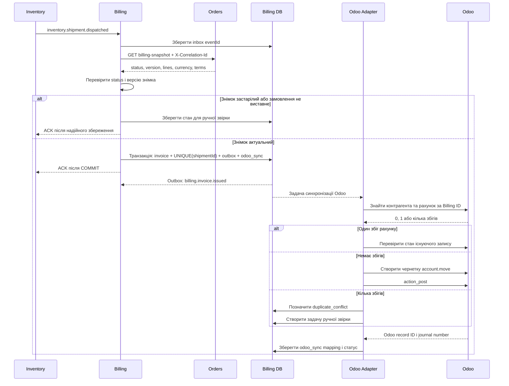

# Опиши завдання лабораторної №3

> прочитай файл lab-03.md в цьому проєкті
>
> візьми до контексту дані результатів виконання минулих лабораторних робіт з папки result цього проєкту і контекстів чатів та сформуй і напиши, що мені потрібно зробити в цій лабораторній роботі

<details><summary>2 previous messages</summary>

> Прочитаю умову `lab-03.md`, матеріали з папки `result` і доступний контекст попередніх чатів, щоб скласти конкретний план виконання лабораторної.
>
> <details><summary>Ran 7 commands</summary>
>
> - Ran `Get-ChildItem -Force; rg --files -g "lab-03.md" -g "result/**" -g "**/result/**" -g "AGENTS.md"`
> - Ran `Get-Content -Raw corporate-software-systems-lessons\lab-03.md; Get-Content -Raw corporate-software-systems-lessons\result\golubiev-bohdan\lab-01.md; Get-Content -Raw corporate-software-systems-lessons\result\golubiev-bohdan\lab-02.md; Get-Content -Raw corporate-software-systems-lessons\result\golubiev-bohdan\lab-02-billing-golubiev.md`
> - Ran `$p='corporate-software-systems-lessons\lab-03.md'; $lines=Get-Content $p; for($i=120;$i -lt $lines.Length;$i++){ '{0}: {1}' -f ($i+1),$lines[$i] }`
> - Ran `Get-ChildItem corporate-software-systems-lessons -Force; rg --files corporate-software-systems-lessons`
> - Ran `$p='corporate-software-systems-lessons\lab-03.md'; $l=Get-Content $p; for($i=224;$i -lt 264;$i++){ '{0}: {1}' -f ($i+1),$l[$i] }; rg -n "^#|^##|^###|NFR|endpoint|Ендпоінт|endpoint|API|поді|автомат станів|сценар|Lead-to-Cash" corporate-software-systems-lessons\result\golubiev-bohdan\lab-02.md | Select-Object -First 100`
>
> Tool call
>
> Tool: list_threads
> Status: completed
>
> Tool call
>
> Tool: read_thread
> Status: completed
>
> Tool call
>
> Tool: read_thread
> Status: completed
>
> Tool call
>
> Tool: read_thread
> Status: completed
>
> Tool call
>
> Tool: read_thread
> Status: completed
>
> - Ran `rg -n "^## |^### |^#### |BIL-R|API|POST /|GET /|events|події|status|NFR|ADR-0004|payment_import|webhook|order.cancelled|shipment.dispatched|invoice.issued" corporate-software-systems-lessons\result\golubiev-bohdan\lab-02-billing-golubiev.md | Select-Object -First 140; rg -n "NFR-PERF|billing|Billing|поді|envelope|correlationId|Roles|ролі|role" corporate-software-systems-lessons\result\golubiev-bohdan\lab-01.md | Select-Object -First 60;`
> - Ran ``$p='corporate-software-systems-lessons\result\golubiev-bohdan\lab-02-billing-golubiev.md'; $l=Get-Content $p; for($i=245;$i -lt 395;$i++){ if($l[$i] -match '^##|^###|^\|.*(/|BIL-|billing\.)|^\| `'){ '{0}: {1}' -f ($i+1),$l[$i] } }; $p='corporate-software-systems-lessons\result\golubiev-bohdan\lab-01.md'; $l=Get-Content $p; for($i=0;$i -lt 24;$i++){ '{0}: {1}' -f ($i+1),$l[$i] }``
>
> </details>

</details>

## Що потрібно зробити в ЛР3

Твій модуль — **Billing** у проєкті «КавоХаб». У ЛР3 треба спроєктувати, як Billing взаємодіє з іншими модулями та зовнішніми сервісами. **Код писати не потрібно**: результат — проєктний документ із контрактами, таблицями, схемами й сценаріями.

Я врахував умову [lab-03.md](./corporate-software-systems-lessons/lab-03.md), результати [ЛР1](./corporate-software-systems-lessons/result/golubiev-bohdan/lab-01.md) і [ЛР2](./corporate-software-systems-lessons/result/golubiev-bohdan/lab-02-billing-golubiev.md), а також попередні чати про план ЛР2, модель API та правила Billing.

### 1. Підготувати вихідні дані

На початку документа коротко зафіксуй, що береш із попередніх робіт:

- межі Billing і його правила BIL-R1–R6;
- життєві цикли рахунку, платежу й кредит-ноти;
- ендпоінти та ролі з ЛР2;
- події, на які підписується Billing: `crm.account.upserted`, `inventory.shipment.dispatched`, `orders.order.cancelled`;
- рішення, що Billing має власний номер рахунку, а Odoo — окремий номер бухгалтерського запису.

Під час роботи з платежами збережи вже погоджену логіку: Billing пропонує кандидатів на розподіл, а підтверджує розподіл лише `accountant`. Невизначений платіж залишається нерозподіленим; сервіс не має самостійно закривати ним рахунки.

### 2. Описати контракти Billing

Підготуй два контракти:

- **OpenAPI 3.1** для API Billing — усі основні ендпоінти з ЛР2, їхні запити, відповіді, схеми даних, ролі та помилки у форматі `application/problem+json`.
- **AsyncAPI 3.0** для подій, які публікує Billing: насамперед `billing.invoice.issued` і `billing.payment.received`.

Для небезпечних POST-команд опиши `Idempotency-Key`: повтор із тим самим ключем і тілом не виконує дію вдруге, а повтор із іншим тілом повертає `422`. Передбач `X-Correlation-Id` для HTTP-викликів і `correlationId` у подіях. Додай 3–5 власних правил лінтингу контракту та поясни, як команди-споживачі зможуть працювати з mock-сервером до готовності реалізації.

Як основу можна взяти вже визначені в ЛР2 маршрути, зокрема `POST /invoices/{id}/issue`, `POST /payment-imports`, `POST /payments/{id}/proposals`, `POST /payments/{id}/allocate`, а також маршрути для кредит-нот і звіту за дебіторською заборгованістю. Не забудь про правило доступу: CSV завантажує `accountant`, batch обробляє `svc-billing`; `svc-billing` не підтверджує allocation.

### 3. Спроєктувати взаємодію з іншими модулями

Зроби таблицю підписок Billing із такими полями: подія, обробник, бізнес-зміна, поведінка при дублікаті та події не за порядком.

Для кожного стику зафіксуй протокол, тайм-аути, повтори, ідемпотентність і поведінку, якщо партнер недоступний. Найважливіші для Billing стики:

- `inventory.shipment.dispatched` → отримати рядки й ціни замовлення через `GET /orders/{id}`, сформувати та виставити рахунок;
- `orders.order.cancelled` → скасувати лише чернетку; якщо рахунок уже проведений, не змінювати його й створити задачу для бухгалтера;
- `crm.account.upserted` → оновити локальну репліку клієнта.

Для синхронних викликів вкажи тайм-аут на з’єднання близько 1 с і на відповідь 2–3 с, до трьох повторів лише для ідемпотентних запитів і тимчасових помилок. Кожен вихідний виклик передає `X-Correlation-Id`.

### 4. Описати обробку подій і збоїв

Опиши топологію RabbitMQ для Billing: основну quorum-чергу, чергу повторів із затримкою, DLQ та прив’язки до routing key. Покажи обробку однієї конкретної події, наприклад `inventory.shipment.dispatched`.

Псевдокод має зафіксувати головне: записати `message.id` у таблицю оброблених повідомлень і виконати бізнес-зміну в одній транзакції; надіслати `ack` лише після `COMMIT`. Для тимчасових помилок передбачити до п’яти спроб, після чого повідомлення переходить у DLQ. Опиши також, хто переглядає DLQ, як визначає причину та як безпечно повторно обробляє повідомлення.

### 5. Додати сценарії стійкості

Напиши щонайменше три сценарії **Given / When / Then**:

1. Подія `inventory.shipment.dispatched` приходить повторно — створюється не більше одного рахунку.
2. Повідомлення з невалідними даними після п’яти спроб переходить у DLQ.
3. Повтор `POST /invoices/{id}/issue` з тим самим ключем і тілом повертає збережений результат і не видає другий номер.

Добре також окремо описати випадок, коли процес падає після `COMMIT`, але до `ack`: повторна доставка не повинна повторити бізнес-зміну.

### 6. Спроєктувати інтеграцію Billing з Odoo

Побудуй Mermaid-діаграму послідовності для проведення рахунку. Покажи, як Billing створює або оновлює контрагента, створює й проводить рахунок через адаптер, зберігає зіставлення номера Billing із Odoo ID та номером бухгалтерського запису.

Додай таблицю відображення полів між моделлю Billing та Odoo. Зафіксуй обробку помилок і недоступності: у партнера Odoo 18 Community, орієнтовний ліміт — 60 запитів за хвилину, щонеділі є вікно недоступності, а перехід на Odoo 19 запланований без визначеної дати. Після недоступності запити мають відновлюватися контрольовано, з обмеженням швидкості й повторами з backoff та jitter.

Оформи ADR з 2–3 реальними варіантами, зокрема: весь процес в Odoo, Billing окремо з адаптером до Odoo, або гібридний підхід. Для кожного зазнач наслідки, а обраним залиш узгоджене в ЛР2 рішення: **Billing окремо, Odoo через адаптер**.

### 7. Провести уявний Lead-to-Cash прогін

Пройди сценарій із розділу 6.3 умови: угода стала `won`, Orders створює й підтверджує замовлення, Inventory резервує та відвантажує, Billing виставляє рахунок, надходить платіж. Для кожного кроку, де бере участь Billing, перевір назви й типи полів, ідентифікатори, помилки, порядок подій та `correlationId`.

Потім змоделюй повторну доставку події резерву й недоступність зовнішньої системи. Результат оформи діаграмою послідовності та таблицею розбіжностей: крок, розбіжність, чия сторона, запропонована зміна контракту, реакція команди або відкрите питання.

### 8. Зібрати документ і самоперевірку

Здай один файл `lab-03-billing-golubiev.md` із розділами: вихідні дані, контракти, взаємодія модуля, обмін подіями, сценарії стійкості, Odoo, інтеграційний прогін, журнал рішень, відкриті питання та самоперевірка. OpenAPI й AsyncAPI можна вкласти в документ або додати окремими YAML-файлами.

Наприкінці дай відповіді щонайменше на п’ять контрольних питань, зосередившись на Billing: ідемпотентність, `ack` після `COMMIT`, повтори HTTP, недоступність Odoo, підпис і дублікати webhook, події не за порядком. Додай посилання або експорт діалогу, якщо це потрібно для здачі.

**Порядок роботи:** спочатку OpenAPI й AsyncAPI, потім підписки та стійкість, далі Odoo й ADR, після цього інтеграційний прогін і фінальна самоперевірка. Так ти перевіриш контракти до проходження наскрізного сценарію й встигнеш зафіксувати знайдені розбіжності.

> Щодо підготовки вихідних даних, давай візьмемо наявні з файлів минули робіт, та винесемо те чого не вистачає в них для поточної лабораторної роботи.&#x20;
>
> сформуємо поєтапно план виконання поточної роботи - що виконуємо зараз та що наступним
>
> як я зрозумів мета цієї роботи спроєктувати, як мій модуль Billing взаємодіє з іншими модулями та зовнішніми сервісами, щоб разом вони працювали як одна система

Так, ти правильно зрозумів мету: **спроєктувати, як Billing взаємодіє з іншими модулями та зовнішніми сервісами, щоб модулі разом працювали як одна система**. Для цього опишемо контракти, обмін подіями, поведінку за збоями й наскрізний сценарій Lead-to-Cash. Код писати не потрібно.

Вихідні дані не треба переписувати з нуля. Візьмемо готове з [ЛР1](./corporate-software-systems-lessons/result/golubiev-bohdan/lab-01.md) і [ЛР2 Billing](./corporate-software-systems-lessons/result/golubiev-bohdan/lab-02-billing-golubiev.md), а окремо зафіксуємо те, чого бракує саме для ЛР3.

## План роботи поетапно

### Етап 1. Підготувати контекст Billing і межі контрактів — **виконуємо зараз**

З попередніх лабораторних беремо:

- бізнес-правила Billing BIL-R1–R6, сутності та стани рахунків, платежів і кредит-нот;
- ендпоінти, ролі доступу та правила зіставлення платежів;
- рішення: Billing зберігає власний номер рахунку, а з Odoo окремо зберігається номер бухгалтерського запису;
- події, на які Billing підписаний: `crm.account.upserted`, `inventory.shipment.dispatched`, `orders.order.cancelled`;
- факт, що проведений рахунок не редагується, а коригується окремим документом.

Для ЛР3 треба додатково визначити або уточнити:

- які саме дані Billing публікує в `billing.invoice.issued` і `billing.payment.received`;
- повні поля в подіях, які Billing споживає, особливо `inventory.shipment.dispatched`;
- як пов’язуються `orderId`, `shipmentId`, `invoiceId`, `paymentId` та ідентифікатори Odoo;
- як кожен обробник поводиться з дублікатом і подією не за порядком;
- які API-контракти й статуси потрібні споживачам Billing;
- як ідемпотентність, `correlationId`, тайм-аути та повтори застосовуються до конкретних команд і стиків.

**Результат цього етапу:** перелік використаних фактів із ЛР1–ЛР2 і короткий список прогалин, які треба закрити під час проєктування ЛР3.

### Етап 2. Спроєктувати контракти Billing — **наступним**

На основі наявного API з ЛР2 сформуємо OpenAPI 3.1, а для подій Billing — AsyncAPI 3.0. Перевіримо контракти з погляду модулів-споживачів: чи вистачає їм даних для роботи.

**Результат:** контракти, правила помилок, ролі, ідемпотентність, кореляція та правила версіонування.

### Етап 3. Описати стики й асинхронну взаємодію

Зробимо таблиці синхронних викликів і підписок Billing. Для кожного стику визначимо тайм-аути, повтори та поведінку за недоступності. Окремо опишемо RabbitMQ, таблицю оброблених повідомлень, `ack` після `COMMIT`, retry та DLQ.

**Результат:** таблиця стиків, таблиця обробників подій і псевдокод ідемпотентного споживача.

### Етап 4. Спроєктувати інтеграцію з Odoo

Опишемо послідовність створення й проведення рахунку, відповідність полів Billing ↔ Odoo, помилки та поведінку під час недоступності. Зафіксуємо ADR з альтернативами, зберігши рішення ЛР2: Billing окремо, Odoo через адаптер.

**Результат:** діаграма послідовності, мапінг полів та ADR.

### Етап 5. Перевірити стійкість і пройти Lead-to-Cash

Сформулюємо Given/When/Then для дубліката події, «отруйного» повідомлення та повторного HTTP-запиту. Потім пройдемо сценарій із ЛР3 від виграної угоди до рахунку й платежу, зупиняючись на нестачі полів або суперечностях.

**Результат:** сценарії стійкості, діаграма прогону та таблиця розбіжностей із рішеннями або відкритими питаннями.

### Етап 6. Зібрати документ і самоперевірку

Зберемо артефакти в `lab-03-billing-golubiev.md`, додамо відкриті питання, журнал рішень, відповіді щонайменше на п’ять контрольних питань і самоперевірку за критеріями оцінювання.

Отже, **зараз починаємо з Етапу 1**: систематизуємо готову основу з попередніх робіт і визначаємо прогалини для контрактів Billing. Наступним кроком після цього буде OpenAPI й AsyncAPI.

> Що Billing публікує:&#x20;
>
> Доставка за принципом щонайменше один раз, дублікати відкидають за `id`. Публікація йде через outbox. &#x20;
>
> подія - data
>
> billing.invoice.issued - invoiceId, orderId, shipmentId, invoiceNumber, accountId, totalAmount, currency, issuedAt, dueAt
>
> billing.payment.received - paymentId, receivedAt, currency, allocations[{invoiceId, amount}]
>
> Події, які Billing споживає
>
> - `inventory.shipment.dispatched`: вартість доставки з події фіксує Orders у знімку
> - `orders.order.cancelled`
> - `crm.account.upserted`
> - REST-знімок Orders (`GET /internal/orders/{orderId}/billing-snapshot`) `status, version`, ціни, знижка, валюта, курс і дата, умови оплати, одержувач, правило або сума доставки.
>
> як пов'язані ідентифікатори:
>
> - `orderId` належить Orders. `shipmentId` належить Inventory, один `orderId` може мати кілька `shipmentId`, але чи буде окремий рахунок на кожну часткову поставку?
> - `invoiceId` це UUID Billing. Окремо є `billingInvoiceNumber` і `odooJournalNumber`
> - В Odoo зв'язок зберігає `odoo_sync` з унікальними `invoice_id` і `odoo_record_id`
> - `paymentId` це UUID платежу, імпортованого з виписки
> - розподіл `payment_allocation(payment_id, invoice_id)` має власний `idempotency_key`
>
> дублікат і порядок подій:
>
> shipment.dispatched - Inbox: унікальні `eventId` і `shipmentId`. ACK після commit, нової роботи немає. - Перед виставленням Billing перевіряє `status` і `version` знімка Orders. Застарілий знімок призводить до зупинки й ручної звірки. &#x20;
>
> order.cancelled - Ідемпотентний за `eventId`, повтор нічого не змінює. - Чернетка стає `cancelled` без номера. &#x20;
>
> crm.account.upserted - порівнювати `source_updated_at`, старішу версію відкидати &#x20;
>
> щодо PI-контракти й статуси потрібні споживачам Billing та як ідемпотентність, `correlationId`, тайм-аути та повтори застосовуються до конкретних команд і стиків запропонуй власні варіанти базуючись на контексті чатів та діючи як системний архітектор

Так, цього вже достатньо, щоб зафіксувати основу Етапу 1. Нижче — мої архітектурні пропозиції для двох відкритих частин: які API потрібні споживачам Billing і як застосувати ідемпотентність, кореляцію, тайм-аути та повтори.

## 1. API Billing для його споживачів

Важливо не змушувати споживачів робити синхронний запит, якщо даних достатньо в події. API потрібне для читання актуального стану й отримання документів; команди, що створюють фінансові наслідки, мають бути ідемпотентними.

| Споживач / потреба                                     | Пропозиція                                                                                                                                                 | Навіщо                                                                                                            |
| ------------------------------------------------------ | ---------------------------------------------------------------------------------------------------------------------------------------------------------- | ----------------------------------------------------------------------------------------------------------------- |
| Orders має знати, чи сплачено рахунок                  | Додати до `billing.payment.received` `invoiceStatus`, `outstandingAmount` і `paidAt` або публікувати окрему подію `billing.invoice.payment_status_changed` | Зараз Orders не може надійно визначити, чи закрито рахунок: у події є розподіли, але немає суми рахунку й залишку |
| Notifications надсилає клієнту рахунок                 | `GET /internal/invoices/{invoiceId}/document` або `GET /internal/invoices/{invoiceId}` із посиланням на PDF та потрібними реквізитами                      | `billing.invoice.issued` може нести `invoiceId` і `accountId`, але не сам PDF та адресу одержувача                |
| Orders або підтримка перевіряє стан рахунку            | `GET /internal/invoices/{invoiceId}`; за потреби `GET /internal/orders/{orderId}/invoices`                                                                 | Дає актуальний стан, номер Billing, валюту, суму, дату й стан синхронізації з Odoo                                |
| Billing приймає знімок замовлення                      | Залишити `GET /internal/orders/{orderId}/billing-snapshot` на боці Orders                                                                                  | Це контракт між Billing і Orders; Billing не має напряму читати їхню БД                                           |
| Odoo-адаптеру треба перевірити результат синхронізації | Внутрішній `GET /internal/invoices/{invoiceId}` має повертати `odooSyncStatus` і `odooJournalNumber`, коли вони вже відомі                                 | Проведення в Billing та синхронізація з Odoo — окремі кроки                                                       |

Для подій пропоную узгодити назви полів:

- У `billing.invoice.issued` використовувати **`billingInvoiceNumber`**, а не неоднозначне `invoiceNumber`. `odooJournalNumber` додавати лише якщо номер уже присвоєний; не затримувати подію про виданий рахунок, очікуючи на синхронізацію з Odoo.
- У `billing.payment.received` додати `amount` — повну суму платежу. `allocations` може бути порожнім або частковим, тож сама наявність платежу не означає, що рахунок або замовлення повністю оплачене.
- Якщо Orders має оновлювати стан до `paid`, краще передавати **стан розрахунків конкретного рахунку** (`invoiceStatus`, `outstandingAmount`) окремою подією після підтвердження allocation. Подія про отримання платежу й подія про зміну стану рахунку означають різні факти.

Наприклад, рекомендований додатковий контракт:

```text
billing.invoice.payment_status_changed
data:
  invoiceId
  orderId
  status: unpaid | partially_paid | paid
  outstandingAmount
  currency
  changedAt
```

Загальний envelope події має містити `specversion`, `id` (ідентифікатор події), `type`, `source`, `time`, `correlationId` і `data`. У `billing.payment.received` варто також передавати `paymentId` як ідентифікатор доменного платежу, не плутаючи його з `id` події.

### Відкритий вибір: рахунок на поставку чи на замовлення

Оскільки одне замовлення може мати кілька `shipmentId`, треба окремо зафіксувати, чи створюється рахунок на кожну часткову поставку. Моя робоча пропозиція — **один рахунок на одну відвантажену поставку**: Billing споживає `inventory.shipment.dispatched`, бере знімок Orders для цієї поставки й запобігає повторному виставленню за `shipmentId`. Це відповідає виставленню за фактично відвантаженим товаром, але лишається припущенням до підтвердження бізнесом.

За цього варіанта варто мати обмеження на кшталт `UNIQUE(shipment_id)` для рахунку, якщо бізнес не дозволяє кілька рахунків на одну поставку. Якщо потрібен один рахунок на все замовлення, треба визначити момент його створення — наприклад, після повного відвантаження — і як Orders повідомляє Billing, що поставки завершені.

## 2. Ідемпотентність і обробка подій

Запропонована тобою схема для `inventory.shipment.dispatched` правильна за умови, що inbox-запис і створення чернетки рахунку відбуваються **в одній транзакції**:

1. Вставити `eventId` у `billing.processed_messages`.
2. Перевірити унікальність `shipmentId` для рахунку.
3. Зберегти посилання на подію та створити/оновити чернетку.
4. Зафіксувати транзакцію.
5. Надіслати `ack`.

Якщо `eventId` уже був, обробник нічого не змінює й підтверджує повідомлення. Унікальність `shipmentId` — додатковий захист від логічного дубля, коли одна поставка випадково прийшла з іншим `eventId`.

Перед проведенням рахунку Billing звіряє `status` і `version` зі знімком Orders. Якщо версія застаріла, не проводить рахунок. Замість нескінченного повтору слід перевести операцію в стан очікування актуального знімка або ручної звірки. Це захищає від виставлення рахунку за вже зміненими цінами чи умовами.

Для інших підписок:

- `orders.order.cancelled`: inbox-дедуплікація за `eventId`; чернетка переходить у `cancelled` без номера; для проведеного рахунку створюється задача на розгляд, сам рахунок не змінюється.
- `crm.account.upserted`: зберігати повну репліку; приймати лише версію з новішим `source_updated_at`. Повтор або старіша версія — без бізнес-зміни.
- Публікація подій Billing: записувати подію в **outbox у тій самій транзакції**, що й зміну рахунку або платежу. Фоновий publisher надсилає її в RabbitMQ із publisher confirms. Якщо він упаде після публікації, подія може прийти повторно — споживачі дедуплікують її за `id`.

## 3. Ідемпотентність HTTP-команд

Для команд із фінансовими наслідками клієнт передає `Idempotency-Key` (UUID). Ключ зберігається разом із типом операції, хешем запиту та результатом; область унікальності — щонайменше клієнт/роль + операція + ключ.

| Команда                                 | Ідемпотентна поведінка                                                                                                                  |
| --------------------------------------- | --------------------------------------------------------------------------------------------------------------------------------------- |
| `POST /invoices/{id}/issue`             | Той самий ключ і тіло повертають первинний результат; номер Billing не видається повторно                                               |
| `POST /payments/{id}/allocate`          | Ключ захищає від повторного створення того самого allocation; суми й залишки повторно перевіряються в транзакції                        |
| `POST /payment-imports`                 | Ключ запобігає повторному створенню batch при повторному HTTP-запиті; хеш файлу та bank reference додатково відсікають повторний імпорт |
| Внутрішнє створення рахунку зі shipment | Бізнес-ідемпотентність за `shipmentId`, незалежно від HTTP-ключа                                                                        |

Для повторного використання того самого ключа з іншим тілом — `422 idempotency-key-reuse`; якщо перший запит ще виконується — `409 request-in-progress`. Ключ allocation не замінює inbox-дедуплікацію подій: це різні точки входу й різні гарантії.

## 4. Кореляція, тайм-аути й повтори

- На вході Billing бере `X-Correlation-Id`; якщо його немає — генерує UUID. Усі HTTP-виклики Orders та Odoo отримують той самий `X-Correlation-Id`.
- При обробці події Billing переносить `correlationId` у вихідні події та журнали. Для зв’язку конкретної події з командою додатково корисний `causationId` — ID вхідної події.
- Для Orders `GET /internal/orders/{orderId}/billing-snapshot`: connect timeout **1 с**, response timeout **3 с**. Як ідемпотентний GET його можна повторити до трьох спроб із затримкою `200 мс × 2ⁿ + jitter`, лише на timeout, `429`, `502`, `503`, `504`.
- Для бізнес-відповіді зі застарілою `version` — не застосовувати HTTP-повтори як лікування; зупинити виставлення й запросити актуальне рішення/знімок.
- Якщо Orders недоступний після повторів, не створювати рахунок із неповними даними. Зберегти роботу як `pending_snapshot` і повторити пізніше через контрольовану чергу; після ліміту спроб — DLQ та ручний розгляд.
- Для Odoo застосувати ті самі стартові тайм-аути, але врахувати ліміт близько 60 запитів на хвилину. Повторювати можна лише операцію, безпеку повтору якої забезпечує адаптер через збережене зіставлення `invoiceId` ↔ `odoo_record_id`. Не повторювати `action_post` наосліп: спершу перевірити, чи рахунок уже проведений у Odoo.
- Для RabbitMQ тимчасова помилка: до п’яти повторів із затримкою, після цього DLQ. Помилки контракту або невалідні дані не варто безкінечно повторювати; одразу маркувати як poison message і спрямовувати на розбір.

Ці рішення можна внести у вихідні дані ЛР3 як **архітектурні пропозиції**, відокремивши їх від фактів попередніх робіт. Невирішеними наразі лишаються бізнес-вибір щодо рахунку на часткову поставку та підтвердження, які саме дані про оплату потрібні Orders для зміни статусу замовлення.

> зараз я маю такі думки:
> Рахунок на часткову поставку. Для початку варто прийняти модель «один рахунок на одну відвантажену поставку». Billing споживає `inventory.shipment.dispatched`, бере знімок Orders для цієї поставки й виставляє рахунок за фактично відвантаженим. Захист від дубля забезпечує `UNIQUE(shipment_id)` разом з inbox-дедуплікацією за `eventId`
> Дані про оплату для Orders. Самої події `billing.payment.received` для зміни статусу недостатньо: `allocations` можуть бути порожніми або частковими, а суми рахунку й залишку в ній немає.

Обидва рішення добре закривають прогалини у вихідних даних. Я б зафіксував їх як **проєктні рішення ЛР3**:

1. **Рахунок на часткову поставку:** один рахунок на один `shipmentId`. Billing обробляє `inventory.shipment.dispatched`, отримує знімок Orders для цієї поставки й виставляє рахунок за фактично відвантаженим. `UNIQUE(shipment_id)` захищає від повторного рахунку за ту саму поставку, а inbox-дедуплікація за `eventId` — від повторної обробки тієї самої події.

2. **Оплата для Orders:** `billing.payment.received` повідомляє, що платіж надійшов, але цього недостатньо, щоб Orders визначив стан розрахунків. Пропоную додати окрему подію `billing.invoice.payment_status_changed` із полями `invoiceId`, `orderId`, `status` (`unpaid`, `partially_paid`, `paid`), `outstandingAmount`, `currency` і `changedAt`.

Оскільки на одне замовлення можуть бути кілька рахунків, Orders має визначати стан оплати замовлення за всіма пов’язаними рахунками: наприклад, вважати його повністю оплаченим, коли всі рахунки оплачені. Це правило варто явно занести до контракту або позначити як припущення для наскрізного прогону.

Також у `billing.payment.received` залишаємо `paymentId`, повну суму платежу, валюту й фактичні `allocations`. Ця подія потрібна для факту надходження та аудиту платежу; окрема подія про стан рахунку — для реакції Orders.

> так, це ми фіксуємо
> який єтап наступний?

Зафіксували обидва рішення: **рахунок на кожну відвантажену поставку** із захистом за `shipmentId` та `eventId`, а для стану оплати Orders отримує окрему подію `billing.invoice.payment_status_changed`.

**Наступний етап — контракти Billing:** описати API в OpenAPI 3.1 і події в AsyncAPI 3.0. Почнемо з подій, щоб зафіксовані рішення одразу стали частиною контракту:

- `billing.invoice.issued`;
- `billing.payment.received`;
- `billing.invoice.payment_status_changed`.

Для кожної визначимо envelope, обов’язкові поля, типи, ідентифікатори та версіювання. Потім опишемо API Billing, яке потрібне споживачам для читання актуального стану рахунку й отримання рахунку, наприклад PDF.

Після цього перевіримо, чи вистачає контрактам даних для Orders, Notifications та інших споживачів, і зафіксуємо відкриті питання. Код писати не потрібно.

> Дій як системний архітектор:
> для `billing.invoice.issued`,`billing.payment.received` я вже надавав можливі поля,&#x20;
> сформуй недостаючі елементи для поточного етапу, які я потом перевірю

Нижче — **чернетка контрактних елементів Billing для перевірки**. Твої поля для `billing.invoice.issued` і `billing.payment.received` залишив; додав envelope, типи й семантику полів. Нові або уточнені пропозиції позначив окремо.

## 1. Спільний envelope подій

Пропоную використовувати однакову зовнішню структуру для всіх подій Billing:

| Поле            | Тип         | Обов’язкове | Значення                                                |
| --------------- | ----------- | ----------: | ------------------------------------------------------- |
| `specversion`   | string      |         так | Версія формату envelope, наприклад `1.0`                |
| `id`            | UUID        |         так | Унікальний ID конкретної події; ключ inbox-дедуплікації |
| `type`          | string      |         так | Тип події, наприклад `billing.invoice.issued`           |
| `source`        | URI/string  |         так | Сервіс, що опублікував подію, наприклад `billing`       |
| `time`          | date-time   |         так | Час публікації події                                    |
| `correlationId` | UUID/string |         так | Наскрізний ID бізнес-сценарію                           |
| `causationId`   | UUID/string |          ні | ID події або команди, що спричинила цю подію            |
| `dataschema`    | URI/string  |         так | Ідентифікатор версії схеми payload                      |
| `data`          | object      |         так | Дані конкретної події                                   |

`id` envelope — це **ID події**, він відрізняється від `invoiceId` або `paymentId`, які ідентифікують доменні об’єкти. Повторна публікація тієї самої події з outbox зберігає той самий `id`.

## 2. Подія `billing.invoice.issued`

Твої поля можна задати так:

| Поле в `data`          | Тип                | Обов’язкове | Примітка                                                                              |
| ---------------------- | ------------------ | ----------: | ------------------------------------------------------------------------------------- |
| `invoiceId`            | UUID               |         так | ID рахунку в Billing                                                                  |
| `orderId`              | UUID/string        |         так | ID замовлення у власності Orders                                                      |
| `shipmentId`           | UUID/string        |         так | ID поставки у власності Inventory; одна поставка — один рахунок за прийнятим рішенням |
| `billingInvoiceNumber` | string             |         так | Номер, виданий Billing                                                                |
| `accountId`            | UUID/string        |         так | ID клієнта з CRM                                                                      |
| `totalAmount`          | decimal string     |         так | Загальна сума рахунку після застосування знижок і правил округлення                   |
| `currency`             | string             |         так | Код валюти, наприклад `UAH`                                                           |
| `issuedAt`             | date-time          |         так | Час проведення рахунку в Billing                                                      |
| `dueAt`                | date-time або date |         так | Строк оплати; формат треба узгодити з моделлю ЛР2                                     |

`odooJournalNumber` не робив би обов’язковим: номер Odoo може з’явитися після видачі рахунку в Billing. Якщо він уже відомий, його можна передати як необов’язкове поле або повідомити окремою подією синхронізації.

## 3. Подія `billing.payment.received`

Залишаємо надані тобою поля і пропоную додати повну суму платежу: інакше одержувач не зможе відрізнити розмір платежу від суми, яку вже розподілили.

| Поле в `data`             | Тип            |         Обов’язкове | Примітка                                                       |
| ------------------------- | -------------- | ------------------: | -------------------------------------------------------------- |
| `paymentId`               | UUID           |                 так | ID платежу в Billing                                           |
| `receivedAt`              | date-time      |                 так | Дата/час надходження платежу                                   |
| `amount`                  | decimal string | **пропозиція: так** | Повна сума платежу                                             |
| `currency`                | string         |                 так | Код валюти                                                     |
| `allocations`             | array          |                 так | Підтверджені розподіли; масив може бути порожнім або частковим |
| `allocations[].invoiceId` | UUID           |                 так | Рахунок Billing                                                |
| `allocations[].amount`    | decimal string |                 так | Сума, розподілена на цей рахунок                               |

Ця подія повідомляє про **надходження платежу**, а не про повну оплату замовлення. Підтверджені розподіли в події мають бути вже закомічені в Billing.

## 4. Нова подія `billing.invoice.payment_status_changed`

Це пропозиція для повідомлення Orders про зміну стану розрахунків за рахунком:

| Поле в `data`       | Тип            | Обов’язкове | Примітка                              |
| ------------------- | -------------- | ----------: | ------------------------------------- |
| `invoiceId`         | UUID           |         так | Рахунок Billing                       |
| `orderId`           | UUID/string    |         так | Замовлення, якому належить рахунок    |
| `status`            | enum           |         так | `unpaid`, `partially_paid` або `paid` |
| `outstandingAmount` | decimal string |         так | Непогашений залишок                   |
| `currency`          | string         |         так | Код валюти                            |
| `changedAt`         | date-time      |         так | Час зміни стану                       |

Рекомендую публікувати її після підтвердження allocation, а також після кредит-ноти чи іншої операції, що змінює залишок. Orders агрегує стани всіх рахунків замовлення; правило «замовлення оплачене, коли оплачені всі його рахунки» варто додати до контракту Orders як пропозицію на узгодження.

## 5. OpenAPI: маршрути Billing для першої чернетки

За основу беремо маршрути з ЛР2. У контракт треба внести для кожного `operationId`, роль, схеми запиту/відповіді та перелік `Problem`-помилок.

| Метод і шлях                              | Для чого                                                 | Ролі / ідемпотентність                                        |
| ----------------------------------------- | -------------------------------------------------------- | ------------------------------------------------------------- |
| `POST /invoices`                          | Створити чернетку рахунку для відвантаженої поставки     | `svc-billing`, за довіреним внутрішнім потоком                |
| `PUT /invoices/{invoiceId}/lines`         | Змінити рядки чернетки                                   | `accountant`                                                  |
| `POST /invoices/{invoiceId}/issue`        | Провести рахунок і видати номер Billing                  | `accountant`, `svc-billing`; `Idempotency-Key`                |
| `POST /invoices/{invoiceId}/cancel`       | Скасувати лише чернетку                                  | `accountant`; `Idempotency-Key`                               |
| `POST /invoices/{invoiceId}/credit-notes` | Створити коригувальний документ                          | `accountant`; `Idempotency-Key`                               |
| `POST /payment-imports`                   | Завантажити CSV-виписку                                  | `accountant`; `Idempotency-Key`                               |
| `POST /payments`                          | Додати одиничний платіж або нормалізований рядок імпорту | `accountant` або `svc-billing`; `Idempotency-Key`             |
| `POST /payments/{paymentId}/proposals`    | Сформувати кандидатів на зіставлення                     | `svc-billing`; без фінального allocation                      |
| `POST /payments/{paymentId}/allocate`     | Підтвердити розподіл платежу                             | лише `accountant`; `Idempotency-Key` на всю команду розподілу |
| `GET /invoices/{invoiceId}`               | Отримати актуальний стан рахунку                         | `accountant`, `svc-billing`, за потреби `orders`              |
| `GET /orders/{orderId}/invoices`          | Отримати рахунки, пов’язані із замовленням               | внутрішній доступ для `orders`                                |
| `GET /invoices/{invoiceId}/document`      | Отримати PDF або короткоживуче посилання                 | `notifications` та авторизовані ролі                          |
| `GET /receivables/aging?asOf=`            | Звіт про заборгованість                                  | `accountant`, `director`                                      |

Шлях `GET /internal/orders/{orderId}/billing-snapshot` належить **Orders**, а не Billing. Його контракт Billing споживає, але визначати його як endpoint Billing не потрібно.

Для кожної операції варто описати типові відповіді `400`, `401`, `403`, `404`, `409`, `422`, `429`, `500`, `503` через `application/problem+json`. `Idempotency-Key` повторно використаний з іншим тілом — `422 idempotency-key-reuse`; команда з тим самим ключем, що ще виконується, — `409 request-in-progress`.

Окремий endpoint для платіжного webhook — `POST /webhooks/payments` — також треба включити, якщо Billing прийматиме callback від платіжного провайдера. Для нього потрібні перевірка HMAC, дедуплікація за ID події провайдера та швидка відповідь `2xx` після надійного збереження повідомлення для асинхронної обробки.

## 6. Що перевірити перед тим, як вважати контракти узгодженими

1. Чи `orderId`, `shipmentId`, `accountId` мають конкретний формат у проєкті, чи залишаємо їх UUID/string?
2. Чи `dueAt` — дата без часу чи timestamp із часовою зоною?
3. Чи додаємо `amount` до `billing.payment.received`?
4. Чи підходять Orders подія `billing.invoice.payment_status_changed` і правило агрегації статусів кількох рахунків?
5. Чи PDF буде віддаватися через Billing API, чи Notifications отримає документ іншим способом?
6. Чи платіжний провайдер входить до реалізації цього модуля, чи endpoint webhook лише описуємо як майбутній стик?

Після твоєї перевірки ці рішення можна оформити в OpenAPI/AsyncAPI-схеми та звірити з потребами команд-споживачів.

> ось відповіді
>
> 1. Формат ID. пропоную `orderId`, `shipmentId` і `accountId` у контракті залишити як `string` (UUID бажаний, але не вимагати його). `invoiceId` і `paymentId` належать Billing, тож для них фіксуємо UUID. Billing не повинен розбирати чужі ID, лише зберігати та передавати їх як є.
> 2. `dueAt`. Строк оплати, найімовірніше, бізнесова дата без часу, пропоную узгодити з моделлю ЛР2: якщо там `date`, то в події теж `date` (`YYYY-MM-DD`). Якщо потрібен timestamp, то обов'язково з часовою зоною
> 3. `amount` у `billing.payment.received`. Так, додаємо як обов'язкове поле (decimal string) разом з `currency`
> 4. Подія `billing.invoice.payment_status_changed` і агрегація. Це пропозиція, яку Orders має підтвердити. Правило: замовлення оплачене, коли оплачені всі його рахунки; якщо оплачена лише частина, то статус «частково оплачено». Подію варто публікувати також після кредит-нот. Потрібна згода Orders і на назву події, і на правило агрегації.
> 5. PDF. віддаємо через Billing API: `GET /invoices/{invoiceId}/document` доступ для `notifications` і авторизованих ролей. Подія `billing.invoice.issued` PDF не несе, лише `invoiceId`.
> 6. Платіжний провайдер. провайдер не входить до реалізації, а `POST /webhooks/payments` лише описуємо як майбутній стик, реалізацію додати, лише якщо це явно вимагається.
>
> які наступні дії?
>
> і можим опереходити до наступного етапу

Так, переходимо до **Етапу 2 — контрактів Billing**. Відповіді зафіксував. Нижче — перша чернетка контрактної частини, щоб ти її перевірив перед оформленням повного OpenAPI й AsyncAPI.

## Чернетка AsyncAPI: події Billing

Для всіх подій пропоную спільний envelope: `specversion`, `id`, `type`, `source`, `time`, `correlationId`, `data`. `id` — UUID події для дедуплікації, `correlationId` простежує наскрізний сценарій, а `invoiceId` і `paymentId` ідентифікують сутності Billing. Чужі `orderId`, `shipmentId` і `accountId` залишаються рядками без вимоги UUID.

### `billing.invoice.issued`

`data` містить твої погоджені поля:

- `invoiceId: string (uuid)`
- `orderId: string`
- `shipmentId: string`
- `billingInvoiceNumber: string`
- `accountId: string`
- `totalAmount: string` — десяткове число
- `currency: string`
- `issuedAt: string (date-time)`
- `dueAt: string (date)` — якщо підтверджується типом у ЛР2

PDF подія не містить. Споживач Notifications отримує його через `GET /invoices/{invoiceId}/document`. `odooJournalNumber` до обов’язкових полів події не включаємо.

### `billing.payment.received`

Обов’язкові поля `data`:

- `paymentId: string (uuid)`
- `receivedAt: string (date-time)`
- `amount: string` — повна сума отриманого платежу
- `currency: string`
- `allocations: array` з об’єктами `{ invoiceId: string (uuid), amount: string }`

`allocations` може бути порожнім або частковим. Отже, ця подія повідомляє про надходження грошей, але сама по собі не означає, що замовлення оплачене.

### `billing.invoice.payment_status_changed` — пропозиція для Orders

`data`:

- `invoiceId: string (uuid)`
- `orderId: string`
- `status: unpaid | partially_paid | paid`
- `outstandingAmount: string`
- `currency: string`
- `changedAt: string (date-time)`

Публікувати подію після підтвердження allocation і після кредит-ноти, якщо вона змінила залишок або статус. Назва події та правило агрегації ще мають бути підтверджені командою Orders: пропозиція — замовлення оплачене, коли оплачені всі рахунки; якщо оплачена лише частина, воно частково оплачене.

## Чернетка OpenAPI: перелік операцій

У контракті зафіксуємо кожну операцію з ЛР2: `operationId`, параметри, схему запиту й відповіді, роль і можливі `application/problem+json` помилки.

| Операція                                  | Роль                                 | Контрактна примітка                                      |
| ----------------------------------------- | ------------------------------------ | -------------------------------------------------------- |
| `POST /invoices`                          | `svc-billing`                        | Створити рахунок-чернетку для поставки                   |
| `PUT /invoices/{invoiceId}/lines`         | `accountant`                         | Змінювати лише чернетку                                  |
| `POST /invoices/{invoiceId}/issue`        | `accountant`, `svc-billing`          | `Idempotency-Key`; видає `billingInvoiceNumber`          |
| `POST /invoices/{invoiceId}/cancel`       | `accountant`                         | Скасувати лише чернетку; `Idempotency-Key`               |
| `POST /invoices/{invoiceId}/credit-notes` | `accountant`                         | Створити коригувальний документ; `Idempotency-Key`       |
| `POST /payment-imports`                   | `accountant`                         | CSV-імпорт; batch обробляє `svc-billing`                 |
| `POST /payments`                          | `accountant`, `svc-billing`          | Створити ручний платіж або нормалізований запис          |
| `POST /payments/{paymentId}/proposals`    | `svc-billing`                        | Сформувати кандидатів, не підтверджувати розподіл        |
| `POST /payments/{paymentId}/allocate`     | `accountant`                         | Підтвердити allocation; `Idempotency-Key` на всю команду |
| `GET /invoices/{invoiceId}`               | авторизовані внутрішні ролі          | Прочитати стан, суми й залишок                           |
| `GET /orders/{orderId}/invoices`          | `orders`                             | Отримати рахунки замовлення                              |
| `GET /invoices/{invoiceId}/document`      | `notifications` та авторизовані ролі | Повернути PDF або короткоживуче посилання                |
| `GET /receivables/aging?asOf=`            | `accountant`, `director`             | Звіт заборгованості                                      |
| `POST /webhooks/payments`                 | майбутній зовнішній стик             | Описати контракт; реалізацію не включати                 |

У командних операціях повтор того самого `Idempotency-Key` з тим самим тілом повертає початковий результат; з іншим тілом — `422 idempotency-key-reuse`; якщо запит ще виконується — `409 request-in-progress`. Усі 4xx/5xx помилки оформлюємо через RFC 9457 Problem Details.

## Що робимо далі в цьому етапі

1. Ти перевіряєш поля трьох подій, особливо `dueAt` і пропозицію події для Orders.
2. Відкритим питанням лишаємо згоду Orders щодо назви `billing.invoice.payment_status_changed` та правила агрегації.
3. Після узгодження полів деталізуємо request/response схеми перелічених API-операцій і зберемо повні чернетки OpenAPI 3.1 та AsyncAPI 3.0. До контракту `GET /internal/orders/{orderId}/billing-snapshot` звертатимемося як до API Orders, не Billing.

> `billing.invoice.issued`. `dueAt` як `string (date)` узгоджується з бізнес-логікою (строк оплати без часу), але це залишається умовним: потрібно звірити з типом у ЛР2. Якщо там timestamp, у контракті має бути `date-time` з часовою зоною.
>
> `billing.payment.received`. `amount` обов'язковий, `allocations` може бути порожнім або частковим. `amount` і `allocations[].amount` варто описати як десяткові рядки з патерном, щоб уникнути проблем із плаваючою комою.
>
> `billing.invoice.payment_status_changed`. єдине, що варто додати для точності: чи `status` розглядається на рівні рахунку (так), а агрегацію на рівні замовлення виконує лише Orders.
>
> 2. Відкрите питання для Orders. Лишається те, згода на назву події та правило «замовлення оплачене, коли оплачені всі рахунки». Додав би ще один пункт: як Orders трактує кредит-ноту, якщо вона зменшує суму рахунку до вже оплаченої&#x20;
>
> 3\. цей endpoint належить Orders, і в OpenAPI Billing його описувати не треба. Достатньо окремої примітки про залежність і посилання на контракт Orders
>
> думаю можна переходити до наступних етапів
>
> І чи не залазимо ми випадково на інші модулі, адже я працюю лише з модулем Billing?

Так, ці уточнення приймаю. Фіксуємо, що `billing.invoice.payment_status_changed.status` описує **лише стан конкретного рахунку**. Агрегацію рахунків і стан замовлення визначає Orders.

Про кредит-ноту варто запитати Orders: якщо кредит-нота зменшує суму рахунку нижче вже отриманої оплати, чи замовлення лишається оплаченим, а надлишок ведеться як клієнтський кредит, чи Orders потрібен інший фінансовий стан? З боку Billing подія має повідомляти стан рахунку та його залишок; семантику стану замовлення ми за Orders не визначаємо.

`amount` і `allocations[].amount` зафіксуємо як десяткові рядки з патерном, наприклад `^(0|[1-9]\d*)(\.\d{1,2})?$` для сум із точністю до копійок. Перед остаточним контрактом звіримо точність із моделлю грошей у ЛР2. `dueAt` лишається `date`, якщо це збігається з типом у ЛР2; інакше використовуємо `date-time` із часовою зоною.

## Чи виходимо за межі Billing?

Ні. Контрактна робота природно описує, що Billing **публікує**, що **споживає** та які дані потрібні його споживачам. Ми не проєктуємо внутрішні API чи автомати Orders, Inventory або CRM. Для `GET /internal/orders/{orderId}/billing-snapshot` зазначимо лише залежність Billing від API Orders і посилання на його контракт. Назву події, правило агрегації оплат і трактування кредит-ноти оформимо як пропозиції, які має погодити Orders.

## Наступний етап

Переходимо до **стиків Billing і стійкості**: складемо таблицю підписок та викликів, а для кожного визначимо тайм-аути, повтори, кореляцію, дедуплікацію й поведінку за недоступності. Тут застосуємо вже погоджене: inbox для подій, outbox для публікацій, унікальність `shipmentId`, застарілий знімок Orders — зупинка й ручна звірка.

Після цього окремо опишемо інтеграцію Billing з Odoo, а потім проведемо наскрізний Lead-to-Cash прогін і зафіксуємо розбіжності контрактів.

> Дій як системний архітектор:
> склади аблицю підписок та викликів, а для кожного визначимо тайм-аути, повтори, кореляцію, дедуплікацію й поведінку за недоступності відповідно до завдання, застосовуючи вже погоджені nbox для подій, outbox для публікацій, унікальність `shipmentId`, застарілий знімок Orders — зупинка й ручна звірка

Нижче — проєкт таблиць для розділів **«Взаємодія модуля»** та **«Обмін подіями»**. Це пропозиція для Billing; для API Orders фіксуємо лише залежність від його контракту.

## Підписки Billing

| Подія                           | Обробка в Billing                                                                                                  | Тайм-аут                                                                         | Повтори                                                                                                                           | Кореляція                                                                                                               | Дедуплікація                                                                                                                                                                                   | Якщо обробка не вдається                                                                                                                                                                                    |
| ------------------------------- | ------------------------------------------------------------------------------------------------------------------ | -------------------------------------------------------------------------------- | --------------------------------------------------------------------------------------------------------------------------------- | ----------------------------------------------------------------------------------------------------------------------- | ---------------------------------------------------------------------------------------------------------------------------------------------------------------------------------------------- | ----------------------------------------------------------------------------------------------------------------------------------------------------------------------------------------------------------- |
| `inventory.shipment.dispatched` | Отримати знімок Orders, створити й видати рахунок за фактично відвантаженою поставкою                              | AMQP: немає HTTP-тайм-ауту. Для запиту знімка Orders — connect 1 с, response 3 с | Знімок — до 3 спроб лише при timeout, `429`, `502`, `503`, `504`, з backoff+jitter. Подію — до 5 спроб із затримкою 5 с, далі DLQ | Зберегти `correlationId` з envelope; передати його в `X-Correlation-Id` запиту до Orders і в опубліковану подію Billing | Inbox за `eventId`; додатковий `UNIQUE(shipment_id)` на рахунку. Повтор із тим самим ID — без нової роботи; повтор з іншим `eventId`, але тим самим `shipmentId` — не створює рахунок повторно | Тимчасова недоступність Orders: відкласти обробку й повторити. Після ліміту — DLQ/ручний розгляд. Застаріла `status`/`version`: зупинити виставлення й передати на ручну звірку, автоматично не повторювати |
| `orders.order.cancelled`        | Якщо рахунок-чернетка — скасувати без номера. Якщо вже проведений — залишити без змін і створити задачу бухгалтеру | AMQP: немає                                                                      | До 5 спроб по 5 с для тимчасових помилок, потім DLQ                                                                               | Перенести `correlationId` події в журнали й будь-які породжені події/задачі                                             | Inbox за `eventId`; переходи стану рахунку ідемпотентні. Якщо замовлення має кілька рахунків, перевірити рахунок за кожною поставкою                                                           | Помилка БД/тимчасова — retry. Невідоме замовлення, суперечливий стан або проведений рахунок — не змінювати фінансовий документ; задача на ручний розгляд                                                    |
| `crm.account.upserted`          | Оновити повну репліку клієнта                                                                                      | AMQP: немає                                                                      | До 5 спроб по 5 с для тимчасових помилок, потім DLQ                                                                               | Зберегти `correlationId`; при подальшому HTTP-виклику передати його                                                     | Inbox за `eventId` та порівняння `source_updated_at`: старіший стан відкинути; повтор тієї самої версії — no-op                                                                                | Тимчасова помилка — retry. Невалідний payload або конфлікт версій — DLQ, розбір оператором                                                                                                                  |

**Обробка inbox:** запис отриманої події має бути довговічно збережений до `ack`. Бізнес-зміна, запис обробленого `eventId` і відповідний запис у outbox виконуються атомарно; `ack` надсилається після `COMMIT`. Якщо для відвантаження потрібен HTTP-виклик Orders, не тримати відкриту DB-транзакцію під час мережевого запиту. Зберігати стан обробки, а фінальну зміну, відмітку inbox і outbox зафіксувати транзакційно; повторна доставка має безпечно відновлювати незавершену роботу.

Для `inventory.shipment.dispatched` це означає: Billing бере `orderId` і `shipmentId`, отримує знімок Orders, перевіряє його `status` та `version`, потім у транзакції фіксує рахунок і подію `billing.invoice.issued`. Унікальність `shipmentId` — бізнес-захист від другого рахунку на ту саму поставку.

## Вихідні виклики Billing

| Стик                                                               | Тайм-аути                 | Повтори                                                                                                                                               | Кореляція                                                                                               | Ідемпотентність / дедуплікація                                                                                                     | Якщо партнер недоступний                                                                                                                                          |
| ------------------------------------------------------------------ | ------------------------- | ----------------------------------------------------------------------------------------------------------------------------------------------------- | ------------------------------------------------------------------------------------------------------- | ---------------------------------------------------------------------------------------------------------------------------------- | ----------------------------------------------------------------------------------------------------------------------------------------------------------------- |
| Billing → Orders `GET /internal/orders/{orderId}/billing-snapshot` | Connect 1 с; response 3 с | До 3 спроб на тимчасові помилки з backoff+jitter; не повторювати 4xx                                                                                  | Передати `X-Correlation-Id`; зберегти `orderId`, `shipmentId` і повернуту `version` у контексті обробки | GET безпечний для повтору. До створення рахунку перевірити актуальний `status` і `version`; рахунок обмежити `UNIQUE(shipment_id)` | При timeout/5xx — відкласти роботу, повторити до ліміту, потім DLQ/ручний розгляд. Якщо знімок застарілий — зупинити й передати на ручну звірку                   |
| Billing → Odoo: створення/оновлення контрагента                    | Connect 1 с; response 3 с | Обмежений retry з backoff+jitter лише на тимчасові помилки; враховувати ліміт близько 60 запитів/хв                                                   | Передати correlation ID у журнали адаптера й зберегти його з `invoiceId`                                | Не покладатися на ідемпотентність Odoo. Зберігати зіставлення Billing account ↔ Odoo record та повторно використовувати його       | Поставити операцію в чергу адаптера, обмежувати швидкість. Після вікна недоступності відновити поступово; після ліміту — ручний розгляд                           |
| Billing → Odoo: створення рахунку та `action_post`                 | Connect 1 с; response 3 с | Не повторювати `action_post` наосліп. Після невідомого результату timeout спершу звірити наявний запис Odoo за збереженим external reference/мапінгом | Передати correlation ID, `invoiceId` і стабільний ключ операції в логи адаптера                         | Унікальне зіставлення `odoo_sync.invoice_id` та `odoo_record_id`; перед повтором перевірити, чи операцію вже виконано              | Якщо Odoo недоступний — залишити синхронізацію в очікуванні, повторити контрольовано після відновлення; невизначений результат проведення — звірка перед повтором |

Виклики до Odoo тут позначені на рівні стику. Детальний мапінг полів і сценарії адаптера оформимо на наступному етапі зовнішньої інтеграції.

## Публікації Billing через outbox

| Подія                                    | Коли записується в outbox                                                               | Публікація й повтори                                                                                                          | Кореляція та дедуплікація                                                                                         |
| ---------------------------------------- | --------------------------------------------------------------------------------------- | ----------------------------------------------------------------------------------------------------------------------------- | ----------------------------------------------------------------------------------------------------------------- |
| `billing.invoice.issued`                 | В одній транзакції з видачею номера та переходом рахунку в `issued`                     | Publisher читає outbox, публікує в RabbitMQ і видаляє/позначає запис лише після publisher confirm; при збої повторно публікує | Той самий `eventId` при повторній публікації; `correlationId` походить від `inventory.shipment.dispatched`        |
| `billing.payment.received`               | В одній транзакції зі збереженням імпортованого платежу                                 | Та сама outbox-політика; доставка щонайменше один раз                                                                         | Споживачі дедуплікують за `eventId`; `paymentId` і bank reference дають додаткову доменну перевірку дубля платежу |
| `billing.invoice.payment_status_changed` | В одній транзакції зі зміною балансу/стану рахунку, включно зі зміною через кредит-ноту | Та сама outbox-політика                                                                                                       | Один `eventId` на факт зміни; `correlationId` переноситься з команди або події, що спричинила зміну               |

Для outbox publisher слід налаштувати publisher confirms і повторну доставку з тим самим `eventId`. Споживачі приймають щонайменше одноразову доставку, тому кожен із них має реалізувати власний inbox.

## Межі контракту

- `GET /internal/orders/{orderId}/billing-snapshot` — **endpoint Orders**. У документації Billing буде лише описано залежність від нього та посилання на контракт Orders.
- `billing.invoice.payment_status_changed` і агрегація стану кількох рахунків — пропозиція для погодження з Orders. Billing публікує стан окремого рахунку; Orders сам визначає стан замовлення.
- `POST /webhooks/payments` залишається описом майбутнього стику. До реалізації Billing він не входить, якщо це окремо не вимагатиметься.

Так таблиці закривають тайм-аути, повтори, кореляцію, дедуплікацію та поведінку за недоступності за кожним поточним стиком Billing.

> є деякі неточності
> Подія йде до DLQ після 5 спроб по 5 с, тобто приблизно за 25 с. NFR-REL-01 вимагає, щоб подія не губилася, коли Orders чи Odoo недоступні до 10 хв
> billing.payment.received маэ виходити після підтвердженого `allocate`, інакше Orders побачить оплату раніше за зіставлення. &#x20;
> Ключ ідемпотентності Odoo неоднозначний, не вказано що робити, якщо за пошуком знайдено два записи. тайм-аут відповіді в 3 с для `create` і `action_post` дуже малий, тож невідомих результатів буде багато &#x20;
>
> який наступний етап лабораторної?

Наступний за планом — **етап зовнішньої інтеграції Billing з Odoo**. За вимогами ЛР3 тут треба підготувати діаграму послідовності, мапінг полів Billing ↔ Odoo, поведінку за помилок і недоступності та ADR із 2–3 альтернативами.

Твої зауваження треба врахувати в цьому етапі й виправити в попередній таблиці стиків:

- **Retry та NFR-REL-01:** п’ять повторів кожні 5 секунд дають приблизно 25 секунд до DLQ і не забезпечують автоматичного відновлення протягом 10 хвилин. Для Orders і Odoo спроєктуємо довше вікно повторів та довговічне зберігання незавершених операцій. Після вичерпання автоматичних повторів повідомлення має залишатися в DLQ/черзі ручного розгляду, а не губитися.
- **Оплата:** після підтвердженого `allocate` Billing може повідомити Orders про розподілену оплату. Але назва `payment.received` означає момент надходження платежу. Щоб подія не вводила споживача в оману й не приховувала нерозподілені платежі, пропоную публікувати `billing.payment.allocated` після `allocate`, а `billing.invoice.payment_status_changed` — після зміни стану рахунку. Винесемо це як контрактне уточнення для перевірки.
- **Odoo-дублікати:** визначимо поведінку пошуку за зовнішнім посиланням: нуль знайдених записів — контрольоване створення; один — повторно використати зіставлений запис; більше одного — зупинити синхронізацію без змін і передати на ручну звірку.
- **Тайм-аути Odoo:** 3 секунди для `create` і `action_post` справді створюють забагато невизначених результатів. У проєкті інтеграції задамо довший, налаштовуваний тайм-аут і окреме відновлення після timeout: спершу перевірити, чи Odoo завершив операцію, і лише потім вирішувати, чи безпечно повторювати.

Отже, **зараз проєктуємо Odoo-інтеграцію**, водночас фіксуючи ці виправлення у рішеннях про стійкість. Після неї наступним буде уявний Lead-to-Cash прогін і таблиця виявлених розбіжностей.

> Дій як системний архітектор, спроєктуй **Odoo-інтеграцію**

<details><summary>2 previous messages</summary>

> Спроєктую стик як адаптер між доменом Billing і Odoo: зафіксую потік рахунку, відображення полів, ідемпотентність, відновлення після timeout та поведінку під час недоступності до 10 хвилин. Партнерські обмеження візьму з матеріалів ЛР2; перевірю лише протокольні деталі за офіційною документацією Odoo.
>
> <details><summary>Ran a command, searched the web</summary>
>
> Searched the web for `site:odoo.com/documentation/18.0 developer reference external_api XML-RPC execute_kw ...`
>
> - Ran `$p='corporate-software-systems-lessons\result\golubiev-bohdan\lab-02-billing-golubiev.md'; $l=Get-Content $p; for($i=65;$i -lt 115;$i++){ '{0}: {1}' -f ($i+1),$l[$i] }; for($i=320;$i -lt 340;$i++){ '{0}: {1}' -f ($i+1),$l[$i] }; rg -n "NFR-REL-01|NFR.*REL|60 запитів|02:00|10 хв|Odoo" corporate-software-systems-lessons\result\golubiev-bohdan\lab-01.md corporate-software-systems-lessons\result\golubiev-bohdan\lab-02.md | Select-Object -First 40`
>
> </details>

</details>

# Проєкт інтеграції Billing з Odoo

Пропоную ізолювати Odoo за адаптером. Billing лишається власником рахунків, їхнього номера, платежів і розподілів. Odoo зберігає бухгалтерське подання рахунку та присвоює власний номер під час проведення. Це продовжує рішення з [ЛР2 Billing](./corporate-software-systems-lessons/result/golubiev-bohdan/lab-02-billing-golubiev.md).

Для Odoo 18 адаптер використовує XML-RPC і `execute_kw`; офіційна документація описує виклик моделей через `xmlrpc/2/object` ([Odoo 18 External API](https://www.odoo.com/documentation/18.0/developer/reference/external_api.html)). Для переходу на Odoo 19 клієнт адаптера треба замінити або оновити: зовнішні XML-RPC/JSON-RPC API позначені застарілими, а JSON-2 визначений як заміна ([Odoo 19 External API](https://www.odoo.com/documentation/19.0/developer/reference/external_api.html), [Odoo 19 External RPC API](https://www.odoo.com/documentation/19.0/developer/reference/external_rpc_api.html)).

## Послідовність виставлення рахунку

Billing обробляє `inventory.shipment.dispatched`, отримує актуальний знімок Orders і в одній локальній транзакції створює рахунок, запис про синхронізацію та outbox-записи. Подію для інших модулів і команду адаптеру до Odoo публікують незалежні працівники після локального `COMMIT`.



Відповідь Orders перевіряється **до** проведення рахунку. Якщо `status` або `version` уже застаріли, Billing не виставляє рахунок і не намагається автоматично «підлаштувати» дані. Цей випадок іде на ручну звірку.

## Відображення Billing ↔ Odoo

| Billing                  | Odoo                                                    | Правило                                                                                                                           |
| ------------------------ | ------------------------------------------------------- | --------------------------------------------------------------------------------------------------------------------------------- |
| `invoiceId`              | рекомендоване `x_billing_invoice_id`; тимчасово — `ref` | UUID Billing зберігається як зовнішній ключ пошуку. Найкраще — окреме поле з `UNIQUE`, якщо партнер дозволить модуль/налаштування |
| `billingInvoiceNumber`   | `ref` або інше поле зовнішнього номера                  | Номер Billing не підміняє номер бухгалтерського журналу Odoo                                                                      |
| `odoo_record_id`         | `account.move.id`                                       | Зберігається в `odoo_sync`, не виходить у домен Billing як Odoo-модель                                                            |
| `odooJournalNumber`      | `account.move.name` після `action_post`                 | Odoo присвоює номер під час проведення; до цього номер може бути відсутній                                                        |
| `accountId`              | пошук `res.partner`                                     | Зіставлення за ЄДРПОУ та CRM reference. `partner_id` Billing не задає напряму                                                     |
| `account.name`, `edrpou` | `res.partner.name`, ідентифікаційне поле                | Вибрати конкретне поле ЄДРПОУ за реальною інсталяцією партнера                                                                    |
| `invoiceDate`            | `account.move.invoice_date`                             | Дата виставлення рахунку                                                                                                          |
| `dueAt`                  | `account.move.invoice_date_due`                         | Бізнесова дата без часу, якщо це підтверджує ЛР2                                                                                  |
| `currency`               | `currency_id`                                           | Адаптер зіставляє код валюти з Odoo ID                                                                                            |
| `invoice_lines`          | `invoice_line_ids` / `account.move.line`                | Товари, кількість, ціна, податкова категорія й аналітика мають бути зіставлені та перевірені на базі партнера                     |
| `orderId`, `shipmentId`  | зовнішні reference поля                                 | Зберігати для трасування, якщо відповідні поля доступні; не використовувати як номер рахунку                                      |

Перед інтеграційним запуском треба перевірити назви й обов’язковість полів у партнерській базі: податкові правила, рахунки доходу, одиниці виміру, журнали та зовнішній ID не можна надійно вивести лише з загальної схеми Odoo.

## Ідемпотентність і неоднозначний результат

У Odoo немає гарантії, що повтор `create` або `action_post` автоматично поверне той самий результат. Тому адаптер веде окрему таблицю `odoo_sync`:

| Поле                               | Призначення                                                               |
| ---------------------------------- | ------------------------------------------------------------------------- |
| `invoice_id`                       | UUID рахунку Billing, `UNIQUE`                                            |
| `odoo_record_id`                   | ID `account.move`, nullable до успішного створення                        |
| `billing_invoice_number`           | Номер Billing для аудиту й пошуку                                         |
| `status`                           | `pending`, `in_progress`, `reconcile_required`, `synced`, `manual_review` |
| `operation_key`                    | Стабільний ключ операції, наприклад `billing-invoice:<invoiceId>`         |
| `attempt_count`, `next_attempt_at` | Контроль повторів                                                         |
| `last_error`, `updated_at`         | Діагностика                                                               |

**Правило пошуку:**

- **0 збігів:** створити рахунок, лише якщо попередній запит точно не міг завершитися або перевірка після timeout не виявила запис.
- **1 збіг:** перевірити його клієнта, суму, валюту, зовнішній ID та стан; прив’язати його до `odoo_sync`. Якщо він уже проведений, не викликати `action_post` повторно.
- **Більше 1 збігу:** нічого не створювати й не проводити; позначити `manual_review`, зберегти знайдені ID та підняти задачу для ручної звірки.

Якщо партнер не дозволяє унікальне зовнішнє поле, `ref` сам по собі не є гарантією унікальності. Тоді після невизначеного timeout адаптер має шукати й звіряти записи; якщо неможливо довести, що першої операції не було, повторне створення блокується та передається людині. Це свідомий запобіжник від подвійного бухгалтерського запису, але додає ручну роботу.

## Тайм-аути, повтори та NFR-REL-01

Замість 3 секунд пропоную такі **стартові, налаштовувані** значення:

| Операція                      | Connect timeout | Response timeout | Повтор                                                                                                         |
| ----------------------------- | --------------: | ---------------: | -------------------------------------------------------------------------------------------------------------- |
| Пошук партнера/рахунку        |             2 с |             10 с | До 3 спроб на тимчасові помилки                                                                                |
| `create` партнера або рахунку |             2 с |             15 с | При timeout не повторювати створення до reconciliation-пошуку                                                  |
| `action_post`                 |             2 с |             20 с | При timeout спочатку прочитати стан рахунку; повторювати проведення тільки якщо доведено, що він лишився draft |

Це початкові значення для проєкту, їх потрібно уточнити за виміряним часом відповіді Odoo. Помилки авторизації, прав, валідації або бізнес-правил не повторюються як тимчасові.

Відновлення будується на довговічній задачі `odoo_sync`, а не на короткоживучому повідомленні:

- Запис `odoo_sync` і команда адаптеру створюються в тій самій локальній транзакції, що й виставлення рахунку та outbox-подія.
- Працівник адаптера повторює тимчасові помилки з backoff+jitter, обмежує швидкість до **не більше приблизно одного запиту за секунду** й не допускає паралельного проведення того самого `invoiceId`.
- Задача не видаляється через timeout або завершення короткої серії повторів. Вона зберігається щонайменше на весь 10-хвилинний період NFR-REL-01, а для планового вікна Odoo — до відновлення сервісу (у кейсі вказано до двох годин щонеділі). Після відновлення обробка продовжується автоматично.
- Після вичерпання автоматичних спроб операція переходить у `manual_review`, але лишається в БД разом із помилкою та журналом спроб. DLQ/черга ручного розгляду — це збережений стан, не видалення повідомлення.
- Після недільного вікна адаптер поступово спорожнює чергу, не перевищуючи rate limit. П’ять повторів із паузою 5 секунд не можуть бути межею для цієї інтеграції.

Усі кроки зберігають `correlationId`, `invoiceId` і `shipmentId` у журналах. Секрет технічного користувача зберігається в секрет-сховищі, не в `odoo_sync` і не в логах.

## Публікація `billing.invoice.issued`

Після локального проведення Billing робить транзакцію: видає `billingInvoiceNumber`, переводить invoice у `issued`, записує `billing.invoice.issued` в outbox і створює Odoo sync job. Подія публікується після commit, із тим самим `eventId` при повторній доставці. Споживачі дедуплікують її у власних inbox.

На момент публікації Odoo може бути ще недоступний. Тому стан Odoo не можна вважати синонімом стану Billing: API Billing має показувати окремий `odooSyncStatus` (`pending`, `synced`, `manual_review`) і, коли відомий, `odooJournalNumber`.

У сценарії ЛР3 є потенційна розбіжність: там згадується номер рахунку з Odoo, тоді як рішення ЛР2 передбачає окремі `billingInvoiceNumber` і `odooJournalNumber`. У таблиці інтеграційного прогону це треба позначити як контрактне уточнення: який номер бачить клієнт і який номер передається споживачам.

## ADR: вибір способу інтеграції

| Варіант                                                        | Переваги                                                                                        | Недоліки та вплив оновлень                                                                                               |
| -------------------------------------------------------------- | ----------------------------------------------------------------------------------------------- | ------------------------------------------------------------------------------------------------------------------------ |
| **1. Усі рахунки й платежі веде Odoo**                         | Єдине бухгалтерське сховище й інтерфейс                                                         | Matching Billing та правила BIL-R1–R6 доведеться переносити у власні модулі Odoo; їх треба супроводжувати при оновленнях |
| **2. Billing окремо, Odoo через адаптер — обрано**             | Домен і правила залишаються в Billing; Odoo отримує бухгалтерське подання; протокол ізольований | Потрібні зіставлення двох номерів, reconciliation, черга відновлення та узгодження станів                                |
| **3. Гібрид: Odoo створює рахунки, Billing зіставляє платежі** | Частина бухгалтерського workflow лишається у звичному Odoo                                      | Важче визначити власника номера та стану; інтеграція чутливіша до змін workflow Odoo                                     |

**Рішення:** варіант 2. Для Odoo 18 — XML-RPC адаптер; протокол і Odoo-моделі не виходять за межі адаптера. Для переходу партнера на Odoo 19 адаптер перевіряється та переводиться на підтримуваний API, зі staging-прогоном до оновлення. Точну дату переходу, можливість унікального зовнішнього поля, ACL технічного користувача і фактичну схему бази лишаємо відкритими питаннями до ІТ-адміністратора.

## Межі інтеграції платежів

ЛР3 насамперед вимагає для Billing проєктування створення/проведення рахунку через Odoo. Передавання платежів у `account.payment` і звірку з рахунками варто описати як наступну інтеграційну операцію лише після підтвердження конфігурації Accounting у базі партнера. Нерозподілений або лише запропонований платіж не повинен автоматично закривати рахунок в Odoo; конкретна бухгалтерська проводка має відповідати підтвердженому allocation.

> Ключ пошуку в `ref` подвоєно. У мапінгу і `invoiceId` (тимчасово), і `billingInvoiceNumber` лежать у `ref`. Треба вибрати одне: або `x_billing_invoice_id`, або `ref = invoiceId` &#x20;
> Клієнт може отримати PDF раніше, ніж рахунок з'явиться в Odoo. `invoice.issued` публікується одразу після commit, а Odoo може бути недоступний кілька годин. У PDF буде номер Billing, а не `КХ/2026/…` &#x20;
> що має бути наступни за лабораторною роботою
> завжди вказуй поточний етап якщо робота над ним ще йде, або наступний етап якщо поточний виконано

**Поточний етап: 3 — зовнішня інтеграція з Odoo. Він ще триває:** ці два зауваження треба внести до проєкту інтеграції.

- **Ключ пошуку рахунку:** обираю `x_billing_invoice_id` як єдиний ключ пошуку та дедуплікації в Odoo. `ref` лишається для номера `billingInvoiceNumber`. Якщо партнерська база не дозволяє додати унікальне поле, fallback — зберігати в `ref` саме `invoiceId`, але тоді це буде альтернативний варіант, а не паралельний ключ.
- **PDF до синхронізації з Odoo:** за рішенням ЛР2 Billing видає власний `billingInvoiceNumber`, а Odoo окремо — `odooJournalNumber`. Тому пропоную формувати PDF із номером Billing і не чекати на Odoo. Потрібно явно зафіксувати, що саме `billingInvoiceNumber` є номером клієнтського рахунку, а `odooJournalNumber` — номером бухгалтерського запису. Якщо бізнес вимагає номер Odoo у PDF, це змінить процес: документ доведеться затримувати до синхронізації.

**Наступним за планом буде етап 4 — уявний інтеграційний прогін Lead-to-Cash.** Пройдемо сценарій від виграної угоди до оплати, перевіримо контракти Billing на кожному кроці та зафіксуємо розбіжності, зокрема очікування щодо номера в PDF і реакцію Orders на оплату та кредит-ноту. Після внесення цих двох рішень етап 3 можна буде вважати завершеним і перейти до прогону.

> Внеси ці зауваження і перейдемо до наступного етапу.
> Давай перейдемо до виконання інтеграційного прогону **Lead-to-Cash** , під час якого зафіксуємо афіксуємо розбіжності, зокрема очікування щодо номера в PDF і реакцію Orders на оплату та кредит-ноту

<details><summary>2 previous messages</summary>

> Внесу виправлення в проєкт інтеграції й проведу прогін як перевірку саме контракту Billing. У ньому окремо зупинятимуся на суперечностях і позначатиму, де потрібне рішення іншого модуля, зокрема Orders. Спершу звірю кроки сценарію з умовою та попередніми артефактами, щоб зафіксувати результат у контексті ЛР1–ЛР2.
>
> <details><summary>Created a file, edited a file, ran 5 commands</summary>
>
> - Ran `$p='corporate-software-systems-lessons\lab-03.md'; $l=Get-Content $p; for($i=248;$i -lt 263;$i++){ '{0}: {1}' -f ($i+1),$l[$i] }; $p='corporate-software-systems-lessons\result\golubiev-bohdan\lab-02-billing-golubiev.md'; $l=Get-Content $p; for($i=20;$i -lt 39;$i++){ '{0}: {1}' -f ($i+1),$l[$i] }; for($i=212;$i -lt 250;$i++){ '{0}: {1}' -f ($i+1),$l[$i] }; for($i=315;$i -lt 336;$i++){ '{0}: {1}' -f ($i+1),$l[$i] };`
> - Ran `rg -n "crm.deal.won|inventory.shipment.dispatched|inventory.stock.reserved|billing.invoice.issued|billing.payment.received|specversion|correlationId|Lead-to-Cash|10 кг|Зерно|кредит-нота" corporate-software-systems-lessons\README.md corporate-software-systems-lessons\result\golubiev-bohdan\lab-01.md corporate-software-systems-lessons\result\golubiev-bohdan\lab-02-billing-golubiev.md | Select-Object -First 100`
> - Ran `$p='corporate-software-systems-lessons\README.md'; $l=Get-Content $p; for($i=132;$i -lt 177;$i++){ '{0}: {1}' -f ($i+1),$l[$i] }; $p='corporate-software-systems-lessons\result\golubiev-bohdan\lab-02-billing-golubiev.md'; $l=Get-Content $p; for($i=375;$i -lt 405;$i++){ '{0}: {1}' -f ($i+1),$l[$i] };`
> - Wrote `./corporate-software-systems-lessons/result/golubiev-bohdan/lab-03-billing-golubiev.md` (+146 -0)
> - Ran `Get-Item corporate-software-systems-lessons\result\golubiev-bohdan\lab-03-billing-golubiev.md | Select-Object FullName,Length; rg -n "x_billing_invoice_id|billingInvoiceNumber|payment_status_changed|NFR-REL-01|2.4|Відкриті питання|Статус лабораторної" corporate-software-systems-lessons\result\golubiev-bohdan\lab-03-billing-golubiev.md; git -C corporate-software-systems-lessons status --short`
> - Ran `$p='corporate-software-systems-lessons\result\golubiev-bohdan\lab-03-billing-golubiev.md'; $l=Get-Content $p; for($i=107;$i -lt 137;$i++){ '{0}: {1}' -f ($i+1),$l[$i] }`
> - Wrote `./corporate-software-systems-lessons/result/golubiev-bohdan/lab-03-billing-golubiev.md` (+2 -1)
>
> </details>

</details>

Вніс виправлення й зафіксував прогін у [lab-03-billing-golubiev.md](./corporate-software-systems-lessons/result/golubiev-bohdan/lab-03-billing-golubiev.md).

**Рахунок в Odoo:** обрав `x_billing_invoice_id` як ключ пошуку; `ref` зберігає `billingInvoiceNumber`. Якщо додати унікальне поле не вдасться, у документі описаний альтернативний варіант, де `ref` містить `invoiceId`. PDF доступний після видачі рахунку в Billing і містить `billingInvoiceNumber`; синхронізація з Odoo має окремий статус і не затримує його.

У прогоні також зафіксував, що:

- Odoo може бути недоступний 10 хвилин: задача синхронізації зберігається й відновлюється, не гублячи рахунок;
- `billing.payment.received` публікується лише після підтвердження allocation;
- `billing.invoice.payment_status_changed` описує стан окремого рахунку, а Orders агрегує стани рахунків замовлення;
- якщо кредит-нота після повної оплати створює клієнтський кредит, але рахунок лишається `paid`, подія `payment_status_changed` не описує цю зміну. Зафіксував пропозицію для Orders: замовлення лишається оплаченим, а кредит обліковується в Billing; контрактно розглянути `billing.credit_note.issued` або подію зміни балансу.

**Етап 4 — інтеграційний прогін — виконано як проєктну симуляцію.** Таблиця містить розбіжності й відкриті питання. Реального погодження з командою Orders немає, тому їхні реакції в документі позначені як пропозиції, що потребують підтвердження. Також зафіксував, що дубль `inventory.stock.reserved` належить до перевірки Inventory→Orders; для Billing перевіряється дубль `inventory.shipment.dispatched`.

**Наступний етап — етап 5: самоперевірка, контрольні питання й оформлення.** Перед фіналізацією документа треба доповнити його повними OpenAPI/AsyncAPI-контрактами та зібрати вже розроблені таблиці стиків і стійкості.

> Чи потрібно мені вирішувати чи пропонувати рішення до розбіжностей?
> чого не вистачає до повноти OpenAPI/AsyncAPI-контрактів?
> і чого іншого не вистачає окрім вишеcказаного для лаб роботи?

<details><summary>2 previous messages</summary>

> Звірю вимоги здачі й оцінювання з поточним чернетковим файлом, щоб відокремити рішення, які можна прийняти в ролі Billing, від питань для інших модулів, і скласти точний список відсутніх артефактів.
>
> <details><summary>Ran 2 commands</summary>
>
> - Ran `$p='corporate-software-systems-lessons\lab-03.md'; $l=Get-Content $p; for($i=224;$i -lt 263;$i++){ '{0}: {1}' -f ($i+1),$l[$i] }; for($i=329;$i -lt 371;$i++){ '{0}: {1}' -f ($i+1),$l[$i] }; $p='corporate-software-systems-lessons\README.md'; $l=Get-Content $p; for($i=320;$i -lt 370;$i++){ '{0}: {1}' -f ($i+1),$l[$i] }`
> - Ran `$p='corporate-software-systems-lessons\README.md'; $l=Get-Content $p; for($i=260;$i -lt 326;$i++){ '{0}: {1}' -f ($i+1),$l[$i] };`
>
> </details>

</details>

## Чи потрібно вирішувати розбіжності?

Так, але розділяй рішення за власником:

- **Для Billing** ти маєш запропонувати й зафіксувати рішення. Наприклад, за BIL-R1 клієнтський рахунок має `billingInvoiceNumber`, а `odooJournalNumber` є окремим номером бухгалтерського запису. Це підтримує PDF із номером Billing, доступний навіть під час простою Odoo.
- **Для іншого модуля** сформулюй пропозицію і наслідки, але не видавай її за вже погоджений факт. У прогоні чат грає команду-споживача й дає модельовану реакцію; якщо питання виходить за межі контрактів і наявних рішень, занось його у відкриті питання.

У твоєму випадку Orders має підтвердити назву події про оплату, агрегацію рахунків до стану замовлення та реакцію на кредит-ноту. Є ще одна контрактна тонкість: якщо кредит-нота створює клієнтський кредит, але рахунок лишається `paid`, `payment_status_changed` може бути неправильною назвою — статус же не змінився. Варіанти для обговорення: окрема `billing.credit_note.issued` або ширша подія про зміну балансу. Це вже записано як пропозиція у [чернетці ЛР3](./corporate-software-systems-lessons/result/golubiev-bohdan/lab-03-billing-golubiev.md).

## Чого бракує OpenAPI й AsyncAPI

Зараз є перелік операцій і проєкт полів подій, але це ще не повні контракти.

**Для OpenAPI 3.1 бракує:**

- повного опису всіх операцій ЛР2: параметрів, тіл запитів, відповідей, кодів статусу й схем;
- схем рахунку, рядка рахунку, платежу, allocation, кредит-ноти, імпортного batch і PDF-відповіді;
- переліку `Problem`-типів і відповідей `application/problem+json` для кожної операції;
- `Idempotency-Key` із семантикою повтору для небезпечних команд, `X-Correlation-Id` і схем ролей доступу;
- контракту `GET /invoices/{invoiceId}/document`, потрібного Notifications;
- контракту `POST /webhooks/payments` як **майбутнього стику**, якщо включаємо його в межі ЛР3. Реалізовувати його не потрібно;
- 3–5 власних правил лінтингу, правил версіонування та опису mock-сервера для споживачів.

Повний перелік операцій треба звірити з ЛР2: створення й редагування чернетки, issue/cancel, кредит-нота, імпорт платежів, створення платежу, proposals, allocate, перелік рахунків та aging. `GET /internal/orders/{orderId}/billing-snapshot` в OpenAPI Billing **не включати** — це API Orders, на нього лише послатися.

**Для AsyncAPI 3.0 бракує:**

- повних схем envelope й payload із типами, обов’язковістю та прикладами;
- RabbitMQ server, каналів/routing keys, повідомлень і publish operations;
- остаточної семантики `billing.invoice.issued`: рекомендована — «рахунок виданий у Billing», а стан Odoo показується окремо;
- узгодження події оплати й події після кредит-ноти з Orders;
- правил сумісної зміни й версіонування схем.

Для сум треба закріпити десятковий рядок із дозволеною точністю; для `dueAt` — `date`, якщо такий тип у ЛР2. Зовнішні `orderId`, `shipmentId`, `accountId` лишаються рядками, Billing `invoiceId` і `paymentId` — UUID. Envelope має відповідати формату з README: `specversion`, `id`, `type`, `source`, `time`, `correlationId`, `dataschema`, `data`.

## Чого ще бракує для повної ЛР3

Умова вимагає не лише контракти й Odoo-прогін. До документа ще треба додати:

- таблицю всіх підписок Billing і поведінки на дублікати та події не за порядком;
- таблицю синхронних викликів із timeout, retry, correlation, ідемпотентністю та поведінкою за збою;
- схему зберігання й обробки `Idempotency-Key`;
- RabbitMQ-топологію Billing, процедуру DLQ та псевдокод inbox-споживача з `ack` після `COMMIT`;
- щонайменше три сценарії стійкості Given/When/Then;
- ADR, журнал рішень, таблицю припущень і відкриті питання;
- самоперевірку за рубрикою, відповіді щонайменше на п’ять контрольних питань, 3–5 прикладів критичної роботи з ШІ та посилання/експорт діалогу.

Також перевір передумови: у самооцінці [ЛР1](./corporate-software-systems-lessons/result/golubiev-bohdan/lab-01.md) зазначено, що частина артефактів ЛР1 — зокрема C4 і початкові контракти — була неповною. Для ЛР3 достатньо використати наявні факти й явно позначити відсутнє як припущення або відкрите питання; повторно виконувати всю ЛР1 не потрібно.

**Статус:** інтеграційний прогін є в чернетці, його розбіжності записані. Наступним за методичкою є етап самоперевірки й оформлення, але спершу треба доповнити відсутні контракти та артефакти взаємодії/стійкості, щоб документ відповідав вимогам здачі.

> до прогону:
>
> 1. Нумерація кроків. Рядок «4, дубль резерву» стосується кроку 7 (дубль події кроку 3). Підпишіть його «7 (крок 3)».
> 2. Крок 7, друга частина. У таблиці немає недоступності зовнішньої системи. Для Billing це Odoo: проведення в Billing завершується, `billing.invoice.issued` публікується, `odooSyncStatus = pending`, адаптер повторює синхронізацію з урахуванням ліміту ≈ 60 запитів на хвилину та вікна обслуговування в неділю 02:00–04:00. Додайте посилання на ADR.
> 3. Крок 4, склад події Inventory. Бракує перевірки, що `inventory.shipment.dispatched` містить `orderId`, `shipmentId` і рядки з кількостями саме цієї поставки. Без цього Billing не побудує рахунок на часткову поставку.
>
> щодо **OpenAPI** та **AsyncAPI&#x20;**&#x432; файлах минули лаб робіт вже мають бути дані для них, також деякі дані знаходять в README.md
>
> User context
>
> Attachments:
>
> - lab-02.md: `./corporate-software-systems-lessons/result/golubiev-bohdan/lab-02.md`
> - lab-02-billing-golubiev.md: `./corporate-software-systems-lessons/result/golubiev-bohdan/lab-02-billing-golubiev.md`
> - lab-01.md: `./corporate-software-systems-lessons/result/golubiev-bohdan/lab-01.md`
> - README.md: `./corporate-software-systems-lessons/README.md`

<details><summary>2 previous messages</summary>

> Внесу ці три уточнення до таблиці прогону. Також перевірю надані файли й README на готові ескізи API та подій, щоб контракти ЛР3 спиралися на попередні артефакти й не дублювалися без потреби.
>
> <details><summary>Edited a file, ran 5 commands</summary>
>
> - Ran `Get-ChildItem corporate-software-systems-lessons\result\golubiev-bohdan -Force | Select-Object Name,Length; rg -n -i "openapi|asyncapi|swagger|endpoint|ендпоінт|api|billing\.invoice\.issued|billing\.payment\.received|payment_status_changed|crm\.account\.upserted|inventory\.shipment\.dispatched|POST /|GET /|PUT /" corporate-software-systems-lessons\README.md corporate-software-systems-lessons\result\golubiev-bohdan\lab-01.md corporate-software-systems-lessons\result\golubiev-bohdan\lab-02.md corporate-software-systems-lessons\result\golubiev-bohdan\lab-02-billing-golubiev.md`
> - Ran `rg -n "^#{1,4} .*API|OpenAPI|AsyncAPI|Контракт.*API|Каталог подій|Ескіз API|Ендпоінти|Ендпоінт|Події Billing|billing\.invoice\.issued|billing\.payment\.received|inventory\.shipment\.dispatched" corporate-software-systems-lessons\result\golubiev-bohdan\lab-01.md corporate-software-systems-lessons\result\golubiev-bohdan\lab-02.md corporate-software-systems-lessons\result\golubiev-bohdan\lab-02-billing-golubiev.md`
> - Ran `$p='corporate-software-systems-lessons\result\golubiev-bohdan\lab-03-billing-golubiev.md'; $l=Get-Content $p; for($i=82;$i -lt 124;$i++){ '{0}: {1}' -f ($i+1),$l[$i] }; rg --files corporate-software-systems-lessons | rg "\.(yaml|yml)$"`
> - Ran `$p='corporate-software-systems-lessons\result\golubiev-bohdan\lab-03-billing-golubiev.md'; $l=Get-Content $p; for($i=1;$i -lt 30;$i++){ '{0}: {1}' -f ($i+1),$l[$i] }; for($i=54;$i -lt 93;$i++){ '{0}: {1}' -f ($i+1),$l[$i] }; for($i=122;$i -lt 140;$i++){ '{0}: {1}' -f ($i+1),$l[$i] }`
> - Wrote `./corporate-software-systems-lessons/result/golubiev-bohdan/lab-03-billing-golubiev.md` (+20 -5)
> - Wrote `./corporate-software-systems-lessons/result/golubiev-bohdan/lab-03-billing-golubiev.md` (+5 -3)
> - Ran `Get-Item corporate-software-systems-lessons\result\golubiev-bohdan\lab-03-billing-golubiev.md | Select-Object FullName,Length; rg -n "Крок 7|shipmentLines|60 запитів|ADR-03-01|api|AsyncAPI|OpenAPI" corporate-software-systems-lessons\result\golubiev-bohdan\lab-03-billing-golubiev.md; rg --files corporate-software-systems-lessons | rg "\.(yaml|yml)$"`
>
> </details>

</details>

Вніс уточнення до [чернетки ЛР3](./corporate-software-systems-lessons/result/golubiev-bohdan/lab-03-billing-golubiev.md):

- дубль резерву тепер позначено як **крок 7 (крок 3)** — Billing його не споживає;
- у кроці 7 додано недоступність Odoo: issue у Billing завершується, `billing.invoice.issued` виходить через outbox, `odooSyncStatus=pending`, адаптер зберігає задачу й поновлює синхронізацію з лімітом близько 60 запитів на хвилину та з урахуванням недільного вікна 02:00–04:00. Додав посилання на ADR-03-01;
- для кроку 4 додано перевірку `orderId`, `shipmentId` та рядків із фактичними кількостями саме цієї поставки. Знімок Orders має віддавати відповідні `shipmentLines`, щоб Billing не виставив рахунок за все замовлення замість часткової поставки.

Щодо контрактів: **вихідні дані є, готових OpenAPI/AsyncAPI YAML-контрактів немає**.

- README містить каталог подій і спільний envelope.
- [lab-02.md](./corporate-software-systems-lessons/result/golubiev-bohdan/lab-02.md) і [lab-02 Billing](./corporate-software-systems-lessons/result/golubiev-bohdan/lab-02-billing-golubiev.md) містять ендпоінти, ролі, відповіді та типи помилок — це основа OpenAPI.
- Схему payload `inventory.shipment.dispatched` із рядками й кількостями наявні матеріали повністю не задають. У ЛР3 її треба оформити як пропозицію до контракту Inventory.
- Самооцінка ЛР1 зазначає, що початкові контракти v0 були неповними, тож їх треба формалізувати, а не вважати готовими.

**Поточний етап: 4 — інтеграційний прогін, у документі є його чернетка.** Підготовчі уточнення внесені. Наступним кроком — пройти прогін послідовно, перевіряючи кожну подію й зупиняючись на розбіжностях; перша важлива перевірка Billing буде payload відвантаження та відповідність йому знімка Orders.

> Давай повернемося до **OpenAPI/AsyncAPI YAML-контрактів**, адже для них вже містяться ендпоінти, ролі, відповіді та типи помилок, сформуй ці **YAML** контракти
> дій як системний архітектор.

<details><summary>2 previous messages</summary>

> Сформую два контрактні файли з наявних артефактів: OpenAPI для API Billing і AsyncAPI для подій, які Billing публікує. Розділю підтверджені поля/правила від запропонованих змін для Orders, а маршрути й помилки звірю з таблицею ЛР2 та форматом подій у README.
>
> <details><summary>Created 2 files, edited 3 files, ran 12 commands</summary>
>
> - Ran `$p='corporate-software-systems-lessons\result\golubiev-bohdan\lab-02-billing-golubiev.md'; $l=Get-Content $p; for($i=315;$i -lt 350;$i++){ '{0}: {1}' -f ($i+1),$l[$i] }; $p='corporate-software-systems-lessons\result\golubiev-bohdan\lab-02.md'; $l=Get-Content $p; for($i=1073;$i -lt 1095;$i++){ '{0}: {1}' -f ($i+1),$l[$i] }; $p='corporate-software-systems-lessons\README.md'; $l=Get-Content $p; for($i=133;$i -lt 174;$i++){ '{0}: {1}' -f ($i+1),$l[$i] };`
> - Ran `rg -n "Idempotency-Key|Request body|тіло:|requestBody|schema|billingInvoiceNumber|payment_import|allocate" corporate-software-systems-lessons\result\golubiev-bohdan\lab-02-billing-golubiev.md | Select-Object -First 80; rg -n "accountant|svc-billing|director|notifications|role|Keycloak" corporate-software-systems-lessons\README.md | Select-Object -First 50;`
> - Ran `$p='corporate-software-systems-lessons\README.md'; $l=Get-Content $p; for($i=173;$i -lt 194;$i++){ '{0}: {1}' -f ($i+1),$l[$i] };`
> - Ran `rg -n "Billing.*810|billing.*810|localhost:810|Billing \|" corporate-software-systems-lessons/README.md corporate-software-systems-lessons/lab-03.md`
> - Wrote `./corporate-software-systems-lessons/result/golubiev-bohdan/billing.openapi.yaml` (+838 -0)
> - Ran `rg -n "^  /invoices:$|^  /receivables|^  /invoices/\{invoiceId\}:" corporate-software-systems-lessons\result\golubiev-bohdan\billing.openapi.yaml`
> - Wrote `./corporate-software-systems-lessons/result/golubiev-bohdan/billing.asyncapi.yaml` (+300 -0)
> - Ran `$p='corporate-software-systems-lessons\result\golubiev-bohdan\billing.openapi.yaml'; $l=Get-Content $p; for($i=14;$i -lt 60;$i++){ '{0}: {1}' -f ($i+1),$l[$i] }; for($i=365;$i -lt 425;$i++){ '{0}: {1}' -f ($i+1),$l[$i] };`
> - Wrote `./corporate-software-systems-lessons/result/golubiev-bohdan/billing.openapi.yaml` (+36 -38)
> - Ran `rg -n "nullable|^  /invoices:$|^    get:|^    post:|Idempotency|x-required-roles|/webhooks|shipmentId|billing\.payment\.received" corporate-software-systems-lessons\result\golubiev-bohdan\billing.openapi.yaml | Select-Object -First 90; rg -n "nullable|^  [a-zA-Z].*:|^operations:|^  publish|^  channels:|billing\." corporate-software-systems-lessons\result\golubiev-bohdan\billing.asyncapi.yaml | Select-Object -First 100`
> - Wrote `./corporate-software-systems-lessons/result/golubiev-bohdan/billing.openapi.yaml` (+17 -6)
> - Ran `$p='corporate-software-systems-lessons\result\golubiev-bohdan\billing.openapi.yaml'; $l=Get-Content $p; for($i=0;$i -lt 24;$i++){ '{0}: {1}' -f ($i+1),$l[$i] }; for($i=522;$i -lt 550;$i++){ '{0}: {1}' -f ($i+1),$l[$i] }`
> - Ran `$p='corporate-software-systems-lessons\result\golubiev-bohdan\billing.openapi.yaml'; $l=Get-Content $p; for($i=503;$i -lt 528;$i++){ '{0}: {1}' -f ($i+1),$l[$i] }`
> - Wrote `./corporate-software-systems-lessons/result/golubiev-bohdan/billing.openapi.yaml` (+11 -11)
> - Ran `Get-Content corporate-software-systems-lessons\result\golubiev-bohdan\billing.openapi.yaml -TotalCount 32`
> - Wrote `./corporate-software-systems-lessons/result/golubiev-bohdan/billing.openapi.yaml` (+14 -0)
> - Wrote `./corporate-software-systems-lessons/result/golubiev-bohdan/billing.asyncapi.yaml` (+11 -2)
> - Wrote `./corporate-software-systems-lessons/result/golubiev-bohdan/billing.openapi.yaml` (+1 -1)
> - Wrote `./corporate-software-systems-lessons/result/golubiev-bohdan/billing.asyncapi.yaml` (+4 -2)
> - Ran `rg -n "^  /[^ ]+:|operationId:|^x-contract|^x-problem|nullable|payment_status_changed|credit_note.issued|status: \{ type: string, enum: \[unpaid|outstandingAmount" corporate-software-systems-lessons\result\golubiev-bohdan\billing.openapi.yaml corporate-software-systems-lessons\result\golubiev-bohdan\billing.asyncapi.yaml`
> - Wrote `./corporate-software-systems-lessons/result/golubiev-bohdan/billing.openapi.yaml` (+1 -1)
> - Wrote `./corporate-software-systems-lessons/result/golubiev-bohdan/lab-03-billing-golubiev.md` (+9 -1)
> - Wrote `./corporate-software-systems-lessons/result/golubiev-bohdan/lab-03-billing-golubiev.md` (+6 -6)
> - Ran `Get-Item corporate-software-systems-lessons\result\golubiev-bohdan\billing.openapi.yaml, corporate-software-systems-lessons\result\golubiev-bohdan\billing.asyncapi.yaml | Select-Object Name,Length; rg -n "^x-contract-governance:|^  /|operationId:|^  invoiceIssued:|^  paymentReceived:|^  invoicePaymentStatusChanged:|^  creditNoteIssued:|publish[A-Z]|minItems: 1|x-required-roles" corporate-software-systems-lessons\result\golubiev-bohdan\billing.openapi.yaml corporate-software-systems-lessons\result\golubiev-bohdan\billing.asyncapi.yaml | Select-Object -First 55;`
>
> </details>

</details>

Створив YAML-чернетки на основі API-таблиць ЛР2 та каталогу подій і envelope з README:

- [billing.openapi.yaml](./corporate-software-systems-lessons/result/golubiev-bohdan/billing.openapi.yaml) — API Billing, ролі, схеми запитів і відповідей, RFC 9457 помилки, `Idempotency-Key`, `X-Correlation-Id`. Майбутній `/webhooks/payments` описаний як контракт без реалізації.
- [billing.asyncapi.yaml](./corporate-software-systems-lessons/result/golubiev-bohdan/billing.asyncapi.yaml) — envelope, канали RabbitMQ та події Billing.
- [Чернетку звіту ЛР3](./corporate-software-systems-lessons/result/golubiev-bohdan/lab-03-billing-golubiev.md) оновив посиланнями на контракти.

`billing.invoice.issued` і `billing.payment.received` відображають поточні рішення. `billing.invoice.payment_status_changed` і `billing.credit_note.issued` позначені як пропозиції для погодження з Orders. Endpoint знімка замовлення не включав: він належить Orders.

**Поточний етап: 1 — контракти. Чернетки сформовані, лишається їх переглянути й уточнити відкриті поля/події.** Після цього наступний етап — завершити таблиці взаємодії, підписок і стійкості.

> мені здається Orders не гарантує порядок між різними подіями. Для `payment_status_changed` і `credit_note.issued` додайте `invoiceVersion` (або `statusVersion`, ціле число, що зростає). Тоді застарілу подію можна відкинути так само, як для `crm.account.upserted`. Тільки `changedAt` ненадійний через розбіжність годинників. &#x20;
> і загалом чи потрібе шлях `GET /orders/{orderId}/invoices` для OpenAPI?

<details><summary>2 previous messages</summary>

> Так, порядок різних подій не можна вважати гарантованим. Додам монотонну `invoiceVersion` до подій, що несуть стан рахунку, і GET для Orders як засіб первинного завантаження та звірки. Це буде читання даних Billing за зовнішнім `orderId`, а не розширення API Orders.
>
> <details><summary>Edited 3 files, ran 2 commands</summary>
>
> - Wrote `./corporate-software-systems-lessons/result/golubiev-bohdan/billing.openapi.yaml` (+55 -2)
> - Wrote `./corporate-software-systems-lessons/result/golubiev-bohdan/billing.asyncapi.yaml` (+19 -3)
> - Ran `$p='corporate-software-systems-lessons\result\golubiev-bohdan\billing.asyncapi.yaml'; $l=Get-Content $p; for($i=195;$i -lt 294;$i++){ '{0}: {1}' -f ($i+1),$l[$i] }; rg -n "invoiceVersion|/orders/\{orderId\}/invoices|OrderInvoiceCollection" corporate-software-systems-lessons\result\golubiev-bohdan\billing.openapi.yaml`
> - Ran `$p='corporate-software-systems-lessons\result\golubiev-bohdan\billing.asyncapi.yaml'; $l=Get-Content $p; for($i=90;$i -lt 144;$i++){ '{0}: {1}' -f ($i+1),$l[$i] };`
> - Wrote `./corporate-software-systems-lessons/result/golubiev-bohdan/billing.asyncapi.yaml` (+8 -2)
> - Wrote `./corporate-software-systems-lessons/result/golubiev-bohdan/lab-03-billing-golubiev.md` (+5 -2)
> - Wrote `./corporate-software-systems-lessons/result/golubiev-bohdan/billing.asyncapi.yaml` (+6 -3)
> - Wrote `./corporate-software-systems-lessons/result/golubiev-bohdan/billing.openapi.yaml` (+10 -3)
>
> </details>

</details>

Так, `changedAt` ненадійний для впорядкування через різницю годинників. Додав `invoiceVersion` — монотонну версію **стану рахунку**, а не лише його статусу. Вона зростає при кожній зміні стану чи балансу; timestamp лишається для аудиту.

Додав версію до `billing.invoice.issued`, `billing.invoice.payment_status_changed` і запропонованої `billing.credit_note.issued`. Вона потрібна й для `invoice.issued`: інакше Orders може отримати його після новішої події та помилково повернути рахунок до старого стану. Orders може дедуплікувати за `eventId` і відкидати подію, якщо її `invoiceVersion` не більша за останню застосовану. `billing.payment.received` лишається повідомленням про підтверджений allocation, а поточний стан визначають версійовані події рахунку.

`GET /orders/{orderId}/invoices` **рекомендую залишити** в OpenAPI Billing як read-only засіб первинного завантаження та звірки проєкції Orders. У звичайному потоці Orders використовує події; endpoint допомагає відновитися після пропуску, виявленого за розривом версій, або відбудувати проєкцію. Він повертає лише стан рахунків Billing за непрозорим `orderId`; статус замовлення й далі агрегує Orders.

Оновив контракти й чернетку звіту:

- [billing.openapi.yaml](./corporate-software-systems-lessons/result/golubiev-bohdan/billing.openapi.yaml)
- [billing.asyncapi.yaml](./corporate-software-systems-lessons/result/golubiev-bohdan/billing.asyncapi.yaml)
- [lab-03-billing-golubiev.md](./corporate-software-systems-lessons/result/golubiev-bohdan/lab-03-billing-golubiev.md)

**Поточний етап: 1 — контракти, чернетки оновлені.** Назви й правила подій для Orders лишаються пропозиціями до його погодження. Наступний етап — синхронні стики та стійкість обміну подіями.

> Давай перейдемо до синхронних стиків та стійкість обміну подіями

<details><summary>4 previous messages</summary>

> Переходжу до етапу синхронних стиків і стійкості. Зведу окремо виклики Billing → Orders/Odoo та вхідні підписки Billing, а потім зафіксую топологію RabbitMQ, inbox/outbox, retry та DLQ. Для Odoo врахую довше вікно недоступності з кейсу й не покладатимусь на короткі повтори.
>
> <details><summary>Edited a file, ran 4 commands</summary>
>
> - Ran `rg -n "NFR-REL-01|REL-01|10 хв|retry|DLQ|x-message-ttl|processed_messages|outbox|Idempotency-Key" corporate-software-systems-lessons\README.md corporate-software-systems-lessons\lab-03.md corporate-software-systems-lessons\result\golubiev-bohdan\lab-01.md corporate-software-systems-lessons\result\golubiev-bohdan\lab-02-billing-golubiev.md | Select-Object -First 100; $p='corporate-software-systems-lessons\result\golubiev-bohdan\lab-03-billing-golubiev.md'; $l=Get-Content $p; for($i=0;$i -lt 90;$i++){ '{0}: {1}' -f ($i+1),$l[$i] }`
> - Wrote `./corporate-software-systems-lessons/result/golubiev-bohdan/lab-03-billing-golubiev.md` (+89 -5)
> - Ran `rg -n "Circuit|### [1234]\." corporate-software-systems-lessons\result\golubiev-bohdan\lab-03-billing-golubiev.md;`
> - Wrote `./corporate-software-systems-lessons/result/golubiev-bohdan/lab-03-billing-golubiev.md` (+10 -8)
> - Ran `$p='corporate-software-systems-lessons\result\golubiev-bohdan\lab-03-billing-golubiev.md'; $l=Get-Content $p; for($i=235;$i -lt $l.Length;$i++){ '{0}: {1}' -f ($i+1),$l[$i] };`
> - Wrote `./corporate-software-systems-lessons/result/golubiev-bohdan/lab-03-billing-golubiev.md` (+3 -3)
> - Wrote `./corporate-software-systems-lessons/result/golubiev-bohdan/lab-03-billing-golubiev.md` (+2 -0)
> - Ran `Get-Item corporate-software-systems-lessons\result\golubiev-bohdan\lab-03-billing-golubiev.md | Select-Object Name,Length; rg -n "^## |^### |t=0|DLQ|shipmentVersion|orderVersion|GET /internal/orders|Idempotency-Key|NFR-REL-01|odoo_sync|GET /orders/\{orderId\}/invoices" corporate-software-systems-lessons\result\golubiev-bohdan\lab-03-billing-golubiev.md | Select-Object -First 80`
>
> </details>
>
> Context compaction
>
> Source: automatic
> Status: completed
>
> <details><summary>Ran a command</summary>
>
> - Ran `Get-Content -LiteralPath 'corporate-software-systems-lessons\result\golubiev-bohdan\lab-03-billing-golubiev.md' | Select-Object -Last 90`
>
> </details>

</details>

**Поточний етап: синхронні стики та стійкість обміну подіями — чернетку внесено до лабораторної.**

У документі зафіксовано:

- синхронні виклики Billing → Orders та Billing → Odoo: тайм-аути, повтори, кореляцію й поведінку при недоступності;
- підписки Billing на події CRM, Inventory та Orders, включно з перевірками, дедуплікацією та реакцією на застарілий знімок;
- RabbitMQ-топологію, довговічні черги повторів і DLQ. Графік повторів розрахований так, щоб п’ята спроба відбулася приблизно через 10 хвилин 35 секунд; Odoo-синхронізація зберігається окремо довше, з урахуванням обмеження запитів і вікна обслуговування;
- порядок обробки через inbox/outbox та ACK лише після commit;
- сценарії стійкості у форматі Given/When/Then і процедуру ручного розгляду DLQ.

Робочий документ: [lab-03-billing-golubiev.md](./corporate-software-systems-lessons/result/golubiev-bohdan/lab-03-billing-golubiev.md).

**Наступний етап:** переглянути чернетку й узгодити відкриті залежності, зокрема як Billing отримає очікуваний `orderVersion` для перевірки знімка, а також які правила Orders застосує до статусу рахунку та кредит-ноти. Після цього можна переходити до фінального зведення лабораторної.

> Як Billing отримає очікуваний `orderVersion` - `orders.order.confirmed` несе необов'язкове `orderVersion`, Inventory зберігає його з резервом і повертає в `inventory.shipment.dispatched` Billing порівнює `orderVersion` з події зі `pricingVersion` у знімку Orders, а не з повним `version` замовлення. `pricingVersion` змінюється лише за зміни цін, знижки, курсу чи умов. &#x20;
> Правила Orders для статусу рахунку й кредит-ноти маю таку пропозицію - Orders зберігає останній `invoiceVersion` для кожного `invoiceId` і відкидає події з версією, що не більша за збережену. Пропуски в версіях закриває `GET /orders/{orderId}/invoices` замовлення стає `paid`, коли оплачені всі його рахунки **і** всі рядки замовлення відвантажені та виставлені Кредит-нота після повної оплати Рахунок лишається `paid`, а замовлення не змінює статус. `credit_note.issued` &#x20;
>
> Можемо переходити до фінального зведення лабораторної з самоаналізом

<details><summary>2 previous messages</summary>

> **Поточний етап: фінальне зведення лабораторної та самоаналіз.** Внесу нові правила `pricingVersion` і обробки подій Orders у документ, а потім звірю підсумковий статус із вимогами ЛР3 та додам самоаналіз.
>
> <details><summary>Edited 3 files, ran 13 commands</summary>
>
> - Ran `rg -n "orderVersion|pricingVersion|invoiceVersion|credit_note|Статус лабораторної|самоаналіз|відкриті питання|самоперевір" 'corporate-software-systems-lessons\result\golubiev-bohdan\lab-03-billing-golubiev.md' 'corporate-software-systems-lessons\lab-03.md'`
> - Ran `Get-Content -LiteralPath 'corporate-software-systems-lessons\lab-03.md' | Select-Object -Skip 240 -First 115; Get-Content -LiteralPath 'corporate-software-systems-lessons\result\golubiev-bohdan\lab-03-billing-golubiev.md' | Select-Object -First 105`
> - Ran `Get-Content -LiteralPath 'corporate-software-systems-lessons\README.md' | Select-Object -Skip 125 -First 105; Get-Content -LiteralPath 'corporate-software-systems-lessons\lab-03.md' | Select-Object -Skip 340 -First 110; Get-Content -LiteralPath 'corporate-software-systems-lessons\result\golubiev-bohdan\billing.asyncapi.yaml' | Select-Object -First 220`
> - Ran `rg -n "6\.2|журнал рішень|самоаналіз|робота з ШІ|уточнення|припущення|самоперевірка|OpenAPI|AsyncAPI" 'corporate-software-systems-lessons\README.md'`
> - Ran `Get-Content -LiteralPath 'corporate-software-systems-lessons\README.md' | Select-Object -Skip 290 -First 45; Get-Content -LiteralPath 'corporate-software-systems-lessons\result\golubiev-bohdan\lab-03-billing-golubiev.md' | Select-Object -First 24; rg -n "orderVersion|pricingVersion|orders.order.confirmed|shipment" 'corporate-software-systems-lessons\result\golubiev-bohdan\billing.asyncapi.yaml'`
> - Ran `rg -n "^##|^###|ADR-03-01|order status|paid|credit|Відкриті|Статус" 'corporate-software-systems-lessons\result\golubiev-bohdan\lab-03-billing-golubiev.md'; rg -n "invoice_payment|InvoicePayment|CreditNote|invoiceVersion|creditNote" 'corporate-software-systems-lessons\result\golubiev-bohdan\billing.asyncapi.yaml'`
> - Ran `rg -n "orders/.*/invoices|invoices:" 'corporate-software-systems-lessons\result\golubiev-bohdan\billing.openapi.yaml'; Get-Content -LiteralPath 'corporate-software-systems-lessons\result\golubiev-bohdan\lab-03-billing-golubiev.md' | Select-Object -Skip 250 -First 30; Get-Content -LiteralPath 'corporate-software-systems-lessons\result\golubiev-bohdan\lab-03-billing-golubiev.md' | Select-Object -Skip 155 -First 20`
> - Wrote `./corporate-software-systems-lessons/result/golubiev-bohdan/lab-03-billing-golubiev.md` (+82 -15)
> - Ran `Get-Content -LiteralPath 'corporate-software-systems-lessons\result\golubiev-bohdan\billing.openapi.yaml' | Select-Object -Skip 430 -First 65; Get-Content -LiteralPath 'corporate-software-systems-lessons\result\golubiev-bohdan\billing.asyncapi.yaml' | Select-Object -Skip 267 -First 78; Get-Content -LiteralPath 'corporate-software-systems-lessons\result\golubiev-bohdan\lab-03-billing-golubiev.md' | Select-Object -Last 115`
> - Ran `rg -n "orderVersion|pricingVersion|GET /orders|version.*snapshot|статус замовлення|paid|кредит-нота|відкрите питання|OpenAPI Billing|OrderInvoiceCollection" 'corporate-software-systems-lessons\result\golubiev-bohdan\lab-03-billing-golubiev.md' 'corporate-software-systems-lessons\result\golubiev-bohdan\billing.openapi.yaml'`
> - Ran `Get-Content -LiteralPath 'corporate-software-systems-lessons\result\golubiev-bohdan\billing.openapi.yaml' | Select-Object -Skip 830 -First 38`
> - Wrote `./corporate-software-systems-lessons/result/golubiev-bohdan/billing.openapi.yaml` (+0 -48)
> - Ran `Get-Content -LiteralPath 'corporate-software-systems-lessons\result\golubiev-bohdan\lab-02-billing-golubiev.md' | Select-Object -First 8; rg -n "OrderInvoiceCollection|/orders/\{orderId\}/invoices|pricingVersion|orderVersion" 'corporate-software-systems-lessons\result\golubiev-bohdan\billing.openapi.yaml' 'corporate-software-systems-lessons\result\golubiev-bohdan\lab-03-billing-golubiev.md'`
> - Ran `Get-Content -LiteralPath 'corporate-software-systems-lessons\result\golubiev-bohdan\lab-03-billing-golubiev.md' | Select-Object -Skip 32 -First 8`
> - Wrote `./corporate-software-systems-lessons/result/golubiev-bohdan/lab-03-billing-golubiev.md` (+6 -3)
> - Wrote `./corporate-software-systems-lessons/result/golubiev-bohdan/billing.asyncapi.yaml` (+7 -3)
> - Wrote `./corporate-software-systems-lessons/result/golubiev-bohdan/lab-03-billing-golubiev.md` (+3 -3)
> - Ran ``rg -n "version`|orderVersion|pricingVersion|orders/\{orderId\}/invoices|OrderInvoiceCollection|Статус лабораторної|Самоперевірка|Робота з ШІ" 'corporate-software-systems-lessons\result\golubiev-bohdan\lab-03-billing-golubiev.md' 'corporate-software-systems-lessons\result\golubiev-bohdan\billing.openapi.yaml' 'corporate-software-systems-lessons\result\golubiev-bohdan\billing.asyncapi.yaml'; git status --short``
> - Wrote `./corporate-software-systems-lessons/result/golubiev-bohdan/lab-03-billing-golubiev.md` (+2 -2)
>
> </details>

</details>

**Поточний етап: 5 — фінальне зведення та самоаналіз. Чернетку оформив.**

У [документі ЛР3](./corporate-software-systems-lessons/result/golubiev-bohdan/lab-03-billing-golubiev.md) зафіксував:

- `orderVersion` з `orders.order.confirmed` може бути необов’язковим; Inventory зберігає його й передає у `inventory.shipment.dispatched`. Billing порівнює його з `pricingVersion` знімка Orders. Якщо маркера немає або версії різняться, пропоную зупинити автоматичне виставлення та направити випадок на ручну звірку.
- Orders зберігає останній `invoiceVersion` для кожного рахунку, відкидає дублікати й старі версії, а пропуски звіряє через власний `GET /orders/{orderId}/invoices`.
- Замовлення переходить у `paid`, коли оплачені всі рахунки та всі рядки відвантажені й виставлені. Кредит-нота після повної оплати залишає рахунок і замовлення у `paid`; факт кредит-ноти передається окремою подією.

Також додав журнал рішень, припущення й ризики, відповіді на 11 контрольних питань та самоаналіз із п’ятьма прикладами уточнень після рецензії. Прибрав `GET /orders/{orderId}/invoices` з OpenAPI Billing: це endpoint Orders і має бути в їхньому контракті.

**Наступний етап: підготовка до здачі.** Звірити `dueAt` і точність сум із ЛР2, перевірити YAML-специфікації лінтером та додати посилання або експорт діалогу. Поведінка за відсутнього `orderVersion` позначена як консервативна пропозиція; її варто погодити з Orders та Inventory.

> Залишаємо цю пропозицію на погодження з Orders та Inventory
> Та виконай самоаналіз до проведеної роботи

<details><summary>2 previous messages</summary>

> **Поточний етап: фінальне зведення — уточнюю самоаналіз і статус погодження.** Позначу поведінку за відсутнього `orderVersion` саме як пропозицію на погодження з Orders та Inventory, а самоаналіз сформулюю від першої особи з конкретними прикладами моїх змін і виправлень.
>
> <details><summary>Edited a file, ran 2 commands</summary>
>
> - Ran `Get-Content -LiteralPath 'corporate-software-systems-lessons\result\golubiev-bohdan\lab-03-billing-golubiev.md' | Select-Object -Skip 270 -First 75`
> - Wrote `./corporate-software-systems-lessons/result/golubiev-bohdan/lab-03-billing-golubiev.md` (+11 -10)
> - Ran `Get-Content -LiteralPath 'corporate-software-systems-lessons\result\golubiev-bohdan\lab-03-billing-golubiev.md' | Select-Object -Skip 282 -First 58; rg -n "orders/\{orderId\}/invoices|OrderInvoiceCollection" 'corporate-software-systems-lessons\result\golubiev-bohdan\billing.openapi.yaml'`
>
> </details>

</details>

**Поточний етап 5 — фінальне зведення — виконано.** Пропозицію щодо відсутнього `orderVersion` залишив відкритою для погодження з Orders та Inventory: якщо маркера немає, Billing зупиняє автоматичне виставлення й направляє випадок на ручну звірку. Це ще не погоджене міжмодульне правило.

Самоаналіз додав до [документа ЛР3](./corporate-software-systems-lessons/result/golubiev-bohdan/lab-03-billing-golubiev.md). У ньому я зафіксував п’ять важливих корекцій:

- Початкові повтори за 25 секунд не покривали вимогу стійкості до недоступності до 10 хвилин.
- `billing.payment.received` має виходити лише після підтвердженого allocation.
- Для пошуку рахунку в Odoo визначили окремий ключ `x_billing_invoice_id`, а не подвійне використання `ref`.
- Перевірку повної версії замовлення замінили на звірку цінового контексту `orderVersion` і `pricingVersion`.
- Я помилково включив endpoint Orders до OpenAPI Billing; виправив межу володіння й прибрав його з контракту Billing.

**Наступний етап: підготовка документа до здачі.** Залишилися звірка `dueAt` і точності сум із ЛР2, перевірка YAML-контрактів лінтером та додавання посилання або експорту діалогу.

> `dueAt` скрізь `date` типу
> виконай перевірку YAML-контрактів лінтером, адже я сам не знайшов помилок
> і виконай перевірку точності сум із ЛР2

<details><summary>6 previous messages</summary>

> **Поточний етап: передздавальна перевірка контрактів і сум.** Звірю `dueAt` у YAML та ЛР2, знайду прийняту в ЛР2 точність грошових значень, потім запущу доступний OpenAPI/AsyncAPI-лінтер і виправлю знайдені помилки.
>
> <details><summary>Edited 3 files, ran 6 commands</summary>
>
> - Ran `rg -n "dueAt|decimal|precision|scale|numeric|decimal string|Money|сума|грош|валют" 'corporate-software-systems-lessons\result\golubiev-bohdan\lab-02-billing-golubiev.md' 'corporate-software-systems-lessons\result\golubiev-bohdan\lab-02.md' 'corporate-software-systems-lessons\result\golubiev-bohdan\lab-03-billing-golubiev.md'`
> - Ran `rg -n "Money:|pattern:|amount:|totalAmount:|outstandingAmount:|dueAt:" 'corporate-software-systems-lessons\result\golubiev-bohdan\billing.openapi.yaml' 'corporate-software-systems-lessons\result\golubiev-bohdan\billing.asyncapi.yaml'`
> - Ran `rg -n -C 3 "numeric\(|numeric\b|NUMERIC|decimal|DECIMAL|precision|scale|2 decimal|двох зна|округл|валют" 'corporate-software-systems-lessons\result\golubiev-bohdan\lab-02-billing-golubiev.md' 'corporate-software-systems-lessons\result\golubiev-bohdan\lab-02.md'`
> - Ran `Get-ChildItem -LiteralPath 'corporate-software-systems-lessons\result\golubiev-bohdan' -Force | Select-Object Name,Length; Get-Command spectral, redocly, asyncapi, npx, node -ErrorAction SilentlyContinue | Select-Object Name,Source`
> - Ran `Get-Content -LiteralPath 'corporate-software-systems-lessons\result\golubiev-bohdan\lab-02-billing-golubiev.md' | Select-Object -Skip 275 -First 28; Get-Content -LiteralPath 'corporate-software-systems-lessons\result\golubiev-bohdan\billing.openapi.yaml' | Select-Object -Skip 572 -First 145; Get-Command spectral, redocly, asyncapi, npx, node, yq -ErrorAction SilentlyContinue | Format-Table Name,Source -AutoSize; Get-ChildItem -LiteralPath 'corporate-software-systems-lessons' -Force | Select-Object Name,Mode`
> - Ran `Get-Content -LiteralPath 'corporate-software-systems-lessons\result\golubiev-bohdan\lab-03-billing-golubiev.md' | Select-Object -First 32; Get-Content -LiteralPath 'corporate-software-systems-lessons\result\golubiev-bohdan\lab-03-billing-golubiev.md' | Select-Object -Skip 286 -First 17; Get-Content -LiteralPath 'corporate-software-systems-lessons\result\golubiev-bohdan\lab-03-billing-golubiev.md' | Select-Object -Last 6`
> - Wrote `./corporate-software-systems-lessons/result/golubiev-bohdan/billing.asyncapi.yaml` (+4 -2)
> - Wrote `./corporate-software-systems-lessons/result/golubiev-bohdan/billing.openapi.yaml` (+6 -4)
> - Wrote `./corporate-software-systems-lessons/result/golubiev-bohdan/lab-03-billing-golubiev.md` (+3 -2)
>
> </details>
>
> Точність із ЛР2 підтверджена: `NUMERIC(14,2)` для грошей, `NUMERIC(12,3)` для ваги, округлення ПДВ до копійок на рівні рядка. Обидва CLI-лінтери ще не вивели результат і зависли на завантаженні через `npx`; зараз перевірю, чи це обмеження мережі середовища, і продовжу перевірку доступним способом.
>
> <details><summary>Ran 3 commands</summary>
>
> - Ran `npx --yes @redocly/cli lint 'corporate-software-systems-lessons/result/golubiev-bohdan/billing.openapi.yaml'`
> - Ran `npx --yes @asyncapi/cli validate 'corporate-software-systems-lessons/result/golubiev-bohdan/billing.asyncapi.yaml'`
> - Ran `npx --yes @redocly/cli lint 'corporate-software-systems-lessons/result/golubiev-bohdan/billing.openapi.yaml'`
>
> </details>
>
> OpenAPI пройшов Redocly: контракт валідний, є лише 6 рекомендованих попереджень (ліцензія, localhost для локального сервера й описи тегів). Перевірка AsyncAPI CLI ще запускається; дочекаюся її результату, а потім занесу обидва підсумки до лабораторної.
>
> <details><summary>Edited 3 files, ran 12 commands</summary>
>
> - Ran `npx --yes @asyncapi/cli validate 'corporate-software-systems-lessons/result/golubiev-bohdan/billing.asyncapi.yaml'`
> - Ran `Get-Content -LiteralPath 'corporate-software-systems-lessons\result\golubiev-bohdan\billing.openapi.yaml' | Select-Object -First 50; Get-Content -LiteralPath 'corporate-software-systems-lessons\result\golubiev-bohdan\lab-03-billing-golubiev.md' | Select-Object -Skip 292 -First 22`
> - Wrote `./corporate-software-systems-lessons/result/golubiev-bohdan/billing.openapi.yaml` (+4 -0)
> - Ran `npx --yes @asyncapi/cli validate 'corporate-software-systems-lessons/result/golubiev-bohdan/billing.asyncapi.yaml'`
> - Ran `npx --yes @redocly/cli lint 'corporate-software-systems-lessons/result/golubiev-bohdan/billing.openapi.yaml'`
> - Ran `npx --offline --yes @redocly/cli lint 'corporate-software-systems-lessons/result/golubiev-bohdan/billing.openapi.yaml'`
> - Ran `npx --offline --yes @asyncapi/cli validate 'corporate-software-systems-lessons/result/golubiev-bohdan/billing.asyncapi.yaml'`
> - Ran `npx --yes @redocly/cli lint 'corporate-software-systems-lessons/result/golubiev-bohdan/billing.openapi.yaml'`
> - Ran `npx --yes @asyncapi/cli validate 'corporate-software-systems-lessons/result/golubiev-bohdan/billing.asyncapi.yaml'`
> - Ran `rg -n -C 1 "dueAt:|dueAt$|format: date|NUMERIC\(14,2\)|pattern: '\^\(0\|\[1-9\]" 'corporate-software-systems-lessons\result\golubiev-bohdan\billing.openapi.yaml' 'corporate-software-systems-lessons\result\golubiev-bohdan\billing.asyncapi.yaml'; Get-Content -LiteralPath 'corporate-software-systems-lessons\result\golubiev-bohdan\billing.openapi.yaml' | Select-Object -Skip 675 -First 25; Get-Content -LiteralPath 'corporate-software-systems-lessons\result\golubiev-bohdan\billing.asyncapi.yaml' | Select-Object -Skip 245 -First 22`
> - Ran `rg -n "OpenAPI 3.1|Основні артефакти ЛР3|Business due date" 'corporate-software-systems-lessons\result\golubiev-bohdan\lab-03-billing-golubiev.md' 'corporate-software-systems-lessons\result\golubiev-bohdan\billing.asyncapi.yaml'`
> - Wrote `./corporate-software-systems-lessons/result/golubiev-bohdan/billing.asyncapi.yaml` (+1 -1)
> - Wrote `./corporate-software-systems-lessons/result/golubiev-bohdan/lab-03-billing-golubiev.md` (+2 -2)
> - Ran `npx --yes @asyncapi/cli validate 'corporate-software-systems-lessons/result/golubiev-bohdan/billing.asyncapi.yaml'`
> - Ran `rg -n "dueAt|NUMERIC\(14,2\)|NUMERIC\(12,3\)|Redocly|AsyncAPI CLI|license|localhost" 'corporate-software-systems-lessons\result\golubiev-bohdan\lab-03-billing-golubiev.md' 'corporate-software-systems-lessons\result\golubiev-bohdan\billing.openapi.yaml' 'corporate-software-systems-lessons\result\golubiev-bohdan\billing.asyncapi.yaml'`
> - Wrote `./corporate-software-systems-lessons/result/golubiev-bohdan/lab-03-billing-golubiev.md` (+1 -1)
>
> </details>

</details>

**Поточний етап: перевірка контрактів і сум — виконано.**

- `dueAt` у OpenAPI та AsyncAPI має тип `string` з `format: date`; відповідність `YYYY-MM-DD` зафіксував у мапінгу.
- У ЛР2 знайшов `NUMERIC(14,2)` для грошових полів, `NUMERIC(12,3)` для ваги та правило округлювати ПДВ до копійок на рівні рядка. Узгодив із цим шаблони сум у YAML: максимум 12 цифр до крапки й 2 після; для ваги — до 9 цифр до крапки й 3 після.
- **Redocly:** OpenAPI валідний, 0 помилок і 2 попередження — не вказана ліцензія та локальна адреса `localhost`, яка потрібна для dev-середовища.
- **AsyncAPI CLI:** контракт валідний, 0 помилок і попереджень; є інформаційна порада перейти на AsyncAPI 3.1. Залишив версію 3.0, як вимагає ЛР3.

Результати й уточнення внесені до [документа ЛР3](./corporate-software-systems-lessons/result/golubiev-bohdan/lab-03-billing-golubiev.md). **Наступний етап:** фінальна підготовка до здачі — додати посилання або експорт діалогу та отримати погодження міжмодульних пропозицій від Orders та Inventory.

> Зроби самоаналіз до проведеної роботи відповідно етапам lab-03

<details><summary>2 previous messages</summary>

> **Поточний етап: самоаналіз за етапами ЛР3.** Переформатую розділ у документі за п’ятьма етапами методички: контракти, синхронні стики й події, Odoo, інтеграційний прогін, самоперевірка та оформлення. У кожному відділю ухвалене рішення від того, що ще потребує погодження або авторської перевірки.
>
> <details><summary>Edited a file, ran a command</summary>
>
> - Ran `Get-Content -LiteralPath 'corporate-software-systems-lessons\lab-03.md' | Select-Object -Skip 265 -First 65; Get-Content -LiteralPath 'corporate-software-systems-lessons\result\golubiev-bohdan\lab-03-billing-golubiev.md' | Select-Object -Skip 310 -First 25`
> - Wrote `./corporate-software-systems-lessons/result/golubiev-bohdan/lab-03-billing-golubiev.md` (+20 -6)
> - Wrote `./corporate-software-systems-lessons/result/golubiev-bohdan/lab-03-billing-golubiev.md` (+1 -1)
>
> </details>

</details>

**Поточний етап: самоаналіз за етапами ЛР3 — виконано.**

Переформатував розділ у [документі лабораторної](./corporate-software-systems-lessons/result/golubiev-bohdan/lab-03-billing-golubiev.md): окремо розглянув контракти, стійкість подій, інтеграцію з Odoo, Lead-to-Cash прогін і самоперевірку. У кожному етапі відобразив, що було уточнено, які помилки чи прогалини виправлено та що ще потребує підтвердження. Зокрема, реакцію Billing на відсутній `orderVersion` описав як пропозицію на погодження з Orders та Inventory.

**Наступний етап: фінальний перегляд документа й підготовка до здачі** — додати посилання або експорт діалогу та перечитати самоаналіз, щоб він відповідав твоєму власному досвіду.
