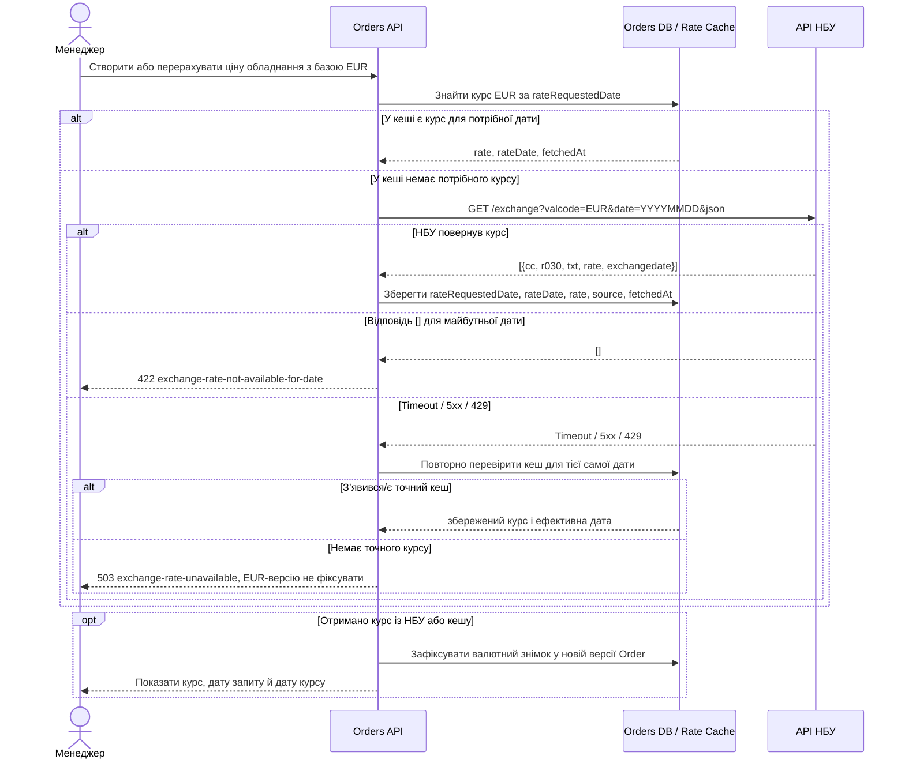
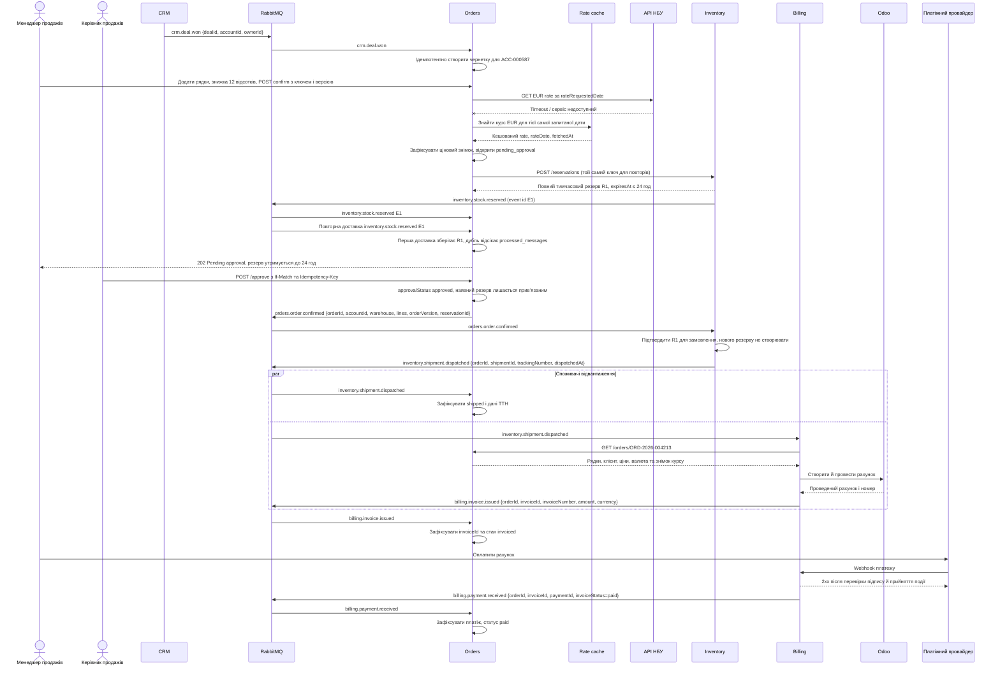
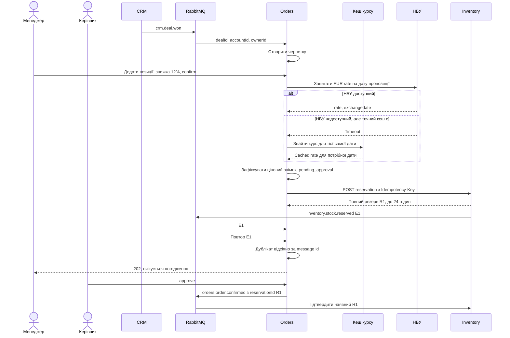
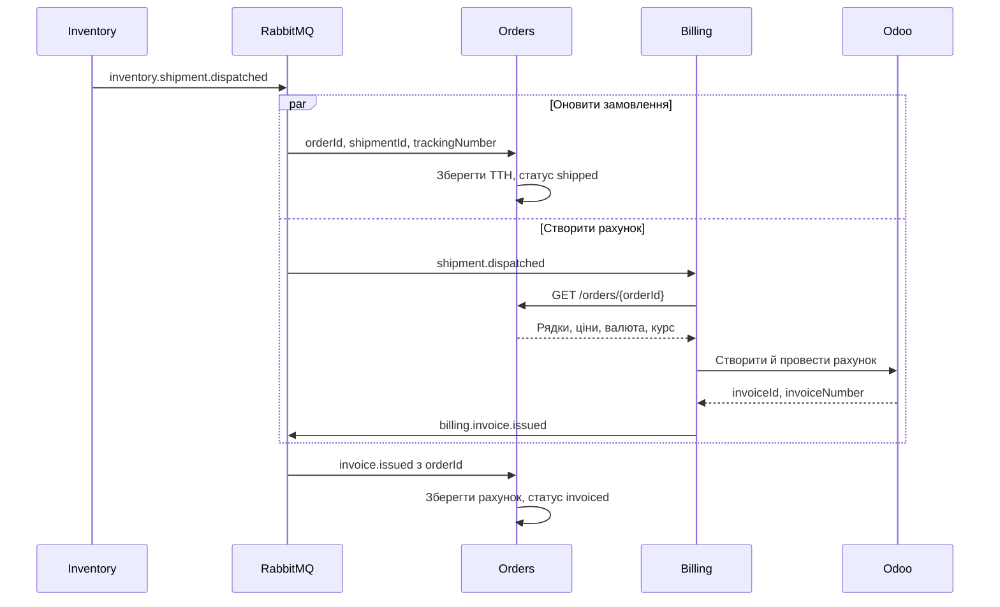
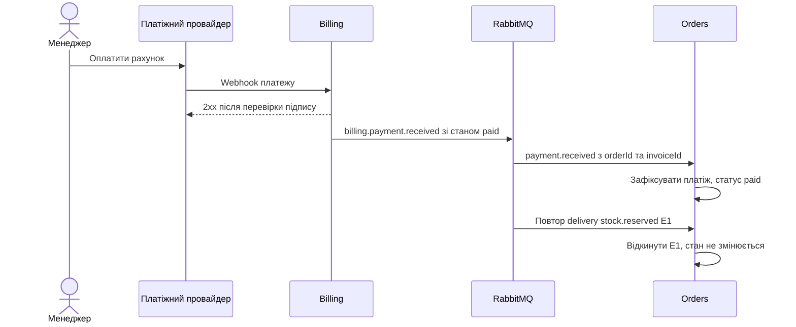

# Лабораторна робота 3. Інтеграція модуля Orders

Студент: Олександр Лисенко; група: не вказана. Дата: 2026-11-17.  
ШІ-асистент: Codex (GPT-6). Діалог: додати посилання або експорт перед здачею.  
Контракти OpenAPI та AsyncAPI подано окремими файлами поруч із документом.

## 0. Вихідні дані та прийняті рішення

- Система — B2B-дистриб’ютор «КавоХаб»; модуль студента — Orders.
- Orders володіє замовленнями, позиціями, цінами й погодженнями знижок. CRM володіє клієнтами й угодами, Inventory — товарами, залишками, резервами та відвантаженнями, Billing — рахунками й оплатами, Odoo — бухгалтерськими проведеннями.
- Знижка **понад 10%** потребує погодження керівника продажів. Знижка 12% у прогоні ЛР3 переходить на погодження.
- Поки погоджується знижка, Inventory може зарезервувати всі рядки замовлення не довше ніж на 24 години. Після схвалення Inventory підтверджує наявний резерв; після відхилення чи спливу строку Orders ініціює звільнення.
- Часткового резервування немає. Inventory є авторитетним джерелом щодо залишків.
- Orders фіксує курс EUR, дату й джерело у версії пропозиції. Погоджений знімок курсу не змінюється.
- Нефункціональна вимога підтвердження замовлення до 20 рядків: p95 ≤ 2 с, p99 ≤ 5 с, частка помилок ≤ 0,5%.
- Рішення щодо маршруту: `POST /orders/{id}/confirm` автоматично запускає погодження для знижки понад 10%; `POST /orders/{id}/submit-approval` залишається явною командою подання на погодження. Обидва шляхи використовують той самий перехід стану і не створюють повторного погодження.
- Вихідна основа: [README — межі модулів, власність даних і каталог подій](../../README.md), [вимоги ЛР1](../../lab-01.md), [рішення Orders з ЛР2](./lab-02-orders-lysenko.md) та [методичні вказівки ЛР3](../../lab-03.md). У доступних матеріалах немає окремого фінального документа ЛР1 студента, тому використано правила кейсу й NFR із методичних матеріалів.

## 1. Контракти модуля

- OpenAPI 3.1: [orders.openapi.yaml](./orders.openapi.yaml).
- AsyncAPI 3.0: [orders.asyncapi.yaml](./orders.asyncapi.yaml).
- Контракти мають версію `0.3.0`. Додавання необов’язкового поля або операції — сумісна зміна; видалення чи перейменування поля, зміна типу/значення або додавання обов’язкового поля в чинний payload — несумісна зміна, яка потребує нової версії й погодження зі споживачами.
- Усі помилки API повертаються як `application/problem+json`. Для 4xx застосовуються стабільні типи Problem, зокрема `validation-error`, `invalid-state-transition`, `concurrency-conflict`, `idempotency-key-reuse` і `request-in-progress`.
- Кожна команда має унікальний `operationId`, потребує OIDC bearer-токен і документує допустимі ролі. Перевірка власника клієнта виконується окремо від перевірки ролі.
- Правила лінтингу: (1) `operationId` обов’язковий і унікальний; (2) усі 4xx-відповіді мають `application/problem+json`; (3) кожна POST-команда має `Idempotency-Key`; (4) всі операції приймають `X-Correlation-Id` або генерують його на вході; (5) кожна операція документує потрібні ролі.
- Споживачі REST API працюють із Prism mock, згенерованим із OpenAPI, до появи реалізації. Для подій використовуються приклади повідомлень або mock publisher за схемами AsyncAPI.

## 2. Взаємодія Orders з іншими модулями

### 2.1. Вихідні синхронні виклики

Для повторів використовуються не більш як 3 спроби загалом із затримкою `200 мс × 2ⁿ + jitter`. Повторюються лише GET або POST з тим самим `Idempotency-Key` і незмінним тілом, лише при timeout, 429, 502, 503 або 504. На 4xx повторів немає. Кожен вихідний HTTP-виклик передає `X-Correlation-Id`; якщо його немає, Orders генерує UUID. Нижче наведені тайм-аути — проєктні бюджети, що уточнюють стартові значення з ЛР3 з урахуванням NFR підтвердження.

| Стик | Тайм-аут з’єднання / відповіді | Повтори й ідемпотентність | Поведінка за недоступності |
|---|---|---|---|
| Orders → Inventory `GET /availability` | 1 с / 2 с | До 3 спроб; GET ідемпотентний | Це інформаційна перевірка перед підтвердженням. Показати «доступність невідома»; не вважати результат резервом і дозволити перейти до команди підтвердження. Фактичне підтвердження залежить від `POST /reservations`. |
| Orders → Inventory `POST /reservations` | Початкова спроба в межах бюджету підтвердження: 0,5 с / 1 с; повна операція — асинхронно | Ключ зберігається для пари замовлення/версії/операції; усі повтори мають той самий ключ і тіло; до 3 спроб загалом | Якщо резерв не підтверджено в бюджеті HTTP, повернути 202, встановити `on_hold`/`reservationStatus=pending`, не запускати 24-годинний таймер і повторити у фоні. Успішна відповідь Inventory запускає таймер від фактичного `reservedAt`. |
| Orders → Inventory `POST /reservations/{id}/release` | 1 с / 2 с | Окремий збережений ключ для операції звільнення; до 3 спроб | Не позначати резерв як `released`, доки Inventory не підтвердить звільнення. За невизначеного результату лишити операцію в очікуванні й повторювати з тим самим ключем. Скасування завершується після підтвердження Inventory; під час очікування API повертає 202 і `cancellationStatus=pending`. |
| Orders → CRM `GET /accounts/{id}` (лише якщо репліки немає) | 1 с / 2 с | До 3 спроб; GET ідемпотентний | Якщо акаунт не вдалося перевірити/отримати, не створювати замовлення з неперевіреним клієнтом; повернути тимчасову помилку з `Retry-After`. Якщо репліка є, не викликати CRM синхронно. |
| Orders → НБУ, GET курсу EUR за датою | 1 с / 3 с | До 3 спроб; GET ідемпотентний; кеш за датою | Використати кеш лише для потрібної дати. Не підміняти курс іншою датою без окремого бізнес-рішення. Якщо точного курсу немає, не підтверджувати ціну у EUR; повернути тимчасову помилку/залишити роботу з пропозицією очікуваною за ADR. |

Перевірка `GET /availability` не є гарантією наявності: між переглядом і підтвердженням запас може змінитися. Лише успішний атомарний `POST /reservations` підтверджує резерв. Оскільки NFR для підтвердження — p95 ≤ 2 с, очікування зовнішнього резерву не блокує HTTP-відповідь довше відведеного бюджету: Orders швидко фіксує команду та повертає 202, якщо потрібне продовження у фоні.

### 2.2. Вхідні підписки

Дублікат визначається за `id` конверта події у `processed_messages`. Для подій, що представляють ту саму бізнес-дію, додатково застосовується унікальний ключ домену (наприклад, `crmDealId` для створення чернетки). У межах одного замовлення Orders не знижує вже досягнутий стан через запізнілу подію; події різних замовлень можуть приходити в будь-якому порядку.

| Подія | Обробник і бізнес-зміна | Дублікат | Подія не за порядком |
|---|---|---|---|
| `crm.deal.won` | Створити чернетку Orders із клієнтом і контекстом виграної угоди | `processed_messages` плюс унікальність джерельної угоди; друга чернетка не створюється | Якщо репліки Account ще немає, завантажити через CRM GET; не створювати замовлення з неповним посиланням на клієнта. |
| `crm.account.upserted` | Оновити локальну репліку повним станом Account | Дубль за `id` — no-op | Приймати лише новішу версію/`updatedAt`; старий snapshot ігнорувати. Потрібно узгодити поле версії з CRM. |
| `inventory.product.upserted` | Оновити локальну проєкцію товару, потрібну для рядків і цін | Дубль за `id` — no-op | Не застосовувати старіший snapshot; для цього потрібні `version` або `updatedAt` від Inventory. |
| `inventory.stock.reserved` | Зберегти `reservationId`, `reservedAt`, `expiresAt`; оновити `reservationStatus=reserved` | Дубль не подовжує строк резерву й не дублює перехід | Якщо замовлення очікує погодження — прив’язати тимчасовий резерв і лишити approval pending. Якщо замовлення вже пройшло далі — не відкотити його. |
| `inventory.stock.reservation_failed` | Зберегти причину; перевести підтвердження в `on_hold`/резерв у `failed`; часткового резерву немає | Дубль не змінює результат повторно | Якщо пізніше прийде успішний резерв для актуальної спроби, прийняти його; застарілу невдачу після успіху ігнорувати за ідентифікатором спроби/версією. |
| `inventory.shipment.dispatched` | Зберегти Shipment/ТТН і перейти до етапу відвантаження | Дубль не створює повторний перехід чи повідомлення | Якщо прийшла раніше за `stock.reserved`, відвантаження є авторитетним фактом Inventory: зафіксувати shipped, зареєструвати пропущену попередню подію й не відкотитися, коли резервна подія надійде пізніше. |
| `billing.invoice.issued` | Зберегти `invoiceId`, номер і суму; позначити рахунок виставленим | Дубль за `id`/`invoiceId` — no-op | Не знижувати стан, якщо оплата вже зафіксована. Подія має містити `orderId`; це слід погодити з Billing. |
| `billing.payment.received` | Зберегти підтверджену оплату; перейти в `paid`, якщо рахунок замовлення повністю оплачено | Дубль за `id`/ідентифікатором платежу — no-op | Якщо подія прийшла раніше за invoice, зберегти її для зіставлення; після отримання invoice застосувати без повторного зарахування. Подія має містити `orderId` та `invoiceId`; часткову оплату не трактувати як повну. |

### 2.3. Наскрізна кореляція та залежності контрактів

- Вхідний HTTP-запит без `X-Correlation-Id` отримує згенерований UUID. Той самий ID проходить у виклики Inventory, CRM і НБУ та в кожну подію, породжену операцією.
- Споживачі подій мають підтримувати `correlationId` та унікальний `id` повідомлення.
- Для безпечного відкидання застарілих даних контрактам CRM та Inventory бажано мати монотонне `version` або надійний `updatedAt`.
- Billing має передавати `orderId` у `billing.invoice.issued` і `billing.payment.received`; інакше Orders не зможе однозначно оновити замовлення без додаткового HTTP-виклику.
- Події Orders додають `orderVersion` для монотонного впорядкування та `reservationId`, коли резерв уже існує. Це запропоновані поля до погодження з Inventory, CRM та Billing.

### 2.4. Зберігання `Idempotency-Key` на боці Orders

Orders зберігає ключ разом із власником клієнта, операцією, хешем тіла та початковою відповіддю. Запис зберігається 24 години. Доменною транзакцією одночасно фіксуються зміна Orders, outbox-повідомлення та остаточна відповідь ідемпотентності.

```sql
CREATE TABLE orders.idempotency_records (
  client_id       text        NOT NULL,
  idempotency_key uuid        NOT NULL,
  http_method     text        NOT NULL,
  request_path    text        NOT NULL,
  request_hash    text        NOT NULL,
  state           text        NOT NULL CHECK (state IN ('processing','completed')),
  response_status integer,
  response_body   jsonb,
  correlation_id  uuid        NOT NULL,
  lease_token     uuid,
  lease_until     timestamptz,
  created_at      timestamptz NOT NULL DEFAULT now(),
  expires_at      timestamptz NOT NULL,
  PRIMARY KEY (client_id, idempotency_key)
);
```

```text
при POST-команді з ключем K:
  обчислити hash(method + path + canonical request body)
  короткою транзакцією створити/знайти запис (client_id, K)
  якщо hash, method або path відрізняються: повернути 422 idempotency-key-reuse
  якщо state=completed: повернути збережені status і body без повторної дії
  якщо state=processing і lease чинний: повернути 409 request-in-progress
  якщо lease прострочений: захопити ключ із новим lease_token (fencing token)
  у доменній транзакції:
    заблокувати запис ключа й перевірити, що lease_token досі належить цьому виконавцю
    виконати зміну Orders
    записати потрібні події в outbox
    зберегти первинні HTTP status/body та state=completed
    якщо lease_token змінився, ROLLBACK і не виконувати команду
  COMMIT
  повернути збережену відповідь
```

Усі повтори одного клієнтського наміру мають надсилати той самий ключ і те саме тіло. Запити до зовнішніх систем не виконуються всередині довгої SQL-транзакції: Orders фіксує стан/outbox і повертає 202, якщо потрібна фонова робота.

## 3. Відкриті питання для погодження контрактів

1. CRM: яке поле є авторитетною версією Account — `version` чи `updatedAt`? Чи `crm.deal.won` містить достатньо даних для чернетки та `crmDealId` для унікальності?
2. Inventory: які точні поля містять `stock.reserved`, `reservation_failed` і `shipment.dispatched` для кореляції до `orderId`, повторних спроб резерву та відвантаження?
3. Billing: підтвердити наявність `orderId`, `invoiceId` та стану повної/часткової оплати у його подіях.
4. Погодити семантику 202 та поля `cancellationStatus` для асинхронного звільнення резерву.

## 4. Обмін подіями та стійкість споживача

### 4.1. Топологія RabbitMQ для Orders

Усі об’єкти створюються декларативно як durable. Exchange `kavohub.events` має тип `topic`; routing key події дорівнює її `type`. Orders споживає всі події, перелічені в таблиці підписок розділу 2.2.

| Об’єкт | Тип і параметри | Призначення |
|---|---|---|
| `kavohub.events` | Topic exchange, durable | Спільний обмін доменними подіями системи |
| `orders.events` | Quorum queue, durable; binding до `kavohub.events` за routing keys нижче | Основна черга Orders |
| `orders.events.retry` | Durable queue; `x-message-ttl=5000`; `x-dead-letter-exchange=""`; `x-dead-letter-routing-key=orders.events` | Затримка 5 секунд, після якої повідомлення повертається в основну чергу |
| `orders.events.dlq` | Quorum queue, durable | Повідомлення, що вичерпали 5 спроб або мають невиправну помилку схеми/контракту |

Прив’язки `orders.events` до `kavohub.events`: `crm.deal.won`, `crm.account.upserted`, `inventory.product.upserted`, `inventory.stock.reserved`, `inventory.stock.reservation_failed`, `inventory.shipment.dispatched`, `billing.invoice.issued`, `billing.payment.received`. Черга retry повертає повідомлення до `orders.events` через default exchange і routing key `orders.events`. Після п’ятої невдалої обробки споживач публікує його в DLQ із причиною, початковим routing key і заголовками спроб.

### 4.2. Ідемпотентний споживач: `inventory.stock.reserved`

Запис `processed_messages` і зміна стану замовлення комітяться однією транзакцією PostgreSQL. `ack` надсилається брокеру лише після успішного `COMMIT`.

```sql
CREATE TABLE orders.processed_messages (
  message_id   uuid PRIMARY KEY,
  event_type   text        NOT NULL,
  order_id     text        NOT NULL,
  processed_at timestamptz NOT NULL DEFAULT now()
);
```

```text
при отриманні повідомлення m типу inventory.stock.reserved:
  перевірити конверт, type, correlationId і потрібні поля data
  BEGIN
    вставити (m.id, m.type, m.data.orderId) у orders.processed_messages
      ON CONFLICT DO NOTHING
    якщо рядок не вставлено:
      COMMIT
      ack m
      завершити                         # точний дублікат

    заблокувати Order за m.data.orderId (SELECT ... FOR UPDATE)
    якщо замовлення не знайдено:
      ROLLBACK                           # тимчасова/контрактна помилка за політикою
      перейти до маршруту retry або DLQ

    якщо статус уже shipped, invoiced, paid, closed або cancelled:
      записати аномалію без відкату стану
      якщо резерв активний, створити outbox-команду на його звільнення
    інакше:
      записати reservationId, reservedAt, expiresAt
      reservationStatus = reserved
      якщо approvalStatus = approved або not_required:
        status = reserved
      інакше якщо approvalStatus = pending:
        лишити status = pending_approval  # резерв тимчасовий, до 24 годин
    COMMIT
  ack m

при тимчасовій помилці (x-retry-count = номер поточної спроби; для першої доставки без заголовка вважати 1):
  ROLLBACK
  якщо x-retry-count < 5:
    опублікувати копію в orders.events.retry із x-retry-count + 1
  інакше:
    опублікувати в orders.events.dlq з error reason і початковим routing key
  дочекатися publisher confirm
  ack оригінал лише після підтвердженої публікації копії
```

`message_id` відсікає повторну доставку того самого повідомлення. Додатково `reservationId` має бути унікальним у таблиці резервів Orders, а перед оновленням перевіряється, чи замовлення не перейшло до пізнішого стану. Це захищає також від повторної бізнес-події з новим `id` і від запізнілої події.

### 4.3. Процедура розбору DLQ

Відповідальний — черговий власник модуля Orders; для помилки даних залучається власник події (CRM, Inventory або Billing). Черговий переглядає `message_id`, `type`, `correlationId`, `orderId`, початковий routing key, кількість спроб і причину помилки в структурованому журналі. Після виправлення тимчасової першопричини точне повідомлення повторно публікується до `orders.events` із тим самим event `id` і `correlationId` та audit-записом ручного replay. Якщо помилковим є сам payload, його не редагують вручну: власник події публікує виправлену подію з новим `id`, а DLQ-запис позначається як superseded. Ідемпотентний споживач безпечно проігнорує точний дублікат, якщо бізнес-транзакцію вже було зафіксовано. Невиправне або застаріле повідомлення позначається як resolved-without-replay із причиною; його не видаляють без аудиту.

## 5. Тестові сценарії стійкості

Це специфікації перевірок, а не результати запуску тестів.

### 5.1. Дублікат події не повторює бізнес-зміну

- **Given:** Order має `status=pending_approval`; подію `inventory.stock.reserved` з `id=M1` уже оброблено, `reservationId=R1` збережено, строк резерву зафіксовано.
- **When:** Orders отримує ту саму подію `id=M1` повторно.
- **Then:** вставка в `processed_messages` конфліктує за ключем; стан, резерв і `expiresAt` не змінюються; споживач надсилає `ack` після завершення транзакції.

### 5.2. Отруйне повідомлення після п’яти спроб потрапляє в DLQ

- **Given:** Основна черга містить `inventory.stock.reserved` для невідомого `orderId`; обробник класифікує це як тимчасову проблему узгодження, але Order не з’являється протягом п’яти спроб. `x-retry-count` на першій доставці вважається 1.
- **When:** кожна обробка завершується помилкою, і повідомлення проходить основну чергу та retry-чергу з TTL 5 секунд.
- **Then:** бізнес-стан не змінюється; після п’ятої невдалої спроби повідомлення з початковим `id`, `correlationId`, routing key та причиною опиняється в `orders.events.dlq`; копія опублікована з publisher confirm, перш ніж оригінал ack-нуто.

### 5.3. HTTP-повтор із тим самим ключем не дублює команду

- **Given:** `POST /orders` із ключем `K1` успішно створив замовлення й зберіг хеш тіла та відповідь.
- **When:** клієнт повторює запит із тим самим тілом і `Idempotency-Key: K1` після тайм-ауту.
- **Then:** API повертає збережений результат; другого замовлення, резерву чи події не створює.

### 5.4. Повторне використання ключа з іншим тілом відхиляється

- **Given:** ключ `K1` уже пов’язаний із хешем першого тіла запиту.
- **When:** клієнт надсилає інше тіло з тим самим ключем `K1`.
- **Then:** API повертає `422 application/problem+json` із типом `idempotency-key-reuse`; стан замовлень не змінюється.

### 5.5. Падіння після COMMIT, але до ack не дублює резерв

- **Given:** транзакція обробника події `M2` закомічена, але процес падає до відправлення `ack`.
- **When:** RabbitMQ доставляє `M2` повторно після відновлення споживача.
- **Then:** `processed_messages` знаходить `M2`; повторна бізнес-зміна не виконується, повідомлення ack-нуто.

### 5.6. НБУ недоступний, але точний курс є в кеші

- **Given:** Є кешований курс EUR для тієї самої `rateRequestedDate`; НБУ недоступний протягом 10 хвилин.
- **When:** Менеджер створює нову версію пропозиції на цю дату.
- **Then:** Orders використовує кешований курс, зберігає початкову дату запиту й ефективну дату НБУ, позначає джерело/час кешу та не змінює валютний знімок після погодження.

### 5.7. НБУ недоступний і точного курсу в кеші немає

- **Given:** НБУ недоступний протягом 10 хвилин і для потрібної дати немає кешованого EUR-курсу.
- **When:** Менеджер створює або перераховує цінову версію в EUR.
- **Then:** Orders не фіксує нову EUR-ціну, повертає `503 exchange-rate-unavailable`, сповіщає відповідальну команду; замовлення в UAH та вже погоджені версії продовжують працювати.

## 6. Зовнішня інтеграція Orders з API НБУ

### 6.1. Контракт і мапінг полів

Коли розрахунок ціни обладнання спирається на постачальницьку ціну в EUR, Orders запитує курс НБУ для дати оцінки версії пропозиції через `GET https://bank.gov.ua/NBUStatService/v1/statdirectory/exchange?valcode=EUR&date=YYYYMMDD&json`. Клієнтська пропозиція при цьому може бути в UAH. Офіційна інструкція НБУ описує `date` у форматі `YYYYMMDD`, `valcode=EUR` і JSON-поля `r030`, `txt`, `rate`, `cc`, `exchangedate` (поле `special` може бути `null`). [Інструкція НБУ до API курсів](https://finliteracy.bank.gov.ua/admin_uploads/article/Instr_API_KURS_VAL_Full_eng.pdf)

| Поле Orders | Поле НБУ | Перетворення / перевірка |
|---|---|---|
| Джерельна валюта обладнання `EUR` | `valcode=EUR`, у відповіді `cc="EUR"`, `r030=978`, `txt="Євро"` | Відправити валютний код; перевірити, що відповідь саме для EUR. `r030` і `txt` зберігати як перевірочні/діагностичні атрибути за потреби. |
| `rateRequestedDate` | query `date=YYYYMMDD` | Дату запиту форматувати без роздільників. Це дата, для якої Orders просив офіційний курс. |
| `exchangeRate` | `rate` | Перетворити на decimal із фіксованою точністю; зберігати значення без проміжного округлення. |
| `rateDate` | `exchangedate` | Розібрати дату `DD.MM.YYYY`; зберегти фактичну дату курсу, яку повернув НБУ. Для вихідного дня/свята вона може бути останнім робочим днем. |
| `rateSource` | endpoint НБУ | Зберегти `NBU` та/або URI джерела разом із часом отримання. |
| Rate cache key | `cc` + дата запиту/ефективна дата | Кешувати за валютою і запитаною датою, додатково зберігати ефективну дату відповіді. Не підміняти курс іншої дати мовчки. |

Відповідь перевіряється на HTTP-статус, валідний JSON-масив, наявність запису EUR, позитивне числове `rate`, збіг `cc` і коректну `exchangedate`. Порожній масив — бізнес-результат «курс на цю дату не опубліковано», а не тимчасова мережева помилка; повторювати його автоматично не потрібно. Для майбутньої дати Orders не створює валютний знімок і повертає `422 exchange-rate-not-available-for-date`. На вихідні та свята використовується курс останнього робочого дня, який повернув НБУ; у знімку зберігаються обидві дати. Курс на наступний день може з’явитися після денного оновлення НБУ (орієнтовно 15:30–16:00), тому до його появи ціна в EUR лишається очікуваною.

### 6.2. Послідовність отримання курсу



### 6.3. ADR-ORD-03: поведінка при недоступності НБУ протягом 10 хвилин

**Контекст.** Ціну обладнання в EUR потрібно відтворити в пропозиції та пов’язаному рахунку. НБУ може бути тимчасово недоступний; після затвердження валютний знімок Orders не змінює.

| Варіант | Переваги | Недоліки |
|---|---|---|
| A. Fail closed: блокувати створення/перерахунок EUR-версії, поки НБУ недоступний | Не використовує застарілий або невідповідний курс; проста аудиторська логіка | Затримує пропозиції в EUR навіть тоді, коли Orders уже має потрібний курс у кеші |
| B. Використати кеш лише для тієї самої запитаної дати; без нього тимчасово відкласти EUR-версію | Доступність за наявності правильного кешу; незмінність і відтворюваність ціни; не маскує різницю дат | Без точного кешу EUR-пропозицію доведеться чекати; потрібно зберігати дату запиту, ефективну дату й час отримання |
| C. Використати останній доступний курс будь-якої дати з позначкою stale | Дозволяє продовжити продаж під час тривалого збою | Може відрізнятися від курсу, визначеного бізнес-правилом; переносить валютний ризик і потребує явного погодження бізнесу та бухгалтерії |

**Рішення: B.** Orders шукає точний кеш за EUR і запитаною датою. Якщо запис є, застосовує його, зберігаючи `rateRequestedDate`, фактичний `rateDate`, `exchangeRate`, `rateSource` і `fetchedAt`. Якщо НБУ недоступний 10 хвилин і точного кешу немає, Orders не фіксує нову/змінену EUR-ціну, повертає тимчасову помилку `503 exchange-rate-unavailable` і сповіщає відповідальну команду. Для команди створення/перерахунку це означає відсутність нової зафіксованої цінової версії; наявна чернетка лишається без змін. Замовлення в UAH і вже погоджені EUR-версії зі збереженим курсом продовжують оброблятися. Після п’яти послідовних технічних помилок circuit breaker відкривається на 30 секунд; після паузи виконується контрольний запит із jitter. Порожній масив не запускає circuit breaker, бо це не outage.

**Наслідки.** Жоден fallback не змінює курс уже погодженої версії. Повторне отримання курсу відбувається у фоні з обмеженням частоти; після успіху менеджер може повторити дію з новим ключем ідемпотентності. Рішення щодо застосування останнього робочого дня ґрунтується на даті, яку фактично повернув НБУ, і зберігає її окремо від запитаної дати.

## 7. Уявний інтеграційний прогін Lead-to-Cash

У прогоні використано прикладові ідентифікатори з README (`ACC-000587`, `ORD-2026-004213`) і один `correlationId` для всього сценарію. Знижка 12% перевищує погоджений поріг 10%. У момент розрахунку ціни обладнання API НБУ недоступний 10 хвилин, але в Orders є точний кеш для `rateRequestedDate`; тому застосовується ADR-ORD-03. Деталі подій, не задані базовим каталогом, винесено в таблицю розбіжностей.



### 7.1. Короткі діаграми за етапами

#### Етапи 1–3: чернетка, курс, погодження та резерв



#### Етапи 4–5: відвантаження та рахунок



#### Етапи 6–7: оплата та повторна доставка події



### 7.2. Результат прогону та розбіжності

| Крок | Розбіжність або перевірка | Сторона | Запропонована зміна / рішення | Реакція команди в симуляції |
|---|---|---|---|---|
| 1. CRM `deal.won` | README задає назву події, але не payload. Orders потребує клієнта й ідентифікатора угоди, щоб створити лише одну чернетку | CRM | Зробити `dealId`, `accountId`, `ownerId` обов’язковими; позиції можуть бути відсутні, бо менеджер додає їх у Orders. Дедуплікація за `dealId` разом із `processed_messages` | CRM погоджує мінімальний payload; додає `dealId` як унікальний бізнес-ключ. Orders створює внутрішню порожню чернетку; публічний `POST /orders` лишається для створення замовлення з рядками. |
| 2. Додати позиції, знижка 12%, `confirm` | Контракт підтверджує поріг >10%; зовнішній курс тимчасово недоступний. У `OrderLine` бракувало джерельної суми/валюти для аудиту конвертації обладнання | Orders / НБУ | Використати точний кеш для запитаної дати; зберігати `sourceUnitPrice`, `sourceCurrency`, клієнтську `unitPrice`, `rateRequestedDate`, фактичний `rateDate`, `exchangeRate`, `rateSource`, `fetchedAt`. Додані поля джерельної суми/валюти — необов’язкові в API-відповіді | Orders застосовує ADR-ORD-03. `confirm` повертає 202, запускає погодження й тимчасовий резерв; без точного кешу нова цінова версія, що залежить від EUR, не фіксується. |
| 3. Inventory резервує | Базовий каталог не формалізує payload `inventory.stock.reserved`; Orders мусить пов’язати подію з Order і не подовжити TTL дублікатом | Inventory | Обов’язкові `orderId`, `reservationId`, `reservedAt`, `expiresAt`, `correlationId`; додатково — ID спроби резерву для відсікання запізнілої невдачі | Inventory погоджує поля. Повтор event `E1` не змінює замовлення й не створює резерв; у межах однієї спроби TTL не поновлюється. |
| 4. `orders.order.confirmed`, потім відвантаження | Inventory має відрізнити підтвердження вже наявного R1 від нового резерву. `shipment.dispatched` має однозначно вказувати Order | Inventory | У `orders.order.confirmed` передавати `orderId`, склад, `sku/qty`, `orderVersion` і `reservationId` за наявності. У відвантаженні передавати щонайменше `orderId`, `shipmentId`, `dispatchedAt`; `trackingNumber` — якщо його створено | Inventory погоджує підтвердження R1 без дубля. Якщо `shipment.dispatched` прийде до `stock.reserved`, Orders фіксує факт відвантаження й не відкотиться пізнішою подією резерву. |
| 5. Billing виставляє рахунок | Payload `billing.invoice.issued` не деталізовано; Orders не може оновити стан лише з назви події | Billing | Включити `orderId`, `invoiceId`, `invoiceNumber`, суму й валюту. Billing бере рядки та ціни з Orders `GET /orders/{id}` і проводить рахунок у Odoo; номер передає лише після проведення | Billing погоджує поля й порядок: спершу проведення в Odoo, тоді `invoice.issued`. Orders доступний для сервісної ролі `svc-billing`. |
| 6. Оплата | `payment.received` не розрізняє повну та часткову оплату без даних розподілу | Billing | Передавати `orderId`, `invoiceId`, `paymentId`, суму розподілу та стан рахунку (`partially_paid`/`paid`). Orders переходить у `paid` лише за повного погашення | Billing погоджує явний `invoiceStatus`; дубль платежу не змінює стан повторно. У цьому сценарії платіж повний. |
| 7. Дублікат резерву й недоступний НБУ | Дублікат `inventory.stock.reserved` імітує доставку at-least-once; недоступність НБУ вже покрита ADR | Orders / Inventory / НБУ | Дедуплікація за event `id`, перевірка `reservationId` і монотонної версії; використання кешу тільки за тією самою датою | Дублікат не має побічних ефектів. Точний кеш дозволяє завершити угоду; якщо кешу немає, ціну не підтверджують, а замовлення лишається без нової EUR-залежної версії. |

**Підсумок:** happy path доходить до `paid`, якщо CRM передає мінімальні ключі угоди, Inventory — кореляційні поля резерву/відвантаження, а Billing — зв’язок платежу й рахунку із замовленням та стан повного погашення. Ці payload-поля треба погодити до реалізації; зміну контракту іншого модуля вважаємо пропозицією, доки його команда її не підтвердила.

## Журнал проєктних рішень

| № | Рішення | Розглянуті альтернативи | Чому обрано | Підстава |
|---|---|---|---|---|
| ADR-ORD-01 | Знижка понад 10% потребує погодження керівника; `confirm` автоматично подає її на погодження, `submit-approval` лишається явною командою | Погоджувати лише після 12%; мати тільки один API-шлях | Відповідає бізнес-правилу «до 10% менеджер сам» і зберігає обидва маршрути ЛР2 без дублювання переходу | Уточнення студента; сценарій 12% у ЛР3 |
| ADR-ORD-02 | Під час погодження Inventory утримує повний резерв максимум 24 години; схвалення підтверджує той самий резерв | Не резервувати до схвалення; створювати другий резерв після схвалення | Компроміс між продажами й складом без подвійного списання запасу | README 2.1, ORD-R7, Inventory контракт |
| ADR-ORD-03 | За збою НБУ використовувати кеш EUR лише для тієї самої запитаної дати; без точного кешу не фіксувати нову EUR-залежну ціну | Fail closed завжди; брати довільний останній курс із stale-позначкою | Зберігає відтворюваність і не підміняє бізнес-дату курсу | ADR-ORD-03, валютна політика ЛР2 |
| ADR-ORD-04 | Підтвердження резерву після тайм-бюджету переходить у фон із 202; 24-годинний таймер починається лише після відповіді Inventory | Блокувати HTTP-запит до завершення всіх повторів | Не порушує NFR p95 ≤ 2 с і не створює фальшивого резерву | NFR-PERF-01; ЛР3, розділи 4.7 і 8.1 |
| ADR-ORD-05 | Дедуплікувати події за `id` у тій самій транзакції, що змінює Order; ack лише після COMMIT | Ack перед COMMIT; дедуплікація лише в пам’яті | Витримує повторну доставку й падіння між COMMIT та ack | ЛР3, розділ 4.5 |
| ADR-ORD-06 | Зберігати клієнтську ціну разом із джерельною сумою/валютою та обома датами курсу | Зберігати лише конвертовану суму; обчислювати курс повторно | Дає аудит і не змінює затверджену версію | П5/Б4 у ЛР1; валютна політика ЛР2 |
| ADR-ORD-07 | Несумісні зміни payload погоджуються зі споживачами до публікації; `orderVersion` і поля кореляції є пропозиціями до погодження | Розгорнути зміну лише на боці Orders | Події є міжкомандним контрактом; тихе додавання обов’язкових полів може зламати споживачів | README 2.6; ЛР3, розділ 4.1 |

## Уточнення стейкхолдерів і припущення

| № | Уточнення / припущення | Джерело | На що впливає |
|---|---|---|---|
| U1 | Робота ведеться для «КавоХаб»; стороння згадка іншої компанії у фінальному документі ЛР2 була помилкою й виправлена | Пряме уточнення студента | Бізнес-контекст, власність даних, контракти |
| U2 | Погоджений поріг — понад 10%; знижка рівно 10% не потребує погодження | Пряме уточнення студента й бізнес-правило ЛР1 | `confirm`, `submit-approval`, рольові обмеження |
| U3 | Для цінового знімка прийнято дату пропозиції; бухгалтерська сторона має підтвердити її для реальної реалізації | Рішення ЛР2; суперечність П5/Б4 у ЛР1 | НБУ, рахунок, відтворюваність ціни |
| U4 | Строк чинності пропозиції 7 календарних днів у ЛР2 — навчальне припущення, не підтверджена вимога | ЛР2 | Перевірка можливості підтвердження і отримання курсу |
| U5 | `crm.deal.won`, Inventory та Billing payload уточнено в уявному прогоні; реакції команд є симульованими, не фактичним затвердженням окремих команд | Базовий каталог подій і симуляція кроку 7 | Потрібне формальне погодження schemas до реалізації |
| U6 | Додаткові поля `orderVersion`, `sourceUnitPrice`, `sourceCurrency`, `cancellationStatus` є пропозиціями контракту, а не зафіксованою реалізацією | Проєктні рішення цього документа | OpenAPI/AsyncAPI, споживачі, аудит |

## Відкриті питання та ризики

1. **Погодження з іншими командами.** Підтвердити payload-поля для `crm.deal.won`, `crm.account.upserted`, Inventory reservation/shipment events і Billing invoice/payment events. До цього їхні реакції в прогоні лишаються симульованими.
2. **Версія даних.** CRM та Inventory мають обрати `version` або гарантовано монотонний `updatedAt`; Orders потребує такого поля для відкидання застарілих snapshot-подій.
3. **Резерв у вікні погодження.** Уточнити значення таймера, що саме відбувається при спливі 24 годин (повернення до draft чи нове підтвердження) та остаточний payload/відповідь команди release.
4. **Скасування з резервом.** Погодити 202 і `cancellationStatus=pending`; звичайне скасування не завершується, доки Inventory не підтвердить звільнення.
5. **Курс НБУ.** Бухгалтер має підтвердити дату курсу (дата пропозиції чи дата рахунку), правило округлення та податковий порядок. API фактично повертає свою `exchangedate`, яку треба зберігати окремо від `rateRequestedDate`.
6. **Події оплат.** Підтвердити, чи одне замовлення може мати кілька рахунків і як Billing передає часткове погашення; Orders переходить у `paid` лише після повної оплати.
7. **Експлуатаційне підтвердження.** Визначити точні тайм-бюджети для клієнтів, формат `Retry-After`, алерти на DLQ та політику очищення 24-годинних idempotency records.
8. **Перевірка контрактів.** OpenAPI/AsyncAPI лінтер не запускався; синтаксис і повноту YAML треба перевірити в Swagger Editor/AsyncAPI Studio перед здачею. Реальних інтеграційних тестів у цій роботі немає за умовою.

## Самоперевірка за критеріями

Офіційний бал не виставляється. Статуси оцінюють наявність проєктних артефактів, а не працездатність реалізації.

| Критерій | Статус | Де в документі / що доробити |
|---|---|---|
| OpenAPI й AsyncAPI (2 бали) | Частково | Розділ 1 та окремі YAML. Є Problem, ролі, ключі, кореляція й версіонування; потрібен лінтинг та погодження payload-полів із командами. |
| Синхронна взаємодія (1,5 бала) | Частково | Розділ 2. Є тайм-аути, повтори, ідемпотентність, поведінка за недоступності та NFR-бюджет; треба остаточно погодити 202 для скасування й семантику release. |
| Події та стійкість (2 бали) | Виконано на рівні проєкту | Розділи 2, 4 і 5. Є subscriptions, out-of-order правила, RabbitMQ retry/DLQ, схема та псевдокод із ack після COMMIT, Given/When/Then. Payload сусідів потребують погодження. |
| Зовнішня інтеграція (1,5 бала) | Виконано на рівні проєкту | Розділ 6. Є мапінг, помилки, 10-хвилинний збій, Mermaid і ADR з трьома альтернативами; інтеграцію не запускали. |
| Інтеграційний прогін (1 бал) | Частково | Розділ 7. Happy path пройдено й розбіжності мають рішення/пропозиції; зміни payload ще не затверджені реальними командами. |

## Відповіді на контрольні питання

Відповіді додаються після захисту в діалозі. Питання ставляться по одному; спочатку відповідає студент.

1. Чому Orders надсилає `ack` лише після `COMMIT`? Що станеться, якщо процес упаде між `COMMIT` і `ack`?
2. Як `processed_messages` разом із транзакцією доводить, що повтор `inventory.stock.reserved` не зарезервує товар двічі?
3. Які HTTP-помилки Orders повторює для Inventory, а які не повторює? Чому?
4. Що поверне Orders, якщо той самий `Idempotency-Key` прийде з іншим тілом запиту?
5. Що зробить Orders, коли НБУ недоступний 10 хвилин і точного курсу немає в кеші? Чому це правило записане в ADR?

Статус: очікуються відповіді студента й короткий зворотний зв’язок асистента.

## Робота з ШІ-асистентом

1. Студент вказав, що його проєкт із самого початку стосувався «КавоХаб»; фінальний документ ЛР2 було виправлено, а не продовжено на базі стороннього сценарію.
2. Студент уточнив поріг знижки: погодження потрібне понад 10%, тому початкову невідповідність тексту документа було вирішено на користь цього правила.
3. Студент обрав узгоджену семантику маршрутів: `confirm` автоматично подає знижку на погодження, `submit-approval` лишається явною командою; обидва шляхи не створюють дубль заявки.
4. Після повідомлення про помилку Mermaid було знайдено крапки з комою в підписах стрілок; їх замінили, а повну sequence diagram доповнили трьома компактними діаграмами для зручності перегляду.

## Стан подання

До комплекту входять цей документ, [orders.openapi.yaml](./orders.openapi.yaml) та [orders.asyncapi.yaml](./orders.asyncapi.yaml). Перед поданням потрібно додати групу, посилання або експорт діалогу, пройти захистові питання та виконати лінтинг контрактів.
