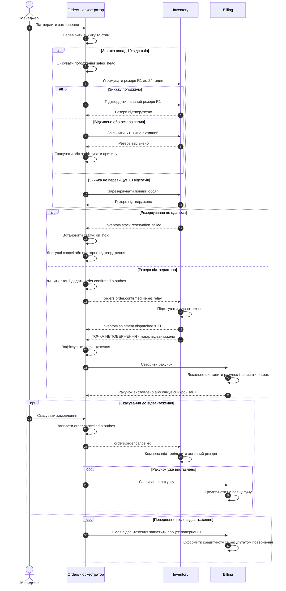
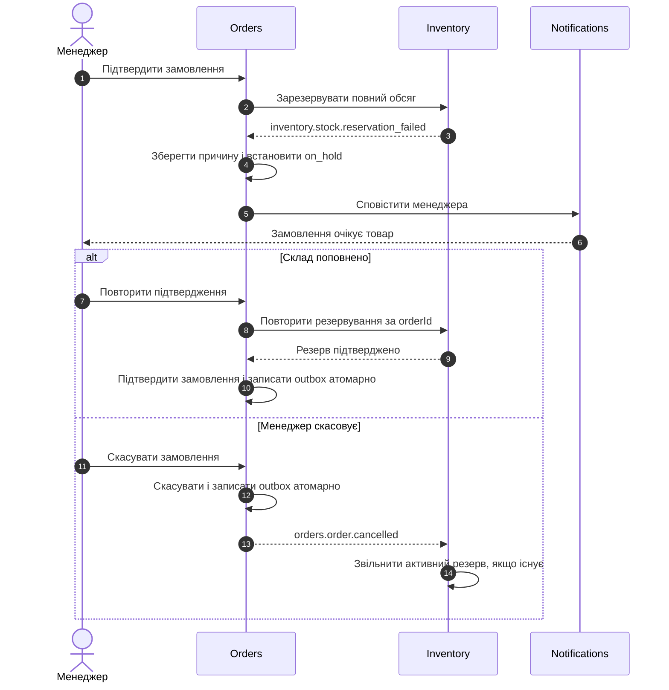

# ЛР 5. Дані КПС: узгодженість, міграція та аналітика — модуль Orders

Студент: Олександр Лисенко. Група: не зазначена. Дата: 2026-11-21.  
ШІ-асистент: Codex (GPT-6). Діалог: поточна розмова; посилання або експорт додати перед здачею.

> **Статус документа:** проєктний опис. Файл `price_agreements.xlsx` не був доступний у робочій теці, тому його кількість рядків і фактичні частоти дефектів не виміряні. Наведений профіль є плановою оцінкою за методичкою та наданим контекстом; перед production-імпортом потрібен dry run на самому файлі.

## 0. Вихідні дані

Модуль **Orders** системи «КавоХаб» володіє сутностями `Order`, `OrderLine`, `ContractPrice` і `DiscountApproval`. Він працює на Python 3.12, FastAPI, Alembic, Pydantic та `aio-pika`, порт 8102; використовує PostgreSQL 17+ зі схемою `orders` і користувачем `orders_user`, RabbitMQ topic exchange `kavohub.events` та CloudEvents 1.0.

Цей документ продовжує рішення ЛР1–ЛР4: моделі й стани замовлення, контракти подій та ідемпотентний споживач із `orders.processed_messages`, окреме розгортання на production VM і staging в офісі. Замовлення знижуються менеджером автоматично до 10% включно; більша знижка потребує `sales_head`. Inventory утримує резерв до 24 годин на час погодження; після схвалення Orders підтверджує наявний резерв `R1`, без повторного резервування. Часткове резервування відсутнє.

За ADR-ORD-03 EUR-ціна розраховується лише за точним курсом НБУ на запитану дату. Якщо його немає в кеші й НБУ недоступний, EUR-запит повертає 503 без фіксації нової ціни; UAH-замовлення продовжують працювати.

**Зміна NFR:** у попередньому контексті ЛР1–ЛР4 для Orders було зазначено RTO ≤ 30 хв. Для ЛР5 приймається останнє рішення RTO ≤ 45 хв. Перед здачею це значення слід узгодити з NFR ЛР1 і виправити там, якщо 45 хв є новим погодженим цільовим показником.

## 1. Узгодженість: Outbox і сага

### 1.1. Таблиця outbox

Зміна стану замовлення та запис події виконуються в одній транзакції PostgreSQL. Через outbox проходять `orders.order.confirmed` і `orders.order.cancelled`.

```sql
CREATE TABLE orders.outbox (
    id              uuid        PRIMARY KEY, -- CloudEvent id
    event_type      text        NOT NULL,
    aggregate_id    text        NOT NULL,    -- orderId
    aggregate_seq   bigint      NOT NULL,
    payload         jsonb       NOT NULL,    -- повний CloudEvents 1.0 конверт
    created_at      timestamptz NOT NULL DEFAULT now(),
    published_at    timestamptz,
    attempts        integer     NOT NULL DEFAULT 0,
    next_attempt_at timestamptz NOT NULL DEFAULT now(),
    last_error      text
);

CREATE INDEX outbox_ready
    ON orders.outbox (next_attempt_at, created_at)
    WHERE published_at IS NULL;

CREATE INDEX outbox_published_cleanup
    ON orders.outbox (published_at)
    WHERE published_at IS NOT NULL;
```

`aggregate_seq` дає змогу виявляти перестановку подій одного замовлення. Якщо потрібен строгий порядок за агрегатом, relay не видає наступну подію цього замовлення до підтвердження попередньої або споживач перевіряє версію події.

### 1.2. Polling publisher

Relay опитує outbox кожні 500 мс і бере до 100 готових рядків. Публікація відбувається під блокуванням рядків; після позитивного publisher confirm позначається `published_at`. RabbitMQ повідомлення persistent, з `mandatory`; повернене брокером повідомлення не вважається доставленим.

```text
BEGIN;
SELECT id, event_type, aggregate_id, aggregate_seq, payload
FROM orders.outbox
WHERE published_at IS NULL AND next_attempt_at <= now()
ORDER BY created_at
LIMIT 100
FOR UPDATE SKIP LOCKED;

Для кожного рядка:
  publish у kavohub.events, routing key = event_type;
  дочекатися publisher confirm і перевірити, що повідомлення не повернене;
  при успіху встановити published_at = now(), last_error = NULL;
  при помилці збільшити attempts, записати last_error і next_attempt_at
    за політикою повторів зі зростаючою затримкою.
COMMIT;
```

`FOR UPDATE SKIP LOCKED` дає кільком relay-екземплярам брати різні рядки. Якщо процес упаде після підтвердження RabbitMQ, але до `COMMIT`, можлива повторна публікація. Це гарантія «щонайменше один раз», а не exactly-once delivery; один бізнес-ефект забезпечує ідемпотентна обробка. Споживач фіксує `orders.processed_messages` і бізнес-зміну однією транзакцією, `ack` надсилає лише після `COMMIT`.

Помилки повторюються з backoff. Після порогу спроб рядок не видаляється, а піднімається алерт для ручного розбору. Очищення видаляє тільки підтверджено опубліковані записи старші за погоджений строк (початково 30 днів); неопубліковані записи не очищаються.

### 1.3. ADR C1 — оркестрація саги модулем Orders

**Статус:** прийнято в межах ЛР5. **Контекст:** Lead-to-Cash проходить через Orders, Inventory і Billing; розподіленої транзакції між ними немає.

| Варіант | Переваги | Компроміси |
|---|---|---|
| Оркестрація Orders (обрано) | Один власник стану саги; явно видно погодження знижки, резерв, `on_hold`, повтор і скасування; простіше відновити завислий процес | Orders відповідає за довгоживучий стан і тайм-аути; потрібні контракти команд/подій із командами Inventory та Billing |
| Хореографія через `kavohub.events` | Модулі автономно реагують на події; менше централізованого керування | Повний потік і причини зависання розподілені між модулями; складніше перевіряти компенсації та порядок кроків |

Обрано оркестрацію. Orders зберігає стан саги, але кожен модуль фіксує власні локальні транзакції та публікує події через власний outbox. Відвантаження — точка неповернення; після нього компенсація означає процес повернення, а не rollback фізичної дії.

### 1.4. Діаграма Lead-to-Cash — C2



## 2. Сценарії збою та тест-специфікації

### SC-ORD-01 — Inventory відмовив у резервуванні

- **Передумова:** замовлення готове до підтвердження; часткового резерву немає.
- **Ін’єкція:** Inventory повертає `inventory.stock.reservation_failed`.
- **Очікувана поведінка:** Orders фіксує причину, переводить замовлення в `on_hold`, сповіщає менеджера; доступні `cancel` і повторне підтвердження після поповнення. Повторна команда ідемпотентна за `orderId`.
- **Інваріант:** `on_hold` не є підтвердженим станом; немає відвантаження чи `orders.order.confirmed` до успішного резерву.
- **Тест:** ін’єктувати відмову; перевірити стан, причину, сповіщення і відсутність події підтвердження. Поповнити склад і повторити — має бути один активний резерв та одна подія підтвердження. Окремо перевірити скасування.
- **Метрика/алерт:** `orders_reservation_failed_total`; алерт на зростання кількості або віку замовлень у `on_hold`.

### SC-ORD-02 — немає відповіді Inventory за 10 хвилин

- **Передумова:** Orders надіслав запит резервування та очікує.
- **Ін’єкція:** відповідь не надходить понад 10 хвилин.
- **Очікувана поведінка:** записати тайм-аут, позначити для розбору, сповістити чергового. Автоматичного скасування чи підтвердження немає.
- **Інваріант:** відсутність відповіді не означає ні резерв, ні відмову; відвантаження не запускається без підтвердженого резерву.
- **Тест:** затримати відповідь понад 10 хв; перевірити статус очікування, запис, алерт і відсутність `orders.order.confirmed`/автоскасування. Після відповіді перевірити контрольоване продовження.
- **Метрика/алерт:** `orders_inventory_response_timeout_total`; алерт, якщо `orders_inventory_pending_age_seconds > 600`.

### SC-ORD-03 — зупинений outbox relay; 20 підтверджень

- **Передумова:** PostgreSQL і Orders доступні; relay зупинено до тесту.
- **Ін’єкція:** створити й підтвердити 20 замовлень, потім запустити relay.
- **Очікувана поведінка:** стан кожного замовлення та outbox-подія записані атомарно; після запуску relay усі події публікуються й отримують `published_at` після publisher confirm.
- **Інваріант:** 20 підтверджених замовлень мають 20 відповідних унікальних подій за `eventId`/`orderId`; нічого не втрачено й немає події без відповідного стану БД.
- **Тест:** до запуску relay звірити 20 підтверджених замовлень і 20 неопублікованих рядків; після запуску — 20 позначених опублікованими, 20 унікальних `eventId`, правильні `orderId`, ідемпотентне споживання.
- **Метрика/алерт:** `orders_outbox_unpublished_count`, вік найстарішого рядка; алерт при накопиченні після відновлення relay.
- **Межа гарантії:** у цьому тесті relay зупинений до публікації, тож очікуються рівно 20 доставок. При падінні після RabbitMQ confirm, але до `COMMIT`, можлива повторна доставка; outbox дає at-least-once, споживач забезпечує один бізнес-ефект. Це окреме crash-window випробування.

### SC-ORD-04 — НБУ недоступний під час EUR-замовлення

- **Передумова:** для EUR-обладнання потрібен курс на запитану дату.
- **Ін’єкція:** НБУ недоступний; точного кешу курсу на цю дату немає.
- **Очікувана поведінка:** за ADR-ORD-03 повернути 503, не фіксувати нову EUR-ціну й не підтверджувати замовлення за застарілим курсом. UAH-замовлення працюють. Якщо точний курс є в кеші — використати його.
- **Інваріант:** EUR-ціна зафіксована лише з курсом запитаної дати; збій НБУ не блокує UAH.
- **Тест:** перевірити три випадки: без кешу — 503 і ціна не записана; з точним кешем — використовуємо його; UAH — успіх. Для невдалого EUR-запиту немає `order.confirmed`.
- **Метрика/алерт:** `orders_nbu_request_failures_total`; алерт при тривалій недоступності, окрема видимість успішності UAH-потоку.

### SC-ORD-05 — Inventory повторно доставив reservation_failed (власний сценарій)

- **Передумова:** замовлення очікує результату резервування; споживач Orders працює з `orders.processed_messages`.
- **Ін’єкція:** ту саму подію `inventory.stock.reservation_failed` доставлено тричі, у тому числі після перезапуску споживача.
- **Очікувана поведінка:** перша доставка переводить замовлення в `on_hold` та створює сповіщення; наступні доставки з тим самим CloudEvent `id` позначаються як дублікати й не повторюють бізнес-дію/сповіщення. `ack` надсилається тільки після транзакції збереження результату.
- **Інваріант:** одне повідомлення має не більше одного бізнес-ефекту; дубль не скасовує замовлення, не створює новий резерв і не породжує повторних сповіщень.
- **Тест:** доставити одне повідомлення тричі, перезапустити споживача між повторними доставками; перевірити один запис обробки, стан `on_hold`, одне сповіщення та журнал дублікатів. Окремо перевірити падіння після `COMMIT`, але до `ack`: повтор має бути відкинутий.
- **Метрика/алерт:** `orders_duplicate_messages_total{event_type="inventory.stock.reservation_failed"}`; алерт при різкому зростанні дублікатів або помилці запису `processed_messages`.

### Діаграма SC-ORD-01



## 3. Журнал аудиту

```sql
CREATE TABLE orders.audit_log (
    id              bigserial   PRIMARY KEY,
    entity          text        NOT NULL,
    entity_id       text        NOT NULL,
    action          text        NOT NULL,
    changed_by      text        NOT NULL,
    correlation_id  uuid,
    old_value       jsonb,
    new_value       jsonb,
    changed_at      timestamptz NOT NULL DEFAULT now()
);

CREATE INDEX audit_log_entity_lookup
    ON orders.audit_log (entity, entity_id, changed_at);
CREATE INDEX audit_log_correlation_lookup
    ON orders.audit_log (correlation_id)
    WHERE correlation_id IS NOT NULL;

REVOKE ALL ON orders.audit_log FROM PUBLIC;
REVOKE UPDATE, DELETE, TRUNCATE ON orders.audit_log FROM orders_user;
GRANT SELECT, INSERT ON orders.audit_log TO orders_user;
GRANT USAGE, SELECT ON SEQUENCE orders.audit_log_id_seq TO orders_user;
```

Таблицею володіє окрема роль міграцій/власник схеми, не `orders_user`; інакше власник зможе обходити обмеження привілеїв. `orders_user` не має бути членом ролі-власника.

Обов’язкові `action`: `order_created`, `status_changed`, `lines_updated`, `discount_approved`, `discount_rejected`, `order_cancelled`, `price_agreement_imported`. У записі зберігаються суб’єкт (користувач або `svc-*`), `correlation_id`, старе/нове значення за потреби. Строк зберігання — 3 роки; архів має залишатися незмінним і доступним для пошуку протягом строку.

## 4. Міграція `price_agreements.xlsx`

### 4.1. Профілювання

Планова оцінка — близько 250 угод. Сам файл не був доступний для фактичного підрахунку, тому це не результат вимірювання. Під час dry run перевірити кількість рядків, порожні поля, унікальність клієнт/SKU/дата початку, формат ціни та дат, валюту, валідність ЄДРПОУ, наявність клієнтів і SKU в довідниках, повтори й перетини періодів.

Очікувані дефекти за методичкою та узгодженими правилами: ціни з текстом `грн`, пробілами й десятковою комою; порожнє `Діє до`; перекриття періодів для того самого клієнта й товару; пропущені валюти для `MCH-*` та `GRN-*`; невалідний ЄДРПОУ або SKU, відсутній у довіднику. За методичкою порожнє `Діє до` означає безстрокову угоду, а за перекриття діє пізніший договір.

### 4.2. Правила мапінгу

Правила нижче позначені погодженими Андрієм Бондарем відповідно до контексту лабораторної; це проєктна фіксація рішення, а не підтвердження окремої реальної консультації.

| Поле джерела | Поле `orders.contract_prices` | Трансформація | Погане значення | Погодження |
|---|---|---|---|---|
| ЄДРПОУ/код клієнта | `account_id` | Нормалізувати формат, перевірити та зіставити з наявним Account | Не проходить перевірку або Account не знайдено → `rejected` (`INVALID_ACCOUNT_ID`, `ACCOUNT_NOT_FOUND`) | Андрій Бондар — правило зіставлення |
| SKU | `product_sku` | Нормалізувати пробіли/регістр за довідником і перевірити існування | Невідомий SKU → `rejected` (`UNKNOWN_SKU`) | Власник довідника товарів |
| Ціна | `price` | Прибрати текст `грн` і пробіли, замінити кому на крапку, перевірити число й додатність | Некоректна/від’ємна ціна → `rejected` (`INVALID_PRICE`) | Андрій Бондар — погоджено |
| Валюта | `currency` | Якщо порожня: `MCH-*`, `GRN-*` → EUR; решта (кава, сиропи) → UAH | Невідома валюта/неоднозначний SKU → `rejected` | Андрій Бондар — погоджено |
| Діє з | `valid_from` | Розібрати як дату; обов’язкове поле | Порожнє/неоднозначне → `rejected` (`INVALID_VALID_FROM`) | Андрій Бондар — погоджено |
| Діє до | `valid_to` | Порожнє → `NULL` (безстроково) | Дата раніше `valid_from` → `rejected` (`INVALID_DATE_RANGE`) | Андрій Бондар — погоджено |
| Період для того самого клієнта та SKU | `valid_to` попередньої угоди | Пізніша угода скорочує всі попередні періоди, що перекриваються: `valid_to = new.valid_from - 1 day` | Однаковий `valid_from` із різною ціною/валютою → карантин, рішення власника | Андрій Бондар — погоджено |

Перевірити всі періоди за парою `account_id + product_sku`, щоб після корекції не лишилося перетинів. `valid_to = NULL` означає відкритий інтервал.

### 4.3. Ідемпотентність, прогони й звіт

Природний ключ: `(account_id, product_sku, valid_from)`. Ціль має мати унікальне обмеження на цей ключ; повторний запуск виконує `UPSERT`, не створює дублікатів. Коригування попередніх періодів і запис нових рядків виконуються транзакційно та в стабільному порядку. Контрольна сума файлу й `migrationBatchId` ідентифікують пакет.

1. **Dry run:** профілювання, трансформація в пам’яті/staging, валідація без запису в цільову таблицю.
2. **Імпорт:** погоджений пакет записується транзакційними batch-пакетами; проблемні рядки ізолюються.
3. **Звіт:** зведення прийнятих, виправлених і відхилених рядків із причинами.
4. **Повторний запуск:** `UPSERT` за природним ключем; повтор того самого файлу не дублює угоди.

Формат звіту: `accepted` — без змін; `corrected` — імпортовано після нормалізації (поле, старе/нове значення, правило); `rejected` — не імпортовано (номер рядка, поле, код і причина); окремо — підсумки звірки й нерозв’язані конфлікти.

### 4.4. Звірка та RabbitMQ

Перевірити рівність `рядки джерела = accepted + corrected + rejected`; для кожного accepted/corrected рядка має бути рівно один запис за природним ключем. Зіставити всі нормалізовані поля рядок-до-рядка; звірити кількість за валютою та SKU, відсутність невідомих клієнтів/SKU та перетинів інтервалів. Суми цін звіряти лише окремо за валютою як контрольний сигнал: це прайс-угоди, а не адитивні продажі; скорочення періоду змінює чинність, тож головна перевірка — кожен ключ, ціна, валюта і дати.

Не публікувати 250 подій одночасно. Спершу погодити контракт події імпорту, оскільки поточний каталог Orders містить `orders.order.confirmed` та `orders.order.cancelled`. Якщо споживачам достатньо знати про завершений пакет — публікувати одну узгоджену подію `orders.contract_prices.imported` з `migrationBatchId`, кількістю і контрольним підсумком; це нова подія, що потребує погодження контракту. Якщо потрібна подія на кожну зміну, записати їх у outbox і обмежити швидкість relay, моніторити чергу та затримку споживачів. Не вимикати outbox у звичайному шляху запису; окремий імпортний шлях без подій допустимий лише з погодженою процедурою синхронізації та звірки.

### 4.5. Персональні дані

Файл з цінами, SKU, періодами та ідентифікатором клієнта може не містити прямих даних фізичної особи. Ризик з’являється, якщо в ньому або пов’язаних довідниках є ФОП, контактні особи, телефони, адреси чи інші дані, що ідентифікують фізичну особу. Закон визначає персональні дані як відомості про ідентифіковану або таку, що може бути ідентифікована, фізичну особу ([Закон України «Про захист персональних даних», ст. 2](https://www.president.gov.ua/documents/2297vi-11567)). Перед імпортом перевірити колонки й приклади значень; обмежити доступ до оригіналу й звітів, не писати контактні значення в логи та видалити тимчасові копії за завершенням погодженого строку.

## 5. Аналітика та BI

### 5.1. Звітні представлення

Ескіз передбачає, що `orders.orders` має поля `id`, `status`, `created_at`, `confirmed_at`, `shipped_at`, `warehouse_id`, `shipping_city`, `total_with_vat`. Перед реалізацією назви й збереження суми з ПДВ треба звірити з моделлю ЛР2. Звітні схеми — стабільний контракт для Metabase; внутрішні таблиці BI не читає.

```sql
CREATE SCHEMA IF NOT EXISTS reporting_orders;

CREATE VIEW reporting_orders.order_lead_time AS
SELECT o.id AS order_id, o.warehouse_id, o.shipping_city,
       o.confirmed_at, o.shipped_at,
       EXTRACT(EPOCH FROM (o.shipped_at - o.confirmed_at)) / 3600.0
           AS lead_time_hours,
       (o.shipped_at <= o.confirmed_at + interval '24 hours')
           AS shipped_within_24h
FROM orders.orders AS o
WHERE o.confirmed_at IS NOT NULL
  AND o.shipped_at IS NOT NULL
  AND o.status = 'shipped';

CREATE VIEW reporting_orders.daily_sales_summary AS
SELECT (o.shipped_at AT TIME ZONE 'Europe/Kyiv')::date AS shipped_day,
       o.warehouse_id, o.shipping_city,
       count(*) AS shipped_orders,
       sum(o.total_with_vat) AS shipped_sales_with_vat,
       avg(o.total_with_vat) AS average_ticket_with_vat
FROM orders.orders AS o
WHERE o.status = 'shipped' AND o.shipped_at IS NOT NULL
GROUP BY 1, 2, 3;
```

### 5.2. Роль `bi_reader`

```sql
CREATE ROLE bi_reader LOGIN;
REVOKE ALL ON SCHEMA orders FROM bi_reader;
REVOKE ALL ON ALL TABLES IN SCHEMA orders FROM bi_reader;
GRANT USAGE ON SCHEMA reporting_orders TO bi_reader;
GRANT SELECT ON reporting_orders.order_lead_time TO bi_reader;
GRANT SELECT ON reporting_orders.daily_sales_summary TO bi_reader;

ALTER DEFAULT PRIVILEGES FOR ROLE orders_owner
    IN SCHEMA reporting_orders
    GRANT SELECT ON TABLES TO bi_reader;
```

`bi_reader` не є власником схеми/об’єктів і не успадковує права інших ролей. Для міжмодульного дашборду використовувати окрему read-only роль Metabase з `SELECT` лише на погоджені views схем `reporting_orders`, `reporting_inventory`, `reporting_billing`; `bi_reader` Orders лишається обмеженим до `reporting_orders`.

### 5.3. Визначення метрик Orders

| Метрика | Бізнес-питання | Формула | Джерело | Зрізи | Оновлення | Власник |
|---|---|---|---|---|---|---|
| Частка замовлень, відвантажених у межах доби (Д2) | Чи виконуємо обіцянку швидкості відвантаження? | `count(shipped_at - confirmed_at <= 24 год) / count(відвантажених у періоді) × 100%` | `reporting_orders.order_lead_time` | склад, день, Київ/інші міста | щогодини | керівник складу спільно з Orders |
| Середній чек із ПДВ | Яка середня сума підтверджених і відвантажених замовлень? | `AVG(total_with_vat)` для поточного статусу `confirmed` або `shipped`; зафіксована сума замовлення | окреме представлення Orders; для відвантажених — `daily_sales_summary` | день, склад, місто, валюта | щогодини | керівник продажів |

Скасовані замовлення виключаються з поточного середнього чека; для історичної когортної аналітики потрібно зберігати статус/суму на момент підтвердження.

### 5.4. «Три цифри дня» — С4 / Д1

Період — поточний календарний день у `Europe/Kyiv`; джерело кожної цифри — стабільне звітне представлення відповідного модуля.

| Показник | Формула | Джерело |
|---|---|---|
| Нові замовлення | Кількість Orders, створених сьогодні за `created_at` | `reporting_orders` |
| Відвантажено | Кількість відвантажень, переданих перевізнику сьогодні за `dispatched_at` | `reporting_inventory` |
| Прострочена дебіторка | Сума несплаченого залишку рахунків зі строком оплати до початку дня, статус `issued`/`partially_paid` | `reporting_billing` |

**Текстовий макет Metabase:**

**КавоХаб — Три цифри дня** (сьогодні, Europe/Kyiv)

- Нові замовлення: **[кількість]** — створені сьогодні (Orders).
- Відвантажено: **[кількість]** — передані перевізнику сьогодні (Inventory).
- Прострочена дебіторка: **[сума] грн** — залишок прострочених рахунків станом на зараз (Billing).

Оновлено: **[час]**. Дані надходять зі звітних представлень трьох модулів. Точні визначення «нового» й «відвантаженого» узгоджені з датою події, а не датою створення запису чи друку ТТН.

## 6. Резервне копіювання та відновлення

### 6.1. Цілі RPO/RTO

- **RPO ≤ 1 година:** допустима втрата не більше години змін. Підтвердження/скасування замовлень і outbox мають фінансові наслідки та впливають на Inventory/Billing.
- **RTO ≤ 45 хвилин:** бізнес-ціль з урахуванням робочого часу та простою продажів. Досягнення залежить від підготовленої цільової БД, доступної копії, автоматизованих кроків і регулярних навчальних відновлень.

`pg_dump -Fc --schema=orders` — логічний повний знімок вибраної схеми, не диференційний бекап і не PITR. Годинні дампи не гарантують RPO ≤ 1 год між знімками. План доповнюється безперервним архівуванням WAL і щоденним фізичним base backup; PITR потребує цілісної послідовності WAL від базової копії. Див. [PostgreSQL pg_dump](https://www.postgresql.org/docs/current/app-pgdump.html) та [Continuous Archiving/PITR](https://www.postgresql.org/docs/current/continuous-archiving.html).

### 6.2. План бекапу — С3

| Що/як часто | Куди | Контроль |
|---|---|---|
| Логічний дамп `orders` щогодини | Зашифроване окреме сховище поза production VM | Перевірка коду завершення, розміру, контрольної суми й віку останнього дампу |
| Фізичний base backup PostgreSQL щодоби | Окреме сховище; незалежна копія може реплікуватися на офісний сервер | Перевірка маніфесту та тест відновлення |
| WAL безперервно, контроль затримки до 5 хв | Те саме віддалене сховище з незалежним доступом | Алерт на розрив архіву/відставання |
| Тестове відновлення щомісяця та після зміни процедури | Ізольоване середовище | Замір фактичного RPO/RTO, контроль цілісності |

Ротація: щоденні копії — 7 днів; щотижневі — 4 тижні; щомісячні — 12 місяців. WAL не видаляється, доки він потрібний для відновлення з копій, що зберігаються. Офісна репліка не замінює незалежну резервну копію. Приклад логічного дампу:

```bash
pg_dump --format=custom --schema=orders \
  --file=/backups/orders-$(date +%F-%H%M).dump "$DATABASE_URL"
```

### 6.3. Runbook відновлення `orders`

**Хто вирішує:** Олег Савчук (ІТ-адміністратор) координує технічне відновлення; відповідальний за інцидент і власник Orders підтверджують точку відновлення та повернення трафіку. Інцидент оголошується черговій команді з фіксацією часу, впливу й обраної цілі.

1. Зупинити FastAPI Orders, outbox relay і фонові writers. За потреби призупинити споживачів, що пишуть у Orders. Не запускати автоматичний рестарт.
2. Вибрати перевірений base backup і WAL до цільового часу; зафіксувати очікуваний RPO та перевірити повноту WAL-ланцюжка.
3. Відновити спершу в ізольовану `kavohub_restore_check`. Логічний архів схеми відновлювати через `pg_restore`; PITR проводити на рівні кластера/БД, бо WAL-відновлення не вибіркове за схемою.
4. Перевірити запуск БД, версію міграцій, таблиці/індекси/обмеження, кількість замовлень і рядків, останні підтвердження та скасування, outbox і `processed_messages`; зробити вибіркову звірку із системними журналами та модулями Inventory/Billing.
5. **Розібрати outbox до запуску relay.** Рядки з `published_at IS NOT NULL` у відновленій копії relay повторно не видає. `published_at IS NULL` можуть бути неопублікованими або подіями, які вже дійшли до RabbitMQ, але позначка не потрапила в копію. Випадкове повторне опублікування з тим самим CloudEvent `id` відкине downstream `processed_messages`, якщо журнал і бізнес-стан споживача не відкотилися раніше за першу обробку.
6. Після відновлення Orders «у минуле» інші модулі можуть містити події/ефекти, яких уже немає в локальному стані Orders. Зіставити `orderId`, `eventId`, часові мітки, підтвердження, скасування, резерви, відвантаження й рахунки з Inventory/Billing. Не републікувати весь outbox навмання; сформувати узгоджені коригувальні команди/події для кожної розбіжності. Якщо відновлюється споживач, його `processed_messages` має відповідати тому самому point-in-time, що й бізнес-дані.
7. Перемкнути Orders на перевірену БД через connection string/endpoint. Перемикання схеми між БД не є атомарним «переміщенням»; за відновлення в чинну БД імпортувати схему лише у вікно обслуговування за окремою перевіреною процедурою.
8. Запустити Orders без relay, виконати smoke-перевірки читання/запису та ідемпотентності. Потім увімкнути relay з моніторингом, далі — споживачів. Переконатися, що RabbitMQ підтверджує публікації й розбіжності з Inventory/Billing усунено або задокументовано.

**Критерій відновлення:** API доступний; БД приймає транзакції; стан замовлень і outbox узгоджені; повторна команда не створює дубль; downstream розбіжності звірені; фактичні RPO ≤ 1 год і RTO ≤ 45 хв зафіксовані. Копія без перевірки відновленням вважається неперевіреною.

## Журнал проєктних рішень

| № | Рішення | Альтернативи | Чому обрано | Підстава |
|---|---|---|---|---|
| ADR-05-01 | Transactional outbox для confirmed/cancelled | Пряма публікація після commit; dual write | Усунення вікна втрати між зміною БД і publish | ЛР3, критерій outbox ЛР5 |
| ADR-05-02 / C1 | Orders оркеструє Lead-to-Cash | Хореографія через exchange | Видимий стан, тайм-аути й компенсації саги | Володіння Orders життєвим циклом; ЛР2 |
| ADR-05-03 | Валюта без значення в імпорті визначається SKU-префіксом | Відхиляти всі пропуски | Відповідає погодженому правилу власника даних | Контекст Андрія Бондаря та умова ЛР5 |
| ADR-05-04 | Відсутня `valid_to` зберігається як `NULL` | Sentinel `9999-12-31` | Явно представляє відкритий період | Правило старої системи |
| ADR-05-05 | RTO прийнято 45 хв; потрібно синхронізувати NFR | Попередня ціль 30 хв | Останнє рішення для ЛР5 | Поточний контекст студента; ЛР1 потребує оновлення |
| ADR-05-06 | Щогодинний schema dump + фізичний base backup/WAL | Лише годинний `pg_dump` | `pg_dump` не є інкрементальним і не дає PITR | PostgreSQL Backup/PITR docs |

## Уточнення стейкхолдерів і припущення

| № | Уточнення / припущення | Джерело | На що впливає |
|---|---|---|---|
| 1 | Андрій Бондар погоджує EUR для `MCH-*`/`GRN-*`, UAH для інших SKU без валюти; пізніший договір перемагає | Наданий студентом контекст; правило методички | Мапінг і періоди контрактних цін |
| 2 | Порожнє «Діє до» означає безстроково | Методичка і контекст | `valid_to = NULL` |
| 3 | Обсяг близько 250 рядків — оцінка, не результат профілювання | Запит студента; файл відсутній у робочій теці | Dry run має підтвердити кількість і дефекти |
| 4 | Для SQL-прикладів є `total_with_vat`, `confirmed_at`, `shipped_at`, `warehouse_id`, `shipping_city` | Проєктне припущення | Потрібно звірити з фактичною моделлю ЛР2 |
| 5 | Роль дашборду, що читає три модулі, окрема від `bi_reader` Orders | Архітектурне уточнення | Мінімальні права Metabase |
| 6 | RTO ≤ 45 хв замінює попередні ≤ 30 хв лише після оновлення NFR ЛР1 | Наданий студентом поточний контекст | Єдність вимог і плану відновлення |
| 7 | Файл може містити або дозволяти вивести дані ФОП/контактів; фактичні колонки не перевірені | Профіль ще не виконаний | Доступ, логування, строки зберігання |

## Відкриті питання та ризики

1. Провести реальний dry run на `price_agreements.xlsx`, підтвердити обсяг, унікальність, формати й дефекти; погодити конфлікти однакового `valid_from`.
2. Звірити назви та типи полів SQL-представлень зі схемою ЛР2; підтвердити, що зафіксована сума включає ПДВ і визначити обробку скасованих замовлень у звітах.
3. Погодити новий контракт події імпорту контрактних цін і спосіб споживання пакета.
4. Узгодити з Inventory/Billing власників, дати й визначення метрик «Відвантажено» та «Прострочена дебіторка».
5. Синхронізувати RTO 45 хв із NFR ЛР1 (раніше в контексті було 30 хв) і підтвердити його навчальним відновленням.
6. Перевірити перелік персональних даних у фактичному файлі та пов’язаних довідниках.
7. Для `orders.audit_log` підтвердити, що власник таблиці — окрема роль, а не `orders_user`; перевірити реальні права в PostgreSQL.

## Самоперевірка за критеріями (самооцінка)

Статуси вказують на повноту **проєктних артефактів**, не на виконання production-робіт або оцінку викладача. Самооцінка: **8,0/8 на рівні проєкту**, з умовою фактичного dry run і перевірки відновлення.

| Критерій | Бали | Статус | Розділи та обґрунтування |
|---|---:|---|---|
| Outbox, relay, сага з компенсаціями та ADR | 1,5 | Виконано повністю на рівні проєкту | §1: outbox, `SKIP LOCKED`, confirms, retry/cleanup, альтернативи оркестрації, компенсації й точка неповернення |
| Сценарії збою й тест-специфікації | 1,0 | Виконано повністю на рівні проєкту | §2: чотири сценарії з інваріантами, перевірками й алертами; тест 20 подій окреслює at-least-once межу |
| Журнал аудиту | 0,5 | Виконано повністю на рівні проєкту | §3: структура, дії, `correlation_id`, append-only права, власник і строк 3 роки |
| Міграція | 2,0 | Виконано повністю на рівні проєкту | §4: профіль-план, погоджені правила, природний ключ, dry run/import/retry, звіт, звірка, події й приватність; фактичні дані потребують dry run |
| Аналітика | 1,5 | Виконано повністю на рівні проєкту | §5: views, read-only ролі, точні метрики й текстовий макет «Три цифри дня» |
| Backup і відновлення | 1,5 | Виконано повністю на рівні проєкту | §6: обґрунтування RPO/RTO, позамайданчикові копії/WAL, ротація, перевірка відновлення, outbox та споживачі |
| **Разом** | **8,0** | **Самооцінка, не оцінка викладача** | — |

## Відповіді на контрольні питання

### 1. Яку проблему розв’язує transactional outbox і чому все одно потрібна ідемпотентність?

Без outbox зміна замовлення та публікація події — дві окремі дії; процес може впасти між ними, залишивши БД і брокер у різних станах. Outbox записує подію в тій самій транзакції, що й зміну замовлення. Relay може повторити публікацію, якщо впаде після broker confirm, але до позначення `published_at`; тому споживач дедуплікує за CloudEvent `id` і фіксує дедуплікацію разом із бізнес-зміною.

### 2. Навіщо `FOR UPDATE SKIP LOCKED`? Що буде без нього з двома relay?

Він дозволяє екземплярам relay захоплювати різні неопубліковані рядки, пропускаючи вже заблоковані. Без блокування два relay можуть вибрати той самий рядок і конкурентно відправити ту саму подію. Дедуплікація споживача захищає ефект, але не прибирає зайвий трафік і навантаження.

### 3. Яку координацію саги обрано і що ускладниться при 15 кроках?

Обрано оркестрацію Orders: він володіє станом замовлення, погодженням знижки, очікуванням резерву й командами наступних кроків. За 15 кроків зростуть кількість переходів, тайм-аутів, компенсацій і відновлювальних сценаріїв; потрібні чітка машина станів, журнал кроків, кореляція та засоби відновлення, інакше централізований оркестратор стане складним для підтримки.

### 4. Чому відвантаження — точка неповернення? Як компенсувати дії після неї?

Після передачі товару перевізнику фізичне відвантаження не можна скасувати транзакційним rollback. До точки відвантаження скасування може звільнити резерв, а виставлений рахунок — компенсувати кредит-нотою. Після відвантаження потрібен процес повернення; Billing формує кредит-ноту за результатом повернення.

### 10. Які RPO/RTO і що буде з подіями при відновленні шестигодинної копії?

Цілі цього документа — RPO ≤ 1 година та RTO ≤ 45 хв, але 45 хв треба синхронізувати з попереднім NFR ЛР1, де раніше вказано 30 хв. Шестигодинна копія перевищує ціль RPO: частина замовлень і outbox-рядків буде втрачена з локального стану, хоча їхні події вже могли бути оброблені Inventory/Billing. Потрібно зіставити `orderId`/`eventId` та бізнес-ефекти між модулями; published-рядки в копії relay повторно не видає, непідтверджені можуть повторитися, а downstream дедуплікація спрацює лише якщо журнал `processed_messages` не відкотили раніше за першу обробку. Необхідні контрольовані коригувальні події/команди, не сліпий повтор усіх подій.

## Робота з ШІ-асистентом

1. Виправлено Mermaid-синтаксис діаграми збою резерву після помилки рендерингу; примітку зроблено прив’язаною до учасника.
2. ASCII-макет «Три цифри дня» замінено на простий читабельний текст із плейсхолдерами, без вигаданих значень.
3. Уточнено, що `pg_dump` не є різницевою копією; для RPO/PITR план доповнено фізичною базовою копією й WAL.
4. Виявлено розбіжність цілі RTO 30 хв у попередньому контексті та 45 хв у ЛР5; останнє значення використано з вимогою синхронізувати NFR.
5. Фактичний `price_agreements.xlsx` відсутній у доступних файлах, тому кількість угод і реальні частоти дефектів не вигадувалися; вони залишені на підтвердження dry run.

