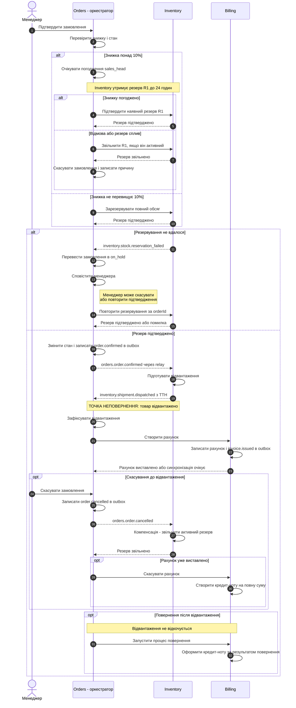
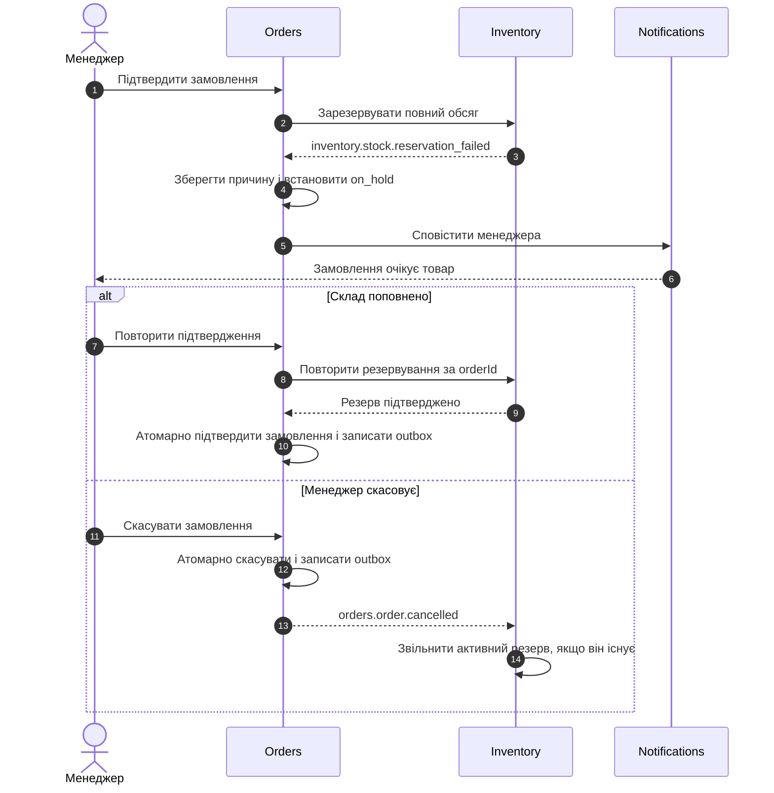

# lab-05.md

> Прочитай файл `lab-05.md` у корені проєкту. Підтвердь, що ти зрозумів мету лабораторної роботи №5 («Дані КПС: узгодженість, міграція та аналітика»), етапи роботи та свої ролі (наставник-архітектор, власники даних, рецензент, що ламає систему). Після підтвердження я надам тобі концентрований контекст мого модуля Orders за результатами ЛР1–ЛР4.

<details><summary>2 previous messages</summary>

> Прочитаю `lab-05.md` у корені проєкту й коротко підтверджу мету, етапи та ролі українською.
>
> <details><summary>Explored 2 files, ran 2 commands</summary>
>
> <details><summary>Explored a file</summary>
>
> - Read `./lab-05.md`
>
> </details>
>
> - Ran `Get-ChildItem -Force | Select-Object Name,Mode`
> - Ran `Get-ChildItem -Recurse -File -Filter 'lab-05.md' | Select-Object -ExpandProperty FullName`
>
> <details><summary>Explored a file</summary>
>
> - Read `./corporate-software-systems-lessons/lab-05.md`
>
> </details>
>
> </details>

</details>

Прочитав [lab-05.md](/C:/Users/lysen/.codex/.chatgpt-projects/g-p-6ae260eb15a881919773da222ec79b70/corporate-software-systems-lessons/lab-05.md). У корені проєкту його немає — знайшов у теці `corporate-software-systems-lessons`.

Мета ЛР5 — спроєктувати для свого модуля надійну роботу з даними: узгодженість між сервісами під час збоїв, прозорий аудит, чисту й повторювану міграцію, корисну аналітику та перевірюване резервне копіювання й відновлення.

Роботу бачу як п’ять етапів:

1. Спроєктувати transactional outbox і ретранслятор, визначити оркестрацію чи хореографію саги, її стани, компенсації та точку неповернення.
2. Розібрати сценарії збоїв, сформулювати інваріанти й тести, додати журнал аудиту та перевірити систему в ролі того, хто шукає способи її зламати.
3. Профілювати старі дані, узгодити правила очищення й мапінгу з власником даних, спланувати ідемпотентні прогони, звіти та звірку.
4. Визначити звітні представлення й точні метрики, продумати дашборд, RPO/RTO та runbook відновлення.
5. Провести самоперевірку, захистити рішення й оформити проєктний документ.

У ролях працюватиму так:

- **Наставник-архітектор:** допоможу пов’язати рішення з матеріалами ЛР1–ЛР4 і довести артефакти до цілісного проєкту.
- **Власники даних та інших модулів:** відповідатиму від їхнього імені, щоб уточнювати профіль даних, погоджувати або відхиляти правила міграції та перевіряти міжмодульні контракти.
- **Рецензент:** перевірятиму повноту, узгодженість і відповідність вимогам ЛР5.
- **Той, хто ламає систему:** атакуватиму рішення дублями й перестановкою подій, падіннями між записом і публікацією, повторними спробами та недоступністю залежностей.

Готовий прийняти концентрований контекст модуля **Orders** за ЛР1–ЛР4.

> > Мій модуль — **Orders** («КавоХаб»), студент — Олександр Лисенко.
> >
> > Ось узгоджений контекст і прийняті рішення за результатами ЛР1–ЛР4 для виконання ЛР5:
> >
> > 1. **Доменна модель та API (ЛР1–ЛР3):** &#x20;
> >    - Orders володіє замовленнями (`Order`), рядками (`OrderLine`), контрактними цінами (`ContractPrice`) та погодженням знижок (`DiscountApproval`).
> >    - Знижка **понад 10%** вимагає погодження керівника продажів (`sales_head`). Знижки `\le` 10% затверджуються менеджером автоматично.
> >    - Резервування утримується складом (Inventory) до 24 годин на час погодження; після схвалення підтверджується наявний резерв `R1` (без дублювання). Часткового резервування немає.
> >    - НБУ (ADR-ORD-03): курс EUR береться з точного кешу на запитану дату. Якщо кешу немає — повертається 503, нові EUR-ціни не фіксуються, але UAH-замовлення працюють безперебійно (деградований режим).
> > 2. **Брокер та ідемпотентність споживача (ЛР3):** &#x20;
> >    - RabbitMQ topic exchange `kavohub.events`. Черги: основна `orders.events` (quorum), повторна `orders.events.retry` (TTL 5000 мс) та `orders.events.dlq`.
> >    - Споживач дедуплікує вхідні події через таблицю `orders.processed_messages` в одній транзакції PostgreSQL. `ack` надсилається **виключно після `COMMIT`**.
> >    - Orders публікує: `orders.order.confirmed` та `orders.order.cancelled` (CloudEvents 1.0 конверт).
> > 3. **Інфраструктура, розгортання та БД (ЛР4):** &#x20;
> >    - Стек: Python 3.12 (FastAPI, Alembic, Pydantic, `aio-pika`), порт `8102`.
> >    - PostgreSQL 17+, окрема схема `orders` (користувач `orders_user`), таблиці: `orders`, `order_lines`, `idempotency_records` (UUID, TTL 24 год), `processed_messages`.
> >    - Production розміщений на окремій хмарній VM (DigitalOcean, 4 vCPU, 8 GiB RAM, бюджет до $100/міс). Staging — на офісному сервері. Реліз за стратегією Recreate.
> > 4. **Фокусні задачі ЛР5 для Orders:** &#x20;
> >    - **Transactional Outbox:** таблиця `orders.outbox` для гарантії публікації подій підтвердження/скасування без подвійного запису;
> >    - **Сага:** координація Lead-to-Cash (Orders `\rightarrow` Inventory `\rightarrow` Billing), компенсації при збої резерву (стан `on_hold`) та скасуванні;
> >    - **Міграція даних:** файл **`price_agreements.xlsx`** (контрактні ціни клієнтів зі старої Excel-системи);
> >    - **Аналітика:** звітні представлення у схемі `reporting_orders` для Metabase (`bi_reader`), ключова метрика — час від підтвердження до відвантаження `\le 24` год (обіцянка директорки Д2);
> >    - **Резервне копіювання:** RPO `\le 1` год, RTO `\le 30` хв для схеми `orders`.
> >
> > ---
> >
> > Давай розпочнемо з **Етапу 1 (Outbox і сага)**: Виступи в ролі **наставника-архітектора** та команд інших модулів. Підготуй:
> >
> > 1. Таблицю `orders.outbox` та проєкт алгоритму ретранслятора (polling publisher із `FOR UPDATE SKIP LOCKED`, publisher confirms, частота 500 мс, пачка до 100 записів, обробка помилок та очищення).
> > 2. **ADR «Хореографія чи оркестрація саги виконання замовлення» (С1):** чому для «КавоХаб» обираємо оркестрацію модулем Orders (або хореографію через `kavohub.events`), які альтернативи та компроміси.
> > 3. **Діаграму саги виконання замовлення (С2) у форматі Mermaid** із компенсаційними діями та чітко позначеною точкою неповернення (відвантаження зі складу).

## Етап 1 — Outbox і сага Orders

### 1. Таблиця `orders.outbox`

Подія записується в outbox **в тій самій транзакції**, що й зміна замовлення. Ретранслятор працює окремо від запиту користувача.

```sql
CREATE TABLE orders.outbox (
    id              uuid        PRIMARY KEY, -- CloudEvent id
    event_type      text        NOT NULL,    -- orders.order.confirmed
    aggregate_id    text        NOT NULL,    -- orderId
    aggregate_seq   bigint      NOT NULL,    -- версія/порядок подій замовлення
    payload         jsonb       NOT NULL,    -- повний CloudEvents 1.0 конверт
    created_at      timestamptz NOT NULL DEFAULT now(),
    published_at    timestamptz,
    attempts        integer     NOT NULL DEFAULT 0,
    next_attempt_at timestamptz NOT NULL DEFAULT now(),
    last_error      text
);

CREATE INDEX outbox_ready
    ON orders.outbox (next_attempt_at, created_at)
    WHERE published_at IS NULL;

CREATE INDEX outbox_published_cleanup
    ON orders.outbox (published_at)
    WHERE published_at IS NOT NULL;
```

`aggregate_seq` допомагає виявити перестановку подій одного замовлення. Якщо споживачам потрібен строгий порядок, ретранслятор має не видавати наступну подію замовлення, доки попередня не опублікована; інакше споживачі мають приймати події за версією та ідемпотентно обробляти повтори.

**Запис події:** наприклад, у транзакції підтвердження замовлення змінюється його стан і додається `orders.order.confirmed`. Для `orders.order.cancelled` діє той самий принцип.

**Polling publisher — кожні 500 мс, до 100 записів:**

```text
BEGIN
  SELECT *
  FROM orders.outbox
  WHERE published_at IS NULL
    AND next_attempt_at <= now()
  ORDER BY created_at
  FOR UPDATE SKIP LOCKED
  LIMIT 100;

  Для кожного запису:
    publish у kavohub.events з routing key = event_type
    persistent delivery + mandatory + publisher confirm

    якщо брокер підтвердив і повідомлення не було повернуте:
      позначити published_at = now()
      очистити last_error
    інакше:
      attempts += 1
      записати last_error
      призначити next_attempt_at із затримкою зростання
COMMIT
```

`SKIP LOCKED` дає змогу кільком екземплярам ретранслятора брати різні записи. Підтвердження публікації треба перевірити до позначення рядка як опублікованого. Якщо процес упаде після публікації, але до `COMMIT`, подія може прийти повторно. Це очікувано: `orders.processed_messages` ідемпотентно відсікає дублікати, а `ack` споживача залишається **після `COMMIT`**.

Після помилки рядок лишається неопублікованим і повторюється зі зростаючою затримкою; тимчасові помилки не гублять подію. Після порогу спроб потрібен алерт і ручний розбір, але запис не слід мовчки видаляти. Очищення видаляє лише давно опубліковані рядки — наприклад, старші за 30 днів — після перевірки, що строк зберігання узгоджений з аудитом і відновленням. Неопубліковані записи очищення не зачіпає.

### 2. ADR С1 — координація саги

**Статус:** запропоновано для ЛР5
**Рішення:** оркестрацію Lead-to-Cash веде модуль Orders.

Orders уже володіє життєвим циклом замовлення та знижковим погодженням. Центральна оркестрація дає змогу явно відобразити очікування резерву, стан `on_hold`, повторне підтвердження й скасування. Вона також враховує правило: знижки понад 10% погоджує `sales_head`; Inventory утримує резерв до 24 годин під час погодження; після схвалення Orders підтверджує **наявний резерв R1**, не створюючи другого.

**Розглянуті альтернативи:**

- **Хореографія через `kavohub.events`.** Модулі реагують на події й видають наступні події самостійно. Це зменшує пряме керування між модулями, але логіку переходів і компенсацій складніше побачити в одному місці. Особливо важче відстежити, чому замовлення зависло між резервом і рахунком.
- **Розподілена транзакція.** Не обираємо: немає спільної ACID-транзакції між Orders, Inventory і Billing, а зовнішня передача Billing до Odoo має власні повтори й відмови.

**Наслідки рішення:** Orders зберігає стан саги та її кроків, а міжмодульні команди й події йдуть через `kavohub.events` та outbox кожного модуля. Це додає відповідальність Orders за тайм-аути й відновлення процесу. Сага не означає глобального rollback: кожен модуль фіксує власну локальну транзакцію, а відміна виконується окремою компенсаційною дією.

### 3. Сага виконання замовлення — С2

```mermaid
sequenceDiagram
    autonumber
    actor Manager as Менеджер
    participant O as Orders — оркестратор
    participant I as Inventory
    participant B as Billing

    Manager->>O: Підтвердити замовлення
    O->>O: Перевірити знижку та стан замовлення

    alt Знижка понад 10%
        O->>O: Очікувати погодження sales_head
        Note over O,I: Inventory утримує резерв R1 до 24 годин
        alt Знижку погоджено
            O->>I: Підтвердити наявний резерв R1
            I-->>O: Резерв підтверджено
        else Знижку відхилено або резерв сплив
            O->>I: Зняти/звільнити резерв R1, якщо він активний
            I-->>O: Резерв звільнено
            O->>O: Скасувати замовлення / зафіксувати причину
        end
    else Знижка не перевищує 10%
        O->>I: Зарезервувати товар повним обсягом
        I-->>O: Резерв створено
    end

    alt Резерв не отримано або резерв R1 не підтверджено
        I-->>O: inventory.stock.reservation_failed
        O->>O: Стан on_hold; сповістити менеджера
        Note over O: Доступні cancel або повторне підтвердження.
        O->>I: Повторити резервування (ідемпотентно за orderId)
        I-->>O: Резерв підтверджено або помилка
    else Резерв підтверджено
        O->>O: Атомарно змінити стан + записати order.confirmed в outbox
        O-->>I: orders.order.confirmed (через relay/outbox)
        I->>I: Підготувати відвантаження
        I-->>O: inventory.shipment.dispatched + ТТН

        Note over I,O: ТОЧКА НЕПОВЕРНЕННЯ: товар відвантажено.
        O->>O: Зафіксувати shipment у замовленні
        O->>B: Створити рахунок за відвантаженням
        B->>B: Локально виставити рахунок; outbox для invoice.issued
        B-->>O: Рахунок виставлено / синхронізація очікує

        opt Скасування до відвантаження
            Manager->>O: Скасувати замовлення
            O->>O: Змінити стан + записати order.cancelled в outbox
            O-->>I: orders.order.cancelled
            I->>I: Компенсація — звільнити активний резерв
            I-->>O: Резерв звільнено
            opt Рахунок уже виставлено
                O-->>B: Скасування після виставлення рахунку
                B->>B: Створити кредит-ноту на повну суму
            end
        end

        opt Скасування після відвантаження
            Note over O,B: Звичайне скасування/звільнення резерву вже неможливе.
            O->>B: Запустити процес повернення та кредит-ноти
        end
    end
```

**Уточнення до діаграми:** `inventory.stock.reservation_failed` переводить замовлення в `on_hold`; це не запускає автоматичне скасування. Orders сповіщає менеджера, а той може скасувати замовлення або ініціювати повторне підтвердження. Повторне підтвердження має бути ідемпотентним за `orderId`.

Відвантаження — точка неповернення: до неї можна компенсувати підтвердження скасуванням і звільненням активного резерву. Після неї фізичну дію не відкрутити; потрібен окремий процес повернення та, якщо рахунок уже створено, кредит-нота в Billing.

> Виправ діаграму (там помилка, вона не відображається) та подання коду на першій анотації. Перепиши відповідь на моє минуле запитання з усім текстом та виправленнями. Помилка Mermaid:
> Parse error on line 29:\
> ...сповістити менеджера Note over O\
> \-----------------------^\
> Expecting '()', 'SOLID_OPEN_ARROW', 'DOTTED_OPEN_ARROW', 'SOLID_ARROW', 'SOLID_ARROW_TOP', 'SOLID_ARROW_BOTTOM', 'STICK_ARROW_TOP', 'STICK_ARROW_BOTTOM', 'SOLID_ARROW_TOP_DOTTED', 'SOLID_ARROW_BOTTOM_DOTTED', 'STICK_ARROW_TOP_DOTTED', 'STICK_ARROW_BOTTOM_DOTTED', 'SOLID_ARROW_TOP_REVERSE', 'SOLID_ARROW_BOTTOM_REVERSE', 'STICK_ARROW_TOP_REVERSE', 'STICK_ARROW_BOTTOM_REVERSE', 'SOLID_ARROW_TOP_REVERSE_DOTTED', 'SOLID_ARROW_BOTTOM_REVERSE_DOTTED', 'STICK_ARROW_TOP_REVERSE_DOTTED', 'STICK_ARROW_BOTTOM_REVERSE_DOTTED', 'BIDIRECTIONAL_SOLID_ARROW', 'DOTTED_ARROW', 'BIDIRECTIONAL_DOTTED_ARROW', 'SOLID_CROSS', 'DOTTED_CROSS', 'SOLID_POINT', 'DOTTED_POINT', got 'NEWLINE'
>
> Response annotation
>
> > Polling publisher — кожні 500 мс, до 100 записів:
> >
> > Add to chat
> > BEGIN
> > SELECT \*
> > FROM orders.outbox
> > WHERE published_at IS NULL
> > AND next_attempt_at <= now()
> > ORDER BY created_at
> > FOR UPDATE SKIP LOCKED
> > LIMIT 100;
> >
> > Для кожного запису:
> > publish у kavohub.events з routing key = event_type
> > persistent delivery + mandatory + publisher confirm
> >
> >     якщо брокер підтвердив і повідомлення не було повернуте:
> >       позначити published_at = now()
> >       очистити last_error
> >     інакше:
> >       attempts += 1
> >       записати last_error
> >       призначити next_attempt_at із затримкою зростання
> >
> > COMMIT
>
> Response annotation
>
> > 3. Сага виконання замовлення — С2
> >    Mermaid
> >
> > sequenceDiagram
> > autonumber
> > actor Manager as Менеджер
> > participant O as Orders — оркестратор
> > participant I as Inventory
> > participant B as Billing
> >
> >     Manager->>O: Підтвердити замовлення
> >     O->>O: Перевірити знижку та стан замовлення
> >
> >     alt Знижка понад 10%
> >         O->>O: Очікувати погодження sales_head
> >         Note over O,I: Inventory утримує резерв R1 до 24 годин
> >         alt Знижку погоджено
> >             O->>I: Підтвердити наявний резерв R1
> >             I-->>O: Резерв підтверджено
> >         else Знижку відхилено або резерв сплив
> >             O->>I: Зняти/звільнити резерв R1, якщо він активний
> >             I-->>O: Резерв звільнено
> >             O->>O: Скасувати замовлення / зафіксувати причину
> >         end
> >     else Знижка не перевищує 10%
> >         O->>I: Зарезервувати товар повним обсягом
> >         I-->>O: Резерв створено
> >     end
> >
> >     alt Резерв не отримано або резерв R1 не підтверджено
> >         I-->>O: inventory.stock.reservation_failed
> >         O->>O: Стан on_hold; сповістити менеджера
> >         Note over O: Доступні cancel або повторне підтвердження.
> >         O->>I: Повторити резервування (ідемпотентно за orderId)
> >         I-->>O: Резерв підтверджено або помилка
> >     else Резерв підтверджено
> >         O->>O: Атомарно змінити стан + записати order.confirmed в outbox
> >         O-->>I: orders.order.confirmed (через relay/outbox)
> >         I->>I: Підготувати відвантаження
> >         I-->>O: inventory.shipment.dispatched + ТТН
> >
> >         Note over I,O: ТОЧКА НЕПОВЕРНЕННЯ: товар відвантажено.
> >         O->>O: Зафіксувати shipment у замовленні
> >         O->>B: Створити рахунок за відвантаженням
> >         B->>B: Локально виставити рахунок; outbox для invoice.issued
> >         B-->>O: Рахунок виставлено / синхронізація очікує
> >
> >         opt Скасування до відвантаження
> >             Manager->>O: Скасувати замовлення
> >             O->>O: Змінити стан + записати order.cancelled в outbox
> >             O-->>I: orders.order.cancelled
> >             I->>I: Компенсація — звільнити активний резерв
> >             I-->>O: Резерв звільнено
> >             opt Рахунок уже виставлено
> >                 O-->>B: Скасування після виставлення рахунку
> >                 B->>B: Створити кредит-ноту на повну суму
> >             end
> >         end
> >
> >         opt Скасування після відвантаження
> >             Note over O,B: Звичайне скасування/звільнення резерву вже неможливе.
> >             O->>B: Запустити процес повернення та кредит-ноти
> >         end
> >     end

## Етап 1 — Outbox і сага Orders

### 1. Таблиця `orders.outbox`

Подію потрібно записувати в outbox **у тій самій транзакції**, що й зміну замовлення. Окремий ретранслятор публікує її в RabbitMQ.

```sql
CREATE TABLE orders.outbox (
    id              uuid        PRIMARY KEY, -- CloudEvent id
    event_type      text        NOT NULL,    -- наприклад, orders.order.confirmed
    aggregate_id    text        NOT NULL,    -- orderId
    aggregate_seq   bigint      NOT NULL,    -- послідовність подій замовлення
    payload         jsonb       NOT NULL,    -- повний CloudEvents 1.0 конверт
    created_at      timestamptz NOT NULL DEFAULT now(),
    published_at    timestamptz,
    attempts        integer     NOT NULL DEFAULT 0,
    next_attempt_at timestamptz NOT NULL DEFAULT now(),
    last_error      text
);

CREATE INDEX outbox_ready
    ON orders.outbox (next_attempt_at, created_at)
    WHERE published_at IS NULL;

CREATE INDEX outbox_published_cleanup
    ON orders.outbox (published_at)
    WHERE published_at IS NOT NULL;
```

`aggregate_seq` дає змогу відстежувати порядок подій одного замовлення. Якщо споживачам потрібен строгий порядок, ретранслятор не має публікувати наступну подію цього замовлення, поки попередня не підтверджена. Інший варіант — споживачі перевіряють послідовність і версію події.

**Алгоритм polling publisher:** опитування кожні 500 мс, до 100 записів за раз. Рядки блокуються на час публікації; після успішного підтвердження транзакція позначає їх опублікованими.

```text
BEGIN;

SELECT id, event_type, aggregate_id, aggregate_seq, payload
FROM orders.outbox
WHERE published_at IS NULL
  AND next_attempt_at <= now()
ORDER BY created_at
LIMIT 100
FOR UPDATE SKIP LOCKED;

Для кожного вибраного запису:
  publish у kavohub.events:
    routing key = event_type
    persistent delivery = увімкнено
    mandatory = увімкнено
    publisher confirm = очікувати підтвердження

  Якщо RabbitMQ підтвердив публікацію і повідомлення не повернулося:
    UPDATE orders.outbox
    SET published_at = now(), last_error = NULL
    WHERE id = :id;

  Якщо публікація не підтверджена або сталася помилка:
    UPDATE orders.outbox
    SET attempts = attempts + 1,
        next_attempt_at = :час_наступної_спроби,
        last_error = :опис_помилки
    WHERE id = :id;

COMMIT;
```

Помилки повторюються зі зростаючою затримкою. Після встановленого порогу спроб потрібні алерт і ручний розбір, але запис не можна мовчки видаляти. `SKIP LOCKED` дає змогу кільком екземплярам ретранслятора брати різні рядки.

Якщо процес упаде після публікації, але до `COMMIT`, подія може бути опублікована повторно. Це очікувана поведінка: отримувачі мають обробляти її ідемпотентно. Споживач Orders уже використовує `orders.processed_messages` і надсилає `ack` лише після `COMMIT`.

Очищення видаляє лише давно опубліковані рядки, наприклад старші за 30 днів, відповідно до погодженого строку зберігання. Неопубліковані записи очищення не зачіпає.
:codex-annotation{index="1" id="368a8d42-6cdd-4053-8486-8cd265fd385f"}

### 2. ADR С1 — оркестрація чи хореографія

**Статус:** запропоновано для ЛР5
**Рішення:** оркестрацію саги Lead-to-Cash веде модуль Orders.

Orders володіє життєвим циклом замовлення та знижковим погодженням. Оркестратор дає змогу явно керувати очікуванням резерву, станом `on_hold`, повторним підтвердженням і скасуванням. Це також враховує правило: знижку понад 10% погоджує `sales_head`; Inventory утримує резерв до 24 годин; після погодження Orders підтверджує наявний резерв `R1`, не створюючи нового.

**Альтернатива — хореографія через `kavohub.events`.** Модулі самостійно реагують на події й публікують наступні. Такий підхід зменшує централізоване керування, але ускладнює огляд повного процесу та пошук причин, чому замовлення зависло між резервом і виставленням рахунку.

Розподілена ACID-транзакція між Orders, Inventory і Billing не обирається: кожен модуль має власну базу даних, а Billing також взаємодіє із зовнішньою системою Odoo.

**Наслідки:** Orders зберігає стан саги, керує кроками та тайм-аутами. Команди й події між модулями проходять через `kavohub.events`, а кожен модуль публікує їх через власний outbox. Компенсація — це окрема бізнес-дія, а не глобальний rollback.

### 3. Діаграма саги виконання замовлення — С2



**Компенсації та правила переходів:**

- Якщо резервування не вдалося, Orders встановлює `on_hold`, сповіщає менеджера й дозволяє скасувати замовлення або повторити підтвердження.
- Повторне резервування має бути ідемпотентним за `orderId`. Після погодження знижки Orders підтверджує наявний `R1`.
- До відвантаження скасування замовлення компенсує активний резерв через його звільнення. Якщо рахунок уже виставлений, Billing створює кредит-ноту.
- Відвантаження — точка неповернення: фізичну дію не можна відкрутити. Після неї потрібен окремий процес повернення; Billing оформлює кредит-ноту відповідно до цього процесу.
  :codex-annotation{index="2" id="a47de98b-bd42-47c0-a6b5-e544161d5e6b"}

> > Етап 1 зафіксовано. Переходимо до **Етапу 2: Сценарії збою й аудит**.
> >
> > Виступи в ролі **рецензента, що ламає систему** (перевіряє інваріанти, дублікати, падіння ретранслятора, збої зовнішніх систем). Підготуй для розділу документа такі артефакти:
> >
> > 1. **Сценарії збою та тест-специфікації (розділ 2 документа):** &#x20;
> >    - **Сценарій 1 (SC-ORD-01):** склад повернув `inventory.stock.reservation_failed` `\rightarrow` перехід замовлення в `on_hold`, сповіщення менеджера, збереження можливості `cancel` або повторного підтвердження.
> >    - **Сценарій 2 (SC-ORD-02):** відповідь від Inventory не надійшла за 10 хв `\rightarrow` фіксація затримки, алерт черговому, статус очікування розбору без автоматичного скасування.
> >    - **Сценарій 3 (SC-ORD-03, тест-специфікація з табл. 6.3):** зупинка ретранслятора outbox, створення та підтвердження 20 замовлень, перезапуск ретранслятора `\rightarrow` інваріант: рівно 20 подій `orders.order.confirmed` опубліковано в RabbitMQ, жодна не втрачена і не розійшлася з БД.
> >    - **Сценарій 4 (SC-ORD-04, власний):** збій НБУ під час погодження замовлення з EUR-обладнанням `\rightarrow` поведінка за ADR-ORD-03 (кеш на запитану дату або 503).
> >    - Для кожного сценарію наведи: передумова, ін'єкція збою, очікувана поведінка, **бізнес-інваріант**, спосіб перевірки тестом та метрика/алерт.
> > 2. **Mermaid-діаграма послідовності збою:** &#x20;
> >    - Візуалізація сценарію SC-ORD-01 (збій резерву `\rightarrow` перехід в `on_hold` `\rightarrow` повторна спроба після поповнення складу або скасування).
> > 3. **Журнал аудиту `orders.audit_log` (розділ 3 документа):** &#x20;
> >    - SQL-схема таблиці `orders.audit_log` (`id`, `entity`, `entity_id`, `action`, `changed_by`, `correlation_id`, `old_value`, `new_value`, `changed_at`).
> >    - Перелік операцій, що підлягають обов'язковому аудиту (`order_created`, `status_changed`, `lines_updated`, `discount_approved`, `discount_rejected`, `order_cancelled`, `price_agreement_imported`).
> >    - Обмеження прав: тільки `INSERT` і `SELECT` для `orders_user` (заборона `UPDATE` і `DELETE`).
> >    - Строк зберігання аудит-записів (3 роки відповідно до вимог комерційного обліку).

## 2. Сценарії збою та тест-специфікації

### SC-ORD-01 — Inventory відмовив у резервуванні

- **Передумова:** замовлення готове до підтвердження; склад має зарезервувати весь обсяг, часткового резервування немає.
- **Ін’єкція збою:** Inventory повертає `inventory.stock.reservation_failed`.
- **Очікувана поведінка:** Orders переводить замовлення в `on_hold`, зберігає причину відмови та сповіщає менеджера. Замовлення можна скасувати або повторно підтвердити після поповнення складу. Повторна команда не створює дубль замовлення чи резерву.
- **Бізнес-інваріант:** замовлення в `on_hold` не вважається підтвердженим і не запускає відвантаження; його стан і доступні дії збережені.
- **Перевірка тестом:** змоделювати відмову Inventory; перевірити стан і причину в Orders, сповіщення менеджеру та відсутність `orders.order.confirmed`. Після поповнення складу повторити підтвердження й перевірити єдиний активний резерв та одну подію підтвердження. Окремо перевірити команду скасування.
- **Метрика/алерт:** лічильник `orders_reservation_failed_total`; алерт черговому, якщо кількість замовлень у `on_hold` перевищила погоджений поріг або вони залишаються там довше цільового часу.

### SC-ORD-02 — Inventory не відповів за 10 хвилин

- **Передумова:** Orders надіслав запит на резервування й очікує відповідь Inventory.
- **Ін’єкція збою:** відповідь Inventory не надійшла протягом 10 хвилин.
- **Очікувана поведінка:** Orders фіксує тайм-аут, позначає замовлення для розбору та створює попередження для чергового. Замовлення лишається в стані очікування; автоматичного скасування чи повторного підтвердження немає.
- **Бізнес-інваріант:** відсутність відповіді не трактується як успішне резервування або відмова; Orders не підтверджує замовлення і не запускає відвантаження без підтвердженого резерву.
- **Перевірка тестом:** затримати або придушити відповідь Inventory на понад 10 хвилин. Перевірити стан замовлення, запис про затримку, алерт і відсутність `orders.order.confirmed` та автоматичного скасування. Після отримання відповіді перевірити коректне продовження або ручний розбір.
- **Метрика/алерт:** `orders_inventory_response_timeout_total`; алерт, якщо `orders_inventory_pending_age_seconds > 600`.

### SC-ORD-03 — Outbox накопичив події під час зупинки ретранслятора

- **Передумова:** Orders та PostgreSQL доступні; outbox працює; ретранслятор зупинено до створення замовлень.
- **Ін’єкція збою:** зупинити ретранслятор, створити й підтвердити 20 замовлень, потім запустити його знову.
- **Очікувана поведінка:** кожне підтвердження і відповідний запис `orders.order.confirmed` у outbox фіксуються атомарно. Після перезапуску ретранслятор допубліковує всі 20 подій; записи позначаються опублікованими після publisher confirm.
- **Бізнес-інваріант:** для 20 підтверджених замовлень є 20 відповідних унікальних подій за `eventId` і `orderId`; жодне підтвердження не втрачено, а подія не існує без відповідного підтвердженого стану в БД.
- **Перевірка тестом:** зупинити ретранслятор; створити 20 замовлень; звірити 20 підтверджених замовлень із 20 неопублікованими рядками outbox. Перезапустити ретранслятор і дочекатися, доки всі рядки матимуть `published_at`. Перевірити 20 різних `eventId`, відповідність `orderId`, відсутність зайвих повідомлень у контрольованому тестовому запуску та успішну ідемпотентну обробку споживачем.
- **Метрика/алерт:** `orders_outbox_unpublished_count` та вік найстарішого неопублікованого запису; алерт, якщо outbox не спорожнюється після відновлення або найстаріший запис перевищив поріг.

**Межа гарантії:** у цьому сценарії ретранслятор зупинений до публікації, тому після запуску очікується рівно 20 повідомлень. Якщо окремо зімітувати падіння після підтвердження RabbitMQ, але до фіксації `published_at`, outbox може опублікувати одну подію повторно. Тому загальна гарантія — доставка щонайменше один раз, а один бізнес-ефект забезпечують ідемпотентні споживачі. Такий crash-window варто перевірити окремим тестом.

### SC-ORD-04 — НБУ недоступний для EUR-замовлення

- **Передумова:** менеджер оформлює або погоджує замовлення з обладнанням у EUR; потрібен курс НБУ для конкретної дати.
- **Ін’єкція збою:** сервіс НБУ недоступний, а кешу курсу на запитану дату немає.
- **Очікувана поведінка:** за ADR-ORD-03 Orders повертає `503`, не фіксує нову EUR-ціну та не підтверджує замовлення за застарілим чи приблизним курсом. UAH-замовлення обробляються штатно. Якщо точний курс уже є в кеші на запитану дату, Orders використовує його.
- **Бізнес-інваріант:** EUR-ціна зафіксована лише з курсом для запитаної дати; збій НБУ не блокує UAH-замовлення.
- **Перевірка тестом:** у тестовому середовищі перевірити три випадки: НБУ недоступний і точного кешу немає — відповідь `503`, ціна не записана; НБУ недоступний, але точний кеш є — використано його курс; UAH-замовлення — успішне. Перевірити, що не створено події підтвердження для невдалого EUR-запиту.
- **Метрика/алерт:** `orders_nbu_request_failures_total` та частка помилок EUR-ціноутворення; алерт при тривалій недоступності НБУ. Окремо відстежувати успішність UAH-замовлень, щоб бачити деградований режим.

## Діаграма послідовності для SC-ORD-01



## 3. Журнал аудиту `orders.audit_log`

Таблиця призначена для доповнення історії змін. Її власником має бути окрема роль міграцій, а не `orders_user`: власник таблиці має ширші права, тому звичайного `REVOKE` для нього недостатньо.

```sql
CREATE TABLE orders.audit_log (
    id              bigserial   PRIMARY KEY,
    entity          text        NOT NULL,
    entity_id       text        NOT NULL,
    action          text        NOT NULL,
    changed_by      text        NOT NULL,
    correlation_id  uuid,
    old_value       jsonb,
    new_value       jsonb,
    changed_at      timestamptz NOT NULL DEFAULT now()
);

CREATE INDEX audit_log_entity_lookup
    ON orders.audit_log (entity, entity_id, changed_at);

CREATE INDEX audit_log_correlation_lookup
    ON orders.audit_log (correlation_id)
    WHERE correlation_id IS NOT NULL;

REVOKE ALL ON orders.audit_log FROM PUBLIC;
REVOKE UPDATE, DELETE, TRUNCATE ON orders.audit_log FROM orders_user;
GRANT SELECT, INSERT ON orders.audit_log TO orders_user;
GRANT USAGE, SELECT ON SEQUENCE orders.audit_log_id_seq TO orders_user;
```

У розгортанні потрібно створити таблицю від імені окремої ролі-власника схеми та перевірити, що `orders_user` не є власником таблиці й не має членства в ролі-власника.

**Обов’язково аудіювати:**

- `order_created` — створення замовлення;
- `status_changed` — кожну зміну стану, з попереднім і новим значеннями;
- `lines_updated` — зміну рядків замовлення;
- `discount_approved` і `discount_rejected` — рішення щодо знижки, включно з тим, хто його ухвалив;
- `order_cancelled` — скасування та причину;
- `price_agreement_imported` — імпорт або оновлення контрактної ціни, із посиланням на пакет міграції.

`changed_by` має містити користувача або назву сервісного облікового запису; `correlation_id` пов’язує запис аудиту з запитом і подіями процесу. Для дій без старого чи нового значення відповідне поле може бути `NULL`.

**Строк зберігання:** 3 роки відповідно до заданої вимоги комерційного обліку. Політика архівації має зберігати записи незмінними та доступними для пошуку протягом цього строку.

> > Етап 2 повністю узгоджено. Переходимо до **Етапу 3: Міграція даних зі старої системи**.
> >
> > Мій файл міграції — **`price_agreements.xlsx`** (контрактні ціни клієнтів зі старої системи).
> >
> > Виступи в ролі **«джерела даних»**, **власника даних (Андрій Бондар, керівник відділу продажів)** та **рецензента з якості даних**.
> >
> > Підготуй для розділу 4 документа такі артефакти:
> >
> > 1. **Профілювання даних `price_agreements.xlsx`:** &#x20;
> >    - Оцінка обсягу (кількість рядків, наприклад \~250 угод).
> >    - Виявлені типові дефекти: ціни з текстом «грн», порожні дати «Діє до», перекриття періодів дії для одного клієнта й товару, відсутність валюти для кавомашин (`MCH-*`) та кавомолок (`GRN-*`), невалідні ЄДРПОУ або невідомі SKU.
> > 2. **Таблиця правил очищення й мапінгу:** &#x20;
> >    - Поля джерела `\rightarrow` поля таблиці `orders.contract_prices` (`account_id`, `product_sku`, `price`, `currency`, `valid_from`, `valid_to`).
> >    - Точні правила трансформації: &#x20;
> >      - якщо валюти немає: для SKU префіксів `MCH-*` і `GRN-*` встановлюється `EUR`, для решти (кава, сиропи) — `UAH` (погоджено з Андрієм Бондарем);
> >      - очищення числових значень від тексту «грн», пробілів і заміна коми на крапку;
> >      - якщо «Діє до» порожнє `\rightarrow` трактувати як безстроково (`9999-12-31` або `NULL`);
> >      - перекриття періодів: нова пізніша угода автоматично скорочує дату закінчення попередньої (`valid_to = new.valid_from - 1 day`);
> >      - невалідний ЄДРПОУ або відсутній SKU в довіднику `\rightarrow` статус `rejected` із внесенням до звіту про помилки.
> >    - Стовпчик «Погоджено / Власник» із фіксацією згоди Андрія Бондаря.
> > 3. **План прогонів та ідемпотентність:** &#x20;
> >    - Схема: `Dry run` (валідація без запису в БД) `\rightarrow` `Імпорт` (транзакційний batch-імпорт) `\rightarrow` `Звіт` `\rightarrow` `Повторний запуск` (ідемпотентний `UPSERT` за природним ключем `account_id + product_sku + valid_from`, що не створює дублікатів).
> >    - Формат звіту про міграцію: прийнято успішно, виправлено (corrected), відхилено (rejected з причиною).
> > 4. **План звірки (Reconciliation) та публікація подій:** &#x20;
> >    - Як довести, що жодна погоджена ціна не загубилася і суми збігаються.
> >    - **Навантаження на RabbitMQ:** як обробити генерацію подій після імпорту (чому не варто публікувати 250 окремих подій миттєво, а краще використати пачкові оновлення або тимчасове відключення outbox-генерації на час початкового завантаження).
> >    - Питання персональних даних (чи є ризики згідно із Законом України «Про захист персональних даних» для цього файлу).

<details><summary>2 previous messages</summary>

> Перевірю, чи є `price_agreements.xlsx` серед доступних файлів проєкту. Якщо самого файлу немає, чітко позначу профіль як попередній на основі описаних дефектів, а не як виміряний результат.
>
> <details><summary>Ran a command, searched the web</summary>
>
> - Ran `Get-ChildItem -Recurse -File -Filter 'price_agreements.xlsx' | Select-Object -ExpandProperty FullName`
>
> Searched the web for `site:zakon.rada.gov.ua Закон України Про захист персональних даних юридична особа ЄДРПОУ персональні дані ФОП`
>
> Searched the web for `Закон України Про захист персональних даних стаття 2 персональні дані ідентифікована фізична особа zakon.rada.gov.ua 2297-VI`
>
> Searched the web for `https://zakon.rada.gov.ua/laws/show/2297-17#Text`
>
> </details>

</details>

## Розділ 4. Міграція даних

### 4.1. Профіль `price_agreements.xlsx`

**Статус профілю:** попередній. Самого `price_agreements.xlsx` у доступних файлах проєкту немає, тож фактичну кількість рядків і частоту дефектів перевірити не вдалося. Для планування приймаємо оцінку **близько 250 угод**, як зазначено в умові. Її потрібно підтвердити під час dry run; наведені нижче дефекти — очікувані за описом, а не виміряні у файлі.

| Перевірка                       | Очікуваний дефект                            | Дія під час профілювання                                             |
| ------------------------------- | -------------------------------------------- | -------------------------------------------------------------------- |
| Кількість рядків і заповненість | Неповні рядки, пропуски обов’язкових полів   | Порахувати рядки, порожні значення за кожним полем                   |
| Формат ціни                     | Текст `грн`, пробіли, десяткова кома         | Порахувати значення, які не конвертуються в число після нормалізації |
| `Діє до`                        | Порожня дата                                 | Порахувати та трактувати як відкритий кінець періоду                 |
| Періоди дії                     | Перетини угод для тієї самої пари клієнт–SKU | Знайти перетини інтервалів до імпорту                                |
| Валюта                          | Не вказана для `MCH-*`, `GRN-*` та інших SKU | Порахувати пропуски за префіксами SKU                                |
| ЄДРПОУ                          | Неправильна довжина або сторонні символи     | Нормалізувати, перевірити формат і знайти відповідний `account_id`   |
| SKU                             | Код відсутній у довіднику товарів            | Зіставити з довідником, відсутні коди відхилити                      |
| Дублікати                       | Повторні угоди з однаковим природним ключем  | Перевірити `account_id + product_sku + valid_from`                   |

Перед імпортом зберігаються назва файлу, дата отримання, контрольна сума файлу та ідентифікатор прогону. Це дасть змогу відрізнити повторний запуск того самого джерела від нового пакета.

### 4.2. Правила очищення й мапінгу

Правила позначено як погоджені Андрієм Бондарем **відповідно до наданого контексту лабораторної**. Це фіксує рішення для проєктного документа, але не підтверджує окрему реальну консультацію з цією особою.

| Поле джерела                        | Поле цілі                    | Правило трансформації                                                                                                                                         | Погане значення                                                                                             | Погоджено / власник                            |
| ----------------------------------- | ---------------------------- | ------------------------------------------------------------------------------------------------------------------------------------------------------------- | ----------------------------------------------------------------------------------------------------------- | ---------------------------------------------- |
| ЄДРПОУ / код клієнта                | `account_id`                 | Прибрати пробіли й розділові знаки згідно з форматом джерела; перевірити допустимий формат; зіставити з наявним клієнтом у CRM/довіднику рахунків             | Невалідний код або клієнта не знайдено — `rejected`, причина `INVALID_ACCOUNT_ID` або `ACCOUNT_NOT_FOUND`   | Андрій Бондар — погодження правил зіставлення  |
| SKU                                 | `product_sku`                | Нормалізувати пробіли та регістр за правилами довідника; перевірити існування SKU                                                                             | Відсутній у довіднику — `rejected`, `UNKNOWN_SKU`                                                           | Власник довідника товарів; погодження потрібне |
| Ціна                                | `price`                      | Видалити текст `грн` і пробіли; кому замінити на крапку; перевірити десяткове число та додатність; зберігати як `numeric`, без округлення поза масштабом поля | Некоректне або від’ємне число — `rejected`, `INVALID_PRICE`                                                 | Андрій Бондар — погоджено                      |
| Валюта                              | `currency`                   | Якщо задана — перевірити код валюти. Якщо порожня: `MCH-*` і `GRN-*` → `EUR`; решта SKU (кава, сиропи) → `UAH`                                                | Невідома валюта або неоднозначний SKU — `rejected`, `INVALID_CURRENCY` / `CURRENCY_UNRESOLVED`              | Андрій Бондар — погоджено                      |
| Дата «Діє з»                        | `valid_from`                 | Розібрати за форматом джерела; привести до дати; поле обов’язкове                                                                                             | Порожнє або неоднозначне значення — `rejected`, `INVALID_VALID_FROM`                                        | Андрій Бондар — погоджено                      |
| Дата «Діє до»                       | `valid_to`                   | Порожнє значення трактувати як безстрокове; у БД зберігати `NULL` (відкритий кінець)                                                                          | Непорожня дата до `valid_from` — `rejected`, `INVALID_DATE_RANGE`                                           | Андрій Бондар — погоджено                      |
| Угода для того самого клієнта й SKU | `valid_to` попередньої угоди | Якщо нова угода має пізніший `valid_from` і перетинає попередню, скоротити попередню до дня перед новою: `valid_to = new.valid_from - 1 day`                  | Однаковий `valid_from` із різними цінами або валютою — карантин і погодження власника; не вибирати довільно | Андрій Бондар — погоджено правило скорочення   |

Для кількох попередніх угод перевіряються **всі періоди того самого `account_id + product_sku`**, а не лише найближча попередня угода. Після корекції не повинно залишитися перетинів. У таблиці `orders.contract_prices` потрібне обмеження, що забороняє кінець періоду раніше за початок. Для `valid_to = NULL` логіка перевірок трактує період як відкритий.

Dry run не змінює цільову БД. Він формує попередній результат очищення та звіт із рішеннями `accepted`, `corrected` або `rejected`. Для рядків, відхилених через конфлікт однакових дат, потрібне рішення власника даних, а не автоматичний вибір.

### 4.3. Прогони, ідемпотентність і звіт

1. **Dry run:** прочитати файл, зафіксувати його контрольну суму, профілювати поля, виконати правила нормалізації, знайти невідомі клієнтів і SKU, не записуючи дані в `orders.contract_prices`.
2. **Імпорт:** після перегляду dry-run звіту записати прийняті й виправлені рядки транзакційними batch-пакетами. Для конфліктів і відхилених рядків створити записи у staging/таблиці результатів міграції.
3. **Звіт:** видати підсумок за рядками, причинами виправлень і відхилень, а також контрольні значення для звірки.
4. **Повторний запуск:** виконати `UPSERT` за природним ключем `account_id + product_sku + valid_from`. Повторна обробка того самого файлу не створює нових угод; вона оновлює той самий запис або не змінює його, якщо нормалізовані дані збігаються.

Природний ключ має бути унікальним у цільовій схемі. Рекомендований технічний захист:

```sql
CREATE UNIQUE INDEX contract_prices_natural_key
    ON orders.contract_prices (account_id, product_sku, valid_from);
```

Щоб повторний запуск був безпечним, коригування періодів попередніх угод і запис нових рядків треба виконувати в транзакції та в стабільному порядку. Унікальний ключ запобігає дублюванню, а перевірка контрольної суми файлу допомагає розпізнавати повторний пакет.

**Формат звіту:**

| Показник         | Зміст                                                                                                                                      |
| ---------------- | ------------------------------------------------------------------------------------------------------------------------------------------ |
| `accepted`       | Рядки імпортовано без трансформацій                                                                                                        |
| `corrected`      | Рядки імпортовано після нормалізації або погодженого скорочення попереднього періоду; містить поле, початкове та цільове значення, правило |
| `rejected`       | Рядки не імпортовано; містить номер рядка, причину й проблемне поле                                                                        |
| `reconciliation` | Лічильники джерела й цілі, унікальні природні ключі, контрольні суми та перелік нерозв’язаних конфліктів                                   |

### 4.4. Звірка й події після імпорту

**Звірка міграції:**

- Перевірити арифметику рядків: `рядки джерела = accepted + corrected + rejected`.
- Переконатися, що для кожного прийнятого або виправленого рядка є рівно один запис цілі за природним ключем.
- Порівняти нормалізовані значення `account_id`, SKU, ціни, валюти й меж періоду для кожного ключа; сформувати звіт про відмінності.
- Перевірити відсутність перетинів періодів для кожної пари клієнт–SKU та відсутність записів із невідомими клієнтами/SKU.
- Зіставити кількість угод за валютою та SKU-префіксом. Контрольні суми цін можна порівнювати окремо за валютою як діагностичний показник, але вони не замінюють порівняння рядок-до-рядка: ціни з різних валют не можна додавати, а скорочення періодів змінює часову чинність угод.

**Публікація подій:** не слід миттєво викидати 250 окремих повідомлень у RabbitMQ без обмеження швидкості: це може створити пік навантаження для споживачів і зайву чергу повторних обробок. Водночас не можна вимикати запис outbox для змін, які мають бути видимі іншим модулям: тоді зміни в БД і події розійдуться.

Рекомендований порядок:

1. Узгодити контракт події для змін контрактних цін. Поточний каталог Orders містить `orders.order.confirmed` і `orders.order.cancelled`; нову подію на кшталт `orders.contract_prices.imported` або `orders.contract_price.changed` потрібно погодити до використання.
2. У транзакції записувати змінені ціни та відповідні outbox-записи. Для початкового завантаження, якщо споживачам не потрібне повідомлення про кожен рядок, погодити одну подію про завершений пакет із `migrationBatchId`, кількістю й контрольним підсумком. Споживач тоді читає пакет із погодженого джерела.
3. Якщо потрібні події на кожну зміну, записати їх у outbox пакетами й обмежити швидкість ретранслятора; моніторити розмір черги та затримку споживачів.
4. Тестове завантаження провести в середовищі, де повідомлення не впливають на production-споживачів.

Тимчасове відключення генерації подій можливе лише для окремого імпортного шляху, якщо заздалегідь погоджено, як споживачі дізнаються про пакет і як перевіряється повнота синхронізації. Для звичайного потоку змін outbox не вимикається.

### 4.5. Персональні дані

Файл із контрактними цінами, ЄДРПОУ юридичних осіб, SKU та цінами **не обов’язково містить персональні дані**. Ризик виникає, якщо в ньому або пов’язаних довідниках є дані про фізичних осіб, які ідентифіковані чи можуть бути ідентифіковані, наприклад ФОП, контактних осіб, телефони, електронні адреси або підписи. Закон визначає персональні дані як відомості про ідентифіковану або конкретно ідентифіковану фізичну особу. [Закон України «Про захист персональних даних», стаття 2](https://www.president.gov.ua/documents/2297vi-11567)

До імпорту потрібно перевірити заголовки й приклади значень усіх колонок. Якщо є дані фізичних осіб — обмежити доступ до файлу й звіту, не копіювати такі значення в логи, використовувати їх лише для визначеної мети обробки та видалити тимчасові копії після завершення погодженого строку. Код ЄДРПОУ юридичної особи сам по собі не є відомістю про фізичну особу, але дані ФОП або контактної особи можуть її ідентифікувати. Це первинна оцінка складу файлу; фактичний висновок залежить від його колонок і вмісту.

> > Етап 3 повністю прийнято. Переходимо до **Етапу 4: Аналітика й резервне копіювання**.
> >
> > Виступи в ролях **директорки (споживача звітів)**, **ІТ-адміністратора Олега Савчука** та **рецензента з експлуатації**.
> >
> > Підготуй для розділів 5 та 6 документа такі артефакти:
> >
> > 1. **Аналітика та звітні представлення (розділ 5):** &#x20;
> >    - SQL-схема звітних представлень у схемі `reporting_orders` (наприклад, `reporting_orders.order_lead_time` та `reporting_orders.daily_sales_summary`).
> >    - Налаштування ролі `bi_reader` (права лише `SELECT` на схему `reporting_orders`, заборона доступу до схеми `orders`).
> >    - Таблиця визначення метрик модуля Orders за шаблоном методички (8.3): &#x20;
> >      1. **Частка замовлень, відвантажених у межах доби** (виконання обіцянки директорки Д2): бізнес-питання, математична формула, джерело, зрізи, частота оновлення, власник.
> >      2. **Середній чек замовлення** (з ПДВ, лише для підтверджених/відвантажених).
> >    - **Метрики дашборду директорки «Три цифри дня» (С4, вимога Д1):** &#x20;
> >      - Таблиця трьох метрик системи: Нові замовлення (Orders), Відвантажено (Inventory), Прострочена дебіторка (Billing) із формулами та джерелами.
> >      - Текстовий/ASCII макет дашборду для Metabase.
> > 2. **Резервне копіювання та Runbook відновлення (розділ 6):** &#x20;
> >    - **Обґрунтування RPO та RTO:** чому для «КавоХаб» погоджено RPO `\le 1` год та RTO `\le 45` хв (з урахуванням робочого часу та фінансових ризиків).
> >    - **План бекапу системи (С3):** що бекапиться (`pg_dump -Fc --schema=orders`), як часто (щогодини різницевий/дамп, щодоби повний), куди зберігається (окреме сховище поза хмарною VM / офісний сервер для реплікації), правила ротації (7 днів / 4 тижні / 12 місяців) та регулярна перевірка відновленням.
> >    - **Runbook відновлення схеми `orders` (за шаблоном 8.4):** &#x20;
> >      - Хто вирішує і як оголошується інцидент;
> >      - Зупинка сервісу `orders` та ретранслятора outbox;
> >      - Процедура відновлення в тестову БД `kavohub_restore_check` та валідація цілісності;
> >      - Перемикання схеми на відновлену;
> >      - **Що робити з outbox і споживачами після повернення в минуле:** детальний аналіз, що станеться з подіями `orders.order.confirmed` (чому записи з `published_at IS NOT NULL` не публікуються вдруге, а якщо стара подія випадково переопублікується — ідемпотентний споживач `processed_messages` відкине дублікат);
> >      - Smoke-перевірки та критерії готовності системи.

<details><summary>2 previous messages</summary>

> Підготую артефакти як проєктний розділ. Також звірю план із поведінкою PostgreSQL: зокрема, `pg_dump` створює повний логічний знімок вибраної схеми, а не різницеву копію.
>
> <details><summary>Searched the web</summary>
>
> Searched the web for `site:postgresql.org/docs/current backup pg_dump does not support incremental backup continuous archiving WAL point in time recovery ...`
>
> </details>

</details>

# Розділ 5. Аналітика

## 5.1. Звітні представлення

Нижче наведено SQL-проєкт на основі припущень, що таблиця `orders.orders` містить `id`, `status`, `created_at`, `confirmed_at`, `shipped_at`, `warehouse_id`, `shipping_city`, `total_with_vat`. `total_with_vat` має бути зафіксованою сумою замовлення з ПДВ, а не перераховуватися з поточних цін. Перед реалізацією назви полів потрібно звірити з фактичною схемою Orders.

```sql
CREATE SCHEMA IF NOT EXISTS reporting_orders;

CREATE VIEW reporting_orders.order_lead_time AS
SELECT
    o.id AS order_id,
    o.warehouse_id,
    o.shipping_city,
    o.confirmed_at,
    o.shipped_at,
    EXTRACT(EPOCH FROM (o.shipped_at - o.confirmed_at)) / 3600.0
        AS lead_time_hours,
    (o.shipped_at <= o.confirmed_at + interval '24 hours')
        AS shipped_within_24h
FROM orders.orders AS o
WHERE o.confirmed_at IS NOT NULL
  AND o.shipped_at IS NOT NULL
  AND o.status = 'shipped';

CREATE VIEW reporting_orders.daily_sales_summary AS
SELECT
    (o.shipped_at AT TIME ZONE 'Europe/Kyiv')::date AS shipped_day,
    o.warehouse_id,
    o.shipping_city,
    count(*) AS shipped_orders,
    sum(o.total_with_vat) AS shipped_sales_with_vat,
    avg(o.total_with_vat) AS average_ticket_with_vat
FROM orders.orders AS o
WHERE o.status = 'shipped'
  AND o.shipped_at IS NOT NULL
GROUP BY 1, 2, 3;
```

`daily_sales_summary` визначає день за часом відвантаження в часовому поясі Києва. Якщо система зберігає часові позначки інакше, часовий пояс треба узгодити з бізнесом.

## 5.2. Доступ Metabase

Роль Orders має читати звітну схему, але не таблиці модуля. Технічний обліковий запис створюється окремою адміністративною роллю; `bi_reader` не повинен бути власником схем або мати успадковані привілеї.

```sql
CREATE ROLE bi_reader LOGIN;

REVOKE ALL ON SCHEMA orders FROM bi_reader;
REVOKE ALL ON ALL TABLES IN SCHEMA orders FROM bi_reader;
GRANT USAGE ON SCHEMA reporting_orders TO bi_reader;
GRANT SELECT ON reporting_orders.order_lead_time TO bi_reader;
GRANT SELECT ON reporting_orders.daily_sales_summary TO bi_reader;

ALTER DEFAULT PRIVILEGES FOR ROLE orders_owner
    IN SCHEMA reporting_orders
    GRANT SELECT ON TABLES TO bi_reader;
```

Оскільки роль `bi_reader` за задумом має доступ лише до `reporting_orders`, дашборд, що показує цифри Inventory і Billing, не повинен отримувати права на внутрішні схеми цих модулів. Варіант — окрема роль Metabase з `SELECT` лише на узгоджені звітні представлення `reporting_inventory` та `reporting_billing`. Самі представлення публікують відповідні модулі; Orders не читає їхні внутрішні таблиці.

## 5.3. Визначення метрик Orders

| Назва                                        | Бізнес-питання                                                            | Формула                                                                                                                                    | Джерело                                                                                                           | Зрізи                            | Оновлення | Власник                                     |
| -------------------------------------------- | ------------------------------------------------------------------------- | ------------------------------------------------------------------------------------------------------------------------------------------ | ----------------------------------------------------------------------------------------------------------------- | -------------------------------- | --------- | ------------------------------------------- |
| Частка замовлень, відвантажених у межах доби | Чи виконуємо обіцянку директорки Д2?                                      | Кількість відвантажених замовлень, де `shipped_at - confirmed_at ≤ 24 год` / кількість замовлень, відвантажених у вибраному періоді × 100% | `reporting_orders.order_lead_time`                                                                                | Склад, місто, день відвантаження | Щогодини  | Керівник Orders спільно з керівником складу |
| Середній чек замовлення з ПДВ                | Яка середня сума замовлень, що дійшли до підтвердження або відвантаження? | `AVG(total_with_vat)` для замовлень зі статусом `confirmed` або `shipped`; сума рахується за зафіксованою ціною замовлення                 | `orders.orders` через окреме звітне представлення; для відвантажених також `reporting_orders.daily_sales_summary` | День, склад, місто, валюта       | Щогодини  | Керівник відділу продажів                   |

Для середнього чека слід визначити, чи виключати скасовані після підтвердження замовлення з історичних показників. У наведеній формулі вони не враховуються, якщо їхній поточний статус уже `cancelled`.

## 5.4. Дашборд директорки «Три цифри дня» — С4

Показники відображаються за поточний календарний день у часовому поясі `Europe/Kyiv`. Джерелами є стабільні звітні представлення кожного модуля.

| Показник              | Формула                                                                                                                  | Джерело                                                               |
| --------------------- | ------------------------------------------------------------------------------------------------------------------------ | --------------------------------------------------------------------- |
| Нові замовлення       | Кількість замовлень, створених сьогодні за `created_at`                                                                  | `reporting_orders` — представлення Orders із полями дати та кількості |
| Відвантажено          | Кількість відвантажень, переданих перевізнику сьогодні за `dispatched_at`                                                | `reporting_inventory` — представлення Inventory                       |
| Прострочена дебіторка | Сума залишку за рахунками зі строком оплати до початку сьогоднішнього дня, що мають статус `issued` або `partially_paid` | `reporting_billing` — представлення простроченої дебіторки            |

Точну формулу простроченої дебіторки треба погодити з Billing: вона має використовувати зафіксований залишок рахунку, а не повторно обчислювати суму з поточних даних.

```text
┌─────────────────────────────────────────────────────────────────┐
│ КАВОХАБ · ТРИ ЦИФРИ ДНЯ                  Сьогодні, Europe/Kyiv   │
├──────────────────────┬──────────────────────┬───────────────────┤
│ НОВІ ЗАМОВЛЕННЯ       │ ВІДВАНТАЖЕНО         │ ПРОСТРОЧЕНА       │
│        42             │        31             │ ДЕБІТОРКА         │
│ Orders · сьогодні    │ Inventory · сьогодні │ 128 400 грн       │
│                      │                      │ Billing · станом  │
│                      │                      │ на зараз          │
├──────────────────────┴──────────────────────┴───────────────────┤
│ Оновлено: 10:00 · Дані з reporting-представлень                  │
└─────────────────────────────────────────────────────────────────┘
```

# Розділ 6. Резервне копіювання і відновлення

## 6.1. RPO та RTO

- **RPO ≤ 1 година:** бізнес допускає втрату не більш як однієї години змін у схемі Orders. Для підтверджень, скасувань і outbox це важливо: втрата даних може розійтися зі станом Inventory або Billing.
- **RTO ≤ 45 хвилин:** це ціль відновлення сервісу в межах погодженого робочого простою, з урахуванням операційних втрат від недоступності замовлень. Досягнення цілі залежить від заздалегідь підготовленого середовища, перевірених копій і відрепетируваного runbook.

**Уточнення до попереднього контексту:** раніше для Orders було зазначено RTO ≤ 30 хв. У цьому етапі використовую нове значення **≤ 45 хв**, задане в поточному рішенні. Його потрібно синхронізувати з NFR ЛР1, щоб у документах не залишилися суперечливі цілі.

`pg_dump -Fc --schema=orders` — логічний дамп вибраної схеми, але він **не є різницевою копією** та сам по собі не забезпечує Point-in-Time Recovery. PostgreSQL підтримує PITR через базову фізичну копію та безперервне архівування WAL; для відновлення до певного моменту потрібен повний ланцюжок WAL від базової копії. [Документація PostgreSQL про `pg_dump`](https://www.postgresql.org/docs/current/app-pgdump.html), [безперервне архівування й PITR](https://www.postgresql.org/docs/current/continuous-archiving.html)

## 6.2. План резервного копіювання — С3

| Копія                           | Частота                                       | Призначення                                                 |
| ------------------------------- | --------------------------------------------- | ----------------------------------------------------------- |
| Логічний дамп схеми `orders`    | Щогодини                                      | Швидкий вибірковий експорт і перевірка таблиць Orders       |
| Фізична базова копія PostgreSQL | Щодоби                                        | Основа для відновлення кластера                             |
| Архів WAL                       | Безперервно; контроль затримки не більше 5 хв | PITR та зменшення фактичної втрати даних до менш ніж RPO    |
| Тестове відновлення             | Щомісяця, а також після зміни процедури       | Підтвердження цілісності копій і вимірювання фактичного RTO |

Годинний `pg_dump` теж є повним знімком вибраної схеми на момент запуску, а не інкрементальним дампом. Для RPO ≤ 1 години годинних дампів самих по собі недостатньо при збоях між знімками; потрібні безперервне архівування WAL або інша перевірена реплікаційна/PITR стратегія.

Приклад логічного дампу:

```bash
pg_dump --format=custom --schema=orders \
  --file=/backups/orders-$(date +%F-%H%M).dump "$DATABASE_URL"
```

Фізичну щоденну базову копію й архів WAL зберігати в **окремому сховищі поза production VM**. Офісний сервер можна використовувати як додаткову репліку копій, але не як єдину: його доступність і незалежність від основного майданчика треба перевіряти. Копії шифруються під час передавання й зберігання; доступ має бути окремим від облікових даних production.

**Ротація:** щоденні копії — 7 днів; щотижневі — 4 тижні; щомісячні — 12 місяців. WAL-файли не видаляються, якщо вони потрібні для відновлення від базової копії, що ще зберігається. Ланцюжок залежностей копій треба контролювати.

## 6.3. Runbook відновлення Orders

**Сценарій:** пошкодження або втрата даних Orders у production.
**Цілі:** RPO ≤ 1 год; RTO ≤ 45 хв.

1. **Оголосити інцидент.** Олег Савчук як ІТ-адміністратор підтверджує збій, фіксує час і залучає чергового власника Orders. Відповідальний за інцидент вирішує, чи потрібне відновлення та на який момент.
2. **Зупинити записи.** Зупинити сервіс Orders і ретранслятор outbox; заблокувати автоматичний запуск під час відновлення. За потреби зупинити споживачів, що записують у Orders. Не видаляти й не очищати outbox.
3. **Обрати точку відновлення.** Вибрати останню придатну базову копію та WAL до цільового часу. Перевірити наявність усього ланцюжка WAL і зафіксувати очікувану втрату даних.
4. **Відновити для перевірки.** Відновити копію в ізольовану БД `kavohub_restore_check` або на окремий PostgreSQL екземпляр. Логічний дамп схеми можна перевірити через `pg_restore`; PITR виконується на рівні кластера/БД, а після перевірки з нього за потреби витягається схема Orders.
5. **Перевірити цілісність.** Переконатися, що БД запускається, міграції схеми відповідають коду релізу, індекси та обмеження на місці. Звірити кількість замовлень і рядків, останні підтвердження та скасування, записи outbox, `processed_messages`, а також вибіркові контрольні суми. Перевірити, що немає замовлень із неможливими станами.
6. **Узгодити події та споживачів до перемикання.**
   - У відновленій outbox події з `published_at IS NOT NULL` ретранслятор не публікуватиме знову.
   - Події з `published_at IS NULL` лишаються кандидатами на публікацію. Перед запуском relay перевірити, чи вони не були вже доставлені до збою.
   - Якщо подія випадково опублікується повторно з тим самим CloudEvent `id`, ідемпотентний споживач відкине повтор, **якщо його `processed_messages` і бізнес-стан не були відновлені на точку раніше за першу обробку**.
   - Відкат Orders може повернути outbox у стан до подій, які інші модулі вже обробили. Отже, споживачі могли просунутися далі за відновлений Orders. Порівняти підтвердження/скасування за `orderId`, `eventId` і часовим інтервалом із Inventory та Billing; для розбіжностей підготувати явні коригувальні команди або події. Не переопубліковувати навмання весь архів.
   - Якщо відновлюється також БД споживача, його `processed_messages` має бути узгоджена з бізнес-станом на ту саму точку; інакше повторна подія може бути застосована вдруге.
7. **Перемкнути сервіс.** Для відновлення в нову БД переключити connection string/endpoint Orders на перевірену БД і застосувати контрольований запуск. Просте «перемикання схеми» між базами не є атомарною операцією PostgreSQL; якщо відновлення виконується в ту саму БД, імпорт схеми проводиться у вікно обслуговування з попередньо перевіреним планом.
8. **Запустити компоненти поступово.** Спершу Orders без споживачів і relay; перевірити читання/запис тестового замовлення в дозволеному середовищі. Потім запустити relay із моніторингом, далі — споживачів.
9. **Smoke-перевірки й критерій готовності.** API Orders відповідає; БД приймає транзакції; тестові команди не створюють дублів за idempotency key; outbox публікує контрольну подію один раз за бізнес-ефектом; RabbitMQ підтверджує публікацію; Inventory/Billing не мають невирішених розбіжностей для оброблених замовлень. Інцидент закривається після підтвердження власника Orders і чергового.

Щомісячне тестове відновлення фіксує фактичний час кожного кроку, перевіряє контрольні суми та підтверджує досяжність RPO/RTO. Копія, яку жодного разу не відновлювали, не є перевіреним планом відновлення.

> Response annotation
>
> > ┌─────────────────────────────────────────────────────────────────┐
> > │ КАВОХАБ · ТРИ ЦИФРИ ДНЯ Сьогодні, Europe/Kyiv │
> > ├──────────────────────┬──────────────────────┬───────────────────┤
> > │ НОВІ ЗАМОВЛЕННЯ │ ВІДВАНТАЖЕНО │ ПРОСТРОЧЕНА │
> > │ 42 │ 31 │ ДЕБІТОРКА │
> > │ Orders · сьогодні │ Inventory · сьогодні │ 128 400 грн │
> > │ │ │ Billing · станом │
> > │ │ │ на зараз │
> > ├──────────────────────┴──────────────────────┴───────────────────┤
> > │ Оновлено: 10:00 · Дані з reporting-представлень │
> > └─────────────────────────────────────────────────────────────────┘
>
> User comment: Такий вигляд не читаємий. Сформуй просто текстом

Макет дашборду простим текстом:

**КавоХаб — Три цифри дня**
Сьогодні · часовий пояс Europe/Kyiv

- Нові замовлення: **[кількість]** — Orders, створені сьогодні.
- Відвантажено: **[кількість]** — замовлення, передані перевізнику сьогодні.
- Прострочена дебіторка: **[сума] грн** — неоплачений залишок прострочених рахунків станом на зараз.

Оновлено: **[час останнього оновлення]**.
Джерела: звітні представлення Orders, Inventory та Billing.
:codex-annotation{index="1" id="966b2ea5-4b71-44c5-b951-763d994a567f"}

> > Етап 4 повністю узгоджено. Переходимо до фінального **Етапу 5: Самоперевірка та оформлення фінального документа**.
> >
> > Як і в попередній роботі, пропустимо інтерактивне опитування в чаті. Натомість виконай такі дві дії:
> >
> > 1. **Проведи самоаналіз за критеріями оцінювання розділу 10 (максимум 8 балів):** Склади таблицю оцінювання з 6 критеріїв (1,5 + 1,0 + 0,5 + 2,0 + 1,5 + 1,5 = 8 балів), зазнач статус («Виконано повністю на рівні проєкту»), посилання на розділи та обґрунтування виконання кожного критерію.
> > 2. **Збери повний підсумковий проєктний документ `lab-05-orders-lysenko.md`** у папці `result/lysenko-oleksandr/` (за структурою розділу 9 методички та шаблону README):
> >    - **0. Вихідні дані:** модуль Orders («КавоХаб»), стек Python 3.12 (FastAPI), зв'язок із рішеннями ЛР1–ЛР4;
> >    - **1. Узгодженість (Outbox і сага):** таблиця `orders.outbox`, алгоритм polling publisher (`FOR UPDATE SKIP LOCKED`, publisher confirms), ADR C1 «Оркестрація саги модулем Orders», діаграма саги Lead-to-Cash (Mermaid) з компенсаціями й точкою неповернення (С1, С2);
> >    - **2. Сценарії збою та тест-специфікації:** 4 сценарії (SC-ORD-01 збій резерву в `on_hold`, SC-ORD-02 таймаут 10 хв, SC-ORD-03 зупинка ретранслятора й тест 20 замовлень, SC-ORD-04 збій НБУ) з інваріантами, перевірками й алертами; Mermaid-діаграма збою резервування;
> >    - **3. Журнал аудиту:** схема таблиці `orders.audit_log`, перелік дій, що підлягають аудиту, права append-only (`REVOKE UPDATE, DELETE`), 3 роки зберігання;
> >    - **4. Міграція даних (`price_agreements.xlsx`):** профілювання, таблиця правил очищення й мапінгу (погоджено з Андрієм Бондарем), природний ключ ідемпотентності `(account_id, product_sku, valid_from)`, план прогонів і формат звіту, план звірки, обробка навантаження на RabbitMQ та аналіз персональних даних;
> >    - **5. Аналітика (BI):** схема `reporting_orders`, права ролі `bi_reader`, визначення метрик (частка відвантажених за добу Д2, середній чек), системний дашборд «Три цифри дня» (С4, Д1);
> >    - **6. Резервне копіювання і відновлення:** RPO `\le 1` год, RTO `\le 45` хв, план бекапу (С3), runbook відновлення схеми `orders` із розбором поведінки `outbox` та ідемпотентних споживачів;
> >    - **Підсумкові розділи:** журнал рішень (ADR), припущення стейкхолдерів, відкриті питання, таблиця самоперевірки (8 балів), **відповіді на 5 контрольних питань розділу 11** (питання 1, 2, 3, 4, 10) та розділ «Робота з ШІ-асистентом».
> >
> > Запиши цей документ у файл `lab-05-orders-lysenko.md` всередині `result/lysenko-oleksandr` в папці репозиторію або виведи його повний текст.

<details><summary>4 previous messages</summary>

> Зберу підсумковий документ у `result/lysenko-oleksandr/`. Спершу звірю структуру з README та методичкою; відсутні дані про сам Excel-файл позначу як попередню оцінку, а не як фактично виміряний профіль.
>
> <details><summary>Created a file, ran 6 commands</summary>
>
> - Ran `Get-ChildItem -Recurse -File | Where-Object { $_.Name -in @('README.md','lab-05.md') } | Select-Object -ExpandProperty FullName`
> - Ran `Get-ChildItem -Force | Select-Object Name,Mode`
> - Ran `$readme = Get-Content -LiteralPath 'corporate-software-systems-lessons\README.md'; $readme | Select-Object -Skip 120 -First 110; $lab = Get-Content -LiteralPath 'corporate-software-systems-lessons\lab-05.md'; $lab | Select-Object -Skip 215 -First 95`
> - Ran `Select-String -Path 'corporate-software-systems-lessons\README.md' -Pattern '^## 6|^### 6\.2|^### 3\.5|^## 3|^## 5' -Context 0,3; Select-String -Path 'corporate-software-systems-lessons\lab-05.md' -Pattern '^## 9|^## 10|^## 11|^### Етап 5' -Context 0,40`
> - Ran `$readme = Get-Content -LiteralPath 'corporate-software-systems-lessons\README.md'; $readme | Select-Object -Skip 293 -First 75; $lab = Get-Content -LiteralPath 'corporate-software-systems-lessons\lab-05.md'; $lab | Select-Object -Skip 155 -First 70`
> - Ran `New-Item -ItemType Directory -Force -Path 'result\lysenko-oleksandr' | Out-Null`
> - Wrote `./result/lysenko-oleksandr/lab-05-orders-lysenko.md` (+483 -0)
>
> </details>
>
> Документ зібрано. Під час звірки з рубрикою помітив, що методичка вимагає щонайменше два власні сценарії збою; додаю п’ятий сценарій про дубльоване повідомлення Inventory, щоб цей пункт був покритий явно.
>
> <details><summary>Edited a file, ran a command</summary>
>
> - Wrote `./result/lysenko-oleksandr/lab-05-orders-lysenko.md` (+9 -0)
> - Ran `Get-Item -LiteralPath 'result\lysenko-oleksandr\lab-05-orders-lysenko.md' | Select-Object FullName,Length; Select-String -Path 'result\lysenko-oleksandr\lab-05-orders-lysenko.md' -Pattern '^## |^### SC-ORD-' | Select-Object -ExpandProperty Line`
>
> </details>

</details>

Підсумковий документ створено: [lab-05-orders-lysenko.md](/C:/Users/lysen/.codex/.chatgpt-projects/g-p-6ae260eb15a881919773da222ec79b70/result/lysenko-oleksandr/lab-05-orders-lysenko.md).

У ньому є всі запитані розділи, п’ять сценаріїв збою, відповіді на контрольні питання 1, 2, 3, 4 і 10 та самооцінка **8,0/8 на рівні проєкту**. Це самооцінка, не оцінка викладача.

Зазначив два пункти для перевірки перед здачею: файл `price_agreements.xlsx` недоступний, тому його профіль поки попередній; RTO 45 хв відрізняється від попередньої цілі 30 хв і потребує узгодження з NFR ЛР1.

> В документі не рендериться mermaid.
>
> ### 1.4. Діаграма Lead-to-Cash — C2:
>
> Parse error on line 27:\
> ...сповістити менеджера Note right \
> \-----------------------^\
> Expecting '()', 'SOLID_OPEN_ARROW', 'DOTTED_OPEN_ARROW', 'SOLID_ARROW', 'SOLID_ARROW_TOP', 'SOLID_ARROW_BOTTOM', 'STICK_ARROW_TOP', 'STICK_ARROW_BOTTOM', 'SOLID_ARROW_TOP_DOTTED', 'SOLID_ARROW_BOTTOM_DOTTED', 'STICK_ARROW_TOP_DOTTED', 'STICK_ARROW_BOTTOM_DOTTED', 'SOLID_ARROW_TOP_REVERSE', 'SOLID_ARROW_BOTTOM_REVERSE', 'STICK_ARROW_TOP_REVERSE', 'STICK_ARROW_BOTTOM_REVERSE', 'SOLID_ARROW_TOP_REVERSE_DOTTED', 'SOLID_ARROW_BOTTOM_REVERSE_DOTTED', 'STICK_ARROW_TOP_REVERSE_DOTTED', 'STICK_ARROW_BOTTOM_REVERSE_DOTTED', 'BIDIRECTIONAL_SOLID_ARROW', 'DOTTED_ARROW', 'BIDIRECTIONAL_DOTTED_ARROW', 'SOLID_CROSS', 'DOTTED_CROSS', 'SOLID_POINT', 'DOTTED_POINT', got 'NEWLINE'
>
> ### Діаграма SC-ORD-01:
>
> Parse error on line 11:\
> ...; встановити on_hold O->>N: Сповісти\
> \-----------------------^\
> Expecting '()', 'SOLID_OPEN_ARROW', 'DOTTED_OPEN_ARROW', 'SOLID_ARROW', 'SOLID_ARROW_TOP', 'SOLID_ARROW_BOTTOM', 'STICK_ARROW_TOP', 'STICK_ARROW_BOTTOM', 'SOLID_ARROW_TOP_DOTTED', 'SOLID_ARROW_BOTTOM_DOTTED', 'STICK_ARROW_TOP_DOTTED', 'STICK_ARROW_BOTTOM_DOTTED', 'SOLID_ARROW_TOP_REVERSE', 'SOLID_ARROW_BOTTOM_REVERSE', 'STICK_ARROW_TOP_REVERSE', 'STICK_ARROW_BOTTOM_REVERSE', 'SOLID_ARROW_TOP_REVERSE_DOTTED', 'SOLID_ARROW_BOTTOM_REVERSE_DOTTED', 'STICK_ARROW_TOP_REVERSE_DOTTED', 'STICK_ARROW_BOTTOM_REVERSE_DOTTED', 'BIDIRECTIONAL_SOLID_ARROW', 'DOTTED_ARROW', 'BIDIRECTIONAL_DOTTED_ARROW', 'SOLID_CROSS', 'DOTTED_CROSS', 'SOLID_POINT', 'DOTTED_POINT', got 'NEWLINE'

<details><summary>2 previous messages</summary>

> Виправлю діаграми у файлі. Помилка виникає через розділові знаки в тексті Mermaid-повідомлень, які парсер може сприйняти як синтаксис; спрощу ці рядки й приберу примітки, що не потрібні для послідовності.
>
> <details><summary>Edited a file, ran 2 commands</summary>
>
> - Ran `Select-String -Path 'result\lysenko-oleksandr\lab-05-orders-lysenko.md' -Pattern 'Note|сповістити|Зберегти причину|Статус on_hold|записати order' -Context 2,2`
> - Wrote `./result/lysenko-oleksandr/lab-05-orders-lysenko.md` (+6 -7)
> - Ran `$p = Get-Content -LiteralPath 'result\lysenko-oleksandr\lab-05-orders-lysenko.md'; $p | Select-Object -Skip 90 -First 56; $p | Select-Object -Skip 195 -First 31; Select-String -Path 'result\lysenko-oleksandr\lab-05-orders-lysenko.md' -Pattern '^\s*Note |;.*(ТОЧКА|on_hold|сповістити)'`
>
> </details>

</details>

Виправив обидві діаграми у файлі [lab-05-orders-lysenko.md](/C:/Users/lysen/.codex/.chatgpt-projects/g-p-6ae260eb15a881919773da222ec79b70/result/lysenko-oleksandr/lab-05-orders-lysenko.md): прибрав Mermaid-примітки та крапки з комою в підписах, які спричиняли помилку парсингу. Точку неповернення тепер позначено безпосередньо в повідомленні про відвантаження.
