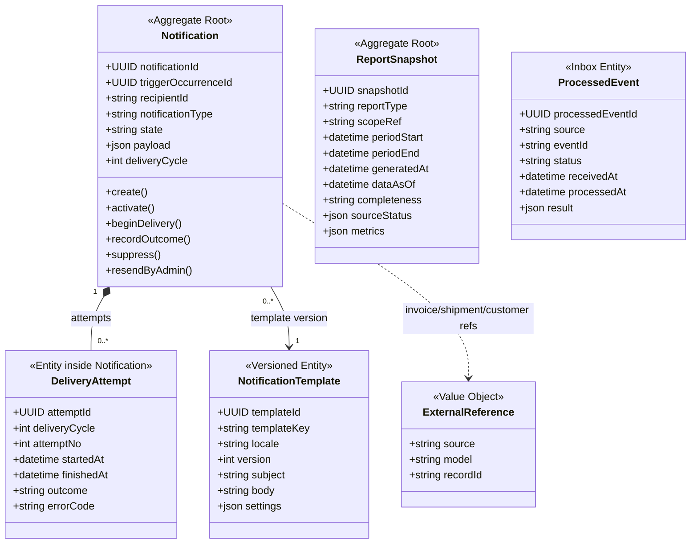
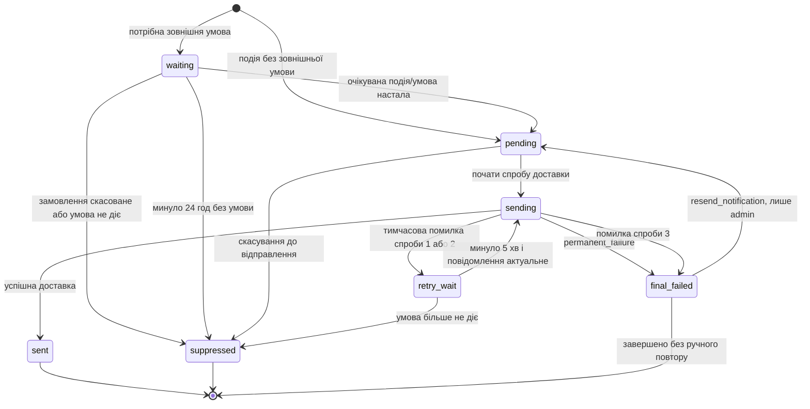

# Лабораторна робота 2 — Notifications / Reporting

## 1. Lead-to-Cash

Нижче наведено штатний процес Odoo для порівняння з архітектурою «КавоХаб». У фактичній системі CRM, Orders, Inventory і Billing — окремі модулі, а Odoo використовується лише як бухгалтерське джерело. Тому CRM, Sales та Inventory Odoo не є власниками відповідних даних «КавоХаб».

| Крок | Застосунок і основна модель Odoo | Що відбувається | Де виникають дані для Notifications / Reporting | Що не відповідає вимогам «КавоХаб» |
|---|---|---|---|---|
| CRM: лід → кваліфікація → нагода → «Виграно» | CRM — `crm.lead` (ліди й нагоди) | Менеджер кваліфікує лід, веде нагоду воронкою та позначає її виграною | Клієнт, відповідальний менеджер і результат продажу виникають у CRM. Сервіс має отримувати їх від окремого CRM-модуля, якщо вони потрібні у зведеннях | CRM «КавоХаб» окремий; записи Odoo CRM не є джерелом істини для звітів сервісу |
| Sales: пропозиція → підтверджене замовлення | Sales — `sale.order`; рядки — `sale.order.line` | Створюється пропозиція на 10 кг кави та кавомолку, потім замовлення підтверджується | Замовлення, суми й знижки виникають у Orders. Сповіщення про погодження має отримати подію Orders, а не покладатися на Odoo | Orders окремий. Штатне введення знижки не означає погодження: знижка 12% сама по собі не вимагає вбудованої згоди керівника |
| Inventory: резерв → відвантаження | Inventory — `stock.picking`; рухи — `stock.move` | Резервуються товари й оформлюється delivery order; після фактичного відвантаження picking переходить у завершений стан | Відвантаження й ТТН виникають в Inventory / інтеграції Нової Пошти. Звідси сервіс отримує `inventory.shipment.dispatched`, номер ТТН і, якщо наданий, прогноз доставки | Inventory «КавоХаб» окремий; Odoo не є джерелом ТТН чи статусу Нової Пошти. Потрібна подія/інтеграція |
| Invoicing: рахунок за відвантажену кількість → проведення | Invoicing / Accounting — `account.move` | Рахунок створюється на основі замовлення або відвантажених кількостей і проводиться | Номер, клієнт, сума, залишок, термін оплати й стан оплати беруться з рахунку; PDF формується стандартним звітом і може бути доступним як `invoice_pdf_report_id` | Odoo використовується лише як бухгалтерія. Умова «надіслати після відвантаження» потребує події зовнішнього Inventory і кореляції з рахунком |
| Оплата й кредит-нота | Accounting — `account.payment`, коригувальний рахунок — `account.move` з типом кредит-ноти | Реєструється часткова/повна оплата; за повернення 1 кг оформлюється кредит-нота | Стан оплати, сума залишку й дати беруться з бухгалтерських записів Odoo; кредит-нота впливає на баланс рахунку | Для єдиного зведення сервіс має поєднати бухгалтерські дані з замовленнями та відвантаженнями інших модулів |

### Знижка 12% у рядку замовлення

У стандартному Sales знижка рядка зберігається в `sale.order.line.discount` як відсоток і враховується в сумі рядка та сформованому рахунку. Сам факт введення 12% не запускає штатне погодження керівником. Для правила «понад 10% — керівник продажів, за його відсутності директорка» потрібен окремий workflow у Orders або розширення; у вибраній архітектурі його подія/рішення надходить до Notifications / Reporting з Orders. Джерела моделей: [CRM `crm.lead`](https://github.com/odoo/odoo/blob/18.0/addons/crm/models/crm_lead.py), [Sales `sale.order`](https://github.com/odoo/odoo/blob/18.0/addons/sale/models/sale_order.py), [Inventory `stock.picking`](https://github.com/odoo/odoo/blob/18.0/addons/stock/models/stock_picking.py), [Accounting `account.move`](https://github.com/odoo/odoo/blob/18.0/addons/account/models/account_move.py).

## 2. Аналіз Odoo

### 2.1. Шаблони листів (`mail.template`)

Шаблон листа прив'язується до моделі документа через `model_id`; для рахунку це `account.move`. Основні поля: `name`, `model_id`, `subject`, `email_from`, `email_to` або `partner_to` / `use_default_to`, `body_html`, `lang`, `report_template_ids` для прикріплення звіту, `attachment_ids`, `reply_to`, `mail_server_id` і `auto_delete`. У динамічних значеннях доступні поля запису: наприклад, у темі — `{{ object.name }}`, у тексті — ім'я клієнта `object.partner_id.name`, номер `object.name` і сума `object.amount_total`. У тілі використовують редактор placeholders/QWeb; перед запуском треба перевірити фактичний HTML і локаль.

В Odoo 18 шаблони доступні в режимі розробника: **Settings → Technical → Email → Email Templates**. Документація описує динамічні placeholders, а вихідний код моделі — поля й прикріплення PDF-звіту: [документація шаблонів Odoo 18](https://www.odoo.com/documentation/18.0/applications/general/companies/email_template.html), [модель `mail.template` Odoo 18](https://github.com/odoo/odoo/blob/18.0/addons/mail/models/mail_template.py).

### 2.2. Автоматичні та заплановані дії

`base.automation` запускає серверні дії для запису Odoo за подією створення/зміни, часовою умовою та іншими доступними тригерами. Дія може використати шаблон листа; `ir.cron` запускає фонові перевірки за розкладом. Це придатне для події, що виникла в самому Odoo, наприклад зміни стану `account.move`. Воно не бачить подію зовнішнього Inventory автоматично: для «КавоХаб» сервіс Notifications / Reporting приймає `inventory.shipment.dispatched` і сам надсилає лист після перевірки PDF та адреси. Документація Odoo 18 описує тригери й налаштування automation rules: [Automation rules](https://www.odoo.com/documentation/18.0/applications/studio/automated_actions.html).

У Community механізми `base_automation` і `ir.cron` доступні за умови встановлених модулів і відповідних технічних прав; Enterprise додає зручну конфігурацію правил через Studio. Жодна з версій не усуває потреби інтегрувати окремий Inventory, коли він є власником події відвантаження.

### 2.3. PDF рахунку та надсилання

У штатному процесі Odoo рахунок `account.move` можна сформувати як PDF і надіслати клієнту з форми рахунку через **Send**; стандартний сценарій використовує документ рахунку й поштовий механізм Odoo. [Документація Customer Invoices Odoo 18](https://www.odoo.com/documentation/18.0/applications/finance/accounting/customer_invoices.html). У моделі `account.move` поле `invoice_pdf_report_id` посилається на вкладення PDF, а `invoice_pdf_report_file` зберігає PDF-вміст ([вихідний код Odoo 18](https://github.com/odoo/odoo/blob/18.0/addons/account/models/account_move.py)).

Це покриває можливість сформувати рахунок і надіслати його, але не правило часу «лише після зовнішнього відвантаження». У вибраному варіанті Б Odoo надає рахунок/PDF, а сервіс отримує його після `inventory.shipment.dispatched`, формує лист і надсилає його власним поштовим провайдером. Тому email-шаблони Odoo не є основним каналом вихідних сповіщень «КавоХаб».

### 2.4. Звіти та відповідність редакцій

Документація Odoo 18 описує звіт **Aged Receivable** для рахунків, що очікують оплати, а також фінансові звіти. Це може покрити бухгалтерську частину списку прострочень/боргу, але не об'єднує замовлення та відвантаження, що ведуться поза Odoo. [Reporting Odoo 18](https://www.odoo.com/documentation/18.0/applications/finance/accounting/reporting.html). Тому фактичну наявність конкретного звіту треба перевірити на цільовій Community-інсталяції та її модулях; fit-gap для вимоги «список прострочених рахунків» — **частково Configure**.

| Вимога | Odoo 18 Community | Odoo 18 Enterprise | Рішення для «КавоХаб» |
|---|---|---|---|
| PDF рахунку й надсилання клієнту | Fit / Configure: стандартний PDF і надсилання з рахунку за налаштованої пошти | Fit / Configure: той самий базовий процес | PDF беремо з Odoo; лист надсилає сервіс |
| Автоматичне надсилання після відвантаження | Gap для зовнішнього Inventory; потрібна інтеграція або розширення | Studio/автоматизація може реагувати на дані в Odoo, але не замінює зовнішню подію Inventory | Сервіс чекає `inventory.shipment.dispatched`, потім отримує PDF і надсилає лист |
| Список прострочених рахунків | Частково Configure: бухгалтерські дані й доступні списки/звіти залежать від встановленої збірки та модулів | Configure: стандартні бухгалтерські звіти, зокрема Aged Receivable | Odoo — джерело рахунків і залишків; сервіс формує потрібний формат і розсилку |
| Звіт про борг | Бухгалтерські дані доступні; кастомний управлінський звіт може вимагати розширення | Стандартна фінансова звітність ширша; для поєднання із зовнішніми даними все одно потрібен сервіс | Сервіс агрегує борг із Odoo з даними Orders/Inventory |
| Щоденне зведення директорці о 18:00 | Gap для зведення між окремими модулями | Gap без інтеграції зовнішніх джерел | Формує й надсилає окремий сервіс |
| Погодження знижки понад 10% із резервним погоджувачем | Немає штатного workflow з таким правилом; потрібне розширення/сторонній модуль | Studio може налаштувати просту автоматизацію, але повний fallback-процес може вимагати розширення | Погодження належить Orders; сервіс надсилає сповіщення та журналює результат |

**Висновок:** Community та Enterprise мають штатні можливості для шаблонів і роботи з рахунком; Enterprise додає зручні інструменти Studio й ширший стандартний облік/звітність. В обраній архітектурі Notifications / Reporting все одно залишається окремим сервісом, бо критичні події та показники походять із CRM, Orders та Inventory, а не з Odoo.

### Джерела для розділу 2

- [Шаблони листів Odoo 18](https://www.odoo.com/documentation/18.0/applications/general/companies/email_template.html)
- [Автоматичні дії Odoo 18](https://www.odoo.com/documentation/18.0/applications/studio/automated_actions.html)
- [Рахунки клієнтам Odoo 18](https://www.odoo.com/documentation/18.0/applications/finance/accounting/customer_invoices.html)
- [Фінансові звіти Odoo 18](https://www.odoo.com/documentation/18.0/applications/finance/accounting/reporting.html)
- [Код моделі `mail.template` Odoo 18](https://github.com/odoo/odoo/blob/18.0/addons/mail/models/mail_template.py)
- [Код моделі `account.move` Odoo 18](https://github.com/odoo/odoo/blob/18.0/addons/account/models/account_move.py)

## 3. Fit-gap

Класи визначено за вимогами ЛР2: Fit — працює з коробки; Configure — достатньо налаштувань; Extend — потрібен власний/сторонній модуль; Gap — Odoo не покриває вимогу в нашій архітектурі, її реалізує зовнішній сервіс. Для «КавоХаб» CRM, Orders та Inventory — окремі системи, тому функція Odoo не вважається покриттям події, якої в Odoo немає.

| Вимога | Клас | Підстава | Зусилля | Ризик оновлення Odoo | Рішення | Де розв'язується |
|---|---|---|---|---|---|---|
| 1. Лист клієнтці з ТТН після відвантаження | Gap | Odoo не є джерелом відвантаження/ТТН; потрібна подія зовнішнього Inventory | Середнє | Низький для Odoo; середній ризик інтеграційного контракту | Сервіс приймає `inventory.shipment.dispatched`, перевіряє ТТН та надсилає лист | Окремий Notifications / Reporting сервіс; ТТН від Inventory/Нової Пошти |
| 2. Статус доставки Нової Пошти клієнтці | Gap | Статус належить API Нової Пошти та інтеграції Inventory, а не бухгалтерським даним Odoo | Середнє/високе | Низький для Odoo | Отримувати статуси від NP/Inventory, надсилати лише значущі оновлення | Окремий сервіс та інтеграція NP/Inventory |
| 3. PDF рахунку та надсилання клієнтці | Fit / Configure | `account.move` підтримує PDF рахунку та стандартне надсилання; потрібні коректні дані клієнта й пошти. Odoo не знає зовнішню умову відвантаження | Низьке | Низький для стандартного звіту; середній при зміні кастомних шаблонів | PDF отримувати з Odoo, лист формувати/надсилати сервісом лише після події відвантаження | PDF — Odoo; таймінг і надсилання — окремий сервіс |
| 4. Щоденне зведення о 18:00: замовлення, відвантаження, борг | Gap | Odoo містить бухгалтерський борг, але замовлення й відвантаження ведуться окремо | Середнє | Низький для Odoo; середній для контрактів подій/реплік | Об'єднувати локальні репліки, чекати джерела до 17:55, позначати неповноту | Окремий сервіс; борг з Odoo/Billing, інші показники з Orders/Inventory |
| 5. Список прострочених рахунків: клієнт, сума, дні прострочення | Configure (частково) | Odoo має дані терміну оплати та залишку й бухгалтерське представлення заборгованості; фактичний склад звіту залежить від Community-модулів | Низьке/середнє | Низький для штатного звіту; середній для власного звіту | Перевірити Aged Receivable у цільовій Community-базі; для потрібного формату й розсилок читати дані у сервіс | Базова бухгалтерська вибірка — Odoo; потрібна вітрина/сповіщення — сервіс |
| 6. Тижневий звіт про неактивних орендарів | Gap | Оренда й активність орендарів не ведуться в Odoo | Середнє | Низький для Odoo | Визначення неактивності отримувати від системи-власника оренди/клієнтів | Окремий сервіс із даними відповідної системи |
| 7. Погодження знижки понад 10%: керівник, за відсутності — директорка | Gap | Odoo Sales не є власником Orders; штатний механізм не реалізує саме цей fallback-процес | Середнє/високе | Низький для Odoo; високий лише якщо обрати Odoo-кастомізацію | Orders володіє рішенням; Notifications маршрутизує запит і повідомляє про рішення | Правило — Orders; повідомлення/аудит — окремий сервіс |
| 8. Журнал надсилань і повтори доставки листа | Gap | Потрібні єдиний журнал, дедуплікація, 3 спроби, затримка 5 хв та контроль помилок; у вибраній архітектурі всі листи надсилає сервіс | Середнє | Низький для Odoo | Зберігати `Notification` і `DeliveryAttempt`, повторювати тільки тимчасові помилки | Окремий сервіс |
| 9. Рольовий доступ до звітів і журналу | Gap | Межі director/warehouse_operator/sales_manager/admin належать API та даним окремого сервісу | Середнє | Низький для Odoo | Реалізувати серверну авторизацію й фільтрацію записів за компанією, складом/командою | Окремий сервіс |
| 10. Сповіщення про прострочення резерву | Gap | Резерв і його строк належать Orders/Inventory, а не Odoo Accounting | Низьке/середнє | Низький для Odoo | Обробляти подію/таймер резерву; після 24 годин створити повідомлення клієнтці, складу й менеджеру | Окремий сервіс на даних Orders/Inventory |

Зусилля — попередня оцінка саме для «КавоХаб». «Низький» ризик оновлення Odoo означає відсутність власного Odoo-коду; він не скасовує необхідності перевірити API-адаптер і формат PDF після оновлення. Відсутність/застарілість джерела у щоденному звіті показується як неповні дані, а не як нуль.

## 4. Адаптер

### 4.1. Версія та спосіб доступу

Ціль — Odoo 18 Community, за припущенням self-hosted інсталяція. Основний потік бухгалтерських змін надходить сервісу як події Billing; пряме читання Odoo використовується для початкового імпорту, звіряння та отримання PDF за потреби. Для прикладу адаптера обрано JSON-RPC `/jsonrpc` з `execute_kw`, методом `search_read`/`read` і окремим сервісним користувачем. Інтеграційний шар ізолює Odoo-моделі від доменних об'єктів сервісу.

JSON-RPC та XML-RPC — legacy зовнішні API; документація Odoo 19 уже позначає їх deprecated і планує видалення в Odoo 22. Тому заміну протоколу треба локалізувати в адаптері, не змінюючи домен і REST API Notifications / Reporting. [External API Odoo 18](https://www.odoo.com/documentation/18.0/developer/reference/external_api.html), [міграційне застереження в Odoo 19](https://www.odoo.com/documentation/19.0/developer/reference/external_rpc_api.html).

### 4.2. Операції адаптера

| Операція адаптера | Модель Odoo | Метод | Ключові аргументи / використання |
|---|---|---|---|
| Початковий імпорт проведених клієнтських рахунків | `account.move` | `search_read` | Домен: `move_type = out_invoice`, `state = posted`; поля: `id`, `name`, `partner_id`, `amount_total`, `amount_residual`, `invoice_date_due`, `payment_state`, `invoice_pdf_report_id`, `currency_id`, `write_date`; `limit`/`offset` для пагінації |
| Інкрементальне звіряння | `account.move` | `search_read` | Той самий фільтр плюс `write_date > watermark`; перечитувати невеликий перекривний інтервал і дедуплікувати за Odoo ID |
| Читання контактів рахунків | `res.partner` | `read` або `search_read` | ID з `partner_id`; поля лише `id`, `name`, `email`, за потреби `lang` |
| Читання платежів для деталізації | `account.payment` | `search_read` | Відібрані платежі; поля `id`, `move_id`, `partner_id`, `amount`, `date`, `state`, `currency_id`, `write_date`. Для звіту про залишок основне джерело — `account.move.amount_residual` |
| Отримання PDF за запитом | `account.move`, за потреби `ir.attachment` | `read` | Спочатку прочитати `invoice_pdf_report_id`; сам PDF отримувати лише для листа після відвантаження. Якщо файл читається через вкладення, перевірити обмежені read-права на пов'язаний attachment |

Адаптер не викликає `create`, `write`, `unlink`, `action_post` чи команди проведення платежу/рахунку.

### 4.3. Мапінг полів

| Поле Odoo | Поле сервісу Notifications / Reporting | Перетворення |
|---|---|---|
| `account.move.id` | `invoice.sourceRefs.odooMoveId` | Зберігати як зовнішній ID разом із джерелом `odoo`; не використовувати як внутрішній PK сервісу |
| `account.move.name` | `invoice.invoiceNumber` | Рядок, наприклад `INV/2026/0042` |
| `account.move.partner_id` | `invoice.customer.sourceRef` | Many2one `[id, display_name]`; брати ID, ім'я за потреби для відображення |
| `res.partner.id`, `res.partner.name`, `res.partner.email` | `customer.sourceRef`, `customer.name`, `recipient.email` | Email зберігати як знімок для надійної доставки; не використовувати як ідентифікатор клієнта |
| `account.move.amount_total` | `invoice.totalAmount` | Decimal разом із `currency_id`; не конвертувати у float |
| `account.move.amount_residual` | `invoice.outstandingAmount` | Decimal у валюті рахунку; залишок не обчислювати повторно з платежів |
| `account.move.invoice_date_due` | `invoice.dueDate` | ISO date; для днів прострочення порівнювати з локальною календарною датою бізнесу |
| `account.move.payment_state` | `invoice.paymentStatus` | Через явну таблицю відповідності Odoo enum → доменний enum; невідоме значення журналювати, не прирівнювати до `paid` |
| `account.payment.id`, `amount`, `date`, `state` | `payment.sourceRef`, `payment.amount`, `payment.paidAt`, `payment.status` | Окрема деталізація платежів; ID і статус нормалізувати в адаптері |
| `account.move.invoice_pdf_report_id` | `invoice.pdfSourceRef` | Many2one `[attachment_id, name]`; для відправлення завантажити PDF у сервіс/тимчасове сховище, перевіривши MIME type і прив'язку до рахунку |
| `account.move.write_date` | `source.updatedAt` / watermark синхронізації | Перетворити у UTC; використовувати для інкрементального звіряння |

### 4.4. Права сервісного користувача

Створити окремого внутрішнього користувача для інтеграції з групами `base.group_user` та `account.group_account_readonly`; дозволити тільки необхідні компанії в `Allowed Companies`. Ці групи забезпечують читання потрібних моделей у стандартній конфігурації. Не додавати `Accounting/Billing User`, `Accounting Administrator`, `Settings` чи менеджерські групи. ACL Odoo додаються між групами, тому після налаштування треба перевірити відсутність `write/create/unlink` через інші призначені групи. Якщо сервісу потрібен сам PDF, окремо перевірити read-доступ до attachment/маршруту завантаження; обмежити його рахунками дозволених компаній.

### 4.5. Помилки, повтори й ідемпотентність

- Таймаут з'єднання — 5 секунд; таймаут відповіді — 20–30 секунд; великі вибірки читати сторінками.
- Для мережевих помилок, timeout, HTTP `429`, `502`, `503`, `504` — до 5 спроб загалом із backoff приблизно 1, 2, 4, 8 секунд, jitter і верхньою межею 30 секунд; враховувати `Retry-After`.
- Для помилок автентифікації, ACL, невідомого поля або неправильного домену не повторювати автоматично; записати помилку інтеграції й вимагати виправлення конфігурації.
- Читання `search_read`/`read` є безпечним для повтору. Локальна репліка upsert-иться за парою `model + Odoo ID`; повторний імпорт не створює дубль. Під час звіряння застосовувати watermark `write_date` з перекриттям.
- Якщо Odoo недоступна під час отримання PDF, зберегти подію відвантаження та відкласти лист у чергу. Не надсилати рахунок без PDF; після відновлення повторити читання. Після вичерпання спроб повідомити оператора й не втрачати задачу.

Ліміт **5 спроб із backoff** вище стосується лише read-запитів адаптера до Odoo. Він не змінює окрему політику поштової доставки: **до 3 спроб у циклі з паузою 5 хвилин**.

### 4.6. Приклад читання проведеного рахунку

Запит — HTTP `POST https://odoo.example.com/jsonrpc`, `Content-Type: application/json`. У прикладі `db`, `uid`, API key та ID рахунку — демонстраційні значення.

```json
{
  "jsonrpc": "2.0",
  "method": "call",
  "params": {
    "service": "object",
    "method": "execute_kw",
    "args": [
      "kavohub_db",
      42,
      "<API_KEY>",
      "account.move",
      "search_read",
      [[
        ["id", "=", 1234],
        ["move_type", "=", "out_invoice"],
        ["state", "=", "posted"]
      ]],
      {
        "fields": [
          "id", "name", "partner_id", "amount_total", "amount_residual",
          "invoice_date_due", "payment_state", "invoice_pdf_report_id", "currency_id", "write_date"
        ],
        "limit": 1
      }
    ]
  },
  "id": 7
}
```

Приклад відповіді:

```json
{
  "jsonrpc": "2.0",
  "id": 7,
  "result": [
    {
      "id": 1234,
      "name": "INV/2026/0042",
      "partner_id": [87, "ТОВ «Приклад»"],
      "amount_total": 1200.0,
      "amount_residual": 450.0,
      "invoice_date_due": "2026-12-15",
      "payment_state": "partial",
      "invoice_pdf_report_id": [5678, "INV_2026_0042.pdf"],
      "currency_id": [2, "EUR"],
      "write_date": "2026-11-23 14:35:00"
    }
  ]
}
```

`invoice_pdf_report_id` повертає ID та ім'я вкладення, а не байти PDF. Відсутній рахунок дає порожній `result`; помилка доступу повертається в `error`. [Документація External API Odoo 18](https://www.odoo.com/documentation/18.0/developer/reference/external_api.html).

## 5. ADR-0004

### ADR-0004 «Buy vs build»: Notifications / Reporting

| Поле | Значення |
|---|---|
| Статус | **Прийнято** |
| Рішення | Варіант Б — окремий сервіс Notifications / Reporting; Odoo Community є бухгалтерським джерелом |

#### Контекст

CRM, Orders, Inventory і Billing — окремі модулі. Odoo використовується лише для бухгалтерських записів, даних про борг і PDF рахунку. Notifications / Reporting має отримувати події від модулів-власників, формувати повідомлення, вести журнал і повторювати тимчасово невдалі доставки.

#### Розглянуті варіанти

| Варіант | Короткий опис |
|---|---|
| **А. Усе в Odoo + власні модулі Odoo** | Реалізувати звіти, повідомлення, журнал і повтори в Odoo; інтегрувати Odoo з окремими CRM, Orders та Inventory. |
| **Б. Окремий сервіс** | Сервіс споживає події, тримає локальні репліки, формує звіти й сам надсилає всі листи. Odoo надає рахунки, суми боргу й PDF для читання. |
| **В. Гібрид** | PDF рахунку й надсилання налаштувати в Odoo, решту реалізувати в сервісі; потрібен міст, який запускає Odoo-відправлення за зовнішньою подією відвантаження. |

#### Обґрунтування

Fit-gap показав, що PDF рахунку та стандартна можливість надіслати його в Odoo мають клас Fit / Configure; список прострочень покривається частково налаштуванням. ТТН і статус Нової Пошти, зведення з даних кількох модулів, неактивні орендарі, погодження знижки, журнал/повтори та прострочення резерву — Gap для Odoo в поточній архітектурі. Варіант Б залишає в Odoo бухгалтерські дані й використовує події модулів-власників для решти сценаріїв.

#### Рішення та розподіл відповідальності

- **Беремо з Odoo:** проведені рахунки `account.move`, залишок/стан оплати, клієнта й email `res.partner`, платежі `account.payment` за потреби, PDF рахунку або посилання на нього.
- **Конфігуруємо в Odoo:** стандартне формування PDF і read-only користувача з доступом лише до потрібних компаній/моделей та PDF-вкладень.
- **Залишаємо сервісу:** підписку на `inventory.shipment.dispatched`, кореляцію відвантаження з рахунком, отримання PDF, формування й надсилання листів, повідомлення про ТТН/доставку, звіти, маршрутизацію повідомлень погодження, журнал і повтори.

#### Вплив на оновлення Odoo

Варіант Б не додає власних модулів Odoo, тому не потребує перенесення їхнього коду. Під час оновлення перевіряються поля/права адаптера, доступність PDF і мапінг. JSON-RPC `/jsonrpc` ізолюється в адаптері: Odoo 19 позначає зовнішні JSON-RPC/XML-RPC API застарілими та планує їх видалення в Odoo 22 ([External RPC API Odoo 19](https://www.odoo.com/documentation/19.0/developer/reference/external_rpc_api.html)).

#### Наслідки

**Плюси:** сервіс не прив'язаний до внутрішнього коду Odoo; один журнал і механізм повторів для всіх листів; звіти поєднують події окремих модулів; збій Odoo не втрачає задачі, які можна поставити в чергу.

**Мінуси й ризики:** потрібно розробити сховище, адаптери, чергу подій і поштовий канал; локальні фінансові репліки можуть відставати від Odoo; відсутність кореляційного ключа або PDF затримає лист. Заходи: початковий імпорт і регулярне звіряння, ідемпотентність подій, журнал помилок, повтори та явна позначка часу актуальності даних.

## 6. Доменна модель і життєвий цикл

### 6.1. Модель та агрегати



`Notification` і `ReportSnapshot` — агрегатні корені. `DeliveryAttempt` є незмінною дочірньою сутністю `Notification`, бо її результат змінює стан доставки. `NotificationTemplate` зберігається версіями; використана версія не редагується. `ProcessedEvent` — inbox-запис для ідемпотентної обробки джерельних подій. `ExternalReference` — value object; зовнішні ID CRM/Inventory/Billing/Odoo не є внутрішніми PK і не мають міжсервісних FK.

### 6.2. Інваріанти

| Об'єкт | Інваріанти |
|---|---|
| `Notification` | Унікальна комбінація `triggerOccurrenceId + recipientId + notificationType`; отримувач і payload фіксуються під час постановки в чергу; переходи стану лише дозволеними командами; `sent` не надсилається повторно автоматично; `waiting` має кінцевий строк; повідомлення з PDF не відправляється без підтвердженого відвантаження та PDF. |
| `DeliveryAttempt` | Номер спроби унікальний у межах `(notificationId, deliveryCycle)`; автоматично — не більше трьох спроб у циклі, перша входить у три; між тимчасовими невдачами — щонайменше 5 хв; permanent failure завершує цикл; одночасно не більше однієї активної спроби; завершені спроби незмінні. |
| ІТ-сповіщення | Після `final_failed` звичайного сповіщення створюється окреме повідомлення з ключем `final-failure + notificationId`; якщо це ІТ-сповіщення не доставлено, помилка лише журналюється й не породжує рекурсивне сповіщення. |
| `ReportSnapshot` | `periodStart <= periodEnd`; знімок і його метрики незмінні після формування; неповний знімок має позначати відсутні/застарілі джерела й час актуальності; виправлений звіт створюється новою версією. |
| `ProcessedEvent` | Унікальна пара `(source, eventId)`; повтор події не створює повторних побічних ефектів; одна подія може породити кілька сповіщень для різних отримувачів/типів. |

### 6.3. Автомат станів `Notification`



Для `waiting → suppressed` після 24 год побічний ефект залежить від типу: для простроченого резерву створюються нові `pending`-сповіщення клієнтці, складу й менеджеру; для рахунку, що чекає на відвантаження, нових повідомлень немає — лише запис у журналі. Для звичайного `final_failed` створюється окреме ІТ-сповіщення; для самого ІТ-сповіщення рекурсивної ескалації немає. Дубль події відкидається до створення агрегату.

### 6.4. Таблиця переходів

| З якого стану | У який | Команда / подія | Умова | Роль або виконавець | Побічні ефекти |
|---|---|---|---|---|---|
| — | `pending` | `create_notification` | Подія не потребує зовнішнього очікування, наприклад `crm.deal.won` чи `billing.payment.received` | Обробник подій | Перевірити ключ дедуплікації; створити повідомлення й поставити в чергу |
| — | `waiting` | `create_notification` | Потрібна подія відвантаження або результат резерву | Обробник подій | Створити повідомлення; запустити таймер очікування 24 год |
| `waiting` | `pending` | `activate_notification` | Очікувана умова настала | Обробник зовнішньої події | Зафіксувати умову; поставити повідомлення в чергу |
| `waiting` | `suppressed` | `suppress_notification` | Замовлення скасовано або умова більше не діє | Обробник події скасування | Скасувати таймер, записати причину; не надсилати |
| `waiting` | `suppressed` | `expire_waiting_notification` | Минуло 24 год без очікуваної умови | Планувальник | Для резерву створити три типізовані `pending`-сповіщення: клієнтці «потребує уточнення», складу й менеджеру «резерв не вдався через прострочення»; для рахунку, що чекає відвантаження, лише записати таймаут у журнал |
| `pending` | `sending` | `send_notification` | Повідомлення актуальне та готове; для рахунку є подія відвантаження й PDF | Воркер доставки | Створити `DeliveryAttempt`; надіслати лист |
| `pending` | `suppressed` | `suppress_notification` | До відправлення замовлення скасовано/умова втратила актуальність | Обробник скасування | Не викликати провайдера; записати причину |
| `sending` | `sent` | `confirm_delivery` | Провайдер підтвердив прийняття листа | Воркер доставки | Завершити спробу як успішну; зберегти ID відповіді провайдера |
| `sending` | `retry_wait` | `schedule_retry` | Тимчасова помилка на спробі 1 або 2 | Воркер доставки | Завершити спробу з помилкою; запланувати наступну через 5 хв |
| `sending` | `final_failed` | `mark_final_failure` | `permanent_failure` або невдала третя спроба | Воркер доставки | Завершити спробу; створити одне ІТ-сповіщення з ключем `final-failure + notificationId` (крім самого ІТ-сповіщення) |
| `retry_wait` | `sending` | `retry_notification` | Минуло 5 хв; повідомлення актуальне; ліміт спроб не вичерпаний | Планувальник / воркер | Створити наступний `DeliveryAttempt` і почати спробу |
| `retry_wait` | `suppressed` | `suppress_notification` | До наступної спроби замовлення скасоване/умова не діє | Обробник скасування | Скасувати відкладений повтор; записати причину |
| `final_failed` | `pending` | `resend_notification` | Адміністратор явно ініціює повтор і надає непорожній `reason` | `admin` — ІТ-адміністратор | Зафіксувати автора й причину; відкрити новий `deliveryCycle`, скинути лічильник спроб поточного циклу, поставити в чергу |

`sent` і `suppressed` — термінальні стани. `final_failed` завершує цикл автоматичних спроб, але може бути переведений назад у `pending` лише явною командою адміністратора. Повторна подія з тим самим ключем дедуплікації не створює нового агрегату.

## 7. Бізнес-правила

| Правило | Місце перевірки | Відповідь API | Припущення |
|---|---|---|---|
| Дедуплікація: один `triggerOccurrenceId + recipientId + notificationType` створює не більше одного сповіщення | Обробник подій робить швидку перевірку; доменний сервіс застосовує правило; унікальне обмеження БД захищає від гонки | Повторна подія підтверджується як уже оброблена (`202 Accepted` для асинхронного ingestion), без нового сповіщення. Ручного POST-створення немає | Так — статус ACK є проєктним рішенням |
| Автоматична доставка: до 3 спроб загалом, перша входить у три; після тимчасової помилки інтервал 5 хв | Доменна політика перед кожною спробою; воркер записує `DeliveryAttempt`; транзакційний перехід стану | Фоновий процес не має синхронної відповіді API; ручний повтор у недозволеному стані — `409`, `urn:kavohub:problem:notification-retry-not-allowed` | Ні — ліміт і затримка задані вимогою; API-код — припущення |
| `permanent_failure` одразу завершує цикл; після `final_failed` звичайного листа — одне ІТ-сповіщення; збій ІТ-листа лише журналюється | Воркер доставки й доменний сервіс; ключ ІТ-повідомлення `final-failure + notificationId`; спеціальне правило не допускає рекурсивної ескалації | Автоматичний перехід не повертає HTTP-відповідь; команда resend лише admin, інакше `403`, а за неправильного стану `409` | Ні — правило задане; коди API є проєктною пропозицією |
| `waiting` очікує зовнішню умову не довше 24 годин; скасування або втрата актуальності переводить у `suppressed` | Планувальник, обробник події-власника та доменний метод `suppress/expire` | Для таймера API-відповіді немає; помилковий ручний виклик переходу — `409`, `urn:kavohub:problem:notification-state-conflict` | Так — точка відліку 24 годин прийнята як час створення `waiting` |
| Після 24 годин прострочення резерву початкове повідомлення `suppressed`; створити нові повідомлення клієнтці, складу й менеджеру. Для рахунку, що чекає відвантаження, — лише журнал | Планувальник і доменна політика за `notificationType` | Внутрішній таймер без HTTP-відповіді; помилка API команди — `409`, `urn:kavohub:problem:notification-state-conflict` | Ні — різна поведінка для резерву й рахунку задана вимогою |
| Рахунок надсилається лише після `inventory.shipment.dispatched` і за наявності PDF та email | Споживач події перевіряє кореляцію; application service повторно перевіряє перед надсиланням | Ручна команда до відвантаження/без PDF — `409`, `urn:kavohub:problem:invoice-notification-precondition`; у потоці подій задача ставиться на повтор отримання PDF | Так — спосіб очікування PDF і код відповіді є технічним рішенням |
| Повідомлення про відвантаження вимагає ТТН; прогноз доставки додається лише за наявності | Валідація event contract і доменний сервіс перед рендерингом листа | Без ТТН — `422`, `urn:kavohub:problem:shipment-tracking-required`; відсутність прогнозу не є помилкою | Ні для обов'язковості ТТН та необов'язковості прогнозу; HTTP-код — припущення |
| Щоденне зведення формується о 18:00; чекати джерела до 17:55; відсутня чи застаріла репліка означає неповні дані | Планувальник і сервіс побудови `ReportSnapshot` перевіряють очікувані джерела та їхню свіжість | Доступний неповний звіт — `200 OK`, `completeness.status = incomplete`; не RFC 9457 помилка | Так — часовий пояс і пороги застарілості треба затвердити |
| Журнал доступний за ролями й областю користувача | API/application authorization та обмеження запиту до сховища; перевіряти також команди | Без автентифікації — `401`; роль/область не дозволяє дію — `403`, `urn:kavohub:problem:notification-access-denied` | Так — деталізація областей для ролей потребує підтвердження бізнесом |
| Тижневий звіт про неактивних орендарів і сповіщення про знижку >10% використовують дані систем-власників | Планувальник звіту читає репліку орендної системи; обробник Orders передає запит погодження, сервіс маршрутизує менеджеру або директорці | Внутрішня обробка події — без синхронної відповіді; API звіту без знімка — `404`, `urn:kavohub:problem:report-not-found` | Так — джерело істини, критерій неактивності й деталі fallback-погодження треба підтвердити |

`type` наведено як стабільні URI проблем RFC 9457. Відповіді для подій/таймерів є внутрішніми результатами обробки, а не HTTP-відповідями клієнтському API.

## 8. Схема даних і міграції

Нижче — базовий DDL для PostgreSQL. Внутрішні ідентифікатори — UUID; ID зовнішніх модулів зберігаються як текстові посилання без міжсервісних FK. Часові мітки — `timestamptz` (UTC). `trigger_occurrence_id` є UUID конкретного виникнення події або таймерного правила. Якщо `eventId` джерела вже UUID — використовується він; якщо це довільний рядок — з `source + eventId` отримується стабільний UUID (наприклад, UUIDv5). Для таймерного запуску ID також генерується детерміновано з типу правила та конкретного об'єкта/строку.

```sql
CREATE SCHEMA IF NOT EXISTS notifications;

CREATE TABLE notifications.notification_templates (
    template_id           uuid PRIMARY KEY DEFAULT gen_random_uuid(),
    template_key          text NOT NULL,
    notification_type     text NOT NULL,
    channel               text NOT NULL DEFAULT 'email'
                          CHECK (channel IN ('email')),
    locale                text NOT NULL DEFAULT 'uk_UA',
    version               integer NOT NULL CHECK (version > 0),
    subject_template      text NOT NULL,
    body_template         text NOT NULL,
    settings              jsonb NOT NULL DEFAULT '{}'::jsonb,
    max_attempts          smallint NOT NULL DEFAULT 3
                          CHECK (max_attempts BETWEEN 1 AND 3),
    retry_delay_seconds   integer NOT NULL DEFAULT 300
                          CHECK (retry_delay_seconds > 0),
    wait_timeout_seconds  integer
                          CHECK (wait_timeout_seconds IS NULL OR wait_timeout_seconds > 0),
    enabled               boolean NOT NULL DEFAULT true,
    created_at            timestamptz NOT NULL DEFAULT now(),
    CONSTRAINT uq_template_version
        UNIQUE (template_key, locale, channel, version)
);

CREATE TABLE notifications.processed_events (
    processed_event_id    uuid PRIMARY KEY DEFAULT gen_random_uuid(),
    source                text NOT NULL,
    event_id              text NOT NULL,
    event_type            text NOT NULL,
    payload               jsonb NOT NULL,
    status                text NOT NULL DEFAULT 'received'
                          CHECK (status IN ('received', 'processing', 'processed', 'failed')),
    received_at           timestamptz NOT NULL DEFAULT now(),
    processing_started_at timestamptz,
    processed_at          timestamptz,
    processing_attempts   smallint NOT NULL DEFAULT 0 CHECK (processing_attempts >= 0),
    next_attempt_at       timestamptz,
    result                jsonb,
    error_code            text,
    error_message         text,
    CONSTRAINT uq_processed_event_source_id UNIQUE (source, event_id),
    CONSTRAINT ck_processed_event_time
        CHECK (status <> 'processed' OR processed_at IS NOT NULL)
);

CREATE TABLE notifications.notifications (
    notification_id       uuid PRIMARY KEY DEFAULT gen_random_uuid(),
    trigger_occurrence_id uuid NOT NULL,
    recipient_id          text NOT NULL,
    recipient_address     text NOT NULL,
    notification_type     text NOT NULL,
    template_id           uuid NOT NULL
                          REFERENCES notifications.notification_templates(template_id)
                          ON DELETE RESTRICT,
    state                 text NOT NULL
                          CHECK (state IN (
                              'waiting', 'pending', 'sending', 'retry_wait',
                              'sent', 'final_failed', 'suppressed'
                          )),
    payload               jsonb NOT NULL DEFAULT '{}'::jsonb,
    company_ref           text NOT NULL,
    warehouse_ref         text,
    sales_manager_ref     text,
    related_entity_type   text,
    related_entity_ref    text,
    delivery_cycle        integer NOT NULL DEFAULT 1 CHECK (delivery_cycle > 0),
    attempt_count         smallint NOT NULL DEFAULT 0 CHECK (attempt_count BETWEEN 0 AND 3),
    created_at            timestamptz NOT NULL DEFAULT now(),
    updated_at            timestamptz NOT NULL DEFAULT now(),
    next_action_at        timestamptz,
    sent_at               timestamptz,
    final_failed_at       timestamptz,
    suppressed_at         timestamptz,
    last_error_code       text,
    last_error_message    text,
    CONSTRAINT uq_notification_dedup
        UNIQUE (trigger_occurrence_id, recipient_id, notification_type)
);

CREATE TABLE notifications.delivery_attempts (
    attempt_id            uuid PRIMARY KEY DEFAULT gen_random_uuid(),
    notification_id      uuid NOT NULL
                         REFERENCES notifications.notifications(notification_id)
                         ON DELETE RESTRICT,
    delivery_cycle       integer NOT NULL CHECK (delivery_cycle > 0),
    attempt_no           smallint NOT NULL CHECK (attempt_no BETWEEN 1 AND 3),
    outcome              text NOT NULL
                         CHECK (outcome IN (
                             'in_progress', 'success',
                             'transient_failure', 'permanent_failure'
                         )),
    started_at           timestamptz NOT NULL DEFAULT now(),
    finished_at          timestamptz,
    provider_message_id  text,
    error_code           text,
    error_message        text,
    is_manual_resend     boolean NOT NULL DEFAULT false,
    initiated_by_ref     text,
    CONSTRAINT uq_attempt_number
        UNIQUE (notification_id, delivery_cycle, attempt_no),
    CONSTRAINT ck_attempt_finished
        CHECK (
            (outcome = 'in_progress' AND finished_at IS NULL)
            OR (outcome <> 'in_progress' AND finished_at IS NOT NULL)
        )
);

CREATE TABLE notifications.report_snapshots (
    snapshot_id          uuid PRIMARY KEY DEFAULT gen_random_uuid(),
    report_type          text NOT NULL,
    scope_ref            text NOT NULL,
    period_start         timestamptz NOT NULL,
    period_end           timestamptz NOT NULL,
    version              integer NOT NULL DEFAULT 1 CHECK (version > 0),
    generated_at         timestamptz NOT NULL DEFAULT now(),
    data_as_of           timestamptz NOT NULL,
    completeness_status  text NOT NULL
                         CHECK (completeness_status IN ('complete', 'incomplete')),
    source_status        jsonb NOT NULL DEFAULT '{}'::jsonb,
    metrics              jsonb NOT NULL,
    schema_version       integer NOT NULL DEFAULT 1 CHECK (schema_version > 0),
    CONSTRAINT ck_report_period CHECK (period_start <= period_end),
    CONSTRAINT uq_report_snapshot_version
        UNIQUE (report_type, scope_ref, period_start, period_end, version)
);

-- Додаткові індекси для черг, журналу, спроб і звітів.
CREATE INDEX ix_processed_events_queue
    ON notifications.processed_events (status, next_attempt_at, received_at)
    WHERE status IN ('received', 'failed');
CREATE INDEX ix_processed_events_processed_at
    ON notifications.processed_events (processed_at DESC)
    WHERE status = 'processed';
CREATE INDEX ix_notifications_action_queue
    ON notifications.notifications (state, next_action_at);
CREATE INDEX ix_notifications_company_created
    ON notifications.notifications (company_ref, created_at DESC);
CREATE INDEX ix_attempts_notification_time
    ON notifications.delivery_attempts (notification_id, started_at DESC);
CREATE UNIQUE INDEX uq_one_active_attempt_per_notification
    ON notifications.delivery_attempts (notification_id)
    WHERE outcome = 'in_progress';
CREATE INDEX ix_reports_scope_period
    ON notifications.report_snapshots (scope_ref, report_type, period_start DESC);
```

PK — окремий UUID у кожній таблиці; FK: `notifications.template_id → notification_templates.template_id` і `delivery_attempts.notification_id → notifications.notification_id`. Унікальні обмеження в DDL також створюють індекси для дедуплікації, номерів версій/спроб і знімків. Для ІТ-сповіщення `trigger_occurrence_id` формується детерміновано з `final-failure + notificationId`, `recipient_id` вказує на адресата/групу ІТ; це реалізує той самий унікальний ключ таблиці без окремої колонки `deduplication_key`.

### Порядок міграцій

| Порядок | Файл міграції | Зміст і залежність |
|---:|---|---|
| 1 | `0001_create_notification_templates.sql` | Створити схему й шаблони; не має залежностей |
| 2 | `0002_create_processed_events.sql` | Створити inbox подій і `UNIQUE(source, event_id)`; таблиця не має FK на сповіщення, бо подія може породити кілька повідомлень |
| 3 | `0003_create_notifications.sql` | Створити повідомлення, FK на шаблон і унікальний ключ дедуплікації |
| 4 | `0004_create_delivery_attempts.sql` | Створити спроби й FK на повідомлення; додати індекс однієї активної спроби |
| 5 | `0005_create_report_snapshots.sql` | Створити незмінні знімки звітів; залежностей на інші таблиці немає |
| 6 | `0006_add_operational_indexes.sql` | Додати індекси для робочих черг, журналу та пошуку звітів, якщо вони не створені попередніми міграціями |

Перед релізом застосунку міграції виконуються на тестовій БД; у production міграції застосовуються до запуску нових воркерів. Для великої БД звичайні індекси можна будувати `CONCURRENTLY` окремою нетранзакційною міграцією, якщо це підтримує migration runner.

### Seed-дані для тестового середовища

| Сутність | Що додати | Який сценарій перевіряє |
|---|---|---|
| `notification_templates` | `invoice_after_dispatch`, `shipment_with_tracking`, `reserve_expired_customer`, `reserve_expired_internal`, `it_final_failure`, `daily_summary_director`, `inactive_renters_weekly`; тестові адреси, без реальних даних; стандартні параметри 3 спроби/300 с, timeout 86400 с лише для `waiting` | Шаблон рахунку й PDF, ТТН з необов'язковим ETA, таймаут резерву, ІТ-ескалація та звіти |
| `notifications` | По одному запису в `waiting`, `pending`, `sending`, `retry_wait`, `sent`, `final_failed`, `suppressed`; різні компанії, склади й менеджери | Повний автомат станів, рольові межі й фільтри журналу |
| `delivery_attempts` | Для `sending` — одна `in_progress`; для `retry_wait` — одна `transient_failure`; для `sent` — одна `success`; для `final_failed` — три тимчасові невдачі та окремий приклад `permanent_failure` на першій спробі | Повтор через 5 хв, завершення після 3 спроб, негайний terminal failure, одна активна спроба |
| `notifications` (ІТ) | Одне ІТ-сповіщення з ключем `final-failure + notificationId`; окреме невдале ІТ-сповіщення | Дедуплікація ІТ-алерта й відсутність рекурсивного сповіщення при його збої |
| `processed_events` | Один `processed` запис для `inventory.shipment.dispatched`, один для `billing.payment.received`, один `failed` із некоректним payload | Повторна доставка події, типізація джерел і журналювання некоректної події; дубль не вставляти в seed через унікальне обмеження — його надсилати повторно в тесті |
| `notifications` (fan-out) | Одна подія резерву з окремими записами для клієнтки, складу й менеджера; одна подія з двома різними `notificationType` | Унікальність ключа дозволяє різних отримувачів і різні типи повідомлень |
| `report_snapshots` | Повний щоденний знімок; неповний знімок із відсутнім Inventory та застарілим Billing, де недоступна метрика дорівнює `null`, а не нулю | `complete`/`incomplete`, час актуальності та пояснення джерел |
| Тестові користувачі та області доступу | `director`, `warehouse_operator` для KYIV і LVIV, `sales_manager` для власної команди, `admin` | Доступ до власних записів і `403` при зверненні до чужого складу/команди; resend доступний лише admin |

Тестовий годинник має бути фіксованим. Seed-набори використовують вигадані ID, адреси й PDF; тест повторної події виконується повторною подачею того самого `(source, event_id)`, а не дубльованим рядком у БД.

## 9. REST API і тести

API версії `/api/v1` повертає JSON. Помилки повертаються як `application/problem+json` за RFC 9457. API **не має** ендпоінтів ручного створення сповіщень або синхронної команди «надіслати зараз». Єдиний командний ендпоінт — admin-only `resend` для `final_failed`; він повторно ставить доставку в чергу, а сам лист надсилає воркер.

### 9.1. Ендпоінти та доступ

| Метод і шлях | Призначення | Ролі | Запит | Успішна відповідь | Основні помилки |
|---|---|---|---|---|---|
| `GET /health` | Базова перевірка доступності без деталей залежностей | Без автентифікації; тільки liveness | Без тіла | `200` `{ "status": "ok" }` | `503` — сервіс не готовий |
| `GET /api/v1/notifications` | Журнал із фільтрами `dateFrom`, `dateTo`, `type`, `state`, `page`, `pageSize` | `director`, `warehouse_operator` (свій склад), `sales_manager` (своя команда), `admin` | Query parameters; тіла немає | `200` сторінка записів у дозволеній області | `401`, `403`, `422` — неправильний фільтр, `503` |
| `GET /api/v1/notifications/{id}` | Деталі сповіщення та історія спроб | Ті самі ролі й обмеження області | UUID у шляху; тіла немає | `200` запис з масивом `attempts` | `401`, `403`, `404`, `503` |
| `POST /api/v1/notifications/{id}/resend` | Поставити повтор доставки для `final_failed`; лист відправляє воркер асинхронно | Лише `admin` | `{"reason":"..."}` — обов'язкове непорожнє пояснення | `202` — повтор поставлено в чергу, повертається новий `deliveryCycle` | `401`, `403`, `404`, `409` — стан не `final_failed`, `422` — `reason` відсутній/порожній, `503` |
| `GET /api/v1/reports/daily?date=YYYY-MM-DD` | Знімок щоденного зведення | `director`, `admin` | Query `date`; тіла немає | `200`; повнота в `completeness.status` (`complete` або `incomplete`) | `401`, `403`, `404` — знімок не сформовано, `422` — неправильна дата, `503` |
| `GET /api/v1/reports/inactive-renters?weekOf=YYYY-MM-DD` | Тижневий звіт про неактивних орендарів | `director`, `admin`; `sales_manager` — лише своя команда | Query `weekOf` (дата понеділка тижня); тіла немає | `200` знімок і статус повноти | `401`, `403`, `404`, `422`, `503` |
| `GET /api/v1/templates` | Перегляд активних шаблонів та несекретних налаштувань | Лише `admin` | Без тіла | `200` масив шаблонів; SMTP credentials не повертаються | `401`, `403`, `503` |

Записи журналу завжди обмежуються компанією користувача; після цього застосовується область складу або команди. Авторизація виконується на сервері й у запиті до сховища, а не лише у UI. Для доступу до наявного, але чужого запису повертається `403`; для відсутнього ID — `404`.

### 9.2. Приклади запитів і відповідей

#### Фільтр журналу за станом

```http
GET /api/v1/notifications?state=retry_wait&dateFrom=2026-11-23&dateTo=2026-11-23&page=1&pageSize=20
Authorization: Bearer <access_token>
Accept: application/json
```

```json
{
  "items": [
    {
      "id": "a4b756a3-118a-4eae-8ef9-962f69fa7392",
      "notificationType": "shipment_with_tracking",
      "recipientId": "crm:partner:87",
      "state": "retry_wait",
      "attemptCount": 1,
      "nextActionAt": "2026-11-23T16:05:00Z",
      "createdAt": "2026-11-23T16:00:00Z"
    }
  ],
  "page": 1,
  "pageSize": 20,
  "total": 1
}
```

#### Деталі зі спробами доставки

```http
GET /api/v1/notifications/4df95b42-eaf5-4d9f-ae0e-9e50ee9f9158
Authorization: Bearer <access_token>
Accept: application/json
```

```json
{
  "id": "4df95b42-eaf5-4d9f-ae0e-9e50ee9f9158",
  "notificationType": "invoice_after_dispatch",
  "recipientEmail": "client@example.test",
  "state": "final_failed",
  "deliveryCycle": 1,
  "attempts": [
    {"attemptNo": 1, "outcome": "transient_failure", "errorCode": "SMTP_TIMEOUT", "startedAt": "2026-11-23T15:00:00Z"},
    {"attemptNo": 2, "outcome": "transient_failure", "errorCode": "SMTP_TIMEOUT", "startedAt": "2026-11-23T15:05:00Z"},
    {"attemptNo": 3, "outcome": "transient_failure", "errorCode": "SMTP_TIMEOUT", "startedAt": "2026-11-23T15:10:00Z"}
  ],
  "finalFailedAt": "2026-11-23T15:10:02Z"
}
```

#### Повтор після остаточної помилки

```http
POST /api/v1/notifications/4df95b42-eaf5-4d9f-ae0e-9e50ee9f9158/resend
Authorization: Bearer <admin_access_token>
Content-Type: application/json
Accept: application/json
```

```json
{
  "reason": "SMTP відновлено; повторно поставити рахунок у чергу"
}
```

```http
HTTP/1.1 202 Accepted
Content-Type: application/json
```

```json
{
  "notificationId": "4df95b42-eaf5-4d9f-ae0e-9e50ee9f9158",
  "state": "pending",
  "deliveryCycle": 2,
  "queued": true,
  "resendRequestedBy": "admin:12",
  "resendRequestedAt": "2026-11-23T15:20:00Z"
}
```

#### Неповне щоденне зведення

```http
GET /api/v1/reports/daily?date=2026-11-23
Authorization: Bearer <director_access_token>
Accept: application/json
```

```json
{
  "reportType": "daily_summary",
  "date": "2026-11-23",
  "generatedAt": "2026-11-23T18:00:00+02:00",
  "completeness": {
    "status": "incomplete",
    "label": "неповні дані",
    "missingSources": ["inventory"],
    "staleSources": [{"source": "billing", "lastSyncAt": "2026-11-23T17:20:00+02:00"}]
  },
  "metrics": {"ordersAccepted": 24, "shipmentsDispatched": null, "outstandingDebt": 18450.0}
}
```

### 9.3. Помилки RFC 9457

Заголовок кожної помилки: `Content-Type: application/problem+json`. Приклади `type` стабільні й не містять внутрішнього stack trace.

| HTTP | `type` | Коли повертається |
|---:|---|---|
| 401 | `urn:kavohub:problem:authentication-required` | Токен відсутній, недійсний або прострочений |
| 403 | `urn:kavohub:problem:notification-access-denied` | Роль/область не дозволяє перегляд або дію |
| 404 | `urn:kavohub:problem:report-not-found` | Знімка звіту за датою/тижнем немає; для ID сповіщення аналогічно `notification-not-found` |
| 409 | `urn:kavohub:problem:notification-retry-not-allowed` | Сповіщення не у `final_failed` або resend уже виконується |
| 409 | `urn:kavohub:problem:notification-state-conflict` | Команда переходу не дозволена для поточного стану |
| 422 | `urn:kavohub:problem:invalid-filter` | Значення фільтра/дати некоректне |
| 422 | `urn:kavohub:problem:resend-reason-required` | У POST resend відсутній або порожній `reason` |
| 503 | `urn:kavohub:problem:dependency-unavailable` | Недоступна Odoo, поштовий провайдер чи інша необхідна залежність; фонові задачі не губляться |

Приклад 422 для resend без причини:

```json
{
  "type": "urn:kavohub:problem:resend-reason-required",
  "title": "Resend reason required",
  "status": 422,
  "detail": "Для ручного повтору потрібно вказати непорожнє поле reason.",
  "instance": "/api/v1/notifications/4df95b42-eaf5-4d9f-ae0e-9e50ee9f9158/resend"
}
```

### 9.4. Тестові сценарії

| № | Назва | Дано | Коли | Тоді |
|---:|---|---|---|---|
| 1 | Дубль події не створює друге сповіщення | `processed_events` уже містить `(source,event_id)` і створене повідомлення з тим самим ключем | Подія надходить повторно | Дубль підтверджується; другий `Notification` і лист не створюються |
| 2 | Фільтр за станом обмежує журнал | Користувач має доступ до своєї області, у ній є `retry_wait` та `sent` | `GET /api/v1/notifications?state=retry_wait` | `200`; повертаються лише дозволені записи зі станом `retry_wait` |
| 3 | Некоректний фільтр відхиляється | Передано невідомий стан `unknown` | Виконується GET журналу | `422` Problem Details з `urn:kavohub:problem:invalid-filter` |
| 4 | Деталі містять історію спроб | Є `final_failed`-повідомлення і три завершені `DeliveryAttempt` | `GET /api/v1/notifications/{id}` | `200`; відповідь містить усі три спроби та їх результати |
| 5 | Чужий запис журналу недоступний | `warehouse_operator` належить до KYIV; запис належить LVIV | Користувач запитує деталі запису | `403`; payload і спроби не розкриваються |
| 6 | Timed-out report відсутній | Знімок за запитану дату ще не сформовано | `GET /api/v1/reports/daily?date=...` | `404` Problem Details з `urn:kavohub:problem:report-not-found` |
| 7 | Неповний звіт повертається з маркером | На зрізі відсутня Inventory-репліка та застаріла Billing-репліка | Запитується сформований щоденний звіт | `200`; `completeness.status = incomplete`, джерела перелічені, недоступна метрика — `null` |
| 8 | Resend без reason відхиляється | Є `final_failed`; користувач — `admin`; тіло `{}` | `POST .../{id}/resend` | `422` з `urn:kavohub:problem:resend-reason-required`; цикл і спроби не змінюються |
| 9 | Resend дозволено admin для final_failed | Є `final_failed`; тіло містить непорожній `reason`; роль `admin` | Виконується POST resend | `202`; новий `deliveryCycle`, стан `pending`, запит записаний в аудит; лист не відправляється синхронно |
| 10 | Resend заборонено не-admin | Є `final_failed`; причина вказана; роль `sales_manager` | Виконується POST resend | `403`; стан і лічильники не змінюються |
| 11 | Resend заборонено для не-final_failed | Стан повідомлення `sent` або `retry_wait`; роль `admin` | Виконується POST resend із reason | `409` з `urn:kavohub:problem:notification-retry-not-allowed` |
| 12 | Спроба рахунку до відвантаження блокується | Рахунок і PDF наявні, але `inventory.shipment.dispatched` не надійшла | Сервіс готується до клієнтського листа | Лист не створюється/не відправляється; команда повертає `409` precondition |
| 13 | Після відвантаження PDF надсилається | Є валідна подія відвантаження, кореляція з рахунком, PDF і email | Обробляється подія | Одне повідомлення ставиться у чергу; PDF додається, після підтвердження провайдера стан `sent` |
| 14 | Відсутня ТТН | Подія відвантаження не має номера ТТН | Обробник перевіряє payload | Клієнтський лист не надсилається; HTTP ingestion повертає `422` або broker-event потрапляє в журнал відхилених подій/DLQ згідно з транспортом |
| 15 | Відсутній ETA не блокує ТТН-лист | Подія має номер ТТН, але прогноз доставки відсутній | Формується повідомлення | Лист надсилається з ТТН, блок прогнозу пропускається |
| 16 | Тимчасова помилка повторюється через 5 хв | Перша спроба має `transient_failure`, повідомлення у `retry_wait` | До дедлайну і після `next_action_at` | Раніше 5 хв повтору немає; після 5 хв починається спроба 2 |
| 17 | Permanent failure одразу фінальний | Спроба 1 повернула `permanent_failure` | Воркер фіксує результат | Стан `final_failed`, автоматичних повторів немає, створюється одне ІТ-сповіщення |
| 18 | Третя невдача створює одне ІТ-сповіщення | Дві тимчасові спроби вже невдалі; третя також невдала | Завершується спроба 3 | Стан `final_failed`; одне ІТ-сповіщення з ключем `final-failure + notificationId` |
| 19 | Збій ІТ-сповіщення не породжує рекурсію | Саме ІТ-сповіщення не доставлено | Воркер фіксує його помилку | Помилка залишається в журналі; нове ІТ-сповіщення та повтори не створюються |
| 20 | Таймаут очікування резерву створює follow-up | Резервне повідомлення у `waiting`; зовнішня умова не настала за 24 год | Планувальник завершує очікування | Початкове `suppressed`; три нові `pending`-повідомлення клієнтці, складу й менеджеру |
| 21 | Таймаут рахунку не створює follow-up | Рахунок у `waiting` на подію відвантаження; минуло 24 год без неї | Планувальник завершує очікування | Початкове `suppressed`; тільки журнал, без нових повідомлень |
| 22 | Конкурентна обробка двома воркерами | Одна подія `processed` ще не завершена; два воркери одночасно намагаються її забрати | Обидва виконують claim/обробку | Лише один воркер отримує claim (row lock/`SKIP LOCKED` або атомарний update); створюється одне повідомлення й не більше однієї активної спроби; другий воркер пропускає запис |

Сценарії 1, 9, 16 і 22 перевіряються також на рівні БД/транзакцій, а не лише через mock-відповідь API. Для автоматів окремо звіряються всі дозволені переходи з таблицею в розділі 6; заборонений перехід не змінює стан агрегату.

## 10. Журнал рішень, припущення, відкриті питання, самоперевірка, контрольні питання

### 10.1. Журнал рішень

| ID | Рішення | Підстава | Статус |
|---|---|---|---|
| ADR-0004 | Обрати варіант Б: окремий Notifications / Reporting сервіс; Odoo Community — бухгалтерське джерело | Окремі CRM, Orders, Inventory і Billing; Gap-вимоги треба покривати поза Odoo | прийнято |
| DEC-001 | Odoo надає рахунки, борг, клієнтські дані та PDF лише для читання | Odoo лишається системою запису для бухгалтерії | прийнято |
| DEC-002 | Сервіс сам надсилає всі листи; рахунок із PDF надсилається лише після `inventory.shipment.dispatched` | Тригер відвантаження належить зовнішньому Inventory | прийнято |
| DEC-003 | PDF рахунку — Fit / Configure; прострочення — частково Configure; інші міжсистемні сповіщення/звіти — Gap у цьому контексті | Fit-gap для Odoo 18 Community та окремих систем-власників | прийнято |
| DEC-004 | Доставка має максимум 3 автоматичні спроби в одному циклі з інтервалом 5 хв; `permanent_failure` завершує цикл одразу | Бізнес-правило доставки | прийнято |
| DEC-005 | Після звичайного `final_failed` створюється окреме ІТ-сповіщення; збій ІТ-сповіщення не ескалується рекурсивно | Потрібен одноразовий сигнал без нескінченного циклу | прийнято |
| DEC-006 | Очікування зовнішньої умови обмежено 24 год; прострочений резерв створює клієнтське та внутрішні сповіщення, а рахунок, що чекає відвантаження, — лише журнал | Вимога розрізняє поведінку за типом сповіщення | прийнято |
| DEC-007 | Зведення запускається о 18:00 після очікування джерел до 17:55; відсутня/застаріла репліка позначається як неповні дані | Вимога щодо щоденного зведення | прийнято |
| DEC-008 | Немає ручного POST-створення та прямого надсилання; `resend` лише admin для `final_failed`, потребує `reason` і ставить повтор у чергу | API має не обходити автомат станів; лист відправляє воркер | прийнято |
| DEC-009 | Для подій використовується дедуплікація за стабільним `triggerOccurrenceId + recipientId + notificationType`; `processed_events` окремо унікальна за `(source,event_id)` | Таймери й планові звіти не мають зовнішнього `eventId`; потрібна узгоджена ідемпотентність | припущення |

### 10.2. Припущення

| ID | Рішення | Підстава | Статус |
|---|---|---|---|
| ASM-001 | ID подій джерела можна стабільно перетворити на UUID `trigger_occurrence_id`; для таймерів/звітів формується детермінований ID запуску | Колонка `trigger_occurrence_id` має тип UUID, а `processed_events.event_id` — текст | припущення |
| ASM-002 | Перехід через 24 год рахується від створення `waiting`; після admin resend починається новий цикл із лічильником спроб 0 і лімітом до 3 | Потрібна однозначна інтерпретація часу очікування й ручного повтору | припущення |
| ASM-003 | Ролі бачать записи лише в межах компанії; складський оператор — власний склад, менеджер — свою команду; директор і admin мають ширший перегляд | Запропонована серверна RBAC-матриця | припущення |
| ASM-004 | API ACK дубльованої події — `202 Accepted` для HTTP ingestion; для брокера еквівалентом є ACK повідомлення | У різних транспортів подій різна семантика підтвердження | припущення |
| ASM-005 | Неповний сформований звіт повертається `200 OK`; поля, які неможливо обчислити через відсутність джерела, мають `null`, не нуль | Запропонований API-контракт знімка звіту | припущення |
| ASM-006 | `403`, `404`, `409`, `422` і `503` застосовуються згідно з таблицею API; причина ручного повтору є обов'язковою | Відповіді RFC 9457 та валідація resend спроєктовані для API | припущення |

### 10.3. Відкриті питання

| ID | Рішення | Підстава | Статус |
|---|---|---|---|
| Q-001 | Визначити стабільний correlation key між Inventory shipment, Orders і проведеним рахунком Odoo/Billing | Без нього сервіс не зможе гарантовано вибрати PDF для відвантаження | відкрите |
| Q-002 | Вирішити, чи створювати нове ІТ-сповіщення, якщо повторний admin-цикл знову завершується `final_failed`; нинішній ключ задає одноразовість на весь `notificationId` | Треба погодити дедуплікацію на весь строк життя повідомлення чи на кожен `deliveryCycle` | відкрите |
| Q-003 | Погодити поріг застарілості окремо для кожного джерела та timezone розкладу (припускається `Europe/Kyiv`) | Умова неповних даних і час 18:00 задані, але freshness SLA і пояс часу — ні | відкрите |
| Q-004 | Перевірити на цільовій Community-інсталяції наявність Aged Receivable та точні колонки/експорт | Доступність бухгалтерського звіту залежить від встановлених модулів/збірки | відкрите |
| Q-005 | Затвердити джерела подій і контракти для орендарів, знижок, резервів, ТТН та статусу Нової Пошти | Odoo не є власником цих даних | відкрите |
| Q-006 | Визначити політику обробки подій без ТТН для фактичного транспорту: HTTP `422` чи ACK + DLQ/ручне виправлення | Синхронний endpoint і брокер мають різні retry semantics | відкрите |
| Q-007 | Вибрати поштового провайдера, політику bounce, строки зберігання листів/PDF та журналу | Потрібно для операційної підтримки й захисту персональних/фінансових даних | відкрите |
| Q-008 | Уточнити критерій неактивного орендаря та бізнес-власника цього довідника | Критерій впливає на weekly report, але його не визначено | відкрите |

### 10.4. Самоперевірка за 10 завданнями

| № | Завдання | Стан | Що доробити |
|---:|---|---|---|
| 1 | Lead-to-Cash в Odoo | виконано | Перед здачею звірити назви моделей/полів із версією Odoo, що використовується в курсі |
| 2 | Аналіз Odoo для Notifications / Reporting | виконано | Підтвердити на цільовій Community-базі доступність звіту заборгованості |
| 3 | Fit-gap для 10 вимог | частково | Додати окремі джерела/посилання до кожного рядка fit-gap і підтвердити оцінки зусиль |
| 4 | Адаптер до API Odoo | частково | Перевірити фактичні права на PDF-вкладення та доступність `/jsonrpc` у конкретному self-hosted середовищі; узгодити формат event ID |
| 5 | ADR-0004 Buy vs build | виконано | Підтвердити відкриті інтеграційні питання перед реалізацією |
| 6 | Доменна модель і життєвий цикл | частково | Додати матрицю заборонених переходів «стан × команда → помилка»; уточнити повторне IT-сповіщення після нового циклу |
| 7 | Бізнес-правила | виконано | Уточнити відкриті пороги актуальності реплік і час очікування PDF |
| 8 | Схема даних, міграції й seed-дані | виконано | Узгодити формат стабільного UUID для таймерних `trigger_occurrence_id`; прогнати DDL на цільовій версії PostgreSQL перед реалізацією |
| 9 | REST API й тестові сценарії | виконано | Перед OpenAPI у ЛР3 узгодити остаточні role scopes, HTTP ingestion ACK та назви RFC 9457 `type` |
| 10 | Журнал рішень, припущення, питання, самоперевірка, контрольні питання | виконано | Закрити відкриті питання з таблиці Q перед розробкою |

### 10.5. Контрольні питання й короткі відповіді

1. **Чому Notifications / Reporting — окремий сервіс, а не модуль Odoo?** CRM, Orders та Inventory є окремими системами; сервіс має споживати їхні події й об'єднувати дані, тоді як Odoo залишається бухгалтерським джерелом.
2. **Що покриває Odoo за fit-gap?** Штатно/налаштуванням — PDF рахунку та його дані; список прострочень покривається частково. ТТН, статус Нової Пошти, міжсистемні звіти, резерви, погодження знижки й централізований журнал — зовнішній сервіс/системи-власники.
3. **Як адаптер захищає дані й повторну обробку?** Сервісний користувач має read-only доступ до потрібних компаній; зміни надходять подіями, локальна репліка upsert-иться за зовнішнім ID, події дедуплікуються, а API-зв'язок ізольований у адаптері.
4. **Як працюють стани й повтори сповіщення?** Повідомлення проходить `waiting/pending → sending`; тимчасова помилка дає до трьох спроб із паузою 5 хв, `permanent_failure` або третя невдача переводить у `final_failed`; після цього один раз створюється окремий IT Notification.
5. **Як забезпечені звітність і доступ?** `ReportSnapshot` фіксує метрики, період і повноту джерел; неповний звіт повертається з явною позначкою. API перевіряє роль та область запису, а помилки передає як RFC 9457, наприклад `403` для заборони й `404` для відсутнього звіту.

### 10.6. Неузгодженості, знайдені під час перевірки

| Неузгодженість | Виправлення / статус |
|---|---|
| Fit-gap вказує, що листи надсилає окремий сервіс, але Odoo має штатну функцію Send invoice | Уточнено: Odoo формує/надає PDF; сервіс надсилає клієнтські листи після зовнішньої події |
| Загальне формулювання ключа `eventId` не охоплювало таймери й планові звіти | Замінено на `triggerOccurrenceId + recipientId + notificationType`; `processed_events` зберігає окремий `(source,event_id)` |
| Ручне створення/надсилання конфліктувало з наявністю resend | Зафіксовано, що створення/пряме надсилання відсутні; resend лише ставить дозволену доставку в чергу |
| Resend не мав чіткої умови для аудиту | Додано обов'язковий непорожній `reason`, API `422` і запис адміністратора/циклу |
| 409 для недозволеного переходу використовував інший тип, ніж таблиця помилок API | Додано окремий RFC 9457 тип `notification-state-conflict`; resend з неправильним станом лишається `notification-retry-not-allowed` |
| `attempt_count` після ручного повтору не було прив'язано до нового циклу | Зафіксовано: новий `deliveryCycle`, лічильник поточного циклу скидається; історія спроб не видаляється |
| Ліміт повторів адаптера Odoo (5) можна сплутати з лімітом поштових спроб (3) | Уточнено: 5 — для тимчасових read-помилок Odoo, 3 із паузою 5 хв — для доставки листа |

Невирішені питання, а не внутрішні суперечності: correlation key для рахунку/відвантаження; чи повторно сповіщати IT після наступного невдалого admin-циклу; точні freshness SLA, timezone та event transport policy. Вони лишаються у Q-001–Q-008.
