# Клонируй репозиторий уроков

> [@GitHub](plugin://github@openai-curated-remote) [https://github.com/Valentayne/corporate-software-systems-lessons.git](https://github.com/Valentayne/corporate-software-systems-lessons.git) склонуй репо

<details><summary>2 previous messages</summary>

> Проверю, есть ли репозиторий уже в рабочей папке, затем склонирую его сюда, если его ещё нет.
>
> <details><summary>Ran 2 commands</summary>
>
> - Ran `pwd && rg --files -g '.git' -g 'README*' -g '!node_modules' | head -40 && git status --short --branch`
> - Ran `git clone https://github.com/Valentayne/corporate-software-systems-lessons.git`
>
> </details>
</details>

Репозиторий склонирован в [corporate-software-systems-lessons](./corporate-software-systems-lessons).

> почнемо виконання lab1

<details><summary>2 previous messages</summary>

> Знайду інструкції до Lab 1 у щойно клонованому репозиторії, перевірю вимоги й почну виконання там.
>
> <details><summary>Explored 2 files, a list, ran a command</summary>
>
> <details><summary>Explored a list</summary>
>
> - Listed files
>
> </details>
>
> - Ran `cat README.md && cat lab-01.md && git status --short --branch && rg --files`
>
> <details><summary>Explored 2 files</summary>
>
> - Read `./lab-01.md`
> - Read `./README.md`
>
> </details>
>
> </details>
</details>

Знайшов методичку ЛР1: [lab-01.md](./corporate-software-systems-lessons/lab-01.md). Працюватимемо українською, поетапно. Для ЛР1 попередні роботи не потрібні.

Мета — спроєктувати свій модуль «КавоХаб»: від вимог і процесів до архітектури та перших контрактів.

Етапи: стейкхолдери й процес as-is; вимоги модуля; event storming і межі модулів; C4, ADR та контракти; самоперевірка, захист і оформлення документа.

Спершу оберіть модуль на весь семестр: **CRM, Orders, Inventory, Billing** або **Notifications / Reporting**.

На першому етапі запропонуйте власний варіант as-is процесу Lead-to-Cash і карту стейкхолдерів хоча б тезами. Також напишіть щонайменше **5 підготовлених вами запитань** до стейкхолдерів — поставимо їх у ролі відповідних учасників і зафіксуємо нові уточнення.

> Notifications / Reporting
>
> відобрази карту стейкхолдерів відповідно до теми, поясни як будувати as-is процесу Lead-to-Cash і карту стейкхолдерів

### Модуль: Notifications / Reporting

Його основні зацікавлені сторони — люди, які надсилають або отримують сповіщення та звіти. Сам модуль підписується на події інших модулів, формує повідомлення й зведення. Він не стає власником клієнтів, замовлень, рахунків чи оплат.

### Карта стейкхолдерів для вашої теми

| Стейкхолдер | Інтерес до модуля | Що відомо з інтерв’ю |
|---|---|---|
| Ірина Мельник, директорка | Щоденна зведена інформація про замовлення, відвантаження й борги; звіт про неактивних орендарів | Хоче бачити три показники щодня (Д1); щопонеділка — клієнтів з орендованою машиною, які два місяці поспіль купували менш як 20 кг кави |
| Марта Гнатів, клієнтка | Сповіщення про доставку й рахунок | Хоче знати очікуваний час доставки та номер ТТН (К1); отримувати рахунок PDF на пошту (К2) |
| Наталія Шевчук, головна бухгалтерка | Список прострочених рахунків для контролю й нагадувань | Потрібні клієнт, сума та кількість днів прострочення (Б5) |
| Андрій Бондар, керівник продажів | Сповіщення про рішення щодо знижок; доступ до показників воронки | Погоджує знижки понад 10%; в інтерв’ю вказано, що відповідає в Telegram і може затриматися до двох діб (П2). Деталі бажаного каналу ще треба з’ясувати |
| Менеджери з продажу | Оперативно отримувати статуси замовлень і доставки для клієнтів | Зараз ведуть клієнтів в Excel і Telegram; мають проблему з втратою клієнтських даних при звільненні менеджера (П1) |
| Керівник складу й комірники | Повідомлення про замовлення, резерви, невдалі резерви та відвантаження | Склад часто дізнається про замовлення телефоном; є помилки під час ручного створення ТТН (С1, С4) |
| Бухгалтери | Одержувати дані про виставлені рахунки, оплати та прострочення | Рахунки вручну переносять у Odoo; платежі зіставляють із рахунками вручну (Б1, Б2) |
| ІТ-адміністратор | Налаштування доступу, пошти й доставки сповіщень | Доступи працівників не завжди вчасно закривають після звільнення (І4) |
| CRM, Orders, Inventory, Billing — команди-сусіди | Надійно передавати події, на які реагують сповіщення та звіти | Дані залишаються у власності відповідних модулів; Notifications / Reporting отримує їх через події, репліки або API |
| Поштова система | Доставляти клієнтські й внутрішні листи | У цільовому середовищі передбачений Mailpit для тестової пошти |

Це початкова карта за матеріалами кейсу. Вимоги про канал, час і правила надсилання для багатьох сповіщень ще не підтверджені — їх варто уточнити в інтерв’ю. Запишіть рішення та відповіді як нові уточнення.

### Як побудувати карту стейкхолдерів

1. **Визначте межі модуля.** Notifications / Reporting отримує події та дані, готує сповіщення й звіти. Він не змінює першоджерела цих даних.
2. **Знайдіть людей, на чиї рішення або роботу він впливає.** Це отримувачі звітів, менеджери, склад і бухгалтерія.
3. **Додайте зовнішні системи та команди-сусіди.** Вони надсилають дані, доставляють повідомлення або залежать від результату.
4. **Для кожного запишіть мету, вплив і відомі потреби.** Підкріплюйте їх цитатами з інтерв’ю, наприклад Д1 або К1.
5. **Позначте невідоме.** Запитайте про канали, терміни, частоту, помилки доставки, повторні спроби й те, хто може змінити налаштування.
6. **Перевірте карту:** чи є ті, хто замовляє функцію, використовує результат, надає дані та підтримує систему?

### Як будувати as-is процес Lead-to-Cash

**As-is** — це те, як робота відбувається зараз, до впровадження нової системи. Не вставляйте в цю діаграму бажані автоматизації або майбутній модуль Notifications / Reporting.

Для вашої теми варто показати, де саме виникає інформація та як її зараз передають людям:

- клієнт робить замовлення або спілкується з менеджером;
- менеджер веде клієнта в Excel / Telegram і повідомляє про замовлення телефоном;
- склад вручну уточнює деталі, готує відвантаження та створює ТТН у кабінеті Нової Пошти;
- менеджер або склад повідомляє клієнта про доставку телефоном чи іншим фактичним каналом;
- бухгалтер вручну переносить рахунок у Odoo та надсилає його клієнту;
- оплати надходять банківською випискою, а бухгалтер вручну зіставляє їх із рахунками;
- директорка отримує зведені показники з таблиць раз на тиждень.

Це попередній ескіз із фактів кейсу; невідомі кроки треба перевірити запитаннями, а не подавати як підтверджені факти.

Для діаграми:

- зробіть окремі пули для **Клієнта**, **КавоХаб** і, за потреби, **Нової Пошти / банку**;
- у пулі «КавоХаб» використайте доріжки для менеджера, складу й бухгалтерії;
- називайте задачі діями: «Записати замовлення в таблицю», «Повідомити склад телефоном», «Перенести рахунок в Odoo»;
- суцільними стрілками покажіть порядок робіт усередині одного пулу;
- пунктирними потоками повідомлень покажіть обмін між різними пулами;
- позначте ручні кроки та точки очікування;
- додайте розгалуження там, де є різні фактичні сценарії, наприклад клієнт оплатив / оплата не надійшла;
- не показуйте бажану автоматичну розсилку як чинний процес, доки її не підтвердили.

Щоб завершити перший етап, надішліть ваш варіант as-is хоча б тезами або Mermaid-діаграмою та **5 власних запитань стейкхолдерам**. Я перевірю послідовність і BPMN-семантику, допоможу уточнити невідомі кроки й глосарій.

> відобрази список стейтхолдерів

### Стейкхолдери модуля Notifications / Reporting

**Внутрішні:**
- Ірина Мельник — директорка
- Андрій Бондар — керівник відділу продажів
- Менеджери з продажу
- Сергій Ткаченко — керівник складу
- Комірники
- Наталія Шевчук — головна бухгалтерка
- Бухгалтери
- Олег Савчук — ІТ-адміністратор

**Зовнішні:**
- Марта Гнатів — клієнтка
- Клієнти «КавоХаб» — отримувачі сповіщень і рахунків

**Команди-сусіди — джерела даних та подій:**
- CRM
- Orders
- Inventory
- Billing

**Зовнішні системи:**
- Поштова система (Mailpit у тестовому середовищі)
- Нова Пошта — джерело статусів доставки й ТТН
- Odoo — джерело бухгалтерських даних

Це початковий список за матеріалами кейсу. На наступному кроці можна додати кожному стейкхолдеру його цілі, вплив і потреби модуля.

> Ти іже описав as is process? |клієнт робить замовлення або спілкується з менеджером;
>
> 1. менеджер веде клієнта в Excel / Telegram і повідомляє про замовлення телефоном;
> 2. склад вручну уточнює деталі, готує відвантаження та створює ТТН у кабінеті Нової Пошти;
> 3. менеджер або склад повідомляє клієнта про доставку телефоном чи іншим фактичним каналом;
> 4. бухгалтер вручну переносить рахунок у Odoo та надсилає його клієнту;
> 5. оплати надходять банківською випискою, а бухгалтер вручну зіставляє їх із рахунками;
> 6. директорка отримує зведені показники з таблиць раз на тиждень.
>
> Питання
>
> 1\.
>
> Сергій Ткаченко — керівник складу
>
> Комірники
>
> Роскажіть, яку інформацію ви зараз отримуєте. Чи достатньо даної інформації, для обліку товарів? Щоб ще хотіли б додати?
>
> 2\.
>
> Марта Гнатів — клієнтка
>
> Клієнти «КавоХаб» — отримувачі сповіщень і рахунків
>
> Чи достатню кількість інформації надається в  сповіщенні? Якої сами інформації вам не вистачає? Чи варто додати ще сповіщення або розбити існуючі сповіщення на менші для конкретизації надійшовшого повідомлення?
>
> 3\.
>
> Андрій Бондар — керівник відділу продажів
>
> Менеджери з продажу
>
> Що нового очікуєте побачити в сповіщеннях? На яку інформацію звертає ваша команда увагу найбільше? чи потрібно додати діаграми зі статистикою проданих товарів?
>
> 4\.
>
> Олег Савчук — ІТ-адміністратор
>
> Яку службову інформацію ваший відділ надсилає? Чи вистачає функціоналу для формування листів?
>
> 5\.
>
> Ірина Мельник — директорка
>
> Які процеси вам важливо відстежувати? Чи потрібно відправляти звітність сформовану певного проміжку часу(щодня, щотижня, щомісяця)?

Так, я навів **попередній ескіз as-is**, але частину кроків подав надто впевнено. За методичкою as-is має відображати підтверджений поточний процес. У матеріалах підтверджено, що склад дізнається про замовлення телефоном (С1), ТТН створюють вручну в кабінеті Нової Пошти (С4), рахунки вручну переносять у Odoo (Б1), платежі зіставляють вручну (Б2), а директорка отримує зведення раз на тиждень (Д1). Канал інформування клієнта про доставку та спосіб надсилання рахунку ще треба з’ясувати — їх не слід фіксувати як факт.

Ваші запитання — добрий початок. Ось відповіді від стейкхолдерів у межах відомих даних кейсу; нові деталі позначаю як уточнення.

**[Сергій Ткаченко, керівник складу]:** Зараз ми часто дізнаємося про замовлення, коли менеджер телефонує. Через це буває, що продали товар, якого немає (С1). Комірники вручну вводять дані для ТТН у кабінеті Нової Пошти, і помилки в адресах та телефонах призводять до повернень (С4). Для обліку важливо бачити підтверджене замовлення, склад, позиції та кількість. **Нове уточнення:** я хотів би також бачити статус резерву й причину його невдачі, але ці деталі треба погодити з командою Orders та Inventory.

**[Марта Гнатів, клієнтка]:** У матеріалах сказано, що мені потрібні очікуваний час доставки й номер ТТН (К1), а рахунок — PDF на пошту (К2). **Нове уточнення:** корисними були б окремі повідомлення про відвантаження з ТТН і про зміну статусу доставки. Який саме канал та частоту таких повідомлень обирати, треба ще вирішити.

**[Андрій Бондар, керівник продажів]:** Менеджерам важливо не втрачати історію клієнта (П1), бачити воронку (П3) і швидко отримувати рішення щодо знижок (П2). **Нове уточнення:** я хотів би бачити сповіщення про замовлення, яке чекає на погодження, та про рішення керівника. Діаграми продажів можуть допомогти, але їх слід визначити як звітну потребу, а не як обов’язкове сповіщення.

**[Олег Савчук, ІТ-адміністратор]:** У цільовому середовищі передбачено Mailpit для тестової пошти (README, розділ 2.8). Інтерв’ю не описує, які саме службові листи надсилає ІТ. **Нове уточнення:** для підтримки корисні повідомлення про помилки доставки листів і стан черги сповіщень. Це пропозиція, яку треба записати як припущення й перевірити з ІТ.

**[Ірина Мельник, директорка]:** Я хочу щодня бачити кількість прийнятих замовлень, відвантажень і суму боргу (Д1). Також потрібен щопонеділковий список неактивних орендарів: клієнтів з орендованою машиною, які два календарні місяці поспіль купували менш як 20 кг кави. **Нове уточнення:** зведення з трьома показниками має бути доступним на телефоні станом на 18:00. Це деталізація факту з README, розділ 5.1.

Щоб просунутися далі, складіть **свій короткий варіант as-is** у послідовності кроків і позначте, що саме ще невідомо. Тоді я перевірю його як рецензент.

> 1. клієнт робить замовлення або спілкується з менеджером;
> 2. менеджер веде клієнта в Excel / Telegram і повідомляє про замовлення телефоном;
> 3. склад вручну уточнює деталі, готує відвантаження та створює ТТН у кабінеті Нової Пошти;
> 4. менеджер або склад повідомляє клієнта про доставку телефоном чи іншим фактичним каналом;
> 5. бухгалтер вручну переносить рахунок у Odoo та надсилає його клієнту;
> 6. оплати надходять банківською випискою, а бухгалтер вручну зіставляє їх із рахунками;
> 7. директорка отримує зведені показники з таблиць раз на тиждень.

Це хороший **чернетковий as-is**. Кроки 2, 3, 5, 6 і 7 підтверджені інтерв’ю. Два місця поки не підтверджені: як клієнт передає замовлення та як саме йому повідомляють про доставку й надсилають рахунок. У BPMN позначте їх як питання для уточнення, а не як установлені факти.

Ще треба уточнити порядок рахунку й відвантаження: зараз із матеріалів не зрозуміло, чи рахунок створюють до відвантаження, чи після. Це вплине на послідовність процесу.

Спробуйте тепер розкласти чернетку на пули **Клієнт**, **КавоХаб** (доріжки: менеджер, склад, бухгалтерія, директорка) та зовнішні учасники — **Нова Пошта** і **банк**. Усередині пулу КавоХаб з’єднайте задачі потоком керування, між пулами покажіть обмін повідомленнями. Для невідомих кроків додайте позначку «уточнити».

> не зрозумів наведи приклад

Ось спрощений **приклад as-is у Mermaid**. Суцільні стрілки показують послідовність кроків усередині учасника. Пунктирні — обмін повідомленнями між різними учасниками.

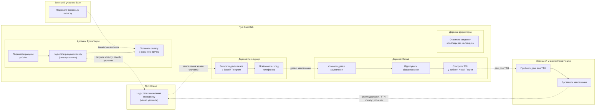

Це саме **чернетка**, не підтверджений опис усіх кроків. З інтерв’ю підтверджені ручне ведення даних, дзвінок складу, створення ТТН, перенесення рахунку в Odoo, ручне зіставлення оплат і щотижневе зведення. Канал отримання замовлення, порядок рахунку щодо відвантаження та спосіб повідомлення клієнта ще треба уточнити.

Спробуйте тепер сказати: **які два невідомі кроки ви хотіли б уточнити в стейкхолдерів першими?**

> бухгалтер
> Що відбувається першим виставлення рахунку чи відвантаження товару?
>
> клієнти
> Як ви зараз передаєте замовлення телефоном чи інакше?

**[Наталія Шевчук, головна бухгалтерка]:** Зазвичай спочатку відвантажуємо товар, а потім виставляємо рахунок. **Нове уточнення:** для окремих клієнтів рахунок можуть підготувати раніше за домовленістю, але типовий порядок — відвантаження, потім рахунок. Це потрібно занести в припущення й підтвердити з командою складу.

**[Марта Гнатів, клієнтка]:** **Нове уточнення:** зазвичай я телефоную менеджеру або пишу йому в Telegram. Менеджер записує замовлення у свою таблицю. Для постійних замовлень іноді надсилаю те саме повідомлення, що й минулого тижня.

Для as-is тепер можна показати замовлення телефоном або в Telegram, а рахунок після відвантаження. Позначте обидва як уточнення, отримані в цьому діалозі.

> Згенеруй діаграму as-is
>
> 1. Клієнт телефонує менеджеру або пише в Telegram (іноді надсилає те саме повідомлення, що й минулого тижня).
> 2. Менеджер записує замовлення в Excel / Telegram.
> 3. Менеджер повідомляє склад телефоном.
> 4. Склад вручну уточнює деталі, готує відвантаження і створює ТТН у кабінеті Нової Пошти.
> 5. Нова Пошта приймає дані для ТТН і доставляє замовлення.
> 6. Бухгалтерія після відвантаження виставляє рахунок: переносить його в Odoo і надсилає клієнту.
> 7. Банк надсилає виписку, бухгалтер вручну зіставляє оплату з рахунком.
> 8. Директорка раз на тиждень отримує зведення з таблиць.

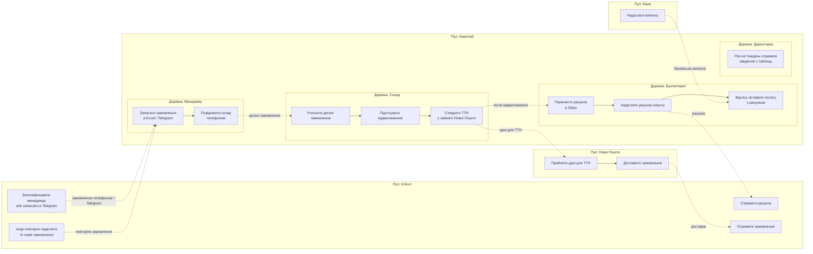

У діаграмі суцільні стрілки показують послідовність робіт усередині пулу «КавоХаб», пунктирні — повідомлення між учасниками процесу.

> в результаті це вся завдання які стосуються лабораторної 1?

Ні. Ми завершили лише частину **етапу 1**: склали попередню карту стейкхолдерів і діаграму as-is для вашого модуля.

За методичкою ЛР1 потрібно підготувати проєктний документ із п’ятьма групами артефактів:

- **Стейкхолдери й процеси:** карта стейкхолдерів, BPMN as-is і to-be.
- **Вимоги модуля:** 5–7 user stories із критеріями приймання, щонайменше 3 вимірювані NFR, конфлікти й приховані вимоги.
- **Доменний аналіз:** event storming, глосарій щонайменше з 15 термінів, карта контекстів і матриця власності даних.
- **Архітектура:** C4 Context, Container і Component, діаграма послідовності, 4 ADR — архітектурний стиль, взаємодія модулів, власність і зберігання даних, стек.
- **Контракти й оформлення:** каталог подій v0, ескіз API з ролями, структура сервісу, журнал рішень, припущення, ризики, самоперевірка та відповіді щонайменше на 5 контрольних питань.

Зараз as-is — чернетка для обговорення. Є ще важливе уточнення: відповідь про типовий порядок «відвантаження, потім рахунок» була новою деталлю з нашої рольової розмови, а не фактом із методички. У фінальному документі її слід позначити як **припущення для підтвердження**.

За правилами роботи на наступному етапі спершу ви пропонуєте власний **to-be підпроцес Notifications / Reporting**: які події система має отримати й кому, яким каналом та за якої умови надсилати звіти чи сповіщення.

> Пропоную свій to-be підпроцес Notifications / Reporting:
>
> 1. Orders надсилає подію "замовлення підтверджено" → клієнтці та менеджеру, email, одразу.
> 2. Inventory надсилає подію "резерв не вдався" → керівнику складу та менеджеру, email, одразу, з причиною.
> 3. Склад створює ТТН → подія "відвантажено" → клієнтці, email, з номером ТТН та очікуваним часом доставки.
> 4. Нова Пошта змінює статус доставки → клієнтці, email, при кожній зміні статусу.
> 5. Billing виставляє рахунок після відвантаження → клієнтці, PDF на пошту.
> 6. Замовлення чекає погодження знижки → керівнику продажів, потім менеджеру з рішенням.
> 7. Щодня о 18:00 директорці зведення: прийняті замовлення, відвантаження, сума боргу.
> 8. Щопонеділка директорці список неактивних орендарів (менше 20 кг кави два місяці поспіль).
> 9. Помилка доставки листа → ІТ-адміністратору (припущення).
>
> Перевір як рецензент: що пропущено, що суперечить кейсу, що треба позначити як припущення.

Загалом підпроцес покриває ключові потреби клієнтки, продажів, складу, директорки й ІТ. Є кілька важливих уточнень.

### Що добре

- Підтвердження замовлення, невдалий резерв, відвантаження, рахунок і погодження знижки прив’язані до подій процесу.
- Повідомлення про відвантаження містить ТТН, як просить клієнтка (К1).
- Щоденне зведення відповідає потребі директорки (Д1), а звіт про неактивних орендарів — уточненню з README.
- Помилку доставки листа правильно позначено як припущення: цього немає в інтерв’ю.

### Що виправити або позначити як припущення

1. **Події з базового каталогу.** Для відвантаження назва події — `inventory.shipment.dispatched`; для невдалого резерву — `inventory.stock.reservation_failed`. У каталозі немає події про кожну зміну статусу Нової Пошти. Її треба запропонувати як новий контракт і погодити з командою Inventory.
2. **«Замовлення підтверджено» не завжди означає підтверджений резерв.** Подія `orders.order.confirmed` виникає після погодження знижки, якщо воно потрібне. Невдалий резерв — окремий сценарій від Inventory. Визначте, чи повідомляєте клієнта про підтвердження лише після успішного резервування.
3. **Отримувачі та канали.** Email для підтвердження, невдалого резерву, ТТН, статусів доставки й рішення про знижку — поки припущення. К1 просить знати час доставки й отримувати номер ТТН, але канал не задає. Уточніть, чи менеджер теж отримує копію і які ролі мають бачити причину невдалого резерву.
4. **Очікуваний час доставки.** ТТН і очікуваний час прибуття — різні дані. К1 просить очікуваний час, але треба з’ясувати, чи Нова Пошта повертає прогноз, чи його розраховує інша система.
5. **Рахунок PDF.** Потреба надіслати рахунок PDF на пошту підтверджена К2. Але правило «після відвантаження» — нове уточнення з рольової розмови, його варто позначити як припущення та підтвердити в бухгалтерки.
6. **Погодження знижки.** Керівник продажів погоджує знижки понад 10% (П2), а за уточненням — якщо він у відпустці, погоджує директорка. Додайте директорку як резервного погоджувача. Повідомлення керівнику й менеджеру, а також канали — ще треба підтвердити. Сам модуль сповіщень має реагувати на подію Orders, а не визначати стан погодження.
7. **Неактивні орендарі.** Критерій у вас правильний: два календарні місяці поспіль менше 20 кг кави при орендованій машині. Періодичність щопонеділка підтверджена. Уточніть, чи список містить клієнта, відповідального менеджера й фактичні обсяги закупівель.
8. **Зведення о 18:00.** Показники відповідають Д1; час 18:00 і перегляд на телефоні вказані в уточненні README. Варто визначити, це email, посилання на дашборд чи інший канал; також узгодити часову зону й поведінку, якщо дані одного модуля ще не надійшли.
9. **Повторні спроби листа.** До пункту про помилку доставки додайте, скільки разів і з яким інтервалом система повторює надсилання, як фіксує остаточну помилку й чи сповіщає про неї повторно. Це можна оформити як припущення до уточнення з ІТ.

### Що пропущено

У базовому каталозі є ще кілька подій, які можуть стосуватися людей:

- `crm.deal.won` — створення чернетки замовлення після виграної угоди; варто вирішити, чи потрібне сповіщення менеджеру.
- `orders.order.cancelled` — потрібне сповіщення клієнту або менеджеру; узгодьте, хто повідомляє клієнта.
- `inventory.stock.reserved` — можливо, повідомлення не потрібне клієнту, але корисне менеджеру для підтвердження наявності.
- `billing.payment.received` — варто визначити, чи надсилати клієнту підтвердження оплати.
- `billing.invoice.issued` уже охоплено вашим пунктом про PDF.

Для додаткового завдання Notifications / Reporting методичка вимагає матрицю для **всіх подій базового каталогу, що стосуються людей**: подія → отримувач → канал → шаблон → умова надсилання, а також які чужі дані потрібні й як модуль їх отримує.

**Наступний крок:** вирішіть, які з пропущених подій мають породжувати сповіщення та кому. Після цього зведемо ваш to-be у BPMN і зафіксуємо невизначені канали й правила як припущення.

> 1. crm.deal.won: менеджеру email.
> 2. orders.order.cancelled: клієнтці та менеджеру email.
> 3. inventory.stock.reserved: сповіщення не потрібне.
> 4. billing.payment.received: клієнтці підтвердження оплати email.
> 5. "Замовлення підтверджено" клієнтці лише після успішного резерву.
> 6. Зміна статусу Нової Пошти: новий контракт, припущення.
> 7. Час доставки беремо з Нової Пошти, якщо його немає, не показуємо (припущення).
> 8. Рахунок після відвантаження: припущення.
> 9. Знижка понад 10%: керівнику продажів, у відпустці директорці.
> 10. Зведення о 18:00: email з посиланням для телефона. Якщо даних немає, позначка "неповні дані".
> 11. Помилка листа: 3 спроби через 5 хв, потім ІТ-адміністратору (припущення).
>
> Зроби матрицю: подія, отримувач, канал, шаблон, умова, чужі дані, як отримуємо. Потім BPMN to-be у Mermaid, невідомі місця познач "припущення".

Нижче зведено ваші рішення. Email для пунктів, де ви його вказали, вважаю обраним каналом. Усі дані, якими володіють інші модулі, Notifications / Reporting отримує через події та локальні репліки, якщо в матриці не зазначено інакше.

## Матриця сповіщень і звітів

| Подія / запуск | Отримувач | Канал | Шаблон | Умова | Чужі дані | Як отримуємо |
|---|---|---|---|---|---|---|
| `crm.deal.won` | Менеджер, відповідальний за угоду | Email | «Угоду виграно: створено чернетку замовлення» | Угоду виграно | Дані угоди й відповідальний менеджер — CRM | Подія; email менеджера — з репліки CRM або довідника адрес |
| `orders.order.confirmed` + `inventory.stock.reserved` | Клієнтка; менеджер — **припущення** | Email | «Замовлення підтверджено» | Надсилати клієнтці лише після успішного резерву; зіставити події за `orderId` | Замовлення й клієнт — Orders; результат резерву — Inventory; контакт і email — CRM | Події Orders та Inventory; клієнтська репліка з CRM |
| `orders.order.cancelled` | Клієнтка та менеджер | Email | «Замовлення скасовано» | Замовлення скасовано | Замовлення — Orders; контакти клієнтки й менеджера — CRM | Подія Orders; адреси з репліки CRM |
| `inventory.stock.reservation_failed` | Керівник складу та менеджер | Email | «Не вдалося зарезервувати товар» із причиною | Резерв не вдався | Причина й позиції — Inventory; замовлення — Orders; адреси — CRM | Подія Inventory; репліки Orders і CRM. Якщо причина не є в події — **припущення**, що Inventory додасть її до контракту |
| `inventory.stock.reserved` | Немає | — | — | Сповіщення не надсилати; використати подію для перевірки успішного резерву перед повідомленням про підтвердження | Резерв і замовлення — Inventory / Orders | Подія Inventory |
| `inventory.shipment.dispatched` | Клієнтка | Email | «Замовлення відвантажено» з номером ТТН та очікуваним часом доставки, якщо він доступний | Відвантаження зафіксовано | ТТН — Inventory; клієнтський контакт — CRM; прогноз доставки — Нова Пошта | Подія Inventory, CRM-репліка; час доставки — **припущення**: новий контракт або API Нової Пошти. Якщо часу немає — не показувати |
| Зміна статусу доставки Новою Поштою — **новий контракт, припущення** | Клієнтка | Email | «Статус доставки змінено» зі статусом і часом | Кожна нова зміна статусу | Статус і ТТН — Нова Пошта / Inventory; email — CRM | **Припущення:** Inventory передає статус подією; Notifications / Reporting отримує її та звіряє з реплікою замовлення |
| `billing.invoice.issued` | Клієнтка | Email із PDF | «Рахунок за замовлення» з PDF-вкладенням | Рахунок виставлено. Виставлення після відвантаження — **припущення** | Рахунок і PDF — Billing; email клієнтки — CRM | Подія Billing; файл або посилання на PDF — із Billing |
| Подія про надсилання на погодження знижки — **потрібно узгодити контракт із Orders** | Керівник продажів; якщо він у відпустці — директорка | Email — **припущення** | «Потрібне погодження знижки» з замовленням і розміром знижки | Знижка понад 10%; запасний погоджувач — якщо керівник у відпустці | Замовлення й знижка — Orders; доступність керівника та адреси — довідник користувачів / Keycloak | **Припущення:** подія Orders; стан відпустки — з узгодженого довідника або налаштування |
| Подія про рішення щодо знижки — **потрібно узгодити контракт із Orders** | Менеджер | Email — **припущення** | «Рішення щодо знижки» з результатом | Керівник продажів або директорка ухвалили рішення | Рішення й замовлення — Orders; email менеджера — CRM | **Припущення:** подія Orders; менеджер — репліка CRM |
| `billing.payment.received` | Клієнтка | Email | «Оплату отримано» з рахунком і сумою | Оплату зіставлено з рахунком | Сума й рахунок — Billing; email клієнтки — CRM | Подія Billing; контакт із репліки CRM |
| Щоденне зведення, 18:00 | Директорка | Email із посиланням, зручним для телефона | «Підсумок за день»: прийняті замовлення, відвантаження, сума боргу | Щодня о 18:00; за відсутніх даних показати «неповні дані» | Замовлення — Orders; відвантаження — Inventory; борг — Billing | Репліки, оновлені подіями модулів. Канал email і посилання — ваше рішення |
| Щотижневий звіт, понеділок | Директорка | **Припущення:** email із посиланням | «Неактивні орендарі» з клієнтом і обсягом закупівель | Клієнт має орендовану машину та купував менш як 20 кг кави два календарні місяці поспіль | Оренда й закупівлі/замовлення — відповідні модулі; клієнт і менеджер — CRM | **Припущення:** локальні репліки, оновлені подіями. Періодичність і поріг підтверджені матеріалами кейсу |
| Помилка доставки листа | ІТ-адміністратор | Канал сповіщення ІТ — **припущення** | «Лист не доставлено» з адресатом і кодом помилки | Після трьох невдалих спроб із паузою 5 хвилин | Результат доставки — поштовий сервіс; адресат — шаблон / CRM | Події або журнали поштового сервісу — **припущення**; правило повторів і сповіщення ще треба узгодити з ІТ |

У базовому каталозі також є `crm.account.upserted` та `inventory.product.upserted`. За вашими рішеннями вони самі по собі не надсилають людям сповіщень; їх можна споживати для оновлення локальних реплік і звітів. Якщо додасте сповіщення про зміну даних клієнта чи товару, це буде окрема вимога.

## BPMN to-be у Mermaid

Це Mermaid-ескіз із пулами та доріжками. Суцільні стрілки показують кроки всередині Notifications / Reporting, пунктирні — повідомлення між пулами. Позначка «припущення» вказує на ще не погоджений канал, контракт або порядок.

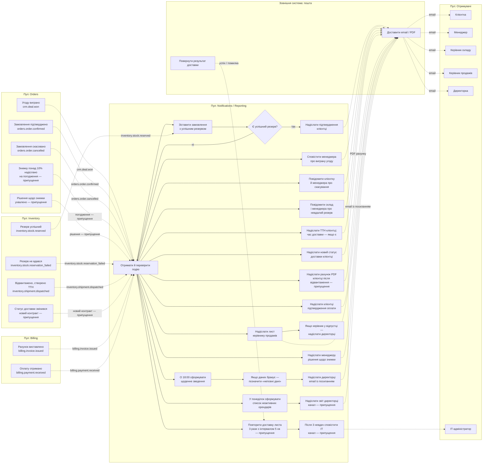

**Уточнення перед фінальною версією:** у README подія `orders.order.confirmed` виникає після погодження знижки, а товар під час очікування погодження резервується не довше 24 годин. Тому порядок «підтвердження → резерв → сповіщення клієнтці» треба узгодити з Orders та Inventory. Також для BPMN треба буде явно визначити поведінку при невдалому/простроченому резерві та чи надсилається клієнтці окреме повідомлення.

> 1. Клієнтці "підтверджено" після orders.order.confirmed, якщо резерв чинний (припущення).
> 2. Якщо резерв невдалий або прострочений: клієнтці "потребує уточнення", складу й менеджеру "резерв не вдався" (припущення).
> 3. stock.reserved лише оновлює репліку, без сповіщення.
> 4. Заміни цикл G1 -> N1 на гілку очікування 24 год.
> 5. Додай шлюз за типом події замість розгалуження з N1.
> 6. Рахунок лише після shipment.dispatched (припущення).
> 7. У повторах листа додай гілку "успіх".
> 8. Додай у матрицю рядок для простроченого резерву. Прибери пул "Отримувачі", зроби компактніше.
> Виведи Mermaid і оновлену матрицю.

## Матриця сповіщень і звітів

| Подія / запуск | Отримувач | Канал | Шаблон | Умова | Чужі дані | Як отримуємо |
|---|---|---|---|---|---|---|
| `crm.deal.won` | Менеджер угоди | Email | «Угоду виграно: створено чернетку замовлення» | Угоду виграно | Угода й менеджер — CRM | Подія; адреса менеджера з репліки CRM |
| `orders.order.confirmed` + чинний резерв | Клієнтка | Email | «Замовлення підтверджено» | Після `orders.order.confirmed`, якщо резерв чинний — **припущення** | Замовлення — Orders; резерв — Inventory; контакт — CRM | Подія Orders + репліка Inventory, оновлена `inventory.stock.reserved`; контакт із репліки CRM |
| `orders.order.cancelled` | Клієнтка та менеджер | Email | «Замовлення скасовано» | Замовлення скасовано | Замовлення — Orders; контакти — CRM | Подія Orders; адреси з репліки CRM |
| `inventory.stock.reservation_failed` | Клієнтка, менеджер і керівник складу | Email | Клієнтці: «Замовлення потребує уточнення»; працівникам: «Резерв не вдався» з причиною | Резерв невдалий — **припущення щодо всіх отримувачів і формулювання** | Резерв і причина — Inventory; замовлення — Orders; контакти — CRM | Подія Inventory та локальні репліки Orders і CRM |
| Прострочення резерву після 24 годин | Клієнтка, менеджер і керівник складу | Email — **припущення** | Клієнтці: «Замовлення потребує уточнення»; працівникам: «Резерв не вдався через завершення строку» | Резерв не отримав рішення протягом 24 годин — **припущення**, відповідно до правила README про зняття резерву й повернення замовлення в чернетку | Статус резерву — Inventory; стан замовлення й менеджер — Orders / CRM | Таймер на 24 год і локальні репліки; подія про прострочення потребує узгодження |
| `inventory.stock.reserved` | Немає | — | — | Оновити репліку резерву; сповіщення не надсилати | Резерв — Inventory | Подія Inventory |
| `inventory.shipment.dispatched` | Клієнтка | Email | «Замовлення відвантажено» з номером ТТН і прогнозом доставки, якщо доступний | Після відвантаження | ТТН — Inventory; контакт — CRM; прогноз — Нова Пошта | Подія Inventory; контакт із CRM; прогноз із Нової Пошти — **припущення**. Якщо прогнозу немає, не показувати |
| Зміна статусу доставки | Клієнтка | Email — **припущення** | «Статус доставки змінено» | Кожна зміна статусу; подія/контракт — **припущення** | Статус — Нова Пошта / Inventory; контакт — CRM | Новий контракт із Inventory або Новою Поштою — **припущення** |
| `billing.invoice.issued` | Клієнтка | Email із PDF | «Рахунок за замовлення» | Лише після `inventory.shipment.dispatched` — **припущення** | Рахунок і PDF — Billing; email — CRM | Подія Billing; PDF або посилання з Billing |
| Подія про надсилання знижки на погодження | Керівник продажів; директорка, якщо керівник у відпустці | Email — **припущення** | «Потрібне погодження знижки» | Знижка понад 10%; подія Orders потребує узгодження | Сума знижки й замовлення — Orders; адреси й доступність — довідник користувачів | Подія Orders — **припущення**; довідник користувачів |
| Подія про рішення щодо знижки | Менеджер | Email — **припущення** | «Рішення щодо знижки» | Погоджено або відхилено; подія Orders потребує узгодження | Рішення — Orders; менеджер і email — CRM | Подія Orders та репліка CRM |
| `billing.payment.received` | Клієнтка | Email | «Оплату отримано» із сумою та рахунком | Оплату зіставлено з рахунком | Оплата й рахунок — Billing; контакт — CRM | Подія Billing; контакт із репліки CRM |
| Щодня о 18:00 | Директорка | Email із посиланням | «Підсумок за день»: прийняті замовлення, відвантаження, борг | Якщо даних бракує — позначити «неповні дані» | Замовлення — Orders; відвантаження — Inventory; борг — Billing | Локальні репліки, оновлені подіями |
| Щопонеділка | Директорка | Email із посиланням — **припущення** | «Неактивні орендарі» | Орендована машина та менш як 20 кг кави два календарні місяці поспіль | Оренда й закупівлі — модулі-власники; клієнт — CRM | Репліки, оновлені подіями; спосіб отримання даних про оренду — **припущення** |
| Помилка доставки email | ІТ-адміністратор | Канал — **припущення** | «Лист не доставлено» з адресатом і кодом помилки | 3 спроби з інтервалом 5 хв; після третьої невдачі повідомити ІТ — **припущення** | Статус доставки — поштовий сервіс; адресат — CRM / шаблон | Результат поштового сервісу |

## BPMN to-be у Mermaid

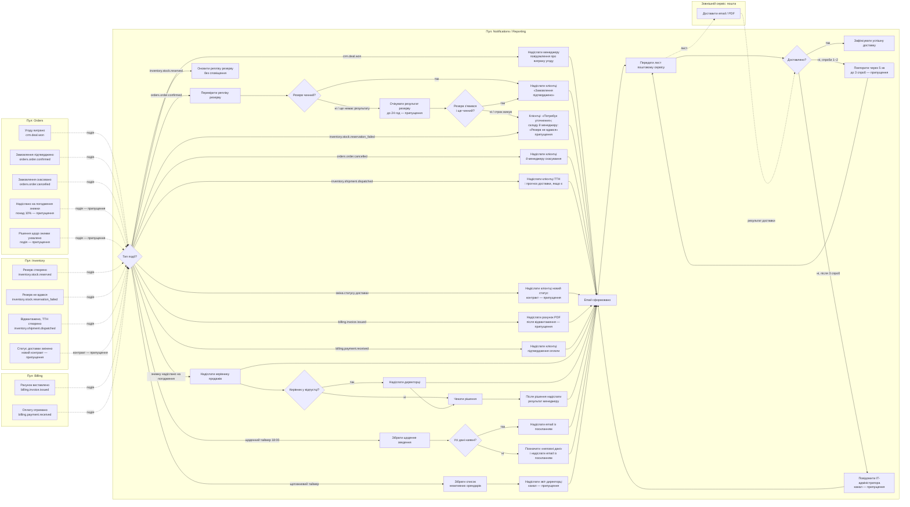

У шлюзі **резерв чинний?** передбачається, що Notifications / Reporting вміє визначити чинність за реплікою Inventory. Очікування до 24 годин та повідомлення про прострочення позначені як припущення; базові матеріали вимагають зняти резерв і повернути замовлення в чернетку, якщо погодження не надійшло вчасно.

> який наступнйи крок

Наступний крок — **етап 2: вимоги модуля**. Ваш to-be і матриця вже задають основу.

Спершу складіть 5–7 user stories для Notifications / Reporting. Для кожної вкажіть роль, цінність, пріоритет, джерело з інтерв’ю або припущення та щонайменше два критерії приймання у форматі Given / When / Then. Хоча б один критерій має описувати помилковий або граничний сценарій.

Почніть із двох історій: сповіщення клієнтки про відвантаження з ТТН та щоденне зведення директорці. Напишіть їх тезами — я перевірю критерії, джерела й пріоритети.

> Виправ to-be:
> 1. Шлюз "резерв чинний?" має перевіряти стан на момент orders.order.confirmed. Прострочення 24 год зроби окремою подією-таймером у шлюзі типу події (припущення).
> 2. Для листа ІТ не повторюй спроби, щоб не було циклу.
> 3. Перед відправкою рахунку додай шлюз "відвантаження вже було?", якщо ні, чекати shipment.dispatched.
> 4. Для рішення щодо знижки додай гілку "рішення не надійшло" (припущення).
> Виведи Mermaid і оновлену матрицю.

## Оновлена матриця

| Подія / запуск | Отримувач | Канал | Шаблон | Умова | Чужі дані | Як отримуємо |
|---|---|---|---|---|---|---|
| `crm.deal.won` | Менеджер угоди | Email | «Угоду виграно: створено чернетку замовлення» | Угоду виграно | Угода й менеджер — CRM | Подія; email менеджера з репліки CRM |
| `orders.order.confirmed` | Клієнтка | Email | «Замовлення підтверджено» | Перевірити чинність резерву **на момент отримання `orders.order.confirmed`**. Чинний — надіслати повідомлення | Замовлення — Orders; резерв — Inventory; контакт — CRM | Подія Orders; стан резерву з репліки Inventory; контакт із репліки CRM |
| Подія-таймер «резерв прострочено через 24 год» — **припущення** | Клієнтка, менеджер і керівник складу | Email — **припущення** | Клієнтці: «Замовлення потребує уточнення»; працівникам: «Резерв не вдався через прострочення» | Таймер спрацював, а резерв не був успішно підтверджений | Статус резерву — Inventory; замовлення — Orders; контакти — CRM | Таймер у Notifications / Reporting — **припущення**; перед надсиланням звірити репліку Inventory |
| `inventory.stock.reservation_failed` | Клієнтка, менеджер і керівник складу | Email — **припущення** | Клієнтці: «Замовлення потребує уточнення»; працівникам: «Резерв не вдався» з причиною | Резерв не вдався | Причина й резерв — Inventory; замовлення — Orders; контакти — CRM | Подія Inventory; локальні репліки Orders і CRM |
| `orders.order.cancelled` | Клієнтка та менеджер | Email | «Замовлення скасовано» | Замовлення скасовано | Замовлення — Orders; контакти — CRM | Подія Orders; адреси з репліки CRM |
| `inventory.stock.reserved` | Немає | — | — | Оновити репліку резерву; сповіщення не надсилати | Резерв — Inventory | Подія Inventory |
| `inventory.shipment.dispatched` | Клієнтка | Email | «Замовлення відвантажено» з ТТН і прогнозом, якщо він доступний | Замовлення відвантажене | ТТН — Inventory; прогноз — Нова Пошта; контакт — CRM | Подія Inventory; контакт із CRM; прогноз із Нової Пошти — **припущення**. Якщо прогнозу немає, не показувати |
| Зміна статусу доставки | Клієнтка | Email — **припущення** | «Статус доставки змінено» | Кожна зміна статусу; новий контракт — **припущення** | Статус — Нова Пошта / Inventory; контакт — CRM | Подія за новим контрактом — **припущення** |
| `billing.invoice.issued` | Клієнтка | Email із PDF | «Рахунок за замовлення» | Перевірити, чи вже є `inventory.shipment.dispatched`. Якщо ні — чекати цю подію. Надсилати рахунок лише після відвантаження — **припущення** | Рахунок і PDF — Billing; відвантаження — Inventory; контакт — CRM | Події Billing та Inventory; локальні репліки |
| Подія про надсилання знижки на погодження | Керівник продажів; якщо у відпустці — директорка | Email — **припущення** | «Потрібне погодження знижки» | Знижка понад 10%; подія Orders потребує узгодження | Замовлення й знижка — Orders; адреси й доступність — довідник користувачів | Подія Orders і довідник — **припущення** |
| Подія про рішення щодо знижки | Менеджер | Email — **припущення** | «Рішення щодо знижки» або «Рішення не надійшло» | Отримано рішення або сплив визначений строк очікування. Строк і подія таймера — **припущення** | Рішення й замовлення — Orders; менеджер — CRM | Подія Orders; таймер у Notifications / Reporting — **припущення** |
| `billing.payment.received` | Клієнтка | Email | «Оплату отримано» із сумою та рахунком | Оплату зіставлено з рахунком | Оплата й рахунок — Billing; контакт — CRM | Подія Billing; контакт із репліки CRM |
| Щодня о 18:00 | Директорка | Email із посиланням | Підсумок: прийняті замовлення, відвантаження, сума боргу | За відсутності частини даних показати «неповні дані» | Orders, Inventory, Billing | Локальні репліки, оновлені подіями |
| Щопонеділка | Директорка | Email із посиланням — **припущення** | Список неактивних орендарів | Орендована машина й менш як 20 кг кави два календарні місяці поспіль | Дані про оренду та закупівлі — модулі-власники; клієнт — CRM | Репліки, оновлені подіями; джерело даних про оренду — **припущення** |
| Остаточна помилка доставки email після трьох спроб із паузою 5 хв | ІТ-адміністратор | Канал — **припущення** | «Лист не доставлено» з адресатом і кодом помилки | Після трьох невдалих спроб | Статус доставки — поштовий сервіс; адресат — CRM / шаблон | Результат поштового сервісу. Повідомлення ІТ не запускає повторні спроби |

## Оновлений BPMN-ескіз у Mermaid

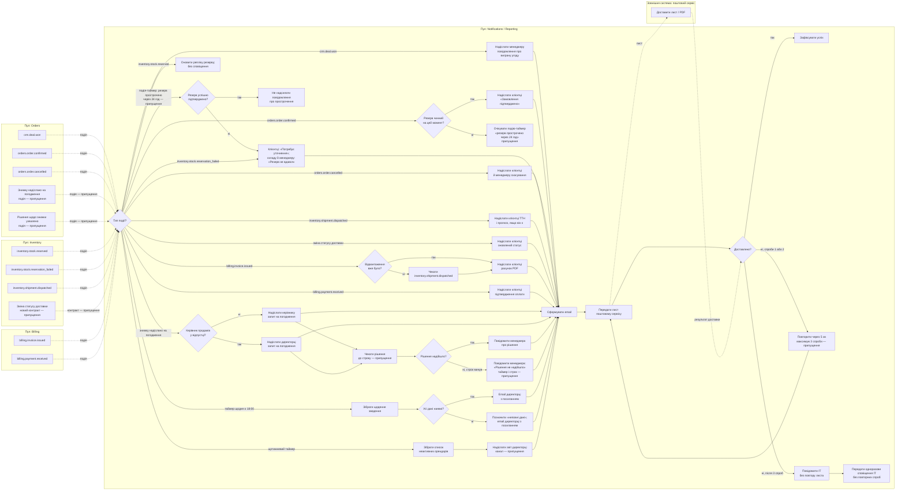

`inventory.stock.reserved` лише оновлює репліку; шлюз після `orders.order.confirmed` перевіряє її актуальний стан. Прострочення резерву показане окремою таймерною подією-припущення. У гілці рахунку Notifications / Reporting зберігає його до отримання `inventory.shipment.dispatched`.

> Виправ to-be:
> 1. Додай стрілку від W1 до G2 (спрацювання таймера).
> 2. Для W2 додай вхід: shipment.dispatched, якщо є рахунок, що чекає, веде до N7.
> 3. Перед N3 додай шлюз "замовлення ще активне?", якщо скасоване, не надсилати (припущення).
> 4. Прибери ITMAIL, залиш один вузол для ІТ без повторів зі стрілкою до пошти.
> Виведи тільки Mermaid.

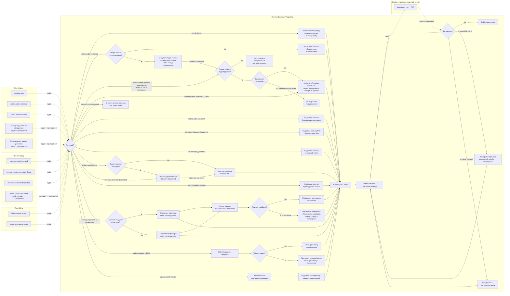

> Напиши 5-7 user stories для Notifications / Reporting з критеріями приймання. Формат: "Як <роль>, я хочу <дія>, щоб <мета>". До кожної 2-3 критерії приймання. Опирайся на стейкхолдерів і матрицю. Нові деталі познач "припущення".

За правилами ЛР1 спершу потрібен ваш варіант user stories: оцінюється, як ви обираєте потреби й обґрунтовуєте рішення. Я перевірю його та допоможу оформити критерії приймання.

Оберіть 5–7 тем із вашої матриці, наприклад:

- клієнтці — підтвердження замовлення після перевірки резерву;
- менеджеру — сповіщення про виграну угоду;
- клієнтці й команді — повідомлення про невдалий або прострочений резерв;
- клієнтці — ТТН, рахунок і підтвердження оплати;
- директорці — щоденне зведення та щотижневий список неактивних орендарів;
- ІТ-адміністратору — повідомлення після невдалих спроб доставки email.

Для кожної заповніть шаблон:

> **US-NOT-01.** Як `<роль>`, я хочу `<дія>`, щоб `<мета>`.
> Пріоритет: Must / Should / Could. Джерело: `<цитата, рішення з матриці або припущення>`.
> **AC-1:** Given `<умова>` When `<дія/подія>` Then `<результат>`.
> **AC-2:** Given `<помилкова або гранична умова>` When `<дія/подія>` Then `<очікувана поведінка>`.

Напишіть хоча б перші дві історії своїми словами. Для каналів, строків, подій і правил, яких немає в інтерв’ю чи базовому каталозі, позначайте джерело як **припущення**.

> Мій варіант перших двох user stories:
>
> US-NOT-01. Як клієнтка, я хочу отримати повідомлення про підтвердження замовлення після перевірки резерву, щоб знати, що товар для мене збережено.
> Пріоритет: Must. Джерело: рішення з матриці; канал email і умова "резерв чинний" - припущення.
> AC-1: Given замовлення підтверджено і резерв чинний When надходить orders.order.confirmed Then клієнтка отримує email "Замовлення підтверджено".
> AC-2: Given резерв невдалий або прострочений When надходить orders.order.confirmed Then повідомлення про підтвердження не надсилається, клієнтка отримує "Замовлення потребує уточнення" (припущення).
>
> US-NOT-02. Як клієнтка, я хочу отримувати номер ТТН і очікуваний час доставки, щоб знати, коли чекати посилку.
> Пріоритет: Must. Джерело: К1; канал email - припущення.
> AC-1: Given товар відвантажено When надходить inventory.shipment.dispatched Then клієнтка отримує email з номером ТТН.
> AC-2: Given прогноз доставки недоступний When надходить inventory.shipment.dispatched Then email надсилається без часу доставки (припущення).
>
> Перевір як рецензент і допоможи оформити критерії приймання. Далі я напишу ще 3-5 історій.

Обидві історії прив’язані до потреб клієнтки й вашої матриці. Критерії можна зробити точнішими, якщо назвати потрібні дані та описати, що робити за конфліктних умов.

### US-NOT-01 — підтвердження замовлення

Джерело «рішення з матриці» варто доповнити посиланням на К1: клієнтка хоче отримувати інформацію про замовлення та доставку. Саме умова «сповіщати після підтвердження за чинного резерву» — ваше **припущення**. Врахуйте, що чинність резерву перевіряється на момент отримання `orders.order.confirmed`.

**Відредагований варіант:**

> **US-NOT-01.** Як клієнтка, я хочу отримати повідомлення про підтвердження замовлення після перевірки резерву, щоб знати, що товар для мене зарезервовано.
> Пріоритет: Must. Джерело: К1; умова сповіщення лише за чинного резерву та канал email — **припущення**.

- **AC-1:** Given надійшла подія `orders.order.confirmed` і репліка Inventory показує чинний резерв для цього замовлення, When Notifications / Reporting обробляє подію, Then клієнтці надсилається email «Замовлення підтверджено» з ідентифікатором замовлення.
- **AC-2:** Given резерв не вдався або прострочений, When Notifications / Reporting обробляє результат резервування, Then email «Замовлення підтверджено» не надсилається, а клієнтка отримує «Замовлення потребує уточнення». Формулювання та канал для цього випадку — **припущення**.

Ваш початковий AC-2 прив’язує невдалий резерв до надходження `orders.order.confirmed`. Але сама ця подія не повідомляє, що резерв не вдався; для цього потрібен результат Inventory або таймер прострочення. Тому в уточненому критерії перевіряється результат резервування.

### US-NOT-02 — повідомлення про відвантаження

К1 підтверджує потребу знати очікуваний час доставки й отримати номер ТТН. Канал email — **припущення**. В AC-1 варто перевірити, що лист містить номер ТТН, а не лише факт відправлення.

**Відредагований варіант:**

> **US-NOT-02.** Як клієнтка, я хочу отримувати номер ТТН і очікуваний час доставки, щоб знати, коли чекати посилку.
> Пріоритет: Must. Джерело: К1; канал email і джерело прогнозу доставки — **припущення**.

- **AC-1:** Given для замовлення надійшла подія `inventory.shipment.dispatched` із номером ТТН, When Notifications / Reporting обробляє подію, Then клієнтці надсилається email із номером ТТН.
- **AC-2:** Given прогноз доставки недоступний, When Notifications / Reporting формує повідомлення про відвантаження, Then email із номером ТТН надсилається без часу доставки. Це правило — **припущення**.

Окремо лишаються питання для уточнення: чи можна вважати резерв чинним за локальною реплікою, якщо вона застаріла; і чи містить `inventory.shipment.dispatched` номер ТТН, чи його треба отримувати окремо. Можете надсилати наступні 3–5 історій тезами — перевірю їх так само.

> US-NOT-03. Як менеджер, я хочу отримати повідомлення про виграну угоду, щоб одразу знати про чернетку замовлення.
> Пріоритет: Should. Джерело: матриця; канал email - припущення.
> AC-1: Given надійшла crm.deal.won When Notifications / Reporting обробляє подію Then менеджер угоди отримує email.
> AC-2: Given email менеджера немає в репліці CRM When надходить crm.deal.won Then сповіщення не надсилається, помилка фіксується (припущення).
>
> US-NOT-04. Як керівник складу, я хочу отримати повідомлення про невдалий або прострочений резерв, щоб швидко розібратися з товаром.
> Пріоритет: Must. Джерело: С1, матриця; таймер 24 год - припущення.
> AC-1: Given надійшла inventory.stock.reservation_failed When подію оброблено Then склад і менеджер отримують email з причиною.
> AC-2: Given замовлення вже скасовано When спрацював таймер прострочення Then повідомлення не надсилається (припущення).
>
> US-NOT-05. Як директорка, я хочу щодня о 18:00 отримувати зведення, а щопонеділка список неактивних орендарів, щоб бачити стан бізнесу.
> Пріоритет: Must. Джерело: Д1, README 5.1; email з посиланням - припущення.
> AC-1: Given настав 18:00 When формується зведення Then директорка отримує кількість прийнятих замовлень, відвантажень і суму боргу.
> AC-2: Given дані одного з модулів відсутні When формується зведення Then воно надсилається з позначкою "неповні дані".
>
> US-NOT-06. Як клієнтка, я хочу отримувати рахунок PDF та підтвердження оплати, щоб мати документи й бачити статус розрахунків.
> Пріоритет: Should. Джерело: К2; порядок "після відвантаження" - припущення.
> AC-1: Given є billing.invoice.issued і відвантаження було When подію оброблено Then клієнтка отримує email з PDF.
> AC-2: Given відвантаження ще не було When надходить billing.invoice.issued Then рахунок зберігається й надсилається після inventory.shipment.dispatched (припущення).
>
> US-NOT-07. Як ІТ-адміністратор, я хочу отримати повідомлення після трьох невдалих спроб доставки листа, щоб усунути проблему.
> Пріоритет: Could. Джерело: припущення (немає в інтерв'ю).
> AC-1: Given три спроби з інтервалом 5 хв невдалі When остання спроба завершилась Then ІТ отримує повідомлення з адресатом і кодом помилки.
> AC-2: Given лист для ІТ теж не доставлено When це сталося Then повторні спроби не запускаються, помилка лише фіксується.
>
> Перевір як рецензент, зазнач, що суперечить кейсу чи матриці.

Загалом історії відповідають модулю й матриці. Явної суперечності з кейсом немає, але три історії об’єднують різні функції, а частині критеріїв бракує точних умов.

| Історія | Рецензія |
|---|---|
| **US-NOT-03** | Узгоджується з `crm.deal.won` і матрицею. Відсутність email у репліці CRM — припущення. Уточніть, що адресу менеджера беруть із репліки CRM, а помилку фіксують без нескінченних повторів. Корисно додати критерій для повторно доставленої події: менеджер не має отримати дубль листа. |
| **US-NOT-04** | Повідомлення про невдалий резерв відповідає `inventory.stock.reservation_failed`, але С1 підтверджує проблему з пізнім інформуванням складу, а не саме потребу в email про невдалий резерв. Отримувач «склад» нечіткий — у матриці це керівник складу. Причина має бути в події або доступна з Inventory — погодьте це як вимогу до контракту. Правило 24 год є в кейсі для резерву під погодження, але окрема таймерна подія й спосіб її обробки — припущення. AC-2 також варто перевіряти для клієнтки, менеджера й керівника складу. |
| **US-NOT-05** | Тут дві окремі цілі: щоденне зведення та щотижневий список орендарів. Розділіть на дві user stories. Д1 підтверджує щоденні три показники; час 18:00 наведений у додаткових фактах кейсу. У критерії для тижневого звіту додайте правило: орендована машина й закупівлі менш як 20 кг у кожному з двох послідовних календарних місяців. Email із посиланням — припущення. |
| **US-NOT-06** | Об’єднує рахунок і підтвердження оплати — розділіть на дві історії. К2 підтверджує PDF рахунку на email, але не підтвердження оплати: його джерело наразі лише матриця й це окреме рішення. Критерії щодо відкладеного рахунку відповідають матриці; правило надсилати тільки після відвантаження — припущення. Формулювання «рахунок зберігається» замініть на «Notifications / Reporting чекає на `inventory.shipment.dispatched`, а потім надсилає PDF» — рахунком володіє Billing. |
| **US-NOT-07** | Коректно позначена як припущення. Уточніть, чи три спроби включають перше надсилання чи означають три повтори після нього. AC-2 має стосуватися саме одноразового сповіщення ІТ: повторів для нього немає, помилка записується. |

Для **US-NOT-05** особливо важливо розділити критерії: відсутність даних у щоденному зведенні не повинна автоматично змінювати умови формування щотижневого звіту. У кожної з двох історій будуть власні AC.

Спільне покращення: додайте негативний критерій про повторну доставку тієї самої події. У README є вимога відкидати дублікати за `id`; це допоможе перевірити, що один `crm.deal.won` або `billing.payment.received` не породить дубль листа.

> Приймаю рецензію. Виправляю історії:
>
> US-NOT-03. Як менеджер, я хочу отримати повідомлення про виграну угоду, щоб знати про чернетку замовлення.
> Пріоритет: Should. Джерело: матриця; email - припущення.
> AC-1: Given надійшла crm.deal.won, адреса менеджера є в репліці CRM When подію оброблено Then менеджер отримує один email.
> AC-2: Given адреси немає в репліці CRM When надійшла подія Then лист не надсилається, помилка фіксується без повторів (припущення).
> AC-3: Given подія з тим самим id надійшла вдруге When її оброблено Then дубль листа не надсилається (README, дублікати за id).
>
> US-NOT-04. Як керівник складу, я хочу отримувати повідомлення про невдалий або прострочений резерв, щоб швидко вирішити проблему з товаром.
> Пріоритет: Must. Джерело: С1; таймер 24 год і причина в контракті - припущення.
> AC-1: Given надійшла inventory.stock.reservation_failed When подію оброблено Then керівник складу, менеджер і клієнтка отримують email (клієнтці "потребує уточнення", працівникам з причиною).
> AC-2: Given замовлення скасоване When спрацював таймер прострочення Then жодному з трьох отримувачів повідомлення не надсилається (припущення).
>
> US-NOT-05. Як директорка, я хочу щодня о 18:00 отримувати зведення, щоб бачити стан бізнесу.
> Пріоритет: Must. Джерело: Д1, 18:00 з README; email з посиланням - припущення.
> AC-1: Given настав 18:00 When формується зведення Then воно містить прийняті замовлення, відвантаження і суму боргу.
> AC-2: Given дані одного модуля відсутні When формується зведення Then воно надсилається з позначкою "неповні дані".
>
> US-NOT-06. Як директорка, я хочу щопонеділка отримувати список неактивних орендарів, щоб вчасно працювати з клієнтами.
> Пріоритет: Should. Джерело: README 5.1; канал - припущення.
> AC-1: Given клієнт має орендовану машину і купував менш як 20 кг кави у кожному з двох послідовних календарних місяців When настав понеділок Then клієнт потрапляє до списку з обсягами.
> AC-2: Given дані про закупівлі за один з місяців відсутні When формується звіт Then звіт позначає клієнта "неповні дані" (припущення).
>
> US-NOT-07. Як клієнтка, я хочу отримувати рахунок PDF, щоб мати документ для оплати.
> Пріоритет: Should. Джерело: К2; порядок "після відвантаження" - припущення.
> AC-1: Given є billing.invoice.issued і відвантаження було When подію оброблено Then клієнтка отримує email з PDF.
> AC-2: Given відвантаження ще не було When надійшла billing.invoice.issued Then Notifications / Reporting чекає на inventory.shipment.dispatched і потім надсилає PDF (припущення).
> AC-3: Given billing.invoice.issued з тим самим id надійшла вдруге Then дубль не надсилається.
>
> Окремо (Could, припущення): підтвердження оплати клієнтці після billing.payment.received та повідомлення ІТ після 3 невдалих спроб доставки (3 спроби включають перше надсилання; для листа ІТ повторів немає, помилка лише записується).
>
> Перевір кількість історій відносно ліміту 5-7 і запропонуй, що об'єднати чи перенести до списку додаткових вимог.

Загалом виходить **7 user stories**: попередні **US-NOT-01 і US-NOT-02** плюс **US-NOT-03–US-NOT-07** у цьому повідомленні. Це вкладається у вимогу ЛР1 — **5–7 історій**. Нічого об’єднувати не потрібно.

US-NOT-05 і US-NOT-06 краще залишити окремими: щоденне зведення та щотижневий список мають різні дані, умови й періодичність. US-NOT-07 також не варто об’єднувати з підтвердженням оплати — це окрема потреба на подію `billing.payment.received`.

Підтвердження оплати та сповіщення ІТ залиште в **списку додаткових вимог / backlog** із пріоритетом Could. Це дає змогу зберегти їх у проєктному документі, не збільшуючи основний набір понад ліміт.

Перед фіксацією основного набору уточніть ще два моменти:

- В **US-NOT-04** джерело С1 підтверджує, що склад пізно дізнається про замовлення, але не прямо потребу в email про невдалий резерв. Позначте склад і email як припущення або з’ясуйте це запитанням до Сергія Ткаченка.
- В **US-NOT-05** зазначте, що показники формуються станом на 18:00 за часом компанії. Умову «неповні дані» варто поширити на звіт, не виключаючи клієнтів із неповними даними з інших звітів без окремого правила.

Після цих уточнень кількість і структура історій відповідають вимогам завдання.

> який етап наступний

Наступний — **етап 2: нефункціональні вимоги та конфлікти**. User stories уже готові; залишилося завершити вимоги модуля.

Складіть для Notifications / Reporting щонайменше **3 вимірювані NFR**. Для кожної вкажіть показник, цільове значення, спосіб перевірки й джерело. Можна розглянути надійність доставки сповіщень, затримку від події до email і доступність щоденного звіту.

Потім визначимо конфлікти та припущення, зокрема порядок «погодження знижки — резерв — підтвердження клієнтці» й умову надсилання рахунку після відвантаження. Почніть із власних трьох NFR тезами — я їх перевірю.

> Уточнення: в US-NOT-04 склад і email - припущення. В US-NOT-05 показники станом на 18:00 за часом компанії, "неповні дані" лише для цього зведення.
>
> Мої NFR для Notifications / Reporting:
>
> NFR-01. Затримка. Показник: час від події до передачі листа поштовому сервісу. Ціль: 95% за 60 секунд. Перевірка: тест із 100 подіями, заміри в логах. Джерело: припущення.
> NFR-02. Надійність доставки. Показник: частка листів, переданих поштовому сервісу, після до 3 спроб. Ціль: не менше 99%. Перевірка: тест із імітацією збою пошти (Mailpit). Джерело: припущення, правило 3 спроб із 5 хв.
> NFR-03. Своєчасність зведення. Показник: час відправки щоденного зведення. Ціль: щодня о 18:00 з відхиленням до 5 хв. Перевірка: тест із керованим годинником, моніторинг за 7 днів. Джерело: Д1, README 5.1 (18:00).
> NFR-04. Ідемпотентність. Показник: кількість дублів листів при повторній події з тим самим id. Ціль: 0. Перевірка: тест повторної доставки події. Джерело: README, дублікати за id.
>
> Конфлікти, які бачу:
> 1. Порядок "погодження знижки - резерв - підтвердження клієнтці": orders.order.confirmed виникає після погодження, а резерв діє до 24 год.
> 2. Рахунок після відвантаження (бухгалтерка) проти потреби клієнтки отримати рахунок раніше (для окремих клієнтів).
> 3. Щоденне зведення о 18:00 проти неповних даних від модулів.
>
> Приховані вимоги: безпека персональних даних у листах, ведення журналу відправок, шаблони листів, часовий пояс компанії.
>
> Перевір як рецензент: чи NFR вимірювані, що пропущено, чи конфлікти сформульовані правильно.

NFR мають показник, ціль і спосіб перевірки — це добра основа. Перед фіксацією уточніть межі вимірювання та навантаження.

### Рецензія на NFR

- **NFR-01 — затримка:** вимірюйте від моменту, коли подія прийнята сервісом, до прийняття листа поштовим сервісом. Це не гарантує доставку до скриньки. 100 подій дадуть лише приблизну оцінку p95; задайте профіль навантаження, особливо пік із Д4.
- **NFR-02 — надійність:** визначте знаменник метрики: наприклад, частка листів, які поштовий сервіс прийняв у межах трьох спроб. Уточніть, що три спроби включають перше надсилання, а між спробами — п’ять хвилин. Ціль 99% і правило повторів — **припущення**.
- **NFR-03 — своєчасність:** вимірювано. Уточніть, що це момент передачі зведення поштовому сервісу, а часовий пояс — часовий пояс компанії. Час 18:00 є в додаткових фактах до ЛР1, §5.1; Д1 сам по собі задає щоденну частоту й три показники.
- **NFR-04 — ідемпотентність:** ціль 0 дублів зрозуміла. Уточніть, що однаковий `id` події не створює другого листа для того самого отримувача й типу повідомлення. Це узгоджується з правилом README про відкидання дублікатів за `id`.

Для наступної редакції зафіксуйте джерело кожної цілі. Наразі числові пороги 60 секунд, 99%, ±5 хв і нуль дублів — ваші проєктні цілі, тобто **припущення**, а не числа з інтерв’ю.

### Конфлікти й пропуски

1. **Резерв — погодження — повідомлення клієнтці:** це радше невирішена послідовність та інтеграційне питання, ніж прямий конфлікт вимог. За README резерв під час очікування погодження діє до 24 годин, а `orders.order.confirmed` виникає після погодження. Визначте, як Notifications / Reporting дізнається про прострочення та як перевіряє, що резерв чинний. Подію-таймер і відповідальність за неї позначайте як припущення.
2. **Рахунок після відвантаження:** потреба клієнтки отримати рахунок раніше не підтверджена цитатою. К2 просить PDF рахунку на email, але не встановлює момент надсилання. Порядок «після відвантаження» теж поки припущення з рольового діалогу, його треба підтвердити. Згаданий у кейсі окремий конфлікт П5 ↔ Б4 стосується дати фіксації ціни на обладнання — це важливо для змісту рахунку, але не є вимогою надсилати його раніше.
3. **Зведення о 18:00 та неповні дані:** це не обов’язково конфлікт. Ви вже визначили поведінку: надіслати звіт із позначкою про неповні дані. Варто додати NFR про свіжість даних або правило, як довго чекати на кожне джерело перед формуванням зведення.

Приховані вимоги сформульовані доречно. Безпека персональних даних, журнал відправлень і шаблони листів варто перетворити на перевірювані вимоги. Також у спільних вимогах README врахуйте пікове навантаження Д4, резервні копії І1 та доступи й звільнення працівників І2–І4.

Після цих уточнень етап вимог буде майже завершений. Наступний етап — **event storming і межі модулів**: спершу складіть власну часову послідовність команд, подій та політик для Notifications / Reporting.

> NFR-01. Затримка: від прийняття події сервісом до прийняття листа поштовим сервісом. Ціль: 95% за 60 с при піку 100 подій на хвилину (припущення, пік уточнити з Д4).
> NFR-02. Надійність: частка листів, прийнятих поштовим сервісом за 3 спроби (перша спроба входить у три), пауза 5 хв. Ціль 99% (припущення).
> NFR-03. Своєчасність: момент передачі зведення поштовому сервісу, часовий пояс компанії. 18:00 ± 5 хв (18:00 з README 5.1).
> NFR-04. Ідемпотентність: однаковий id події не дає другого листа тому самому отримувачу з тим самим типом повідомлення. Ціль 0 дублів (README).
> NFR-05. Свіжість даних зведення: чекаємо на кожне джерело до 17:55, далі формуємо з позначкою "неповні дані" (припущення).
> NFR-06. Безпека: у листах лише потрібні дані, доступ до журналу відправок за ролями (припущення).
> NFR-07. Журнал відправок: кожна спроба фіксується з id події, отримувачем, статусом (припущення).
>
> Конфлікт "резерв - погодження - повідомлення" перейменовую на відкрите інтеграційне питання (таймер і відповідальність за нього - припущення). Конфлікт "рахунок раніше" знімаю: це припущення без цитати, порядок "після відвантаження" треба підтвердити в бухгалтерки. Зведення 18:00 і неповні дані - не конфлікт, а правило (NFR-05).
>
> Далі event storming. Мій варіант послідовності:
> Події: crm.deal.won, orders.order.confirmed, inventory.stock.reserved, inventory.stock.reservation_failed, inventory.shipment.dispatched, billing.invoice.issued, billing.payment.received.
> Команди модуля: Надіслати сповіщення, Повторити доставку, Сформувати зведення.
> Політики: "після confirmed перевірити резерв", "рахунок чекає на dispatched", "дубль за id відкинути", "після 3 невдач сповістити ІТ".
> Агрегати: Сповіщення, Звіт, Шаблон.
> Зовнішні системи: пошта, Нова Пошта.
>
> Перевір як рецензент, допоможи оформити event storming і межі модулів.

Ваш event storming добре охоплює основний процес. Перед оформленням є дві важливі межі:

- Послідовність не цілком лінійна: резерв може бути успішним або невдалим, а `inventory.stock.reserved` може статися до `orders.order.confirmed`, поки замовлення очікує погодження. Покажіть ці події як альтернативні гілки й прив’яжіть їх до одного `orderId`.
- Notifications / Reporting має **реагувати** на завершення строку резерву, але не вирішувати долю резерву чи повертати замовлення в чернетку. Це відповідальність Orders та/або Inventory; хто саме публікує подію про прострочення, треба узгодити.

## Event storming: пропозиція оформлення

| Крок / подія | Актор або джерело | Команда / політика Notifications / Reporting | Результат або гаряча точка |
|---|---|---|---|
| Угоду виграно — `crm.deal.won` | CRM | Сформувати й надіслати менеджеру сповіщення | Перевірити, що визначений менеджер і його email доступні |
| Замовлення підтверджено — `orders.order.confirmed` | Orders | Перевірити локальну репліку резерву | Сповіщати клієнтку лише якщо резерв чинний на момент обробки — ваше припущення |
| Товар зарезервовано — `inventory.stock.reserved` | Inventory | Оновити репліку резервів; за потреби завершити очікування результату резервування | Саме повідомлення про резерв не надсилати |
| Резерв не вдався — `inventory.stock.reservation_failed` | Inventory | Сформувати різні повідомлення клієнтці та працівникам | Причина має бути в події або доступною з Inventory; це потребує уточнення контракту |
| Сплив строк погодження / резерву — подія ще не узгоджена | Orders та/або Inventory | Після події перевірити, чи замовлення ще активне, і сформувати потрібні повідомлення | Таймер, його власник і новий контракт — припущення; модуль сповіщень не змінює стан замовлення чи резерву |
| Відвантажено — `inventory.shipment.dispatched` | Inventory | Надіслати клієнтці ТТН; додати прогноз, якщо він доступний | Прогноз із Нової Пошти — припущення. З Новою Поштою інтегрується Inventory; Notifications отримує статус через подію Inventory |
| Виставлено рахунок — `billing.invoice.issued` | Billing | Якщо відвантаження ще не зафіксовано — зберегти очікування; на `shipment.dispatched` надіслати PDF | Надсилання лише після відвантаження — припущення для підтвердження з бухгалтеркою |
| Оплату отримано — `billing.payment.received` | Billing | Надіслати клієнтці підтвердження оплати | Додаткова вимога Could, ще не серед основних user stories |
| Настав час звіту | Таймер Notifications / Reporting | Зібрати щоденне зведення або щотижневий список | О 17:55 зафіксувати доступність джерел; о 18:00 надіслати зведення, позначивши неповні дані |
| Пошта прийняла лист / повернула помилку | Поштовий сервіс | Записати результат; після невдачі повторити в межах ліміту | Після трьох невдач повідомити ІТ без повтору листа ІТ — припущення |

**Команди** у вашому переліку варто називати конкретніше: «Обробити подію», «Перевірити резерв», «Сформувати сповіщення», «Передати email», «Запланувати повтор», «Зібрати щоденне зведення», «Сформувати список неактивних орендарів».

Додайте кандидати на **власні події** модуля, якщо вони потрібні для журналювання або спостережуваності: «Email передано поштовому сервісу», «Спробу доставки завершено помилкою», «Повтор заплановано». Це внутрішні пропозиції, не події базового каталогу.

Для агрегатів точніше буде: **Сповіщення** (отримувач, шаблон/дані, ключ дедуплікації, стан), **Спроба доставки** (номер, час, результат) і **Знімок звіту**. Шаблон може бути окремим агрегатом, якщо ним керують і змінюють окремо; інакше це довідкові дані.

## Межі контекстів і власність даних

| Контекст / власник | Власні дані | Відношення до Notifications / Reporting |
|---|---|---|
| CRM | Клієнти, контакти, відповідальні менеджери та їхні адреси | Джерело подій і даних адресатів; Notifications тримає потрібну репліку |
| Orders | Замовлення, статус, знижка та погодження | Джерело подій про підтвердження, скасування й погодження; власник стану замовлення |
| Inventory | Резерви, відвантаження, ТТН і, ймовірно, статуси доставки | Джерело подій про резерв і відвантаження; інтегрується з Новою Поштою |
| Billing | Рахунки, PDF і оплати | Джерело подій про рахунок та оплату; власник фінансових даних |
| Notifications / Reporting | Правила сповіщень, шаблони, статуси спроб, журнал, звітні знімки | Володіє доставкою повідомлень і своїми похідними даними; не змінює замовлення, резерви чи рахунки |
| Поштова система | Результати передачі й доставки листів | Зовнішній канал; взаємодія через адаптер пошти |
| Нова Пошта | Перевізник, статус доставки | Notifications отримує потрібну інформацію через Inventory, а не напряму — якщо контракт модулів не змінять |

Між CRM, Orders, Inventory, Billing і Notifications узгодьте опубліковані подієві контракти: виробник володіє даними, Notifications споживає події та підтримує локальні репліки. Поштовий адаптер ізолює формат і помилки зовнішнього сервісу. Для Inventory → Notifications потрібен окремо погоджений контракт статусів Нової Пошти.

## Коротка перевірка NFR

Уточнення добре зробили NFR-01, 03–07 вимірюваними. У NFR-02 ще зафіксуйте період розрахунку 99% і знаменник: наприклад, усі листи, які сервіс мав передати за цей період. Для NFR-06 сформулюйте перевірку доступу до журналу за ролями та перелік даних, заборонених у листах. У NFR-03 перевірте посилання: факт про 18:00 є в додаткових фактах до ЛР1, §5.1; цитата Д1 окремо говорить про щоденні показники.

> Приймаю оформлення event storming і межі контекстів. Виправляю:
>
> 1. inventory.stock.reserved може прийти до orders.order.confirmed. Покажи резерв успішний/невдалий як гілки, прив'язані до одного orderId.
> 2. Подію про прострочення публікує Orders та/або Inventory (власник - припущення, узгодити). Notifications лише реагує, стан замовлення не змінює.
> 3. Команди перейменовую: Обробити подію, Перевірити резерв, Сформувати сповіщення, Передати email, Запланувати повтор, Зібрати щоденне зведення, Сформувати список неактивних орендарів.
> 4. Агрегати: Сповіщення (отримувач, дані, ключ дедуплікації, стан), Спроба доставки, Знімок звіту. Шаблон - довідкові дані.
> 5. Внутрішні події модуля (не з каталогу): Email передано, Спробу доставки завершено помилкою, Повтор заплановано.
> 6. NFR-02: період розрахунку 99% - календарний місяць, знаменник - усі листи, які сервіс мав передати за місяць. NFR-06: перевірка доступу до журналу за ролями і перелік заборонених у листах даних (паролі, повні банківські реквізити).
>
> Далі: склади глосарій щонайменше з 15 термінів (напр. подія, репліка, дедуплікація, резерв, ТТН, шаблон, ключ ідемпотентності, спроба доставки, неактивний орендар, зведення) і матрицю власності даних. Познач припущення.

За методикою ЛР1, на кожному етапі спочатку ви пропонуєте власний варіант, а я його рецензую й допомагаю оформити. Event storming і межі контекстів ви вже запропонували; для глосарію та матриці власності потрібен ваш перший начерк.

Ось заготовка. Для глосарію напишіть по одному короткому визначенню кожного терміна саме в контексті Notifications / Reporting:

1. Доменна подія
2. Команда
3. Репліка
4. Власник даних
5. Дедуплікація
6. Ключ ідемпотентності
7. Сповіщення
8. Шаблон
9. Спроба доставки
10. Повтор доставки
11. Резерв
12. ТТН
13. Відвантаження
14. Знімок звіту
15. Неактивний орендар
16. Неповні дані

Для матриці вкажіть власника, що зберігає Notifications / Reporting і як копія оновлюється:

| Дані | Власник | Що зберігає Notifications / Reporting | Як оновлюється |
|---|---|---|---|
| Клієнт і контакт |  |  |  |
| Угода й менеджер |  |  |  |
| Замовлення та його статус |  |  |  |
| Резерв і його статус |  |  |  |
| Товар і відвантаження / ТТН |  |  |  |
| Рахунок і PDF |  |  |  |
| Оплата |  |  |  |
| Шаблони, сповіщення й спроби доставки |  |  |  |
| Знімок звіту |  |  |  |

Використайте README, розділи 2.5–2.6, як джерело власників і подій. Новий власник події прострочення резерву та спосіб отримання даних про оренду поки є **припущеннями**. Заповніть таблиці тезами — я перевірю визначення, власність і відповідність межам вашого модуля.

> Доменна подія: факт, що вже стався в іншому модулі (наприклад, orders.order.confirmed), на який реагує сервіс.
> 2. Команда: наказ модулю щось зробити (Сформувати сповіщення, Передати email).
> 3. Репліка: локальна копія чужих даних, яку оновлюють подіями. Потрібна, щоб не викликати інші модулі щоразу.
> 4. Власник даних: модуль, що створює дані і єдиний їх змінює. Notifications лише читає репліку.
> 5. Дедуплікація: відкидання повторної події з тим самим id, щоб не було дубля листа.
> 6. Ключ ідемпотентності: id події разом з отримувачем і типом повідомлення; за ним визначаємо дубль.
> 7. Сповіщення: повідомлення отримувачу про подію (отримувач, шаблон, дані, стан).
> 8. Шаблон: заготовка тексту листа з полями для підстановки.
> 9. Спроба доставки: одна передача листа поштовому сервісу з номером, часом і результатом.
> 10. Повтор доставки: нова спроба після невдалої, до 3 спроб із паузою 5 хв (припущення).
> 11. Резерв: закріплення товару за замовленням; під час очікування погодження діє до 24 год.
> 12. ТТН: номер експрес-накладної Нової Пошти для відстеження посилки.
> 13. Відвантаження: передача товару перевізнику, фіксується inventory.shipment.dispatched.
> 14. Знімок звіту: збережений на момент формування набір показників зведення.
> 15. Неактивний орендар: клієнт з орендованою машиною, що купував менш як 20 кг кави у кожному з двох послідовних календарних місяців.
> 16. Неповні дані: позначка зведення, коли частина джерел не відповіла до 17:55 (припущення).
>
> Матриця власності:
> | Дані | Власник | Що зберігає Notifications | Як оновлюється |
> | Клієнт і контакт | CRM | репліка: id, ім'я, email | події CRM (crm.account.upserted) |
> | Угода й менеджер | CRM | id угоди, менеджер, email | crm.deal.won |
> | Замовлення та статус | Orders | id, статус, знижка | події Orders (confirmed, cancelled), події знижки - припущення |
> | Резерв і статус | Inventory | стан резерву за orderId | stock.reserved, reservation_failed; прострочення - припущення, власник події не визначений |
> | Товар і відвантаження / ТТН | Inventory | ТТН, факт відвантаження, прогноз - припущення | shipment.dispatched, inventory.product.upserted |
> | Рахунок і PDF | Billing | id рахунку, посилання на PDF, статус очікування відвантаження | billing.invoice.issued |
> | Оплата | Billing | id оплати, сума, рахунок | billing.payment.received |
> | Шаблони, сповіщення, спроби | Notifications | повністю власні | створюються самим модулем |
> | Знімок звіту | Notifications | показники, час, позначка неповних даних | таймер 18:00 і понеділок; джерело даних про оренду - припущення |
>
> Перевір як рецензент: визначення, межі власності, що не відповідає README 2.5-2.6. Потім допоможи з картою контекстів.

Ваші визначення переважно точні й узгоджуються з межами модуля. Ось кілька уточнень.

### Рецензія

- **Сповіщення** може виникати не лише у відповідь на подію, а й за таймером — наприклад, щоденне зведення. Краще визначити його як повідомлення, створене за подією або правилом.
- **Дедуплікація** — не просто відкинути повторну подію: модуль має пам’ятати оброблені ключі. Ваш складений ключ ідемпотентності підходить; для отримувача краще зберігати стабільний ID, а не лише email.
- У правилі про **повтор доставки** уточніть, що три спроби включають перше надсилання, а пауза 5 хвилин відраховується перед наступною спробою.
- **ТТН** — номер експрес-накладної; номер і статус доставки варто вважати даними, що надходять до Notifications через Inventory.
- **Неповні дані**: правило «джерело не відповіло до 17:55» — ваше припущення. Визначте, чи це також охоплює застарілу або неповну репліку.

У матриці власності розділіть рядок **«товар і відвантаження / ТТН»** на два: товарний каталог та відвантаження з ТТН мають різні події й використовуються в різних сценаріях. `inventory.product.upserted` оновлює репліку товарів, але сам по собі не потрібен для відправлення ТТН.

Перевірте, чи містять події `crm.account.upserted` і `crm.deal.won` потрібні контактні дані та відповідального менеджера. Якщо ні, треба розширити контракт або визначити інший спосіб отримання адреси. Так само `billing.invoice.issued` має надати PDF або безпечне посилання на нього. Джерело даних про оренду залишається відкритим питанням: у переліку власників README окремий власник орендованого обладнання не вказаний.

### Карта контекстів — робочий варіант

Стрілка показує напрям передавання даних або запиту. Подієві контракти — **Published Language**; модуль-споживач адаптує дані до власної моделі й не змінює дані джерела.

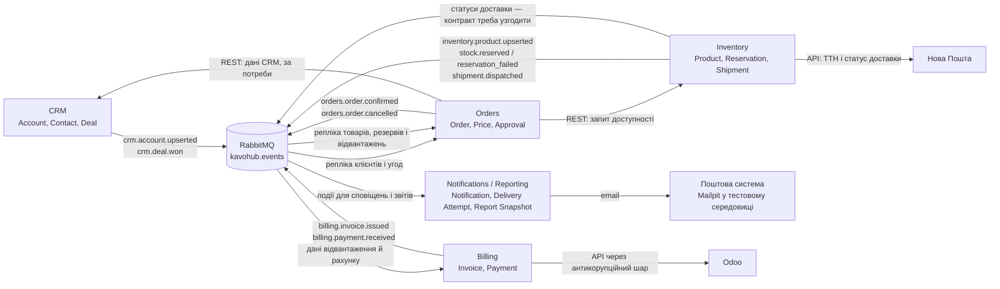

У цьому варіанті Notifications / Reporting є **downstream-споживачем** подій CRM, Orders, Inventory та Billing і тримає локальні репліки для сповіщень і звітів. Інвентарні дані щодо Нової Пошти приходять через Inventory; прямого зв’язку Notifications із перевізником немає.

Підпис `ORD → CRM: REST` лишайте, тільки якщо справді потрібен синхронний запит: README показує цей зв’язок у цільовому ландшафті, але для вашої матриці частину даних уже дає репліка. Події про прострочення резерву, погодження знижки та статуси доставки позначені як контракти для погодження, а не як підтверджені базові події.

> що лишилось вирішити

Основні артефакти етапів 1–3 уже є в чернетці. Залишилися невирішені припущення й архітектурні артефакти етапу 4.

### Рішення, які треба підтвердити

- **Резерв і погодження:** хто публікує подію про прострочення — Orders чи Inventory; як Notifications дізнається, що резерв чинний, якщо `inventory.stock.reserved` прийшла раніше за `orders.order.confirmed`.
- **Сповіщення про знижку:** потрібні події про надсилання на погодження, рішення та відсутність рішення до строку; підтвердити резервного погоджувача, канал і строк очікування.
- **Відвантаження й доставка:** погодити подію для кожної зміни статусу Нової Пошти та передачу прогнозу доставки через Inventory.
- **Рахунок:** підтвердити з бухгалтеркою правило «надсилати PDF лише після `inventory.shipment.dispatched`».
- **Неактивні орендарі:** визначити власника даних про оренду й джерело обсягів закупівель.
- **Контракти подій:** перевірити, що CRM надає контакт та адресу, а Billing — PDF або безпечне посилання; погодити відсутні поля й нові події.
- **Email-політика:** зафіксувати припущення про три спроби, інтервали, журналювання та одноразове сповіщення ІТ.

### Ще треба оформити для завершення ЛР1

- Конфлікти й відкриті питання в таблиці: позиції сторін, запропоноване рішення, відповідальний за рішення.
- Діаграми C4 Context, Container і Component та діаграму послідовності happy path.
- Чотири ADR: архітектурний стиль, взаємодія модулів, власність і зберігання даних, технологічний стек.
- Каталог подій v0, ескіз API з ролями та структуру сервісу.
- Самоперевірку за критеріями, відповіді на щонайменше п’ять контрольних питань і зібраний документ.

Окремо перевірте посилання для вимоги 18:00: цей час наведено в додаткових фактах до методички ЛР1, §5.1; Д1 підтверджує щоденне зведення, але не сам час.

> Приймаю рецензію. Виправляю:
> 1. Глосарій: "Сповіщення" - створене за подією або правилом (таймер). "Повтор доставки": 3 спроби включають перше надсилання, пауза 5 хв перед наступною. "Неповні дані" охоплюють і застарілу репліку (припущення).
> 2. Матриця: розділити "Товар" і "Відвантаження / ТТН". Для отримувача зберігати стабільний id, email лише як атрибут.
> 3. Карта контекстів: стрілки MQ до ORD помилкові, це має бути лише MQ до NTF (Notifications / Reporting). Виправ.
>
> Далі етап 4. Мій варіант ADR:
> ADR-01 Архітектурний стиль: модульний моноліт vs мікросервіси. Мій вибір: окремий сервіс Notifications / Reporting у складі event-driven системи, бо споживає події.
> ADR-02 Взаємодія: асинхронні події через RabbitMQ kavohub.events, без синхронних викликів інших модулів.
> ADR-03 Власність і зберігання: власна БД, локальні репліки CRM/Orders/Inventory/Billing, оновлення подіями, журнал відправок.
> ADR-04 Стек: пошта через адаптер (Mailpit у тесті), стек вибрати за README (припущення).
>
> Для кожного ADR: контекст, рішення, альтернативи, наслідки. Потім зроби C4 Context, Container, Component і діаграму послідовності для happy path "shipment.dispatched - email клієнтці". Познач припущення.

Є одна важлива поправка до карти: **для фокусу на Notifications / Reporting можна показати лише потік RabbitMQ → Notifications**, але повна C4 Container-діаграма має зберегти зв’язки брокера з іншими модулями. README, розділи 2.5–2.6, задає міжмодульні події та репліки CRM, Orders, Inventory і Billing. Нижче Context показує лише межу вашого модуля, а Container — повну взаємодію системи.

## ADR

### ADR-01. Окремий сервіс у подієвій архітектурі

**Статус:** запропоновано
**Контекст:** Notifications / Reporting споживає події кількох доменів, надсилає сповіщення та готує звіти. Навантаження може зростати в піковий сезон (Д4).

**Розглянуті альтернативи:**

1. **Модуль у спільному моноліті** — простіше почати, але складніше незалежно розгортати й масштабувати обробку подій.
2. **Окремий сервіс у подієвій системі — обрано** — власний життєвий цикл і БД, підписка на події через RabbitMQ.
3. **Окремо сервіс сповіщень і сервіс звітів** — ізолює різні навантаження, але додає інфраструктуру й операційну складність.

**Рішення:** залишити Notifications / Reporting окремим сервісом і bounded context, інтегрованим через події.

**Наслідки:** сервіс можна незалежно розгортати й масштабувати. Дані можуть бути застарілими або неповними; потрібні репліки, контроль свіжості, обробка повторів і спостережуваність.

### ADR-02. Асинхронна взаємодія через RabbitMQ

**Статус:** запропоновано
**Контекст:** модуль отримує зміни з CRM, Orders, Inventory і Billing. Синхронні запити під час формування кожного повідомлення зв’язали б доступність модуля з доступністю джерел.

**Розглянуті альтернативи:**

1. **Синхронні REST-запити до модулів** — свіжі дані, але сповіщення залежать від доступності кількох сервісів.
2. **Події RabbitMQ `kavohub.events` — обрано** — модуль обробляє повідомлення незалежно від коротких збоїв джерел.
3. **Гібридна схема** — події для основного процесу, REST для довідкових даних; може підвищити свіжість, але додає залежності.

**Рішення:** отримувати міжмодульні дані через події та локальні репліки; не викликати інші модулі синхронно для кожного email чи звіту. Email передавати через окремий адаптер пошти.

**Наслідки:** потрібні дедуплікація за ключем подія + адресат + тип повідомлення, контроль актуальності реплік і погоджені контракти. Збої обробляються повторною доставкою подій та пошти за окремими правилами.

### ADR-03. Власна база і проєкції для читання

**Статус:** запропоновано
**Контекст:** README, §2.5, закріплює єдиного власника сутності. Notifications / Reporting має формувати повідомлення та звіти, не змінюючи дані інших модулів.

**Розглянуті альтернативи:**

1. **Спільна БД або читання чужих схем** — доступ до чужих даних простіший, але порушує межі власності з README, §2.8.
2. **Власна схема PostgreSQL із мінімальними репліками — обрано** — зберігати лише дані для адресації, звітів, ідемпотентності та відправлень.
3. **REST-запити до власників під час кожного формування повідомлення** — дані свіжіші, але сервіс залежить від синхронної доступності інших модулів.

**Рішення:** окрема схема й користувач БД. Зберігати проєкції CRM/Orders/Inventory/Billing, журнал спроб, ключі дедуплікації, довідкові шаблони й похідні знімки звітів.

**Наслідки:** джерела залишаються єдиними власниками клієнтів, замовлень, резервів, відвантажень, рахунків та оплат. Треба визначити мінімальний склад персональних даних і строк зберігання журналу. Статус і прогноз доставки проходять через Inventory; джерело даних про оренду ще треба визначити.

### ADR-04. Технологічний стек

**Статус:** запропоновано; вибір треба підтвердити
**Контекст:** README, §2.8, вимагає HTTP API з OpenAPI, PostgreSQL і міграції, RabbitMQ AMQP 0-9-1, JWT/OIDC, JSON-логи, Prometheus-метрики, тести й Docker.

**Розглянуті альтернативи:**

1. **TypeScript + NestJS — пропонований вибір:** модульна структура пасує до розділення event consumer, звітів та адаптера пошти.
2. **Python + FastAPI:** зручний для обробки та агрегування звітних даних.
3. **C# + ASP.NET Core:** сильний типізований стек із широкою підтримкою корпоративних інтеграцій.

**Пропозиція:** TypeScript + NestJS; PostgreSQL з міграціями, RabbitMQ-клієнт, перевірка JWT/OIDC Keycloak, JSON-логування, Prometheus, модульні й інтеграційні тести, Docker. Mailpit — лише тестовий поштовий сервіс; production-провайдера ще не вибрано.

**Наслідки:** стек відповідає дозволеним прикладам README, але команда має підтвердити свою компетенцію в TypeScript/NestJS. Вибір production-пошти та політик зберігання — окремі рішення.

## C4 Context

Тут цільова система — модуль Notifications / Reporting. Інші модулі є джерелами подій; споживання показане лише для цільового модуля.

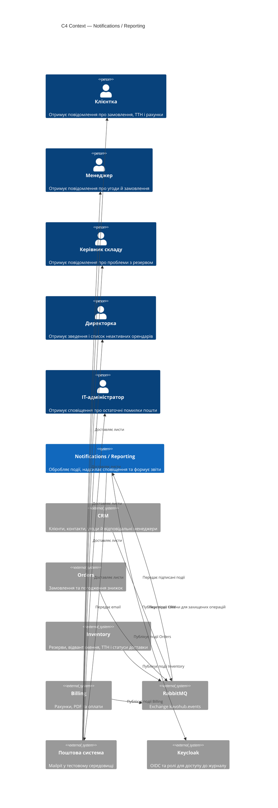

## C4 Container

У повній системі модулі публікують і споживають події згідно з README, §2.5–2.6. Стрілки від брокера до інших модулів тут відповідають їхнім базовим підпискам, а не лише роботі Notifications / Reporting.

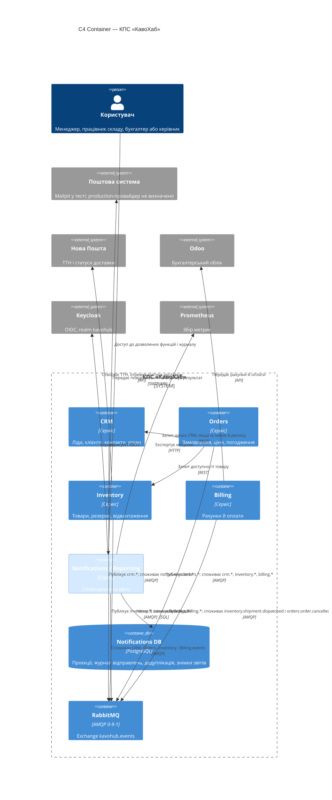

Примітка: REST-зв’язок Orders → CRM залишайте лише для запитів, яких не покривають репліки. Для Notifications / Reporting доступ до клієнтів і менеджерів має йти через події/репліку відповідно до ADR-02.

## C4 Component — Notifications / Reporting

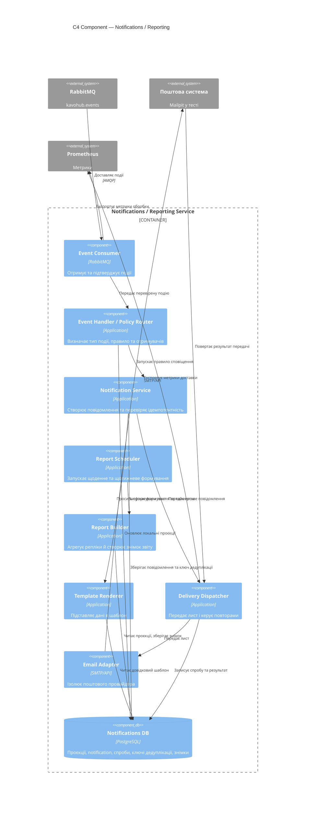

## Sequence: `inventory.shipment.dispatched` → email клієнтці

```mermaid
sequenceDiagram
  autonumber
  participant INV as Inventory
  participant MQ as RabbitMQ
  participant EC as Event Consumer
  participant DB as Notifications DB
  participant NS as Notification Service
  participant TR as Template Renderer
  participant EA as Email Adapter
  participant MAIL as Поштова система
  actor C as Клієнтка

  INV->>MQ: inventory.shipment.dispatched<br/>(orderId, TTN, correlationId)
  MQ->>EC: Доставити подію
  EC->>DB: Перевірити/зареєструвати event id
  DB-->>EC: Подія нова
  EC->>DB: Оновити проєкцію відвантаження
  EC->>NS: Обробити подію
  NS->>DB: Отримати стабільний customerId та email з CRM-репліки
  DB-->>NS: Дані адресата
  NS->>DB: Створити сповіщення з ключем дедуплікації
  DB-->>NS: Сповіщення створене
  NS->>TR: Сформувати лист за шаблоном
  TR-->>NS: Тема й текст з номером ТТН
  NS->>EA: Передати лист
  EA->>MAIL: SMTP/API: адреса, тема, текст
  MAIL-->>EA: Лист прийнято поштовим сервісом
  EA-->>NS: Результат передачі успішний
  NS->>DB: Записати спробу й статус
  NS-->>EC: Обробку завершено
  EC-->>MQ: Підтвердити подію
  MAIL-->>C: Доставити email

  Note over NS,MAIL: Прогноз доставки додається лише якщо доступний через Inventory; джерело й контракт прогнозу — припущення.
  Note over MAIL,C: Успішне прийняття поштовим сервісом не гарантує появу листа у вхідних клієнтки.
```

Є два відкриті рішення: підтвердити запропонований стек NestJS і погодити production-поштовий сервіс. Також контракт `inventory.shipment.dispatched` має передавати достатньо даних для листа або дозволяти дістати їх із локальних реплік.

> Приймаю ADR, C4 і Sequence. Зауваження:
> 1. ADR-04: стек - [ВПИШІТЬ СВІЙ ВИБІР: TypeScript+NestJS / Python+FastAPI / C#]. Обґрунтування: [чому саме він].
> 2. У Sequence додай перевірку ключа дедуплікації (event id + отримувач + тип) при створенні сповіщення.
> 3. Keycloak залиш лише для доступу до журналу за ролями. Підпиши це.
> 4. Додай до Sequence альтернативну гілку: лист не прийнято, повтор через 5 хв, після 3 спроб сповіщення ІТ (припущення).
>
> Далі: каталог подій v0 (подія, виробник, споживачі, ключові поля, статус: базова або припущення), ескіз API з ролями (директорка, керівник складу, ІТ, менеджер; перегляд журналу сповіщень і зведень), структура сервісу (папки), таблиця конфліктів і відкритих питань (позиції сторін, рішення, відповідальний), журнал рішень, ризики, самоперевірка і відповіді на 5 контрольних питань.

<details><summary>2 previous messages</summary>

> Звірю каталог і відкриті конфлікти з точними формулюваннями методички, а потім зберу решту артефактів. Для стеку залишу поле вашого вибору, а захист проведу по одному питанню за правилами ЛР1.
>
> <details><summary>Explored 2 files</summary>
>
> - Read `./lab-01.md`
> - Read `./README.md`
>
> </details>
</details>

Оновив Sequence і зібрав чернетки решти артефактів. Позначки **базова** стосуються подій із README, §2.6; нові контракти й рішення позначені **припущення**. Методика просить, щоб студент сам обрав стек і відповів на контрольні питання, тому ADR-04 лишається з вашим вибором, а захист починаю з першого питання наприкінці.

## Оновлена Sequence-діаграма

Перевірка дедуплікації виконується за ключем `eventId + recipientId + notificationType`. Keycloak використовується лише для доступу до журналу за ролями; у потік email він не залучений.

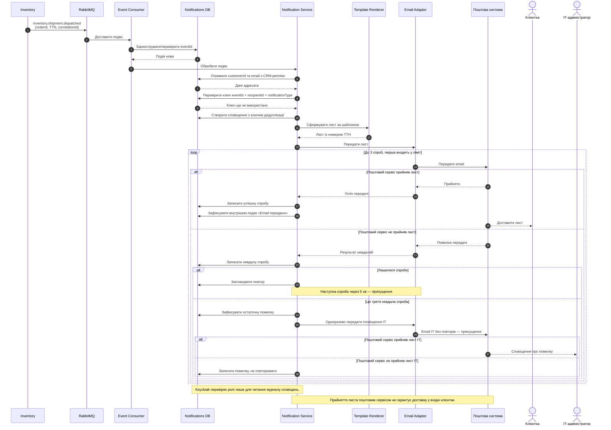

## Каталог подій v0

Поля нижче — мінімальний ескіз. Базові назви подій задані README §2.6, але деякі поля для Notifications / Reporting потребують уточнення в схемах контрактів.

| Подія | Виробник → споживачі | Ключові поля `data` | Статус |
|---|---|---|---|
| `crm.account.upserted` | CRM → Orders, Billing, Notifications | `accountId`, `contactId`, `email`, `managerId` | Базова подія; поля контактів та email треба підтвердити |
| `crm.deal.won` | CRM → Orders, Notifications | `dealId`, `accountId`, `managerId` | Базова подія; поля адресата треба підтвердити |
| `orders.order.confirmed` | Orders → Inventory, CRM; Notifications підписується для повідомлень | `orderId`, `accountId`, `warehouse`, `lines[{sku, qty}]` | Базова |
| `orders.order.cancelled` | Orders → Inventory, Billing, Notifications | `orderId`, `accountId`, `reason`, `cancelledAt` | Базова; `reason` треба узгодити |
| `inventory.stock.reserved` | Inventory → Orders, Notifications | `orderId`, `reservationId`, `warehouse`, `lines`, `expiresAt` | Базова; Notifications оновлює репліку |
| `inventory.stock.reservation_failed` | Inventory → Orders, Notifications | `orderId`, `reason`, `lines`, `failedAt` | Базова; наявність `reason` у контракті треба підтвердити |
| `inventory.shipment.dispatched` | Inventory → Orders, Billing, Notifications | `orderId`, `shipmentId`, `trackingNumber`, `dispatchedAt` | Базова; поле ТТН перевірити в схемі |
| `billing.invoice.issued` | Billing → Orders, Notifications | `invoiceId`, `orderId`, `accountId`, `pdfRef` | Базова; `pdfRef` і відкладене надсилання — припущення |
| `billing.payment.received` | Billing → Orders, Notifications | `paymentId`, `invoiceId`, `amount`, `currency`, `receivedAt` | Базова |
| Подія про запит погодження знижки | Orders → Notifications | `approvalId`, `orderId`, `managerId`, `discountPercent`, `expiresAt` | **Припущення:** назву та контракт узгодити |
| Подія про рішення щодо знижки | Orders → Notifications | `approvalId`, `decision`, `decidedBy`, `decidedAt` | **Припущення:** назву та контракт узгодити |
| Подія про відсутність рішення / завершення погодження | Orders → Notifications | `approvalId`, `orderId`, `expiredAt` | **Припущення:** правило й власник події |
| Подія про прострочення резерву | Inventory та/або Orders → Notifications | `orderId`, `reservationId`, `expiredAt`, `reason` | **Припущення:** виробника треба узгодити |
| `inventory.shipment.delivery_status_changed` | Inventory → Notifications | `shipmentId`, `orderId`, `status`, `occurredAt`, `trackingNumber` | **Припущення:** новий контракт для статусів Нової Пошти |
| `notifications.email.submitted` | Notifications → внутрішній журнал / моніторинг | `notificationId`, `recipientId`, `type`, `submittedAt`, `providerMessageId` | Внутрішня подія; не публікувати в загальний каталог без потреби |
| `notifications.delivery.failed` | Notifications → внутрішній журнал / моніторинг | `notificationId`, `attemptId`, `recipientId`, `attemptNo`, `errorCode` | Внутрішня подія |
| `notifications.delivery.retry_scheduled` | Notifications → внутрішній журнал / моніторинг | `notificationId`, `attemptNo`, `nextAttemptAt` | Внутрішня подія |

Таймери щоденного й щотижневого звітів — локальний розклад сервісу, а не події базового міжмодульного каталогу.

## Ескіз API з ролями

У методичці ролі названо `director`, `warehouse_operator`, `admin` та `sales_manager`. Відповідно, керівник складу працює через `warehouse_operator`, а ІТ-адміністратор — через `admin`. Якщо потрібен окремий `it_admin`, це нова роль для погодження.

| Метод і шлях | Призначення | Доступ |
|---|---|---|
| `GET /health` | Перевірка працездатності; відповідає `{"status":"ok"}` | Без автентифікації |
| `GET /api/v1/notifications` | Перегляд журналу з фільтрами за датою, типом і статусом | `director`: усі; `warehouse_operator`: складські типи без сум; `sales_manager`: лише свої клієнти/замовлення; `admin`: технічні статуси без зайвих персональних даних |
| `GET /api/v1/notifications/{id}` | Перегляд запису й спроб доставки | Ті самі обмеження за роллю та областю даних |
| `GET /api/v1/reports/daily?date=YYYY-MM-DD` | Щоденне зведення | `director`; доступ до перегляду звіту через роль — **припущення, узгодити політику Keycloak** |
| `GET /api/v1/reports/inactive-renters?weekOf=YYYY-MM-DD` | Щотижневий список неактивних орендарів | `director`; `sales_manager` — лише свої клієнти, якщо таке право погодять (**припущення**) |

Keycloak у C4 позначено **лише для перевірки ролей під час читання журналу**. Оскільки API також має рольові обмеження для звітів, окремо вирішіть, чи звіти перевіряють ролі через той самий механізм або через API gateway.

## Структура сервісу

```text
notifications-reporting/
├── src/
│   ├── api/
│   │   ├── health/
│   │   ├── notifications/
│   │   └── reports/
│   ├── application/
│   │   ├── process-event/
│   │   ├── create-notification/
│   │   ├── schedule-retry/
│   │   └── build-report/
│   ├── domain/
│   │   ├── notification/
│   │   ├── delivery-attempt/
│   │   ├── report-snapshot/
│   │   └── policies/
│   ├── consumers/
│   │   ├── crm/
│   │   ├── orders/
│   │   ├── inventory/
│   │   └── billing/
│   ├── projections/
│   ├── templates/
│   ├── delivery/
│   │   └── email-adapter/
│   ├── scheduler/
│   ├── infrastructure/
│   │   ├── postgres/
│   │   ├── rabbitmq/
│   │   └── keycloak-journal-access/
│   ├── observability/
│   └── config/
├── migrations/
├── contracts/
│   └── asyncapi/
└── docs/
    ├── adr/
    └── api/
```

`keycloak-journal-access` стосується саме перегляду журналу. Назви папок — проєктна пропозиція, яку можна змінити після вибору стека.

## Конфлікти та відкриті питання

| Питання / позиції | Поточне рішення | Відповідальний |
|---|---|---|
| **Резерв:** Андрій хоче бачити й утримати товар, поки клієнт думає (П4); Сергій заперечує резерви на тижні й дозволяє їх лише для підтверджених замовлень, максимум на добу (С2) | Компроміс README: під час погодження резерв до 24 годин; після строку — зняти резерв і повернути замовлення в чернетку. Хто публікує подію прострочення — ще відкрите інтеграційне питання | Керівник продажів і керівник складу; власника події погодити командам Orders та Inventory |
| **Ціна обладнання:** продажі хочуть ціну пропозиції незмінною в рахунку (П5); бухгалтерія хоче курс НБУ на день рахунку (Б4) | Уточнення методички: пропозиція чинна 5 робочих днів і фіксує гривневу ціну на день пропозиції; бухгалтерка готова прийняти цей курс, якщо в рахунку буде курс і дата. Конфлікт фактично врегульовано | Керівник продажів і головна бухгалтерка |
| **Момент надсилання рахунку:** К2 просить PDF на email; правило «після відвантаження» з’явилося в рольовому уточненні | Надсилати після `shipment.dispatched` — поки припущення; підтвердити, чи бувають винятки | Головна бухгалтерка; клієнтка щодо очікувань |
| **Канал ТТН:** клієнтка просить Viber або email | Email є допустимим каналом за додатковим фактом методички; вибір email у вашому рішенні треба зберегти в припущеннях/вимогах | Клієнтка, відповідальний менеджер |
| **Звіт о 18:00:** директорці потрібні денні показники на телефоні; дані можуть надійти із запізненням | Формувати звіт о 18:00 за часовим поясом компанії; за відсутньої або застарілої репліки позначати «неповні дані» — останнє є припущенням | Директорка та власники CRM/Orders/Inventory/Billing |
| **Оренда:** потрібен щотижневий список клієнтів, які не купували 20 кг два календарні місяці поспіль | Критерій і періодичність задані фактами методички, але власника даних про орендовані машини в матриці власності README не визначено | Директорка та власник процесу оренди; модуль-власник треба визначити |
| **Нова Пошта:** клієнтці потрібні ТТН і статус доставки | Inventory інтегрується з перевізником. Подія для кожної зміни статусу та ETA ще не входить до базового каталогу | Команда Inventory |

## Журнал рішень

| ID | Рішення | Підстава | Статус |
|---|---|---|---|
| ADR-01 | Notifications / Reporting — окремий сервіс у подієвій архітектурі | Власний bounded context, звіти й доставка повідомлень | Прийнято вами; документувати як запропоноване |
| ADR-02 | Міжмодульні дані надходять через RabbitMQ і репліки | Асинхронна обробка та відсутність синхронної залежності від модулів | Прийнято вами |
| ADR-03 | Окрема БД і лише потрібні проєкції | Єдиний власник даних і заборона читати чужі схеми | Прийнято вами |
| ADR-04 | Стек сервісу | Має виконувати вимоги README §2.8 | **Відкрите:** вписати власний стек і обґрунтування |
| D-05 | Дедуплікація за `eventId + recipientId + notificationType` | Запобігає дублю листа одному адресату | Прийнято вами |
| D-06 | Три спроби доставки включно з першою; пауза 5 хв | Обрана політика доставки | **Припущення** |
| D-07 | Чекати на дані звіту до 17:55; позначати застарілу/відсутню репліку | Зведення передається близько 18:00 | **Припущення** |
| D-08 | Таймер прострочення резерву публікує Orders та/або Inventory | Notifications не змінює стан бізнес-сутностей | Власника й контракт узгодити |

## Ризики

- Застаріла репліка резерву може спричинити неправильне підтвердження клієнтці.
- Відсутні контактні дані або PDF у контрактах подій можуть заблокувати формування листа.
- Поштовий сервіс може прийняти лист, але він не потрапить у вхідні клієнтки; метрика вимірює лише прийняття провайдером.
- Помилка в дедуплікації може або створити дубль, або придушити потрібне повідомлення іншому адресату.
- Дані про оренду не мають визначеного власника, тож щотижневий звіт може бути неповним.
- Email може розкрити персональні чи фінансові дані; потрібні мінімізація вмісту й рольовий доступ до журналу.
- Пік навантаження й розсилок може перевищити обрану ціль 100 подій/хв; цей профіль треба зіставити з Д4 (412 замовлень, близько 60% між 9:00 і 13:00).
- Збій одного джерела перед 18:00 може систематично породжувати неповні звіти.

## Самоперевірка за критеріями ЛР1

| Критерій | Стан | Що доробити |
|---|---|---|
| BPMN as-is і to-be | Частково | Звести діаграми в документ, перевірити пули/доріжки й повідомлення, позначити припущення |
| User stories і конфлікти | Частково | 7 історій є; перенести виправлені версії в один документ і додати таблицю рішень та відповідальних |
| NFR | Частково | 7 NFR сформульовано; підтвердити джерела, цілі та профіль навантаження |
| Доменний аналіз | Частково | Event storming, глосарій, карта контекстів і власність є; узгодити прострочення, статуси доставки, поля контрактів і власника оренди |
| C4 і Sequence | Частково | Діаграми підготовлено; після змін внести фінальні версії та перевірити узгодженість між ними |
| ADR | Частково | ADR-01–03 сформульовано; ADR-04 потребує вашого стеку й аргументації |
| Контракти й структура сервісу | Частково | Каталог, API та папки вище — чернетки; потрібно узгодити припущені події з командами-сусідами |

Офіційної оцінки тут немає; це перевірка повноти за критеріями методички.

### Захист

Методичка просить відповідати на контрольні питання самостійно й проходити їх по одному. Тому надаю питання, але не готові відповіді:

1. Чим потік повідомлень відрізняється від потоку керування в BPMN? Наведіть приклад кожного з вашого процесу Lead-to-Cash.
2. Які конфлікти вимог ви знайшли й хто має їх вирішувати? Чому це не рішення розробника?
3. Як перетворити Д4 на вимірювану NFR? Яких даних бракувало?
4. Чим доменна подія відрізняється від команди? Чому події називають у минулому часі?
5. Які ключові події визначили межі Notifications / Reporting?

Почніть із відповіді на **питання 1**. Після вашої відповіді я коротко її перевірю й перейду до наступного.

**Окремо для ADR-04:** впишіть один варіант — TypeScript + NestJS, Python + FastAPI або C# + ASP.NET Core — і 1–2 речення, чому він пасує вашому модулю. Це рішення має бути вашим відповідно до методички; самостійно його за вас не підставлятиму.

> задача виконана?

**ЛР1 ще не завершена повністю.** Основні проєктні матеріали підготовлені, але лишилося:

- обрати стек і обґрунтувати ADR-04;
- узгодити позначені припущення й контракти подій;
- відповісти на 5 контрольних питань — за методичкою, по одному;
- зібрати та перевірити все в підсумковому документі `lab-01-notifications-reporting-<прізвище>.md`.

Отже, проєктування майже завершене; здаваний документ і захист ще не закриті.

> DR-04: обираю [ВПИШІТЬ: TypeScript + NestJS / Python + FastAPI / C# + ASP.NET Core], бо [1-2 речення, чому знаєте цей стек і чому він пасує модулю].
>
> Відповідь на питання 1:
> Потік керування - суцільна стрілка всередині одного пулу, задає порядок кроків. Приклад: у Notifications / Reporting після "Сформувати сповіщення" іде "Передати email".
> Потік повідомлень - пунктирна стрілка між різними пулами. Приклад: Inventory надсилає inventory.shipment.dispatched до Notifications / Reporting.
> Різниця: потік керування не виходить за межі учасника, а повідомлення завжди переходить від одного учасника до іншого.
>
> відправ зразу всі питання

Відповідь на питання 1 правильна: потік керування показує порядок дій у межах пулу, а потік повідомлень поєднує різні пули. Невелике уточнення: потік керування може проходити між доріжками одного пулу.

Ось усі п’ять контрольних питань. Перше вже зараховую як відповідь; напишіть відповіді на решту чотири:

1. **Відповіли:** чим відрізняються потоки керування й повідомлень у BPMN? Наведіть приклади з Lead-to-Cash.
2. Які конфлікти вимог ви знайшли? Хто в компанії має їх вирішувати і чому це не рішення розробника?
3. Як перетворити побажання Д4 («таблиця перестала відкриватися») на вимірювану NFR? Яких даних спершу бракувало і як їх отримали?
4. Чим доменна подія відрізняється від команди? Чому події називають у минулому часі?
5. Які ключові події визначили межі Notifications / Reporting?

**ADR-04 поки не заповнений:** у повідомленні залишився шаблон вибору стека й обґрунтування. Коли оберете конкретний стек і поясните вибір, зафіксую ADR.

> 2. Конфлікти: резерв (П4 проти С2, компроміс: до 24 год під час погодження), ціна обладнання (П5 проти Б4, пропозиція 5 робочих днів із курсом і датою в рахунку), момент рахунку (К2 і правило "після відвантаження", припущення). Вирішують їх власники процесів: керівник продажів, керівник складу, головна бухгалтерка. Це бізнес-рішення про ризики й гроші, розробник не має повноважень вибирати чию сторону прийняти.
>
> 3. Д4 "таблиця перестала відкриватися" - це скарга, а не вимога. Бракувало: скільки замовлень, коли пік, який час відкриття вважається нормою. З кейсу: 412 замовлень, близько 60% між 9:00 і 13:00. NFR формулюємо числом: обробка події до 60 с при піку 100 подій на хвилину (припущення, пік узгодити).
>
> 4. Подія - факт, що вже стався (orders.order.confirmed), її не можна скасувати, тому минулий час. Команда - наказ зробити дію (Сформувати сповіщення), вона може бути відхилена. Подію публікує власник даних, команду виконує модуль.
>
> 5. Межі Notifications / Reporting визначили події, на які модуль лише реагує: crm.deal.won, orders.order.confirmed і cancelled, inventory.stock.reserved і reservation_failed, inventory.shipment.dispatched, billing.invoice.issued і payment.received. Модуль їх споживає, стан не змінює; власні дані - сповіщення, спроби, знімки звітів.

Відповіді 2–5 загалом правильні. Кілька уточнень для фінального документа:

- **Питання 2:** резерв і курс обладнання — реальні конфлікти з погодженими компромісами. Момент рахунку — поки відкрите припущення, а не конфлікт: К2 просить PDF на email, але не визначає, чи надсилати його до відвантаження.
- **Питання 3:** дані про пік правильні. Ціль 100 подій/хв — ваше припущення; не ототожнюйте її з 412 замовленнями. Зафіксуйте її як навантажувальну ціль для перевірки. Час 18:00 наведено в додаткових фактах до ЛР1, §5.1, а не в цитаті Д4.
- **Питання 4:** правильно. Уточнення: подію не скасовують; якщо бізнес-стан змінився, публікують іншу подію, наприклад про скасування замовлення.
- **Питання 5:** межа описана правильно. `inventory.stock.reserved` оновлює репліку, але не спричиняє лист; підтвердження клієнтці залежить від `orders.order.confirmed` і перевірки резерву. Таймер звіту та подія статусу доставки — додаткові джерела, остання ще припущення.

Захист за п’ятьма питаннями пройдено. Щоб завершити ADR-04 і зібрати здаваний документ, лишилося заповнити ваш вибір стека та коротке обґрунтування. У шаблоні залишилися TypeScript + NestJS, Python + FastAPI або C# + ASP.NET Core.
