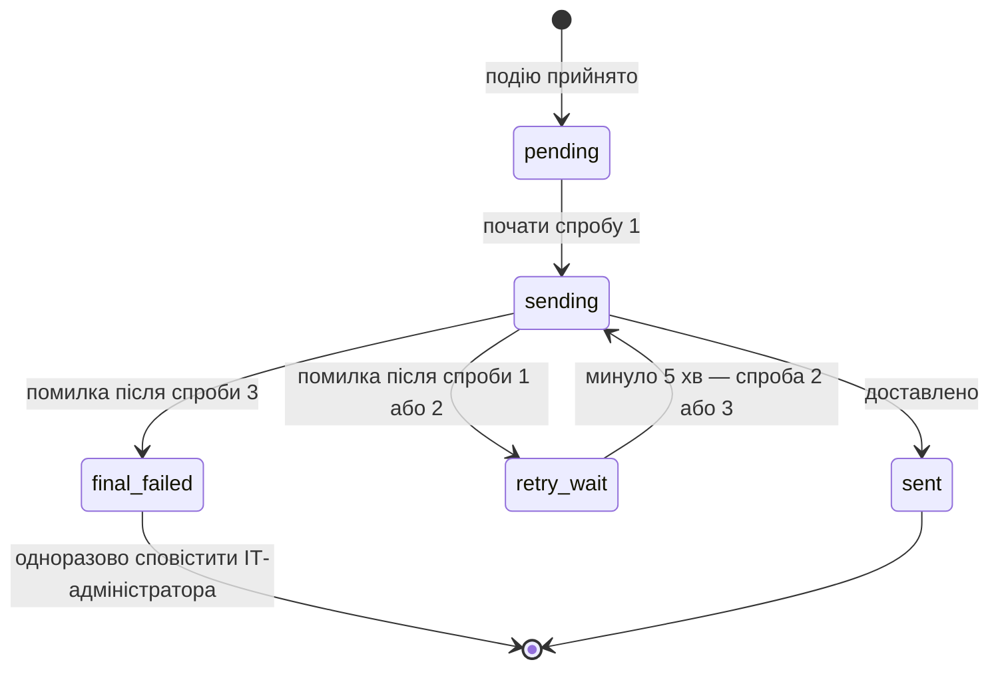
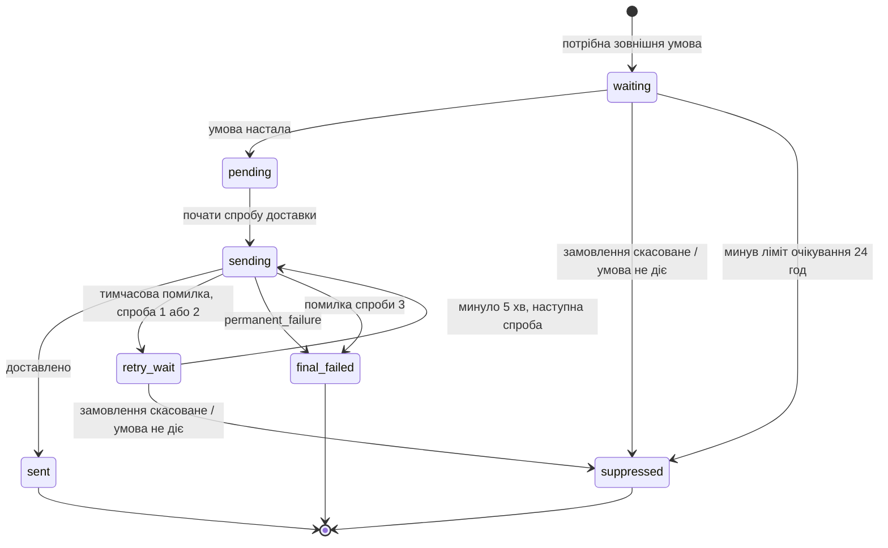

# Перейти до lab2

> Переходимо до lab2

Добре, переходимо до lab2. Що потрібно зробити?

> Проаналізуй роботу проведену в першій лабораторній та видай список завдань які треба виконати в lab2

<details><summary>2 previous messages</summary>

> Знайду матеріали першої лабораторної у робочій папці, проаналізую результати й сформую конкретний перелік завдань для lab2.
>
> <details><summary>Ran 4 commands</summary>
>
> - Ran `rg --files`
> - Ran `Get-Content -Raw 'corporate-software-systems-lessons\lab-01.md'; Get-Content -Raw 'corporate-software-systems-lessons\lab-02.md'; Get-Content -Raw 'corporate-software-systems-lessons\README.md'`
> - Ran `rg -n "^#|^##|Що здати|Етапи роботи|Критерії|модуль" 'corporate-software-systems-lessons\lab-02.md' 'corporate-software-systems-lessons\lab-01.md'`
> - Ran `$p='corporate-software-systems-lessons\lab-02.md'; Get-Content $p | Select-Object -Skip 123 -First 250; Get-Content $p | Select-Object -Skip 321 -First 150; $q='corporate-software-systems-lessons\lab-01.md'; Get-Content $q | Select-Object -Skip 310 -First 45`
>
> </details>
</details>

Переглянув методичні вказівки до ЛР1 і ЛР2. У робочій папці є методички, але самого готового звіту ЛР1 я не знайшов. Тож нижче — план ЛР2, побудований на тому, що мало бути спроєктовано в ЛР1; конкретні вимоги треба буде звірити з вашим документом ЛР1 і обраним модулем.

## Завдання для lab2

1. **Відобразити Lead-to-Cash в Odoo.** Описати шлях від ліда до кредит-ноти через CRM, Sales, Inventory та Invoicing. Деталізувати кроки свого модуля й з’ясувати, як система обробляє знижку 12%.

2. **Проаналізувати застосунок Odoo для свого модуля.** Запропонувати потрібні налаштування та відповісти на запитання методички. Підкріпити висновки документацією або власною перевіркою.

3. **Зробити fit-gap аналіз.** Взяти 8–10 вимог свого модуля з backlog ЛР1 і визначити для кожної: `Fit`, `Configure`, `Extend` або `Gap`; описати покриття, підставу, зусилля, ризик для оновлень Odoo та рішення — використовувати, налаштовувати чи розробляти.

4. **Спроєктувати адаптер до API Odoo.** Вказати версію і спосіб доступу, операції та моделі Odoo, мапінг полів, права доступу, антикорупційний шар і поведінку під час збоїв. Додати приклад запиту й відповіді. Для Billing адаптер обов’язковий.

5. **Підготувати ADR-0004 «Buy vs build».** Порівняти щонайменше три реальні варіанти, зокрема «усе в Odoo з власними розширеннями», і пояснити наслідки для вашого модуля та оновлень.

6. **Спроєктувати ядро модуля.** Підготувати доменну модель з агрегатами, сутностями, об’єктами-значеннями, інваріантами та репліками чужих даних. Побудувати автомат станів основного документа й таблицю переходів із командами, умовами, ролями, побічними ефектами та забороненими переходами.

7. **Описати бізнес-правила свого варіанта.** Для кожного правила з методички вказати, де воно перевіряється — у домені, сценарії застосунку чи БД — і яку помилку отримує клієнт при порушенні.

8. **Спроєктувати зберігання й API.** Описати таблиці та типи даних, ключі, обмеження, індекси, план міграцій і seed-дані. Додати таблицю REST-ендпоінтів для довідників і команд, ролі, приклади запитів і відповідей та помилки у форматі RFC 9457.

9. **Підготувати щонайменше 10 тестових сценаріїв** у форматі Given/When/Then. Включити негативні сценарії, перевірку заборонених переходів і конкурентного доступу там, де це важливо для модуля.

10. **Оформити звіт і пройти самоперевірку.** Здати `lab-02-<модуль>-<прізвище>.md` і посилання або експорт діалогу. Додати вихідні дані з ЛР1, журнал рішень, уточнення й припущення, ризики, самоперевірку, відповіді щонайменше на 5 контрольних питань і 3–5 прикладів критичної роботи з ШІ.

**Послідовність роботи за методичкою:** Odoo і Lead-to-Cash → fit-gap, адаптер та ADR → доменна модель і стани → зберігання, API й сценарії → самоперевірка та оформлення. Звіт ЛР1 потрібен як основа: з нього беруться вимоги модуля, попередні рішення та контракти, а зміни до них слід зафіксувати в журналі рішень.

> Завантажую файл з lab1
>
> User context
>
> Attachments:
> - lab1.md: `~/Downloads/lab1.md`

Отримав файл [lab1.md](~/Downloads/lab1.md). Використаю його як звіт першої лабораторної, щоб звірити ваші рішення й вимоги з планом lab2.

> Проаналізуй роботу проведену в першій лабораторній та видай список завдань які треба виконати в lab2 на основі звіту, який ти отримав

<details><summary>2 previous messages</summary>

> Прочитаю ваш звіт ЛР1, зіставлю його артефакти й рішення з вимогами ЛР2 та складу персоналізований список наступних завдань.
>
> <details><summary>Explored a file, ran a command</summary>
>
> <details><summary>Explored a file</summary>
>
> - Read `~/Downloads/lab1.md`
>
> </details>
>
> - Ran `rg -n '^#|^##|^###|Notifications|ADR-04|Fit-gap|Odoo|openapi|API|NFR|US-NOT|подій|event storming|C4|тест|повтор|ODS|виконано|частково' 'C:\Users\yehoi\Downloads\lab1.md'`
>
> </details>
</details>

## Аналіз звіту ЛР1

У звіті обрано модуль **Notifications / Reporting**. Для нього вже підготовлено значну частину проєктної основи: карту стейкхолдерів, чернетки процесів as-is і to-be, матрицю сповіщень, події v0, C4 та діаграму послідовності, API-ескіз, структуру сервісу, ризики й журнал рішень. Ви також пройшли захист за п’ятьма контрольними питаннями.

Це дає добру основу для ЛР2, але не всі артефакти ЛР1 були фіналізовані. У звіті залишилися відкритими ADR-04 зі стеком, частина припущень і контрактів подій, а самоперевірка позначає окремі розділи як частково виконані. Перед використанням у ЛР2 варто перенести до робочого документа затверджені рішення й чітко позначити невирішене.

## Персональний список завдань для ЛР2

1. **Пройти Lead-to-Cash в Odoo «на папері».** Зробити таблицю кроків CRM → Sales → Inventory → Invoicing: застосунок і модель Odoo, що відбувається, де саме виникає потрібна вашому модулю інформація та що не відповідає вимогам ЛР1. Обов’язково з’ясувати, що Odoo зробить зі знижкою 12%. Для Notifications / Reporting особливо простежити появу даних для листа з ТТН, PDF рахунку, оплат і звітів.

2. **Проаналізувати Odoo для Notifications / Reporting.** Описати налаштування шаблонів листів, автоматичних дій і звітів; перевірити, чи можна штатно сформувати PDF рахунку та надіслати його клієнту, а також чи покривають стандартні звіти потреби директорки. Розрізнити можливості Community та функції, для яких потрібне розширення чи зовнішній модуль.

3. **Побудувати fit-gap таблицю на 8–10 вимог із ЛР1.** Відібрати вимоги власного модуля, наприклад: лист із ТТН після відвантаження; статус доставки; PDF рахунку; щоденне зведення директорці; прострочені рахунки; ризик оренди; сповіщення про погодження знижки; журнал і повтори доставки; рольовий доступ до звітів. Для кожної вказати клас `Fit / Configure / Extend / Gap`, підставу, зусилля, ризик оновлення й рішення. Не подавати припущення зі звіту як підтверджені можливості Odoo.

4. **Спроєктувати адаптер до Odoo.** Для вашого модуля методичка передбачає читання даних для звіряння або початкового імпорту. Визначити потрібні моделі й операції, мапінг полів, спосіб доступу, права та обробку недоступності API й повторних запитів. Зокрема, розглянути `mail.template` та `account.move` для рахунку/PDF і визначити, чи потрібен модулю прямий доступ до Odoo, чи дані надходитимуть через події та репліки. Додати приклад запиту й відповіді.

5. **Підготувати ADR-0004 «Buy vs build».** Порівняти щонайменше три варіанти для «КавоХаб», включно з «усе в Odoo + власні модулі Odoo». Обґрунтувати, що Notifications / Reporting бере з Odoo, що конфігурує, а що залишає окремому сервісу; описати вплив розширень на оновлення Odoo. Для всіх варіантів зафіксувати наслідки й підстави з fit-gap.

6. **Спроєктувати доменну модель і життєвий цикл сповіщення.** На основі вже наявних `Notification`, `DeliveryAttempt` і `ReportSnapshot` уточнити агрегати та інваріанти. Побудувати автомат станів, наприклад від створення сповіщення до надсилання, повтору або остаточної помилки. Вказати команду, умову, роль і побічні ефекти для кожного переходу.

7. **Уточнити бізнес-правила саме вашого модуля.** Зафіксувати, як працюють дедуплікація, повторні спроби, звіт із неповними даними, доступ до журналу, надсилання рахунку та повідомлення про доставку. Зі звіту видно, що повтори «три спроби з паузою 5 хв», час звіту о 18:00, очікування даних до 17:55 і частина правил про статус доставки поки є припущеннями. Для кожного правила вказати місце перевірки та відповідь API у разі порушення.

8. **Спроєктувати схему даних і міграції.** Описати таблиці для сповіщень, спроб доставки, шаблонів/налаштувань і знімків звітів; зазначити типи, ключі, обмеження й індекси. Додати порядок міграцій і склад тестових seed-даних. Врахувати ключ дедуплікації `eventId + recipientId + notificationType`, але перевірити, що він узгоджується з моделлю та потрібними сценаріями.

9. **Описати REST API й підготувати щонайменше 10 тестових сценаріїв.** API має покривати перегляд звітів і журналу, а також потрібні команди для повторного надсилання чи керування налаштуваннями, якщо вони входять у межі модуля. Указати ролі, приклади запитів/відповідей і помилки RFC 9457. У тестах перевірити дублікати подій, повтори після помилки, кінцеву помилку доставки, відсутні дані для листа, застарілі дані звіту та заборонений доступ.

10. **Оформити документ ЛР2.** Здати `lab-02-notifications-reporting-<прізвище>.md` з усіма артефактами, журналом рішень, уточненнями й припущеннями, відкритими питаннями, самоперевіркою та відповідями на щонайменше п’ять контрольних питань.

### Що взяти з ЛР1 і що спершу уточнити

Перенесіть у ЛР2 матрицю сповіщень, список подій, ролі, схему даних і вимоги з посиланнями на джерело. Окремо перегляньте відкриті питання: хто володіє даними про оренду; хто публікує статуси Нової Пошти й прострочення резерву; чи доступний `pdfRef` у контракті рахунку; які канали й правила повторів погоджені. Ці невирішені пункти впливають на fit-gap, адаптер і межі модуля — у звіті ЛР2 їх слід або узгодити, або прямо залишити як припущення з наслідками.

> Я виконую лабораторну з корпоративних систем. Мій модуль: Notifications / Reporting для компанії "КавоХаб". Ми інтегруємо його з Odoo (Community). Допоможи мені крок за кроком
>
> Інформація про звітності та обов'язки у звіті який я відправляв тобі раніше&#x20;
>
> Перелічи кроки Lead-to-Cash в Odoo: CRM → Sales → Inventory → Invoicing. Для кожного кроку вкажи застосунок і основну модель Odoo.

<details><summary>2 previous messages</summary>

> Зіставлю типовий процес із вашими потребами звітності та сповіщень і звірю назви моделей із документацією Odoo. Оскільки версію Odoo у звіті не зафіксовано, позначу місця, де поведінка може залежати від версії чи встановлених модулів.
>
> <details><summary>Searched the web</summary>
>
> Searched the web for `site:odoo.com/documentation CRM leads opportunities model crm.lead Odoo ...`
>
> Searched the web for `site:odoo.com/documentation/18.0 invoice based on delivered quantities customer invoices Odoo ...`
>
> </details>
</details>

Нижче — типовий потік Lead-to-Cash для Odoo. У вашому звіті версію Odoo не зафіксовано, тому це базова схема; назви моделей наведені для планування інтеграції й варто перевірити їх у конкретному екземплярі.

| Крок | Застосунок Odoo | Що відбувається | Основна модель Odoo |
|---|---|---|---|
| 1. Створити лід | **CRM** | Фіксують потенційного клієнта, контакт і джерело звернення. | `crm.lead` |
| 2. Кваліфікувати й перетворити на нагоду | **CRM** | Лід оцінюють; після кваліфікації його перетворюють на opportunity, призначають відповідального та ведуть воронкою до «Виграно» або «Програно». Після конвертації можуть бути створені або прив’язані записи клієнта й контакту. | `crm.lead` (ліди й нагоди); `res.partner` (клієнт/контакт) |
| 3. Створити комерційну пропозицію | **Sales** | Для нагоди створюють quotation із товарами, кількостями, цінами, податками та знижками. | `sale.order`; рядки — `sale.order.line` |
| 4. Підтвердити замовлення | **Sales** | Після прийняття пропозиції її підтверджують; quotation переходить у статус Sales Order. Це запускає складський процес. | `sale.order` |
| 5. Зарезервувати й підготувати товари | **Inventory** | Для підтвердженого замовлення створюється складська операція. Склад обробляє відбір і доставку; конкретна кількість кроків залежить від налаштування маршруту складу. | `stock.picking`; рухи — `stock.move`, деталізація — `stock.move.line`; залишки — `stock.quant` |
| 6. Відвантажити | **Inventory** | Комірник перевіряє фактичну кількість і підтверджує (`Validate`) операцію доставки. В Odoo вона переходить у виконаний стан. | `stock.picking` |
| 7. Створити й провести рахунок | **Invoicing** | Рахунок створюють із замовлення. За політикою виставлення він може бути за замовленою або фактично відвантаженою кількістю. Бухгалтер перевіряє й проводить рахунок. | `account.move` |
| 8. Зареєструвати оплату та звірити її | **Invoicing / Accounting** | Реєструють платіж і звіряють його з банківською операцією; рахунок позначається оплаченим після відповідної звірки. | `account.payment` і `account.move` |

Odoo описує основний комерційний потік як пропозиція → замовлення → доставка → рахунок → оплата; підтвердження пропозиції створює Sales Order, а після нього доступне складське замовлення на доставку ([документація Sales](https://www.odoo.com/documentation/18.0/applications/sales/sales/sales_quotations/create_quotations.html), [документація Inventory](https://www.odoo.com/documentation/18.0/applications/inventory_and_mrp/inventory/shipping_receiving/daily_operations/receipts_delivery_two_steps.html)).

Для **Notifications / Reporting** важливі точки, де з’являються дані для ваших сценаріїв: підтвердження замовлення, виконана доставка з ТТН, проведений рахунок/PDF і зареєстрована оплата. Звіт про прострочені рахунки спирається на дані рахунків; в Odoo є звіт Aged Receivable ([документація Invoicing](https://www.odoo.com/documentation/18.0/applications/finance/accounting/getting_started/process_overview/customer_invoice.html)). Як саме ваш модуль отримає ці зміни — через API, періодичне читання чи окремий інтеграційний механізм — треба визначити окремо; сама ця схема не означає, що Odoo автоматично публікує потрібні події для вашого сервісу.

> Що Odoo зробить зі знижкою 12% на рядку замовлення на продаж? Яке поле моделі sale.order.line використовується і як ця знижка потрапляє в рахунок account.move?

<details><summary>2 previous messages</summary>

> Перевірю це за вихідним кодом Odoo та офіційною документацією: важливо відрізнити саме знижку на рядку `sale.order.line` від механізму погодження знижок у «КавоХаб».
>
> <details><summary>Searched the web</summary>
>
> Searched the web for `site:github.com/odoo/odoo/blob/18.0/addons/sale/models/sale_order_line.py discount price_unit invoice_line_ids ...`
>
> Searched the web for `https://github.com/odoo/odoo/blob/18.0/addons/sale/models/sale_order_line.py`
>
> </details>
</details>

У стандартному Odoo 18 **знижка 12% на рядку не запускає автоматичне погодження лише тому, що вона перевищує 10%**. Якщо функцію знижок увімкнено в Sales, користувач вводить `12` у колонку **Disc.%**; Odoo застосовує її до ціни цього рядка. Стандартна функція описує застосування знижки, але не правило «понад 10% — погодити».[Документація Odoo про знижки](https://www.odoo.com/documentation/18.0/applications/sales/sales/products_prices/prices/discounts.html)

У моделі `sale.order.line` це поле **`discount`** — відсоткове значення знижки. Коли рахунок створюють із замовлення, Odoo переносить знижку на відповідний рядок рахунку `account.move.line.discount` і пов’язує його з початковим рядком замовлення. За джерельним кодом Odoo 18 під час формування рядка рахунку також переносяться `price_unit`, `quantity`, податки й посилання на `sale_line_ids`.[Код Odoo 18: `sale.order.line`](https://github.com/odoo/odoo/blob/18.0/addons/sale/models/sale_order_line.py)

**Приклад:** ціна за одиницю — 100 грн, кількість — 2, знижка — 12%. Рядок рахунку матиме ту саму знижку, а сума до податків обчислюватиметься від 176 грн (`2 × 100 × (1 − 0,12)`), з урахуванням налаштувань податків і округлення.

Для звіту ЛР2 сформулюйте висновок так: *Odoo Sales підтримує відсоткову знижку на рядку (`sale.order.line.discount`) і переносить її в рахунок як знижку рядка (`account.move.line.discount`). Погодження знижки понад 10% треба реалізувати окремим налаштуванням/розширенням або в модулі Orders; саме поле `discount` такого погодження не забезпечує.*

> У нашому процесі знижку понад 10% погоджує керівник продажів, а коли він у відпустці, то директорка. Чи є в Odoo Community штатне погодження такої знижки? Якщо ні, що потрібно додати?

<details><summary>2 previous messages</summary>

> Перевірю окремо стандартні можливості Sales у Community та варіанти реалізації погодження з двома рівнями відповідальності: керівник продажів, а за його відсутності директорка.
>
> <details><summary>Searched the web</summary>
>
> Searched the web for `site:odoo.com/documentation/18.0 "approval" "discount" Sales order ...`
>
> </details>
</details>

**Ні.** У стандартному Odoo Community можна ввімкнути знижки на рядках замовлення й вказати відсоток, але Sales не переводить автоматично замовлення зі знижкою понад 10% на погодження. Документація Odoo описує введення знижки в колонці `Disc.%`, але не містить такого порогу чи маршруту погодження.[Документація Odoo про знижки](https://www.odoo.com/documentation/18.0/applications/sales/sales/products_prices/prices/discounts.html)

У Odoo є правила погодження через **Studio**, де можна задати умову й погоджувачів, але це не штатне правило Sales у Community: документація описує його саме як налаштування Studio.[Документація Odoo про правила погодження](https://www.odoo.com/documentation/18.0/applications/studio/approval_rules.html)

Для вашого процесу потрібно додати одне з двох:

- **Власний модуль Odoo** — доречний, якщо лишаєтеся на Community і треба надійно заборонити підтвердження замовлення до рішення.
- **Сторонній модуль погодження знижок** — готові модулі для Community є, але треба перевірити їхню сумісність із вашою версією, правилами доступу та оновленнями перед вибором.[Приклад модуля в Odoo Apps](https://apps.odoo.com/apps/modules/18.0/sale_order_discount_approval_odoo)

У будь-якому разі в реалізації слід передбачити:

1. Якщо **будь-який рядок** має `discount > 10%`, замовлення переходить у стан очікування погодження й не може бути підтверджене звичайним продавцем.
2. Погодити його може керівник продажів; директорка має бути визначеною заміною на час його відсутності. Потрібне явне правило призначення або делегування, щоб запит не зависав.
3. Зберігати запит, відсоток і рядки, автора, погоджувача, рішення, час та коментар; відмовлене замовлення не підтверджувати.
4. Перевіряти поріг на сервері під час підтвердження, а не лише ховати кнопку в інтерфейсі — інакше обмеження можна обійти іншим шляхом.

Для звіту ЛР2 це **Extend**: стандартна знижка є, але погодження понад 10% із резервним погоджувачем треба додати. Перед реалізацією варто також визначити, чи поріг застосовується до кожного рядка окремо (як у вимозі «знижка на рядку») чи до середньої/загальної знижки замовлення.

> Доповни таблицю Lead-to-Cash двома колонками: "де саме виникає інформація для модуля Notifications / Reporting" (лист з ТТН, PDF рахунку, оплата, звіти) та "що не відповідає нашим вимогам". Наші вимоги: рахунок надсилається клієнтці після відвантаження; ТТН створюється в Новій Пошті й надходить від Inventory; знижку понад 10% погоджує керівник продажів, а за його відсутності директорка; у нашій системі CRM, Orders, Inventory і Billing окремі модулі, а Odoo лише бухгалтерія.

Нижче доповнив таблицю двома потрібними колонками. У колонці про джерело вказую, де дані мають виникати **у вашій цільовій архітектурі**: CRM, Orders, Inventory і Billing — окремі модулі; Odoo використовується лише як бухгалтерська система запису.

| Крок Lead-to-Cash | Застосунок і модель Odoo для порівняння | Що відбувається | Де саме виникає інформація для Notifications / Reporting | Що не відповідає нашим вимогам |
|---|---|---|---|---|
| 1. Створити та кваліфікувати ліда | CRM — `crm.lead`; клієнт/контакт — `res.partner` | Лід оцінюють і за потреби перетворюють на нагоду. | **CRM:** дані клієнта й контакт для адресата повідомлень; події створення/оновлення ліда та виграшу угоди — якщо потрібні звіти. | Цільова CRM — окремий модуль, не Odoo CRM. CRM Odoo тут лише аналог процесу, а не власник клієнтських даних. |
| 2. Підготувати пропозицію та погодити знижку | Sales — `sale.order`, рядки — `sale.order.line` | Формують пропозицію з товарами, цінами й знижками; після прийняття її підтверджують як замовлення. | **Orders:** подія запиту на погодження знижки й рішення; автор, відсоток, погоджувач і стан замовлення. Повідомлення про потребу погодження може бути адресоване керівнику продажів або його заміні. | Звичайне поле знижки не реалізує обов’язкове погодження понад 10%. Потрібно додати правило, що блокує підтвердження до рішення, із призначенням директорки як заміни керівника продажів. У цільовій системі це має бути в Orders, а не в Odoo Sales. |
| 3. Підтвердити замовлення | Sales — `sale.order` | Після підтвердження замовлення передають у виконання. | **Orders:** подія підтвердження замовлення з `orderId`, клієнтом, рядками та іншими даними, потрібними для обробки й звітів. | У цільовій системі замовлення належить Orders. Якщо вести його в Odoo Sales, Odoo стане операційною системою замовлень, що суперечить вимозі «Odoo — лише бухгалтерія». |
| 4. Зарезервувати товари й підготувати відвантаження | Inventory — `stock.picking`, `stock.move`, `stock.move.line` у типовій схемі Odoo | Склад обробляє товари, формує складську операцію та підтверджує відвантаження. | **Inventory:** факт відвантаження, номер ТТН, час, `orderId` і клієнтський ідентифікатор. ТТН створюється у **Новій Пошті**, а номер і пов’язані дані надходять до Notifications / Reporting через Inventory. | Не можна покладатися на Odoo Inventory як джерело ТТН. Вимога визначає Нову Пошту як місце створення ТТН, а Inventory — як джерело для модуля сповіщень. |
| 5. Відправити клієнтці лист із ТТН | У типовому потоці Odoo цей крок може бути пов’язаний із доставкою; модель доставки — `stock.picking` | Після відвантаження клієнтці надсилають номер ТТН і, якщо доступно, очікуваний час доставки. | **Notifications / Reporting** формує й надсилає лист після події Inventory про відвантаження; адресу отримує з клієнтських даних CRM. | Надсилання має відбуватися після факту відвантаження і використовувати ТТН від Inventory. Якщо генерувати лист без номера ТТН або брати статус доставки напряму з Odoo, це не відповідає погодженому джерелу даних. |
| 6. Створити рахунок, сформувати PDF і надіслати його | Invoicing — рахунок `account.move`; рядки рахунку — `account.move.line` | У типовому Odoo рахунок створюють із замовлення або відповідно до фактично відвантаженої кількості, проводять і формують документ для клієнта. | **Billing** створює/узгоджує рахунок і отримує бухгалтерські дані з Odoo. PDF або його посилання надходить із Billing. **Notifications / Reporting** надсилає PDF клієнтці після події про відвантаження та появи готового рахунку. | Рахунок не можна надсилати до відвантаження. Odoo може бути бухгалтерським джерелом, але операційний сценарій надсилання й умова «після відвантаження» мають виконуватися через Billing та Notifications / Reporting. Потрібно узгодити, як обробити затримку, якщо відвантаження вже є, а рахунок/PDF ще не готовий. |
| 7. Зареєструвати оплату та оновити звітність | Invoicing / Accounting — `account.payment`, `account.move` | Оплату реєструють і звіряють із рахунком; стан розрахунків відображається в бухгалтерському обліку. | **Odoo → Billing:** бухгалтерські дані про рахунок, оплату, залишок і прострочення. **Billing** передає потрібні дані або події модулю Notifications / Reporting; той оновлює звітність і, якщо передбачено, сповіщення про оплату. | Odoo не має ставати сховищем усіх операційних даних CRM, Orders та Inventory. Звіти про замовлення й відвантаження мають використовувати дані відповідних модулів; фінансові суми й оплати — дані Billing/Odoo. |
| 8. Сформувати звіти | У Odoo є звіти Sales/Accounting, зокрема звіт за дебіторською заборгованістю | Зводять показники діяльності за період. | **Notifications / Reporting:** агрегує дані CRM, Orders і Inventory; для боргів та оплат використовує дані Billing/Odoo. | Звітність лише з Odoo не покриває наскрізні показники, якщо CRM, Orders та Inventory там не ведуться. Модуль має зводити їхні дані через погоджені події або репліки, не змінюючи першоджерела. |

У типовому Odoo рахунок можна формувати за замовленою або відвантаженою кількістю; для вашої вимоги треба зафіксувати сценарій, де відвантаження є умовою для надсилання рахунку клієнтці.[Політики виставлення рахунків Odoo](https://www.odoo.com/documentation/18.0/applications/sales/sales/invoicing/invoicing_policy.html) Odoo також описує створення рахунку, його проведення та надсилання; у вашій архітектурі бухгалтерські дані залишаються в Odoo, а доставку листа виконує Notifications / Reporting за даними Billing.[Процес рахунків Odoo](https://www.odoo.com/documentation/18.0/applications/finance/accounting/getting_started/process_overview/customer_invoice.html)

Для звіту ЛР2 ключовий висновок такий: **Odoo використовується для бухгалтерського обліку; CRM, Orders та Inventory залишаються окремими власниками своїх даних. Notifications / Reporting отримує дані з цих модулів і від Billing, а не трактує Odoo CRM, Sales чи Inventory як джерела системи.**

> Для кожного з цих даних вкажи, де саме вони з'являються в самій Odoo (модель і поле): номер відстеження доставки (ТТН); PDF рахунку; стан оплати рахунку; сума оплати; дата оплати; прострочення рахунку; клієнт і його email. Познач, чого в Community немає без додаткового модуля.

<details><summary>2 previous messages</summary>

> Перевірю поля на рівні моделей Odoo, особливо відмінність між тим, що Odoo зберігає в записах, і тим, що генерується як PDF або обчислюється для звіту. Також окремо позначу інтеграцію з Новою Поштою: наявність поля для трек-номера сама по собі не означає, що Community отримує його від перевізника.
>
> <details><summary>Searched the web</summary>
>
> Searched the web for `site:github.com/odoo/odoo/blob/18.0/addons/delivery/models/stock_picking.py carrier_tracking_ref ...`
>
> Searched the web for `https://github.com/odoo/odoo/blob/18.0/addons/delivery/models/stock_picking.py`
>
> Searched the web for `Odoo 18 stock.picking carrier_tracking_ref field source ...`
>
> Searched the web for `https://github.com/odoo/odoo/blob/18.0/addons/stock_delivery/models/stock_picking.py`
>
> </details>
</details>

Нижче — поля **на прикладі Odoo 18 Community**. У вашій архітектурі CRM, Orders та Inventory лишаються окремими модулями, а Odoo є бухгалтерською системою. Тому дані з Odoo варто брати для рахунків, оплат і контактних реквізитів, а ТТН — із Inventory.

| Дані | Модель і поле Odoo | Чи є в Community без додаткового модуля? |
|---|---|---|
| Номер відстеження / ТТН | `stock.picking.carrier_tracking_ref` — модель і поле з модуля **Stock Delivery**; URL відстеження може бути в `stock.picking.carrier_tracking_url`. | **Поле є** в стандартному модулі доставки Odoo. **Інтеграції з Новою Поштою немає автоматично**: потрібен конектор/модуль або власна інтеграція, яка заповнить трек-номер. Для вашого процесу джерело ТТН — Inventory. [Код Odoo: Stock Delivery](https://github.com/odoo/odoo/blob/18.0/addons/stock_delivery/models/stock_picking.py) |
| PDF рахунку | `account.move.invoice_pdf_report_file` — PDF; `account.move.invoice_pdf_report_id` — пов’язане вкладення. PDF також можна отримати через звіт `account.report_invoice`. | **Так**, стандартний звіт рахунку генерує PDF. Але автоматичне надсилання саме після відвантаження — окреме правило інтеграції/автоматизації, бо Odoo не знає автоматично вашого міжмодульного сценарію. [Код Odoo: `account.move`](https://github.com/odoo/odoo/blob/18.0/addons/account/models/account_move.py), [звітний механізм](https://www.odoo.com/documentation/18.0/developer/tutorials/backend.html) |
| Стан оплати рахунку | `account.move.payment_state` — наприклад, не оплачено, частково оплачено або оплачено. `account.move.state` — це стан самого бухгалтерського документа (чернетка/проведений), а не оплати. | **Так.** Стан оновлюється на підставі оплат і звіряння. Odoo вважає рахунок оплаченим після відповідного бухгалтерського узгодження.[Документація рахунків](https://www.odoo.com/documentation/18.0/applications/finance/accounting/getting_started/process_overview/customer_invoice.html) |
| Сума оплати | Для окремого платежу — `account.payment.amount`. Для залишку рахунку — `account.move.amount_residual`; сплачена частина зазвичай обчислюється як `amount_total - amount_residual`. Для точних сум, розподілених між рахунками, треба врахувати звірені рядки `account.move.line`. | **Так**, але немає одного надійного поля на рахунку, яке завжди описує кожну окрему оплату: можливі часткові платежі, кілька оплат або один платіж на кілька рахунків. |
| Дата оплати | `account.payment.date`; якщо оплата надійшла через банківську виписку, дата банківського рядка — `account.bank.statement.line.date`. | **Так.** Для фінансового звіту треба визначити, яку дату вважати датою оплати: дату платіжного запису чи дату операції у виписці. |
| Прострочення рахунку | `account.move.invoice_date_due` — дата оплати; `account.move.amount_residual` — несплачений залишок. Кількість днів прострочення обчислюється для непогашеного проведеного рахунку: поточна дата мінус дата платежу. | **Основні дані є.** Звіт **Aged Receivable** доступний у стандартній бухгалтерській звітності, але окреме поле «днів прострочення» для вашого API/звіту може потребувати обчислення у Notifications / Reporting. [Документація Odoo про рахунки та звітність](https://www.odoo.com/documentation/18.0/applications/finance/accounting/getting_started/process_overview/customer_invoice.html) |
| Клієнт і його email | Рахунок: `account.move.partner_id`; контакт: `res.partner`; email — `res.partner.email`. Для рахунку треба брати саме контакт, прив’язаний як адресат рахунку. | **Так.** Додатковий модуль потрібен лише якщо email відсутній, адресу треба отримувати з CRM або в системі є спеціальні правила вибору адресата. |

### Що зазначити у fit-gap

- **Fit:** стандартні бухгалтерські записи рахунків і оплат, платіжний стан, сума залишку, дата платежу та дані клієнта.
- **Configure / обчислення у вашому модулі:** показувати дні прострочення на основі дати платежу й залишку; отримувати PDF рахунку.
- **Extend:** автоматично отримувати ТТН з Нової Пошти та запускати лист із PDF **після події відвантаження**. Odoo має поле для трек-номера, але конектор перевізника й узгодження цього тригера з вашим Inventory/Notifications процесом не виникають автоматично.

Для інтеграційного контракту варто передавати не лише `payment_state`, а й `amount_total`, `amount_residual`, валюту та дані окремих звірених оплат. Так звіт зможе коректно показати часткові платежі й борг.

> Як в Odoo 18 Community налаштовуються шаблони листів (модель mail.template)? Які основні поля має шаблон і як у ньому підставляти дані з запису, наприклад з рахунку account.move?

<details><summary>2 previous messages</summary>

> Звірю поля `mail.template` та синтаксис підстановок саме для Odoo 18, а також відділю стандартне налаштування шаблону від автоматичного запуску листа після відвантаження у вашому процесі.
>
> <details><summary>Searched the web</summary>
>
> Searched the web for `site:odoo.com/documentation/18.0 applications general email communication email templates dynamic placeholders ...`
>
> Searched the web for `https://github.com/odoo/odoo/blob/18.0/addons/mail/models/mail_template.py`
>
> Searched the web for `'_name = 'mail.template''`
>
> Searched the web for `'email_to = fields'`
>
> </details>
</details>

В Odoo 18 Community шаблон електронного листа зберігається в моделі **`mail.template`**. Шаблон прив’язують до моделі запису, для якого його використовуватимуть, наприклад `account.move` для рахунків. Налаштувати його можна в режимі розробника: **Settings → Technical → Email → Email Templates**. [Документація Odoo про шаблони](https://www.odoo.com/documentation/18.0/applications/general/companies/email_template.html)

### Основні поля шаблону

| Поле `mail.template` | Для чого |
|---|---|
| `name` | Назва шаблону для працівників |
| `model_id` / `model` | Модель запису, до якого застосовується шаблон, наприклад `account.move` |
| `subject` | Тема листа |
| `email_from` | Відправник |
| `email_to` | Email-адреси одержувачів |
| `partner_to` | Ідентифікатори контактів-одержувачів |
| `use_default_to` | Використати одержувачів, визначених для запису |
| `email_cc`, `reply_to` | Копія та адреса для відповідей |
| `body_html` | HTML-вміст листа |
| `attachment_ids` | Статичні вкладення |
| `report_template_ids` | Звіти, які Odoo генерує та прикріплює до листа, зокрема PDF рахунку |
| `lang` | Мова шаблону |
| `scheduled_date` | Запланований час надсилання |
| `mail_server_id` | Поштовий сервер для відправлення |
| `auto_delete` | Чи видаляти технічний запис листа після надсилання |

Назви та поведінку полів можна звірити у вихідному коді [моделі `mail.template` Odoo 18](https://github.com/odoo/odoo/blob/18.0/addons/mail/models/mail_template.py).

### Як підставляти дані з рахунку

У шаблоні задайте **Applies to = Journal Entry (`account.move`)**, а потім вставляйте динамічні заповнювачі в тему, одержувача й текст. У редакторі це можна зробити через меню динамічних заповнювачів; у вихідному коді шаблони Odoo 18 використовують QWeb. [Опис заповнювачів і редактора](https://www.odoo.com/documentation/18.0/applications/general/companies/email_template.html)

Наприклад:

```text
To: {{ object.partner_id.email }}
Subject: Рахунок {{ object.name }} від КавоХаб
```

У тексті листа можна підставити:

```html
<p>Добрий день, {{ object.partner_id.name }}!</p>
<p>Надсилаємо рахунок {{ object.name }}.</p>
<p>Сума: {{ object.amount_total }} {{ object.currency_id.name }}</p>
<p>Сплатити до: {{ object.invoice_date_due }}</p>
```

`object` — це поточний запис `account.move`; далі вказується поле або пов’язане поле, наприклад `object.partner_id.name`. Для акуратного форматування суми й дат краще вибирати відповідні поля через редактор заповнювачів або оформити їх QWeb-виразом. Увімкніть `report_template_ids` і виберіть звіт рахунку, щоб додати PDF до листа: механізм шаблонів генерує прив’язаний звіт і додає його як вкладення. [Код генерації вкладень](https://github.com/odoo/odoo/blob/18.0/addons/mail/models/mail_template.py)

**Важливо для вашого процесу:** шаблон визначає вміст листа й вкладення, але сам по собі не задає умову «надіслати після відвантаження». У вашій архітектурі цю умову має запускати подія Inventory про відвантаження; Notifications / Reporting має дочекатися готового рахунку/PDF від Billing і тоді надіслати лист. Odoo може містити шаблон `account.move`, але не є джерелом ТТН у цьому процесі.

> Як в Odoo 18 Community працюють автоматичні дії (base.automation) і заплановані дії (ir.cron)? Які тригери доступні і чи можна ними запустити надсилання листа за зміною запису?

<details><summary>2 previous messages</summary>

> Перевірю перелік тригерів саме для Odoo 18 і які типи дій можна прив’язати до автоматизації. Окремо поясню, як це співвідноситься з вашим правилом надсилати рахунок після відвантаження.
>
> <details><summary>Searched the web</summary>
>
> Searched the web for `site:odoo.com/documentation/18.0 automated actions triggers send email based on field change ...`
>
> </details>
</details>

Так. У **Odoo 18 Community** правила автоматизації можуть реагувати на зміну запису й запускати дію **Send Email** із шаблоном. Запланована дія працює інакше: `ir.cron` запускає перевірку або метод за розкладом, а не безпосередньо в момент зміни запису.

### `base.automation`: реакція на подію чи зміну запису

Основні тригери Odoo 18:

- **On save** — створення або збереження/оновлення запису; можна вказати поля, зміна яких запускає правило, і додати умови.
- **Спеціальні зміни поля** — перехід стадії чи стану, зміна відповідального, пріоритету або тегу, архівація/розархівація.
- **Based on date field / After creation / After last update** — дія за датою або після певного часу.
- **On deletion** — видалення запису.
- **On UI change** — зміна в формі до збереження; працює лише з виконанням коду.
- **On webhook** — зовнішня система викликає URL автоматизації.
- **On incoming/outgoing message** — вхідне або вихідне повідомлення для моделей із функцією chatter.

Набір конкретних тригерів залежить від моделі та її полів. Для правила можна додати одну або кілька дій, зокрема **Send Email** із вибраним `mail.template`; також доступні інші дії, як-от оновити запис чи створити активність. [Документація автоматизацій Odoo](https://www.odoo.com/documentation/18.0/applications/studio/automated_actions.html), [модель автоматизації Odoo 18](https://github.com/odoo/odoo/blob/18.0/addons/base_automation/models/base_automation.py)

**Отже, на зміну запису надіслати лист можна.** Наприклад, правило на `account.move` може реагувати на проведення рахунку й надіслати його клієнту. Але така умова спрацює на зміну рахунку — сама по собі вона не знає, що замовлення вже відвантажено.

### `ir.cron`: періодичний запуск

`ir.cron` запускає задану дію з інтервалом: хвилини, години, дні, тижні або місяці. Типово це виклик методу на моделі; за документацією, інтервал має бути не менше п’яти хвилин. Cron може, наприклад, періодично знаходити неоплачені або прострочені рахунки й надсилати нагадування. Він не є миттєвим тригером зміни запису. [Документація Scheduled Actions](https://www.odoo.com/documentation/18.0/developer/reference/backend/actions.html)

### Як це застосувати до вашого процесу

Для надсилання рахунку **після відвантаження** автоматизація на `account.move` достатня лише тоді, коли Odoo отримує й зберігає підтверджений факт відвантаження та має зв’язок між ним і рахунком. Тоді правило може реагувати на заповнення такого поля й надсилати лист із PDF. Якщо Odoo не веде склад і не отримує цей факт, потрібна інтеграція, яка передає його в Odoo, або — відповідно до вашої архітектури — Notifications / Reporting має отримати подію `inventory.shipment.dispatched`, дочекатися PDF від Billing і надіслати лист самостійно.

`base.automation` і `ir.cron` — інструменти автоматизації всередині Odoo, а не заміна подієвих контрактів між вашими окремими CRM, Orders, Inventory, Billing і Notifications / Reporting.

> Чи можна в Odoo 18 Community штатно сформувати PDF рахунку та надіслати його клієнту поштою? Опиши кроки, які використовуються модель і шаблон листа.

<details><summary>1 previous message</summary>

> <details><summary>Searched the web</summary>
>
> Searched the web for `site:odoo.com/documentation/18.0 customer invoice send PDF email Send button Odoo ...`
>
> Searched the web for `site:github.com/odoo/odoo/blob/18.0/addons/account/report account.report_invoice ...`
>
> </details>
</details>

Так. **Odoo 18 Community штатно формує PDF рахунку й дає змогу надіслати його клієнту електронною поштою** через запис рахунку `account.move`. Для цього потрібен налаштований вихідний поштовий сервер, а в контакті клієнта — правильна адреса email. Стандартну дію описано в [документації Odoo про рахунки клієнтів](https://www.odoo.com/documentation/18.0/applications/finance/accounting/customer_invoices.html).

### Як надіслати рахунок вручну

1. Відкрити **Accounting → Customers → Invoices** і вибрати проведений рахунок.
2. Натиснути **Send**.
3. У вікні надсилання перевірити одержувача, тему й текст листа.
4. Переконатися, що до листа додано PDF рахунку, і натиснути **Send**. Лист також відображається в історії рахунку.

Переважний спосіб надсилання можна вказати в картці клієнта. У вікні надсилання рахунок можна відправити або завантажити PDF.[Документація Odoo](https://www.odoo.com/documentation/18.0/applications/finance/accounting/customer_invoices.html)

### Модель і шаблон

- **Рахунок:** `account.move`
- **Шаблон листа:** `mail.template`, налаштований для моделі `account.move`
- **PDF звіт:** стандартний QWeb звіт `account.report_invoice`; шаблон листа може додавати звіт як вкладення через `report_template_ids`. [Документація звітів Odoo](https://www.odoo.com/documentation/18.0/developer/reference/backend/reports.html), [код `mail.template` Odoo 18](https://github.com/odoo/odoo/blob/18.0/addons/mail/models/mail_template.py)

### Важливо для «КавоХаб»

Штатне ручне надсилання є. Але вимога «надіслати рахунок **після відвантаження**» — це окрема умова автоматичного запуску. Якщо Odoo використовується лише для бухгалтерії, тригер відвантаження має надійти від Inventory до Notifications / Reporting; модуль надсилає лист із PDF, отриманим від Billing/Odoo. Сам шаблон Odoo не знає, що відвантаження завершилося.

> Які стандартні звіти Odoo 18 Community покривають такі потреби директорки: кількість прийнятих замовлень за день, кількість відвантажень за день, сума боргу, список прострочених рахунків? Чого з цього бракує?

<details><summary>2 previous messages</summary>

> Зіставлю кожен показник із типовими звітами Odoo 18 і врахую вашу архітектуру: у робочій системі CRM, Orders та Inventory окремі, а в Odoo ведеться лише бухгалтерія.
>
> <details><summary>Searched the web</summary>
>
> Searched the web for `site:odoo.com/documentation/18.0 Sales Analysis report quotations orders count Odoo ...`
>
> Searched the web for `Odoo 18 Community Aged Receivable report Community edition account_reports Enterprise ...`
>
> </details>
</details>

Тут важливе розрізнення: документація Odoo 18 описує функції платформи загалом, а деякі бухгалтерські звіти з неї належать **Enterprise**, а не Community. Крім того, за вашою архітектурою в Odoo ведеться лише бухгалтерія — Sales та Inventory звітів у вашій базі не буде, якщо ці модулі там не використовуються.

| Потреба директорки | Що дає Odoo 18 | Що бракує для вашого процесу |
|---|---|---|
| **Кількість прийнятих замовлень за день** | У повній конфігурації є **Sales Analysis**: можна відфільтрувати підтверджені замовлення, згрупувати за датою замовлення й вибрати міру Count. | У вашому Odoo немає джерела цих даних: підтвердження замовлень належить окремому модулю **Orders**. Потрібно отримувати його дані в Notifications / Reporting. |
| **Кількість відвантажень за день** | Якщо відвантаження ведуться в Odoo Inventory, записи доставок і складських рухів можна переглядати та аналізувати. **Moves Analysis** рахує рухи товару. | Кількість складських рухів не завжди дорівнює кількості відвантажень: одне відвантаження може містити кілька рухів. У вашій системі джерелом є окремий **Inventory**, тож звіт має рахувати завершені відвантаження за подією/датою фактичного відвантаження. |
| **Сума боргу** | Бухгалтерські дані Odoo містять залишок непогашених рахунків; у повній бухгалтерській звітності борг можна переглядати за клієнтами. | У Community треба перевірити наявну конфігурацію звітності. Залишки рахунків є, але готові зведення на кшталт Partner Ledger/Aged Receivable не слід вважати гарантовано доступними без Enterprise-звітів або додаткового модуля. |
| **Список прострочених рахунків** | Рахунки містять дату оплати й непогашений залишок; список можна сформувати фільтром: проведений рахунок, залишок більший за нуль, дата оплати раніше поточної. | У Community стандартний список рахунків дає вихідні дані, але повний звіт **Aged Receivable** з розбивкою за періодами прострочення не варто вважати штатним. Може знадобитися збережений фільтр, власний звіт або додатковий модуль. |

Odoo описує Sales Analysis із мірою Count та групуванням за датою, а Inventory має звіт Moves Analysis; останній аналізує саме рухи товару.[Звіти Sales Analysis](https://www.odoo.com/documentation/18.0/applications/essentials/reporting.html), [Inventory reports](https://www.odoo.com/documentation/18.0/applications/inventory_and_mrp/inventory/product_management/configure/type.html) Документація також описує Aged Receivable, але не розрізняє на цій сторінці Community та Enterprise — тому для Community наявність цього звіту потрібно підтвердити у встановленій базі, а не припускати.[Документація бухгалтерських звітів](https://www.odoo.com/documentation/18.0/applications/finance/accounting/reporting.html)

**Висновок для КавоХаб:** Odoo Community може бути джерелом фінансових даних про рахунки та оплати. Для щоденних показників замовлень і відвантажень Notifications / Reporting має отримувати дані з **Orders** та **Inventory**. Отже, повного директорського звіту лише зі штатних звітів Odoo Community у вашій цільовій архітектурі бракує.

> Склади таблицю: вимога | Odoo 18 Community | Odoo Enterprise | потребує стороннього модуля чи власного розширення. Вимоги: PDF рахунку та надсилання клієнту; автоматичне надсилання після відвантаження; список прострочених рахунків; звіт про борг; щоденне зведення директорці; погодження знижки понад 10%.

<details><summary>2 previous messages</summary>

> Зведу вимоги в матрицю, розрізнивши штатну функцію продукту та вашу архітектуру, де Odoo відповідає лише за бухгалтерію. Особливо уточню межу: Enterprise може додати правила погодження через Studio, але це не автоматично забезпечує резервне погодження директоркою саме за відсутності керівника.
>
> <details><summary>Searched the web</summary>
>
> Searched the web for `site:odoo.com/documentation/18.0 applications finance accounting reporting aged receivable partner ledger ...`
>
> </details>
</details>

Ось матриця для Odoo 18. Оцінка враховує вашу архітектуру: **CRM, Orders, Inventory і Billing — окремі модулі, Odoo використовується для бухгалтерії**.

| Вимога | Odoo 18 Community | Odoo Enterprise | Потребує стороннього модуля чи власного розширення? |
|---|---|---|---|
| **PDF рахунку та надсилання клієнту** | Є: рахунок можна сформувати в PDF і надіслати через стандартну дію **Send**. Потрібно налаштувати пошту та адресу клієнта. | Є штатно. | **Ні** для ручного надсилання. Для вашого сценарію PDF має надійти з Billing/Odoo до Notifications / Reporting. |
| **Автоматичне надсилання після відвантаження** | Немає готового наскрізного сценарію. У вашому Odoo немає джерела події відвантаження. | Studio дає правила автоматизації, але їм потрібен доступний в Odoo тригер. | **Так — інтеграція або власне розширення.** Notifications / Reporting має отримати подію від Inventory, дочекатися PDF від Billing і надіслати лист. |
| **Список прострочених рахунків** | Дані рахунків дають змогу відфільтрувати непогашені рахунки з минулою датою оплати; готового аналізу прострочення за періодами може не бути. | Є штатний звіт **Aged Receivable** з рахунками та віком боргу. | **У Community — можливо**, якщо потрібен збережений список із базовими фільтрами. Для готового aging-звіту потрібен модуль/розширення. |
| **Звіт про борг** | Частково: можна отримати залишки непогашених рахунків; розширений звіт із підсумками за клієнтами та простроченням залежить від додаткової звітності. | Є бухгалтерські звіти, зокрема **Partner Ledger** та **Aged Receivable**. | **У Community — так**, якщо потрібна агрегована заборгованість за клієнтами чи періодами. |
| **Щоденне зведення директорці** | Немає готового зведення, яке поєднує замовлення, відвантаження й борги. | Стандартні бухгалтерські звіти не об’єднають автоматично дані зовнішніх Orders та Inventory. | **Так.** Потрібен ваш Notifications / Reporting, який збирає події/репліки з CRM, Orders, Inventory та Billing/Odoo і формує зведення за розкладом. |
| **Погодження знижки понад 10%** | Поле знижки є, але стандартного погодження з порогом понад 10% немає. | Studio має правила погодження кнопок із умовами та призначеними погоджувачами. Але резервне погодження директоркою лише під час відсутності керівника може потребувати додаткової логіки. | **Community — так**, потрібен модуль/розширення. **Enterprise — частково** можна налаштувати через Studio; точне правило заміни керівника потребує перевірки або власного розширення. У вашій архітектурі це правило належить Orders. |

Odoo штатно підтримує PDF рахунку та надсилання клієнту.[Документація Odoo про рахунки](https://www.odoo.com/documentation/18.0/applications/finance/accounting/customer_invoices.html) Для Enterprise документовані звіти Aged Receivable та Partner Ledger.[Документація бухгалтерських звітів](https://www.odoo.com/documentation/18.0/applications/finance/accounting/reporting.html) Odoo Studio описує умовні правила погодження й кілька послідовних кроків; стандартна знижка Sales сама по собі лише застосовує відсоток до рядка.[Правила погодження Studio](https://www.odoo.com/documentation/18.0/applications/studio/approval_rules.html), [знижки Sales](https://www.odoo.com/documentation/18.0/applications/sales/sales/products_prices/prices/discounts.html)

**Практичний висновок для ЛР2:** PDF і ручне надсилання — `Fit`; автолист після події Inventory та щоденне зведення — `Extend`; розширені звіти про борг і прострочення — `Fit` в Enterprise, але `Extend` або часткове покриття в Community; погодження знижки — `Extend` у Community і щонайменше часткове налаштування в Enterprise. Для вашого рішення погодження знижки та дані про відвантаження мають залишатися у відповідних окремих модулях.

> Побудуй fit-gap таблицю для Odoo 18 Community. Колонки: вимога | клас (Fit / Configure / Extend / Gap) | підстава | зусилля (низьке/середнє/високе) | ризик оновлення Odoo | рішення. Перші 5 вимог: 1) лист клієнтці з ТТН після відвантаження; 2) статус доставки Нової Пошти клієнтці; 3) PDF рахунку клієнтці на пошту; 4) щоденне зведення директорці о 18:00 (замовлення, відвантаження, борг); 5) список прострочених рахунків для головної бухгалтерки (клієнт, сума, дні прострочення). У нас CRM, Orders, Inventory і Billing окремі модулі, Odoo лише бухгалтерія.

Нижче — fit-gap **саме для Odoo 18 Community** у вашій архітектурі. Класи показують відповідність Odoo; власниками замовлень, відвантажень і сповіщень залишаються окремі модулі.

| Вимога | Клас | Підстава | Зусилля | Ризик оновлення Odoo | Рішення |
|---|---|---|---|---|---|
| 1. Лист клієнтці з ТТН після відвантаження | **Extend** | Odoo може надсилати листи, але не має вашого факту відвантаження та ТТН: їх створює Нова Пошта, а джерелом для листа є Inventory. Потрібно передати подію відвантаження й номер ТТН до сповіщень. | Середнє | Низький, якщо логіку реалізувати в Notifications / Reporting і не змінювати Odoo | Inventory передає подію з `orderId`, ТТН і клієнтом; Notifications / Reporting надсилає лист після відвантаження. |
| 2. Статус доставки Нової Пошти клієнтці | **Extend** | Статус надає Нова Пошта через інтеграцію; стандартний бухгалтерський Odoo не є джерелом статусу доставки й не знає, кому та коли повідомляти зміни. | Високе | Низький для Odoo; середній для конектора перевізника | Inventory отримує статуси Нової Пошти й передає їх подіями. Notifications / Reporting надсилає клієнтці оновлення. |
| 3. PDF рахунку клієнтці на пошту | **Configure** | Odoo Community формує PDF рахунку та має дію надсилання електронною поштою. Потрібно налаштувати вихідну пошту, контакт клієнта й шаблон. [Документація рахунків](https://www.odoo.com/documentation/18.0/applications/finance/accounting/customer_invoices.html) | Низьке | Низький, якщо використовувати стандартний звіт і шаблон | Billing створює бухгалтерський запис в Odoo; PDF отримує Billing або Notifications / Reporting. Якщо потрібне автоматичне надсилання саме після відвантаження, тригер і інтеграція — **Extend**. |
| 4. Щоденне зведення директорці о 18:00: замовлення, відвантаження, борг | **Extend** | У Odoo немає даних Orders та Inventory, а бухгалтерські підсумки самі по собі не утворюють потрібне наскрізне зведення. | Високе | Низький, якщо агрегація виконується поза Odoo; середній, якщо додати власні звіти в Odoo | Notifications / Reporting збирає показники з CRM, Orders, Inventory та Billing/Odoo і формує зведення за розкладом о 18:00. |
| 5. Список прострочених рахунків: клієнт, сума, дні прострочення | **Extend** | У Community є дані рахунку, дата оплати й несплачений залишок, з яких можна визначити прострочення. Але готовий звіт із потрібними колонками та «днями прострочення» потребує окремого подання/обчислення; стандартний Aged Receivable у документації Odoo не слід вважати доступним у Community без перевірки конкретного складання. [Звітність Odoo](https://www.odoo.com/documentation/18.0/applications/finance/accounting/reporting.html) | Середнє | Низький, якщо звіт будує Notifications / Reporting з даних Billing; середній для власного звіту всередині Odoo | Billing/Odoo передає клієнта, дату оплати, суму залишку й валюту. Notifications / Reporting фільтрує непогашені прострочені рахунки та рахує кількість днів. |

Для п’ятої вимоги зафіксуйте формулу: **дні прострочення = дата формування звіту − дата оплати**, лише якщо рахунок проведений, залишок більший за нуль, а дата оплати вже минула. У звіті також варто вказувати залишок боргу, а не початкову суму рахунку, щоб частково сплачені рахунки відображалися коректно.

> Продовж таблицю в тому самому форматі. Вимоги 6–10: 6) тижневий звіт про неактивних орендарів; 7) сповіщення про погодження знижки понад 10% керівнику продажів, а за його відсутності директорці; 8) журнал надсилань і повтори доставки листа; 9) рольовий доступ до звітів і журналу; 10) сповіщення про прострочення резерву.

<details><summary>2 previous messages</summary>

> Продовжу з тією самою рамкою: оцінюю покриття Odoo Community, але враховую, що оренда, знижки, резерви та журнал розсилок належать вашим окремим модулям.
>
> <details><summary>Searched the web</summary>
>
> Searched the web for `site:odoo.com/documentation/18.0 access rights record rules users Odoo security ...`
>
> </details>
</details>

| Вимога | Клас | Підстава | Зусилля | Ризик оновлення Odoo | Рішення |
|---|---|---|---|---|---|
| 6. Тижневий звіт про неактивних орендарів | **Extend** | Odoo Community не має потрібного контексту оренди й історії замовлень: орендоване обладнання належить CRM/іншому модулю, замовлення — Orders. Бухгалтерські рахунки самі по собі не визначають усіх неактивних орендарів. | Середнє | Низький, якщо звіт будується в Notifications / Reporting із даних модулів | Отримувати ознаку оренди з власника цих даних і історію замовлень з Orders; раз на тиждень формувати список за погодженим критерієм неактивності. |
| 7. Сповіщення про погодження знижки понад 10% керівнику продажів, а за його відсутності директорці | **Extend** | Odoo Community зберігає відсоток знижки, але не має вашого процесу погодження, резервного погоджувача й окремого модуля Orders. | Середнє | Низький, якщо погодження та сповіщення реалізовані в Orders і Notifications / Reporting | Orders створює запит і визначає погоджувача; Notifications / Reporting надсилає повідомлення. Правило заміни керівника має бути зафіксоване в Orders. |
| 8. Журнал надсилань і повтори доставки листа | **Extend** | Odoo має поштову чергу та фіксує частину станів листів, але це не дорівнює журналу бізнес-сповіщень із політикою повторів, дедуплікацією, лімітом спроб і результатом на одержувача. Також Odoo зазначає, що причину невдалої доставки не завжди вдається визначити. [Проблеми надсилання email](https://www.odoo.com/documentation/18.0/applications/general/email_communication/faq.html) | Середнє | Низький, якщо власний журнал і повтори зберігаються в Notifications / Reporting | Вести `Notification` і `DeliveryAttempt` у власній БД модуля; зберігати ідентифікатор події, адресата, шаблон, номер спроби, час, результат та код помилки. |
| 9. Рольовий доступ до звітів і журналу | **Extend** | Odoo підтримує групи доступу та правила записів для своїх моделей. Але звіти й журнал надсилань у вашій системі належать Notifications / Reporting, отже права Odoo самі по собі їх не захистять. [Права доступу Odoo](https://www.odoo.com/documentation/18.0/applications/general/users/access_rights.html) | Середнє | Низький, якщо авторизація реалізована в API/ідентифікаційному провайдері окремого модуля | Застосувати ролі директорки, бухгалтерії, ІТ та інших потрібних груп на ендпоінтах і даних Notifications / Reporting. Для перегляду рахунків в Odoo окремо налаштувати групи й record rules. |
| 10. Сповіщення про прострочення резерву | **Extend** | Odoo, який використовується лише для бухгалтерії, не є власником резервів і не знає їхнього строку. Таймер і статус прострочення мають надходити з Orders або Inventory — за узгодженим контрактом подій. | Середнє | Низький, якщо строк і подія обробляються поза Odoo | Власник резерву публікує подію про його прострочення з `orderId`, `reservationId` та часом; Notifications / Reporting надсилає повідомлення потрібним працівникам. |

Odoo має автоматизації, що запускаються за змінами записів або за часовою умовою, а також дії надсилання email. Але вони діють на дані, доступні в Odoo, і не замінюють події між вашими окремими модулями.[Автоматизації Odoo 18](https://www.odoo.com/documentation/18.0/applications/studio/automated_actions.html)

Для вимог 6, 7 і 10 ще потрібно остаточно визначити **власника даних/події**: де саме зберігається факт оренди, хто обчислює неактивність і чи Orders або Inventory публікує подію прострочення резерву.

> Переглянь класифікацію fit-gap. Визначення класів: Fit = Odoo Community вже покриває вимогу; Configure = покривається налаштуванням Odoo без розробки; Extend = потрібна доробка або модуль всередині Odoo; Gap = Odoo не покриває, вимога реалізується поза Odoo в окремому сервісі. Для всіх 10 вимог дай уточнену таблицю: вимога | клас | коротка підстава. Для кожної вимоги вкажи, де розв'язується: в Odoo чи в окремому сервісі Notifications / Reporting.

За наведеними визначеннями класифікація змінюється: **Gap** означає, що потрібна функція реалізується поза Odoo. Тому вимоги, які обслуговують окремі модулі КавоХаб, не позначаю як `Extend` лише тому, що теоретично їх можна було б допрограмувати в Odoo.

| Вимога | Клас | Коротка підстава | Де розв’язується |
|---|---|---|---|
| 1. Лист клієнтці з ТТН після відвантаження | **Gap** | Odoo Community не є джерелом події відвантаження чи ТТН: вони надходять від Нової Пошти через Inventory. | Окремий сервіс **Notifications / Reporting**; джерело ТТН — Inventory. |
| 2. Статус доставки Нової Пошти клієнтці | **Gap** | Статуси надходять від Нової Пошти через Inventory; бухгалтерська Odoo цього потоку не веде. | Окремий сервіс **Notifications / Reporting**; джерело статусу — Inventory. |
| 3. PDF рахунку клієнтці на пошту | **Configure** | Odoo Community штатно формує PDF рахунку й уміє надсилати його; потрібні поштові налаштування й шаблон. Умова відправлення після відвантаження розглядається окремо у вимозі 1. | **Odoo** — формує рахунок/PDF; **Notifications / Reporting** може надсилати його клієнтці за узгодженим тригером. |
| 4. Щоденне зведення директорці о 18:00: замовлення, відвантаження, борг | **Gap** | Odoo не містить даних окремих Orders та Inventory, тож не може сформувати повне зведення самостійно. | Окремий сервіс **Notifications / Reporting**; борг бере з Billing/Odoo, решту — з CRM, Orders та Inventory. |
| 5. Список прострочених рахунків: клієнт, сума, дні прострочення | **Gap** | Odoo зберігає рахунки, дату оплати та залишок, але потрібне зведення з обчисленням днів прострочення реалізується поза Community Odoo. | Окремий сервіс **Notifications / Reporting**, використовуючи дані Billing/Odoo. |
| 6. Тижневий звіт про неактивних орендарів | **Gap** | Для звіту потрібні ознака оренди та історія замовлень, яких немає в бухгалтерській Odoo. | Окремий сервіс **Notifications / Reporting**; дані — від власників оренди й замовлень. |
| 7. Сповіщення про погодження знижки понад 10% керівнику продажів або директорці | **Gap** | Процес погодження належить Orders; Odoo не володіє замовленням і не визначає доступність погоджувачів. | **Orders** керує запитом і рішенням; **Notifications / Reporting** надсилає сповіщення. |
| 8. Журнал надсилань і повтори доставки листа | **Gap** | Поштова черга Odoo не покриває потрібний бізнес-журнал сповіщень із контрольованою політикою повторів та дедуплікацією. | Окремий сервіс **Notifications / Reporting** і його власне сховище. |
| 9. Рольовий доступ до звітів і журналу | **Gap** | Права Odoo застосовуються до даних Odoo; вони не керують доступом до звітів і журналу окремого сервісу. | Окремий сервіс **Notifications / Reporting**; бухгалтерські записи лишаються під правами Odoo. |
| 10. Сповіщення про прострочення резерву | **Gap** | Odoo, яка використовується лише для бухгалтерії, не зберігає резерв і його строк дії. | **Orders або Inventory** публікує факт прострочення; **Notifications / Reporting** надсилає сповіщення. |

Для вимоги 3 `Configure` стосується саме формування й надсилання PDF з Odoo. Автоматичний тригер **після відвантаження** лишається окремою інтеграційною вимогою 1. Офіційна документація підтверджує стандартні PDF та надсилання рахунків, а також стандартні права доступу в Odoo, але ці права не поширюються на дані вашого окремого сервісу.[Рахунки Odoo](https://www.odoo.com/documentation/18.0/applications/finance/accounting/customer_invoices.html), [права доступу Odoo](https://www.odoo.com/documentation/18.0/applications/general/users/access_rights.html)

> Зроби мапінг полів: поле Odoo (account.move, account.payment, res.partner) → поле моделі модуля Notifications / Reporting. Потрібні дані: id рахунку, id клієнта, email, сума, залишок, термін оплати, стан оплати, посилання на PDF.

<details><summary>2 previous messages</summary>

> Зіставлю ці дані з полями Odoo 18 і запропоную нейтральні назви полів для локальної моделі. Окремо позначу, що PDF — це захищене вкладення/файл, а не обов’язково постійне публічне посилання.
>
> <details><summary>Searched the web</summary>
>
> Searched the web for `https://github.com/odoo/odoo/blob/18.0/addons/account/models/account_move.py`
>
> </details>
</details>

Нижче — мапінг для Odoo 18. Поля `account.move` описують бухгалтерський рахунок; модель Notifications / Reporting зберігає потрібну проєкцію для листів і звітів. Назви локальних полів — пропозиція, їх можна узгодити з вашою схемою.

| Дані модуля Notifications / Reporting | Поле Odoo | Перетворення / примітка |
|---|---|---|
| `billingInvoiceRef.odooRecordId` | `account.move.id` | Внутрішній числовий ID запису. Зберігайте разом з `odooInstanceId`, щоб ID не конфліктував між базами. |
| `billingInvoiceRef.invoiceNumber` | `account.move.name` | Номер проведеного рахунку для відображення людині. |
| `billingInvoiceRef.odooPartnerId` | `account.move.partner_id` → `res.partner.id` | Odoo ID контакту, вказаного як клієнт рахунку. Це **не обов’язково** канонічний `accountId` клієнта з вашої CRM. |
| `recipient.email` | `account.move.partner_id.email` → `res.partner.email` | Email контактної особи рахунку. Якщо CRM є власником контактів, краще брати адресу й канонічний `accountId` з CRM, а email з Odoo використовувати як бухгалтерський fallback. |
| `invoice.totalAmount` | `account.move.amount_total` | Загальна сума рахунку з податками. Обов’язково передавати валюту окремо. |
| `invoice.currency` | `account.move.currency_id` → `res.currency.name` | Наприклад, `UAH`. |
| `invoice.balanceDue` | `account.move.amount_residual` | Непогашений залишок на момент читання. Для звіту про борг використовуйте залишок, а не початкову суму. |
| `invoice.dueDate` | `account.move.invoice_date_due` | Дата оплати; передавати як дату ISO `YYYY-MM-DD`. |
| `invoice.paymentStatus` | `account.move.payment_state` | Нормалізувати значення Odoo у власний enum, наприклад `not_paid`, `partial`, `in_payment`, `paid`, `reversed`. Звірте фактичні значення у вашій базі. |
| `invoice.pdfAttachmentRef` | `account.move.invoice_pdf_report_id` → `ir.attachment.id` | Посилання на пов’язане PDF-вкладення. У Odoo 18 також є `account.move.invoice_pdf_report_file` (Binary). |
| `invoice.pdfDownloadUrl` | Генерується інтеграцією | Це не варто вважати постійним публічним полем Odoo. Завантажуйте PDF через автентифікований Odoo endpoint або передавайте файл у Billing/Notifications і зберігайте власний `pdfStorageRef`. |

Odoo 18 визначає PDF-поля рахунку в [моделі `account.move`](https://github.com/odoo/odoo/blob/18.0/addons/account/models/account_move.py). Для шаблону листа й вкладення рахунку зручно передавати в Notifications саме посилання на файл/сховище, а не припускати, що вкладення доступне за відкритою URL-адресою.

Якщо потрібні відомості про **окремі платежі** (наприклад, сума й дата кожної часткової оплати), можна додати проєкцію платежів:

| Дані платежу | Поле Odoo | Примітка |
|---|---|---|
| `payment.odooRecordId` | `account.payment.id` | ID запису платежу. |
| `payment.amount` | `account.payment.amount` | Сума цього платежу; додайте `account.payment.currency_id`. |
| `payment.date` | `account.payment.date` | Дата платежу, а не обов’язково дата банківської операції. |
| `payment.invoiceRefs[]` | Звірені рядки `account.move.line` | Зв’язок платежу з рахунком встановлюйте через бухгалтерське звіряння. Не трактуйте `account.payment.move_id` як пряме посилання на рахунок: це пов’язаний бухгалтерський запис платежу. |

Для вашої архітектури рекомендую зберігати обидва ідентифікатори клієнта: канонічний `crmAccountId` з CRM та `odooPartnerId` як зовнішнє бухгалтерське посилання. Так Notifications / Reporting зможе зв’язати лист із правильним клієнтом, не роблячи ID Odoo головним ID CRM.

> Який спосіб доступу до даних Odoo 18 краще для адаптера: JSON-RPC / XML-RPC (/jsonrpc), REST через модуль, чи отримання даних через події від Billing і локальні репліки? Порівняй коротко: переваги, недоліки, підхід до автентифікації.

<details><summary>2 previous messages</summary>

> Перевірю саме межі API у Odoo 18, бо назви endpoint’ів і рекомендований спосіб автентифікації залежать від версії. Потім порівняю варіанти з вашим розділенням Billing та Notifications / Reporting.
>
> <details><summary>Searched the web</summary>
>
> Searched the web for `site:odoo.com/documentation/18.0 developer external API XML-RPC JSON-RPC API key ...`
>
> </details>
</details>

Для **Odoo 18** важливо розрізнити **JSON-RPC** (`/jsonrpc`) і новіший **JSON-2** REST-подібний API (`/json/2/...`): JSON-2 з’явився в Odoo 19, тож це не варіант для Odoo 18.[API Odoo 18](https://www.odoo.com/documentation/18.0/developer/reference/external_api.html), [JSON-2 для Odoo 19](https://www.odoo.com/documentation/19.0/developer/reference/external_api.html)

| Варіант | Переваги | Недоліки | Автентифікація |
|---|---|---|---|
| **JSON-RPC (`/jsonrpc`) або XML-RPC (`/xmlrpc/2/...`) напряму з адаптера** | Штатний доступ до моделей Odoo; не треба розробляти REST-модуль. Зручно для Billing-адаптера, який читає рахунки, залишки та оплати. | Це RPC-інтерфейс до моделей, а не стабільний бізнес-контракт. Зміни моделей/полів Odoo можуть вплинути на клієнта. Треба контролювати права й обробляти повтори, помилки та обмеження запитів. | Окремий технічний користувач Odoo з мінімальними правами. API-ключ передається замість пароля; лише HTTPS, ключ — у сховищі секретів. RPC-виклики перевіряються правами користувача.[Документація Odoo 18](https://www.odoo.com/documentation/18.0/developer/reference/external_api.html) |
| **Власний REST-модуль в Odoo** | Можна надати цільові бізнес-ендпоінти, DTO, версіонування, перевірку та ідемпотентність під потреби Billing. | У Odoo 18 REST API такого формату не надається з коробки: потрібна розробка й підтримка модуля під час оновлень. Не варто дублювати зовнішній API, якщо достатньо вузького адаптера Billing. | Треба проєктувати в модулі. Можна використовувати автентифікованого Odoo-користувача/сесію; для сервісного `Bearer` токена потрібна окрема перевірка або відповідний модуль. |
| **Billing адаптер читає Odoo, публікує події; Notifications / Reporting тримає локальні репліки** | Найкраще відповідає вашим межам модулів: тільки Billing знає про `account.move` та `account.payment`; Notifications не залежить від Odoo напряму й читає власну проєкцію. Працює і при тимчасовій недоступності Odoo. | Дані в репліці можуть бути трохи застарілими. Потрібні версійовані контракти, дедуплікація, обробка повторних/непослідовних подій, outbox або механізм звірки й повторного завантаження. | Міжмодульна автентифікація окремо від Odoo: сервісні облікові дані або mTLS/OAuth client credentials, права на брокері/API. Odoo API-ключ зберігає лише Billing-адаптер. |

**Рекомендація:** обрати третій варіант. Billing адаптер читає потрібні поля з Odoo 18 через RPC — для простого початку XML-RPC має добре задокументований зовнішній інтерфейс, JSON-RPC теж є варіантом; потім Billing публікує події рахунка й оплат, а Notifications / Reporting оновлює локальні проєкції. Такі проєкції мають містити лише поля, потрібні для листів і звітів, наприклад залишок, дату оплати, стан оплати та посилання на PDF.

Не давайте Notifications / Reporting власні облікові дані Odoo: тоді кілька модулів залежатимуть від Odoo-моделей і доступів напряму.

> Які права потрібні сервісному користувачу Odoo для адаптера тільки для читання (account.move, account.payment, res.partner)? Дай мінімальний набір груп і правил доступу.

<details><summary>4 previous messages</summary>

> Перевірю штатні групи Odoo 18 для бухгалтерських записів і контактів. Для сервісного користувача важливо дати доступ лише на читання потрібних моделей і не успадкувати зайві права через широку бухгалтерську або системну роль.
>
> <details><summary>Searched the web</summary>
>
> Searched the web for `site:github.com/odoo/odoo/blob/18.0/addons/account/security/account_security.xml group_account_readonly ...`
>
> </details>
>
> Context compaction
>
> Source: automatic
> Status: completed
>
> <details><summary>Searched the web</summary>
>
> Searched the web for `github odoo 18.0 account/security/ir.model.access.csv account.move account.payment group_account_readonly ...`
>
> Searched the web for `site:github.com/odoo/odoo/blob/18.0/addons/account/security/ir.model.access.csv "account.move" "group_account_readonly" ...`
>
> Searched the web for `"access_account_payment_readonly" Odoo 18 ...`
>
> </details>
</details>

Для адаптера, який лише читає рахунки, платежі й контакти, створіть окремого внутрішнього користувача Odoo та призначте йому мінімальні групи:

| Група | Для чого потрібна |
|---|---|
| `base.group_user` — Internal User | Дає доступ до `res.partner` лише для читання. |
| `account.group_account_readonly` — Accounting: Read-only | Дає читання `account.move` і `account.payment` та потрібних пов’язаних бухгалтерських даних. |

У штатних ACL Odoo 18 для цих моделей права читання надаються без створення, редагування чи видалення записів. [ACL у вихідному коді Odoo 18](https://gitlab.reach.com.vn/thanh/odoo18c/-/blob/main/addons/account/security/ir.model.access.csv), [ACL для контактів](https://gitlab.reach.com.vn/thanh/odoo18c/-/blob/main/odoo/addons/base/security/ir.model.access.csv).

**Правила записів:** залиште стандартні правила Odoo, які обмежують бухгалтерські записи доступними компаніями користувача. Вкажіть йому тільки потрібні компанії в *Allowed Companies*. Якщо адаптер має бачити лише конкретні записи, додайте окремі record rules із відповідними доменами; ACL визначають операції над моделлю, а record rules — які саме записи доступні. [Документація Odoo про права й правила доступу](https://www.odoo.com/documentation/18.0/developer/reference/backend/security.html).

Не призначайте групи **Billing/Accounting User**, **Accounting Administrator**, **Settings** чи менеджерські ролі: вони можуть дати зайві права. Права Odoo додаються через групи, тому додавання іншої групи з `write`, `create` або `unlink` може скасувати практичний ефект read-only ролі.

Зверніть увагу: `account.group_account_readonly` дає читання й деяких інших бухгалтерських моделей, не лише трьох перелічених. Якщо вимога означає *доступ рівно до цих трьох моделей*, потрібна власна група з окремими read-only ACL; стандартна бухгалтерська роль ширша. Для завантаження PDF через вкладення може також знадобитися окремий, обмежений доступ до `ir.attachment` або спеціальний endpoint.

> Як адаптеру обробляти недоступність API Odoo та повторні запити: таймаути, кількість спроб, backoff, ідемпотентність читання, поведінка коли Odoo недоступна о 18:00 під час формування зведення?

<details><summary>2 previous messages</summary>

> Сформулюю політику для адаптера, який читає Odoo і готує щоденне зведення: окремо розберу тимчасові помилки, повтори без дублювання та сценарій збою саме о 18:00.
>
> <details><summary>Searched the web</summary>
>
> Searched the web for `site:odoo.com/documentation/18.0 external API XML-RPC errors Odoo 18 ...`
>
> </details>
</details>

Для адаптера налаштуйте **обмежені автоматичні повтори** для тимчасових збоїв і зберігайте кожен запуск зведення як окреме завдання, яке можна відновити.

### Політика повторів

- **Таймаути:** почніть із 3–5 секунд на з’єднання та 20–30 секунд на відповідь. Для довгих вибірок читайте дані сторінками, щоб один виклик не зависав надовго.
- **Повтори:** максимум 5 спроб загалом на один виклик. Між спробами — експоненційна затримка з випадковим розкидом, наприклад приблизно 1, 2, 4, 8 секунд, з обмеженням до 30 секунд. Якщо сервер повертає `Retry-After`, враховуйте його. Такий backoff із jitter допомагає уникнути шквалу запитів під час відновлення сервера. [AWS: Retry with backoff](https://docs.aws.amazon.com/prescriptive-guidance/latest/cloud-design-patterns/retry-backoff.html)
- **Повторюйте** при таймауті, мережевій помилці, `429`, `502`, `503` або `504`.
- **Не повторюйте автоматично** помилки автентифікації, прав доступу, некоректного домену/параметрів або помилки бізнес-логіки. Вони не зникнуть від повторного виклику; зафіксуйте помилку й повідомте відповідального.
- Якщо Odoo довго недоступна, відкрийте **circuit breaker**: тимчасово припиніть часті виклики, а потім перевірте доступність рідше. Підхід до вибору повторюваних і постійних помилок описаний у [Microsoft Retry pattern](https://learn.microsoft.com/en-us/azure/architecture/patterns/retry).

Odoo 18 дає адаптеру доступ до моделей через зовнішній API. При вибірці використовуйте фільтри й пагінацію; документація окремо попереджає, що дані можуть змінитися між послідовними запитами. [Odoo 18 External API](https://www.odoo.com/documentation/18.0/developer/reference/external_api.html)

### Ідемпотентність читання

Повтор `search` або `read` сам по собі не змінює дані Odoo, тож безпечний. Але обробка результату має бути ідемпотентною:

- зберігайте отримані записи за ключем Odoo — наприклад, `model + record_id`;
- під час повторного завантаження оновлюйте локальний запис, а не додавайте його вдруге;
- використовуйте стабільне сортування та пагінацію;
- для інкрементального оновлення зберігайте watermark за `write_date` і перекривайте невеликий часовий інтервал, дедуплікуючи записи за ID.

Не можна вважати кілька послідовних RPC-запитів одним узгодженим знімком: дані можуть змінитися між сторінками або запитами. Якщо важлива точність стану на конкретний момент, збережіть час формування та позначте його у звіті як «дані станом на …».

### Якщо Odoo недоступна о 18:00

1. Планувальник о 18:00 створює запис запуску зведення зі станом `pending`, датою звіту й унікальним ключем, наприклад `daily_summary:company_id:YYYY-MM-DD`.
2. Адаптер робить обмежені спроби. Якщо вони вичерпалися, **не надсилає порожній або неповний звіт як успішний**: записує помилку та планує повтор.
3. Повторює збір, наприклад, протягом 15 хвилин. У цей час можна показати директорці повідомлення, що звіт затримується через недоступність Odoo.
4. Після відновлення Odoo адаптер формує звіт і надсилає його з фактичним часом зрізу даних. Якщо граничний час минув — явно позначає його як затриманий.
5. Унікальний ключ запуску не дозволяє надіслати один і той самий звіт двічі. Якщо потрібне повторне надсилання після виправлення даних, створюйте нову версію звіту й зазначайте, що вона замінює попередню.
6. Якщо Odoo не відновилася до погодженого дедлайну, система має повідомити відповідальну особу й залишити запуск у черзі для повторної обробки, а не втрачати його.

**Практичне правило:** короткі повтори — для одного API-виклику; довге очікування відновлення — через чергу завдань із журналом спроб. Так збій о 18:00 затримає зведення, але не загубить його й не створить дубль.

> Як адаптеру обробляти недоступність API Odoo та повторні запити: таймаути, кількість спроб, backoff, ідемпотентність читання, поведінка коли Odoo недоступна о 18:00 під час формування зведення?

Рекомендую розділити **повтори одного API-виклику** та **повторне формування всього зведення**.

### Виклики до Odoo

- **Таймаут:** 5 с на з’єднання, 20–30 с на відповідь. Великі вибірки розбивайте на сторінки.
- **Повтори:** до 5 спроб загалом. Затримки — приблизно 1, 2, 4, 8 секунд із випадковим розкидом, максимум 30 с. Якщо є `Retry-After`, дотримуйтеся його. Експоненційний backoff із jitter знижує ризик перевантажити сервіс, що відновлюється. [AWS: Retry with backoff](https://docs.aws.amazon.com/prescriptive-guidance/latest/cloud-design-patterns/retry-backoff.html)
- **Повторюйте** мережеві помилки, таймаути та тимчасові HTTP-помилки `429`, `502`, `503`, `504`.
- **Не повторюйте** помилки автентифікації, доступу, некоректні параметри чи помилки бізнес-логіки — вони потребують виправлення конфігурації або запиту.
- Після серії невдалих викликів тимчасово припиніть звернення до Odoo (circuit breaker) і перевіряйте доступність із довшими інтервалами.

Odoo 18 підтримує зовнішні виклики до моделей; вибірки слід робити з фільтрами та пагінацією. Окремі запити не гарантують одного незмінного знімка: записи можуть змінитися під час збору. [Odoo 18 External API](https://www.odoo.com/documentation/18.0/developer/reference/external_api.html)

### Ідемпотентність читання

Повторне читання через `search`/`read` не змінює Odoo. На стороні адаптера дедуплікуйте записи за парою `модель + ID`, а повторне отримання оновлюйте в локальній репліці замість створення дубля. Для інкрементального збору зберігайте watermark за `write_date`, перечитуйте невеликий перекривний інтервал і дедуплікуйте за ID.

### Якщо Odoo недоступна о 18:00

1. Створіть запуск зведення зі станом `pending`, датою та унікальним ключем, наприклад `daily_summary:company_id:YYYY-MM-DD`.
2. Після вичерпання коротких повторів збережіть помилку й заплануйте нову спробу. Не надсилайте неповний звіт як успішний.
3. Повторюйте збір, наприклад, до 18:15. Якщо звіт затримується, повідомте директорку.
4. Після відновлення Odoo сформуйте й надішліть звіт, вказавши фактичний час зрізу даних.
5. Якщо дедлайн минув, повідомте відповідальну особу та залиште запуск у черзі. Унікальний ключ не дасть надіслати той самий звіт повторно; виправлену версію надсилайте як нову й позначайте, що вона замінює попередню.

Так збій затримає зведення, але запуск не загубиться і повторна обробка не створить дубль.

> Дай приклад запиту й відповіді для читання проведеного рахунку з account.move через JSON-RPC Odoo 18: поля id, name, partner_id, amount_total, amount_residual, invoice_date_due, payment_state, invoice_pdf_report_id.

<details><summary>2 previous messages</summary>

> Перевірю назву PDF-поля в Odoo 18, щоб приклад запиту використовував реальне поле моделі, а не схоже поле з іншої версії.
>
> <details><summary>Searched the web</summary>
>
> Searched the web for `site:github.com/odoo/odoo/blob/18.0/addons/account/models/account_move.py "invoice_pdf_report_id" ...`
>
> Searched the web for `https://github.com/odoo/odoo/blob/18.0/addons/account/models/account_move.py`
>
> Searched the web for `'invoice_pdf_report_id'`
>
> </details>
</details>

Ось приклад для Odoo 18 через **JSON-RPC**. Надішліть `POST` на `https://odoo.example.com/jsonrpc` із заголовком `Content-Type: application/json`. Спочатку автентифікуйте сервісного користувача через `common.authenticate`, а отриманий `uid` використайте в запиті до моделі. Odoo описує зовнішні виклики моделей через `execute_kw`; `invoice_pdf_report_id` у Odoo 18 — поле `Many2one` до `ir.attachment`. [Документація External API](https://www.odoo.com/documentation/18.0/developer/reference/external_api.html), [модель `account.move` Odoo 18](https://github.com/odoo/odoo/blob/18.0/addons/account/models/account_move.py#L3384-L3404).

**1. Автентифікація** — замініть значення-заповнювачі своїми:

```json
{
  "jsonrpc": "2.0",
  "method": "call",
  "params": {
    "service": "common",
    "method": "authenticate",
    "args": [
      "kavohub_db",
      "adapter_user",
      "YOUR_API_KEY",
      {}
    ]
  },
  "id": 1
}
```

Приклад відповіді — `result` містить числовий `uid`:

```json
{
  "jsonrpc": "2.0",
  "id": 1,
  "result": 42
}
```

**2. Читання проведеного клієнтського рахунку** — підставте `42` як `uid`, а `1234` як ID рахунку:

```json
{
  "jsonrpc": "2.0",
  "method": "call",
  "params": {
    "service": "object",
    "method": "execute_kw",
    "args": [
      "kavohub_db",
      42,
      "YOUR_API_KEY",
      "account.move",
      "search_read",
      [
        [
          ["id", "=", 1234],
          ["move_type", "=", "out_invoice"],
          ["state", "=", "posted"]
        ]
      ],
      {
        "fields": [
          "id",
          "name",
          "partner_id",
          "amount_total",
          "amount_residual",
          "invoice_date_due",
          "payment_state",
          "invoice_pdf_report_id"
        ],
        "limit": 1
      }
    ]
  },
  "id": 2
}
```

**Приклад відповіді** (значення умовні):

```json
{
  "jsonrpc": "2.0",
  "id": 2,
  "result": [
    {
      "id": 1234,
      "name": "INV/2026/0042",
      "partner_id": [87, "ТОВ «Приклад»"],
      "amount_total": 1200.0,
      "amount_residual": 450.0,
      "invoice_date_due": "2026-12-15",
      "payment_state": "partial",
      "invoice_pdf_report_id": [5678, "INV_2026_0042.pdf"]
    }
  ]
}
```

`partner_id` і `invoice_pdf_report_id` повертаються як пари `[ID, назва]`; якщо PDF ще не створений, значення останнього поля буде `false`. Це поле дає посилання на вкладення, **не сам PDF і не URL для завантаження**. Для отримання файлу знадобиться окремо прочитати вкладення або використати відповідний маршрут завантаження.

> Дай приклад відповіді JSON-RPC Odoo 18 у випадку помилки: невірний API-ключ, відсутні права доступу до account.move, рахунок не знайдено (порожній результат).

У JSON-RPC помилка зазвичай повертається в полі `error`; якщо запит успішний, але записів немає, `result` містить порожній список.

### 1. Невірний API-ключ під час автентифікації

Виклик `common.authenticate` не повертає `uid` — результатом буде `false`:

```json
{
  "jsonrpc": "2.0",
  "id": 1,
  "result": false
}
```

Якщо після цього виконати `execute_kw` із `false` замість `uid`, виклик буде неавторизований. Точний текст помилки залежить від версії/конфігурації сервера, але відповідь матиме приблизно такий вигляд:

```json
{
  "jsonrpc": "2.0",
  "id": 2,
  "error": {
    "code": 100,
    "message": "Access Denied",
    "data": {
      "name": "odoo.exceptions.AccessDenied",
      "message": "Access Denied",
      "arguments": ["Access Denied"],
      "debug": "..."
    }
  }
}
```

Не надсилайте запит до моделі, якщо автентифікація повернула `false`.

### 2. У сервісного користувача немає права читати `account.move`

Приклад структури відповіді на `search_read`:

```json
{
  "jsonrpc": "2.0",
  "id": 2,
  "error": {
    "code": 200,
    "message": "Odoo Server Error",
    "data": {
      "name": "odoo.exceptions.AccessError",
      "message": "You are not allowed to access 'Journal Entry' (account.move) records.",
      "arguments": [
        "You are not allowed to access 'Journal Entry' (account.move) records."
      ],
      "debug": "..."
    }
  }
}
```

Повідомлення може відрізнятися; адаптеру слід орієнтуватися на наявність `error`, а не на точний текст.

### 3. Рахунок не знайдено

Якщо права є, але умови пошуку не збігаються — це **успішна відповідь**, а не помилка:

```json
{
  "jsonrpc": "2.0",
  "id": 2,
  "result": []
}
```

У коді адаптера розрізняйте ці випадки: `result: false` при автентифікації — невдалий вхід; поле `error` — помилка запиту або доступу; порожній `result` — рахунок за заданим доменом не знайдений. Odoo використовує JSON-RPC `result` для відповіді на виклик і `error` для RPC-помилок. [Документація зовнішнього API Odoo 18](https://www.odoo.com/documentation/18.0/developer/reference/external_api.html)

> Для нашого модуля Notifications / Reporting чи потрібен прямий доступ до Odoo, чи достатньо подій від Billing і локальних реплік? Дай рекомендацію з обґрунтуванням і вкажи, коли прямий доступ усе ж потрібен (наприклад, початковий імпорт, звіряння).

Для вашої архітектури рекомендую **події від Billing як основний канал, локальні репліки для формування звітів і прямий доступ до Odoo лише для імпорту та звіряння**.

Оскільки Odoo у вас виконує роль бухгалтерії, Billing має бути джерелом подій для Notifications / Reporting. Після проведення рахунку або реєстрації оплати Billing передає потрібні дані; модуль зберігає їх у локальній моделі й надсилає сповіщення або будує звіт без регулярних запитів до Odoo.

Переваги такого підходу:

- **Звіти й сповіщення працюють**, навіть якщо Odoo тимчасово недоступна.
- **Менше залежності від API Odoo** та її обмежень доступу, таймаутів і структури моделей.
- **Локальні дані можна індексувати й агрегувати** для щоденних зведень та списків прострочених рахунків.
- **Події фіксують зміни** — адаптеру не потрібно постійно опитувати Odoo, щоб виявити їх.

Подія від Billing має містити стабільний ID рахунку й клієнта, email, суму, залишок, дату оплати, статус, строк оплати, посилання або ідентифікатор PDF та час зміни. Додайте унікальний ID події, версію схеми й час створення. Обробляйте події ідемпотентно, зберігайте журнал і повторюйте доставку невдалих подій.

**Прямий доступ до Odoo потрібен у таких випадках:**

- **Початковий імпорт** рахунків, платежів і контактів у локальну репліку.
- **Звіряння** репліки з бухгалтерськими записами за розкладом або після збою в доставці подій.
- **Відновлення пропущених подій** за період простою Billing чи адаптера.
- **Перевірка актуального стану** конкретного рахунку, якщо розбіжність має фінансові наслідки.

Отже, використовуйте **події для поточної роботи**, **репліку для швидких звітів**, а пряме читання через Odoo API — як контрольований механізм імпорту та звіряння. У Odoo 18 для такого читання доступна зовнішня API-модель із `search`/`read` і пагінацією. [Odoo 18 External API](https://www.odoo.com/documentation/18.0/developer/reference/external_api.html)

> Підготуй ADR «Buy vs build» для модуля Notifications / Reporting компанії КавоХаб. Запропонуй 3 варіанти: (А) усе в Odoo + власні модулі Odoo; (Б) окремий сервіс Notifications / Reporting, Odoo лише як бухгалтерське джерело даних; (В) гібрид: PDF і надсилання рахунку налаштувати в Odoo, решту зробити в окремому сервісі. Для кожного дай короткий опис.

# ADR: Buy vs Build — Notifications / Reporting для «КавоХаб»

**Статус:** пропозиція
**Контекст:** CRM, Orders, Inventory і Billing — окремі модулі. Odoo Community використовується як бухгалтерське джерело рахунків і платежів. Notifications / Reporting має працювати з подіями цих систем, надсилати сповіщення та формувати звіти.

## Варіанти

**А. Усе в Odoo + власні модулі Odoo — build**

Реалізувати сповіщення, звіти, журнал надсилань, повтори й погодження знижок у власних модулях Odoo. Odoo має отримувати потрібні дані від CRM, Orders та Inventory. Варіант зосереджує функціональність в одному середовищі, але збільшує обсяг доробок і залежність від оновлень Odoo.

**Б. Окремий сервіс Notifications / Reporting — build окремого сервісу**

Створити сервіс, який споживає події від Billing та інших модулів, зберігає локальні репліки й на їх основі надсилає повідомлення та формує звіти. Odoo залишається джерелом бухгалтерських даних; пряме читання з неї використовується для початкового імпорту й звіряння. Варіант відповідає наявному поділу модулів і не прив’язує звітність до Odoo.

**В. Гібрид — налаштувати Odoo та build окремого сервісу**

У Odoo налаштувати PDF рахунку, шаблон і надсилання клієнту. Окремий сервіс реалізувати для зведень, прострочень, статусів доставки, журналу надсилань, повторів та інших повідомлень. Щоб надіслати рахунок саме після відвантаження, треба інтегрувати подію від Inventory з процесом надсилання в Odoo.

## Попередня рекомендація

**Обрати варіант Б**, якщо важливо зберегти Notifications / Reporting незалежним від Odoo та об’єднати дані з усіх окремих модулів в одному сервісі. Він також дає єдине місце для журналу повідомлень, повторів і звітів.

Варіант **В** доцільний, якщо команда хоче залишити PDF і відправлення рахунків у стандартному бухгалтерському процесі Odoo та готова підтримувати інтеграцію, яка запускає його після відвантаження.

> Порівняй ці три варіанти за критеріями: вартість розробки, складність оновлення Odoo, незалежність від Odoo, відповідність нашій подієвій архітектурі, ризики. Таблицею.

<details><summary>1 previous message</summary>

> Оцінки відносні: **низька / середня / висока**. Вартість означає початкову розробку й інтеграцію.
>
> | Критерій | А. Усе в Odoo + власні модулі | Б. Окремий Notifications / Reporting | В. Гібрид: рахунки в Odoo, решта окремо |
> |---|---|---|---|
> | Вартість розробки | **Висока** — власні модулі для звітів, подій, журналу й повторів | **Середня–висока** — потрібні сервіс, локальні репліки та інтеграції з джерелами подій | **Середня** — частину процесу рахунків покриває Odoo, але потрібна інтеграція з Inventory |
> | Складність оновлення Odoo | **Висока** — доробки треба перевіряти й адаптувати до оновлень | **Низька** — зміни Odoo переважно впливають на API та адаптер | **Середня** — оновлення може вплинути на шаблони, надсилання рахунків та інтеграційний тригер |
> | Незалежність від Odoo | **Низька** — функціональність Notifications / Reporting розміщена в Odoo | **Висока** — Odoo є лише джерелом бухгалтерських даних | **Середня** — звітність незалежна, але надсилання рахунків залежить від Odoo |
> | Відповідність подієвій архітектурі | **Низька–середня** — Odoo доведеться інтегрувати з подіями інших модулів | **Висока** — сервіс споживає події та формує локальні репліки | **Середня** — події живлять сервіс, але рахунки мають окремий процес в Odoo |
> | Основні ризики | Складне оновлення, прив’язка до Odoo, обмін подіями між окремими модулями | Надійність доставки подій, узгодженість реплік і потреба в мон
</details>

| Варіант | Вартість розробки | Складність оновлення Odoo | Незалежність від Odoo | Відповідність подієвій архітектурі | Основні ризики |
|---|---|---|---|---|---|
| **А. Усе в Odoo + власні модулі** | **Висока**: звіти й сповіщення треба розробити в Odoo та інтегрувати з окремими CRM, Orders, Inventory і Billing | **Висока**: власні модулі треба перевіряти й адаптувати після оновлень | **Низька**: логіка й дані прив’язані до Odoo | **Низька / середня**: події з інших модулів доведеться передавати в Odoo | Складна підтримка кастомізацій; оновлення можуть порушити модулі; звітність залежить від доступності Odoo |
| **Б. Окремий Notifications / Reporting сервіс** | **Середня / висока**: треба побудувати сервіс, сховище, обробку подій і звітність | **Низька**: менше власного коду в Odoo; адаптер до API все одно треба підтримувати | **Висока**: сервіс працює з подіями та репліками кількох систем | **Висока**: події й локальні репліки — основний спосіб обробки | Потрібно надійно доставляти й повторно обробляти події; треба звіряти локальні дані з Odoo |
| **В. Гібрид: рахунки в Odoo, решта в сервісі** | **Середня**: частину можливостей дають налаштування Odoo, але потрібна інтеграція із сервісом | **Середня**: кастомізацій менше, однак треба перевіряти взаємодію Odoo та сервісу після оновлень | **Середня**: звітність незалежна, але надсилання рахунків залежить від Odoo | **Середня / висока**: події живлять звітність; подія відвантаження має запускати надсилання рахунку через Odoo | Логіка й журнал відправлень можуть розділитися між системами; збій інтеграції затримає рахунок; потрібне узгодження повторів і статусів |

**Підсумок:** варіант **Б** найкраще відповідає архітектурі з окремими модулями й подіями та забезпечує найбільшу незалежність від Odoo. Варіант **В** може зменшити витрати на власне формування й надсилання рахунків, але додає інтеграційну залежність саме в момент відвантаження.

> Результати fit-gap для Odoo 18 Community: PDF рахунку і надсилання клієнту — Fit/Configure; прострочені рахунки — частково Configure; лист з ТТН, статус доставки НП, щоденне зведення, звіт про неактивних орендарів, сповіщення про погодження знижки, журнал і повтори, сповіщення про прострочення резерву — Gap. Що саме Notifications / Reporting бере з Odoo, що конфігурує в Odoo, а що залишає окремому сервісу?

Розмежування таке: **Odoo лишається джерелом бухгалтерських даних і стандартного PDF рахунку**, а Notifications / Reporting отримує ці дані й поєднує їх із подіями інших модулів.

| Функція / дані | Що бере Notifications / Reporting з Odoo | Що налаштовується в Odoo | Що залишається окремому сервісу |
|---|---|---|---|
| **Рахунки та платежі** | ID і номер рахунку, клієнт та email, сума, залишок, строк оплати, стан оплати, час зміни; PDF або посилання на нього. Наприклад, із `account.move`, `account.payment`, `res.partner` | PDF-звіт рахунку, шаблон листа та вихідну пошту | Локальна репліка для швидких зведень, обробка подій Billing і звіряння з Odoo |
| **PDF рахунку та надсилання клієнту** | Дані рахунку й клієнта; за потреби — результат відправлення | Формування PDF і стандартний лист із рахунком | Визначення моменту відправлення після відвантаження, якщо подія про нього приходить із зовнішнього Inventory |
| **Прострочені рахунки** | Рахунок, клієнт, залишок, термін оплати, статус | Стандартний звіт заборгованості / фільтр прострочених рахунків і доступ бухгалтерки | Спеціальний формат, розсилки чи включення прострочень у зведення, якщо стандартного звіту недостатньо |
| **Лист із ТТН і статус доставки Нової Пошти** | Фінансові дані та реквізити клієнта, якщо потрібні в повідомленні | Спеціальна конфігурація в Odoo не замінює інтеграцію з Новою Поштою | Отримання ТТН і статусів доставки від Inventory / Нової Пошти; лист клієнту |
| **Щоденне зведення директорці** | Борг і стан рахунків | За потреби — звіти Odoo, що є джерелом фінансової частини | Об’єднання боргу із замовленнями й відвантаженнями, формування та надсилання зведення о 18:00 |
| **Неактивні орендарі** | Лише фінансову інформацію, якщо вона потрібна для звіту | Не налаштовується в Odoo, якщо дані про активність орендарів ведуться в іншій системі | Визначення неактивності за даними відповідної системи та тижневий звіт |
| **Погодження знижки понад 10%** | Дані рахунків, якщо вони потрібні для аудиту після продажу | Odoo як бухгалтерська система не керує погодженням знижки в зовнішньому Orders | Отримання запиту на погодження, сповіщення керівника продажів або директорки та фіксація рішення |
| **Журнал і повтори надсилання** | Дані про листи, відправлені через Odoo, якщо інтеграція передає їх сервісу | Стандартний механізм відправлення рахунку | Єдиний журнал Notifications, контроль повторів, помилок і доставки повідомлень |
| **Прострочення резерву** | Нічого, якщо резерв не ведеться в бухгалтерії Odoo | Не налаштовується в Odoo | Відстеження резерву в Orders / Inventory та сповіщення про його закінчення |

Отже, **«PDF рахунку й надсилання клієнту — Fit/Configure»** означає, що Odoo може сформувати PDF і надіслати стандартний лист після налаштування. Але умова **«після відвантаження»** залежить від події зовнішнього Inventory, тому її має координувати окрема інтеграція або сервіс. Регулярний прямий доступ до Odoo сервісу не обов’язковий: краще використовувати події Billing і локальну репліку, а API Odoo — для початкового імпорту та періодичного звіряння.

> Як власні модулі та розширення Odoo впливають на оновлення Odoo до нових версій? Порівняй для варіантів А, Б і В.

<details><summary>2 previous messages</summary>

> Зіставлю вплив власних модулів, зовнішнього адаптера та гібридної схеми на типовий перехід між основними версіями Odoo, включно з тим, що саме доведеться перевіряти або мігрувати.
>
> <details><summary>Searched the web</summary>
>
> Searched the web for `site:odoo.com/documentation upgrade custom modules custom code Odoo upgrade ...`
>
> </details>
</details>

Власні модулі не заважають оновленню автоматично, але їхній код має сумісно працювати з цільовою версією Odoo. Офіційна інструкція з оновлення вимагає підготувати й перевірити кастомні модулі, перенести потрібні технічні дані та за потреби додати upgrade scripts. [Odoo: Upgrade a customized database](https://www.odoo.com/documentation/18.0/developer/howtos/upgrade_custom_db.html)

| Варіант | Що потрібно робити під час оновлення Odoo | Вплив модулів / розширень | Ризик і складність |
|---|---|---|---|
| **А. Усе в Odoo + власні модулі** | Перенести код кожного модуля на нову версію, перевірити сумісність із моделями та полями, доступами, автоматизаціями, звітами й листами; мігрувати налаштування та дані; провести регресійну перевірку процесів | Найбільше власного коду залежить від внутрішніх змін Odoo. Зміна моделі, поля чи механізму може вимагати переробки модуля | **Висока складність і ризик.** Кожна нова версія створює значний обсяг робіт і потребує тестування всього розширення |
| **Б. Окремий сервіс, Odoo — джерело бухгалтерських даних** | Оновлювати й перевіряти сумісність адаптера з API Odoo; звіряти поля, права, вибірки й поведінку синхронізації. Сам сервіс і його звіти оновлюються незалежно від Odoo | Власного коду всередині Odoo немає або майже немає. Залежність зосереджена в адаптері та контракті даних | **Низький / середній ризик.** Odoo оновлювати простіше, але зміни API або полів можуть порушити імпорт чи звіряння |
| **В. Гібрид: рахунки в Odoo, решта в сервісі** | Перевірити після оновлення генерацію PDF, шаблони листів, поштові налаштування і зв’язок події відвантаження з надсиланням рахунку | Якщо PDF і шаблони лише налаштовані штатно, власного коду мало. Якщо для запуску після відвантаження додати модуль або змінити поведінку Odoo, цей код треба переносити й тестувати як у варіанті А | **Середній ризик.** Менше кастомізації, ніж у А, але процес рахунку залежить від сумісності Odoo та зовнішньої інтеграції |

**Для КавоХаб:** варіант **Б** найменше прив’язує звітність до внутрішньої реалізації Odoo. У варіанті **В** штатні PDF і шаблони можуть лишатися конфігурацією, але автоматичне надсилання саме після зовнішнього відвантаження потребує інтеграції — її сумісність треба перевіряти при кожному оновленні.

Окремо врахуйте API: у документації Odoo 19 зовнішні `/jsonrpc` і XML-RPC позначені як застарілі, а їхнє видалення заплановане для Odoo 22. Тож адаптер для варіантів Б і В варто ізолювати за інтерфейсом, щоб замінити спосіб доступу до Odoo без переробки звітів і сповіщень. [Odoo: External RPC API](https://www.odoo.com/documentation/19.0/developer/reference/external_rpc_api.html)

> Оформи ADR-0004 «Buy vs build» для Notifications / Reporting КавоХаб. Обраний варіант: Б — окремий сервіс; Odoo лише бухгалтерське джерело (PDF рахунку, дані про борг), сервіс сам надсилає листи, включно з PDF рахунку після події inventory.shipment.dispatched. Структура: Статус, Контекст, Розглянуті варіанти (А, Б, В з коротким описом), Рішення, Обґрунтування з посиланням на fit-gap (що Fit/Configure, що Gap), Що беремо з Odoo / що конфігуруємо / що залишаємо сервісу, Вплив на оновлення Odoo, Наслідки (плюси, мінуси, ризики), Відкриті питання і припущення.

<details><summary>2 previous messages</summary>

> Зберу ADR як окремий Markdown-файл у робочій папці. У ньому зафіксую варіант Б і розмежую штатне формування PDF в Odoo від сервісного запуску листа за подією відвантаження.
>
> <details><summary>Created a file, explored 3 files, ran a command</summary>
>
> - Ran `rg --files`
>
> <details><summary>Explored 2 files</summary>
>
> - Read `./corporate-software-systems-lessons/README.md`
> - Read `./corporate-software-systems-lessons/lab-02.md`
>
> </details>
>
> - Wrote `./corporate-software-systems-lessons/ADR-0004-buy-vs-build-notifications-reporting.md` (+116 -0)
>
> <details><summary>Explored a file</summary>
>
> - Read `./corporate-software-systems-lessons/ADR-0004-buy-vs-build-notifications-reporting.md`
>
> </details>
>
> </details>
</details>

Оформив ADR-0004 із рішенням **Б**, fit-gap підставами, розподілом відповідальностей, впливом на оновлення Odoo, наслідками, ризиками й відкритими питаннями.

[Відкрити ADR-0004](./corporate-software-systems-lessons/ADR-0004-buy-vs-build-notifications-reporting.md)

> Для модуля Notifications / Reporting уточни доменну модель. Агрегати: Notification (отримувач, шаблон, дані, ключ дедуплікації eventId + recipientId + notificationType, стан), DeliveryAttempt (номер спроби, час, результат, код помилки), ReportSnapshot (показники, час формування, позначка неповних даних). Для кожного агрегата вкажи: що в ньому зберігається, ідентифікатор і інваріанти.

## Доменна модель Notifications / Reporting

| Агрегат | Що зберігається | Ідентифікатор | Інваріанти |
|---|---|---|---|
| **Notification** | `eventId`, `recipientId` і адреса отримувача на момент постановки в чергу; `notificationType`; `templateId` і версія шаблону; дані для підстановки або сформований вміст; ключ дедуплікації; стан; час створення, планового надсилання й останньої зміни; лічильник спроб | `notificationId` — UUID. Окремий унікальний ключ дедуплікації: `eventId + recipientId + notificationType` | Такий ключ може мати лише одне повідомлення. Після створення адресат і дані мають бути зафіксовані для відтворюваного надсилання. Стан змінюється лише дозволеними переходами, наприклад `pending → sending → sent` або `pending → retry_scheduled → sending`; повідомлення у стані `sent` не надсилається повторно без явної команди повторної відправки. |
| **DeliveryAttempt** | `notificationId`, порядковий номер спроби, час початку й завершення, результат (`success`, `transient_failure`, `permanent_failure`), код і короткий опис помилки, ідентифікатор відповіді поштового провайдера | `attemptId` — UUID; унікальна пара `notificationId + attemptNo` | Номер спроби унікальний і зростає в межах одного повідомлення. Спроба належить одному `Notification` і після завершення незмінна. Для одного повідомлення одночасно виконується не більше однієї спроби. Повтор дозволений лише для повторюваних помилок і в межах політики повторів. |
| **ReportSnapshot** | Тип звіту, компанія/область даних, звітний період, показники й валюта/одиниці виміру, час формування, час актуальності джерел, позначка повноти, причини неповноти, watermark або версії джерел | `snapshotId` — UUID. Для дедуплікації запуску — `reportType + scopeId + period + version` | Період початку не пізніше періоду завершення. Знімок незмінний після формування; виправлення створює нову версію. Якщо дані неповні, знімок має містити причину й позначений час актуальності — його не можна подавати як повний звіт. Показники мають відповідати версії схеми звіту. |

### Зв’язки та уточнення

`Notification` має **нуль або багато** `DeliveryAttempt`. З погляду DDD спроби доставки зазвичай краще зберігати як дочірні сутності всередині агрегату `Notification`: їхній результат безпосередньо змінює стан повідомлення. Якщо спроб дуже багато або їх обробляють незалежні воркери, `DeliveryAttempt` можна зробити окремим агрегатом, але тоді потрібна окрема координація стану повідомлення.

Для `ReportSnapshot` варто зберігати не лише час генерації, а й **час актуальності даних**. Наприклад, звіт може бути сформований о 18:05, але містити дані Odoo лише станом на 17:52. Це дає змогу чесно позначити затримані або неповні дані.

Ключ дедуплікації `eventId + recipientId + notificationType` має бути захищений **унікальним обмеженням у сховищі**, а не лише перевіркою в коді: це запобігає дублям при паралельній обробці повторно доставленої події.

> Які стани має сповіщення від створення до остаточного результату? Правила: до 3 спроб доставки (перша входить у три), пауза 5 хв між спробами, після остаточної помилки одноразово сповіщається ІТ-адміністратор. Дубль події відкидається.

Пропоную таку машину станів для `Notification`:



| Стан | Значення |
|---|---|
| `pending` | Подію прийнято, повідомлення створено й поставлено в чергу. |
| `sending` | Виконується спроба доставки. Перша спроба також рахується. |
| `retry_wait` | Спроба завершилася помилкою; наступна запланована через 5 хвилин. |
| `sent` | Доставку підтверджено; стан успішний і термінальний. |
| `final_failed` | Усі 3 спроби завершилися помилкою; стан термінальний. ІТ-адміністратору надсилається одне сповіщення. |

**Правило повторів:** після помилки спроби 1 — чекати 5 хв і виконати спробу 2; після помилки спроби 2 — чекати 5 хв і виконати спробу 3. Якщо третя спроба невдала, перейти у `final_failed` і надіслати ІТ-адміністратору одне сповіщення. Після успішної доставки перейти в `sent` без наступних спроб.

**Дубль події:** якщо вже існує запис із тим самим ключем дедуплікації `eventId + recipientId + notificationType`, нове сповіщення не створюється і не надсилається. Адаптер підтверджує прийом дубля, щоб джерело не повторювало його знову. За потреби дубль можна записати в технічний журнал, але це не окремий стан вихідного сповіщення.

Сповіщення ІТ також варто зробити ідемпотентним — наприклад, з ключем `final-failure + notificationId`, щоб повторна обробка помилки не надіслала його вдруге.

> Доповни стани сповіщення. Додай: waiting (очікує зовнішню умову, наприклад подію відвантаження для рахунку або результат резерву до 24 год) і suppressed (скасовано, бо замовлення скасоване або умова більше не діє). Додай перехід sending → final_failed одразу для неповторюваної помилки (permanent_failure). Сповіщення ІТ є окремим Notification: його збій не створює нового сповіщення ІТ, помилка лише записується, повторів немає. Виведи оновлений перелік станів.

## Оновлені стани `Notification`

| Стан | Значення |
|---|---|
| `waiting` | Повідомлення створене, але очікує зовнішню умову — наприклад, подію відвантаження або результат резерву. Очікування обмежене 24 годинами. |
| `pending` | Умова виконалась; повідомлення готове до відправлення й стоїть у черзі. |
| `sending` | Виконується спроба доставки. Перша спроба входить у загальний ліміт із трьох. |
| `retry_wait` | Тимчасова помилка доставки; наступна спроба запланована через 5 хвилин. |
| `sent` | Повідомлення успішно доставлене. Термінальний стан. |
| `final_failed` | Доставка остаточно невдала: сталася `permanent_failure` або вичерпано три спроби. Термінальний стан. Для звичайного повідомлення створюється окреме сповіщення ІТ-адміністратору. |
| `suppressed` | Повідомлення більше не потрібно надсилати: замовлення скасовано, умова більше не діє або, за прийнятим правилом, умова не настала за 24 години. Термінальний стан. |

### Переходи

- `waiting → pending` — зовнішня умова настала.
- `waiting → suppressed` — умова скасована або втратила актуальність. **Припущення:** якщо умова не настала за 24 години, повідомлення також переходить у `suppressed`.
- `pending → sending` — починається перша спроба.
- `sending → sent` — доставка успішна.
- `sending → retry_wait` — тимчасова помилка на першій або другій спробі; повтор через 5 хвилин.
- `retry_wait → sending` — настав час наступної спроби.
- `sending → final_failed` — `permanent_failure` одразу або помилка третьої спроби.
- `pending` чи `retry_wait → suppressed` — умова більше не діє до наступної спроби.

Після `final_failed` для звичайного повідомлення створюється **окремий `Notification`** для ІТ-адміністратора. Якщо не доставлено саме це ІТ-сповіщення, його помилка лише записується: повторів немає, нове ІТ-сповіщення не створюється.

Дубль події відкидається за ключем `eventId + recipientId + notificationType` до створення нового `Notification`; окремим станом повідомлення це не є.

> Побудуй оновлений автомат станів у Mermaid (stateDiagram-v2) з усіма станами: waiting, pending, sending, retry_wait, sent, final_failed, suppressed.



> Зроби таблицю переходів: з якого стану | у який | команда | умова | роль або виконавець | побічні ефекти. Врахуй: коли waiting закінчується через 24 години без умови, початкове сповіщення стає suppressed, а побічним ефектом створюються нові сповіщення іншого типу (клієнтці «потребує уточнення», складу й менеджеру «резерв не вдався через прострочення»). Після final_failed створюється окреме сповіщення ІТ, його збій нових не створює.

| З якого стану | У який | Команда | Умова | Роль або виконавець | Побічні ефекти |
|---|---|---|---|---|---|
| — | `waiting` | `create_notification` | Створено сповіщення, для якого ще не настала зовнішня умова | Обробник події / бізнес-сервіс | Зафіксувати `eventId`, `recipientId`, тип і ключ дедуплікації; запустити таймер очікування на 24 години |
| `waiting` | `pending` | `activate_notification` | Отримано потрібну подію: наприклад, відвантаження або результат резерву | Обробник зовнішньої події | Зафіксувати умову й поставити повідомлення в чергу на відправлення |
| `waiting` | `suppressed` | `expire_waiting_notification` | Минуло 24 години, а очікувана умова не настала | Планувальник | Закрити початкове сповіщення як `suppressed`; створити нові `pending`-сповіщення: клієнтці — **«потребує уточнення»**; складу й менеджеру — **«резерв не вдався через прострочення»**. Кожне нове сповіщення має власний ключ дедуплікації й надалі обробляється окремо. |
| `waiting` | `suppressed` | `suppress_notification` | Замовлення скасовано або умова очікування більше не діє | Обробник події скасування / бізнес-сервіс | Скасувати таймер; повідомлення не відправляти |
| `pending` | `sending` | `send_notification` | Повідомлення готове до відправлення; запускається чергова спроба | Воркер доставки | Створити `DeliveryAttempt` із номером спроби й часом початку |
| `pending` | `suppressed` | `suppress_notification` | До початку відправлення замовлення скасовано або умова більше не діє | Обробник події скасування / бізнес-сервіс | Не викликати поштового провайдера |
| `sending` | `sent` | `confirm_delivery` | Поштовий провайдер підтвердив прийняття листа | Воркер доставки | Завершити спробу як успішну; зберегти ідентифікатор відповіді провайдера |
| `sending` | `retry_wait` | `schedule_retry` | Тимчасова помилка під час спроби 1 або 2 | Воркер доставки | Завершити спробу з помилкою; запланувати наступну спробу через 5 хвилин |
| `sending` | `final_failed` | `mark_final_failure` | Помилка класифікована як `permanent_failure` або невдала спроба 3 | Воркер доставки | Завершити спробу; створити окреме сповіщення ІТ-адміністратору. Якщо це ІТ-сповіщення саме не доставиться, лише записати його помилку — без повторів і без створення нового ІТ-сповіщення |
| `retry_wait` | `sending` | `retry_notification` | Минуло 5 хвилин, повідомлення ще актуальне, ліміт спроб не вичерпано | Планувальник / воркер доставки | Почати наступну спробу й створити новий `DeliveryAttempt` |
| `retry_wait` | `suppressed` | `suppress_notification` | До наступної спроби замовлення скасовано або умова більше не діє | Обробник події скасування / бізнес-сервіс | Скасувати запланований повтор; нового листа не надсилати |

Подію-дубль відкидаємо **до створення нового сповіщення** за ключем `eventId + recipientId + notificationType`; перехід стану для дубля не виконується. `sent`, `final_failed` і `suppressed` — термінальні стани.

> Доповни таблицю переходів: 1) додай початковий перехід — → pending для сповіщень без зовнішньої умови очікування (наприклад crm.deal.won, billing.payment.received); 2) уточни, що побічні ефекти переходу waiting → suppressed після 24 годин залежать від notificationType: для прострочення резерву створюються нові сповіщення, для рахунку, що чекає на відвантаження, нових сповіщень немає, лише запис в журнал; 3) додай перехід final_failed → pending за командою resend_notification, роль admin (ІТ-адміністратор), який створює нову спробу; 4) у побічні ефекти final_failed додай ключ дедуплікації ІТ-сповіщення: final-failure + notificationId. Виведи оновлену таблицю.

| З якого стану | У який | Команда | Умова | Роль або виконавець | Побічні ефекти |
|---|---|---|---|---|---|
| — | `pending` | `create_notification` | Подія не потребує зовнішньої умови очікування, наприклад `crm.deal.won` або `billing.payment.received` | Обробник події / бізнес-сервіс | Створити `Notification`, перевіривши ключ дедуплікації `eventId + recipientId + notificationType`; поставити його в чергу |
| — | `waiting` | `create_notification` | Для сповіщення потрібна зовнішня умова, наприклад відвантаження або результат резерву | Обробник події / бізнес-сервіс | Створити `Notification`, запустити таймер очікування на 24 години |
| `waiting` | `pending` | `activate_notification` | Надійшла очікувана подія або результат | Обробник зовнішньої події | Зафіксувати умову й поставити сповіщення в чергу |
| `waiting` | `suppressed` | `expire_waiting_notification` | Минуло 24 години без очікуваної умови | Планувальник | **Ефект залежить від `notificationType`:** для прострочення резерву — позначити початкове сповіщення як `suppressed` і створити нові `pending`-сповіщення: клієнтці — «потребує уточнення», складу й менеджеру — «резерв не вдався через прострочення». Для рахунку, що чекає на відвантаження, — нових сповіщень не створювати, лише записати завершення очікування в журнал |
| `waiting` | `suppressed` | `suppress_notification` | Замовлення скасовано або умова більше не діє | Обробник події скасування / бізнес-сервіс | Скасувати таймер; записати причину; повідомлення не відправляти |
| `pending` | `sending` | `send_notification` | Повідомлення готове до відправлення | Воркер доставки | Створити `DeliveryAttempt` і почати спробу |
| `pending` | `suppressed` | `suppress_notification` | До початку відправлення замовлення скасовано або умова більше не діє | Обробник події скасування / бізнес-сервіс | Не викликати поштового провайдера; записати причину |
| `sending` | `sent` | `confirm_delivery` | Поштовий провайдер підтвердив прийняття листа | Воркер доставки | Завершити `DeliveryAttempt` як успішний; зберегти відповідь провайдера |
| `sending` | `retry_wait` | `schedule_retry` | Тимчасова помилка під час спроби 1 або 2 | Воркер доставки | Завершити спробу з помилкою; запланувати повтор через 5 хвилин |
| `sending` | `final_failed` | `mark_final_failure` | `permanent_failure` або невдала третя спроба | Воркер доставки | Завершити спробу; створити окремий `Notification` ІТ-адміністратору з ключем дедуплікації `final-failure + notificationId`. Збій доставки цього ІТ-сповіщення лише записати в журнал: без повторів і без нового ІТ-сповіщення |
| `retry_wait` | `sending` | `retry_notification` | Минуло 5 хвилин, повідомлення актуальне, ліміт спроб не вичерпаний | Планувальник / воркер доставки | Створити наступний `DeliveryAttempt` і почати повтор |
| `retry_wait` | `suppressed` | `suppress_notification` | До наступної спроби замовлення скасовано або умова більше не діє | Обробник події скасування / бізнес-сервіс | Скасувати запланований повтор; записати причину |
| `final_failed` | `pending` | `resend_notification` | Адміністратор явно вирішив повторно надіслати повідомлення | `admin` — ІТ-адміністратор | Зафіксувати адміністратора й причину ручного повтору; створити нову спробу доставки з позначкою ручного запуску та поставити повідомлення в чергу |

Дубль події відкидається **до створення нового сповіщення** за ключем `eventId + recipientId + notificationType`. `sent`, `final_failed` і `suppressed` — термінальні стани, крім явного ручного переходу `final_failed → pending` командою `resend_notification`.

> Опиши бізнес-правило дедуплікації сповіщень у Notifications / Reporting. Ключ: eventId + recipientId + notificationType. Що відбувається при повторній події з тим самим ключем? Де це перевіряється (обробник подій, база, API) і яка відповідь API, якщо правило порушено при ручному створенні?

## Бізнес-правило дедуплікації

Для кожного сповіщення комбінація

`eventId + recipientId + notificationType`

ідентифікує одну логічну доставку. У системі може існувати не більше одного `Notification` із цим ключем.

Якщо надходить повторна подія з таким самим ключем, сервіс **не створює нового сповіщення**, не запускає повторне надсилання й не змінює наявне. Він фіксує дубль у технічному журналі та підтверджує обробку події джерелу. Це запобігає повторним листам, якщо джерело повторно доставляє подію.

## Де перевіряється

1. **Обробник подій** перевіряє ключ і може швидко знайти вже створене сповіщення.
2. **Доменний сервіс** застосовує те саме правило для подій і ручного створення.
3. **База даних** має унікальне обмеження на три поля ключа. Це остаточний захист від одночасної обробки двох однакових запитів — однієї перевірки в коді недостатньо.

Якщо через паралельні запити запис усе ж не пройшов обмеження бази, доменний сервіс перетворює помилку у зрозумілий результат дедуплікації.

## Ручне створення через API

Якщо ручний `POST` має ключ, який уже існує, API повертає **`409 Conflict`** із типом `application/problem+json`. Новий запис і побічні ефекти не створюються.

```http
HTTP/1.1 409 Conflict
Content-Type: application/problem+json
```

```json
{
  "type": "urn:kavohub:problem:notification-duplicate",
  "title": "Notification already exists",
  "status": 409,
  "detail": "Сповіщення з таким eventId, recipientId і notificationType уже існує.",
  "code": "notification_duplicate",
  "existingNotificationId": "8a0c4a83-84f9-4b34-b178-314f819f3cf2"
}
```

`existingNotificationId` — додаткове поле відповіді, яке допомагає клієнту знайти наявне сповіщення. Для повторної відправки використовується окрема команда `resend_notification` з авторизацією, а не створення ще одного сповіщення.

> Опиши правило повторних спроб доставки: 3 спроби (перша входить у три), пауза 5 хв, permanent_failure одразу веде до остаточної помилки, після остаточної помилки одноразово сповіщається ІТ-адміністратор. Де правило перевіряється і яка відповідь API при спробі ручного повтору, коли він не дозволений?

## Правило повторів доставки

- Сервіс виконує **не більше трьох автоматичних спроб**, включно з першою.
- Після тимчасової помилки на спробі 1 або 2 наступна спроба планується **через 5 хвилин**.
- `permanent_failure` одразу переводить сповіщення у `final_failed`, без повтору.
- Помилка третьої спроби також переводить його у `final_failed`.
- Після переходу в `final_failed` сервіс створює одне окреме сповіщення ІТ-адміністратору з ключем дедуплікації `final-failure + notificationId`. Якщо не доставиться саме це сповіщення, помилку лише записують — без повторів і нового ІТ-сповіщення.

### Де перевіряється

Політику застосовує доменний сервіс: він перевіряє кількість спроб, тип помилки, час наступної спроби та дозволені переходи станів. Воркер доставки виконує рішення й записує кожну спробу. Перехід стану та лічильник спроб треба оновлювати атомарно, щоб паралельні воркери не перевищили ліміт. API перевіряє права й передає команду доменному сервісу, але не є єдиним місцем контролю.

**Ручний повтор** дозволений лише користувачу з роллю `admin` для сповіщення у стані `final_failed`; це явний новий цикл доставки, записаний в аудиті. Він не запускається автоматично. Для інших станів ручний повтор заборонений.

### Відповідь API, якщо повтор заборонений

Якщо стан сповіщення не `final_failed`, API повертає **`409 Conflict`**:

```http
HTTP/1.1 409 Conflict
Content-Type: application/problem+json
```

```json
{
  "type": "urn:kavohub:problem:notification-retry-not-allowed",
  "title": "Notification retry not allowed",
  "status": 409,
  "detail": "Ручний повтор дозволений лише для сповіщення у стані final_failed.",
  "code": "notification_retry_not_allowed",
  "currentState": "retry_wait"
}
```

Якщо команду виконує користувач без ролі `admin`, відповідь — **`403 Forbidden`**.

> Опиши правило формування щоденного зведення директорці: час 18:00, очікування даних від джерел до 17:55, після цього зведення формується з позначкою «неповні дані», яка охоплює відсутню або застарілу репліку. Де перевіряється правило і що показує API звіту, коли дані неповні?

## Правило формування щоденного зведення

Зведення формується щодня о **18:00 за часовим поясом `Europe/Kyiv`**. Сервіс очікує дані від визначених джерел до **17:55**. Після цього дедлайну він не відкладає зведення, а формує його з доступних реплік.

Зведення отримує позначку **«неповні дані»**, якщо хоча б одна очікувана репліка відсутня або застаріла. Для кожного джерела свіжість визначається за `lastSyncAt` і погодженим для нього порогом актуальності. Точні пороги свіжості треба налаштувати окремо для джерел — наприклад, Orders, Inventory та Billing.

## Де перевіряється

- **Планувальник** запускає підготовку зведення та очікування до 17:55.
- **Сервіс формування звіту** після дедлайну перевіряє наявність і свіжість кожної репліки, обчислює показники й зберігає `ReportSnapshot` з часом формування та позначкою повноти.
- **API звіту** повертає збережений знімок і його повноту; воно не має приховувати неповноту чи трактувати відсутні дані як нульові показники.

## Відповідь API для неповного звіту

Якщо зведення сформоване, але частина даних відсутня або застаріла, API повертає **`200 OK`** із показниками, доступними в знімку, та описом проблемних джерел. Для недоступних показників слід повертати `null`, а для застарілих — вказувати час останньої синхронізації.

```json
{
  "reportId": "daily-2026-11-23-v1",
  "reportType": "daily_summary",
  "generatedAt": "2026-11-23T18:00:00+02:00",
  "period": {
    "from": "2026-11-23T00:00:00+02:00",
    "to": "2026-11-23T18:00:00+02:00"
  },
  "completeness": {
    "status": "incomplete",
    "label": "неповні дані",
    "cutoffAt": "2026-11-23T17:55:00+02:00",
    "missingSources": ["inventory"],
    "staleSources": [
      {
        "source": "billing",
        "lastSyncAt": "2026-11-23T17:20:00+02:00"
      }
    ]
  },
  "metrics": {
    "ordersAccepted": 24,
    "shipmentsDispatched": null,
    "outstandingDebt": 18450.00
  }
}
```

Директорка бачить, які саме дані неповні й коли джерело востаннє оновлювалося. Якщо після формування надходять запізнілі дані, їх доцільно показувати в новій версії зведення, не переписуючи вже виданий знімок.

> Опиши правило доступу до журналу сповіщень за ролями: director, warehouse_operator, sales_manager, admin. Які записи кожна роль бачить? Де перевіряється доступ і яка відповідь API у форматі RFC 9457 при забороні (403)?

## Доступ до журналу сповіщень

Наведені межі — **в межах компанії користувача**. Журнал доступний лише для читання; право перегляду запису не дає права змінювати його або надсилати повідомлення повторно.

| Роль | Які записи бачить |
|---|---|
| `director` | Усі сповіщення компанії: щоденні звіти, борги, доставки, резерви, погодження знижок; може переглядати статуси й результати спроб доставки. |
| `warehouse_operator` | Сповіщення, пов’язані з його складом: відвантаження, ТТН, статуси доставки та резерви. Не бачить фінансових деталей рахунків і сповіщень про знижки. |
| `sales_manager` | Сповіщення щодо його команди, призначених клієнтів і замовлень: запити на погодження знижок, рішення погоджувачів та пов’язані клієнтські повідомлення. Не бачить складський журнал поза своїми замовленнями. |
| `admin` | Усі сповіщення компанії та повні технічні результати спроб, зокрема коди помилок. Може виконувати окремо авторизовану команду ручного повтору для `final_failed`. |

Для застосування цих правил у записах треба зберігати область доступу: `companyId`, а за потреби `warehouseId`, відповідального менеджера й тип сповіщення. Технічні помилки з чутливими даними доступні лише `admin`.

### Де перевіряється доступ

1. **API/application layer** перевіряє автентифіковану роль перед виконанням запиту.
2. **Запит до сховища** відразу фільтрує записи за роллю та областю користувача. Не слід завантажувати весь журнал, а потім приховувати рядки у клієнті.
3. **Команди над записом** — наприклад, ручний повтор — повторно перевіряють роль і область доступу на сервері. Приховування кнопки у UI не є контролем доступу.

### RFC 9457 при забороні

Якщо користувач автентифікований, але не має права переглянути запис або виконати команду, API повертає **`403 Forbidden`** із типом `application/problem+json`. Відповідь не розкриває вміст недоступного сповіщення.

```http
HTTP/1.1 403 Forbidden
Content-Type: application/problem+json
```

```json
{
  "type": "urn:kavohub:problem:notification-access-denied",
  "title": "Access denied",
  "status": 403,
  "detail": "Ваша роль не має доступу до цього запису журналу сповіщень.",
  "instance": "/api/notifications/9c73...",
  "code": "notification_access_denied"
}
```

Якщо користувач не автентифікований, API має повернути `401 Unauthorized`; це інший випадок, ніж заборона за роллю.

> Опиши правила двох сповіщень: 1) надсилання рахунку PDF клієнтці лише після відвантаження (подія inventory.shipment.dispatched), 2) повідомлення про відвантаження з ТТН; прогноз доставки показується лише якщо він доступний. Для кожного вкажи місце перевірки і відповідь API у разі порушення (наприклад, відсутній PDF або ТТН).

## 1. Рахунок PDF — лише після відвантаження

**Правило:** сервіс може надіслати клієнтці рахунок лише після отримання `inventory.shipment.dispatched` для пов’язаного замовлення. Сам факт створення чи проведення рахунку не запускає відправлення.

**Де перевіряється:** обробник події перевіряє тип події, її унікальність і зв’язок між відвантаженням та рахунком. Доменний сервіс перед переходом до відправлення повторно перевіряє, що відвантаження підтверджене, PDF доступний і в рахунку є адреса клієнтки. API не повинен мати команди, яка обходить цю перевірку.

Якщо PDF ще не готовий, лист не надсилається. Подію можна підтвердити та поставити завдання в чергу на отримання PDF; невдале читання Odoo обробляється повтором за політикою адаптера.

Для синхронної команди ручного надсилання, коли відвантаження ще не відбулося або PDF відсутній, API повертає **`409 Conflict`**:

```json
{
  "type": "urn:kavohub:problem:invoice-notification-precondition",
  "title": "Invoice notification precondition not met",
  "status": 409,
  "detail": "Надсилання дозволене лише після відвантаження та за наявності PDF рахунку.",
  "code": "invoice_notification_precondition_not_met"
}
```

## 2. Повідомлення про відвантаження з ТТН

**Правило:** повідомлення надсилається після підтвердженого відвантаження та має містити номер ТТН. Прогноз доставки додається лише тоді, коли джерело його надало; відсутній прогноз не блокує відправлення і не повинен вигадуватися.

**Де перевіряється:** обробник `inventory.shipment.dispatched` перевіряє номер відвантаження, ТТН і адресу отримувачки. Перед передаванням листа доменний сервіс ще раз перевіряє обов’язкові поля та формує вміст; поле прогнозу включає умовно.

Якщо ТТН відсутня, повідомлення клієнтці не надсилається. Для синхронного API створення повідомлення повертається **`422 Unprocessable Content`**:

```json
{
  "type": "urn:kavohub:problem:shipment-tracking-required",
  "title": "Tracking number required",
  "status": 422,
  "detail": "Неможливо сформувати повідомлення про відвантаження без номера ТТН.",
  "code": "tracking_number_required"
}
```

Якщо подію передає брокер, а не синхронний API, помилкову подію слід записати в журнал некоректних подій і направити на виправлення; її не можна нескінченно повторювати. Успішний лист може містити номер ТТН без прогнозу доставки.

> Зведи всі правила в таблицю: правило | місце перевірки | відповідь API при порушенні (код і тип RFC 9457) | припущення (так/ні). Правила: дедуплікація подій, повтори доставки, формування зведення о 18:00 з неповними даними, доступ до журналу за ролями, надсилання рахунку після відвантаження, повідомлення про відвантаження з ТТН.

У таблиці **«припущення»** означає, що бізнес-правило задане, але HTTP-відповідь чи технічний спосіб його реалізації є пропозицією і потребує підтвердження.

| Правило | Місце перевірки | Відповідь API при порушенні (код і тип RFC 9457) | Припущення |
|---|---|---|---|
| **Дедуплікація подій:** ключ `eventId + recipientId + notificationType`; дубль не створює і не надсилає повідомлення | Обробник подій перевіряє наявне сповіщення; унікальне обмеження БД захищає від одночасних дублів; API використовує той самий доменний сервіс | Для повторної події — успішне підтвердження без створення запису: **`202 Accepted`**, без RFC 9457. Для ручного створення з уже зайнятим ключем — **`409 Conflict`**, `urn:kavohub:problem:notification-duplicate` | **Так** — код підтвердження події та конфлікт для ручного створення |
| **Повтори доставки:** до 3 спроб загалом, інтервал 5 хв; `permanent_failure` одразу завершує доставку; після `final_failed` створюється одноразове ІТ-сповіщення | Доменна політика та воркер доставки; атомарний облік `DeliveryAttempt` і переходу стану в БД. ІТ-сповіщення має ключ `final-failure + notificationId`; його збій лише журналюється | Автоматична доставка не є синхронним API-запитом. Якщо ручний повтор заборонений через поточний стан — **`409 Conflict`**, `urn:kavohub:problem:notification-retry-not-allowed`; якщо бракує ролі admin — **`403 Forbidden`**, `urn:kavohub:problem:notification-access-denied` | **Так** — HTTP-поведінка для ручного повтору |
| **Щоденне зведення:** запуск о 18:00, очікування джерел до 17:55; відсутня або застаріла репліка позначає звіт як неповний | Планувальник запускає формування; сервіс звіту перевіряє повноту й свіжість реплік і зберігає результат у `ReportSnapshot` | Якщо знімок сформовано з неповними даними — **`200 OK`** із `completeness.status: "incomplete"` та переліком відсутніх/застарілих джерел; не RFC 9457 помилка | **Так** — `200 OK` для доступного, але неповного звіту |
| **Доступ до журналу за ролями:** director, warehouse_operator, sales_manager, admin бачать лише записи у своїй дозволеній області | API/application layer перевіряє роль; запит до сховища фільтрує записи за компанією, складом, командою та типом; команди також авторизуються на сервері | Заборонений доступ — **`403 Forbidden`**, `urn:kavohub:problem:notification-access-denied` | **Так** — межі видимості ролей є запропонованою деталізацією |
| **Рахунок надсилається лише після відвантаження** (`inventory.shipment.dispatched`); PDF обов’язковий | Обробник події перевіряє відвантаження й кореляцію з рахунком; сервіс перед відправленням перевіряє наявність PDF та email | Для синхронної команди до відвантаження або без PDF — **`409 Conflict`**, `urn:kavohub:problem:invoice-notification-precondition`. Для асинхронної події з тимчасово відсутнім PDF — поставити завдання на повторне отримання, не надсилати лист | **Так** — код відповіді й політика очікування PDF |
| **Повідомлення про відвантаження має містити ТТН; прогноз доставки — лише якщо доступний** | Обробник події та доменний сервіс перевіряють ТТН і отримувача; прогноз додається умовно | Без ТТН — **`422 Unprocessable Content`**, `urn:kavohub:problem:shipment-tracking-required`; без прогнозу помилки немає, поле/текст прогнозу опускається | **Так** — HTTP-код для відсутньої ТТН |

Для заборонених запитів API може повертати `application/problem+json` із `type`, `title`, `status`, `detail` і кодом помилки. Для неповного зведення це не помилка запиту: звіт доступний, а його неповнота явно зазначена у відповіді.

> Спроєктуй таблиці PostgreSQL для Notifications / Reporting: notifications, delivery_attempts, notification_templates (шаблони й налаштування), report_snapshots. Для кожної таблиці: колонки з типами, первинний і зовнішні ключі.

Нижче — базова схема PostgreSQL. Усі часові мітки зберігаються як `timestamptz` у UTC. ID зовнішніх систем зберігаються як текстові посилання без FK: CRM, Inventory, Billing і Odoo є власниками тих записів. `recipient_id` також namespaced, наприклад `billing:partner:87`.

```sql
CREATE TABLE notification_templates (
    template_id           uuid PRIMARY KEY DEFAULT gen_random_uuid(),
    template_key          text NOT NULL,
    notification_type     text NOT NULL,
    channel               text NOT NULL DEFAULT 'email'
                          CHECK (channel IN ('email')),
    locale                text NOT NULL DEFAULT 'uk_UA',
    version               integer NOT NULL CHECK (version > 0),
    subject_template      text NOT NULL,
    body_template         text NOT NULL,
    settings              jsonb NOT NULL DEFAULT '{}'::jsonb,
    max_attempts          smallint NOT NULL DEFAULT 3
                          CHECK (max_attempts BETWEEN 1 AND 3),
    retry_delay_seconds   integer NOT NULL DEFAULT 300
                          CHECK (retry_delay_seconds > 0),
    wait_timeout_seconds  integer
                          CHECK (wait_timeout_seconds IS NULL
                                 OR wait_timeout_seconds > 0),
    enabled               boolean NOT NULL DEFAULT true,
    created_at            timestamptz NOT NULL DEFAULT now(),

    CONSTRAINT uq_notification_template_version
        UNIQUE (template_key, locale, channel, version)
);
```

`template_id` — первинний ключ. FK немає. Кожна версія шаблону, на яку вже посилається повідомлення, має лишатися незмінною; зміни створюють нову версію.

```sql
CREATE TABLE notifications (
    notification_id       uuid PRIMARY KEY DEFAULT gen_random_uuid(),
    event_id              uuid NOT NULL,
    recipient_id          text NOT NULL,
    recipient_address     text NOT NULL,
    notification_type     text NOT NULL,
    template_id           uuid NOT NULL
                          REFERENCES notification_templates(template_id)
                          ON DELETE RESTRICT,

    state                 text NOT NULL
                          CHECK (state IN (
                              'waiting', 'pending', 'sending', 'retry_wait',
                              'sent', 'final_failed', 'suppressed'
                          )),
    payload               jsonb NOT NULL DEFAULT '{}'::jsonb,

    company_ref           text NOT NULL,
    warehouse_ref         text,
    sales_manager_ref     text,
    related_entity_type   text,
    related_entity_ref    text,

    delivery_cycle        integer NOT NULL DEFAULT 1
                          CHECK (delivery_cycle > 0),
    attempt_count         smallint NOT NULL DEFAULT 0
                          CHECK (attempt_count BETWEEN 0 AND 3),

    created_at            timestamptz NOT NULL DEFAULT now(),
    updated_at            timestamptz NOT NULL DEFAULT now(),
    next_action_at        timestamptz,
    sent_at               timestamptz,
    final_failed_at       timestamptz,
    suppressed_at         timestamptz,
    last_error_code       text,
    last_error_message    text,

    CONSTRAINT uq_notification_dedup
        UNIQUE (event_id, recipient_id, notification_type)
);
```

FK: `template_id → notification_templates.template_id`. Унікальне обмеження реалізує ключ дедуплікації `eventId + recipientId + notificationType`. Для повідомлення ІТ-адміністратору з `final_failed` як `event_id` можна використати ID початкового сповіщення — так паралельна обробка не створить два однакових ІТ-сповіщення.

```sql
CREATE TABLE delivery_attempts (
    attempt_id            uuid PRIMARY KEY DEFAULT gen_random_uuid(),
    notification_id      uuid NOT NULL
                         REFERENCES notifications(notification_id)
                         ON DELETE RESTRICT,

    delivery_cycle       integer NOT NULL CHECK (delivery_cycle > 0),
    attempt_no           smallint NOT NULL CHECK (attempt_no BETWEEN 1 AND 3),
    outcome              text NOT NULL
                         CHECK (outcome IN (
                             'in_progress', 'success',
                             'transient_failure', 'permanent_failure'
                         )),
    started_at           timestamptz NOT NULL DEFAULT now(),
    finished_at          timestamptz,
    provider_message_id  text,
    error_code           text,
    error_message        text,
    is_manual_resend     boolean NOT NULL DEFAULT false,
    initiated_by_ref     text,

    CONSTRAINT uq_notification_attempt_number
        UNIQUE (notification_id, delivery_cycle, attempt_no),

    CONSTRAINT ck_attempt_finished
        CHECK (
            (outcome = 'in_progress' AND finished_at IS NULL)
            OR
            (outcome <> 'in_progress' AND finished_at IS NOT NULL)
        )
);
```

FK: `notification_id → notifications.notification_id`. Номер спроби унікальний у межах циклу доставки. Ручний resend створює новий цикл і зберігає адміністратора в `initiated_by_ref`.

```sql
CREATE TABLE report_snapshots (
    snapshot_id          uuid PRIMARY KEY DEFAULT gen_random_uuid(),
    report_type          text NOT NULL,
    scope_ref            text NOT NULL,
    period_start         timestamptz NOT NULL,
    period_end           timestamptz NOT NULL,
    version              integer NOT NULL DEFAULT 1 CHECK (version > 0),

    generated_at         timestamptz NOT NULL DEFAULT now(),
    data_as_of           timestamptz NOT NULL,
    completeness_status  text NOT NULL
                         CHECK (completeness_status IN ('complete', 'incomplete')),
    source_status        jsonb NOT NULL DEFAULT '{}'::jsonb,
    metrics              jsonb NOT NULL,
    schema_version       integer NOT NULL DEFAULT 1 CHECK (schema_version > 0),

    CONSTRAINT ck_report_period
        CHECK (period_start <= period_end),

    CONSTRAINT uq_report_snapshot_version
        UNIQUE (report_type, scope_ref, period_start, period_end, version)
);
```

Для неповного зведення `source_status` містить джерела з їхнім станом, часом останньої синхронізації та причиною неповноти; `metrics` зберігає фактичні показники, а відсутні дані мають бути `null`, а не нульовим значенням. У `report_snapshots` немає FK на джерела: це незмінні історичні знімки.

### Рекомендовані індекси

```sql
CREATE INDEX ix_notifications_state_action
    ON notifications (state, next_action_at);

CREATE INDEX ix_notifications_company_created
    ON notifications (company_ref, created_at DESC);

CREATE INDEX ix_attempts_notification_time
    ON delivery_attempts (notification_id, started_at DESC);

CREATE UNIQUE INDEX uq_one_active_attempt_per_notification
    ON delivery_attempts (notification_id)
    WHERE outcome = 'in_progress';

CREATE INDEX ix_reports_scope_period
    ON report_snapshots (scope_ref, report_type, period_start DESC);
```

База обмежує допустимі значення, унікальність і зв’язки. Дозволені переходи між станами та правила повторів перевіряє доменний сервіс у транзакції; для одночасних воркерів перехід варто виконувати атомарно.

> Перевір, чи ключ дедуплікації eventId + recipientId + notificationType узгоджується з моделлю. Розглянь сценарії: 1) одна подія і кілька отримувачів; 2) одна подія і різні типи повідомлень для одного отримувача; 3) сповіщення за таймером (прострочення резерву) без eventId у джерелі; 4) планові звіти без eventId; 5) ІТ-сповіщення після final_failed; 6) ручний повтор resend_notification. Де ключ підходить, а де потрібне уточнення?

Ключ `eventId + recipientId + notificationType` узгоджується з **подіями, що мають стабільний `eventId`**. У поточній схемі він збережений як `UNIQUE(event_id, recipient_id, notification_type)`. Для таймерів і планових запусків `eventId` треба замінити або узагальнити до **ідентифікатора конкретного запуску правила** — `triggerOccurrenceId`.

| Сценарій | Чи підходить ключ? | Уточнення |
|---|---|---|
| **1. Одна подія, кілька отримувачів** | Так | Для кожного отримувача створюється окреме сповіщення. `recipientId` має ідентифікувати саме конкретного адресата; якщо повідомлення надсилається групі як одному адресату, використовується стабільний ID групи. |
| **2. Одна подія, різні типи повідомлень одному отримувачу** | Так | `notificationType` відрізняє логічно різні сповіщення, тому вони не конфліктують. |
| **3. Прострочення резерву без `eventId` у джерелі** | Потрібне уточнення | Генерувати стабільний `triggerOccurrenceId` із резерву й конкретного випадку прострочення. Додати версію резерву або строк його дії, щоб нове прострочення після продовження резерву не було помилково визнане дублем старого. |
| **4. Планові звіти без `eventId`** | Потрібне уточнення | Ідентифікатор запуску має включати тип звіту, область/компанію, період і версію знімка. Повторний запуск тієї самої версії дедуплікується; навмисно виправлена версія може створити нове сповіщення. |
| **5. ІТ-сповіщення після `final_failed`** | Частково | `triggerOccurrenceId` можна сформувати з ID початкового `Notification` і факту остаточної помилки. Треба вирішити, чи надсилати ІТ-сповіщення лише один раз за весь час життя повідомлення, чи знову після невдалого ручного resend. У другому випадку в ключ потрібно включити `deliveryCycle`. |
| **6. Ручний `resend_notification`** | Не має створювати новий ключ | Це повторна доставка того самого логічного сповіщення: зберігаються `notificationId` і ключ дедуплікації, збільшується `deliveryCycle` та створюються нові `DeliveryAttempt`. Інакше ручний повтор може обійти дедуплікацію й створити дубль повідомлення. |

### Рекомендоване уточнення моделі

Універсально назвати першу частину ключа `triggerOccurrenceId` — ID конкретного виникнення події або запуску правила:

```text
triggerOccurrenceId + recipientId + notificationType
```

- Для зовнішньої події `triggerOccurrenceId = eventId`.
- Для таймера — стабільний ID конкретного випадку прострочення.
- Для щоденного звіту — ID запуску для звіту, області, періоду й версії.
- Для ІТ-сповіщення — ID випадку остаточної помилки.
- Для ручного повтору ключ не змінюється.

У БД це можна закріпити унікальним обмеженням `UNIQUE(trigger_occurrence_id, recipient_id, notification_type)`. За такого підходу поточний `event_id` краще перейменувати: для таймерів і звітів це буде не ID події джерела, а ідентифікатор **виникнення тригера**.

> Запропонуй порядок міграцій схеми (які таблиці створюються першими і чому), з назвами файлів міграцій. Врахуй: notification_templates, notifications (із trigger_occurrence_id замість event_id), delivery_attempts, report_snapshots, таблиця оброблених подій processed_events, індекси.

Рекомендований порядок: спочатку створити таблиці без залежностей, потім таблиці, що на них посилаються, і наприкінці — індекси для робочих запитів. Унікальні обмеження, що захищають від дублів, треба створити разом із відповідними таблицями.

| Порядок | Файл міграції | Що створює | Чому в цьому порядку |
|---|---|---|---|
| 1 | `0001_create_notification_templates.sql` | `notification_templates` та унікальність версії шаблону | `notifications` матиме FK на конкретну версію шаблону. |
| 2 | `0002_create_processed_events.sql` | `processed_events` із унікальністю `(source, event_id)` | Це незалежна таблиця-вхідна черга для дедуплікації подій. Вона не має FK на `notifications`, бо одна подія може породити кілька сповіщень. |
| 3 | `0003_create_notifications.sql` | `notifications`, FK на шаблон і унікальність `(trigger_occurrence_id, recipient_id, notification_type)` | Створює основну таблицю та захищає ключ дедуплікації на рівні БД. `trigger_occurrence_id` узагальнює ID джерельної події для таймерів і планових запусків. |
| 4 | `0004_create_delivery_attempts.sql` | `delivery_attempts`, FK на `notifications`, унікальність `(notification_id, delivery_cycle, attempt_no)` | Таблиця спроб залежить від сповіщення. Унікальне обмеження не дасть двом воркерам записати одну й ту саму спробу. |
| 5 | `0005_create_report_snapshots.sql` | `report_snapshots` і унікальність версії знімка | Таблиця самостійна, але її зручно створити разом з іншими основними таблицями до додавання індексів. |
| 6 | `0006_add_operational_indexes.sql` | Індекси для черг, журналу, звітів і активних спроб | Індекси створюються після таблиць і потрібних колонок. |

### Що закласти в міграції

- `0002`: унікальний індекс `(source, event_id)` у `processed_events`; повторна доставка тієї самої події не запускає обробку вдруге.
- `0003`: унікальне обмеження `(trigger_occurrence_id, recipient_id, notification_type)`; не створювати друге повідомлення для того самого тригера, адресата й типу.
- `0004`: частковий унікальний індекс на `delivery_attempts(notification_id) WHERE outcome = 'in_progress'`, щоб одночасно не виконувалися дві активні спроби доставки одного повідомлення.
- `0005`: унікальність `(report_type, scope_ref, period_start, period_end, version)`, щоб повторний запуск не перезаписав знімок, а нова версія збереглася окремо.
- `0006`: звичайні індекси для вибірок за станом і часом наступної дії, компанією та датою створення, ID сповіщення в спробах і періодом звіту.

Порядок FK: `notifications.template_id → notification_templates.template_id`; `delivery_attempts.notification_id → notifications.notification_id`. Для збереження аудиту рекомендовано `ON DELETE RESTRICT`, а не каскадне видалення.

`processed_events.event_id` — ID від джерела, а `notifications.trigger_occurrence_id` — ID конкретного виникнення тригера. Для timer і report запусків останній генерується стабільно з ідентифікаторів об’єкта/періоду/версії, щоб повторний запуск того самого правила дедуплікувався.

Спочатку застосуйте міграції до тестової БД і перевірте індекси та FK, потім розгортайте версію застосунку, яка очікує ці таблиці. Для великої production-БД звичайні індекси можна створювати `CONCURRENTLY` окремою нетранзакційною міграцією, якщо це підтримує обраний migration runner.

> Напиши DDL для таблиці processed_events (вхідна черга для дедуплікації подій): колонки, первинний ключ, унікальність (source, event_id), час обробки, результат обробки, індекси.

```sql
CREATE TABLE processed_events (
    processed_event_id  uuid PRIMARY KEY DEFAULT gen_random_uuid(),

    source              text NOT NULL,
    event_id            text NOT NULL,
    event_type          text NOT NULL,
    payload             jsonb NOT NULL,

    status              text NOT NULL DEFAULT 'received'
                        CHECK (status IN (
                            'received',
                            'processing',
                            'processed',
                            'failed'
                        )),

    received_at         timestamptz NOT NULL DEFAULT now(),
    processing_started_at timestamptz,
    processed_at        timestamptz,

    processing_attempts smallint NOT NULL DEFAULT 0
                        CHECK (processing_attempts >= 0),
    next_attempt_at     timestamptz,

    result              jsonb,
    error_code          text,
    error_message       text,

    CONSTRAINT uq_processed_events_source_event
        UNIQUE (source, event_id),

    CONSTRAINT ck_processed_events_processed_at
        CHECK (status <> 'processed' OR processed_at IS NOT NULL)
);
```

### Індекси

```sql
-- Унікальне обмеження вже створило індекс для пошуку за source + event_id.

-- Вибірка подій, готових до обробки або повтору.
CREATE INDEX ix_processed_events_queue
    ON processed_events (status, next_attempt_at, received_at)
    WHERE status IN ('received', 'failed');

-- Пошук і аудит оброблених подій за часом.
CREATE INDEX ix_processed_events_processed_at
    ON processed_events (processed_at DESC)
    WHERE status = 'processed';

-- Перегляд подій конкретного джерела за часом надходження.
CREATE INDEX ix_processed_events_source_received
    ON processed_events (source, received_at DESC);
```

`UNIQUE (source, event_id)` є основним захистом від повторної обробки: якщо джерело повторно надішле ту саму подію, вставлення конфліктуватиме з наявним записом.

`result` зберігає підсумок обробки, наприклад ID створених сповіщень; помилки записуються в `error_code` і `error_message`. Не зберігайте в повідомленні помилки секрети чи надлишкові персональні дані.

> Запропонуй склад тестових seed-даних: які шаблони, сповіщення в різних станах, спроби доставки, оброблені події й знімки звітів потрібні для перевірки сценаріїв з правил (дубль події, повтори, final_failed, неповні дані, заборонений доступ). Таблицею: сутність | що додати | який сценарій перевіряє.

Для повторюваних тестів зафіксуйте `now()` у тестовому годиннику. Час спроб і `next_action_at` задавайте відносно нього, щоб перевірки повторів не залежали від реального часу.

| Сутність | Що додати | Який сценарій перевіряє |
|---|---|---|
| `notification_templates` | `invoice_after_dispatch` — лист клієнтці з PDF; `shipment_with_tracking` — лист із ТТН і необов’язковим прогнозом доставки | PDF обов’язковий; прогноз можна пропустити без помилки |
| `notification_templates` | `reserve_expired_customer` — «потребує уточнення»; `reserve_expired_warehouse` і `reserve_expired_manager` — «резерв не вдався через прострочення» | Прострочення `waiting` резерву створює три нові сповіщення для відповідних отримувачів |
| `notification_templates` | `it_final_failure` і `daily_summary_director`; для звичайних email-шаблонів — `max_attempts=3`, `retry_delay_seconds=300`, для очікуваних умов — `wait_timeout_seconds=86400` | ІТ-сповіщення після остаточної помилки; налаштування політик і зведення директорці |
| `notifications` | `waiting`: рахунок чекає на відвантаження; окреме `waiting`-сповіщення резерву з дедлайном 24 години | До події не відправляти; перевірити різну поведінку після таймауту за `notificationType` |
| `notifications` | Прострочене `waiting`-сповіщення резерву, уже переведене в `suppressed`, і три похідні `pending`-сповіщення: клієнтці, складу, менеджеру | Після 24 годин початкове сповіщення пригнічується, нові створюються з власними ключами дедуплікації |
| `notifications` | Прострочене `waiting`-сповіщення рахунку у стані `suppressed`, без похідних повідомлень | Для рахунку, що чекав відвантаження, після 24 годин створюється лише запис у журналі |
| `notifications` | `pending` без зовнішньої умови, наприклад після `billing.payment.received`; `sending` із зафіксованою активною спробою | Подія одразу ставить повідомлення в чергу; воркер починає відправлення |
| `notifications` + `delivery_attempts` | `retry_wait` після тимчасової помилки спроби 1; `next_action_at = failed_at + 5 хв`; одна завершена спроба `transient_failure` | Повтор не починається раніше ніж через 5 хвилин |
| `notifications` + `delivery_attempts` | `sent` з однією успішною спробою; `final_failed` після трьох тимчасових невдач із трьома записами спроб | Завершення успішної доставки та вичерпання ліміту у три спроби |
| `notifications` + `delivery_attempts` | Окреме `final_failed` після першої спроби `permanent_failure` | Постійна помилка одразу завершує доставку, без `retry_wait` |
| `notifications` + `delivery_attempts` | ІТ-сповіщення, створене для `final_failed`, та варіант ІТ-сповіщення зі своєю помилкою доставки | Перевірка ключа `final-failure + notificationId`; збій ІТ-сповіщення лише журналюється й не породжує нового ІТ-сповіщення |
| `notifications` | `suppressed` для скасованого замовлення; один `sent` для того самого замовлення до/після скасування | Скасування до доставки блокує майбутній лист |
| `notifications` + `delivery_attempts` | `final_failed` із трьома спробами, `delivery_cycle=1`; тестовий `admin` запускає `resend_notification`, після чого створюється новий цикл | Ручний повтор доступний адміністратору й має аудит; інша роль отримує відмову |
| `processed_events` | Один `processed` запис `(source, event_id)` для події, яка вже створила повідомлення | Повторна доставка тієї самої події не створює новий `processed_events` або `Notification`; перевіряється унікальність `(source, event_id)` |
| `processed_events` | `received` для нової події; `failed` для події з некоректним payload або без ТТН | Обробка нової події; фіксація помилки та недопущення некоректного клієнтського листа |
| `processed_events` + `notifications` | Одна подія відвантаження з двома або більше різними `recipient_id`; окремо — та сама подія й адресат, але два різні `notificationType` | Дедуплікаційний ключ дозволяє fan-out різним отримувачам і різні типи повідомлень |
| `report_snapshots` | Повний знімок щоденного звіту з усіма джерелами актуальними | API повертає `completeness.status = complete` |
| `report_snapshots` | Неповний знімок: одне джерело відсутнє, інше застаріле; недоступний показник має `null`, а не `0` | API повертає звіт із позначкою «неповні дані», переліком джерел і часом останньої синхронізації |
| Тестові користувачі та рольові дані | `director`, `warehouse_operator` для складу Київ, оператор для складу Львів, `sales_manager` із призначеною командою та `admin`; сповіщення з відповідними `company_ref`, `warehouse_ref`, `sales_manager_ref` | Дозволений перегляд своєї області та заборонений доступ до чужого складу/команди; перевірка `403` і ручного повтору лише для `admin` |

Для дубля події **не додавайте другий seed-рядок** у `processed_events`: це порушить `UNIQUE(source, event_id)`. Збережіть один оброблений запис і повторно подайте ту саму подію в тесті; перевірте, що повідомлення не дублюється.

У seed-даних для шаблонів використовуйте вигадані адреси й тестові PDF/посилання. Не включайте реальні персональні чи фінансові дані.

> Спроєктуй REST API Notifications / Reporting. Ролі: director, warehouse_operator, sales_manager, admin. Ендпоінти: GET /health; GET /api/v1/notifications (журнал з фільтрами за датою, типом, станом); GET /api/v1/notifications/{id} (запис і спроби); POST /api/v1/notifications/{id}/resend (ручний повтор, тільки admin, лише для final_failed); GET /api/v1/reports/daily?date=; GET /api/v1/reports/inactive-renters?weekOf=; GET /api/v1/templates (перегляд налаштувань, admin). Ручного створення сповіщення немає. Таблицею: метод і шлях | призначення | ролі | успішний код | помилки.

Усі помилки API повертає як `application/problem+json` за RFC 9457. Видимість записів у журналі обмежується компанією та областю користувача: складом для `warehouse_operator`, призначеною командою для `sales_manager`. Зведення по боргу доступне лише `director` і `admin`.

| Метод і шлях | Призначення | Ролі | Успішний код | Помилки |
|---|---|---|---|---|
| `GET /health` | Перевірка доступності сервісу; відповідь не розкриває деталі залежностей | Без автентифікації — лише базовий health check | `200 OK` | `503 Service Unavailable` — `urn:kavohub:problem:service-unavailable` |
| `GET /api/v1/notifications` | Журнал сповіщень; фільтри `dateFrom`, `dateTo`, `type`, `state`; результати обмежені областю доступу ролі | `director`, `warehouse_operator`, `sales_manager`, `admin` | `200 OK` | `400` — некоректні фільтри (`urn:kavohub:problem:invalid-query`); `401` — не автентифіковано (`urn:kavohub:problem:authentication-required`); `403` — роль не має доступу (`urn:kavohub:problem:notification-access-denied`) |
| `GET /api/v1/notifications/{id}` | Деталі сповіщення та його `DeliveryAttempt`-и | Ті самі; лише записи у власній області | `200 OK` | `400` — некоректний ID; `401`; `403` — запис поза областю доступу; `404` — такого запису немає |
| `POST /api/v1/notifications/{id}/resend` | Ручно повторити доставку; дозволено лише для `final_failed` | Лише `admin` | `202 Accepted` — повтор поставлено в чергу | `401`; `403` — не `admin`; `404` — сповіщення не знайдено; `409` — стан не `final_failed` або повтор уже виконується (`urn:kavohub:problem:notification-retry-not-allowed`) |
| `GET /api/v1/reports/daily?date=` | Отримати збережене щоденне зведення за датою | `director`, `admin` | `200 OK`; у відповіді може бути `completeness.status: "incomplete"` | `400` — неправильний формат дати; `401`; `403`; `404` — знімок за дату ще не сформовано (`urn:kavohub:problem:report-not-found`) |
| `GET /api/v1/reports/inactive-renters?weekOf=` | Отримати тижневий звіт про неактивних орендарів | `director`, `sales_manager` — лише орендарі своєї команди; `admin` | `200 OK` | `400` — неправильний `weekOf`; `401`; `403`; `404` — звіт за тиждень відсутній |
| `GET /api/v1/templates` | Переглянути налаштування шаблонів без секретів поштового провайдера | Лише `admin` | `200 OK` | `401`; `403` — роль не `admin` (`urn:kavohub:problem:template-access-denied`) |

Для `GET /api/v1/reports/daily` неповні дані самі по собі не є помилкою API: сервіс повертає `200 OK`, позначку неповноти та відсутні або застарілі джерела. Ендпоінта ручного створення сповіщення в API немає.

> Дай приклади запитів і відповідей (JSON) для: GET /api/v1/notifications з фільтром за станом, GET /api/v1/notifications/{id} з трьома спробами, POST /api/v1/notifications/{id}/resend.

Нижче — приклади з умовними ID й даними. `Authorization` показано для ролі, що має доступ до цих записів. Для `POST` припускаю, що причина ручного повтору передається для аудиту.

### 1. Журнал із фільтром за станом

```http
GET /api/v1/notifications?state=retry_wait
Authorization: Bearer <access_token>
Accept: application/json
```

```json
{
  "items": [
    {
      "id": "a4b756a3-118a-4eae-8ef9-962f69fa7392",
      "notificationType": "shipment_with_tracking",
      "recipientId": "crm:partner:87",
      "recipientEmail": "client@example.com",
      "state": "retry_wait",
      "attemptCount": 1,
      "nextActionAt": "2026-11-23T16:05:00Z",
      "createdAt": "2026-11-23T16:00:00Z"
    }
  ],
  "count": 1
}
```

### 2. Деталі сповіщення з трьома спробами

```http
GET /api/v1/notifications/4df95b42-eaf5-4d9f-ae0e-9e50ee9f9158
Authorization: Bearer <access_token>
Accept: application/json
```

```json
{
  "id": "4df95b42-eaf5-4d9f-ae0e-9e50ee9f9158",
  "eventId": "a92ad429-c0f8-49d9-a481-5f621e97687c",
  "notificationType": "invoice_after_dispatch",
  "recipientId": "billing:partner:87",
  "recipientEmail": "client@example.com",
  "template": {
    "key": "invoice_after_dispatch",
    "version": 2
  },
  "state": "final_failed",
  "deliveryCycle": 1,
  "attemptCount": 3,
  "attempts": [
    {
      "attemptNo": 1,
      "startedAt": "2026-11-23T15:00:00Z",
      "finishedAt": "2026-11-23T15:00:02Z",
      "outcome": "transient_failure",
      "errorCode": "SMTP_TIMEOUT"
    },
    {
      "attemptNo": 2,
      "startedAt": "2026-11-23T15:05:02Z",
      "finishedAt": "2026-11-23T15:05:04Z",
      "outcome": "transient_failure",
      "errorCode": "SMTP_TIMEOUT"
    },
    {
      "attemptNo": 3,
      "startedAt": "2026-11-23T15:10:04Z",
      "finishedAt": "2026-11-23T15:10:06Z",
      "outcome": "transient_failure",
      "errorCode": "SMTP_TIMEOUT"
    }
  ],
  "finalFailedAt": "2026-11-23T15:10:06Z"
}
```

### 3. Ручний повтор

Запит виконує користувач із роллю `admin`. Причина потрібна для аудиту.

```http
POST /api/v1/notifications/4df95b42-eaf5-4d9f-ae0e-9e50ee9f9158/resend
Authorization: Bearer <admin_access_token>
Content-Type: application/json
Accept: application/json
```

```json
{
  "reason": "SMTP відновлено; повторне надсилання рахунку"
}
```

Відповідь `202 Accepted` означає, що повтор поставлено в чергу. Створюється новий цикл доставки; воркер виконає першу спробу цього циклу.

```json
{
  "notificationId": "4df95b42-eaf5-4d9f-ae0e-9e50ee9f9158",
  "state": "pending",
  "deliveryCycle": 2,
  "resendRequestedBy": "admin:12",
  "resendRequestedAt": "2026-11-23T15:20:00Z"
}
```

> Дай приклади помилок у форматі RFC 9457 (application/problem+json) для: 401, 403, 404, 409 (повтор не дозволений), 422 (неправильний фільтр) та 503 (залежність недоступна). Кожна з полями type, title, status, detail, instance.

Приклади RFC 9457 для API Notifications / Reporting:

**401 Unauthorized**

```http
HTTP/1.1 401 Unauthorized
Content-Type: application/problem+json
```

```json
{
  "type": "urn:kavohub:problem:authentication-required",
  "title": "Authentication required",
  "status": 401,
  "detail": "Для доступу до цього ресурсу потрібна автентифікація.",
  "instance": "/api/v1/notifications"
}
```

**403 Forbidden**

```http
HTTP/1.1 403 Forbidden
Content-Type: application/problem+json
```

```json
{
  "type": "urn:kavohub:problem:access-denied",
  "title": "Access denied",
  "status": 403,
  "detail": "Ваша роль не має доступу до цього ресурсу.",
  "instance": "/api/v1/notifications/4df95b42-eaf5-4d9f-ae0e-9e50ee9f9158"
}
```

**404 Not Found**

```http
HTTP/1.1 404 Not Found
Content-Type: application/problem+json
```

```json
{
  "type": "urn:kavohub:problem:notification-not-found",
  "title": "Notification not found",
  "status": 404,
  "detail": "Сповіщення з указаним ідентифікатором не знайдено.",
  "instance": "/api/v1/notifications/4df95b42-eaf5-4d9f-ae0e-9e50ee9f9158"
}
```

**409 Conflict — повтор не дозволений**

```http
HTTP/1.1 409 Conflict
Content-Type: application/problem+json
```

```json
{
  "type": "urn:kavohub:problem:notification-retry-not-allowed",
  "title": "Notification retry not allowed",
  "status": 409,
  "detail": "Ручний повтор дозволений лише для сповіщення у стані final_failed.",
  "instance": "/api/v1/notifications/4df95b42-eaf5-4d9f-ae0e-9e50ee9f9158/resend"
}
```

**422 Unprocessable Content — неправильний фільтр**

```http
HTTP/1.1 422 Unprocessable Content
Content-Type: application/problem+json
```

```json
{
  "type": "urn:kavohub:problem:invalid-filter",
  "title": "Invalid filter",
  "status": 422,
  "detail": "Параметр state має містити одне з дозволених значень: waiting, pending, sending, retry_wait, sent, final_failed, suppressed.",
  "instance": "/api/v1/notifications?state=unknown"
}
```

**503 Service Unavailable — залежність недоступна**

```http
HTTP/1.1 503 Service Unavailable
Content-Type: application/problem+json
```

```json
{
  "type": "urn:kavohub:problem:dependency-unavailable",
  "title": "Dependency unavailable",
  "status": 503,
  "detail": "Тимчасово неможливо отримати необхідні дані з бухгалтерської системи. Спробуйте пізніше.",
  "instance": "/api/v1/reports/daily?date=2026-11-23"
}
```

> Склади щонайменше 10 тестових сценаріїв для API й обробки подій у форматі: № | назва | дано | коли | тоді. Перші 5: 1) дубль події не створює друге сповіщення; 2) повтор після тимчасової помилки через 5 хв; 3) кінцева помилка доставки після 3 спроб створює ІТ-сповіщення; 4) відсутній ТТН у події відвантаження; 5) застарілі дані звіту дають позначку «неповні дані».

| № | Назва | Дано | Коли | Тоді |
|---:|---|---|---|---|
| 1 | Дубль події не створює друге сповіщення | У системі вже є `Notification` із ключем `triggerOccurrenceId + recipientId + notificationType` | Обробник отримує ту саму подію повторно | Новий запис і новий лист не створюються; подія підтверджується як уже оброблена |
| 2 | Повтор після тимчасової помилки | Сповіщення у `retry_wait`, перша спроба завершилася `transient_failure`, наступна спроба запланована через 5 хвилин | Час ще не настав, а потім настає `next_action_at` | До дедлайну повтору немає; після нього запускається спроба 2 |
| 3 | Остаточна помилка після трьох спроб | Три спроби завершилися тимчасовими помилками; ІТ-сповіщення з ключем `final-failure + notificationId` ще немає | Завершується третя невдала спроба | Початкове сповіщення переходить у `final_failed`; створюється одне ІТ-сповіщення |
| 4 | У події відвантаження немає ТТН | Подія `inventory.shipment.dispatched` не містить номера ТТН | Обробник перевіряє дані перед формуванням листа | Лист клієнтці не надсилається; помилка фіксується. Синхронний API повертає `422` з типом `urn:kavohub:problem:shipment-tracking-required` |
| 5 | Застарілі дані позначають звіт неповним | На 17:55 одна репліка відсутня, інша застаріла | Зведення формується о 18:00 | API повертає `200`; `completeness.status` дорівнює `incomplete`, джерела позначені, недоступний показник має `null` |
| 6 | Рахунок не надсилається до відвантаження | Є проведений рахунок і PDF, але подія `inventory.shipment.dispatched` відсутня | Надходить запит на ручне надсилання | Лист не надсилається; API повертає `409` з типом `urn:kavohub:problem:invoice-notification-precondition` |
| 7 | Рахунок надсилається після відвантаження | Надійшла валідна подія `inventory.shipment.dispatched`; знайдено проведений рахунок, PDF і email клієнтки | Обробник запускає надсилання | Створюється одне повідомлення з PDF; після успіху його стан стає `sent` |
| 8 | PDF ще недоступний після відвантаження | Подія відвантаження валідна, але PDF рахунку ще не доступний в Odoo | Сервіс намагається підготувати лист | Лист не надсилається без PDF; завдання очікує/повторно отримує PDF згідно з політикою, помилка й час спроби журналюються |
| 9 | `permanent_failure` завершує доставку одразу | Перша спроба повернула `permanent_failure` | Воркер обробляє результат | Стан одразу стає `final_failed`; `retry_wait` і подальші спроби не створюються; створюється одне ІТ-сповіщення |
| 10 | Збій ІТ-сповіщення не породжує нове ІТ-сповіщення | ІТ-сповіщення про `final_failed` не доставлене | Воркер фіксує помилку його доставки | Помилка записується в журнал; повторів і нового ІТ-сповіщення немає |
| 11 | Прострочення резерву після 24 годин | Сповіщення про резерв перебуває у `waiting`; зовнішній результат не надійшов | Минає 24 години | Початкове сповіщення стає `suppressed`; створюються `pending`-сповіщення клієнтці, складу й менеджеру з окремими ключами дедуплікації |
| 12 | Рахунок не отримав подію відвантаження за 24 години | Сповіщення рахунку перебуває у `waiting`, умова не настала | Минає 24 години | Початкове сповіщення стає `suppressed`; додаткові сповіщення не створюються, у журналі фіксується завершення очікування |
| 13 | Ручний повтор доступний адміністратору | Сповіщення у `final_failed`; користувач має роль `admin` | Виконується `POST /api/v1/notifications/{id}/resend` | API повертає `202`; створюється новий цикл доставки та запис аудиту |
| 14 | Ручний повтор заборонений для іншої ролі | Сповіщення у `final_failed`; користувач має роль `sales_manager` | Користувач викликає `POST .../resend` | Доставка не запускається; API повертає `403` з типом `urn:kavohub:problem:notification-access-denied` |
| 15 | Ручний повтор заборонений у неправильному стані | Сповіщення має стан `sent` або `retry_wait`; користувач — `admin` | Виконується команда `resend_notification` | Стан не змінюється; API повертає `409` з типом `urn:kavohub:problem:notification-retry-not-allowed` |
| 16 | Доступ до чужого запису журналу заборонений | Сповіщення належить іншому складу або команді, ніж дозволено користувачу | `warehouse_operator` чи `sales_manager` запитує його через `GET /api/v1/notifications/{id}` | Дані сповіщення й спроб не повертаються; API повертає `403` |
| 17 | Неправильний фільтр журналу | У запиті `GET /api/v1/notifications?state=unknown` передано недозволений стан | API валідує query-параметри | Список не повертається; API повертає `422` з типом `urn:kavohub:problem:invalid-filter` |

> Запропонуй 5 контрольних питань для захисту лабораторної №2 (Odoo, fit-gap, адаптер, ADR Buy vs build, життєвий цикл сповіщення, схема даних, API) і дай короткі відповіді на кожне.

1. **Чому для Notifications / Reporting обрано окремий сервіс, а не власні модулі Odoo?**
   CRM, Orders, Inventory і Billing — окремі модулі, а Odoo використовується лише для бухгалтерії. Окремий сервіс підписується на їхні події, об’єднує дані для звітів і не прив’язує логіку сповіщень до внутрішнього коду Odoo.

2. **Що покриває Odoo у fit-gap аналізі, а що залишається сервісу?**
   Odoo Community може сформувати PDF рахунку та надати дані про борг; список прострочених рахунків покривається частково. ТТН, статус доставки, щоденні зведення з кількох систем, погодження знижок, журнал і повтори доставки реалізує окремий сервіс.

3. **Як адаптер читає дані з Odoo і захищає систему від дублювання подій?**
   Адаптер читає потрібні бухгалтерські дані та PDF, не змінюючи їх. Події дедуплікуються за `triggerOccurrenceId + recipientId + notificationType`; унікальне обмеження в БД захищає від дублів навіть при паралельній обробці.

4. **Який життєвий цикл сповіщення і як працюють повтори?**
   Повідомлення може пройти через `waiting`, `pending`, `sending` і завершитися у `sent`, `final_failed` або `suppressed`. Після тимчасової помилки виконується до трьох спроб з інтервалом 5 хвилин; `permanent_failure` одразу завершує доставку. Після `final_failed` створюється окреме ІТ-сповіщення.

5. **Як схема даних і API підтримують надійність та контроль доступу?**
   `notifications` зберігає стан і ключ дедуплікації, `delivery_attempts` — історію спроб, `processed_events` — оброблені події, `report_snapshots` — незмінні знімки звітів із позначкою повноти. API фільтрує записи за ролями; помилки повертає у форматі RFC 9457, наприклад `403` для забороненого доступу й `409` для недозволеного повтору.

> Склади журнал рішень, список припущень і відкритих питань на основі нашої розмови. Таблицями: ID | рішення | підстава | статус (прийнято / припущення / відкрите).

Нижче зібрав рішення, які явно задані в розмові, окремо від запропонованих технічних деталей і питань, що залишилися без відповіді. «Прийнято» означає, що рішення або правило прямо задане вами; технічні пропозиції, які ви ще не підтвердили, позначені як припущення.

### Журнал рішень

| ID | Рішення | Підстава | Статус |
|---|---|---|---|
| ADR-0004 | Обрати варіант Б: окремий сервіс Notifications / Reporting; Odoo — лише бухгалтерське джерело | Обраний вами варіант; інші модулі компанії окремі | прийнято |
| DEC-001 | Odoo постачає сервісу PDF рахунку й дані про борг; бухгалтерські записи сервіс читає, але не змінює | Odoo виконує роль бухгалтерської системи | прийнято |
| DEC-002 | Сервіс сам надсилає листи, зокрема рахунок із PDF після `inventory.shipment.dispatched` | Вимога запускати надсилання після зовнішнього відвантаження | прийнято |
| DEC-003 | Для PDF рахунку та стандартного надсилання fit-gap — Fit/Configure; для списку прострочених рахунків — частково Configure | Надані вами результати fit-gap для Odoo 18 Community | прийнято |
| DEC-004 | ТТН, статус доставки, щоденне зведення, звіт про неактивних орендарів, погодження знижок, журнал/повтори та прострочення резерву — Gap для Odoo | Надані вами результати fit-gap | прийнято |
| DEC-005 | Максимум три спроби доставки, включно з першою; пауза між автоматичними спробами — 5 хвилин; `permanent_failure` одразу завершує доставку | Задані вами правила повторів | прийнято |
| DEC-006 | Після `final_failed` створюється окреме ІТ-сповіщення; збій цього сповіщення лише журналюється, без повторів і рекурсивних ІТ-сповіщень | Задані вами правила ескалації | прийнято |
| DEC-007 | Ручний resend дозволений лише `admin` і лише для `final_failed`; він запускає новий цикл доставки | Задані вами обмеження ручного повтору | прийнято |
| DEC-008 | Сповіщення може чекати зовнішню умову до 24 годин; скасоване або неактуальне сповіщення переходить у `suppressed` | Задані вами стани та правила очікування |
| DEC-009 | Після 24 годин прострочення резерву початкове сповіщення пригнічується й створюються повідомлення клієнтці, складу та менеджеру; для рахунку, що чекає відвантаження, — лише запис у журналі | Уточнення вами різної поведінки за `notificationType` | прийнято |
| DEC-010 | Щоденне зведення запускається о 18:00; дані очікуються до 17:55; відсутня або застаріла репліка позначає зведення як неповне | Задані вами час і правило повноти | прийнято |
| DEC-011 | ТТН є обов’язковою для повідомлення про відвантаження; прогноз доставки додається лише за наявності | Задана вами вимога до повідомлення | прийнято |
| DEC-012 | API не має ендпоінта ручного створення сповіщень; визначені ендпоінти журналу, звітів, шаблонів і resend | Задана вами специфікація API | прийнято |
| DEC-013 | Використовувати стани `waiting`, `pending`, `sending`, `retry_wait`, `sent`, `final_failed`, `suppressed` | Узгоджений автомат станів | прийнято |

### Припущення технічного проєктування

| ID | Рішення | Підстава | Статус |
|---|---|---|---|
| ASM-001 | Для джерельних подій ключ дедуплікації — `triggerOccurrenceId + recipientId + notificationType`; один ключ дає не більше одного логічного сповіщення | Потрібна ідемпотентна обробка повторно доставлених подій; `triggerOccurrenceId` узагальнює `eventId` для таймерів і звітів | припущення |
| ASM-002 | Унікальність дедуплікаційного ключа забезпечується обмеженням БД, а перевірка додатково виконується в обробнику/доменному сервісі | Захист від гонок паралельних воркерів | припущення |
| ASM-003 | Повтор дубльованої події підтверджується як уже оброблений без створення нового листа; ручний дубль повертає `409` | Технічна поведінка API для заданого правила дедуплікації | припущення |
| ASM-004 | Повторний запуск `resend` відкриває новий `deliveryCycle`, а ліміт трьох автоматичних спроб застосовується в межах циклу | Потрібно узгодити ручний resend з лімітом автоматичних повторів | припущення |
| ASM-005 | Прострочення `waiting` для резерву настає через 24 години від створення сповіщення; таймерна подія має стабільний ID виникнення | Детерміновані таймери й дедуплікація таймерних сповіщень | припущення |
| ASM-006 | Ролі бачать записи в межах компанії; `warehouse_operator` — свій склад, `sales_manager` — свою команду, `director` та `admin` — ширший журнал | Запропонована деталізація рольового доступу | припущення |
| ASM-007 | Неповний, але сформований звіт повертається як `200 OK` із `completeness.status = incomplete`; відсутні показники — `null`, не нуль | Запропонований контракт читання знімків звітів | припущення |
| ASM-008 | За відсутньої ТТН синхронний API повертає `422`; за відсутнього PDF або відсутньої події відвантаження — `409`; помилки оформлюються RFC 9457 | Запропоновані HTTP-коди та типи помилок | припущення |
| ASM-009 | Схема використовує UUID для внутрішніх ID, текстові зовнішні посилання, незмінні версії шаблонів і `ON DELETE RESTRICT` для аудиту | Запропонований DDL і потреба зберігати історію | припущення |

### Відкриті питання

| ID | Рішення | Підстава | Статус |
|---|---|---|---|
| Q-001 | Який стабільний ключ пов’язує `inventory.shipment.dispatched`, замовлення Billing і рахунок Odoo? | Без кореляції сервіс не знатиме, який PDF прикріпити | відкрите |
| Q-002 | Якщо PDF ще не сформований після відвантаження, як довго чекати його появи й що робити після таймауту? | Визначено, що без PDF лист не відправляється, але остаточний строк очікування не погоджений | відкрите |
| Q-003 | Які пороги свіжості реплік застосовуються окремо для Orders, Inventory, Billing та інших джерел? | «Застаріла репліка» визначена, але числові межі не задані | відкрите |
| Q-004 | Після ручного resend, якщо новий цикл знову завершився `final_failed`, створювати ще одне ІТ-сповіщення чи лише одне за весь час життя початкового повідомлення? | Початковий ключ `final-failure + notificationId` не розрізняє цикли | відкрите |
| Q-005 | Які точні області доступу мають `director`, `warehouse_operator`, `sales_manager` та `admin`, зокрема до сум боргу, email і технічних помилок? | Наведена рольова матриця була проєктною пропозицією | відкрите |
| Q-006 | Який модуль є джерелом істини для орендарів, знижок і резервів та які контракти подій він публікує? | Ці вимоги мають Gap відносно Odoo й залежать від зовнішніх модулів | відкрите |
| Q-007 | Яка поведінка транспорту подій при некоректній події без ТТН: повтор доставки, відхилення HTTP webhook чи dead-letter queue? | Відповідь `422` стосується синхронного API; механізм брокера не визначено | відкрите |
| Q-008 | Які поштовий провайдер, правила bounce/відмов, строк зберігання журналу та вимоги до зберігання PDF? | Потрібно для реалізації відправлення й аудиту | відкрите |
| Q-009 | Яку версію/endpoint Odoo API використовувати й коли планувати заміну `/jsonrpc` при оновленні? | Адаптер має пережити зміни зовнішнього API між версіями Odoo | відкрите |
| Q-010 | Чи працює розклад 17:55/18:00 за `Europe/Kyiv`, і як трактувати перехід на літній/зимовий час? | Час задано, часовий пояс явно не погоджено | відкрите |

> Зроби самоперевірку за завданнями 1–10 ЛР2: завдання | стан (виконано / частково / не виконано) | що доробити.

<details><summary>2 previous messages</summary>

> Зіставлю зроблені артефакти з формальними пунктами 1–10 у методичці ЛР2 і відзначу окремо виконане в розмові та те, що ще треба оформити у фінальному документі.
>
> <details><summary>Ran 2 commands</summary>
>
> - Ran `Select-String -Path corporate-software-systems-lessons\lab-02.md -Pattern '^## 6\.|^## 7\.|^## 8\.|^## 9\.|^### 6\.|^### 7\.|^### 8\.|^### 9\.|^### 10\.|^## 10\.|^## 5\.|^## 4\.|^## 3\.' -Context 0,2`
> - Ran `$p='corporate-software-systems-lessons\lab-02.md'; (Get-Content $p)[122..190] + (Get-Content $p)[417..437]`
>
> </details>
</details>

Оцінка нижче показує, що вже розроблено в розмові. Більшість артефактів ще треба зібрати у фінальний документ `lab-02-notifications-reporting-<прізвище>.md`; ADR-0004 уже збережено окремим файлом.

| Завдання | Стан | Що доробити |
|---|---|---|
| **1. Lead-to-Cash в Odoo** | частково | Зібрати фінальну таблицю CRM → Sales → Inventory → Invoicing з моделями, діями та невідповідностями вимогам «КавоХаб». Додати висновок про знижку 12%. |
| **2. Аналіз застосунку Odoo** | частково | Звести в один розділ налаштування шаблонів, автоматичних дій, PDF рахунку, звітів і потрібних даних; додати посилання на документацію або позначити неперевірені висновки. |
| **3. Fit-gap** | частково | Перенести фінальну класифікацію 8–10 вимог у документ, перевірити, що рольовий доступ включений окремим рядком, і доповнити підстави посиланнями та оцінкою зусиль/оновлень. |
| **4. Адаптер до API Odoo** | частково | Зібрати специфікацію разом: версія й спосіб доступу, операції та методи, мапінг полів, ACL, обробка збоїв і приклад запиту. Окремо уточнити спосіб отримання PDF і сумісність адаптера з майбутніми версіями Odoo. |
| **5. ADR-0004 Buy vs build** | виконано | [ADR-0004 уже оформлений окремим файлом](./corporate-software-systems-lessons/ADR-0004-buy-vs-build-notifications-reporting.md). Додати його до фінального документа або здати як окремий артефакт згідно з вимогами курсу. |
| **6. Доменна модель** | частково | Описати агрегати й інваріанти діаграмою Mermaid/PlantUML; позначити сутності, value objects і репліки зовнішніх даних із джерелами. |
| **7. Життєвий цикл сповіщення** | частково | Перенести діаграму та таблицю переходів у документ. Додати таблицю «стан × команда → дозволено/помилка» для заборонених переходів. |
| **8. Бізнес-правила** | частково | Звести правила в таблицю: правило, місце перевірки, роль, побічний ефект і помилка API. Охопити дедуплікацію, повтори, таймаут очікування, неповні звіти та вимоги до PDF/ТТН. |
| **9. Зберігання, міграції та seed-дані** | частково | Зібрати DDL усіх таблиць в одному розділі, перевірити цілісність FK та індексів, включити `processed_events`, порядок міграцій і seed-сценарії. Перевірити, що приклади містять безпечні тестові дані. |
| **10. REST API** | частково | Перенести таблицю ендпоінтів, ролі, коди помилок RFC 9457 та приклади запитів/відповідей. Додати тіло запиту й успішну відповідь для кожного ендпоінта або явно вказати, що тіло відсутнє. |

За методичкою ЛР2 **тестові сценарії — окремий пункт 11**, хоча запит стосувався пунктів 1–10. Їх уже підготовлено в розмові; перед здачею варто додати їх у документ і включити окремий конкурентний сценарій та перевірку всіх заборонених переходів автомата.

> Створи файл lab-02-notifications-reporting-<прізвище>.md з каркасом розділів за нашими 10 завданнями: 1 Lead-to-Cash; 2 Аналіз Odoo; 3 Fit-gap; 4 Адаптер; 5 ADR-0004; 6 Доменна модель і життєвий цикл; 7 Бізнес-правила; 8 Схема даних і міграції; 9 REST API і тести; 10 Журнал рішень, припущення, відкриті питання, самоперевірка, контрольні питання. Лише заголовки й порожні місця для вмісту.

<details><summary>2 previous messages</summary>

> Створю каркас у папці лабораторних. Оскільки справжнє прізвище не вказане, назву файл із суфіксом `template`, щоб її можна було перейменувати перед здачею.
>
> <details><summary>Created a file, explored a file</summary>
>
> - Wrote `./corporate-software-systems-lessons/lab-02-notifications-reporting-template.md` (+41 -0)
>
> <details><summary>Explored a file</summary>
>
> - Read `./corporate-software-systems-lessons/lab-02-notifications-reporting-template.md`
>
> </details>
>
> </details>
</details>

Створив порожній каркас із 10 розділів. Через відсутнє прізвище назвав файл шаблоном — його можна перейменувати перед здачею.

[Відкрити каркас ЛР2](./corporate-software-systems-lessons/lab-02-notifications-reporting-template.md)

> Заповни розділи 1 і 2 файлу за нашими відповідями (таблиця Lead-to-Cash з колонками про дані для модуля й невідповідності, відповідь про знижку 12%, шаблони листів, автоматичні дії, PDF рахунку, звіти, Community проти Enterprise).

<details><summary>2 previous messages</summary>

> Заповню розділи 1 і 2 у каркасі: таблицею Lead-to-Cash із даними для Notifications / Reporting та fit-gap за Odoo Community/Enterprise. Перевірю наявний текст файлу, щоб зберегти інші розділи порожніми.
>
> <details><summary>Edited a file, explored a file, ran a command, searched the web</summary>
>
> <details><summary>Explored a file</summary>
>
> - Read `./corporate-software-systems-lessons/lab-02-notifications-reporting-template.md`
>
> </details>
>
> Searched the web for `site:odoo.com/documentation/18.0 email templates Odoo 18 dynamic placeholders mail.template ...`
>
> Searched the web for `site:github.com/odoo/odoo/blob/18.0/addons/base_automation/models/base_automation.py base.automation trigger ...`
>
> Searched the web for `https://github.com/odoo/odoo/blob/18.0/addons/mail/models/mail_template.py`
>
> Searched the web for `'report_template_ids'`
>
> - Wrote `./corporate-software-systems-lessons/lab-02-notifications-reporting-template.md` (+52 -0)
>
> - Ran `Get-Content corporate-software-systems-lessons\lab-02-notifications-reporting-template.md | Select-Object -Last 28`
>
> </details>
</details>

Заповнив розділи 1 і 2 таблицею Lead-to-Cash, аналізом знижки 12%, шаблонів, автоматичних дій, PDF і звітів, а також порівнянням Community та Enterprise. Додав посилання на документацію Odoo 18. Розділи 3–10 залишив порожніми.

[Відкрити оновлений файл](./corporate-software-systems-lessons/lab-02-notifications-reporting-template.md)

> Заповни розділи 3 і 4: fit-gap (10 вимог із класами, підставою, зусиллям, ризиком оновлення, рішенням і колонкою «де розв'язується»), адаптер до Odoo (моделі й операції, мапінг полів, спосіб доступу, права, помилки, повтори, приклад запиту й відповіді).

<details><summary>2 previous messages</summary>

> Додам розділи 3 і 4 у наявний файл, залишивши інші розділи недоторканими. Fit-gap узгоджу з десятьма вимогами, а адаптер опишу як read-only імпорт/звіряння Odoo при основному потоці подій від Billing.
>
> <details><summary>Edited a file, ran 2 commands</summary>
>
> - Ran `Get-Content corporate-software-systems-lessons\lab-02-notifications-reporting-template.md | Select-Object -Skip 35 -First 38`
> - Wrote `./corporate-software-systems-lessons/lab-02-notifications-reporting-template.md` (+119 -0)
> - Ran `Select-String -Path corporate-software-systems-lessons\lab-02-notifications-reporting-template.md -Pattern '^## [1-5]\.|^### 4\.' | ForEach-Object { $_.Line }`
>
> </details>
</details>

Заповнив розділи 3 і 4: fit-gap для 10 вимог і проєкт адаптера з моделями, мапінгом полів, правами, обробкою збоїв та JSON-RPC прикладом. Інші розділи не змінював.

[Відкрити оновлений файл](./corporate-software-systems-lessons/lab-02-notifications-reporting-template.md)

> Заповни розділи 5 і 6: ADR-0004 з виправленим статусом, доменна модель з інваріантами, автомат станів Mermaid з усіма переходами (включно з [\*] --> pending, pending --> suppressed, final_failed --> pending) і таблиця переходів.

<details><summary>2 previous messages</summary>

> Оновлю розділи 5 і 6 у файлі: зафіксую ADR-0004 як прийняте рішення Б та додам доменну модель, інваріанти, автомат станів і таблицю переходів. Розділи 1–4 і 7–10 залишу без змін.
>
> <details><summary>Edited a file, ran 4 commands</summary>
>
> - Ran `Get-Content corporate-software-systems-lessons\lab-02-notifications-reporting-template.md | Select-Object -Skip 215 -First 55`
> - Ran `Select-String -Path corporate-software-systems-lessons\lab-02-notifications-reporting-template.md -Pattern '^## 5\.|^## 6\.|^## 7\.' -Context 0,4`
> - Ran `Get-Content corporate-software-systems-lessons\lab-02-notifications-reporting-template.md | Select-Object -Skip 185 -First 20`
> - Wrote `./corporate-software-systems-lessons/lab-02-notifications-reporting-template.md` (+172 -0)
> - Ran `Select-String -Path corporate-software-systems-lessons\lab-02-notifications-reporting-template.md -Pattern '^## [5-7]\.|^### 6\.|^    \[\*\] --> pending|final_failed --> pending|pending --> suppressed' | ForEach-Object { $_.Line }`
>
> </details>
</details>

Заповнив розділи 5 і 6. В ADR-0004 вказав статус **«Прийнято»** для варіанта Б. Додав доменну модель з інваріантами, Mermaid-автомат і таблицю переходів, включно з `[*] → pending`, `pending → suppressed` та `final_failed → pending`.

[Відкрити оновлений файл](./corporate-software-systems-lessons/lab-02-notifications-reporting-template.md)

> Заповни розділи 7 і 8: бізнес-правила таблицею (правило, місце перевірки, відповідь API, припущення), DDL усіх таблиць включно з processed_events, порядок міграцій, seed-дані.

<details><summary>2 previous messages</summary>

> Заповню розділи 7 і 8 у файлі: зведу бізнес-правила з місцем перевірки та відповідями API, потім додам PostgreSQL DDL, послідовність міграцій і склад seed-даних для основних сценаріїв.
>
> <details><summary>Edited a file, ran 2 commands</summary>
>
> - Ran `Select-String -Path corporate-software-systems-lessons\lab-02-notifications-reporting-template.md -Pattern '^## 7\.|^## 8\.|^## 9\.' -Context 0,3`
> - Wrote `./corporate-software-systems-lessons/lab-02-notifications-reporting-template.md` (+191 -0)
> - Ran `Select-String -Path corporate-software-systems-lessons\lab-02-notifications-reporting-template.md -Pattern '^## [7-9]\.|^### Порядок міграцій|^CREATE TABLE notifications\.|^CREATE UNIQUE INDEX uq_one_active' | ForEach-Object { $_.Line }`
>
> </details>
</details>

Заповнив розділи 7 і 8: додав таблицю бізнес-правил із перевірками й відповідями API, DDL п’яти таблиць та індексів, порядок шести міграцій і seed-дані для основних сценаріїв.

[Відкрити оновлений файл](./corporate-software-systems-lessons/lab-02-notifications-reporting-template.md)

> Заповни розділ 9: ендпоінти, ролі, приклади запитів і відповідей, помилки RFC 9457 та щонайменше 10 тестових сценаріїв (з виправленнями: без ручного створення й ручного надсилання; додай сценарії 404 для звіту й 422 для resend без reason та конкурентний сценарій двох воркерів).

<details><summary>2 previous messages</summary>

> Оновлю лише розділ 9: зафіксую, що API не створює й не надсилає листи вручну, а `resend` лише ставить дозволений повтор у чергу. Додам рольову матрицю, приклади, RFC 9457 і сценарії з 404, 422 та конкуренцією воркерів.
>
> <details><summary>Edited a file, ran 2 commands</summary>
>
> - Ran `Select-String -Path corporate-software-systems-lessons\lab-02-notifications-reporting-template.md -Pattern '^## 9\.|^## 10\.' -Context 0,4`
> - Wrote `./corporate-software-systems-lessons/lab-02-notifications-reporting-template.md` (+176 -0)
> - Ran `Select-String -Path corporate-software-systems-lessons\lab-02-notifications-reporting-template.md -Pattern '^## 9\.|^### 9\.|^## 10\.|\| 22 \|' | ForEach-Object { $_.Line }`
>
> </details>
</details>

Заповнив розділ 9: додав ендпоінти й рольові обмеження, приклади запитів/відповідей, помилки RFC 9457 і **22 тестові сценарії**. API не має ручного створення чи прямого надсилання листів; `resend` лише ставить повтор у чергу. Додав сценарії для `404` звіту, `422` resend без `reason` і конкурентної обробки двома воркерами.

[Відкрити оновлений файл](./corporate-software-systems-lessons/lab-02-notifications-reporting-template.md)

> Заповни розділ 10: журнал рішень, припущення, відкриті питання таблицями (ID | рішення | підстава | статус), самоперевірка за 10 завданнями, відповіді на 5 контрольних питань. Потім перевір увесь файл на узгодженість: ключ дедуплікації, коди помилок, стани, назви ролей. Виведи список знайдених неузгодженостей.

<details><summary>1 previous message</summary>

> <details><summary>Edited a file, ran 4 commands</summary>
>
> - Ran `Select-String -Path corporate-software-systems-lessons\lab-02-notifications-reporting-template.md -Pattern 'ручний дубль|trigger_occurrence_id|triggerOccurrenceId =|deliveryCycle|attempt_count|notification-state-conflict|notification-retry-not-allowed' | ForEach-Object { "$($_.LineNumber): $($_.Line)" }`
> - Ran `Select-String -Path corporate-software-systems-lessons\lab-02-notifications-reporting-template.md -Pattern 'trigger|eventId' | ForEach-Object { "$($_.LineNumber): $($_.Line)" } | Select-Object -First 20`
> - Wrote `./corporate-software-systems-lessons/lab-02-notifications-reporting-template.md` (+4 -3)
> - Wrote `./corporate-software-systems-lessons/lab-02-notifications-reporting-template.md` (+73 -0)
> - Ran `Select-String -Path corporate-software-systems-lessons\lab-02-notifications-reporting-template.md -Pattern 'eventId \+|triggerOccurrenceId \+|trigger_occurrence_id|notification-duplicate|state-conflict|retry-not-allowed|director|warehouse_operator|sales_manager|admin|ручн(е|ого) створення|ручн(е|ого) надсилання|3 спроб|3 автоматичні' | ForEach-Object { "$($_.LineNumber): $($_.Line)" }`
> - Wrote `./corporate-software-systems-lessons/lab-02-notifications-reporting-template.md` (+2 -2)
> - Ran `Get-Content corporate-software-systems-lessons\lab-02-notifications-reporting-template.md | Select-Object -Skip 740 -First 100`
> - Wrote `./corporate-software-systems-lessons/lab-02-notifications-reporting-template.md` (+3 -0)
>
> </details>
</details>

Заповнив розділ 10 і перевірив документ на узгодженість. У таблиці самоперевірки зазначив частково виконаними пункти, де ще потрібні підтвердження або доповнення.

Виявлені неузгодженості виправив у файлі:

- Уточнив, що Odoo надає PDF рахунку, а після `inventory.shipment.dispatched` лист надсилає сервіс.
- Узагальнив ключ дедуплікації до `triggerOccurrenceId + recipientId + notificationType`, щоб він охоплював події, таймери й планові звіти.
- Розмежував відсутність ручного створення/надсилання та admin-команду `resend`, яка лише ставить доставку в чергу й вимагає `reason`.
- Узгодив коди `409` для забороненого resend і для інших заборонених переходів стану.
- Уточнив скидання лічильника спроб при новому циклі resend.
- Розмежував 5 повторів читання Odoo і 3 спроби доставки листа.

Невирішеними залишилися питання, занесені до таблиці відкритих питань: кореляційний ключ рахунку з відвантаженням, ІТ-сповіщення після повторного невдалого циклу, межі свіжості реплік, часовий пояс і транспорт подій.

[Відкрити оновлений файл](./corporate-software-systems-lessons/lab-02-notifications-reporting-template.md)
