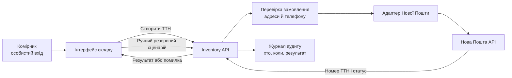

# Склонируй репозиторий

> [@GitHub](plugin://github@openai-curated-remote) [https://github.com/DmytroHnatiuk/corporate-software-systems-lessons](https://github.com/DmytroHnatiuk/corporate-software-systems-lessons) склонуй репо

2 previous messages

> Перевірю доступ до репозиторію та клоную його у поточну робочу папку.
>
> 

Ran 3 commands

>
> - Ran `git clone https://github.com/DmytroHnatiuk/corporate-software-systems-lessons.git`
> - Ran `git clone https://github.com/DmytroHnatiuk/corporate-software-systems-lessons.git`
> - Ran `git -C corporate-software-systems-lessons status --short --branch`
>
> 

Репозиторій склоновано в [corporate-software-systems-lessons](</C:/Users/devgn/OneDrive/Документы/ChatGPT/labs 2/corporate-software-systems-lessons>). Поточна гілка — `master`, синхронізована з `origin/master`.

> давай розпочнемо виконання lab1

2 previous messages

> Знайду інструкції та файли `lab1` у склонованому репозиторії, перегляну вимоги й почну виконання в робочій копії.
>
> 

Ran 4 commands

>
> - Ran `Get-ChildItem -Force; rg --files`
> - Ran `Get-Content lab-01.md -Raw; Get-Content README.md -TotalCount 100`
> - Ran `rg -n '^## [0-9]|^### [0-9]|Обрати|варіант|етап|запитань|питань|модуль|Почніть' lab-01.md README.md`
> - Ran `$f=Get-Content lab-01.md; $f[165..245]; $r=Get-Content README.md; $r[99..115]; $r[207..245]; $r[296..326]`
>
> 

Мета ЛР1 — пройти від потреб «КавоХаб» до проєктної архітектури вашого модуля; код писати не потрібно.
Роботу пройдемо поетапно: стейкхолдери й BPMN as-is; вимоги модуля; event storming і межі контекстів; архітектура, ADR і контракти; самоперевірка та оформлення документа.
На кожному етапі спершу ви запропонуєте власне рішення, а я допоможу його перевірити й розвинути.
Методичка та README вже є в склонованому репозиторії.
Щоб почати етап 1, напишіть, будь ласка: який модуль обираєте на семестр, чи є попередні роботи та які щонайменше п’ять власних запитань ви підготували стейкхолдерам?
Якщо запитання ще не готові, почніть із чернетки карти стейкхолдерів або опишіть, як, на вашу думку, зараз проходить Lead-to-Cash.

> яка задача стоїть в lab1?

У ЛР1 потрібно спроєктувати рішення для одного модуля корпоративної системи «КавоХаб» — від аналізу потреб до перших архітектурних контрактів. **Код писати й запускати не потрібно.**

Робота охоплює п’ять етапів:

1. Визначити стейкхолдерів і змоделювати поточний процес Lead-to-Cash (**as-is**).
2. Описати майбутній процес (**to-be**) для обраного модуля, підготувати 5–7 user stories, вимірювані нефункціональні вимоги та розібрати конфлікти вимог.
3. Провести event storming, визначити межі модулів, підготувати глосарій і карту контекстів.
4. Описати архітектуру діаграмами C4, підготувати ADR-рішення, каталог подій і ескіз API свого модуля.
5. Зібрати проєктний документ, самоперевірити його за критеріями та відповісти щонайменше на п’ять контрольних питань.

Щоб перейти до першого етапу, потрібно обрати свій модуль: **CRM, Orders, Inventory, Billing або Notifications / Reporting**.

> стейкхолдер - чим займаєтьс - зона відповідальності

Стейкхолдер — це людина або організація, на яку впливає система або яка може впливати на її розробку. Для ЛР1 потрібно визначити, чим кожен стейкхолдер займається, за що відповідає та чого очікує від системи.

| Стейкхолдер | Чим займається / зона відповідальності |
|---|---|
| **Ірина Мельник, директорка** | Керує компанією, відповідає за загальні результати й швидкість виконання замовлень. Хоче бачити щоденні показники продажів і боргів та розуміти активність орендарів кавомашин. |
| **Андрій Бондар, керівник продажів** | Керує менеджерами та продажами. Відповідає за клієнтську базу, воронку угод, погодження великих знижок і конверсію менеджерів. |
| **Менеджери з продажу** | Залучають клієнтів, ведуть угоди, формують пропозиції та замовлення. Працюють із клієнтами й потребують актуальних даних про ціни та наявність товарів. |
| **Сергій Ткаченко, керівник складу** | Організовує складську роботу. Відповідає за облік залишків, резервування, комплектацію та відвантаження товарів. |
| **Комірники** | Виконують складські операції: відбирають товари, пакують і відвантажують замовлення, оформлюють ТТН. |
| **Наталія Шевчук, головна бухгалтерка** | Веде бухгалтерський облік в Odoo. Відповідає за рахунки, облік оплат, звірку платежів і контроль простроченої дебіторської заборгованості. |
| **Олег Савчук, ІТ-адміністратор** | Підтримує ІТ-інфраструктуру й доступи користувачів. Відповідає за облікові записи, доступ до системи та резервне копіювання. |
| **Марта Гнатів, клієнтка** | Представляє кав’ярню-клієнта. Хоче отримувати рахунки, знати статус і час доставки замовлення та швидко отримувати номер ТТН. |
| **Нова Пошта** | Зовнішній учасник процесу доставки: приймає дані відправлення, оформлює ТТН і надає статус доставки. |
| **Банк / платіжний провайдер** | Передає інформацію про платежі, щоб компанія могла зіставити їх із виставленими рахунками. |

Для карти стейкхолдерів у ЛР1 ще потрібно оцінити для кожного **рівень впливу та зацікавленості**, а також зафіксувати його цілі й проблеми з посиланнями на цитати з інтерв’ю.

> які є проблеми відносно стейкхолдера (табл)

| Стейкхолдер | Проблеми / «болі» за матеріалами ЛР1 |
|---|---|
| **Ірина Мельник, директорка** | Не має щоденних зведених показників: дані про замовлення й борги збирають вручну з кількох таблиць раз на тиждень (Д1). Не бачить, які клієнти з орендованими кавомашинами припинили закупівлі (Д3). У піковий сезон торішні таблиці перестали відкриватися (Д4). |
| **Андрій Бондар, керівник продажів** | Дані про клієнтів зберігаються в Excel і Telegram; після звільнення менеджера клієнти можуть «зникнути» разом із ним (П1). Погодження знижок понад 10% через Telegram затягується до двох днів (П2). Не вистачає звітності про воронку продажів і конверсію менеджерів (П3). Менеджерам складно перевірити й утримати товар під час оформлення замовлення (П4). Ціна обладнання в пропозиції може не збігтися з ціною у рахунку (П5). Повторні щотижневі замовлення доводиться оформлювати вручну (П6). |
| **Менеджери з продажу** | Ведуть клієнтів у розрізнених Excel-файлах і Telegram (П1). Можуть не бачити актуальної наявності товару (П4). Регулярні замовлення оформлюють вручну (П6). |
| **Сергій Ткаченко, керівник складу** | Склад дізнається про замовлення із дзвінків менеджерів; через це продають товару більше, ніж є в наявності (С1). Резерви «поки клієнт думає» можуть тримати товар тижнями (С2). Потрібно враховувати терміни придатності кави й відвантажувати старіші партії першими (С3). ТТН оформлюють вручну, помиляються в адресах і телефонах, через що посилки повертаються (С4). |
| **Комірники** | Оформлюють ТТН вручну в кабінеті Нової Пошти (С4). Спільний пароль на складі ускладнює визначення, хто виконав операцію (І3). |
| **Наталія Шевчук, головна бухгалтерка** | Вручну переносить дані про рахунки з листів менеджерів в Odoo (Б1). Щопонеділка витрачає пів дня на ручне зіставлення оплат із рахунками (Б2). Потрібен звіт про прострочені рахунки (Б5). |
| **Олег Савчук, ІТ-адміністратор** | Не впевнений, що резервні копії сервера справді створюються щоночі (І1). Доступ потрібен працівникам із різних місць (І2). На складі використовують один пароль на всіх (І3). Йому не завжди повідомляють про звільнення працівника, тож доступ можуть вчасно не закрити (І4). |
| **Марта Гнатів, клієнтка** | Не знає, коли приїде замовлення, і мусить телефонувати менеджеру, щоб дізнатися номер ТТН (К1). Рахунок потрібен електронною поштою у PDF (К2). |
| **Нова Пошта** | У матеріалах немає окремо описаних проблем зі сторони перевізника. Зазначена проблема «КавоХаб» — ручне введення адрес і телефонів у кабінет (С4). |
| **Банк / платіжний провайдер** | В інтерв’ю не вказано окремих проблем банку чи провайдера. Проблема бухгалтерії — платежі надходять із довільним призначенням, тому їх важко зіставляти з рахунками (Б2). |

> проблема над якою буду працювати: Оформлюють ТТН вручну в кабінеті Нової Пошти (С4). Спільний пароль на складі ускладнює визначення, хто виконав операцію (І3).
>
> хто ще з стейкхолдерів взаємодіє з цим

З цією проблемою взаємодіють такі стейкхолдери:

| Стейкхолдер | Як пов’язаний із проблемою |
|---|---|
| **Комірник** | Вручну вводить дані відправлення в кабінеті Нової Пошти. Через спільний пароль складно встановити, хто створив або виправив ТТН. |
| **Сергій Ткаченко, керівник складу** | Відповідає за процес відвантаження та точність даних. Помилки в адресі чи телефоні призводять до повернення посилки (С4). |
| **Олег Савчук, ІТ-адміністратор** | Відповідає за облікові записи й доступи. Спільний пароль заважає персональній автентифікації та аудиту дій (І3). |
| **Марта Гнатів, клієнтка** | Залежить від правильного оформлення доставки й хоче отримувати номер ТТН та знати, коли приїде замовлення (К1). |
| **Нова Пошта** | Отримує дані відправлення й створює ТТН. Некоректні контактні дані можуть спричинити проблеми з доставкою. |
| **Менеджер з продажу** | Передає або уточнює дані клієнта й замовлення, які потрібні для відправлення; може допомогти розв’язати помилку в адресі чи телефоні. |

Для карти стейкхолдерів основними тут будуть **комірник, керівник складу й ІТ-адміністратор**; клієнтка та Нова Пошта — зовнішні учасники процесу доставки.

> також до проблеми знайди ще 3 під проблеми, напиши їх рішення (компромісні)
>
> вінальну архітекттуру

Так. Для обраної проблеми — ручного оформлення ТТН і спільного пароля — можна виділити такі підпроблеми. Рішення нижче компромісні: їх можна взяти за основу й уточнити після розмови зі стейкхолдерами.

| Підпроблема | Компромісне рішення |
|---|---|
| **Помилки під час ручного введення адреси й телефону** (С4) | Автоматично підставляти дані доставки з підтвердженого замовлення. Перед створенням ТТН комірник перевіряє й підтверджує адресу та телефон. Якщо дані неповні — виправляє їх або повертає менеджеру на уточнення. |
| **Неможливо визначити, хто створив або змінив ТТН** через спільний пароль (І3) | Запровадити персональний вхід працівників через корпоративну автентифікацію. Зберігати в журналі працівника, час і результат операції. Спільний пароль прибирати поступово, після видачі особистих облікових записів і короткого навчання. |
| **Збій інтеграції або недоступність API Нової Пошти зупиняє відвантаження** | Система повторює тимчасово невдалі запити та показує комірнику статус. Якщо сервіс недоступний довше встановленого часу, дозволяється оформити ТТН вручну як резервний сценарій; номер ТТН і факт ручного оформлення потім вносяться в систему. |

### Попередній ескіз архітектури для цього процесу

**Inventory** відповідає за відвантаження й інтеграцію з Новою Поштою. Комірник працює у складському інтерфейсі під особистим обліковим записом. Інтерфейс надсилає команду створити ТТН до Inventory API; сервіс перевіряє дані замовлення, звертається до адаптера Нової Пошти й записує результат та автора операції. Якщо зовнішній сервіс недоступний, система фіксує помилку й дозволяє контрольований ручний сценарій.

Це поки **ескіз для обговорення**, а не остаточна архітектура всієї ЛР1: у ній ще треба визначити межі модуля, події, API та архітектурні рішення. Я виходжу з того, що ваш модуль — **Inventory**. Напишіть, чи погоджуєтеся з трьома підпроблемами та який компроміс хочете залишити у рішенні — особливо щодо ручного резервного сценарію.

> тепер підготуй це як PR

5 previous messages

> Оформлю це як окремий Markdown-документ для ЛР1 у репозиторії. Назву PR тут розумію як проєктний результат для перегляду; якщо ви мали на увазі саме GitHub Pull Request, скажіть — для цього знадобляться зміни в гілці та публікація.
>
> 

Created a file, ran a command

>
> - Ran `git status --short --branch; Get-ChildItem -Force`
> - Wrote `./corporate-software-systems-lessons/lab-01-inventory-draft.md` (+65 -0)
>
> 

>
> відповідно до правил
>
> у Codex (Free), підключеному до вашого fork репозиторію курсу. Всю роботу ведіть в за етапами 1–5 з розділу 7 відповідної лабораторної. \
> \
> Але дозволяється створювати новий чат для генерації кейсу, цей результат ви копіюєте назад в головний чат і продовжуєте роботу.\
>
> - У своєму fork створіть гілку lab-NN-\<prizvyshche>, де NN — номер лабораторної (01, 02 … 06).
> - Створіть папку results/\<prizvyshche>-\<imia>/, якщо її ще немає. Наприклад: results/shevchenko-taras/.
> - Скопіюйте з Codex , тобто всі ваші промпти й усі відповіді, без скорочень. Збережіть його у файл results/\<prizvyshche>-\<imia>/lab-NN.md. Наприклад: lab-01.md, lab-02.md.
> - Відкрийте  у репозиторій курсу з назвою ЛР<номер> — <Прізвище Ім'я> — <модуль>. Окремий PR на кожну лабораторну.
>
> ⚠️ Чат не можна редагувати чи «чистити». Помилки й місця, де ви не погоджувались з асистентом, мають лишитися: за ними оцінюється розділ «Робота з пошуком, межами проблеми та коректності вирішення».\
> \
> results/\
> └── shevchenko-taras/\
>     ├── lab-01.md\
>     ├── lab-02.md\
>     ├── lab-03.md\
>     ├── lab-04.md\
>     ├── lab-05.md\
>     └── lab-06.md
>
> Зрозумів: результат має бути в окремій гілці та PR за правилами курсу, а не просто чернетка в корені. Використаю `Inventory` як ваш обраний модуль (це випливає з теми ТТН). Ім’я в URL форку — `DmytroHnatiuk`, тому поки підготую шлях `results/hnatiuk-dmytro/`; якщо це не ваше прізвище та ім’я, скажіть — виправлю. Також оформлю цей матеріал лише як перший етап і збережу діалог у файлі транскрипту.
>
> 

Created a file, ran 3 commands

>
> - Ran `git remote -v; git branch --show-current; git status --short; Get-ChildItem -Force`
> - Ran `git switch -c lab-01-hnatiuk`
> - Wrote `./corporate-software-systems-lessons/results/hnatiuk-dmytro/lab-01.md` (+189 -0)
> - Ran `Remove-Item -LiteralPath lab-01-inventory-draft.md; git status --short --branch`
>
> 

Створив гілку `lab-01-hnatiuk` і файл транскрипту [results/hnatiuk-dmytro/lab-01.md](</C:/Users/devgn/OneDrive/Документы/ChatGPT/labs 2/corporate-software-systems-lessons/results/hnatiuk-dmytro/lab-01.md>). Поки що це робочий транскрипт; роботу продовжимо за етапами 1–5, а PR створю після завершення лабораторної, щоб він містив готовий результат.

Для етапу 1 запропонуйте своїми словами, як зараз проходить оформлення відвантаження й ТТН — від отримання замовлення складом до передачі посилки Новій Пошті. Додайте п’ять запитань, які ви поставили б комірнику, керівнику складу, ІТ-адміністратору або клієнту. Я перевірю ваш варіант і допоможу оформити BPMN as-is.

Також підтвердіть, будь ласка, чи правильно визначив ваше ім’я для папки: `hnatiuk-dmytro`.

> так

Добре, залишаю папку `results/hnatiuk-dmytro/`.

Для етапу 1 опишіть своїми словами, як зараз проходить відвантаження: як замовлення потрапляє на склад, хто оформлює ТТН і як посилка передається Новій Пошті. Додайте п’ять запитань, які ви поставили б стейкхолдерам, щоб уточнити цей процес.
