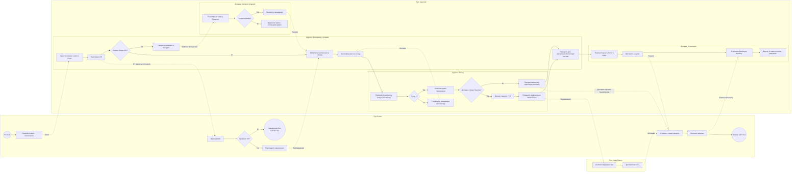
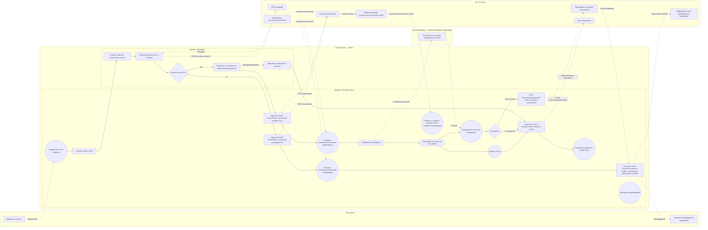
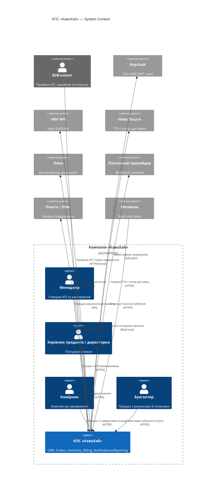
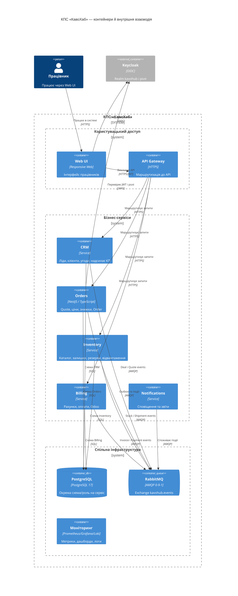
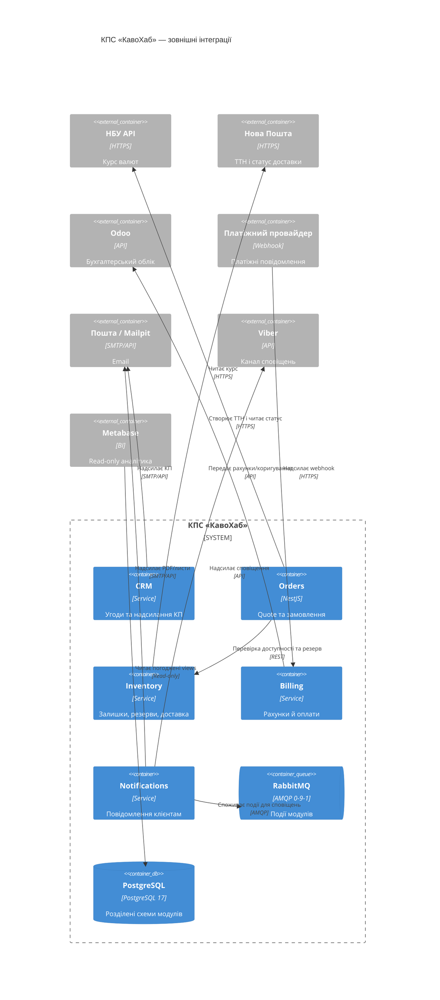
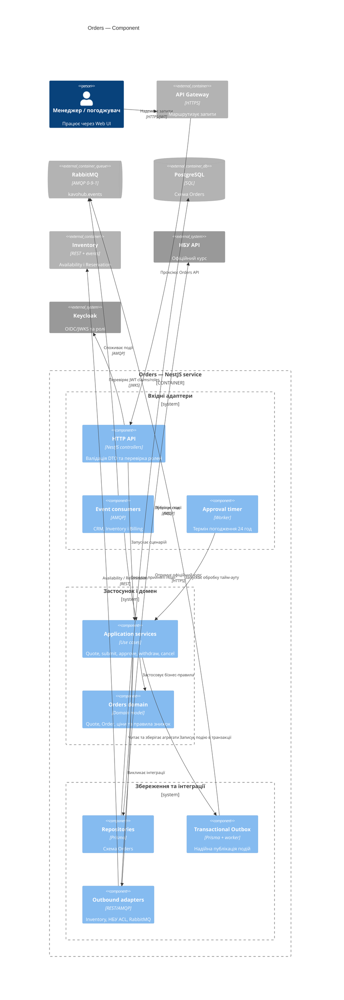
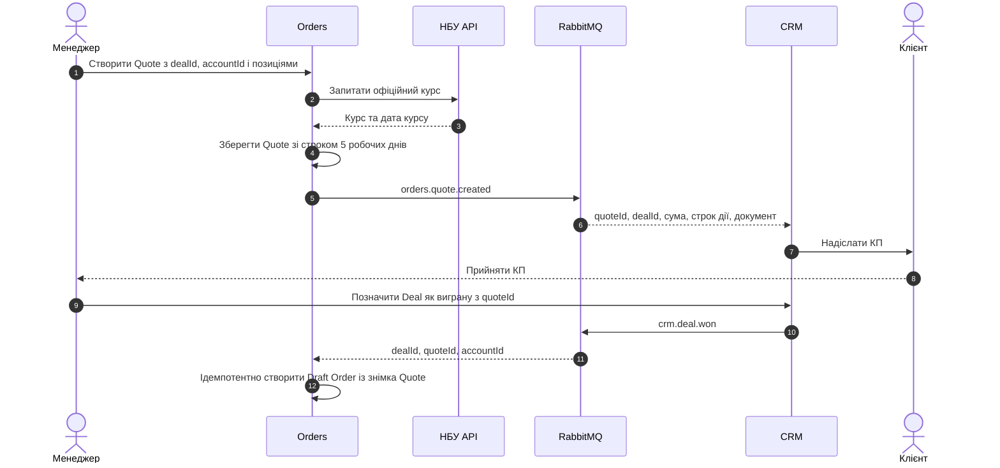
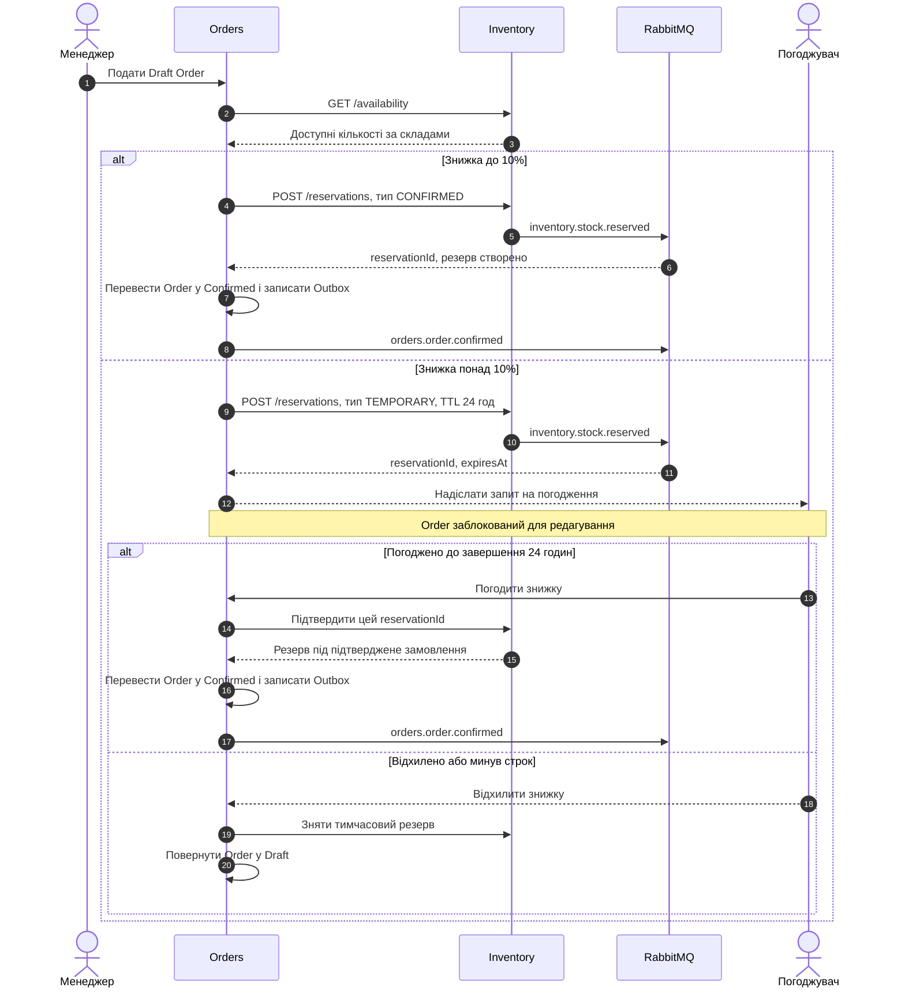
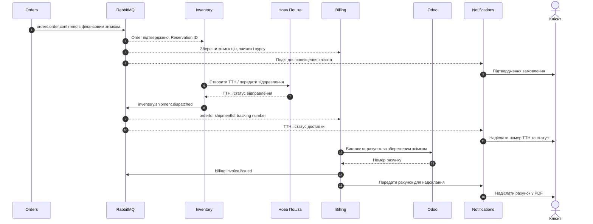
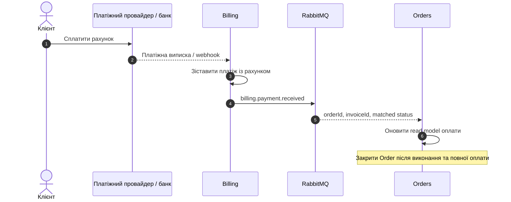

# ЛР 1. Аналіз вимог, моделювання бізнес-процесів і проєктування архітектури КПС — модуль Orders

**Студент:** Василь Гордашевський; **група:** не вказана. **Дата:** 2026-11-21.  
**ШІ-асистент:** ChatGPT (GPT-6). **Діалог:** посилання на діалог не додано; його потрібно прикріпити під час подання.

## 0. Вихідні дані

- Наскрізний кейс: КПС компанії «КавоХаб», B2B-дистриб'ютора товарів для HoReCa.
- Обраний на семестр модуль: **Orders** — комерційні пропозиції, замовлення, ціни, знижки, погодження та оркестрація виконання замовлення.
- Попередніх лабораторних робіт немає.
- Фокус ЛР1: прозоре підтвердження замовлень, погодження знижок понад 10%, резервування товару та фіксація курсу для обладнання.
- Діалог з ШІ використано для рольових уточнень, рецензування та узгодження контрактів із командами CRM, Inventory і Billing. Рольові відповіді не є фактичними інтерв'ю.

## 1. Стейкхолдери й процес as-is

### 1.1. Стейкхолдери

Оцінка влади й інтересу є проєктною оцінкою для планування залучення. Інтереси прив'язані до цитат вихідного кейсу.

| Стейкхолдер | Влада / інтерес | Цілі та проблеми | Зв'язок з Orders / джерело |
|---|---|---|---|
| Ірина Мельник, директорка | Висока / висока | Контроль замовлень, відвантажень і боргів; витримування сезонного піку; огляд орендарів без закупівель. | Затверджує компроміси між відділами; може бути резервною погоджувачкою знижок. Д1–Д5; нове уточнення про пік. |
| Андрій Бондар, керівник продажів | Висока / висока | Швидко погоджувати знижки; зберігати ціну в КП; мати воронку та контроль над клієнтами. | Власник бізнес-правил продажу й основний погоджувач знижок. П1–П6; уточнення про КП і делегування. |
| Менеджер з продажу | Середня / висока | Оформити КП і замовлення, перевірити доступність, отримати рішення щодо знижки. | Створює Quote/Order; має право відкликати замовлення на погодженні, але не редагувати його в цьому статусі. П1, П2, П4–П6. |
| Сергій Ткаченко, керівник складу | Висока / висока | Не продавати відсутній товар; не тримати товар у безстроковому резерві; уникати помилок відвантаження. | Inventory — власник залишків і резервів; Orders має погодити правила й контракт резервування. С1–С5. |
| Комірники | Середня / висока | Отримати точне завдання на комплектування та відвантаження; не бачити цін і фінансів. | Споживають операційний результат замовлення через Inventory; права задаються окремо. С5. |
| Наталія Шевчук, головна бухгалтерка | Висока / висока | Безперервна нумерація рахунків, незмінність виставленого рахунку, коректне зіставлення платежів. | Billing/Odoo — власник рахунків і оплат; погоджує фінансовий знімок курсу й цін з Orders. Б1–Б5; рольове уточнення про курс. |
| Олег Савчук, ІТ-адміністратор | Середня / середня | Доступ із різних місць, персональні облікові записи, своєчасне закриття доступу, відновлювані резервні копії. | Підтримує Keycloak та інфраструктуру; потрібні перевірка відкликання доступу й план відновлення. І1–І4. |
| Марта Гнатів та інші клієнти | Низька / висока | Швидке підтвердження замовлення, інформація про доставку, PDF-рахунок. | Надсилають замовлення/приймають КП, отримують підтвердження і документи. К1–К2; нове уточнення про канал сповіщень. |
| Команди CRM, Inventory, Billing | Висока у межах своїх даних / висока | Узгоджені інтерфейси та відсутність дублювання власності даних. | CRM володіє Account/Deal; Inventory — Product/Stock/Reservation; Billing — Invoice/Payment. README 2.4–2.6. |
| Нова Пошта, НБУ API, Odoo, платіжний провайдер | Зовнішні учасники | Доставка; надання курсу; бухгалтерський облік; приймання платежів. | Інтеграційні залежності сусідніх модулів. README 2.3–2.4. |

### 1.2. BPMN as-is верхнього рівня

Діаграма реконструює процес за наданими інтерв'ю. Деталі, яких джерела не визначають (наприклад, формальна кваліфікація ліда та конкретний канал надсилання КП), позначені як припущення в розділі 8.

**Проблеми as-is:** клієнти й замовлення ведуться в Excel/Telegram; склад дізнається про замовлення телефоном і трапляється продаж відсутнього товару (П1, С1); погодження знижки може тривати до двох діб (П2); ТТН вводиться вручну (С4); рахунок вручну переносять у Odoo, а платежі вручну зіставляють (Б1–Б2). Формальної наскрізної події резервування/скасування в описі поточного процесу не виявлено.

## 2. Вимоги модуля Orders

### 2.1. М1 — BPMN to-be підпроцесу Orders

**Пояснення нотації й правил:** суцільні стрілки — потік керування в пулі; пунктирні — потоки повідомлень між пулами/системами. У статусі `PendingApproval` замовлення незмінне; менеджер може відкликати його. Погоджувач — `sales_head`, а за його відсутності `director`. Таймер — 24 години від надсилання на погодження. У гілці без погодження Orders також чекає підтвердження резерву перед `orders.order.confirmed`.

**Уточнення контракту резерву:** тимчасовий резерв створюється через Inventory `POST /reservations`, і Inventory публікує `inventory.stock.reserved` з `reservationId`, `reservationType=TEMPORARY`, `expiresAt`. Після погодження Orders просить підтвердити той самий ID. У цій версії діаграми успішна синхронна відповідь Inventory підтверджує перехід резерву; окрема подія про конвертацію не додається. Цей контракт є проєктним припущенням, яке треба зафіксувати командою Inventory. Якщо резерв не створено, замовлення не підтверджується.

### 2.2. М2 — User Stories

#### US-ORD-01. Фіксація курсу та строку КП

Як менеджер з продажу, я хочу створити КП з ціною обладнання в гривнях за офіційним курсом НБУ, зафіксованим для цієї КП, щоб клієнт мав стабільну ціну протягом строку пропозиції. **Пріоритет:** Must. **Джерело:** П5; нове уточнення Андрія Бондаря й Наталії Шевчук.

- **AC-1:** Given товар обладнання в EUR і доступний курс НБУ When менеджер створює КП Then Orders зберігає курс, дату курсу, суму в UAH і строк дії до кінця п'ятого робочого дня.
- **AC-2 (негативний):** Given строк дії КП минув When менеджер створює замовлення з цієї КП Then система не переносить застарілі умови як чинні й вимагає нової КП/перерахунку.
- **AC-3 (негативний):** Given НБУ API недоступний і немає валідного курсу на дату розрахунку When створюється КП Then система не підставляє старий курс непомітно та не фіксує суму як актуальну.

#### US-ORD-02. Перевірка доступності

Як менеджер з продажу, я хочу бачити доступну кількість товару по складах під час оформлення, щоб не підтверджувати замовлення без наявного товару. **Пріоритет:** Must. **Джерело:** П4, С1.

- **AC-1:** Given менеджер додає SKU When Orders запитує Inventory Then показується доступна кількість `on hand - reserved` з ідентифікацією складу.
- **AC-2 (негативний):** Given доступна кількість менша за замовлену When менеджер подає замовлення на резерв Then Order не переходить у `Confirmed`, менеджер бачить дефіцит.
- **AC-3:** Given два менеджери одночасно бачать останню одиницю When обидва запитують резерв Then Inventory створює резерв лише тому запиту, який першим успішно захопив залишок; другий отримує `reservation_failed`.

#### US-ORD-03. Погодження знижки з тимчасовим резервом

Як менеджер з продажу, я хочу надіслати замовлення зі знижкою понад 10% на погодження та утримувати товар до 24 годин, щоб не втратити доступність під час очікування рішення. **Пріоритет:** Must. **Джерело:** П2, П4, С2; нове уточнення Андрія.

- **AC-1:** Given чернетка зі знижкою 15% When менеджер надсилає її на погодження Then статус стає `PendingApproval`, редагування блокується, створюється тимчасовий резерв із `expiresAt` не пізніше ніж за 24 години.
- **AC-2 (негативний):** Given Order очікує погодження When менеджер змінює ціну/кількість Then система відмовляє; менеджер може відкликати замовлення, після чого резерв знімається.
- **AC-3:** Given Inventory не створив резерв When Orders отримує `inventory.stock.reservation_failed` Then Order не подається на погодження як зарезервований і менеджер отримує причину відмови.

#### US-ORD-04. Рішення погоджувача

Як керівник продажів або директорка як резервна погоджувачка, я хочу погодити або відхилити знижку з мобільного браузера, щоб клієнт отримав рішення без затримки до двох діб. **Пріоритет:** Must. **Джерело:** П2, І2; нове уточнення Андрія.

- **AC-1:** Given чинний резерв та Order у `PendingApproval` When `sales_head` погоджує до спливу 24 годин Then Orders підтверджує той самий `reservationId`, чекає підтвердження Inventory, змінює Order на `Confirmed` і записує подію `orders.order.confirmed` в Outbox.
- **AC-2 (негативний):** Given Order у `PendingApproval` When роль `sales_manager` намагається погодити знижку Then API повертає 403 і стан не змінюється.
- **AC-3:** Given минуло 24 години без рішення або погоджувач відхилив запит When Orders обробляє таймер/відмову Then резерв знімається, Order повертається в `Draft`, а подія/повідомлення про завершення фіксується.
- **AC-4:** Given керівник продажів позначений недоступним за узгодженим механізмом делегування When директорка погоджує Then її право перевіряється окремою роллю Keycloak; звичайна роль перегляду сама по собі не дає права погодження.

#### US-ORD-05. Регулярний шаблон замовлення

Як менеджер з продажу, я хочу налаштувати щотижневий шаблон повторного замовлення для клієнта, щоб скоротити ручне оформлення типових закупівель. **Пріоритет:** Should. **Джерело:** П6.

- **AC-1:** Given активний шаблон із клієнтом, позиціями, розкладом і чинними цінами When настає наступна дата Then система створює чернетку Order і повідомляє відповідального менеджера.
- **AC-2 (негативний):** Given шаблон створив чернетку, але Inventory не може зарезервувати потрібну кількість When приходить `reservation_failed` Then замовлення не підтверджується автоматично, шаблон не генерує дубль того самого періоду, менеджер отримує сповіщення.

### 2.3. М3 — Нефункціональні вимоги

| ID | Характеристика | Вимога | Перевірка | Джерело / примітка |
|---|---|---|---|---|
| NFR-ORD-PERF-01 | Продуктивність | Підтвердження замовлення до 20 рядків: `p95 ≤ 1,5 с`, `p99 ≤ 3 с`, технічна частка помилок `≤ 0,5%` при **4 підтвердженнях/хв**. Розрахунок: 412 × 60% / 240 хв ≈ 1,03/хв; триразовий запас ≈ 3,1/хв, округлено вгору до 4/хв. | Навантажувальний сценарій k6 із репрезентативними рядками; окремо рахувати технічні 5xx/тайм-аути, не бізнес-відмови. | Д4 + нове уточнення директорки: 412 замовлень 23 листопада, близько 60% між 09:00–13:00. Верхній розмір 20 рядків — проєктна межа тесту. |
| NFR-ORD-REL-01 | Надійність | Подія Orders, записана разом зі зміною стану, не втрачається при недоступності RabbitMQ до 15 хв; після відновлення брокера публікується з Outbox. Повторна доставка не створює повторну бізнес-операцію. | Інтеграційний сценарій із зупинкою брокера, перевіркою Outbox, повторною доставкою та ідемпотентним споживачем за `id`. | Архітектурна ціль; узгоджується з надійністю процесу й проблемами ручної передачі С1. 15 хв — проєктне припущення. |
| NFR-ORD-SEC-01 | Безпека | Бізнес-ендпоінти Orders вимагають валідний OIDC/JWT. Погодження — лише `sales_head` або делегований `director`; `sales_manager` не може погодити власне замовлення. Відкликаний доступ блокується максимум за 5 хвилин. `GET /health` — публічний. | API-тести 401/403 для матриці ролей; тест відкликання доступу в Keycloak із вимірюванням затримки. | І2–І4, П2; 5 хв — ціль, що потребує конфігураційної перевірки. |
| NFR-ORD-DR-01 | Відновлюваність | Для Orders передбачити резервну копію даних і перевірюване відновлення. Попередні цілі `RPO ≤ 24 год`, `RTO ≤ 4 год` — для погодження з ІТ-адміністратором, не затверджені бізнесом. | Періодичне тестове відновлення в ізольованому середовищі й фіксація фактичного RPO/RTO. | І1: бекап сервера є, але відновлення не перевіряли. Цілі — проєктне припущення, відкрите для підтвердження. |

### 2.4. М4 — Конфлікти та приховані вимоги

| Питання | Позиції та джерела | Узгоджене рішення | Хто затверджує / що лишається відкритим |
|---|---|---|---|
| Момент і тривалість резерву (П4 ↔ С2) | Продажі хочуть утримати товар, поки клієнт вирішує; склад проти резервів на тижні. | Тимчасовий резерв лише на час погодження знижки, максимум 24 год; відхилення/тайм-аут/відкликання знімає резерв. Для звичайного замовлення резерв створюється до підтвердження й утримується до відвантаження. | Директорка разом із керівниками продажів і складу. Узгодити конвертацію того самого `reservationId` з Inventory. |
| Курс на день КП чи рахунку (П5 ↔ Б4) | Продажі фіксують ціну обладнання у гривнях на день КП; початкова позиція бухгалтерії — курс на день рахунку. | Курс, дата й суми з КП фіксуються; у рахунку зазначають курс і дату та зберігають посилання на КП. КП діє 5 робочих днів. | Наталія Шевчук і Андрій Бондар погодили компроміс у рольовому діалозі з ШІ. Перевірити формат відображення в Odoo. |
| Делегування погодження | Керівник продажів погоджує знижки понад 10%; при його відсутності — директорка. Менеджер не редагує Order після подання, лише відкликає. | Дозволити директорці погодження через явне право/роль Keycloak і фіксувати особу, що ухвалила рішення. | Андрій Бондар; ІТ-адміністратор налаштовує доступ. Базове право `director` лише на перегляд треба розширити погодженим дозволом. |
| Ціна в КП і Billing | Billing приймає курс на дату КП, якщо в рахунку вказано курс і дату. | Billing споживає незмінний фінансовий знімок Order; рахунок створюється після `inventory.shipment.dispatched`. Уже виставлений рахунок не змінюється, застосовується коригувальний документ. | Наталія Шевчук і команда Billing. Визначити точний склад полів та відповідність ліній Odoo. |
| Дефіцит товару під час конкурентних замовлень | Доступність може змінитись між GET і резервом; двоє менеджерів можуть бачити останню одиницю. | Авторитетна операція — атомарне створення резерву в Inventory; `GET /availability` лише інформує, не гарантує наявність. | Команди Orders та Inventory мають узгодити статус-коди й ідемпотентність запиту резерву. |

## 3. Доменний аналіз

### 3.1. С3/М6 — глосарій єдиної мови

| Термін | Визначення в контексті КПС | Власник терміна/даних |
|---|---|---|
| Lead (лід) | Потенційний B2B-клієнт до кваліфікації. | CRM |
| Account (клієнт/заклад) | Організація-контрагент, для якої оформлюються угоди й замовлення. | CRM; Orders/Billing мають репліки |
| Contact (контакт) | Фізична особа для комунікації від імені Account. | CRM |
| Deal (угода) | Можливість продажу в CRM; виграна угода ініціює чернетку Order за базовим контрактом. | CRM |
| Quote (комерційна пропозиція, КП) | Набір товарних і цінових умов, чинний 5 робочих днів; містить зафіксовані ціни та параметри курсу. | Orders |
| Quote validity (строк дії КП) | Період, протягом якого клієнт може прийняти збережені умови КП. | Orders |
| Order (замовлення) | Намір/зобов'язання продати позиції за прийнятими умовами, що проходить погодження й виконання. | Orders |
| OrderLine (рядок замовлення) | SKU, кількість, ціна й знижка для конкретної позиції. | Orders |
| SKU | Унікальний код товару; не тотожний самому Product. | Код визначає Inventory; Orders зберігає посилання |
| Product (товар) | Запис каталогу товарів, що продаються. | Inventory; Orders тримає репліку |
| ContractPrice (контрактна ціна) | Ціна SKU, узгоджена для конкретного клієнта та строку чинності. | Orders |
| PriceList (прайс-лист) | Базовий набір цін для асортименту, від якого можуть відрізнятися контрактні умови. | Orders |
| Discount approval (погодження знижки) | Рішення `sales_head` або делегованої директорки щодо знижки понад 10%. | Orders; особа погоджувача — аудитний атрибут |
| AvailableStock (доступний залишок) | Орієнтовна доступна кількість: `on hand - reserved`; джерелом істини є Inventory. | Inventory |
| Temporary reservation (тимчасовий резерв) | Резерв на час очікування погодження, не довше 24 годин. | Inventory |
| Confirmed reservation (резерв під підтверджене замовлення) | Резерв товару для виконання підтвердженого замовлення до відвантаження. | Inventory |
| Reservation ID | Ідентифікатор Inventory-резерву, який Orders зберігає для кореляції та конвертації. | Inventory |
| Shipment (відвантаження) | Логістичний факт комплектації/передачі товару; ТТН — пов'язаний документ, а не синонім Shipment. | Inventory |
| Invoice (рахунок) | Документ на оплату; після виставлення не редагується, коригується окремим документом. | Billing/Odoo |
| Payment (оплата) | Надходження коштів, яке Billing зіставляє з одним або кількома рахунками. | Billing |
| Exchange-rate snapshot (знімок курсу) | Значення курсу НБУ й дата, за якими Quote зафіксував ціну в UAH. | Orders зберігає; джерело — НБУ API |
| Correlation ID | Ідентифікатор наскрізного сценарію, що пов'язує HTTP-запити та події Lead-to-Cash. | Спільний технічний контракт |

### 3.2. С4/М5 — Event Storming Lead-to-Cash та Orders

Події нижче записані як уже здійснені факти. Назви в кодовому форматі відповідають базовому каталогу; нові події позначені як запропоновані.

| Крок / актор | Команда | Доменна подія | Політика / зовнішня система | Гаряча точка |
|---|---|---|---|---|
| CRM / менеджер | Виграти угоду | `crm.deal.won` **(pivotal)** | Orders за `dealId` і `quoteId` створює чернетку Order; обробка ідемпотентна. | Базовий контракт каже створити чернетку замовлення; точний момент угоди щодо Quote має бути однаковим у всіх процесних описах. |
| Менеджер | Створити КП | `orders.quote.created` **(нова подія)** | Orders отримує офіційний курс НБУ; CRM отримує ідентифікатор/посилання й надсилає лист клієнту. | Що робити, якщо НБУ API недоступний? Старий курс не підставляється непомітно. |
| Клієнт / менеджер | Прийняти КП і оформити замовлення | КП прийнято (локальний факт Orders) | Orders створює Draft із `quoteId`; менеджер бачить доступність через REST Inventory. | Чинна КП може втратити доступність товару до фактичного резерву. |
| Orders | Запросити резерв | — (команда через `POST /reservations`) | Inventory атомарно створює TEMPORARY або CONFIRMED reservation і публікує результат. | Конкурентне резервування останньої одиниці; повторний POST має бути ідемпотентним. |
| Inventory | Створити резерв | `inventory.stock.reserved` | Orders зберігає `reservationId`, вид резерву та строк чинності. | Подія має співвідноситися з актуальним Order і конкретною спробою резервування. |
| Inventory | Відмовити у резерві | `inventory.stock.reservation_failed` | Orders лишає замовлення в Draft і повідомляє менеджера. | Недостатній залишок після попередньої перевірки. |
| Менеджер | Подати знижку понад 10% | `orders.discount.submitted` (внутрішня/запропонована) | Заблокувати редагування; повідомити `sales_head`, а за делегування — `director`; резерв максимум на 24 год. | Як фіксується відсутність керівника і межі делегування? |
| Керівник / директорка | Погодити знижку | `orders.discount.approved` (внутрішня) | Orders конвертує той самий Reservation ID у резерв під виконання, тоді підтверджує Order. | Що робити, якщо резерв уже сплив або конвертація не вдалася? |
| Керівник / директорка | Відхилити знижку | `orders.discount.rejected` (внутрішня) | Зняти резерв, повернути Order у Draft. | Клієнту надсилають нову КП чи просто повідомляють менеджера? Відкрито. |
| Таймер Orders | Завершити очікування погодження | Строк погодження минув | Через 24 години зняти резерв і повернути Order у Draft. | Потрібне сповіщення менеджеру й клієнту; канал і шаблон погодити. |
| Менеджер | Відкликати запит на погодження | Запит відкликано (локальний факт Orders) | Розблокувати редагування, скасувати таймер, зняти резерв. | Повторна подача має створити нову версію/спробу, не дублювати події. |
| Orders | Підтвердити замовлення | `orders.order.confirmed` **(pivotal)** | Після успішного резерву зберегти фінансовий знімок, публікувати через Outbox; CRM/Billing/Inventory споживають погоджені поля. | Помилка не може залишити Order Confirmed без Reservation ID. |
| Inventory | Відвантажити замовлення | `inventory.shipment.dispatched` **(pivotal)** | Orders оновлює read model виконання; Billing готує рахунок за знімком і передає в Odoo. | Часткове відвантаження в базових вимогах не визначене. |
| Billing | Виставити рахунок | `billing.invoice.issued` | Рахунок іде в Odoo; Orders зберігає лише статус/ідентифікатор рахунку як репліку. | Безперервна нумерація та незмінність рахунку — відповідальність Billing/Odoo. |
| Billing | Зіставити оплату | `billing.payment.received` **(pivotal)** | Orders оновлює read model оплати; після виконання та оплати Order може бути закритий. | Часткові платежі/один платіж на кілька рахунків потребують правил Billing. |
| Orders | Скасувати замовлення | `orders.order.cancelled` | Inventory знімає резерв; Billing анулює/коригує рахунок законним окремим документом, якщо він уже виставлений. | Не змінювати виставлений рахунок (Б3). |

**Ключові події та межі:** `crm.deal.won` передає відповідальність від CRM до Orders; `orders.order.confirmed` означає, що комерційні умови прийняті та резерв успішний; `inventory.shipment.dispatched` переводить процес у виконання Billing; `billing.payment.received` завершує фінансову частину. Подія підтвердження є pivotal лише після успішного резерву.

**Агрегати-кандидати:**

| Кандидат | Межа та інваріанти |
|---|---|
| Quote | Окремий агрегат із позиціями, строком чинності, валютними умовами й незмінним знімком курсу/ціни після створення. Має `quoteId`, пов'язаний із Deal та Order. |
| Order (корінь) | Містить OrderLines, `quoteId`, статус, застосовані контрактні ціни, approval state та `reservationId`. Не можна підтвердити без успішного резерву; у PendingApproval редагування заборонене. |
| DiscountApproval | На першій версії — стан/сутність усередині Order, бо результат змінює саме Order. Окремий агрегат потрібен лише за появи самостійного життєвого циклу. |
| PriceList / ContractPrice set | Моделі власності Orders з датами чинності й правилами пріоритету; Quote зберігає знімок застосованих цін, а не читає їх заднім числом. |
| RecurringOrderTemplate | Окремий кандидат для незалежного розкладу й стану шаблону; генерація створює Draft, автоматичне підтвердження не дозволяється без резерву. |

### 3.3. С5 — карта контекстів і власність даних

| Взаємодія | Напрямок / патерн | Контракт та межа |
|---|---|---|
| CRM → Orders | CRM upstream / Orders downstream; Customer–Supplier + Published Language | `crm.account.upserted`, `crm.deal.won`. Orders зберігає read-only репліку Account та посилання на Deal; CRM лишається власником клієнта/угоди. |
| Orders → CRM | Orders upstream для Quote; Published Language | Запропонована `orders.quote.created` дає `quoteId`, `dealId`, короткі умови/посилання; CRM синхронізує статус угоди й надсилає КП. CRM не редагує ціни. |
| Inventory → Orders | Inventory upstream / Orders downstream; OHS + Published Language | `GET /availability`, `inventory.product.upserted`, `inventory.stock.reserved`, `inventory.stock.reservation_failed`. Inventory є джерелом істини про товар, залишок і Reservation. |
| Orders → Inventory | Orders upstream щодо замовлення / Inventory downstream; Published Language | REST `POST /reservations` та події `orders.order.confirmed`, `orders.order.cancelled`. Обидва напрями мають окремі правила та версії контрактів. |
| Orders → Billing | Orders upstream / Billing downstream; Published Language | Billing отримує фінансовий знімок Order/Quote, але не змінює Quote чи Order. Billing створює рахунок після `inventory.shipment.dispatched`. |
| Billing → Orders | Billing upstream для фінансових статусів / Orders downstream; Published Language | `billing.invoice.issued`, `billing.payment.received`; Orders тримає лише read model для статусу рахунку/оплати. |
| Orders → НБУ API | НБУ upstream; ACL усередині Orders | Adapter нормалізує формат і помилки НБУ; Orders зберігає використану ставку й дату. Кеш не підміняє актуальний курс без явної політики. |

#### Матриця власності даних

| Дані | Власник | Репліки / споживачі | Рішення ЛР1 |
|---|---|---|---|
| Account, Contact, Deal | CRM | Orders, Billing | Orders читає репліки, не редагує їх. |
| Product | Inventory | Orders | Додати/оновлювати репліку подією `inventory.product.upserted`. |
| Stock, Reservation, Shipment | Inventory | Orders | Лише Inventory змінює; Orders зберігає `reservationId` та статуси. |
| Quote | Orders | CRM (ідентифікатор/статус/документ), Billing (знімок) | **Запропонована зміна** до README 2.5: додати Quote як дані Orders. |
| Order, OrderLine, PriceList, ContractPrice, DiscountApproval | Orders | Inventory, Billing, CRM за потребою | Лише Orders змінює бізнес-стан. |
| Invoice, Payment, PaymentAllocation | Billing | Orders (статус/посилання) | Billing/Odoo — власник фінансових документів. |
| Бухгалтерські проведення | Odoo | — | Billing передає документи до Odoo. |

**Позиція команд-сусідів у рольовому узгодженні:** CRM погоджується з власністю Orders на Quote за умови, що CRM лише надсилає документ/оновлює Deal; Inventory погоджується з REST-резервом і подією успіху, але просить ідемпотентність і чітку конвертацію Reservation ID; Billing погоджується отримувати незмінні умови, створювати рахунок після відвантаження й коригувати окремим документом. Це узгодження через ШІ, не зовнішнє затвердження реальних команд.

## 4. Архітектура, ADR і контракти v0

### 4.1. С6 — C4 як код

#### C4 System Context

#### C4 Container

##### C4 Container — зовнішні інтеграції

**Примітка:** PostgreSQL 17 — одна інстанція з логічною ізоляцією schema/roles; це не фізично окрема база на сервіс. API Gateway не замінює перевірку JWT і прав на самому сервісі. Metabase не читає таблиці напряму з правами запису.

#### М7 — C4 Component Orders

#### С6 — Діаграми послідовності Lead-to-Cash за етапами

Усі чотири діаграми використовують спільний `correlationId`. Це один наскрізний happy path, розділений для читабельності.

##### Етап 1. КП, курс НБУ та виграна угода

##### Етап 2. Перевірка наявності, резерв і погодження

Якщо замість `inventory.stock.reserved` надійшла `inventory.stock.reservation_failed`, Orders лишає замовлення в Draft і повідомляє менеджера; це альтернативний потік, не частина happy path.

##### Етап 3. Підтвердження, відвантаження та рахунок

##### Етап 4. Оплата та закриття замовлення

**Наскрізні вимоги:** у подіях і викликах передаються `correlationId` та унікальний `id`; споживачі обробляють повторні повідомлення ідемпотентно. Orders не викликає напряму Odoo, платіжний провайдер чи Нову Пошту.

### 4.2. С7/М8 — ADR

#### ADR-0001. Стиль архітектури

**Статус:** запропоновано. **Дата:** 2026-11-21. **Автор:** Василь Гордашевський. **Обговорено з:** рецензентом-архітектором у діалозі з ШІ.

**Контекст.** КПС має CRM, Orders, Inventory, Billing і Notifications із різними власниками даних та інтеграційними контрактами. Піковий день — 412 замовлень; вимога до масштабування сама по собі не доводить потребу в дрібних мікросервісах. Команда та операційні можливості обмежені.

**Варіанти.** (1) Модульний моноліт — простіші експлуатація й локальні транзакції, але межі релізу спільні. (2) Один автономний сервіс на bounded context — ізоляція власності й незалежні контракти, але дорожчі моніторинг, деплой і узгодження подій. (3) Дрібні мікросервіси за кожною функцією — гнучке масштабування, але непропорційна складність для команди й цього навантаження.

**Рішення.** Вибрати грубозернисті сервіси за контекстами, один сервіс на кожен із п'яти модулів. Масштабування аргументується передусім незалежною власністю даних і різними межами змін/доступу, а не лише 400 замовленнями.

**Наслідки.** Позитивні: межі даних, RBAC та інтеграції явні. Негативні: потрібні RabbitMQ, Outbox, ідемпотентність, спостережуваність і керування версіями контрактів. Переглянути рішення, якщо команда скоротиться до 1–2 людей або підтримка інфраструктури стане непропорційною; оцінити частоту релізів і операційні інциденти.

#### ADR-0002. Міжмодульна взаємодія

**Статус:** запропоновано. **Дата:** 2026-11-21. **Автор:** Василь Гордашевський. **Обговорено з:** командами Inventory і Billing (рольова симуляція з ШІ).

**Контекст.** Orders потребує актуальної доступності та резерву, але інші модулі мають реагувати на зміну стану замовлення. Потрібна стійкість до короткої недоступності брокера та дублювання повідомлень.

**Варіанти.** (1) Лише REST — проста відповідь для кожної дії, але сильне синхронне зв'язування й каскадні тайм-аути. (2) Лише події — слабке зв'язування, але складно синхронно відповісти щодо наявності/резерву. (3) Гібрид: REST для query/команд Reservation із відповіддю, RabbitMQ для фактів між модулями.

**Рішення.** Варіант 3. Orders синхронно читає Inventory `/availability` і викликає `POST /reservations`; Inventory публікує `inventory.stock.reserved` або `inventory.stock.reservation_failed`. Зміни станів Order публікуються через RabbitMQ із transactional Outbox.

**Наслідки.** Потрібні тайм-аути, повтори з ідемпотентним ключем, дедуплікація за event `id`, DLQ/моніторинг і кореляція. Outbox забезпечує повторну доставку, не exactly-once. Контракт конвертації резерву того самого ID має бути затверджений Inventory; можливу окрему подію конвертації поки не додаємо.

#### ADR-0003. Власність і зберігання даних

**Статус:** запропоновано. **Дата:** 2026-11-21. **Автор:** Василь Гордашевський. **Обговорено з:** CRM, Inventory, Billing у рольовому узгодженні.

**Контекст.** README 2.5 вимагає одного власника сутності. Модулі мають обмінюватися даними без прямого запису в чужі таблиці. Експлуатацією опікується невелика ІТ-функція.

**Варіанти.** (1) Одна спільна схема й таблиці — дешевше, але сильне зчеплення та ризик обходу власника. (2) Окрема схема й DB-role кожному сервісу в одній PostgreSQL — логічна ізоляція та простіший операційний супровід. (3) Окремий фізичний кластер/БД на модуль — сильніша ізоляція, але дорожче резервування, моніторинг та адміністрування.

**Рішення.** Варіант 2 для першої версії. Orders — єдиний writer Quote/Order/ціни/approval; CRM і Inventory — writers своїх сутностей; інші модулі отримують read-only проєкції. Додати Quote в матрицю власності як узгоджену зміну.

**Наслідки.** Позитивні: сервісні облікові записи обмежуються власною схемою; репліки оновлюються подіями. Негативні: спільний PostgreSQL лишається спільною точкою відмови, а схема не є фізичною ізоляцією. Metabase отримує лише read-only views. Потрібні резервні копії й перевірка відновлення; RPO/RTO ще погодити з ІТ.

#### ADR-0004. Технологічний стек Orders

**Статус:** запропоновано. **Дата:** 2026-11-21. **Автор:** Василь Гордашевський. **Обговорено з:** архітектором-рецензентом у діалозі з ШІ.

**Контекст.** README 2.8 вимагає зрілий HTTP framework/OpenAPI, PostgreSQL з міграціями, AMQP 0-9-1, OIDC/JWT, JSON-логи, Prometheus-метрики, тестовий framework і Docker-образ. Orders обробляє суми/знижки й інтегрує RabbitMQ, НБУ та Inventory.

**Варіанти.** (1) TypeScript + NestJS + Prisma — структура модулів, декоратори, OpenAPI та типізація; потрібне явне decimal-представлення грошей. (2) Python + FastAPI + SQLAlchemy — швидка розробка й зрозумілі схеми; дисципліну структури треба підтримувати командою. (3) C# + ASP.NET Core + EF Core — сильна типізація та зрілі enterprise-бібліотеки; обрати за наявності відповідного досвіду команди.

**Рішення.** TypeScript + NestJS, PostgreSQL, Prisma migrations, AMQP-клієнт, OIDC/JWT middleware, JSON logger, Prometheus, інтеграційний/модульний test framework і Docker. Грошові значення зберігати як `NUMERIC` у PostgreSQL і обчислювати decimal-бібліотекою, не binary floating point.

**Наслідки.** Позитивні: явні модулі, DTO, OpenAPI та типізовані межі. Негативні: Prisma/ORM не скасовує потреби в транзакційній перевірці Outbox; потрібні спеціальні правила округлення й точності валют. Переглянути стек за фактичними навичками команди, проблемами decimal-розрахунку чи підтримки AMQP/OIDC.

### 4.3. М9 — Каталог подій v0 для Orders

Формат конверта: CloudEvents-подібний, поля `specversion`, `id`, `type`, `source`, `time`, `correlationId`, `dataschema`, `data`. Події публікуються з Outbox; споживачі мають бути ідемпотентними.

| Подія | Продюсер → споживачі | Ключові поля `data` | Умова / зміна до базового контракту |
|---|---|---|---|
| `orders.quote.created` | Orders → CRM | `quoteId`, `dealId`, `accountId`, `currency`, `totalAmount`, `expiresAt`, `documentRef` | **Нова подія.** CRM оновлює угоду й надсилає КП; не має права змінювати Quote. `documentRef` є ідентифікатором/посиланням, не writer-доступом. |
| `orders.order.confirmed` | Orders → Inventory, CRM, Billing, Notifications | `orderId`, `quoteId`, `accountId`, `warehouse`, `lines[{sku,qty,unitPrice,discount}]`, `currency`, `netAmount`, `taxAmount`, `totalAmount`, `exchangeRate`, `rateDate`, `reservationId` | Базова подія. **Запропонована зміна:** додати Billing і Notifications та фінансовий знімок. Billing зберігає його й виставляє рахунок після відвантаження; Notifications сповіщає клієнта. Ризик: Inventory не потребує фінансових полів; обмежити їх обробку або виділити Billing-specific подію. |
| `orders.order.cancelled` | Orders → Inventory, Billing | `orderId`, `reservationId`, `reason`, `cancelledAt`, `invoiceId?` | Є в базовому каталозі. Inventory знімає резерв; Billing коригує/анулює належним документом, якщо рахунок уже створено. |

#### Вхідні події, які споживає Orders

| Подія | Продюсер | Реакція Orders / ключові поля |
|---|---|---|
| `crm.account.upserted` | CRM | Оновити read-only Account projection за `accountId`, контактними полями та версією/часом зміни. |
| `crm.deal.won` | CRM | Ідемпотентно створити чернетку Order за `dealId`, `accountId`, `quoteId`; повторна доставка не створює друге замовлення. |
| `inventory.product.upserted` | Inventory | Оновити локальну read-only проєкцію SKU/назви/активності. |
| `inventory.stock.reserved` | Inventory | Записати `orderId`, `reservationId`, `warehouse`, `lines`, `expiresAt`, тип резерву; звірити з очікуваним замовленням/спробою. |
| `inventory.stock.reservation_failed` | Inventory | Залишити Order у Draft/Pending за погодженою політикою, не публікувати підтвердження; зберегти `reason` і повідомити менеджера. |
| `inventory.shipment.dispatched` | Inventory | Оновити read model виконання за `orderId`, `shipmentId`, `trackingNumber`, `dispatchedAt`; Notifications надсилає клієнту ТТН/статус. |
| `billing.invoice.issued` | Billing | Оновити read model рахунку: `orderId`, `invoiceId`, номер, сума, дата, статус; Notifications надсилає PDF клієнту. |
| `billing.payment.received` | Billing | Оновити read model оплати після зіставлення: `orderId`, `invoiceId`, сума, дата, статус зіставлення. |

**Відкрите рішення з мінімізації даних:** користувач погодив повний фінансовий знімок у `orders.order.confirmed`, який також споживає Inventory. Для найменшого розкриття даних варто окремо розглянути `orders.order.billing_snapshot_ready` тільки для Billing. Поточний каталог фіксує обране рішення, а альтернативу лишає як ризик/наступне покращення.

### 4.4. М10 — Ескіз API Orders і ролі

| Метод | Шлях | Призначення | Викликач | Роль / доступ |
|---|---|---|---|---|
| POST | `/quotes` | Створити Quote й зафіксувати курс/дати/умови | UI | `sales_manager` для своїх клієнтів; `sales_head` для всіх |
| GET | `/quotes/{quoteId}` | Переглянути Quote і стан чинності | UI, CRM | `sales_manager`, `sales_head`, `director`; `svc-crm` лише потрібні поля |
| GET | `/quotes/{quoteId}/document` | Отримати артефакт КП для листа | CRM | `svc-crm` client credentials; доступ на читання |
| POST | `/orders/{orderId}/submit` | Подати Draft на перевірку/резерв і, якщо потрібно, погодження | UI | `sales_manager` — власний клієнт |
| POST | `/orders/{orderId}/withdraw` | Відкликати з PendingApproval, зняти резерв, розблокувати редагування | UI | `sales_manager` — власний Order |
| POST | `/orders/{orderId}/approve` | Погодити знижку й підтвердити чинний резерв | UI | `sales_head`; `director` лише як делегований погоджувач |
| POST | `/orders/{orderId}/reject` | Відхилити знижку, зняти резерв, повернути Draft | UI | `sales_head`; `director` лише як делегований погоджувач |
| POST | `/orders/{orderId}/cancel` | Скасувати замовлення та опублікувати `orders.order.cancelled` | UI | `sales_manager` у дозволених статусах; `sales_head` — усі клієнти |
| GET | `/orders` | Пошук/список за статусом, клієнтом, датами | UI, Billing | `sales_manager` — свої; `sales_head`/`director` — усі; `accountant` — читання; `svc-billing` — service client credentials |
| GET | `/orders/{orderId}` | Перегляд деталей і статусу | UI, Billing | `sales_manager` — свої; `sales_head`/`director`; `accountant` і `svc-billing` — read-only |
| GET | `/health` | Перевірка процесу | Оркестратор/моніторинг | Без автентифікації; `{"status":"ok"}` |

Orders як клієнт Inventory викликає його `GET /availability`, `POST /reservations` і запропоновану операцію конвертації того самого ID (наприклад `POST /reservations/{reservationId}/confirm`). Останній шлях є проєктною пропозицією для узгодження з Inventory, а не вже затвердженим контрактом.

### 4.5. М11 — структура майбутнього сервісу Orders

- **Зовнішні точки входу:** HTTPS REST API за API Gateway; RabbitMQ consumers для CRM, Inventory, Billing; `GET /health`.
- **Inbound adapters:** NestJS controllers, DTO validation, OpenAPI, перевірка JWT та RBAC; event consumers з дедуплікацією за `id`.
- **Application layer:** use cases `CreateQuote`, `CreateDraftOrder`, `SubmitOrder`, `ApproveDiscount`, `RejectDiscount`, `WithdrawOrder`, `CancelOrder`; планувальник 24h timeout та recurring templates.
- **Domain layer:** Quote/Order агрегати, стани, правила цін, знижок, строку чинності, заборони редагування й інваріант «немає підтвердження без резерву».
- **Infrastructure:** Prisma repositories і migrations для власної схеми PostgreSQL; transactional Outbox; RabbitMQ publisher/consumer; REST clients до Inventory і НБУ ACL; OIDC/JWKS; структуровані JSON-логи, Prometheus metrics.
- **Залежності:** PostgreSQL, RabbitMQ, Keycloak, Inventory REST, НБУ API; CRM/Billing інтегруються подіями. Orders не звертається напряму до Odoo, Нової Пошти чи платіжного провайдера.
- **Обробка помилок:** REST timeout/retry з backoff та idempotency key; Outbox retry/DLQ; бізнес-помилки (відсутній товар, прострочена КП, неавторизований погоджувач) повертаються окремо від технічних 5xx.

## Журнал проєктних рішень

| № | Рішення | Альтернативи | Чому обрано | Підстава |
|---|---|---|---|---|
| D-01 | Тимчасовий резерв максимум на 24 год під час погодження | Резерв із моменту чернетки; резерв лише після остаточного підтвердження | Компроміс між збереженням доступності та небажанням складу блокувати товар на тижні. | П4 ↔ С2; Додаток, ADR-0002 |
| D-02 | Курс і гривнева ціна фіксуються в Quote на дату отримання офіційного курсу | Курс на день рахунку; динамічний перерахунок після прийняття КП | Клієнт має стабільну ціну 5 робочих днів; Billing має курс і дату для аудиту. | П5, Б4; рольові уточнення |
| D-03 | Orders — власник Quote | CRM або Billing як власник | Quote є джерелом цін/знижок/курсу; CRM доставляє КП, Billing оформлює рахунок. | README 2.4–2.5; погодження CRM/Billing у діалозі |
| D-04 | Резерв має бути успішним до `orders.order.confirmed` | Підтвердити Order і резервувати асинхронно після цього | Не створювати підтверджене замовлення без товару. | С1, П4; контракт Inventory |
| D-05 | `director` може погоджувати як делегований резервний погоджувач | Доступ лише для `sales_head`; погодження через ручне втручання admin | Не зупиняти процес у відпустку керівника; рішення авторизоване й аудитується. | П2, І2–І4; нове уточнення Андрія |
| D-06 | CRM надсилає клієнту лист із Quote; Orders лишається власником КП | Orders сам надсилає; Notifications надсилає всі типи повідомлень | Відповідає межі CRM та інтеграції пошти в базовій моделі. | README 2.4, нове рішення команди |
| D-07 | Billing споживає фінансовий знімок із `orders.order.confirmed`, рахунок створює після shipment event | Billing читає Orders напряму; окрема Billing-specific подія | Не потрібен синхронний доступ до даних Orders під час оформлення рахунку. Ризик розкриття фінансових полів Inventory зафіксований. | Узгодження Billing; контракт подій v0 |
| D-08 | Логічно ізолювати схеми PostgreSQL на сервіс | Спільна схема; окрема БД/кластер на кожен сервіс | Компроміс між правами доступу, власністю й операційною складністю. | І1, README 2.5; ADR-0003 |

## Уточнення стейкхолдерів і припущення

| № | Уточнення / припущення | Джерело | На що впливає |
|---|---|---|---|
| A-01 | «Неактивний орендар» для директорки — клієнт з орендованою машиною та закупівлями <20 кг два календарні місяці поспіль; щотижневий огляд у понеділок. | Нове уточнення директора у рольовому діалозі на основі інструкцій Lab1 | CRM/Reporting; не є ядром Orders. |
| A-02 | Пік — 412 замовлень 23 листопада, близько 60% між 09:00 і 13:00. | Нове уточнення Ірини через ШІ | NFR навантаження. Не первинне інтерв'ю. |
| A-03 | КП діє п'ять робочих днів; курс обладнання фіксується за курсом НБУ, застосованим на момент її формування; курс і дата показуються в рахунку. | Нові уточнення Андрія та Наталії через ШІ | Quote, Billing snapshot. |
| A-04 | За відсутності керівника продажів знижку погоджує директорка; менеджер не редагує Order після подачі, лише відкликає. | Нове уточнення Андрія через ШІ | Workflow та Keycloak RBAC. |
| A-05 | Директорка готова приймати курс на день КП за наявності аудиторських даних курс/дата. | Нове уточнення Наталії через ШІ | Компроміс П5 ↔ Б4. |
| A-06 | CRM надсилає клієнту лист із Quote; `orders.quote.created` синхронізує статус Deal. | Рішення студента, узгоджене в діалозі | Розмежування CRM/Orders/Notifications. |
| A-07 | НБУ API при недоступності блокує створення КП, якщо немає валідного курсу; кешований попередній курс мовчки не застосовується. | Рішення студента після рецензії | NFR/помилки Quote. |
| A-08 | `POST /reservations/{id}/confirm` конвертує TEMPORARY у confirmed під тим самим ID; синхронна відповідь Inventory підтверджує конвертацію. | Проєктна пропозиція; потребує контрактного затвердження Inventory | Стан резерву, BPMN/sequence. |
| A-09 | Orders передає Billing повний фінансовий snapshot у `orders.order.confirmed`; Billing виставляє рахунок після shipment event. | Рішення студента; рольове погодження Billing | Контракт; ризик надмірного розкриття полів Inventory. |
| A-10 | RPO ≤24h і RTO ≤4h — початкові цілі для обговорення, не затверджені стейкхолдерами. | Припущення студента для відображення І1 | Резервне копіювання й DR-план. |
| A-11 | Ціна/валюта прайс-листа для різних категорій, округлення курсу та ПДВ не повністю визначені вихідними матеріалами. | Власне припущення / відкрите питання | Quote, фінансовий payload, Billing. |

## Відкриті питання та ризики

1. Підтвердити з Inventory формат і семантику конвертації того самого `reservationId`; чи достатньо синхронної відповіді, чи потрібна окрема подія `reservation_confirmed`.
2. `orders.order.confirmed` містить ціни та знижки, але його споживає Inventory. Для мінімізації доступу розглянути окрему подію з фінансовими даними для Billing.
3. Визначити політику округлення UAH/EUR, ПДВ, курсу вихідного/неробочого дня та точний строк чинності КП до кінця п'ятого робочого дня.
4. Визначити, як Orders дізнається про недоступність `sales_head` і коли директорка може діяти як делегат; роль `director` має бути аудитована.
5. Уточнити, чи потрібні часткові відвантаження й часткові/об'єднані рахунки; у цьому документі happy path розглядає одне повне відвантаження.
6. Визначити бізнес-реакцію на відхилення знижки: нова КП/нова знижка, повідомлення клієнта, збереження чернетки.
7. Погодити SLO відкликання доступу ≤5 хв, RPO/RTO, періодичність і місце резервних копій з ІТ-адміністратором; вихідне інтерв'ю свідчить, що відновлення ще не тестували.
8. Перевірити, чи надсилання Quote належить CRM, а всі інші сповіщення — Notifications; не дублювати адресата/шаблон/канал між модулями.
9. Визначити idempotency key для `POST /reservations`, поведение повторних `crm.deal.won`, retry/DLQ та час очікування після відновлення брокера.

## Самоперевірка за критеріями

| Критерій | Статус | Де в документі / що лишилося |
|---|---|---|
| BPMN as-is і to-be (1,5) | Частково | Розділи 1.2 і 2.1 містять Mermaid діаграми та ручні кроки; остаточно перевірити рендер BPMN, стрілки/шлюзи й зберегти експорт, якщо платформа не підтримує Mermaid. |
| User stories і конфлікти (1,5) | Виконано | 2.2 має 5 історій, кожна має ≥2 AC і негативні сценарії; 2.4 має позиції, рішення та відповідальних. |
| NFR (1) | Виконано з відкритою ціллю DR | 2.3 має вимірювані PERF/REL/SEC і методи перевірки; RPO/RTO позначені як непогоджені цілі. |
| Доменний аналіз (2) | Виконано з контрактним ризиком | 3.1 ≥15 термінів; 3.2 event storming, гарячі точки, агрегати; 3.3 карта контекстів і власність. Потрібно закрити подієве узгодження резерву й мінімізувати фінансові поля для Inventory. |
| C4 та sequence (1,5) | Виконано як Mermaid-специфікації | 4.1 має C4 Context, Container, Component і чотири послідовні sequence-діаграми. Перед поданням відкрити Markdown preview із підтримкою Mermaid і перевірити розкладку. |
| ADR (1) | Виконано | 4.2 містить чотири ADR з альтернативами, рішеннями, наслідками й умовами перегляду. |
| Контракти й структура сервісу (0,5) | Виконано як v0 | 4.3–4.5 містять події, API з ролями, service layers та `GET /health`; Inventory має погодити конвертацію резерву. |

**Орієнтовний висновок:** концептуальні артефакти ЛР1 зібрані. Офіційну оцінку не виставляю. Перед поданням потрібно перевірити візуальне відображення діаграм і закрити або явно залишити відкритими контрактні питання з Inventory/Billing та DR.

## Відповіді на контрольні питання

1. **Потік керування й потік повідомлень.** Потік керування — суцільна стрілка порядку виконання кроків усередині одного пулу, може переходити між його доріжками. Потік повідомлень — пунктирний обмін між незалежними пулами. Приклад керування: задача менеджера «Створити замовлення» → XOR «Знижка > 10%?». Приклад повідомлення: клієнт надсилає прийняття КП до пулу «КавоХаб».
2. **Конфлікти й відповідальні.** Продажі бажають раннього резерву, склад — резерву лише під реальне виконання; компроміс затверджують директорка й керівники продажів/складу. Продажі фіксують курс на КП, бухгалтерія спершу очікувала курс на рахунок; компроміс погоджують керівник продажів і головна бухгалтерка. Це бізнес-ризик, а не одноосібне технічне рішення розробника.
3. **Вимірювання піку.** Директорка уточнила 412 замовлень у піковий день, близько 60% за чотири години. Це приблизно 1,03 замовлення/хв; із триразовим запасом ≈3,1/хв, ціль округлено до 4 підтверджень/хв. Вимога: до 20 рядків, p95 ≤1,5 с, p99 ≤3 с, технічні помилки ≤0,5%, перевірка k6.
4. **Команда й доменна подія.** Команда — запит/намір, що може бути відхилений; подія — факт, що вже стався, і записується в минулому часі. Команда: «Підтвердити замовлення»; подія: `orders.order.confirmed`. Подію не видаляють з історії; виправлення оформлюють новою компенсувальною подією.
5. **Quote і власність даних.** Quote належить Orders, бо містить позиції, ціну, знижку, курс і строк чинності. CRM володіє Account/Deal, Billing — Invoice/Payment, Inventory — Product/Stock/Reservation. Інші контексти можуть зберігати read-only проєкції або незмінні знімки, але змінювати Quote може тільки Orders.

## Робота з ШІ-асистентом

1. Початкове рішення передбачало створення підтвердженого Order до резервування; після рецензії порядок змінено: резерв має бути успішним до `orders.order.confirmed`.
2. Було виявлено протиріччя між правами `director` у базовій таблиці ролей (перегляд) і резервним погодженням знижок; погодження винесено в явне право/роль Keycloak.
3. Валютний курс на день КП узгоджено з бухгалтерією лише за наявності курсу й дати в рахунку; старий кешований курс не підставляється непомітно.
4. Quote спершу можна було помилково віднести до CRM або Billing; після аналізу власності даних його закріплено за Orders, а CRM лишено доставку КП і синхронізацію Deal.
5. Виявлено ризик повного фінансового snapshot у події, яку читає Inventory. Поточне рішення студента зафіксовано, але в ризиках лишено альтернативу окремої події для Billing.

