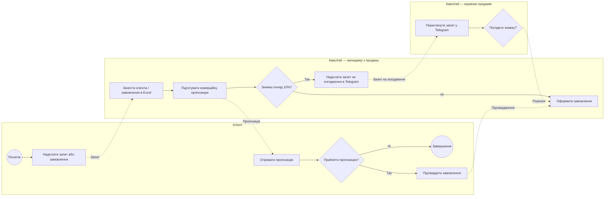
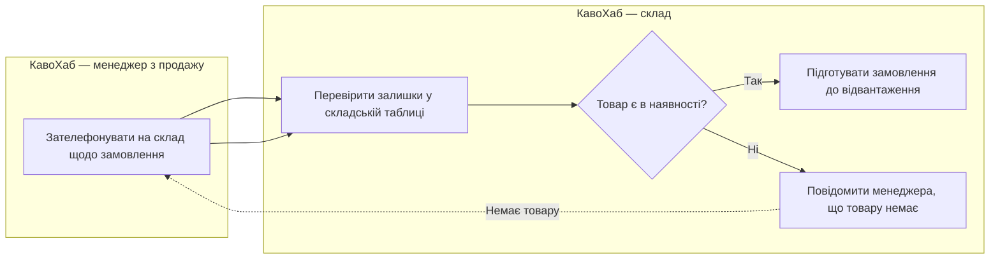
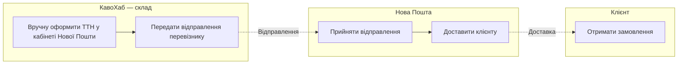
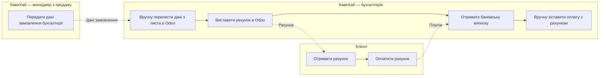

# Склонировать репозиторий занятий

> [@GitHub](plugin://github@openai-curated-remote) [https://github.com/0Kelovi0/corporate-software-systems-lessons.git](https://github.com/0Kelovi0/corporate-software-systems-lessons.git) склонуй репо

2 previous messages

> Клонирую репозиторий в текущую рабочую папку. Сначала проверю доступные GitHub-инструменты и содержимое папки, чтобы выбрать безопасное место для клона.
>
> 

Ran 3 commands

>
> - Ran `Get-ChildItem -Force | Select-Object Mode,Name`
> - Ran `git clone https://github.com/0Kelovi0/corporate-software-systems-lessons.git`
> - Ran `git clone https://github.com/0Kelovi0/corporate-software-systems-lessons.git`
>
> 

Готово. Репозиторий склонирован в [corporate-software-systems-lessons](./corporate-software-systems-lessons).

> давай розпочнемо роботу над lab1

2 previous messages

> Знайду інструкції для Lab1 у клонованому репозиторії, перегляну структуру й визначу, які саме файли та вимоги стосуються цієї лабораторної. Потім почну виконувати завдання в робочій копії.
>
> 

Ran 4 commands

>
> - Ran `Get-ChildItem -Force -Recurse -Depth 2 | Select-Object Mode,FullName`
> - Ran `Get-Content README.md; Get-Content lab-01.md`
> - Ran `Get-Content lab-01.md -TotalCount 260`
> - Ran `$c=Get-Content lab-01.md; $c[95..185]`
>
> 

У ЛР1 потрібно обрати один модуль на весь семестр: **CRM, Orders, Inventory, Billing або Notifications / Reporting**. Для кожного треба окремо з’ясувати вимоги у стейкхолдерів.

Я переглянув методичку. У спільній частині роботи ми змоделюємо поточний процес Lead-to-Cash, а потім спроєктуємо обраний модуль. Наприклад, для **Orders** уже видно два конфлікти, які треба дослідити: коли резервувати товар (П4 ↔ С2) і за яким курсом фіксувати ціну обладнання (П5 ↔ Б4).

Напиши, будь ласка:

1. Який модуль обираєш? Якщо ще не вирішив, пропоную **Orders** — він охоплює центральний процес і має чіткі конфлікти вимог.
2. Які щонайменше **5 власних запитань стейкхолдерам** ти підготував, як просить методичка? Якщо ще не підготував, скажи — складемо їх разом.

> яка задача стоїть в lab1?

У **Lab1 потрібно спроєктувати свій модуль** корпоративної системи для компанії «КавоХаб» — від вимог до архітектури. Код писати й запускати не потрібно.

Робота складається з таких частин:

- описати стейкхолдерів і змоделювати поточний процес продажу від ліда до оплати (**Lead-to-Cash, as-is**);
- обрати один модуль на весь семестр: **CRM, Orders, Inventory, Billing або Notifications / Reporting**;
- для нього описати майбутній процес, підготувати 5–7 user stories із критеріями приймання, нефункціональні вимоги й розібрати конфлікти вимог;
- змоделювати події та межі модулів, створити глосарій і діаграми архітектури;
- зафіксувати архітектурні рішення (**ADR**) та підготувати початкові контракти подій і API.

Результат — **проєктний документ** `lab-01-<модуль>-<прізвище>.md` і посилання на діалог із ШІ. Деталі є в [lab-01.md](./corporate-software-systems-lessons/lab-01.md) та спільні правила в [README.md](./corporate-software-systems-lessons/README.md).

> стейкхолдери - чим займаються - зона відповідальності

Ось стейкхолдери «КавоХаб», їхні ролі та зони відповідальності за матеріалами Lab1:

| Стейкхолдер | Чим займається | Зона відповідальності |
|---|---|---|
| **Ірина Мельник — директорка** | Керує компанією, відстежує замовлення, відвантаження та заборгованість. | Бізнес-цілі й пріоритети, контроль показників, рішення щодо роботи компанії. |
| **Андрій Бондар — керівник відділу продажів** | Керує менеджерами, клієнтами, угодами та погодженням знижок. | Продажі, воронка, розподіл клієнтів між менеджерами, знижки понад 10%. |
| **Менеджери з продажу** | Залучають клієнтів, ведуть переговори, готують пропозиції та замовлення. | Робота з лідами й клієнтами, ціни та знижки в межах повноважень, передавання замовлень далі. |
| **Сергій Ткаченко — керівник складу** | Організовує облік товару, комплектацію та відвантаження. | Складські залишки й резерви, партії та терміни придатності, робота комірників, передавання відправлень перевізнику. |
| **Комірники** | Збирають замовлення, пакують товар і оформлюють відвантаження. | Точність комплектації, складські операції та створення ТТН. За вимогою керівника складу не повинні бачити ціни й суми. |
| **Наталія Шевчук — головна бухгалтерка** | Веде бухгалтерський облік у Odoo, виставляє рахунки й звіряє оплати. | Рахунки, нумерація документів, облік платежів, коригування, контроль простроченої заборгованості. |
| **Олег Савчук — ІТ-адміністратор** | Підтримує ІТ-інфраструктуру та облікові записи працівників. | Доступи й облікові записи, сервер, резервні копії та технічна підтримка. |
| **Марта Гнатів — власниця кав’ярні, клієнтка** | Купує продукцію та обладнання для свого закладу. | Як зовнішній користувач, очікує своєчасну доставку, номер ТТН і рахунок у PDF на пошті. |
| **Нова Пошта** | Приймає й доставляє відправлення, надає номер ТТН та інформацію про доставку. | Перевезення посилок і дані про їхній статус. Це зовнішня система, а не працівник «КавоХаб». |

> які є проблеми відносно стекхолдера(табл.)

| Стейкхолдер | Проблема / «біль» | Джерело |
|---|---|---|
| **Директорка Ірина Мельник** | Дані про замовлення, відвантаження й борги збирають вручну з кількох таблиць лише раз на тиждень, тому немає актуальної щоденної картини. | Д1 |
| | Не видно клієнтів, які мають орендовану кавомашину, але перестали закуповувати каву. | Д3 |
| | У піковий сезон замовлень утричі більше; минулого року таблиця перестала відкриватися. | Д4 |
| **Керівник продажів Андрій Бондар** | Менеджери ведуть клієнтів у Excel і Telegram. Коли менеджер звільняється, інформація про його клієнтів може зникнути. | П1 |
| | Погодження знижок понад 10% відбувається в Telegram і затримується; клієнт іноді чекає до двох діб. | П2 |
| | Немає зручної воронки продажів і даних про конверсію менеджерів. | П3 |
| | Не завжди зрозуміло, чи вистачить товару; бажання одразу резервувати його конфліктує з потребою складу не тримати резерв тижнями. | П4, С2 |
| | Ціна обладнання в пропозиції може відрізнятися від ціни в рахунку через різні правила визначення курсу валют. | П5, Б4 |
| | Повторні щотижневі замовлення оформлюють вручну, хоча їх можна автоматизувати. | П6 |
| **Керівник складу Сергій Ткаченко** | Склад часто дізнається про замовлення телефоном; трапляються продажі товару, якого немає. | С1 |
| | Резерви «поки клієнт думає» можуть надовго блокувати товар. | С2 |
| | Потрібно відвантажувати каву з найстаріших партій першою, щоб враховувати термін придатності. | С3 |
| | ТТН Нової Пошти вводять вручну, через помилки в адресах і телефонах посилки повертаються. | С4 |
| | Комірникам не потрібен доступ до цін і сум, але це обмеження треба забезпечити в системі. | С5 |
| **Головна бухгалтерка Наталія Шевчук** | Рахунки вручну переносять у Odoo з листів менеджерів; є вимога безперервної нумерації. | Б1 |
| | Платежі вручну зіставляють із рахунками, бо призначення платежу клієнти заповнюють довільно. | Б2 |
| | Після виставлення рахунок не можна змінювати — потрібен окремий коригувальний документ. | Б3 |
| | Правило курсу для обладнання в пропозиції та рахунку не узгоджене. | Б4, П5 |
| | Потрібен список прострочених рахунків із сумою боргу й кількістю днів прострочення. | Б5 |
| **ІТ-адміністратор Олег Савчук** | Невідомо, чи працюють резервні копії належним чином; відновлення з них не перевіряли. | І1 |
| | Працівники мають отримувати доступ до системи з різних місць, зокрема з телефонів. | І2 |
| | На складі використовують один спільний пароль, тому дії окремих працівників важко розрізнити. | І3 |
| | ІТ-адміністратор не завжди вчасно дізнається про звільнення працівника, щоб закрити доступ. | І4 |
| **Клієнтка Марта Гнатів** | Не отримує інформацію про доставку й номер ТТН одразу, тому змушена телефонувати менеджеру. | К1 |
| | Рахунок потрібен електронною поштою у PDF, щоб передати його бухгалтерці. | К2 |
| **Нова Пошта — зовнішній перевізник** | У процесі є ризик помилок у даних доставки через ручне оформлення ТТН; потрібен обмін коректними адресами, телефонами та статусами доставки. | С4, К1 |

> Я обираю модуль Orders на весь семестр.\
> \
> Проблема, над якою я буду працювати в межах цього модуля: відсутність прозорого та керованого процесу підтвердження замовлення і погодження умов (знижок > 10% та цін на обладнання), через що виникають прямі конфлікти між відділом продажів, складом і бухгалтерією — зокрема щодо моменту і тривалості резервування товару (П4 ↔ С2) та фіксації валютного курсу на обладнання (П5 ↔ Б4).\
> \
> Хто ще зі стейкхолдерів прямо чи опосередковано взаємодіє з цією проблемою?\
> \
> І на першому етапі я підготував такі 6 запитань до стейкхолдерів для розкриття цієї проблеми:\
> 1\. До Андрія Бондаря (керівника відділу продажів): Як саме має відбуватися погодження знижки понад 10%, якщо ви у відпустці або недоступні, і чи може менеджер змінити замовлення після відправлення на погодження?\
> 2\. До Андрія Бондаря: Який термін дії комерційної пропозиції, і в який момент ціна обладнання в гривнях має фіксуватися остаточно?\
> 3\. До Сергія Ткаченка (керівника складу): Чому довгий резерв для вас критичний і як зараз склад дізнається, що замовлення скасовано або знижку не погодили?\
> 4\. До Наталії Шевчук (головної бухгалтерки): За яких умов ви готові прийняти в рахунку курс валюти на день комерційної пропозиції, а не на день виставлення рахунку?\
> 5\. До Ірини Мельник (директорки): Яке пікове навантаження (кількість замовлень на день та в пікові години) система має витримувати в листопаді–грудні?\
> 6\. До Марти Гнатів (клієнтки): Чи важливо для вас знати, що замовлення прийняте в роботу, ще до моменту відправлення ТТН?

Із цією проблемою пов’язані такі стейкхолдери:

| Стейкхолдер | Взаємодія з проблемою | Інтерес або відповідальність |
|---|---|---|
| **Менеджери з продажу** | Створюють замовлення, задають знижки й ціни, надсилають їх на погодження. | Швидко оформити замовлення й отримати рішення; знати, чи можна змінити замовлення після надсилання. |
| **Андрій Бондар, керівник продажів** | Погоджує знижки понад 10%; визначає правила роботи з комерційними пропозиціями. | Контролювати знижки, не затримуючи відповідь клієнту; мати заміну на час відсутності. |
| **Сергій Ткаченко, керівник складу** | Залежить від моменту створення й скасування резерву товару. | Не допустити продажу відсутнього товару та не тримати товар зарезервованим надовго. |
| **Комірники** | Виконують резервування або комплектацію замовлень і мають знати про його скасування чи погодження. | Отримувати однозначний статус замовлення та актуальну інформацію про резерв. |
| **Наталія Шевчук, головна бухгалтерка** | Отримує підтверджені умови замовлення для виставлення рахунку в Odoo. | Щоб ціна, валюта, курс і дата курсу були зрозумілими та узгодженими; рахунок відповідав затвердженій пропозиції. |
| **Ірина Мельник, директорка** | Впливає на правила погодження й пріоритети процесу; може бути альтернативною погоджувачкою. | Щоб замовлення не затримувалися, а процес витримував пікове навантаження. |
| **Клієнтка Марта Гнатів та інші клієнти** | Чекають на цінову пропозицію, підтвердження замовлення й інформацію про подальші кроки. | Отримати швидку відповідь і не зіткнутися зі зміною ціни після погодження. |
| **Олег Савчук, ІТ-адміністратор** | Підтримує доступи працівників і технічну роботу системи та інтеграцій. | Щоб погодження було доступне уповноваженим працівникам, а дії можна було пов’язати з конкретними обліковими записами. |
| **Команди Inventory та Billing** | Inventory надає Orders дані про наявність і резерви; Billing використовує затверджені ціни й умови для рахунків. | Отримувати несуперечливі статуси й дані через узгоджені контракти між модулями. |
| **Odoo** | Зовнішня для Orders система, куди передаються дані для бухгалтерського обліку. | Отримувати затверджені умови рахунку з необхідними реквізитами, зокрема курсом і датою. |

**Основні учасники конфлікту** — продажі, склад і бухгалтерія. **Клієнт** відчуває наслідки затримок або зміни умов, а директорка встановлює пріоритети й правила. Inventory, Billing та Odoo залежать від рішень і даних Orders.

Твої шість запитань охоплюють ці сторони. Для питання до директорки про пікове навантаження корисно уточнити не лише кількість замовлень на день, а й скільки з них надходить у найнавантаженішу годину.

> Дякую за уточнення! Зіграй, будь ласка, ролі зазначених стейкхолдерів і сам згенеруй їхні відповіді від першої особи на кожне з цих 6 запитань:\
> \
> 1\. До Андрія Бондаря (керівника відділу продажів): Як саме має відбуватися погодження знижки понад 10%, якщо ви у відпустці або недоступні, і чи може менеджер змінити замовлення після відправлення на погодження?\
> 2\. До Андрія Бондаря: Який термін дії комерційної пропозиції, і в який момент ціна обладнання в гривнях має фіксуватися остаточно?\
> 3\. До Сергія Ткаченка (керівника складу): Чому довгий резерв для вас критичний і як зараз склад дізнається, що замовлення скасовано або знижку не погодили?\
> 4\. До Наталії Шевчук (головної бухгалтерки): За яких умов ви готові прийняти в рахунку курс валюти на день комерційної пропозиції, а не на день виставлення рахунку?\
> 5\. До Ірини Мельник (директорки): Яке пікове навантаження (кількість замовлень на день та в найнавантаженіші години) система має витримувати в листопаді–грудні?\
> 6\. До Марти Гнатів (клієнтки): Чи важливо для вас знати, що замовлення прийняте в роботу, ще до моменту відправлення ТТН, і яким каналом зв'язку вам зручніше отримувати сповіщення?

## Відповіді стейкхолдерів

**1. Андрій Бондар, керівник відділу продажів:**
«Якщо я у відпустці або недоступний, знижку погоджує директорка. Погодження має надійти мені або їй у систему, щоб рішення не губилося в Telegram. Після відправлення замовлення на погодження менеджер не повинен змінювати його умови. Якщо потрібно щось виправити, він відкликає замовлення, вносить зміни й надсилає його повторно».

**2. Андрій Бондар:**
«Комерційна пропозиція діє п’ять робочих днів. Ціну обладнання в гривнях потрібно зафіксувати на день створення пропозиції. Якщо клієнт приймає її в межах строку дії, саме ця ціна має перейти в замовлення й рахунок».

**3. Сергій Ткаченко, керівник складу:**
«Довгий резерв критичний, бо товар може тижнями залишатися недоступним для інших замовлень, хоча клієнт ще нічого не підтвердив. Зараз склад часто дізнається про замовлення телефоном і так само неформально може почути про скасування. Надійного автоматичного повідомлення немає. Резерв має бути пов’язаний зі статусом замовлення, а про його скасування чи завершення строку погодження склад має отримувати повідомлення».

**4. Наталія Шевчук, головна бухгалтерка:**
«Я готова прийняти курс на день комерційної пропозиції, якщо в рахунку буде зазначено сам курс і дату, на яку його взяли. Також треба зберегти зв’язок рахунку з пропозицією, щоб можна було перевірити, звідки взялася сума. Рахунок після виставлення не змінюємо — помилки виправляємо окремим коригувальним документом».

**5. Ірина Мельник, директорка:**
«Минулого року 23 листопада ми отримали 412 замовлень за день, і приблизно 60% надійшло між 9:00 та 13:00. У листопаді й грудні система має витримувати щонайменше таке навантаження, із запасом для зростання. Даних про точний розподіл замовлень по кожній годині в мене немає, але цей проміжок — найнапруженіший».

**6. Марта Гнатів, клієнтка:**
«Так, мені важливо знати, що замовлення прийняли в роботу, до того як з’явиться ТТН. Тоді я розумітиму, що його не забули й коли приблизно чекати доставку. Найзручніше отримувати короткі сповіщення у Viber або на електронну пошту. У вихідні замовлення я не оформлюю».

> Дякую за відповіді. Тепер перевір мої напрацювання і згенеруй діаграму для процесу Lead-to-Cash

1 previous message

> Зіставлю твої напрацювання з вимогами Lab1 і підготую BPMN-подібну діаграму **as-is** для Lead-to-Cash. Оскільки в чаті вже є початкові проблеми стейкхолдерів і шість відповідей, перевірю їх на повноту та відділю підтверджені факти від припущень.

## Перевірка напрацювань

Ти добре визначив проблему модуля **Orders**: вона пов’язує погодження знижок і цін із конфліктом щодо резервування та зачіпає продажі, склад і бухгалтерію.

- Таблиця стейкхолдерів і проблем охоплює основних учасників. Для повного завдання **С1** додай до неї рівень **влади й інтересу** та посилання на цитати — наприклад, П4 або С2.
- Шість запитань відповідають проблемі й адресовані потрібним людям. Запитання Сергію поєднує дві теми — причину довгого резерву й сповіщення про скасування. Це нормально, але для чітких відповідей їх можна розділити.
- Згенеровані відповіді розкривають потрібні уточнення: замісник погоджувача — директорка, пропозиція діє п’ять робочих днів, курс фіксується на день пропозиції, пік — 412 замовлень 23 листопада, близько 60% між 9:00 і 13:00.
- У документі познач ці відповіді як **уточнення, отримані в діалозі з ШІ в ролі стейкхолдерів**. Це не дослівні цитати з вихідних інтерв’ю.
- As-is процес нижче спирається на інтерв’ю. Деталі, яких у них немає — наприклад, точний етап кваліфікації ліда чи спосіб надсилання пропозиції — позначені як припущення для уточнення.

## Lead-to-Cash as-is

```mermaid
flowchart LR
  subgraph CUSTOMER["Пул: Клієнт"]
    C0((Початок))
    C1["Надіслати запит або зробити замовлення"]
    C2["Отримати комерційну пропозицію"]
    C3{"Прийняти пропозицію?"}
    C4["Підтвердити замовлення"]
    C5((Завершення без замовлення))
    C6["Отримати товар і рахунок"]
    C7["Оплатити рахунок"]
    C8((Замовлення оплачено))
    C0 --> C1
    C2 --> C3
    C3 -->|Ні| C5
    C3 -->|Так| C4
    C6 --> C7 --> C8
  end

  subgraph KAVOHUB["Пул: КавоХаб"]
    direction LR

    subgraph SALES["Доріжка: Менеджер з продажу"]
      S1["Занести клієнта / замовлення в Excel"]
      S2["Підготувати комерційну пропозицію"]
      S3{"Знижка понад 10%?"}
      S4["Надіслати запит на погодження в Telegram"]
      S5["Оформити замовлення за погодженими умовами"]
      S6["Зателефонувати на склад щодо замовлення"]
      S7["Передати дані замовлення бухгалтерії"]
      S1 --> S2 --> S3
      S3 -->|Ні| S5
      S3 -->|Так| S4
      S5 --> S6
      S6 --> S7
    end

    subgraph MANAGER["Доріжка: Керівник продажів"]
      M1["Переглянути запит у Telegram"]
      M2{"Погодити знижку?"}
      M3["Відповісти менеджеру в Telegram"]
      M1 --> M2 --> M3
    end

    subgraph WAREHOUSE["Доріжка: Склад"]
      W1["Перевірити залишки у складській таблиці"]
      W2{"Товар є в наявності?"}
      W3["Підготувати замовлення до відвантаження"]
      W4["Повідомити, що товару немає"]
      W5["Вручну оформити ТТН у кабінеті Нової Пошти"]
      W6["Передати відправлення перевізнику"]
      W1 --> W2
      W2 -->|Так| W3
      W2 -->|Ні| W4
      W3 --> W5 --> W6
    end

    subgraph ACCOUNTING["Доріжка: Бухгалтерія"]
      A1["Вручну перенести дані з листа менеджера в Odoo"]
      A2["Виставити рахунок в Odoo"]
      A3["Отримати банківську виписку"]
      A4["Вручну зіставити оплату з рахунком"]
      A1 --> A2 --> A3 --> A4
    end
  end

  subgraph CARRIER["Пул: Нова Пошта"]
    N1["Прийняти відправлення"]
    N2["Доставити клієнту"]
    N1 --> N2
  end

  C1 -. "Запит / замовлення" .-> S1
  S2 -. "Комерційна пропозиція" .-> C2
  C4 -. "Підтвердження" .-> S5
  S4 -. "Запит на погодження" .-> M1
  M3 -. "Рішення" .-> S5
  S6 --> W1
  W4 -. "Немає товару" .-> S6
  S7 -. "Дані замовлення" .-> A1
  W6 -. "Відправлення" .-> N1
  N2 -. "Доставка" .-> C6
  A2 -. "Рахунок" .-> C6
  C7 -. "Банківський платіж" .-> A3
```

Суцільні стрілки показують послідовність робіт у межах пулу «КавоХаб» або учасника. Пунктирні стрілки між пулами показують обмін повідомленнями. Доріжки складу й бухгалтерії відображають інтерв’ю: складський облік ведеться в таблиці, ТТН оформлюють вручну, а бухгалтерка переносить дані до Odoo з листів.

У BPMN можна окремо показати варіант доставки власним транспортом, а також уточнити, чи й коли фактично створюють резерв: в інтерв’ю є суперечливі побажання щодо резервування, але немає однозначного опису поточної практики.

> Розбий діаграму по етапно щоб краще було видно

Розбив процес на чотири діаграми: від звернення клієнта до оплати. Суцільні стрілки — послідовність дій, пунктирні — обмін між учасниками.

### 1. Запит і комерційна пропозиція

### 2. Перевірка товару й підготовка відвантаження

### 3. Відвантаження та доставка

### 4. Рахунок і оплата

Зверни увагу: спосіб надсилання пропозиції та точний порядок резервування в інтерв’ю не визначені. Їх варто позначити в роботі як питання для уточнення, а не як підтверджені кроки процесу.
