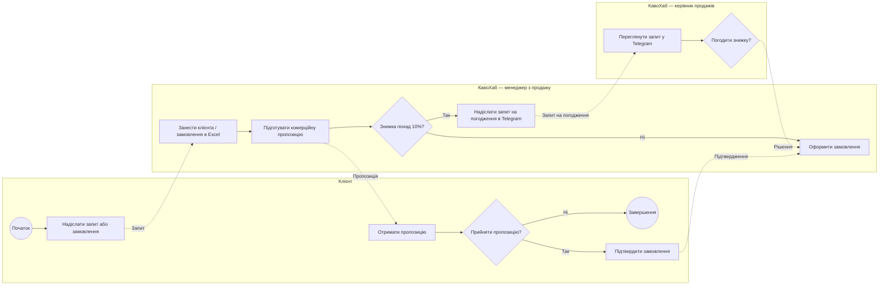
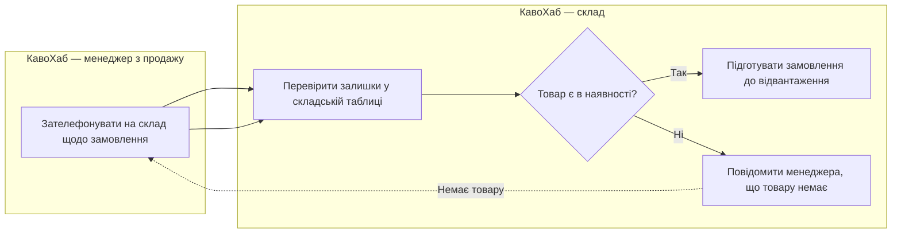
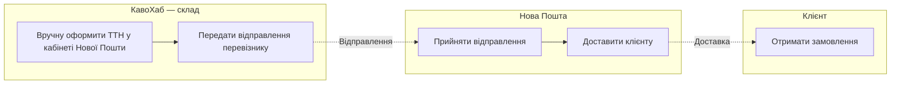
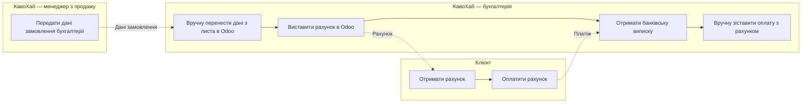
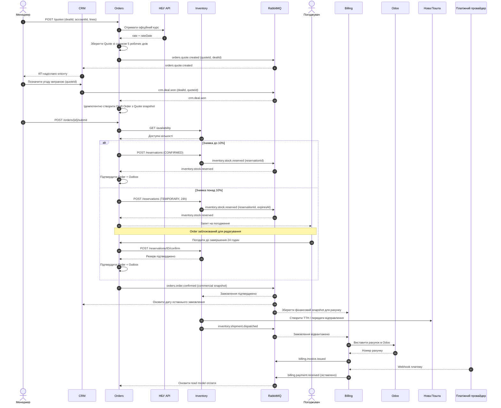

# Склонировать репозиторий занятий

> [@GitHub](plugin://github@openai-curated-remote) [https://github.com/0Kelovi0/corporate-software-systems-lessons.git](https://github.com/0Kelovi0/corporate-software-systems-lessons.git) склонуй репо

1 previous message

> Клонирую репозиторий в текущую рабочую папку. Сначала проверю доступные GitHub-инструменты и содержимое папки, чтобы выбрать безопасное место для клона.

Готово. Репозиторий склонирован в [corporate-software-systems-lessons](./corporate-software-systems-lessons).

> давай розпочнемо роботу над lab1

1 previous message

> Знайду інструкції для Lab1 у клонованому репозиторії, перегляну структуру й визначу, які саме файли та вимоги стосуються цієї лабораторної. Потім почну виконувати завдання в робочій копії.

У ЛР1 потрібно обрати один модуль на весь семестр: **CRM, Orders, Inventory, Billing або Notifications / Reporting**. Для кожного треба окремо з’ясувати вимоги у стейкхолдерів.

Я переглянув методичку. У спільній частині роботи ми змоделюємо поточний процес Lead-to-Cash, а потім спроєктуємо обраний модуль. Наприклад, для **Orders** уже видно два конфлікти, які треба дослідити: коли резервувати товар (П4 ↔ С2) і за яким курсом фіксувати ціну обладнання (П5 ↔ Б4).

Напиши, будь ласка:

1. Який модуль обираєш? Якщо ще не вирішив, пропоную **Orders** — він охоплює центральний процес і має чіткі конфлікти вимог.
2. Які щонайменше **5 власних запитань стейкхолдерам** ти підготував, як просить методичка? Якщо ще не підготував, скажи — складемо їх разом.

> яка задача стоїть в lab1?

У **Lab1 потрібно спроєктувати свій модуль** корпоративної системи для компанії «КавоХаб» — від вимог до архітектури. Код писати й запускати не потрібно.

Робота складається з таких частин:

- описати стейкхолдерів і змоделювати поточний процес продажу від ліда до оплати (**Lead-to-Cash, as-is**);
- обрати один модуль на весь семестр: **CRM, Orders, Inventory, Billing або Notifications / Reporting**;
- для нього описати майбутній процес, підготувати 5–7 user stories із критеріями приймання, нефункціональні вимоги й розібрати конфлікти вимог;
- змоделювати події та межі модулів, створити глосарій і діаграми архітектури;
- зафіксувати архітектурні рішення (**ADR**) та підготувати початкові контракти подій і API.

Результат — **проєктний документ** `lab-01-<модуль>-<прізвище>.md` і посилання на діалог із ШІ. Деталі є в [lab-01.md](./corporate-software-systems-lessons/lab-01.md) та спільні правила в [README.md](./corporate-software-systems-lessons/README.md).

> стейкхолдери - чим займаються - зона відповідальності

Ось стейкхолдери «КавоХаб», їхні ролі та зони відповідальності за матеріалами Lab1:

| Стейкхолдер | Чим займається | Зона відповідальності |
|---|---|---|
| **Ірина Мельник — директорка** | Керує компанією, відстежує замовлення, відвантаження та заборгованість. | Бізнес-цілі й пріоритети, контроль показників, рішення щодо роботи компанії. |
| **Андрій Бондар — керівник відділу продажів** | Керує менеджерами, клієнтами, угодами та погодженням знижок. | Продажі, воронка, розподіл клієнтів між менеджерами, знижки понад 10%. |
| **Менеджери з продажу** | Залучають клієнтів, ведуть переговори, готують пропозиції та замовлення. | Робота з лідами й клієнтами, ціни та знижки в межах повноважень, передавання замовлень далі. |
| **Сергій Ткаченко — керівник складу** | Організовує облік товару, комплектацію та відвантаження. | Складські залишки й резерви, партії та терміни придатності, робота комірників, передавання відправлень перевізнику. |
| **Комірники** | Збирають замовлення, пакують товар і оформлюють відвантаження. | Точність комплектації, складські операції та створення ТТН. За вимогою керівника складу не повинні бачити ціни й суми. |
| **Наталія Шевчук — головна бухгалтерка** | Веде бухгалтерський облік у Odoo, виставляє рахунки й звіряє оплати. | Рахунки, нумерація документів, облік платежів, коригування, контроль простроченої заборгованості. |
| **Олег Савчук — ІТ-адміністратор** | Підтримує ІТ-інфраструктуру та облікові записи працівників. | Доступи й облікові записи, сервер, резервні копії та технічна підтримка. |
| **Марта Гнатів — власниця кав’ярні, клієнтка** | Купує продукцію та обладнання для свого закладу. | Як зовнішній користувач, очікує своєчасну доставку, номер ТТН і рахунок у PDF на пошті. |
| **Нова Пошта** | Приймає й доставляє відправлення, надає номер ТТН та інформацію про доставку. | Перевезення посилок і дані про їхній статус. Це зовнішня система, а не працівник «КавоХаб». |

> які є проблеми відносно стекхолдера(табл.)

| Стейкхолдер | Проблема / «біль» | Джерело |
|---|---|---|
| **Директорка Ірина Мельник** | Дані про замовлення, відвантаження й борги збирають вручну з кількох таблиць лише раз на тиждень, тому немає актуальної щоденної картини. | Д1 |
| | Не видно клієнтів, які мають орендовану кавомашину, але перестали закуповувати каву. | Д3 |
| | У піковий сезон замовлень утричі більше; минулого року таблиця перестала відкриватися. | Д4 |
| **Керівник продажів Андрій Бондар** | Менеджери ведуть клієнтів у Excel і Telegram. Коли менеджер звільняється, інформація про його клієнтів може зникнути. | П1 |
| | Погодження знижок понад 10% відбувається в Telegram і затримується; клієнт іноді чекає до двох діб. | П2 |
| | Немає зручної воронки продажів і даних про конверсію менеджерів. | П3 |
| | Не завжди зрозуміло, чи вистачить товару; бажання одразу резервувати його конфліктує з потребою складу не тримати резерв тижнями. | П4, С2 |
| | Ціна обладнання в пропозиції може відрізнятися від ціни в рахунку через різні правила визначення курсу валют. | П5, Б4 |
| | Повторні щотижневі замовлення оформлюють вручну, хоча їх можна автоматизувати. | П6 |
| **Керівник складу Сергій Ткаченко** | Склад часто дізнається про замовлення телефоном; трапляються продажі товару, якого немає. | С1 |
| | Резерви «поки клієнт думає» можуть надовго блокувати товар. | С2 |
| | Потрібно відвантажувати каву з найстаріших партій першою, щоб враховувати термін придатності. | С3 |
| | ТТН Нової Пошти вводять вручну, через помилки в адресах і телефонах посилки повертаються. | С4 |
| | Комірникам не потрібен доступ до цін і сум, але це обмеження треба забезпечити в системі. | С5 |
| **Головна бухгалтерка Наталія Шевчук** | Рахунки вручну переносять у Odoo з листів менеджерів; є вимога безперервної нумерації. | Б1 |
| | Платежі вручну зіставляють із рахунками, бо призначення платежу клієнти заповнюють довільно. | Б2 |
| | Після виставлення рахунок не можна змінювати — потрібен окремий коригувальний документ. | Б3 |
| | Правило курсу для обладнання в пропозиції та рахунку не узгоджене. | Б4, П5 |
| | Потрібен список прострочених рахунків із сумою боргу й кількістю днів прострочення. | Б5 |
| **ІТ-адміністратор Олег Савчук** | Невідомо, чи працюють резервні копії належним чином; відновлення з них не перевіряли. | І1 |
| | Працівники мають отримувати доступ до системи з різних місць, зокрема з телефонів. | І2 |
| | На складі використовують один спільний пароль, тому дії окремих працівників важко розрізнити. | І3 |
| | ІТ-адміністратор не завжди вчасно дізнається про звільнення працівника, щоб закрити доступ. | І4 |
| **Клієнтка Марта Гнатів** | Не отримує інформацію про доставку й номер ТТН одразу, тому змушена телефонувати менеджеру. | К1 |
| | Рахунок потрібен електронною поштою у PDF, щоб передати його бухгалтерці. | К2 |
| **Нова Пошта — зовнішній перевізник** | У процесі є ризик помилок у даних доставки через ручне оформлення ТТН; потрібен обмін коректними адресами, телефонами та статусами доставки. | С4, К1 |

> Я обираю модуль Orders на весь семестр.\
> \
> Проблема, над якою я буду працювати в межах цього модуля: відсутність прозорого та керованого процесу підтвердження замовлення і погодження умов (знижок > 10% та цін на обладнання), через що виникають прямі конфлікти між відділом продажів, складом і бухгалтерією — зокрема щодо моменту і тривалості резервування товару (П4 ↔ С2) та фіксації валютного курсу на обладнання (П5 ↔ Б4).\
> \
> Хто ще зі стейкхолдерів прямо чи опосередковано взаємодіє з цією проблемою?\
> \
> І на першому етапі я підготував такі 6 запитань до стейкхолдерів для розкриття цієї проблеми:\
> 1\. До Андрія Бондаря (керівника відділу продажів): Як саме має відбуватися погодження знижки понад 10%, якщо ви у відпустці або недоступні, і чи може менеджер змінити замовлення після відправлення на погодження?\
> 2\. До Андрія Бондаря: Який термін дії комерційної пропозиції, і в який момент ціна обладнання в гривнях має фіксуватися остаточно?\
> 3\. До Сергія Ткаченка (керівника складу): Чому довгий резерв для вас критичний і як зараз склад дізнається, що замовлення скасовано або знижку не погодили?\
> 4\. До Наталії Шевчук (головної бухгалтерки): За яких умов ви готові прийняти в рахунку курс валюти на день комерційної пропозиції, а не на день виставлення рахунку?\
> 5\. До Ірини Мельник (директорки): Яке пікове навантаження (кількість замовлень на день та в пікові години) система має витримувати в листопаді–грудні?\
> 6\. До Марти Гнатів (клієнтки): Чи важливо для вас знати, що замовлення прийняте в роботу, ще до моменту відправлення ТТН?

Із цією проблемою пов’язані такі стейкхолдери:

| Стейкхолдер | Взаємодія з проблемою | Інтерес або відповідальність |
|---|---|---|
| **Менеджери з продажу** | Створюють замовлення, задають знижки й ціни, надсилають їх на погодження. | Швидко оформити замовлення й отримати рішення; знати, чи можна змінити замовлення після надсилання. |
| **Андрій Бондар, керівник продажів** | Погоджує знижки понад 10%; визначає правила роботи з комерційними пропозиціями. | Контролювати знижки, не затримуючи відповідь клієнту; мати заміну на час відсутності. |
| **Сергій Ткаченко, керівник складу** | Залежить від моменту створення й скасування резерву товару. | Не допустити продажу відсутнього товару та не тримати товар зарезервованим надовго. |
| **Комірники** | Виконують резервування або комплектацію замовлень і мають знати про його скасування чи погодження. | Отримувати однозначний статус замовлення та актуальну інформацію про резерв. |
| **Наталія Шевчук, головна бухгалтерка** | Отримує підтверджені умови замовлення для виставлення рахунку в Odoo. | Щоб ціна, валюта, курс і дата курсу були зрозумілими та узгодженими; рахунок відповідав затвердженій пропозиції. |
| **Ірина Мельник, директорка** | Впливає на правила погодження й пріоритети процесу; може бути альтернативною погоджувачкою. | Щоб замовлення не затримувалися, а процес витримував пікове навантаження. |
| **Клієнтка Марта Гнатів та інші клієнти** | Чекають на цінову пропозицію, підтвердження замовлення й інформацію про подальші кроки. | Отримати швидку відповідь і не зіткнутися зі зміною ціни після погодження. |
| **Олег Савчук, ІТ-адміністратор** | Підтримує доступи працівників і технічну роботу системи та інтеграцій. | Щоб погодження було доступне уповноваженим працівникам, а дії можна було пов’язати з конкретними обліковими записами. |
| **Команди Inventory та Billing** | Inventory надає Orders дані про наявність і резерви; Billing використовує затверджені ціни й умови для рахунків. | Отримувати несуперечливі статуси й дані через узгоджені контракти між модулями. |
| **Odoo** | Зовнішня для Orders система, куди передаються дані для бухгалтерського обліку. | Отримувати затверджені умови рахунку з необхідними реквізитами, зокрема курсом і датою. |

**Основні учасники конфлікту** — продажі, склад і бухгалтерія. **Клієнт** відчуває наслідки затримок або зміни умов, а директорка встановлює пріоритети й правила. Inventory, Billing та Odoo залежать від рішень і даних Orders.

Твої шість запитань охоплюють ці сторони. Для питання до директорки про пікове навантаження корисно уточнити не лише кількість замовлень на день, а й скільки з них надходить у найнавантаженішу годину.

> Дякую за уточнення! Зіграй, будь ласка, ролі зазначених стейкхолдерів і сам згенеруй їхні відповіді від першої особи на кожне з цих 6 запитань:\
> \
> 1\. До Андрія Бондаря (керівника відділу продажів): Як саме має відбуватися погодження знижки понад 10%, якщо ви у відпустці або недоступні, і чи може менеджер змінити замовлення після відправлення на погодження?\
> 2\. До Андрія Бондаря: Який термін дії комерційної пропозиції, і в який момент ціна обладнання в гривнях має фіксуватися остаточно?\
> 3\. До Сергія Ткаченка (керівника складу): Чому довгий резерв для вас критичний і як зараз склад дізнається, що замовлення скасовано або знижку не погодили?\
> 4\. До Наталії Шевчук (головної бухгалтерки): За яких умов ви готові прийняти в рахунку курс валюти на день комерційної пропозиції, а не на день виставлення рахунку?\
> 5\. До Ірини Мельник (директорки): Яке пікове навантаження (кількість замовлень на день та в найнавантаженіші години) система має витримувати в листопаді–грудні?\
> 6\. До Марти Гнатів (клієнтки): Чи важливо для вас знати, що замовлення прийняте в роботу, ще до моменту відправлення ТТН, і яким каналом зв'язку вам зручніше отримувати сповіщення?

## Відповіді стейкхолдерів

**1. Андрій Бондар, керівник відділу продажів:**
«Якщо я у відпустці або недоступний, знижку погоджує директорка. Погодження має надійти мені або їй у систему, щоб рішення не губилося в Telegram. Після відправлення замовлення на погодження менеджер не повинен змінювати його умови. Якщо потрібно щось виправити, він відкликає замовлення, вносить зміни й надсилає його повторно».

**2. Андрій Бондар:**
«Комерційна пропозиція діє п’ять робочих днів. Ціну обладнання в гривнях потрібно зафіксувати на день створення пропозиції. Якщо клієнт приймає її в межах строку дії, саме ця ціна має перейти в замовлення й рахунок».

**3. Сергій Ткаченко, керівник складу:**
«Довгий резерв критичний, бо товар може тижнями залишатися недоступним для інших замовлень, хоча клієнт ще нічого не підтвердив. Зараз склад часто дізнається про замовлення телефоном і так само неформально може почути про скасування. Надійного автоматичного повідомлення немає. Резерв має бути пов’язаний зі статусом замовлення, а про його скасування чи завершення строку погодження склад має отримувати повідомлення».

**4. Наталія Шевчук, головна бухгалтерка:**
«Я готова прийняти курс на день комерційної пропозиції, якщо в рахунку буде зазначено сам курс і дату, на яку його взяли. Також треба зберегти зв’язок рахунку з пропозицією, щоб можна було перевірити, звідки взялася сума. Рахунок після виставлення не змінюємо — помилки виправляємо окремим коригувальним документом».

**5. Ірина Мельник, директорка:**
«Минулого року 23 листопада ми отримали 412 замовлень за день, і приблизно 60% надійшло між 9:00 та 13:00. У листопаді й грудні система має витримувати щонайменше таке навантаження, із запасом для зростання. Даних про точний розподіл замовлень по кожній годині в мене немає, але цей проміжок — найнапруженіший».

**6. Марта Гнатів, клієнтка:**
«Так, мені важливо знати, що замовлення прийняли в роботу, до того як з’явиться ТТН. Тоді я розумітиму, що його не забули й коли приблизно чекати доставку. Найзручніше отримувати короткі сповіщення у Viber або на електронну пошту. У вихідні замовлення я не оформлюю».

> Дякую за відповіді. Тепер перевір мої напрацювання і згенеруй діаграму для процесу Lead-to-Cash

1 previous message

> Зіставлю твої напрацювання з вимогами Lab1 і підготую BPMN-подібну діаграму **as-is** для Lead-to-Cash. Оскільки в чаті вже є початкові проблеми стейкхолдерів і шість відповідей, перевірю їх на повноту та відділю підтверджені факти від припущень.

## Перевірка напрацювань

Ти добре визначив проблему модуля **Orders**: вона пов’язує погодження знижок і цін із конфліктом щодо резервування та зачіпає продажі, склад і бухгалтерію.

- Таблиця стейкхолдерів і проблем охоплює основних учасників. Для повного завдання **С1** додай до неї рівень **влади й інтересу** та посилання на цитати — наприклад, П4 або С2.
- Шість запитань відповідають проблемі й адресовані потрібним людям. Запитання Сергію поєднує дві теми — причину довгого резерву й сповіщення про скасування. Це нормально, але для чітких відповідей їх можна розділити.
- Згенеровані відповіді розкривають потрібні уточнення: замісник погоджувача — директорка, пропозиція діє п’ять робочих днів, курс фіксується на день пропозиції, пік — 412 замовлень 23 листопада, близько 60% між 9:00 і 13:00.
- У документі познач ці відповіді як **уточнення, отримані в діалозі з ШІ в ролі стейкхолдерів**. Це не дослівні цитати з вихідних інтерв’ю.
- As-is процес нижче спирається на інтерв’ю. Деталі, яких у них немає — наприклад, точний етап кваліфікації ліда чи спосіб надсилання пропозиції — позначені як припущення для уточнення.

## Lead-to-Cash as-is

```mermaid
flowchart LR
  subgraph CUSTOMER["Пул: Клієнт"]
    C0((Початок))
    C1["Надіслати запит або зробити замовлення"]
    C2["Отримати комерційну пропозицію"]
    C3{"Прийняти пропозицію?"}
    C4["Підтвердити замовлення"]
    C5((Завершення без замовлення))
    C6["Отримати товар і рахунок"]
    C7["Оплатити рахунок"]
    C8((Замовлення оплачено))
    C0 --> C1
    C2 --> C3
    C3 -->|Ні| C5
    C3 -->|Так| C4
    C6 --> C7 --> C8
  end

  subgraph KAVOHUB["Пул: КавоХаб"]
    direction LR

    subgraph SALES["Доріжка: Менеджер з продажу"]
      S1["Занести клієнта / замовлення в Excel"]
      S2["Підготувати комерційну пропозицію"]
      S3{"Знижка понад 10%?"}
      S4["Надіслати запит на погодження в Telegram"]
      S5["Оформити замовлення за погодженими умовами"]
      S6["Зателефонувати на склад щодо замовлення"]
      S7["Передати дані замовлення бухгалтерії"]
      S1 --> S2 --> S3
      S3 -->|Ні| S5
      S3 -->|Так| S4
      S5 --> S6
      S6 --> S7
    end

    subgraph MANAGER["Доріжка: Керівник продажів"]
      M1["Переглянути запит у Telegram"]
      M2{"Погодити знижку?"}
      M3["Відповісти менеджеру в Telegram"]
      M1 --> M2 --> M3
    end

    subgraph WAREHOUSE["Доріжка: Склад"]
      W1["Перевірити залишки у складській таблиці"]
      W2{"Товар є в наявності?"}
      W3["Підготувати замовлення до відвантаження"]
      W4["Повідомити, що товару немає"]
      W5["Вручну оформити ТТН у кабінеті Нової Пошти"]
      W6["Передати відправлення перевізнику"]
      W1 --> W2
      W2 -->|Так| W3
      W2 -->|Ні| W4
      W3 --> W5 --> W6
    end

    subgraph ACCOUNTING["Доріжка: Бухгалтерія"]
      A1["Вручну перенести дані з листа менеджера в Odoo"]
      A2["Виставити рахунок в Odoo"]
      A3["Отримати банківську виписку"]
      A4["Вручну зіставити оплату з рахунком"]
      A1 --> A2 --> A3 --> A4
    end
  end

  subgraph CARRIER["Пул: Нова Пошта"]
    N1["Прийняти відправлення"]
    N2["Доставити клієнту"]
    N1 --> N2
  end

  C1 -. "Запит / замовлення" .-> S1
  S2 -. "Комерційна пропозиція" .-> C2
  C4 -. "Підтвердження" .-> S5
  S4 -. "Запит на погодження" .-> M1
  M3 -. "Рішення" .-> S5
  S6 --> W1
  W4 -. "Немає товару" .-> S6
  S7 -. "Дані замовлення" .-> A1
  W6 -. "Відправлення" .-> N1
  N2 -. "Доставка" .-> C6
  A2 -. "Рахунок" .-> C6
  C7 -. "Банківський платіж" .-> A3
```

Суцільні стрілки показують послідовність робіт у межах пулу «КавоХаб» або учасника. Пунктирні стрілки між пулами показують обмін повідомленнями. Доріжки складу й бухгалтерії відображають інтерв’ю: складський облік ведеться в таблиці, ТТН оформлюють вручну, а бухгалтерка переносить дані до Odoo з листів.

У BPMN можна окремо показати варіант доставки власним транспортом, а також уточнити, чи й коли фактично створюють резерв: в інтерв’ю є суперечливі побажання щодо резервування, але немає однозначного опису поточної практики.

> Розбий діаграму по етапно щоб краще було видно

Розбив процес на чотири діаграми: від звернення клієнта до оплати. Суцільні стрілки — послідовність дій, пунктирні — обмін між учасниками.

### 1. Запит і комерційна пропозиція

### 2. Перевірка товару й підготовка відвантаження

### 3. Відвантаження та доставка

### 4. Рахунок і оплата

Зверни увагу: спосіб надсилання пропозиції та точний порядок резервування в інтерв’ю не визначені. Їх варто позначити в роботі як питання для уточнення, а не як підтверджені кроки процесу.

> Переходимо до Етапу 2 (вимоги модуля Orders: завдання М1–М4). Ось мої напрацювання:
> \
>
> \
> \### М1. Текстовий опис діаграми BPMN to-be підпроцесу модуля Orders
> \
> \- \*\*Пули та доріжки:\*\*
> \
> &#x20; 1\. \*Пул «Клієнт»\* (зовнішній учасник).
> \
> &#x20; 2\. \*Пул «КавоХаб (модуль Orders)»\* із двома доріжками: «Менеджер з продажу» та «Керівник продажів / Директорка».
> \
> &#x20; 3\. \*Пул «Inventory»\* (суміжний модуль складу).
> \
> \- \*\*Послідовність процесу (потік керування та потоки повідомлень):\*\*
> \
> &#x20; 1\. \*\*Початкова подія (повідомлення):\*\* Клієнт погоджує комерційну пропозицію або надсилає запит на замовлення → потік повідомлень передає дані менеджеру з продажу.
> \
> &#x20; 2\. \*\*Задача (Менеджер з продажу):\*\* «Створити чернетку замовлення та перевірити доступні залишки» (синхронний запит до модуля Inventory щодо вільних залишків).
> \
> &#x20; 3\. \*\*Ексклюзивний шлюз XOR «Знижка > 10%?»:\*\*
> \
> &#x20;    \- \*Гілка «Ні» (знижка ≤ 10%):\* перехід одразу до задачі «Підтвердити замовлення».
> \
> &#x20;    \- \*Гілка «Так» (знижка > 10%):\*
> \
> &#x20;      \- \*\*Задача (Менеджер з продажу):\*\* «Надіслати замовлення на погодження» (статус змінюється на «Очікує погодження», редагування блокується, ціна обладнання з КП фіксується).
> \
> &#x20;      \- \*\*Потік повідомлень до Inventory:\*\* запит на створення тимчасового резерву товару на 24 години.
> \
> &#x20;      \- \*\*Задача (Керівник продажів / Директорка):\*\* «Розглянути та ухвалити рішення щодо знижки» (паралельно запускається \*\*проміжна подія-таймер на 24 години\*\*).
> \
> &#x20;      \- \*\*Ексклюзивний шлюз XOR «Результат розгляду»:\*\*
> \
> &#x20;        \- \*Погоджено вчасно:\* перехід до підтвердження замовлення.
> \
> &#x20;        \- \*Відхилено або спрацював таймер 24 год:\* задача «Повернути замовлення в чернетку» + потік повідомлень в Inventory для зняття тимчасового резерву → \*\*альтернативна кінцева подія\*\* «Погодження не пройдено».
> \
> &#x20; 4\. \*\*Задача (Система / Orders):\*\* «Підтвердити замовлення» — публікується подія \`orders.order.confirmed\` (потік повідомлень у пул Inventory для переведення резерву в постійний під відвантаження, а також сповіщення клієнту про прийняття замовлення в роботу).
> \
> &#x20; 5\. \*\*Кінцева подія:\*\* «Замовлення підтверджено та передано у виконання».
> \
>
> \
> \### М2. User Stories для модуля Orders
> \
> 1\. \*\*US-ORD-01.\*\* Як менеджер з продажу, я хочу формувати комерційну пропозицію з фіксацією ціни обладнання в гривнях за курсом НБУ на день створення КП на 5 робочих днів, щоб клієнт був захищений від коливань курсу під час прийняття рішення. (Пріоритет: Must. Джерело: П5, уточнення Бондаря).
> \
> &#x20;  \- \*AC-1:\* Given створено КП з кавомашиною в EUR When КП збережено Then система фіксує курс НБУ на дату створення, розраховує суму в UAH і встановлює термін дії +5 робочих днів.
> \
> &#x20;  \- \*AC-2 (негативний):\* Given термін дії КП (5 робочих днів) минув When менеджер намагається створити замовлення на основі цієї КП Then система блокує перенесення ціни та вимагає перерахунок за актуальним курсом.
> \
> 2\. \*\*US-ORD-02.\*\* Як менеджер з продажу, я хочу бачити актуальний доступний залишок товару на складах під час оформлення замовлення, щоб не продавати відсутній товар. (Пріоритет: Must. Джерело: П4, С1).
> \
> &#x20;  \- \*AC-1:\* Given менеджер додає позицію в замовлення When система запитує модуль Inventory Then відображається доступний залишок (\`on hand - reserved\`).
> \
> &#x20;  \- \*AC-2 (негативний):\* Given доступний залишок менший за замовлену кількість When менеджер намагається підтвердити замовлення Then система попереджає про нестачу та не дозволяє підтвердити без коригування.
> \
> 3\. \*\*US-ORD-03.\*\* Як менеджер з продажу, я хочу надсилати замовлення зі знижкою > 10% на погодження в системі з автоматичним резервуванням товару на 24 години, щоб товар не забрали, поки керівник ухвалює рішення. (Пріоритет: Must. Джерело: П2, П4, С2).
> \
> &#x20;  \- \*AC-1:\* Given замовлення зі знижкою 15% When менеджер надсилає його на погодження Then статус змінюється на «Очікує погодження», редагування блокується, а в Inventory створюється резерв на 24 год.
> \
> &#x20;  \- \*AC-2 (негативний):\* Given замовлення в статусі «Очікує погодження» When менеджер намагається змінити кількість або ціну Then система відмовляє з помилкою та пропонує спершу відкликати замовлення.
> \
> 4\. \*\*US-ORD-04.\*\* Як керівник відділу продажів (або директорка за його відсутності), я хочу погоджувати або відхиляти знижки > 10% з мобільного браузера, щоб клієнт отримував відповідь швидше, ніж за 24 години. (Пріоритет: Must. Джерело: П2, І2, уточнення Бондаря).
> \
> &#x20;  \- \*AC-1:\* Given замовлення зі знижкою > 10% When керівник продажів або директорка натискає «Погодити» Then статус змінюється на «Підтверджено» і публікується подія \`orders.order.confirmed\`.
> \
> &#x20;  \- \*AC-2 (негативний):\* Given минуло 24 години без рішення керівника When спрацьовує таймер Then резерв знімається, а замовлення повертається в статус «Чернетка».
> \
> 5\. \*\*US-ORD-05.\*\* Як менеджер з продажу, я хочу налаштовувати шаблон регулярного щотижневого замовлення для постійного клієнта, щоб не створювати типові замовлення вручну. (Пріоритет: Should. Джерело: П6).
> \
> &#x20;  \- \*AC-1:\* Given у клієнта активовано регулярне замовлення на щопонеділка When настає час генерації Then система створює чернетку замовлення з контрактними цінами клієнта.
> \
> &#x20;  \- \*AC-2 (негативний):\* Given для регулярного замовлення на складі бракує товару When система перевіряє залишки Then замовлення не підтверджується автоматично, а менеджеру надходить сповіщення про дефіцит.
> \
>
> \
> \### М3. Нефункціональні вимоги (NFR)
> \
> 1\. \*\*NFR-ORD-PERF-01 (Продуктивність у пік, джерело Д4):\*\* Модуль Orders повинен обробляти створення та підтвердження замовлень із часом відгуку \`p95 <= 1.5 с\` та \`p99 <= 3 с\` за навантаження до 15 запитів на хвилину (пік 412 замовлень на день, 60% у проміжку 9:00–13:00 з триразовим запасом). \*Перевірка:\* навантажувальний тест у k6.
> \
> 2\. \*\*NFR-ORD-REL-01 (Надійність подій, джерело С1, І1):\*\* Жодна подія \`orders.order.confirmed\` або \`orders.order.cancelled\` не повинна втрачатися при тимчасовій недоступності RabbitMQ до 15 хвилин (використання патерну Transactional Outbox). \*Перевірка:\* інтеграційний тест із зупинкою брокера.
> \
> 3\. \*\*NFR-ORD-SEC-01 (Безпека та контроль доступу, джерело П2, І2–І4):\*\* Усі ендпоінти Orders захищені OIDC/JWT через Keycloak; погодження знижки > 10% дозволено виключно ролям \`sales_head\` та \`director\`, а відкликання облікового запису в Keycloak блокує доступ до API протягом ≤ 5 хвилин. \*Перевірка:\* автоматизовані API-тести безпеки (403 Forbidden для \`sales_manager\`).
> \
>
> \
> \### М4. Конфлікти вимог і приховані вимоги
> \
> 1\. \*\*Конфлікт резервування (П4 ↔ С2):\*\* Продажі хочуть резерв «поки клієнт думає», склад проти «мертвих» резервів. \*Рішення:\* резервувати товар лише при відправленні замовлення на погодження знижки максимум на 24 години (після чого автоскасування резерву) або при остаточному підтвердженні замовлення. \*Хто вирішує:\* директорка Ірина Мельник спільно з керівниками продажів і складу.
> \
> 2\. \*\*Конфлікт курсу обладнання (П5 ↔ Б4):\*\* Продажі фіксують ціну в КП на 5 днів, бухгалтерія вимагає курс НБУ на день рахунку. \*Рішення:\* фіксувати гривневу ціну обладнання за курсом НБУ на дату створення КП (дійсна 5 робочих днів) і передавати в Billing/Odoo сам курс, дату курсу та посилання на КП. \*Хто вирішує:\* головна бухгалтерка Наталія Шевчук та керівник продажів Андрій Бондар.
> \
> 3\. \*\*Прихована вимога (делегування погодження та заборона редагування, П2):\*\* Якщо керівник продажів у відпустці, погоджувати може директорка; під час очікування погодження менеджер не може редагувати замовлення, лише відкликати. \*Хто вирішує:\* керівник відділу продажів Андрій Бондар.
> \
>
> \
> Перевір, будь ласка, ці артефакти як рецензент вимог!

1 previous message

> Перевірю М1–М4 за критеріями методички й окремо звірю назви подій та правила резервування з базовим README. Зосереджуся на логічних переходах процесу, вимірюваності NFR і тому, що ще треба уточнити або позначити припущенням.

## Рецензія

Напрацювання добре покривають М1–М4: є процес погодження, **5 user stories** із критеріями, **3 NFR** і три конфлікти/приховані вимоги. Перед здачею варто виправити кілька важливих неузгодженостей.

### М1. BPMN to-be

Опис задає логіку процесу, але для артефакту **М1** його ще треба оформити власне BPMN-діаграмою. Уточни в ній:

- Додай доріжку **Orders / система**: менеджер створює та надсилає замовлення, а система блокує редагування, запускає таймер і змінює статус.
- Після погодження знижки покажи перехід до підтвердження замовлення й подію `orders.order.confirmed`. За базовим каталогом цю подію споживає Inventory, щоб обробити резерв.
- Моделюй очікування рішення як **подію-відповідь або таймер**: наприклад, подієвий шлюз очікування рішення з гілками «погоджено», «відхилено», «24 години минули». Сам XOR не відображає очікування повідомлення чи таймера.
- Для відмови та тайм-ауту вкажи повернення замовлення в чернетку, зняття резерву й завершення цього проходу процесу. Для успішної гілки — переведення резерву в стан, потрібний для виконання замовлення.
- Уточни старт процесу: оскільки це підпроцес Orders, найчіткіша початкова подія — **прийняття клієнтом чинної КП**. «Надсилає запит на замовлення» може означати окремий сценарій без КП.

Резерв на час погодження до 24 годин узгоджується з базовим компромісом із README. Проте для замовлень без знижки понад 10% теж явно покажи, коли Inventory створює резерв: після підтвердження замовлення. Доступність, перевірена раніше, може змінитися до підтвердження.

### М2. User Stories

Усі п’ять історій мають по два AC, і в кожній є негативний або альтернативний сценарій. Зверни увагу на такі моменти:

- **US-ORD-01:** добре описано фіксацію курсу й строк дії КП. Умова «після завершення строку потрібен перерахунок» є логічним правилом, яке варто позначити як рішення/припущення, а не як пряму цитату.
- **US-ORD-02:** заборона підтверджувати замовлення при нестачі товару — додаткова бізнес-політика; в інтерв’ю вона прямо не визначена. Познач її як припущення або уточни, чи дозволені часткове виконання та очікування поповнення.
- **US-ORD-03:** поведінка відповідає резерву на період погодження. Додай, що при відкликанні замовлення резерв також знімається.
- **US-ORD-04:** AC-1 зараз об’єднує погодження і підтвердження. Додай умову, що резерв ще чинний або може бути поновлений, перш ніж підтвердити замовлення. Також додай окремий критерій для **відхилення** знижки.
- **US-ORD-05:** історія про повторні замовлення має пріоритет Should — це прийнятно, але коротко обґрунтуй, чому автоматизація не є Must для першої версії.

У каталозі ролей `director` зараз має право перегляду, але не погодження знижок. Водночас уточнення Андрія делегує погодження директорці, якщо він відсутній. Треба узгодити права: наприклад, явно надати директорці право погоджувача або визначити окрему роль/механізм делегування. Інакше вимога US-ORD-04 суперечитиме моделі доступу в README.

Для стабільної роботи зв’язку Orders–Inventory варто додати AC про ситуацію, коли резерв не вдалося створити або товар уже зарезервований іншим замовленням.

### М3. NFR

1. **Продуктивність:** вимога вимірювана за p95/p99 і має метод перевірки, але 15 запитів/хв не випливає прямо з наведеної статистики. У методичці є орієнтир: близько **4 підтверджень/хв із триразовим запасом**. Визнач, що саме рахуєш — HTTP-запити чи підтверджені замовлення, — і зафіксуй навантаження, розмір замовлення та допустиму частку помилок. Наприклад, можна використати `p95 ≤ 1,5 с`, `p99 ≤ 3 с`, помилки `≤ 0,5%` і сценарій до 20 рядків у замовленні.
2. **Надійність:** Transactional Outbox — доречний механізм для подій Orders. Уточни, що події не губляться за недоступності брокера до 15 хвилин і публікуються після відновлення, а споживачі можуть безпечно обробити повторну доставку. Познач 15 хвилин як проєктну ціль, якщо це не погоджена бізнес-вимога.
3. **Безпека:** вимога про доступ із різних місць відповідає І2, а персональні облікові записи — І3–І4. П’ятихвилинне відкликання доступу — конкретна ціль, але для неї треба вказати технічний механізм і спосіб вимірювання. Також узгодь права `director` на погодження. Формулювання «усі ендпоінти» звузь до захищених бізнес-ендпоінтів, оскільки службові перевірки стану можуть мати інші правила доступу.

### М4. Конфлікти й приховані вимоги

Три проблеми визначено правильно, але перші дві точніше подати як таблицю **позиції сторін → узгоджене рішення → відповідальний**:

- **Резерв:** продажі хочуть зберегти наявність товару під час очікування, склад не хоче довгих резервів. Рішення — резерв на час погодження, максимум 24 години; після тайм-ауту резерв знімається, замовлення повертається в чернетку.
- **Курс обладнання:** Андрій фіксує ціну в КП на п’ять робочих днів; Наталія погоджується прийняти курс на день КП, якщо в рахунку вказані курс і дата. Запиши цю умову в критерії приймання й у контракті Orders–Billing.
- **Погодження:** за відсутності Андрія погоджує директорка; після надсилання на погодження менеджер не редагує замовлення, а відкликає його. Це треба відобразити і в BPMN, і в правах доступу.

Назви `orders.order.confirmed` та `orders.order.cancelled` узгоджуються з базовим каталогом подій у [README.md](./corporate-software-systems-lessons/README.md:139). Загалом основа сильна; найважливіше зараз — узгодити права директорки, показати очікування рішення як події/таймер у BPMN і точніше визначити навантаження та резерв після погодження.

> Дякую за детальну рецензію! Я зафіксував усі зауваження до Етапу 2 для фінального документа (доріжка системи Orders і подієвий шлюз очікування в BPMN to-be, узгодження ролі \`director\` як резервного погоджувача знижок у Keycloak, позначення бізнес-правил як припущень, уточнення NFR із розрахунком 4 підтверджень/хв із 3x запасом до 20 рядків та помилками ≤ 0,5%).
> \
>
> \
> Тепер переходимо до \*\*Етапу 3 (Доменний аналіз: завдання С3, С4, С5, М5, М6)\*\*. Ось мої напрацювання:
> \
>
> \
> \### 1. Event Storming рівня процесу для модуля Orders (М5) та ключові події Lead-to-Cash (С4)
> \
> \| Часовий крок / Актор | Команда (Синій) | Доменна подія (Помаранчевий) | Політика / Зовнішня система (Бузковий / Рожевий) | Гаряча точка (Червоний) |
> \
> \|---|---|---|---|---|
> \
> \| 1. Менеджер / CRM | Передати виграну угоду | \`crm.deal.won\` \*(pivotal)\* | Коли угоду виграно — створити чернетку КП / замовлення | — |
> \
> \| 2. Менеджер | Сформувати КП на обладнання та каву | Комерційну пропозицію створено | Запит до НБУ API: зафіксувати курс EUR→UAH на 5 роб. днів | Що робити, якщо НБУ API тимчасово недоступний? |
> \
> \| 3. Менеджер | Перевірити залишки та надіслати замовлення | Замовлення відправлено на обробку | Синхронний запит в Inventory (\`GET /availability\`). Якщо знижка ≤ 10% — одразу підтвердити | Можливий race condition: два менеджери одночасно бачать останній товар |
> \
> \| 4. Менеджер (якщо знижка > 10%) | Надіслати на погодження знижки | Запит на погодження створено | Заблокувати редагування; запит в Inventory на резерв 24 год; сповістити \`sales_head\` / \`director\` | Хто і як визначає, що керівник у відпустці? |
> \
> \| 5. Керівник продажів / Директорка | Погодити / Відхилити знижку | Знижку погоджено / Знижку відхилено | При погодженні — підтвердити замовлення. При відхиленні — зняти резерв, повернути в чернетку | — |
> \
> \| 6. Таймер 24 год (Система) | Скасувати прострочене погодження | Строк погодження минув | Зняти тимчасовий резерв 24 год в Inventory, повернути замовлення в чернетку | — |
> \
> \| 7. Менеджер | Відкликати замовлення з погодження | Замовлення відкликано | Зняти резерв 24 год в Inventory, розблокувати редагування | — |
> \
> \| 8. Система Orders | Підтвердити замовлення | \`orders.order.confirmed\` \*(pivotal)\* | Публікація події в RabbitMQ: Inventory створює постійний резерв, CRM оновлює дату замовлення | Що робити, якщо в Inventory за секунду до цього закінчився товар (\`inventory.stock.reservation_failed\`)? |
> \
> \| 9. Inventory / Billing | Відвантажити / Виставити рахунок та оплатити | \`inventory.shipment.dispatched\`, \`billing.invoice.issued\`, \`billing.payment.received\` \*(pivotal)\* | Orders оновлює статус виконання й оплати замовлення | Потрібна компенсація, якщо замовлення скасують після виставлення рахунку (\`orders.order.cancelled\`) |
> \
>
> \
> \*\*Агрегати-кандидати модуля Orders:\*\*
> \
> \- \*\*Quote (Комерційна пропозиція):\*\* інкапсулює позиції, фіксований курс НБУ, дату курсу та строк дії (5 робочих днів).
> \
> \- \*\*Order (Замовлення — головний агрегат):\*\* інкапсулює рядки замовлення (\`OrderLine\`), застосовані контрактні ціни/знижки, статус життєвого циклу (\`Draft\` → \`PendingApproval\` → \`Confirmed\` → \`Fulfilled\`/\`Cancelled\`) та правила заборони редагування під час погодження.
> \
> \- \*\*DiscountApproval (Погодження знижки):\*\* інкапсулює запит на знижку > 10%, таймер 24 год, хто погодив (\`sales_head\` або \`director\`) та результат.
> \
> \- \*\*ContractPrice / PriceList (Контрактні ціни):\*\* довідник індивідуальних умов клієнта.
> \
>
> \
> \### 2. Карта контекстів для модуля Orders (С5)
> \
> \- \*\*CRM (Upstream) → Orders (Downstream):\*\* патерн \*\*Customer/Supplier + Published Language\*\* (через події \`crm.account.upserted\`, \`crm.deal.won\`). Orders зберігає локальну репліку \`Account\` лише для читання.
> \
> \- \*\*Inventory (Upstream) → Orders (Downstream) та взаємна координація:\*\* патерн \*\*Open Host Service / Published Language\*\* для синхронної перевірки доступності (\`GET /availability\`) та асинхронний обмін подіями (\`inventory.product.upserted\`, \`orders.order.confirmed\`, \`inventory.stock.reserved\`, \`inventory.stock.reservation_failed\`).
> \
> \- \*\*Orders (Upstream) → Billing (Downstream):\*\* патерн \*\*Customer/Supplier + Published Language\*\*. Orders передає підтверджене замовлення з зафіксованим курсом і датою КП, а Billing повертає статус рахунку й оплати (\`billing.invoice.issued\`, \`billing.payment.received\`).
> \
> \- \*\*НБУ API (Upstream) → Orders (Downstream):\*\* патерн \*\*Anticorruption Layer (ACL)\*\*, щоб ізолювати доменну модель Orders від формату зовнішнього державного API та кешувати останній валідний курс.
> \
> \- \*Звірка матриці власності даних (README 2.5):\* Модуль Orders є єдиним власником \`Order\`, \`OrderLine\`, \`Quote\`, \`ContractPrice\`, \`PriceList\`, \`DiscountApproval\`. Пропоную уточнити в матриці 2.5, що Orders також є власником сутності \*\*Quote (Комерційна пропозиція)\*\*, оскільки саме в ній фіксується курс НБУ на 5 робочих днів для передачі в замовлення і рахунок.
> \
>
> \
> \### 3. Повний глосарій єдиної мови та контексту Orders (С3, М6 — 16 термінів)
> \
> 1\. \*\*Лід (Lead)\*\* — потенційний B2B-клієнт (заклад HoReCa), зацікавлений у співпраці. \*Власник: CRM.\*
> \
> 2\. \*\*Клієнт (Account)\*\* — верифікований контрагент (кав'ярня, ресторан, офіс), з яким укладаються угоди та замовлення. \*Власник: CRM (репліка в Orders, Billing).\*
> \
> 3\. \*\*Угода (Deal)\*\* — комерційна домовленість на стадії переговорів; її виграш ініціює створення замовлення. \*Власник: CRM.\*
> \
> 4\. \*\*Комерційна пропозиція (Quote / КП)\*\* — офіційна цінова пропозиція клієнту, дійсна 5 робочих днів, із зафіксованим курсом EUR на дату створення. \*Власник: Orders.\*
> \
> 5\. \*\*Замовлення (Order)\*\* — оформлений намір клієнта придбати товари за погодженими цінами та умовами. \*Власник: Orders.\*
> \
> 6\. \*\*Рядок замовлення (OrderLine)\*\* — окрема товарна позиція в замовленні (SKU, кількість, ціна, знижка). \*Власник: Orders.\*
> \
> 7\. \*\*Контрактна ціна (ContractPrice)\*\* — індивідуальна ціна на SKU, закріплена за конкретним клієнтом. \*Власник: Orders.\*
> \
> 8\. \*\*Базовий прайс-лист (PriceList)\*\* — стандартні ціни на асортимент компанії (у UAH для кави/чаю, у EUR для обладнання). \*Власник: Orders.\*
> \
> 9\. \*\*Погодження знижки (DiscountApproval)\*\* — процес та сутність затвердження знижки > 10% керівником продажів або директоркою в межах 24 годин. \*Власник: Orders.\*
> \
> 10\. \*\*Регулярне замовлення (RecurringOrderTemplate)\*\* — шаблон автоматичного щотижневого замовлення постійного клієнта. \*Власник: Orders.\*
> \
> 11\. \*\*Товар / SKU (Product)\*\* — облікова одиниця асортименту (кава, чай, сироп, обладнання). \*Власник: Inventory (репліка в Orders).\*
> \
> 12\. \*\*Доступний залишок (AvailableStock)\*\* — кількість товару на складі, вільна для продажу (\`on hand - reserved\`). \*Власник: Inventory.\*
> \
> 13\. \*\*Тимчасовий резерв (TemporaryReservation)\*\* — блокування товару на складі на строк до 24 годин на час погодження знижки > 10%. \*Власник: Inventory.\*
> \
> 14\. \*\*Постійний резерв (ConfirmedReservation)\*\* — блокування товару під підтверджене замовлення до моменту його відвантаження. \*Власник: Inventory.\*
> \
> 15\. \*\*Відвантаження / ТТН (Shipment)\*\* — факт комплектації та передачі товару перевізнику (Нова Пошта або власний транспорт). \*Власник: Inventory.\*
> \
> 16\. \*\*Рахунок (Invoice)\*\* — первинний документ на оплату замовлення з безперервним номером \`КХ/2026/...\`, що передається в Odoo. \*Власник: Billing.\*
> \
>
> \
> Прошу перевірити цей етап: чи правильно визначено межі модуля Orders, патерни контекстів та чи погоджуються команди суміжних модулів із тим, що \`Quote\` належить Orders?

1 previous message

> Звірю доменний аналіз із базовою матрицею власності та каталогом подій README, а потім пройду по межах Orders, термінах і ключових переходах. Окремо перевірю, чи не змішані доменні події з командами та чи справді запропоновані контракти підтримують описаний процес.

## Загальна оцінка

Доменні межі Orders загалом визначені правильно. Глосарій має потрібні 16 термінів, event storming охоплює основні кроки процесу, а Quote логічно належить Orders, бо містить ціну, знижку, курс і строк дії пропозиції.

Є **одна критична неузгодженість**: Orders публікує `orders.order.confirmed`, а вже після цього Inventory може повідомити `inventory.stock.reservation_failed`. Тоді клієнтові замовлення вже підтверджене, але товар не зарезервований. Це треба узгодити в процесі та контракті.

## М5: Event Storming

Таблиця добре відділяє команди, події, політики та гарячі точки. Щоб її було легше перевіряти й надалі перетворити на контракти, внеси такі зміни:

- **Розділи події, злиті в останньому рядку.** Окремо покажи відвантаження (`inventory.shipment.dispatched`), виставлення рахунку (`billing.invoice.issued`), отримання й зіставлення оплати (`billing.payment.received`) та закриття замовлення.
- У першому рядку команда — **«Виграти угоду»**, а `crm.deal.won` — подія, що вже сталася. Політика зі створення чернетки замовлення відповідає базовому каталогу README.
- У третьому рядку розділи перевірку залишків і подання замовлення. `GET /availability` — запит до Inventory, а не подія. «Замовлення відправлено на обробку» — запропонована доменна подія; познач її як новий контракт, якщо плануєш її публікувати.
- Для комерційної пропозиції назви подію, наприклад, `orders.quote.created`, якщо вона потрібна іншим модулям. Зараз у README такої події немає, тож це буде пропозиція розширити каталог.
- Курс формулюй як **«зафіксувати курс, застосований до КП, і дату курсу»**. Не підмінюй їх датою створення КП: офіційний курс НБУ та дата КП можуть не збігатися, зокрема якщо API недоступний.
- «Погодити знижку» — команда, «Знижку погоджено» — подія. Аналогічно для відмови. Внутрішні події можна лишити в event storming, навіть якщо їх не треба публікувати в RabbitMQ.

Для резерву узгодь таку послідовність: Inventory створює тимчасовий резерв під час очікування погодження; після погодження резерв стає резервом під підтверджене замовлення. Для замовлень без погодження спершу потрібен успішний резерв, і лише тоді варто публікувати `orders.order.confirmed`. Якщо резерв не вдався, замовлення не повинно залишатися підтвердженим.

Затримка API НБУ — влучна гаряча точка. Не можна мовчки використати кешований курс і назвати його курсом на день КП. Зафіксуй політику: не створювати КП до отримання курсу або дозволяти лише останній офіційно опублікований курс із його фактичною датою, показаною в пропозиції.

## С5: Межі й карта контекстів

Власність Orders на `Order`, `OrderLine`, `PriceList`, `ContractPrice` і `DiscountApproval` відповідає README. Додавання **Quote** до власності Orders — обґрунтована зміна матриці: саме Orders відповідає за комерційні умови та їхню незмінність після прийняття.

Відповідь команд-сусідів у межах цієї моделі:

| Суміжний контекст | Позиція команди-сусіда |
|---|---|
| **CRM** | Погоджується, що Orders володіє Quote і комерційними умовами. CRM залишається власником Account і Deal та публікує `crm.account.upserted` і `crm.deal.won`. Якщо CRM надсилає лист із КП, він передає клієнту сформовану Orders пропозицію, але не змінює її ціни. |
| **Inventory** | Погоджується, що володіє Product, залишками й Reservation, а Orders читає доступність через REST. Треба окремо визначити підтвердження створення/переведення резерву й порядок дій при невдалому резервуванні. Inventory лишається джерелом істини щодо наявності. |
| **Billing** | Погоджується, що Quote і Order належать Orders, а рахунок та оплата — Billing. Billing приймає зафіксовані курс і дату курсу для рахунку. Якщо рахунок уже виставлено, скасування замовлення не означає видалення чи зміну рахунку: Billing має застосувати окремий коригувальний документ згідно з Б3. |

Для CRM → Orders і Orders → Billing патерн **Customer/Supplier + Published Language** доречний. Водночас назви подій і формат даних треба узгодити як контракти.

Для Orders ↔ Inventory краще показати **два напрямки окремо**:

- Inventory → Orders: Inventory надає доступність і повідомляє про результат резервування.
- Orders → Inventory: Orders повідомляє про підтверджене або скасоване замовлення.

Тут OHS / Published Language доречні для API та подій. Це не односторонній зв’язок Inventory → Orders.

**НБУ API → Orders**: зовнішня система є upstream, ACL — внутрішній адаптер на боці Orders. Це допомагає ізолювати формат НБУ, але кешування саме по собі не визначає, який курс допустимо застосувати.

Додай Quote до матриці власності README як **запропоновану зміну**. Там також варто зафіксувати, що Billing отримує незмінний знімок комерційних умов, а не читає й не змінює Quote напряму.

## Агрегати-кандидати

Розподіл загалом логічний. Я б уточнив межі так:

- **Quote** — окремий агрегат із позиціями, строком дії, зафіксованими цінами, курсом і датою курсу. Прийняте Quote пов’язується із замовленням через `quoteId`; Order зберігає потрібний знімок умов.
- **Order** — кореневий агрегат із `OrderLine`, статусом та інваріантами редагування й підтвердження.
- **DiscountApproval** — на першій версії радше стан або сутність усередині Order, а не окремий агрегат: погодження змінює стан саме цього замовлення.
- **PriceList** і набір контрактних цін — окремі агрегати або моделі з власними правилами чинності. Зафіксуй період дії та пріоритет контрактної ціни щодо базового прайсу.
- **RecurringOrderTemplate** — окремий агрегат, якщо залишаєш функціональність регулярних замовлень у межах Orders.

## С3 і М6: Глосарій

Кількість термінів достатня, але кілька визначень варто уточнити:

- Розділи **Product** і **SKU**: Product — товар у каталозі Inventory, SKU — його код.
- **Shipment** і **ТТН** — не синоніми: Shipment — відвантаження, ТТН — транспортний документ або його номер.
- Для `billing.payment.received` врахуй умову з базового каталогу: платіж отриманий **і зіставлений із рахунком**.
- «Постійний резерв» краще назвати **резервом під підтверджене замовлення**: він зберігається до відвантаження, але не є постійним.
- Познач джерело термінів із чужих модулів і не припускай, що Orders змінює Account, Product, Reservation чи Invoice.
- «Базовий прайс-лист у гривнях для кави/чаю та євро для обладнання» і «верифікований контрагент» не випливають безпосередньо з наведених вимог. Залиш їх лише як явно позначені припущення, якщо вони потрібні твоїй моделі.

## Найважливіші правки

1. Усунути ситуацію, коли замовлення підтверджене, а Inventory не зміг зарезервувати товар.
2. Відокремити події від команд і розбити злиті події відвантаження, рахунку й оплати.
3. Показати обидва напрямки інтеграції Orders ↔ Inventory.
4. Додати Quote до матриці власності як пропозицію зміни й зафіксувати, що Billing споживає незмінні умови.
5. Для рахунку після скасування використовувати коригувальний документ, а не зміну чи видалення рахунку.

> Правки з минулого етапу врахував: спочатку чекаємо від складу підтвердження резерву (\`inventory.stock.reserved\`), і лише тоді підтверджуємо замовлення; якщо API НБУ лежить, старий курс мовчки не підставляємо; комерційну пропозицію закріпив за Orders.\
> \
> Переходимо до 4-го етапу (архітектура, ADR та контракти). Коротко опишу своє рішення:\
> \
> 1\. \*\*Архітектура C4 та сценарій (happy path):\*\*\
> \- \*Контекст:\* система «КавоХаб», працівники й клієнти; ззовні — Keycloak, НБУ, Нова Пошта, Odoo, платіжний шлюз та пошта/Viber.\
> \- \*Контейнери:\* адаптивний веб-інтерфейс, API-шлюз, 5 окремих сервісів (\`CRM\` :8101, \`Orders\` :8102, \`Inventory\` :8103, \`Billing\` :8104, \`Notifications\` :8105), PostgreSQL 17+ (окрема схема й користувач на кожен модуль), RabbitMQ, Keycloak, Metabase (read-only) та Prometheus/Grafana/Loki.\
> \- \*Компоненти Orders:\* 4 блоки — прийом запитів і подій, бізнес-логіка (ціни, знижки, таймер 24 год, регулярні замовлення), клієнти до Inventory та НБУ, і шар бази даних із Outbox для гарантованої відправки подій.\
> \- \*Happy path (через єдиний \`correlationId\`):\* \`crm.deal.won\` → створюємо КП із курсом НБУ на 5 роб. днів → при оформленні замовлення перевіряємо залишки через REST в Inventory → якщо знижка > 10%, блокуємо зміни й беремо тимчасовий резерв на 24 год до рішення \`sales_head\`/\`director\` → після \`inventory.stock.reserved\` підтверджуємо замовлення (\`orders.order.confirmed\`) → далі відвантаження (\`inventory.shipment.dispatched\`), рахунок в Odoo (\`billing.invoice.issued\`) і закриття після оплати (\`billing.payment.received\`).\
> \
> 2\. \*\*Чотири ADR:\*\*\
> \- \*ADR-0001 (Стиль):\* Модульні автономні сервіси замість моноліту чи дрібних мікросервісів — ізолюємо фінанси від складу та масштабуємося в пік (400+ замовлень). Переглянемо, якщо команда зменшиться до 1–2 людей.\
> \- \*ADR-0002 (Взаємодія):\* Гібрид — синхронний REST для перевірки залишків у реальному часі, а зміна станів через RabbitMQ + Outbox, щоб події не губилися при збоях.\
> \- \*ADR-0003 (Дані):\* Окрема схема PostgreSQL на модуль; довідники клієнтів і товарів тримаємо як read-only репліки за подіями.\
> \- \*ADR-0004 (Стек Orders):\* TypeScript + NestJS + PostgreSQL (Prisma) замість Python/C# — сувора типізація для розрахунку курсів і знижок плюс готова підтримка OpenAPI, AMQP та OIDC.\
> \
> 3\. \*\*Контракти подій, API та структура сервісу:\*\*\
> \- \*Події:\* пропоную додати \`orders.quote.created\` (для CRM і сповіщень) та розширити \`orders.order.confirmed\` полями \`quoteId\`, курсом НБУ і датою курсу для Billing; також публікуємо \`orders.order.cancelled\`. Слухаємо події від CRM, Inventory та Billing.\
> \- \*API та права (порт 8102, JWT через Keycloak):\* менеджери створюють КП і замовлення, відправляють в роботу, відкликають із погодження та скасовують; \`sales_head\` і \`director\` погоджують/відхиляють знижки > 10%; \`accountant\` і \`svc-billing\` мають доступ на читання замовлень; комірники доступу не мають. Є відкритий \`GET /health\` (\`{"status":"ok"}\`).\
> \- \*Шари всередині:\* прийом/валідація запитів → сценарії роботи (таймер, планувальник) → доменна логіка → інфраструктура (БД, Outbox, REST/НБУ).\
> \
> Як тобі така архітектура з боку рецензента, і чи погоджуються команди Inventory та Billing на ці зміни в подіях?

## Загальна оцінка

Архітектура загалом узгоджується з вибором Orders: власність даних розділена, REST використовується для запиту доступності, події — для змін стану, а Outbox допомагає надійно публікувати події.

Перед фіналізацією є три суттєві питання:

1. **Яка команда в Inventory створює резерв?** Orders тепер чекає `inventory.stock.reserved`, але ще не визначено, як Inventory отримує запит на резерв.
2. **Хто саме споживає `orders.order.confirmed` і які дані отримує?** За базовим каталогом це Inventory і CRM, не Billing.
3. **На якому етапі CRM публікує `crm.deal.won` відносно створення Quote?** Базовий каталог пов’язує цю подію зі створенням чернетки замовлення, а ваш сценарій — зі створенням КП.

## C4 і happy path

Опис контейнерів достатньо конкретний для підготовки C4, але для ЛР1 потрібні самі артефакти: **C4 System Context і Container як код**, **C4 Component Orders** та **діаграма послідовності**. Додайте на діаграмах протоколи й напрямки основних викликів: браузер → API Gateway → Orders, Orders → НБУ та Inventory, Orders ↔ RabbitMQ, сервіси → власні схеми PostgreSQL.

Архітектурні уточнення:

- Уточніть, чи Orders робить `POST /reservations` до Inventory, надсилає команду через RabbitMQ, чи використовує інший контракт. `inventory.stock.reserved` — це відповідь-подія, а не запит на створення резерву.
- Визначте цей цикл для **обох** гілок: знижка до 10% іде на резерв без очікування погодження; знижка понад 10% — на тимчасовий резерв до 24 годин. Успішне резервування має бути перед `orders.order.confirmed`.
- Якщо резерв не вдався, замовлення не повинно лишатися підтвердженим. Опишіть повернення до чернетки або інший погоджений бізнес-результат.
- `crm.deal.won` у базовому каталозі запускає створення чернетки замовлення. Зафіксуйте точний порядок Quote і Deal: чи Quote уже існує до виграшу угоди, чи CRM генерує Deal won на іншому етапі.
- Для Outbox зазначте, що доставка може повторюватися, а споживачі мають обробляти дублікати за `id` події. Outbox дає надійну доставку після відновлення брокера, але не гарантує «рівно один раз».

У компонентній діаграмі чотири блоки краще назвати межами коду Orders: **HTTP/event adapters**, **application use cases**, **domain model**, **infrastructure adapters** (PostgreSQL, Outbox, RabbitMQ, Inventory і НБУ). Таймер і планувальник можна показати в application/infrastructure частинах.

## ADR

Вибір вартий розгляду, але короткого опису «обрали X замість Y» недостатньо для шаблону ADR. Для кожного ADR додайте контекст, 2–3 реальні альтернативи, переваги й недоліки, наслідки та критерії перегляду.

- **ADR-0001:** термін «модульні автономні сервіси» варто визначити точніше: це окремий сервіс на bounded context чи модульний моноліт? Розділення даних і командні межі — сильніші аргументи, ніж лише 400 замовлень на день. Також зафіксуйте операційну ціну п’яти сервісів.
- **ADR-0002:** добре обґрунтований гібрид REST + RabbitMQ. Додайте альтернативи REST-only та events-only, а також поведінку при тайм-ауті запиту резерву й повторній доставці подій.
- **ADR-0003:** розрізніть спільну БД зі спільною схемою, окремі схеми/користувачі й окремі БД. Окремі схеми обмежують доступ, але не дають повної фізичної ізоляції.
- **ADR-0004:** NestJS/PostgreSQL узгоджується з обов’язковим стеком. Порівняйте NestJS із FastAPI та ASP.NET Core, зокрема за підтримкою OpenAPI, AMQP, OIDC, міграцій, тестування й досвідом команди. Prisma також потребує окремого обґрунтування щодо міграцій і транзакцій Outbox.

## Чи погоджуються Inventory та Billing?

Нижче — позиції **в ролі команд-сусідів**, як вимагає формат лабораторної.

| Команда | Позиція |
|---|---|
| **Inventory** | «Погоджуємося з `inventory.stock.reserved` як підтвердженням створеного резерву. Але Orders має надіслати окремий запит на резерв із `orderId`, товарами, кількостями та типом/строком резерву. У разі невдачі повертаємо `inventory.stock.reservation_failed`. Підтвердження замовлення після успішного резерву прийнятне. Просимо визначити, як тимчасовий резерв переводиться в резерв підтвердженого замовлення і чи зберігає він той самий `reservationId`.» |
| **Billing** | «Погоджуємося, що Quote і Order належать Orders, а рахунки й оплати — Billing. Курсу та дати курсу недостатньо для виставлення рахунку: потрібні `quoteId`, `orderId`, клієнт, рядки, кількості, ціни, валюта, знижки та узгоджені суми. За процесом рахунок виставляється після відвантаження, тому подія підтвердження може підготувати дані, а `inventory.shipment.dispatched` — запустити виставлення рахунку. Після вже виставленого рахунку скасування має створювати коригувальний документ, а не змінювати рахунок.» |

У базовому каталозі `orders.order.confirmed` має споживачів **Inventory і CRM**. Якщо додаєте Billing, це потрібно явно внести як запропоновану зміну. Щоб не розкривати фінансові дані всім споживачам, можна або додати Billing із чітко визначеним повним знімком умов, або передати йому окрему подію з фінансовими даними. Подію `orders.quote.created` для CRM і Notifications теж погодьте з ними та визначте, хто саме надсилає КП, щоб не дублювати відповідальність за листи.

## Контракти API й подій

Зараз наведено напрямок дизайну, але для М9–М10 потрібні таблиці контрактів:

- Для кожної події — назва, продюсер, споживачі, ключові поля `data`, умова публікації. Для вхідних подій CRM, Inventory і Billing вкажіть, яку дію Orders виконує.
- Для API — метод, шлях, призначення, викликач і роль. Додайте також правила доступу й помилки для погодження, відкликання та скасування.
- Уточніть, що `accountant` має лише читання замовлень, `svc-billing` автентифікується як сервісний клієнт, а `sales_head` і `director` мають право погодження знижок.
- `GET /health` із відповіддю `{"status":"ok"}` відповідає вимозі. Позначте його як відкритий endpoint перевірки стану.

Загалом межа **Quote в Orders** логічна й прийнятна для сусідніх модулів. Найперше зафіксуйте контракт запиту на резерв, повний склад даних для Billing і послідовність `crm.deal.won` → Quote → Order — тоді happy path і подієві контракти будуть узгоджені.

> Дякую за рецензію! Я закрив усі три моменти перед фіналом:\
> \
> 1\. \*\*Запит на резерв в Inventory:\*\* Orders надсилає синхронний \`POST /reservations\` (передає \`orderId\`, позиції, кількість і тип резерву — тимчасовий на 24 год або під підтвердження). Якщо знижку погодили, Orders підтверджує цей самий \`reservationId\`, і тільки після події \`inventory.stock.reserved\` переводить замовлення у статус підтвердженого.\
> 2\. \*\*Дані для Billing та листи з КП:\*\* Погоджуюся з командою Billing — додаю їх у споживачі \`orders.order.confirmed\` і передаю туди повний фінансовий знімок (позиції, ціни, знижки, суми, курс НБУ і дату курсу). Білінг зберігає ці дані, а сам рахунок в Odoo виставляє після події відвантаження \`inventory.shipment.dispatched\`. Лист із КП клієнту надсилає CRM (як зазначено в таблиці модулів), а \`orders.quote.created\` використовується для синхронізації статусу в угоді.\
> 3\. \*\*Порядок \`Quote\` і \`crm.deal.won\`:\*\* Під час переговорів менеджер створює КП в Orders (\`orders.quote.created\`). Коли клієнт погоджується, менеджер закриває угоду як виграну в CRM (\`crm.deal.won\` із посиланням на \`quoteId\`), і на її основі в Orders автоматично створюється чернетка замовлення з уже зафіксованими цінами.\
> \
> Усі діаграми C4 кодом, розгорнуті ADR та таблиці контрактів я оформлю у фінальному звіті.\
> \
> Давай переходити до \*\*Етапу 5\*\*: проведи, будь ласка, самоперевірку моєї роботи за критеріями оцінювання ЛР1, а потім постав мені по одному 5 контрольних питань для захисту.

## Самоперевірка ЛР1

Попередня оцінка базується на матеріалах у чаті. Вона показує готовність напрацювань, а не гарантований бал за фінальний документ.

| Критерій | Попередній стан | Що перевірити у фінальному документі |
|---|---|---|
| **BPMN as-is і to-be — 1,5 бала** | Частково готово | Додати обидві діаграми у коректній нотації. To-be поки описано текстом. Перевірити пули, потоки повідомлень і керування, підписані умови шлюзів, відмову та тайм-аут погодження. |
| **User stories і конфлікти — 1,5 бала** | Добре опрацьовано | Зберегти 5–7 історій, щонайменше два AC на кожну, негативні сценарії та посилання на джерела. Включити виправлені рішення щодо резерву, курсу НБУ й делегування погодження. |
| **NFR — 1 бал** | Добре опрацьовано | У фінальній версії зафіксувати навантаження як **4 підтвердження за хвилину з триразовим запасом**, розмір замовлення до 20 рядків, цільові p95/p99, частку помилок ≤ 0,5% і спосіб перевірки. |
| **Доменний аналіз — 2 бали** | Добре опрацьовано | Внести виправлені переходи резервування в event storming; розділити події відвантаження, рахунку й оплати; показати двосторонній зв’язок Orders–Inventory; додати Quote до матриці власності як узгоджену зміну. Глосарій має потрібні 16 термінів. |
| **C4 і sequence — 1,5 бала** | Потребує оформлення | Діаграми ще не наведені. Додати C4 Context, Container і Component Orders як код та sequence happy path із `correlationId`, резервуванням, підтвердженням і виставленням рахунку. |
| **ADR — 1 бал** | Рішення сформовані, записи треба розгорнути | Для кожного з чотирьох ADR подати контекст, реальні альтернативи, аргументи, наслідки й умови перегляду. |
| **Контракти та структура сервісу — 0,5 бала** | Потребує оформлення | Додати таблицю подій із продюсерами, споживачами й ключовими полями; таблицю API з ролями; структуру Orders, залежності та `GET /health`. Вказати Billing як споживача `orders.order.confirmed` і описати фінансовий знімок. |

**Підсумок:** змістова основа сильна; найбільше незавершеної роботи — оформлення діаграм, ADR і таблиць контрактів. Повний бал залежатиме від того, чи ці артефакти будуть присутні й узгоджені у фінальному документі.

## Захист — питання 1 із 5

Чим **потік повідомлень** відрізняється від **потоку керування** в BPMN? Наведи по одному прикладу з Lead-to-Cash.

> Потік керування (позначається суцільною стрілкою) показує порядок виконання кроків усередині одного пулу — він може переходити між доріжками працівників однієї компанії, але ніколи не виходить за межі пулу. А потік повідомлень (пунктирна стрілка) показує обмін інформацією, запитами чи документами саме між різними незалежними пулами.\
> \
> Приклад потоку керування з нашого процесу: перехід усередині пулу «КавоХаб» від задачі менеджера «Створити замовлення» до перевірки умови на шлюзі «Знижка > 10%?».\
> Приклад потоку повідомлень: надсилання клієнтом погодженої комерційної пропозиції з пулу «Клієнт» у пул «КавоХаб» (або відправка рахунку у PDF клієнту).

Правильно: потік керування залишається в межах одного пулу, але може переходити між його доріжками. Потік повідомлень з’єднує різні пули. Обидва приклади доречні: підтвердження КП від клієнта — повідомлення до «КавоХаб», а PDF-рахунок — повідомлення клієнту.

## Питання 2 із 5

Які два головні конфлікти вимог ти виявив у Orders, і хто має ухвалити рішення щодо кожного? Чому це не має вирішувати розробник?

> Я виявив два головні конфлікти між відділами:\
> \
> 1\. \*\*Момент і тривалість резервування товару (П4 ↔ С2):\*\* продажі (Андрій Бондар) хочуть бронювати товар одразу, «поки клієнт думає», щоб його не забрали під інше замовлення. А склад (Сергій Ткаченко) проти «мертвих» резервів, які висять тижнями, і вимагає ставити в резерв лише підтверджені замовлення максимум на добу. Компроміс (резерв на 24 години тільки на час погодження знижки або вже після підтвердження замовлення) мають затвердити \*\*директорка Ірина Мельник разом із керівниками продажів і складу\*\*.\
> 2\. \*\*Курс валюти для ціни обладнання (П5 ↔ Б4):\*\* продажі фіксують ціну в гривнях у комерційній пропозиції на 5 робочих днів, а бухгалтерія (Наталія Шевчук) звикла виставляти рахунок за курсом НБУ на день створення самого рахунку. Рішення (прийняти курс на день КП за умови, що в рахунку вказані сам курс, його дата і посилання на КП) мають погодити \*\*головна бухгалтерка Наталія Шевчук та керівник продажів Андрій Бондар\*\*.\
> \
> \*\*Чому це не має вирішувати розробник:\*\* бо це питання бізнес-правил, фінансових ризиків (курсові різниці, заморожені залишки на складі) і зони відповідальності різних відділів, а не технічна деталь. Якщо розробник сам обере один із варіантів, він гарантовано зламає роботу або продажів, або складу, або бухгалтерії під час перевірок.

Добре: ти назвав обидва конфлікти, сторони й відповідальних за рішення. Також правильно пояснив, що розробник може запропонувати технічний варіант, але не має самостійно визначати бізнес-правила чи приймати фінансові ризики.

Маленьке уточнення для документа: резерв під погодження триває **не довше 24 годин**; після підтвердження це вже резерв під виконання замовлення, який зберігається до відвантаження.

## Питання 3 із 5

Перетвори побажання директорки «у листопаді не має лягати» на вимірювану NFR. Яких даних бракувало для її формулювання і як ти їх отримав?

> Щоб перетворити побажання директорки «у листопаді не має лягати» на вимірювану вимогу, мені бракувало конкретних цифр: скільки саме замовлень приходить у піковий день, у які години найбільший наплив, який типовий розмір замовлення та які затримки й відсоток помилок вважати нормальними.\
> \
> Ці дані я отримав під час додаткового опитування Ірини Мельник на першому етапі: вона уточнила, що в найпіковіший день (23 листопада) компанія отримала 412 замовлень, і приблизно 60% із них надійшло в проміжку між 9:00 та 13:00. Додатково ми врахували триразовий запас на ріст та розмір замовлення до 20 рядків.\
> \
> У результаті сформулював таку вимірювану NFR: модуль Orders має обробляти створення та підтвердження замовлень (до 20 рядків) за навантаження 4 підтвердження на хвилину з триразовим запасом із часом відгуку \`p95 ≤ 1,5 с\`, \`p99 ≤ 3 с\` та часткою помилок \`≤ 0,5%\`. Перевірятимемо це навантажувальним тестом у k6.

Добре сформульовано: ти навів пікові дані, розмір замовлення, метрики й метод перевірки. Зауваж: у фінальному документі чітко напиши, що **4 підтвердження за хвилину — це цільове навантаження вже з триразовим запасом**, щоб це не прочитали як «4, помножити ще на 3». Також p95, p99 і частка помилок — обрані цільові пороги, а не цифри, повідомлені директоркою.

## Питання 4 із 5

Чим доменна подія відрізняється від команди? Чому події в Event Storming зазвичай записують у минулому часі? Наведи приклад з Orders.

> \*\*Команда\*\* — це намір або запит щось зробити (у наказовому способі), який ще може бути відхилений системою — наприклад, якщо не вистачає залишків на складі або бракує прав доступу. А \*\*доменна подія\*\* — це важливий для бізнесу факт, який уже відбувся. Її не можна скасувати чи відхилити, сусідні модулі можуть лише відреагувати на неї.\
> \
> У Event Storming події пишуть у минулому часі саме для того, щоб зафіксувати: бізнес-правила вже перевірені, стан змінився, і це доконаний факт. Так команда не плутає «що користувач хоче зробити» із «що вже реально сталося в системі».\
> \
> \*\*Приклад з мого модуля Orders:\*\*\
> \- Команда: «Підтвердити замовлення» (або «Погодити знижку»).\
> \- Подія: «Замовлення підтверджено» (\`orders.order.confirmed\`), після якої склад ставить товар у резерв під відвантаження, а білінг готує дані для рахунку.

Правильно розрізнив намір і вже здійснений факт, а приклад події сформульований у минулому часі. Точніше буде сказати: подію не видаляють із історії, але помилковий чи змінений стан можна компенсувати новою подією.

Є невелика неузгодженість із твоїм рішенням з Етапу 4: `orders.order.confirmed` публікується **після** `inventory.stock.reserved`. Отже, склад уже зарезервував товар; після підтвердження він отримує подію й може перевести тимчасовий резерв у резерв під виконання. Білінг зберігає фінансовий знімок, а рахунок готує після відвантаження.

## Питання 5 із 5

Чому Quote належить Orders, а не CRM чи Billing? Які дані інші модулі можуть зберігати у своїх репліках і хто має право їх змінювати?

> \`Quote\` належить модулю \`Orders\`, бо це не просто файл чи лист, а комерційні умови продажу: склад позицій, контрактні ціни, правила знижок, фіксація курсу НБУ та контроль 5 робочих днів дії.\
> \
> \- \*\*Чому не CRM:\*\* CRM відповідає за роботу з клієнтами та воронку угод (\`Lead\`, \`Account\`, \`Deal\`). Якби КП належала CRM, довелося б дублювати там прайс-листи, розрахунок знижок і логіку валютних курсів.\
> \- \*\*Чому не Billing:\*\* білінг відповідає за бухгалтерський облік, безперервну нумерацію рахунків в Odoo та оплати вже після відвантаження. На етапі КП фінансового документа ще немає.\
> \
> \*\*Що можуть зберігати інші модулі у своїх репліках і хто їх змінює:\*\*\
> Інші модулі можуть зберігати у себе лише локальні копії для читання або незмінні знімки: наприклад, CRM — номер КП, суму й статус у картці угоди, а Billing після підтвердження замовлення отримує зафіксований знімок цін і курсу для майбутнього рахунку.\
> \
> Змінювати сам \`Quote\` має право \*\*виключно модуль \`Orders\`\*\* через свої бізнес-правила. Сусідні модулі не мають права редагувати ці дані у своїх репліках напряму — вони лише оновлюють їх автоматично за подіями від \`Orders\` (\`orders.quote.created\`, \`orders.order.confirmed\`).

На всі п’ять контрольних питань ти відповів правильно й обґрунтовано. **Усна самоперевірка пройдена.**

Дві деталі перенеси у фінальний документ:

- `orders.order.confirmed` публікується після успішного резервування. Inventory отримує цю подію й переводить уже створений резерв у стан, потрібний для виконання замовлення.
- Репліки Quote у CRM і Billing — це проєкції або незмінні знімки. Вони не дають цим модулям права змінювати Quote; її змінює лише Orders.

Раніше складені діаграми C4, ADR і таблиці контрактів залишаються потрібними артефактами фінального звіту.

> Проведи самоаналіз виконання lab1

## Самоаналіз виконання ЛР1 — модуль Orders

**Обраний модуль:** Orders.
**Проблема:** відсутність прозорого процесу підтвердження замовлень і погодження комерційних умов, зокрема знижок понад 10%, резервування товару та фіксації курсу обладнання.

### Що опрацьовано

- Визначено стейкхолдерів, їхні проблеми та взаємозв’язки з Orders.
- Підготовлено шість запитань і отримано відповіді від ШІ в ролях стейкхолдерів. Уточнення про пікове навантаження, строк дії КП, делегування погодження та курс НБУ треба позначити у звіті як **результати діалогу з ШІ**, а не як фактичні інтерв’ю.
- Описано Lead-to-Cash as-is у вигляді діаграм, розбитих на етапи. Припущення, яких немає у вихідних інтерв’ю, потрібно явно позначити.
- Сформовано вимоги Orders: п’ять user stories, три NFR та конфлікти вимог щодо резервування, курсу й делегування погодження.
- Підготовлено event storming, карту контекстів, глосарій із 16 термінів і агрегати-кандидати.
- Визначено архітектурний напрямок: сервіси за модулями, REST для перевірки доступності й резервування, RabbitMQ для подій, PostgreSQL та Outbox.
- Уточнено межі даних: Quote належить Orders; Billing володіє рахунками й оплатами; Inventory — товарами, залишками та резервами.

### Важливі уточнення, внесені під час роботи

1. Резерв під погодження обмежений 24 годинами. Для підтвердження замовлення Orders спершу має отримати від Inventory підтвердження резерву.
2. Якщо API НБУ недоступний, система не підставляє старий курс непомітно.
3. Якщо керівник продажів відсутній, директорка може погоджувати знижки; це право треба відобразити в ролях Keycloak.
4. Після виставлення рахунку його не змінюють — скасування замовлення має обробляти Billing через відповідний коригувальний документ.
5. `orders.order.confirmed` — подія про вже підтверджене замовлення. Її не можна трактувати як запит на створення резерву; резерв має бути успішним до її публікації.

Ці уточнення стали результатом критичного перегляду початкових рішень: наприклад, спершу резерв планувався після підтвердження замовлення, що могло лишити підтверджене замовлення без товару. Також перевірено розбіжність між правами ролі `director` у базовій моделі та її роллю резервного погоджувача.

### Що ще потрібно завершити у звіті

Розмовою сформовано змістове ядро роботи, але **фінальний документ ще не зібрано**. Перед здачею треба включити:

- фінальні BPMN as-is і to-be діаграми;
- C4 Context, Container і Component як код та sequence-діаграму;
- повні чотири ADR із альтернативами, наслідками й умовами перегляду;
- таблиці подій, API та структури сервісу з ролями й ключовими полями;
- матрицю власності з Quote як узгодженою пропозицією зміни;
- перелік припущень, відкритих питань і ризиків;
- самоперевірку за критеріями, відповіді на контрольні питання й 3–5 прикладів того, як діалог із ШІ допоміг виправити або уточнити рішення.

**Висновок:** вимоги й доменні рішення Orders опрацьовані ґрунтовно, а п’ять контрольних питань пройдено. Повноту ЛР1 можна буде оцінити після оформлення й звірки всіх обов’язкових артефактів у фінальному документі.

> Збери **фінальний документ** в папку /corporate-software-systems-lessons/results/hordashevskyi-vasyl

1 previous message

> Зберу всі напрацьовані рішення в один звіт для Orders, звірю його структуру з шаблоном README та вимогами ЛР1, а потім збережу у вказаній папці. Де в діалозі лишилися припущення, позначу їх явно замість подавати як підтверджені факти.

Зібрав фінальний звіт у [lab-01-orders-hordashevskyi.md](./corporate-software-systems-lessons/results/hordashevskyi-vasyl/lab-01-orders-hordashevskyi.md).

У документі є BPMN as-is і to-be, вимоги Orders, доменний аналіз, C4-діаграми та sequence, чотири ADR, контракти подій і API, журнал рішень, ризики, самоперевірка й відповіді на п’ять контрольних питань.

Перед поданням заповни **групу** та додай **посилання на діалог**. Також лишив позначеними відкриті питання щодо конвертації резерву в Inventory, фінансових полів для Billing і цілей відновлення RPO/RTO.

> можеш переписать на mermaid і зразу відобразить діаграми з 4 пункту в файлі

2 previous messages

> Перепишу C4-діаграми з пункту 4 у синтаксис Mermaid і вставлю їх у звіт як Mermaid-блоки, щоб підтримуваний переглядач Markdown одразу показував їх графічно. Спершу звірю актуальний синтаксис C4 у Mermaid та перевірю відповідні місця у файлі.
>
> Три C4-діаграми вже замінені на Mermaid-блоки (`C4Context`, `C4Container`, `C4Component`); діаграма послідовності в тому ж розділі вже була Mermaid. Зараз перевірю, що у файлі не лишилися старі PlantUML-блоки й усі чотири діаграми стоять у потрібному пункті.

Переписав три C4-діаграми в пункті 4 на Mermaid: System Context, Container і Component. Діаграма послідовності вже була Mermaid. У файлі більше немає PlantUML-блоків. Ці типи C4 підтримуються Mermaid ([офіційна документація](https://mermaid.js.org/syntax/c4.html)).

[Відкрити фінальний документ](./corporate-software-systems-lessons/results/hordashevskyi-vasyl/lab-01-orders-hordashevskyi.md). Mermaid-діаграми відобразяться графічно у переглядачі Markdown із підтримкою Mermaid.

> #### С6 — Діаграма послідовності Lead-to-Cash (happy path)
>
> Parse error on line 38:\
> ...; Order заблокований    A->>O: Approve \
> \-----------------------^\
> Expecting '()', 'SOLID_OPEN_ARROW', 'DOTTED_OPEN_ARROW', 'SOLID_ARROW', 'SOLID_ARROW_TOP', 'SOLID_ARROW_BOTTOM', 'STICK_ARROW_TOP', 'STICK_ARROW_BOTTOM', 'SOLID_ARROW_TOP_DOTTED', 'SOLID_ARROW_BOTTOM_DOTTED', 'STICK_ARROW_TOP_DOTTED', 'STICK_ARROW_BOTTOM_DOTTED', 'SOLID_ARROW_TOP_REVERSE', 'SOLID_ARROW_BOTTOM_REVERSE', 'STICK_ARROW_TOP_REVERSE', 'STICK_ARROW_BOTTOM_REVERSE', 'SOLID_ARROW_TOP_REVERSE_DOTTED', 'SOLID_ARROW_BOTTOM_REVERSE_DOTTED', 'STICK_ARROW_TOP_REVERSE_DOTTED', 'STICK_ARROW_BOTTOM_REVERSE_DOTTED', 'BIDIRECTIONAL_SOLID_ARROW', 'DOTTED_ARROW', 'BIDIRECTIONAL_DOTTED_ARROW', 'SOLID_CROSS', 'DOTTED_CROSS', 'SOLID_POINT', 'DOTTED_POINT', got 'NEWLINE'
>
> перепиши код для mermaid

1 previous message

> Знайду блок sequenceDiagram у файлі й виправлю форматування рядків у гілці погодження, щоб кожне повідомлення було окремою інструкцією Mermaid. Заодно перегляну весь блок на подібні помилки розбору.

Переписав діаграму в документі: прибрав крапку з комою з підпису повідомлення та спростив назву учасника погодження. Ось оновлений код:

Оновлена версія вже є у [фінальному документі](./corporate-software-systems-lessons/results/hordashevskyi-vasyl/lab-01-orders-hordashevskyi.md).

> розбий всі діаграми з 4 пункту по етапно
>
> #### М7 — C4 Component Orders, C4 Container, C4 System Context а ці діаграми перероби повністю а то вийшло просто жахливо

1 previous message

> Перероблю пункт 4 цілісно: спрощу C4-діаграми, згрупую системи за ролями й напрямками взаємодії, а happy path розіб’ю на чотири окремі sequence-діаграми — КП, резерв/погодження, відвантаження/рахунок, оплата/закриття. Так їх легше читати й Mermaid-переглядачу — показувати без надмірно довгих схем.

Переробив діаграми в пункті 4:

- C4 System Context, Container і Component згрупував і спростив.
- Container розділив на дві схеми: внутрішня платформа та зовнішні інтеграції.
- Довгий happy path розбив на чотири sequence-діаграми: КП, резерв і погодження, відвантаження й рахунок, оплата й закриття.

Усі діаграми вбудовані в Markdown як Mermaid-блоки; відкрий файл у Markdown preview, щоб побачити їх графічно. [Переглянути документ](./corporate-software-systems-lessons/results/hordashevskyi-vasyl/lab-01-orders-hordashevskyi.md).
