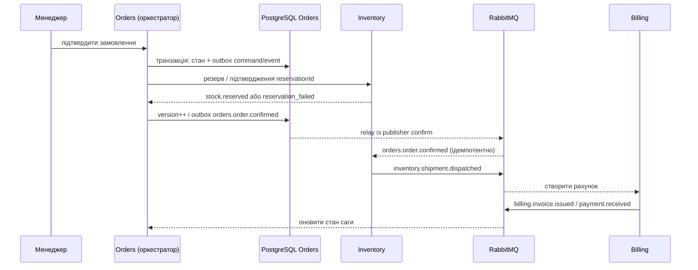

# ЛР 5. Дані КПС: узгодженість, міграція та аналітика — модуль Orders

**Студент:** Василь Гордашевський. **Група:** не вказана. **Дата:** 2026-11-22.  
**Стек:** TypeScript, NestJS, PostgreSQL 17+, Prisma ORM, RabbitMQ.  
**ШІ-асистент:** ChatGPT (GPT-6). **Діалог:** додати посилання або експорт перед поданням.

> Проєктний документ. Сценарії, SQL-ескізи й процедури описують цільову поведінку; код, імпорт і відновлення не запускалися. Файл `price_agreements.xlsx` у робочих матеріалах відсутній, тому числовий профіль джерела не підтверджено.

## 0. Вихідні дані та межі

- Orders володіє замовленнями, контрактними цінами, знижками та процесом погодження. Inventory володіє резервами й відвантаженнями; Billing — рахунками й оплатами.
- Orders публікує `orders.order.confirmed` і `orders.order.cancelled`; споживає події Inventory та Billing, описані в ЛР3. Повідомлення мають стабільний `eventId`, `correlationId` і версію агрегата, де це потрібно.
- Приватні дані й комерційні умови з файлу міграції обробляються в ізольованому контурі. Звіти BI не відкривають персональні дані.
- Наявні цілі аварійного відновлення: RPO ≤ 24 год, загальне RTO ≤ 4 год. Для Orders встановлено внутрішню ціль відновлення до 45 хв.
- Резервування під час очікування погодження знижки триває до 24 год. Відповідь Inventory очікується до 10 хв; після тайм-ауту автоматичного скасування немає, запис ставиться на розбір.

## 1. Узгодженість: transactional outbox і сага

### 1.1. Таблиця outbox та гарантії доставки

Зміна агрегата замовлення та запис події до `orders.outbox_messages` виконуються в одній транзакції PostgreSQL. Так Orders не підтвердить бізнес-зміну без збереженого повідомлення для подальшої публікації. Гарантія доставки — **at-least-once**: дублікати можливі, тому споживачі мають забезпечити один бізнес-ефект через Inbox/ідемпотентність.

| Поле | Призначення |
|---|---|
| `event_id` UUID PK | Незмінний ID події; використовується при кожному повторі |
| `event_type` | Наприклад, `orders.order.confirmed` |
| `aggregate_id` / `order_id` | Ідентифікатор замовлення |
| `aggregate_version` | Версія стану для виявлення застарілих/непослідовних змін |
| `envelope` JSONB | Конверт події, `correlationId`, час, схема і бізнес-дані |
| `created_at` | Час створення події в UTC |
| `published_at` nullable | Час підтвердженої публікації |
| `attempt_count` | Кількість спроб публікації |
| `last_error` nullable | Остання технічна помилка без секретів/ПД |
| `status` | `pending`, `published`, `failed` |
| `locked_until` nullable | Кінець lease для взятого в роботу запису |
| `claim_token` nullable | Токен власника lease; захищає від запису застарілого воркера |

Індекси: частковий індекс для рядків `pending`/`failed` за доступним часом повтору; індекс за `(aggregate_id, aggregate_version)`. Унікальність `event_id` гарантує стабільність ідентифікатора під час повторної публікації.

### 1.2. Алгоритм ретранслятора

NestJS worker прокидається кожні 500 мс, забирає до 50 записів. Коротка транзакція атомарно обирає доступні рядки з `FOR UPDATE SKIP LOCKED`, призначає `claim_token`, `locked_until = now() + 30 seconds` і комітиться. Публікація до RabbitMQ виконується **поза транзакцією**. Воркери не обробляють рядки з активною орендою; прострочений lease може бути перехоплений іншим інстансом.

Після publisher confirm воркер ще раз оновлює запис лише за умовою `claim_token = token`, виставляє `published_at`, `status=published`, очищує lease. Так старий/завислий воркер не перезапише стан після того, як запис уже забрав інший інстанс. Після confirm, але до оновлення БД, можливий повтор з тим самим `event_id`; Inbox-споживачі його дедуплікують.

Публікація вимагає durable exchange/queue, persistent delivery, publisher confirms і перевірки повернених нерозмаршрутизованих повідомлень. Технічні помилки повторюються з паузою 1, 2, 4, 8 і 16 секунд. Після п’яти невдалих спроб запис переходить у `failed`, генерується метрика/alert для Alertmanager, а оператор має процедуру виправлення та ручного повторного запуску. Невдалі записи автоматично не видаляються. Опубліковані записи очищуються після 7 днів за контрольованою щоденною задачею.

Порядок подій одного замовлення зберігається за `aggregate_version`: воркер не має випереджати неопубліковану попередню версію того самого агрегата. Якщо порядок не забезпечений брокером, споживач перевіряє версію й не застосовує застарілі переходи.

### 1.3. Inbox та ідемпотентність споживачів

Кожен споживач записує `event_id` до власної inbox-таблиці та застосовує зміну в одній транзакції; ACK надсилається лише після COMMIT. Унікальний ключ на `event_id` відсікає повтори. Для резервів Inventory також потрібен бізнес-ключ `orderId`/`reservationId`, бо повторна команда з іншим ID події не повинна створити другий резерв.

### 1.4. ADR-05-01 — Оркестрація чи хореографія

**Контекст.** Процес має погодження знижки, часові межі, повторне очікування резерву й компенсації. Orders є власником замовлення та його станів.

| Варіант | Переваги | Недоліки |
|---|---|---|
| Оркестрація Orders (обрано) | Єдине місце стану саги, таймерів і бізнес-рішень; простіше відлагоджувати `on_hold` і повторне підтвердження | Orders знає кроки процесу; треба уникнути перетворення на God-service і не брати на себе власність чужих даних |
| Хореографія подіями | Менше централізованих залежностей; модулі реагують автономно | Складніше бачити повний процес, тайм-аути й компенсувати розгалуження; важче діагностувати цикли подій |

**Рішення.** Оркеструє Orders, зберігаючи стан саги в БД. Він викликає/надсилає команди за контрактами, але не змінює таблиці Inventory чи Billing. Сусідні модулі залишаються власниками резервів, відвантажень, рахунків та оплат.

### 1.5. Стани й послідовність саги

```mermaid
stateDiagram-v2
    [*] --> draft
    draft --> pending_approval: знижка понад 10%, резерв до 24 год
    pending_approval --> pending_reservation: погоджено
    pending_approval --> draft: відмова або 24 год без рішення; зняти резерв
    pending_reservation --> confirmed: Inventory підтвердив reservationId
    pending_reservation --> on_hold: reservation_failed; резерву немає
    pending_reservation --> pending_reservation: 10 хв тайм-аут; прапорець розбору + alert
    on_hold --> pending_reservation: менеджер повторно підтверджує; нова/перевірена наявність
    draft --> cancelled: скасування
    on_hold --> cancelled: скасування
    pending_approval --> cancelled: скасування
    pending_reservation --> cancelled: скасування; очікувати/компенсувати пізній резерв
    confirmed --> shipped: Inventory відвантажив; точка неповернення
    shipped --> invoiced: Billing виставив рахунок
    invoiced --> paid: Billing підтвердив оплату
```

Застосовується єдиний `reservationId` для резерву замовлення. На час очікування погодження резерв обмежений 24 годинами; після погодження підтверджується той самий резерв. Відмова `inventory.stock.reservation_failed` переводить замовлення в `on_hold` без утримання резерву; менеджер отримує повідомлення, доступні повторне підтвердження або скасування. Це уточнення змінює попередній перехід до `draft` із ЛР2 і має бути зафіксоване в журналі рішень та OpenAPI.

Якщо Inventory не відповів за 10 хв, Orders позначає сагу для розбору та сигналізує оператору, але не скасовує автоматично. Під час розбору перевіряється стан конкретного `reservationId` у Inventory.

**Компенсації та точка неповернення.** До відвантаження скасування публікує `orders.order.cancelled`; Inventory знімає активний резерв, Billing анулює чернетку або виконує узгоджений сценарій. Якщо `stock.reserved` приходить після скасування, Orders не переходить у `confirmed`, а надсилає ідемпотентну команду зняти конкретний `reservationId`. Після фізичної передачі товару (`shipped`) процес не «відмотується»: потрібен окремий RMA/процес повернення Inventory, а Billing оформлює кредит-ноту/повернення коштів і синхронізацію з Odoo.

### 1.6. Події та взаємодія модулів

Orders споживає `inventory.stock.reserved`, `inventory.stock.reservation_failed`, `inventory.shipment.dispatched`, `billing.invoice.issued`, `billing.payment.received`, а також події CRM/каталогу з ЛР3. Orders публікує `orders.order.confirmed` і `orders.order.cancelled` через outbox. Контракт `orders.order.confirmed` означає підтверджене замовлення; він не використовується як загальний сигнал для всіх кроків саги.

Для резерву застосовується REST-команда з ЛР3 `POST /reservations` та `Idempotency-Key`; звільнення — `POST /reservations/{id}/release`. Якщо додається окрема подія/команда для ручного розбору тайм-ауту або `on_hold`, її схема та стани узгоджуються в OpenAPI/AsyncAPI з Inventory. `on_hold` додається до API Orders; контракт `orders.order.confirmed` змінюється лише якщо його payload/семантика змінюється.

## 2. Сценарії збоїв і тест-специфікації

Кожен тест перевіряє бізнес-інваріант і дані всіх задіяних модулів, а не лише HTTP 200 чи лог воркера.

| ID | Ін’єкція / передумова | Очікувана поведінка та інваріант | Перевірка |
|---|---|---|---|
| SC-ORD-01 (методичка) | Inventory повертає `reservation_failed` | Orders → `on_hold`, резерв відсутній, менеджер сповіщений; `orders.order.confirmed` не створено | Перевірити стан, reservationId, outbox і сповіщення; повторне підтвердження працює лише після нового успішного резерву |
| SC-ORD-02 (методичка) | Немає відповіді Inventory 10 хв | `pending_reservation` з прапорцем розбору, alert; автоматичного скасування/підтвердження немає | Переконатися, що стан і резерв перевірені за тим самим ID; оператор може звірити статус у Inventory |
| SC-ORD-03 | Зупинити relay під час підтвердження 20 замовлень | Після запуску всі 20 бізнес-подій доступні брокеру; жодної втрати; дублікати допустимі лише з тим самим eventId | Звірити 20 committed outbox подій з брокером і 20 бізнес-ефектів у тестовому споживачі |
| SC-ORD-04 | RabbitMQ підтвердив публікацію, воркер упав до `published_at` | Після завершення lease відбудеться повтор з тим самим eventId; один бізнес-ефект у споживача | Ін’єктувати crash у вікні, перевірити повторне повідомлення та унікальний Inbox |
| SC-ORD-05 | Скасування менеджером одночасно з `stock.reserved` | Оптимістична перевірка `version` дозволяє лише один узгоджений перехід; якщо замовлення скасоване — release reservationId, не `confirmed` | Запустити обидва порядки/конкурентні транзакції; перевірити state, version, outbox, Inventory reservation |
| SC-ORD-06 | Пізня відповідь `stock.reserved` після скасування | Стан лишається `cancelled`; ідемпотентний release конкретного reservationId; дубль `order.cancelled` не створює повторної компенсації | Повторити відповідь і release; перевірити нуль активних резервів і один ефект скасування |
| SC-ORD-07 (власний) | Два relay-інстанси та завершення 30-секундного lease під час повільної публікації | Claim token не дозволяє старому інстансу перезаписати claim нового; дубль не створює подвійного бізнес-ефекту | Відтворити прострочення lease; перевірити `claim_token`, `published_at`, Inbox і кількість ефектів |
| SC-ORD-08 (власний) | Відновити БД на 6 годин назад, коли Inventory/Billing уже просунули замовлення | Outbound relay та consumers призупинені; фактичні стани звірено; втрачені записи реконструйовано до публікації | Звірити перелік orderId/eventId із Inventory/Billing, відновити узгоджений стан і лише тоді запускати relay |

## 3. Аудит

Журнал `orders.audit_log` є append-only для сервісної ролі: їй надаються лише `INSERT` і `SELECT`; `UPDATE`/`DELETE` заборонені. Таблиця належить окремій ролі власника, яка не використовується застосунком. Запис аудиту створюється в тій самій транзакції, що й зміна замовлення; якщо аудит не записався, бізнес-зміна не комітиться.

| Поле | Зміст |
|---|---|
| `audit_id` | UUID/монотонний ключ запису |
| `entity_type`, `entity_id` | Тип сутності й ID замовлення/рядка |
| `action` | create, line_change, discount_approve/reject, confirm, on_hold, cancel, timeout, manual_retry, saga_reconcile |
| `actor_type`, `actor_id` | Користувач або сервіс, що виконав дію |
| `correlation_id`, `event_id` | Наскрізне трасування запиту/події |
| `old_value`, `new_value` JSONB | Дозволені до аудиту поля до/після; зайві ПД/секрети маскуються |
| `created_at` | Час у UTC |

Записи зберігаються 3 роки, після чого переносяться до контрольованого холодного архіву за процедурою з обмеженим доступом; видалення після строку документується. Читання аудиту надається лише уповноваженим ролям. Збої аудиту, доступ до журналу та експорт журналу фіксуються окремо.

## 4. Міграція контрактних цін із `price_agreements.xlsx`

### 4.1. Доступність джерела та профіль

Методичка підтверджує типові дефекти: перекриття періодів, текст «грн», змішані UAH/EUR без позначки. У прикладі є клієнт `38217456` і SKU `COF-ARB-ETH-1KG` з перекриттям 01.01–30.06.2026 та 01.05–31.12.2026. Пізніший договір має пріоритет; за напіввідкритих меж старий запис стає `[2026-01-01, 2026-05-01)`, новий — `[2026-05-01, 2027-01-01)`.

Самого Excel-файлу в наданій робочій теці немає. Тому точна кількість рядків, невідомі ЄДРПОУ/SKU, повтори, нульові/від’ємні ціни, некоректні дати та інші дефекти — **непрофільовані**, а не відсутні. До production-імпорту потрібно отримати контрольовану копію файлу, виконати dry run і додати фактичну статистику до звіту.

### 4.2. Правила очищення та мапінгу

| Поле джерела | Ціль | Правило | Помилкове значення |
|---|---|---|---|
| Клієнт (ЄДРПОУ) | `account_id` | Нормалізувати пробіли/формат, зіставити з CRM account; зберегти leading zeros де застосовно | Невідомий/невалідний код → `UNKNOWN_ACCOUNT` / `INVALID_ACCOUNT` |
| SKU | `sku` | Нормалізувати trim і регістр, зіставити з каталогом Inventory | Не знайдено → `UNKNOWN_SKU` |
| Ціна | `amount` | Зберегти сире значення для звіту; прибрати пробіли й `грн`, строго розібрати десятковий роздільник | Неоднозначний/нерозбірливий, нульовий чи від’ємний тариф → `INVALID_PRICE` / `NON_POSITIVE_PRICE` та ручний розгляд |
| Валюта | `currency` | Явно вказану приймати після валідації; якщо пропущена: `MCH-*`, `GRN-*` → EUR, решта → UAH | Конфлікт правила/значення або невідомий SKU → `CURRENCY_REVIEW` |
| Діє з | `valid_from` | Обов’язкова календарна дата; парсинг за дозволеними форматами, timezone Europe/Kyiv | Порожня/неоднозначна дата → `INVALID_VALID_FROM` |
| Діє до | `valid_to_exclusive` | Порожнє = безстроково (`NULL`); включну дату Excel перетворити на наступну календарну дату, формуючи `[from,to)` | Кінець до/на початку або некоректний формат → `INVALID_PERIOD` |

Часова зона бізнес-правил — `Europe/Kyiv`, як у ЛР2. Інтервали зберігаються напіввідкритими `[valid_from, valid_to_exclusive)`, щоб сусідні періоди не перекривалися. Якщо для одного account/SKU кілька рядків мають однаковий `valid_from`, але різні ціни/валюти, жоден не перезаписується мовчки: рядки йдуть у `MANUAL_CONFLICT_REVIEW`. Для інших перекриттів пріоритет має пізніший `valid_from`; попередній інтервал обрізається до нього. Порожній або від’ємний після обрізання інтервал відхиляється.

Імпортний ключ — `(account_id, sku, valid_from)`, захищений унікальним обмеженням. Якщо в джерелі є різні договори з тим самим ключем, застосовується ручний розбір, а не довільний UPSERT. Звіт містить номер рядка, статус `accepted`/`corrected`/`rejected`/`manual_review`, коди причин, сирі значення та нормалізоване значення. У логах застосунку не зберігаються зайві ПД чи повні комерційні записи.

### 4.3. План прогонів і звірки

1. **Dry run:** ізольовано читаємо файл без запису в БД; визначаємо кількість рядків, типи/порожні значення, дублі за ключем, невідомі account/SKU, формати валют/цін/дат і перекриття. Формуємо звіт із причинами.
2. **Робочий імпорт:** після розбору ручних конфліктів виконуємо UPSERT у транзакційних порціях. Формуємо звіт прийнятих, виправлених, відхилених та відправлених на розбір рядків.
3. **Звірка:** порівнюємо кількість рядків за статусами з кількістю рядків джерела; перевіряємо унікальність ключа, періоди й контрольні суми за валютами та нормалізованими цінами. Перевіряємо вибірку з джерелом і власником даних.
4. **Повторний прогін:** запускаємо той самий файл повторно в контрольованому режимі; кількість записів не зростає, дублів немає, нормалізовані значення і контрольні суми не змінюються.

Власник даних (керівник відділу продажів) у межах проєктного погодження схвалив правило валюти за SKU, безстроковий `NULL`, пріоритет пізнішого договору й ручний розбір однакових дат початку з різними цінами. Остаточне бізнес-погодження має бути зафіксоване у звіті dry run.

**Конфіденційність.** Сирий Excel містить комерційну таємницю та контактні дані. Імпорт виконується в ізольованому контурі з мінімальним доступом, шифруванням диска/передачі та без включення повного вмісту рядків у логи. Після успішної звірки вихідний файл видаляється з робочої директорії адміністратора; контрольовану копію/архів зберігають лише якщо це дозволяє політика компанії. Видалення фіксується.

**Події після імпорту.** Контрактні ціни — власність Orders, і наразі немає споживачів у каталозі подій, тому імпорт не публікує сотні зовнішніх `*.upserted` повідомлень. Це свідоме відхилення від загальної вимоги шаблону ЛР5; його треба погодити з викладачем/командою курсу. Якщо з’явиться споживач, буде додано версійований контракт `orders.contract_price.upserted`, записи підуть через outbox порціями з rate limit, стабільним eventId і ідемпотентністю consumer; для масового імпорту окремо узгоджується подія завершення імпорту.

## 5. Аналітика й звітні представлення

Схема `reporting_orders` є read-only контрактом для Metabase. `bi_reader` має `SELECT` лише на представлення, не на таблиці модуля; персональні дані клієнтів не включаються. Власник Orders версіонує поля й визначення метрик, а зміни сумісності проходять огляд до релізу. Всі календарні доби та зрізи дашборду визначені за `Europe/Kyiv`; біля кожної метрики показані період і час останнього оновлення її джерела.

| Представлення | Гранулярність і поля |
|---|---|
| `reporting_orders.daily_orders` | День, склад, кількість підтверджених/відвантажених замовлень, сума у UAH, валюта та правило курсу, час оновлення |
| `reporting_orders.order_lead_time` | `order_id` (псевдонімізований/технічний), склад, `confirmed_at`, `shipped_at`, lead time, когорти, status bucket, час оновлення; без імен/контактів клієнта |
| `reporting_orders.order_status_snapshot` | Замовлення у `on_hold`, очікуванні резерву чи відвантаження; вік стану, склад, без зайвих ПД |

### 5.1. Метрики Orders (Д2)

1. **Час до відвантаження:** середнє й медіана годин між `confirmed_at` і фактичним `shipped_at` для когорти замовлень, підтверджених понад 24 години тому. Незавершені замовлення цієї когорти показуються окремо й не зникають із контролю затримок. Зрізи: склад Київ/Львів, день/тиждень; оновлення щогодини.
2. **Частка відвантажених у межах 24 годин:** кількість замовлень зрілої когорти (`confirmed_at` старше 24 год), для яких `shipped_at - confirmed_at ≤ 24h`, поділити на всі замовлення цієї зрілої когорти. Невідвантажені після 24 год залишаються у знаменнику як невиконана ціль. Свіжа когорта (<24 год) показується окремо як «ще в роботі».
3. **Середній чек:** сума підтверджених замовлень у UAH (з ПДВ, сума/курс зафіксовані на момент комерційної пропозиції) поділена на кількість у тій самій когорті. Курсове перерахування не використовує поточний курс заднім числом.

### 5.2. Дашборд і «Три цифри дня»

**Макет Orders:** верхній ряд — три KPI за сьогодні: кількість підтверджених замовлень, середній час відвантаження для зрілої когорти, частка відвантажень до 24 год. Посередині — лінійний графік замовлень за днями та складами. Унизу — таблиця `on_hold`, очікування резерву й відвантаження понад 24 години. Біля кожного показника видно часовий період, оновлення та розмір когорти.

| «Цифра дня» | Визначення | Єдине джерело правди |
|---|---|---|
| Прийнято замовлень сьогодні | Кількість і сума подій переходу в `confirmed` за календарну добу Europe/Kyiv; не за поточним статусом | `reporting_orders` |
| Відвантажено сьогодні | Кількість і сума замовлень, фактично переданих перевізнику/транспорту за добу | `reporting_inventory` |
| Дебіторська заборгованість | Загальний непогашений залишок рахунків у гривні на час зрізу | `reporting_billing` |

Дашборд показує окремий timestamp свіжості кожного джерела. Не змішуємо два джерела відвантаження та не рахуємо поточну заборгованість за даними Orders.

## 6. Резервне копіювання й відновлення

### 6.1. План копіювання

| Дані | Частота/механізм | Місце та контроль |
|---|---|---|
| PostgreSQL, усі схеми/бази КПС | Щоденний зашифрований `pg_dump` о 03:00; WAL archiving для PITR | Окреме зовнішнє S3-сховище з обмеженим доступом; контроль завершення, checksum після завантаження та alert при пропуску/пошкодженні |
| Конфігурації відновлення | Версіоновані несекретні конфігурації; секрети — у захищеному менеджері | Перевірити доступність секретів/ключів і процедуру їх отримання; не класти секрети в дамп/репозиторій |
| RabbitMQ | Durable queues та persistent messages; окремо визначити політику бекапу конфігурації/метаданих брокера | Не вважати durable чергу повною заміною копії бізнес-даних; під час відновлення врахувати redelivery і дублі |

RPO ≤24 год підтримують нічні копії й архівування WAL; алерт сигналізує про відсутність валідної копії/відставання WAL. RTO Orders ≤45 хв — ціль для тренувального відновлення окремої схеми; загальне RTO системи ≤4 год включає PostgreSQL, брокер, залежні модулі та перевірки. Щомісяця ІТ-адміністратор відновлює копію у тимчасову БД, перевіряє checksum, цілісність таблиць і контрольні суми та записує фактичний час відновлення. Результат перевірки є доказом досяжності цілей, а не лише наявності файлу копії.

### 6.2. Runbook: відновлення Orders із точки в минулому

**Власник виконання:** ІТ-адміністратор Олег; бізнес-рішення про відновлення — відповідальний керівник. Мета: відновити Orders до узгодженого стану та перевірити інтеграції до поновлення обміну.

1. Оголосити інцидент, зафіксувати час/вплив та обрану цільову точку відновлення.
2. Ізолювати старий Orders instance; зупинити API, вхідних consumer-ів, таймери саги та outbox relay. Перевірити, що інший екземпляр не приймає записів.
3. Зробити дамп пошкодженої БД для розслідування. Не перезаписувати єдину копію доказів.
4. Обрати валідний за checksum дамп і WAL-діапазон; відновити у чисту БД/схему. Перевірити власників, ролі, розширення (зокрема `btree_gist` із ЛР2), обмеження, індекси й міграції Prisma.
5. Звірити останні замовлення, версії, `eventId`, outbox та стани саги за час після backup point із журналами/представленнями Inventory й Billing. Окремо визначити: що відсутнє в Orders, що вже виконано зовнішньо, які outbox-події будуть повторені.
6. Відновити пропущені замовлення/стани лише узгодженим способом із власниками даних. Не запускати масовий replay, доки не перевірені Inbox/ідемпотентність сусідніх модулів. Дублікати подій допустимі, повторні бізнес-ефекти — ні.
7. Перевірити таблиці, рядки, контрольні суми, інваріанти періодів цін, стан саги, outbox (`pending`/`failed`), відсутність активного claim старого інстансу та вибіркову звірку з Inventory/Billing.
8. Підняти Orders без relay, виконати `/health`, `/ready`, читання замовлення, перевірку резерву/стану саги й лічильників outbox. Узгодити з бізнесом прийнятність відновлених записів.
9. Відновити consumer-и й relay контрольовано, спостерігати за повторними повідомленнями/помилками, перевірити що кожен повтор має той самий `eventId` і споживачі не створюють дубль-ефектів.
10. Зафіксувати фактичні RPO/RTO, checksum/точку відновлення, невідновлені записи, погоджені ручні коригування та закрити інцидент після підтвердження бізнесу.

Дублювання `eventId` усуває повторний ефект лише якщо Inbox сусідніх сервісів збережені й достатньо свіжі. Durable queue також може повторно доставити повідомлення. Жоден з цих механізмів не повертає замовлення, відсутні у старішому дампі, тому потрібна звірка та контрольована реконструкція.

## 7. Журнал рішень, припущення та відкриті питання

### Журнал рішень

| ID | Рішення | Причина |
|---|---|---|
| ADR-05-01 | Orders оркеструє сагу | Централізовані тайм-аути та `on_hold`; власність Inventory/Billing лишається в них |
| ADR-05-02 | Outbox at-least-once з lease, confirms, стабільним eventId; Inbox у споживачах | Усунення втрати подій при атомарному локальному записі; безпечна повторна доставка |
| ADR-05-03 | Після `reservation_failed` → `on_hold` без резерву; тайм-аут 10 хв без автоскасування | Менеджер/оператор має керовану дію, а невідомий результат не маскується |
| ADR-05-04 | Імпорт цін ідемпотентний; конфлікт однакового `valid_from` — ручний розбір | Не перезаписувати комерційні умови мовчки |
| ADR-05-05 | У BI лише read-only звітні представлення без ПД | Мінімізація доступу та стабільний контракт звітів |
| ADR-05-06 | Нічний dump + WAL, щомісячне тестове відновлення; цілі Orders 45 хв / система 4 год | Перевірюване відновлення й PITR у межах RPO |

### Припущення й відкриті питання

- Немає реального `price_agreements.xlsx`; фактичний профіль, кількості, невідомі ключі та дефекти треба доповнити після отримання файлу.
- Перехід `pending_approval → draft` після відмови/24 год з ЛР2 зберігається зі зняттям резерву. Зміна `reservation_failed → on_hold` фіксується як уточнення ЛР2 та зміна OpenAPI.
- Необхідно перевірити контракт відповіді Inventory щодо release/reservation status, а також процес ручного replay `failed` outbox запису.
- Методичка просить описати `*.upserted` події після імпорту. Рішення не публікувати події через відсутність зовнішніх споживачів позначене як відхилення, що потребує погодження; якщо курс вимагає подію, додати контрольований контракт/пакетну публікацію.
- Точні retention, незмінність холодного архіву аудиту, S3 retention/Object Lock і час WAL-відставання мають бути погоджені з ІТ-адміністратором.
- Місячний тест restore перевіряє точку й час відновлення; реальне досягнення загального RTO підтвердити повним навчальним відновленням.

## 8. Самоперевірка за критеріями розділу 10

| Критерій | Орієнтовно | Самоперевірка |
|---|---:|---|
| Outbox, relay, сага й ADR | 1,3 / 1,5 | Атомарність, lease, confirms, повтори, Inbox, альтернативи координації та компенсації описані; потрібно узгодити фінальні контракти |
| Сценарії збоїв і тест-специфікації | 0,8 / 1,0 | Вісім сценаріїв мають ін’єкцію й інваріант; формальні кроки запуску тестів можна деталізувати перед реалізацією |
| Аудит | 0,45 / 0,5 | Append-only, correlationId, атомарність, права й строк визначено; архів/видалення потребує операційної процедури |
| Міграція | 1,4 / 2,0 | Є правила, дедуплікація, чотири прогони, звірка й приватність; відсутній файл не дозволяє заявити фактичні дефекти поза відомими |
| Аналітика | 1,4 / 1,5 | Формули, когорти, джерела й макет визначені; SQL/версія представлень — окремий артефакт реалізації |
| Резервування та відновлення | 1,3 / 1,5 | Є dump/WAL, перевірки та сценарій «повернення в минуле»; RTO має бути підтверджено навчальним відновленням |
| **Разом** | **6,65 / 8** | Попередня самооцінка за проєктним документом; не оцінка викладача |

## 9. Відповіді на контрольні питання

1. **Outbox та ідемпотентність.** Outbox атомарно записує зміну замовлення й подію в PostgreSQL, уникаючи подвійного запису між БД та брокером. Publisher confirm не закриває crash-вікно до `published_at`, тому доставка at-least-once; Inbox за стабільним `eventId` забезпечує один бізнес-ефект.
2. **Lease та кілька воркерів.** Коротка транзакція з `FOR UPDATE SKIP LOCKED` призначає унікальні `claim_token` і `locked_until`. Інші інстанси пропускають активний lease; після падіння запис доступний після 30 секунд. Confirm до запису `published_at` призводить до безпечного повтору з тим самим ID; порівняння токена не дає старому воркеру перезаписати новий claim.
3. **Оркестрація саги.** Orders обраний через централізовані переходи, `on_hold` і тайм-аути. За 15 кроків зростають кількість станів і компенсацій, ризик God-service та зв’язність; потрібні чіткі межі модулів і, можливо, декомпозиція процесу.
4. **Точка неповернення.** Після `shipped` товар фізично переданий перевізнику, тому потрібен процес повернення/RMA; рахунок/оплата компенсуються кредит-нотою або поверненням коштів через Billing/Odoo, а не простим відкатом статусу.
5. **Пізні й неупорядковані події.** Перевіряється поточний стан і `aggregate_version`. Для скасованого замовлення запізнілий `stock.reserved` не дає перейти у `confirmed`; Orders ідемпотентно звільняє точний `reservationId`. Подія буферизується лише коли є визначена умова очікування; застаріла версія відкидається/аудитується.
6. **Рецензентські сценарії.** Додано crash-вікно після confirm, гонку cancel проти `stock.reserved`, прострочення lease та відновлення Orders з точки на шість годин раніше. Відповідні зміни: стабільний eventId, version check, компенсація reservationId, звірка з Inventory/Billing до relay.
7. **Дефекти старих даних.** За методичкою підтверджені перекриття, `грн` у ціні, відсутня позначка валюти; власник даних погодив пріоритет пізнішого періоду, EUR для MCH/GRN, UAH для решти, `NULL` для безстроковості. Інші дефекти й кількості не підтверджені, бо самого Excel немає.
8. **Ідемпотентність імпорту.** Унікальний ключ `(account_id, sku, valid_from)` із UPSERT та ручним розбором конфліктів не допускає дублів. Повторний прогін перевіряє незростання кількості рядків та незмінність контрольних сум; звіт містить номер рядка, код причини й сире значення.
9. **BI-представлення.** Metabase читає стабільні read-only представлення, а не таблиці модуля: це ізолює схему, обмежує ПД і дає контрольовану еволюцію контракту. Прямі запити до таблиць можуть зламатися при міграції чи розкрити зайві поля.
10. **RPO/RTO й відновлення з минулого.** RPO ≤24 год забезпечують нічний dump, перевірка та WAL/PITR; RTO системи ≤4 год, Orders має ціль 45 хв, які треба підтвердити навчанням. Відновлення старішої БД може повторити вже опубліковані події й загубити нові замовлення. До запуску relay зупиняються потоки, перевіряються Inbox, а Orders звіряється з Inventory/Billing; потім дані реконструюються і replay виконується контрольовано.

## 10. Робота з ШІ-асистентом

Під час етапу Outbox і саги було уточнено at-least-once семантику, lease, crash-вікно після publisher confirm, ідемпотентність споживачів, конкуренцію скасування з резервом, компенсації Inventory/Billing і зміни контракту `on_hold`. Під час етапу міграції зафіксовано напіввідкриті дати, валютні правила, ручний розбір конфліктів, dry run/імпорт/звірку/replay і правила роботи з комерційно чутливим файлом. Для аналітики погоджено когорти Д2, власників джерел «Трьох цифр дня», часову зону й свіжість даних. Для відновлення додано WAL, ізоляцію relay/consumers, звірку з сусідніми модулями та контрольований replay. Захист за контрольними питаннями пройдено.
